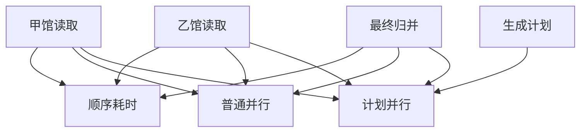

# 两馆比较的三种调度代价

用户明确要求比较两处。
读取相互独立，可以顺序执行、普通并行，或由模型先产计划再并行。
三者必须满足同一完整性义务。
假定执行槽足够且没有共享排队。计划耗时只计入第三种策略。

## 先解决一个具体问题

**为什么普通并行有时比“先计划再并行”更快？**

两者的读取阶段都取较慢分支，后者额外付计划成本。
若计划没有带来新的工作避免或质量收益，这段额外模型往返就直接落在关键路径上。


先从具体的低档设定开始：甲馆读取取 80毫秒、乙馆读取取 150毫秒、生成计划取 50毫秒、最终归并取 35毫秒。
三个结果依次是顺序耗时 265毫秒、普通并行 185毫秒、计划并行 235毫秒。
先手算这个起点，读完后再把另一个输入切到高档，这样能知道数字变化时究竟改变了哪个假设。

## 先写清输入边界和三个观测量

用 a 表示甲馆读取，取 80毫秒 或 260毫秒，这两点是用于隔离因果影响的教学输入。

用 b 表示乙馆读取，取 150毫秒 或 380毫秒，这两点是用于隔离因果影响的教学输入。

用 c 表示生成计划，取 50毫秒 或 320毫秒，这两点是用于隔离因果影响的教学输入。

用 d 表示最终归并，取 35毫秒 或 100毫秒，这两点是用于隔离因果影响的教学输入。

「顺序耗时」的计算式为 `a+b+d`，按业务量展开是 `甲馆读取+乙馆读取+最终归并`，输出单位为毫秒。

「普通并行」的计算式为 `max(a,b)+d`，按业务量展开是 `max(甲馆读取,乙馆读取)+最终归并`，输出单位为毫秒。

「计划并行」的计算式为 `c+max(a,b)+d`，按业务量展开是 `生成计划+max(甲馆读取,乙馆读取)+最终归并`，输出单位为毫秒。

公式中 ceil 与 floor 分别向上、向下取整，% 在表达式中作取余，** 为乘方，三元条件按“条件 ? 成立值 : 其他值”读取。展示数值最多保留三位小数，比较和反推采用未舍入值。



图上的箭头表示该输入出现在计算式中。同一输入通向多个指标时，三个读数可能共同移动。分支、取整或相互抵消又会使某些边在具体样本上没有可见增量。

## 从输入按单位逐步算到可比较的结果

<details>
<summary>展开推演与对应反例</summary>

### 样本 0000：甲馆读取 80、乙馆读取 150

这一组设定为甲馆读取为 80毫秒、乙馆读取为 150毫秒、生成计划为 50毫秒、最终归并为 35毫秒。

代入「顺序耗时」：`80+150+35`，得到 265毫秒。

代入「普通并行」：`max(80,150)+35`，得到 185毫秒。

代入「计划并行」：`50+max(80,150)+35`，得到 235毫秒。

以「计划并行」作主读数时，本组单独切换生成计划的绝对变化最大或并列最大，读数会从 235毫秒 变为 505毫秒。

对角样本 1111 的主读数为 800毫秒。它同时改了四项，差额不能充当任一单个因素的净收益。

### 样本 0001：甲馆读取 80、乙馆读取 150

这一组设定为甲馆读取为 80毫秒、乙馆读取为 150毫秒、生成计划为 50毫秒、最终归并为 100毫秒。

代入「顺序耗时」：`80+150+100`，得到 330毫秒。

代入「普通并行」：`max(80,150)+100`，得到 250毫秒。

代入「计划并行」：`50+max(80,150)+100`，得到 300毫秒。

以「计划并行」作主读数时，本组单独切换生成计划的绝对变化最大或并列最大，读数会从 300毫秒 变为 570毫秒。

对角样本 1110 的主读数为 735毫秒。它同时改了四项，差额不能充当任一单个因素的净收益。

### 样本 0010：甲馆读取 80、乙馆读取 150

这一组设定为甲馆读取为 80毫秒、乙馆读取为 150毫秒、生成计划为 320毫秒、最终归并为 35毫秒。


代入「计划并行」：`320+max(80,150)+35`，得到 505毫秒。

以「计划并行」作主读数时，本组单独切换生成计划的绝对变化最大或并列最大，读数会从 505毫秒 变为 235毫秒。

对角样本 1101 的主读数为 530毫秒。它同时改了四项，差额不能充当任一单个因素的净收益。

### 样本 0011：甲馆读取 80、乙馆读取 150

这一组设定为甲馆读取为 80毫秒、乙馆读取为 150毫秒、生成计划为 320毫秒、最终归并为 100毫秒。


代入「计划并行」：`320+max(80,150)+100`，得到 570毫秒。

以「计划并行」作主读数时，本组单独切换生成计划的绝对变化最大或并列最大，读数会从 570毫秒 变为 300毫秒。

对角样本 1100 的主读数为 465毫秒。它同时改了四项，差额不能充当任一单个因素的净收益。

### 样本 0100：甲馆读取 80、乙馆读取 380

这一组设定为甲馆读取为 80毫秒、乙馆读取为 380毫秒、生成计划为 50毫秒、最终归并为 35毫秒。

代入「顺序耗时」：`80+380+35`，得到 495毫秒。

代入「普通并行」：`max(80,380)+35`，得到 415毫秒。

代入「计划并行」：`50+max(80,380)+35`，得到 465毫秒。

以「计划并行」作主读数时，本组单独切换生成计划的绝对变化最大或并列最大，读数会从 465毫秒 变为 735毫秒。

本组固定其余输入时，分别改变「甲馆读取」均不会改变 465毫秒 这个主读数，是否影响另一指标仍需另算。

对角样本 1011 的主读数为 680毫秒。它同时改了四项，差额不能充当任一单个因素的净收益。

### 样本 0101：甲馆读取 80、乙馆读取 380

这一组设定为甲馆读取为 80毫秒、乙馆读取为 380毫秒、生成计划为 50毫秒、最终归并为 100毫秒。

代入「顺序耗时」：`80+380+100`，得到 560毫秒。

代入「普通并行」：`max(80,380)+100`，得到 480毫秒。

代入「计划并行」：`50+max(80,380)+100`，得到 530毫秒。

以「计划并行」作主读数时，本组单独切换生成计划的绝对变化最大或并列最大，读数会从 530毫秒 变为 800毫秒。

本组固定其余输入时，分别改变「甲馆读取」均不会改变 530毫秒 这个主读数，是否影响另一指标仍需另算。

对角样本 1010 的主读数为 615毫秒。它同时改了四项，差额不能充当任一单个因素的净收益。

### 样本 0110：甲馆读取 80、乙馆读取 380

这一组设定为甲馆读取为 80毫秒、乙馆读取为 380毫秒、生成计划为 320毫秒、最终归并为 35毫秒。


代入「计划并行」：`320+max(80,380)+35`，得到 735毫秒。

以「计划并行」作主读数时，本组单独切换生成计划的绝对变化最大或并列最大，读数会从 735毫秒 变为 465毫秒。

本组固定其余输入时，分别改变「甲馆读取」均不会改变 735毫秒 这个主读数，是否影响另一指标仍需另算。

对角样本 1001 的主读数为 410毫秒。它同时改了四项，差额不能充当任一单个因素的净收益。

### 样本 0111：甲馆读取 80、乙馆读取 380

这一组设定为甲馆读取为 80毫秒、乙馆读取为 380毫秒、生成计划为 320毫秒、最终归并为 100毫秒。


代入「计划并行」：`320+max(80,380)+100`，得到 800毫秒。

以「计划并行」作主读数时，本组单独切换生成计划的绝对变化最大或并列最大，读数会从 800毫秒 变为 530毫秒。

本组固定其余输入时，分别改变「甲馆读取」均不会改变 800毫秒 这个主读数，是否影响另一指标仍需另算。

对角样本 1000 的主读数为 345毫秒。它同时改了四项，差额不能充当任一单个因素的净收益。

### 样本 1000：甲馆读取 260、乙馆读取 150

这一组设定为甲馆读取为 260毫秒、乙馆读取为 150毫秒、生成计划为 50毫秒、最终归并为 35毫秒。

代入「顺序耗时」：`260+150+35`，得到 445毫秒。

代入「普通并行」：`max(260,150)+35`，得到 295毫秒。

代入「计划并行」：`50+max(260,150)+35`，得到 345毫秒。

以「计划并行」作主读数时，本组单独切换生成计划的绝对变化最大或并列最大，读数会从 345毫秒 变为 615毫秒。

对角样本 0111 的主读数为 800毫秒。它同时改了四项，差额不能充当任一单个因素的净收益。

### 样本 1001：甲馆读取 260、乙馆读取 150

这一组设定为甲馆读取为 260毫秒、乙馆读取为 150毫秒、生成计划为 50毫秒、最终归并为 100毫秒。

代入「顺序耗时」：`260+150+100`，得到 510毫秒。

代入「普通并行」：`max(260,150)+100`，得到 360毫秒。

代入「计划并行」：`50+max(260,150)+100`，得到 410毫秒。

以「计划并行」作主读数时，本组单独切换生成计划的绝对变化最大或并列最大，读数会从 410毫秒 变为 680毫秒。

对角样本 0110 的主读数为 735毫秒。它同时改了四项，差额不能充当任一单个因素的净收益。

### 样本 1010：甲馆读取 260、乙馆读取 150

这一组设定为甲馆读取为 260毫秒、乙馆读取为 150毫秒、生成计划为 320毫秒、最终归并为 35毫秒。


代入「计划并行」：`320+max(260,150)+35`，得到 615毫秒。

以「计划并行」作主读数时，本组单独切换生成计划的绝对变化最大或并列最大，读数会从 615毫秒 变为 345毫秒。

对角样本 0101 的主读数为 530毫秒。它同时改了四项，差额不能充当任一单个因素的净收益。

### 样本 1011：甲馆读取 260、乙馆读取 150

这一组设定为甲馆读取为 260毫秒、乙馆读取为 150毫秒、生成计划为 320毫秒、最终归并为 100毫秒。


代入「计划并行」：`320+max(260,150)+100`，得到 680毫秒。

以「计划并行」作主读数时，本组单独切换生成计划的绝对变化最大或并列最大，读数会从 680毫秒 变为 410毫秒。

对角样本 0100 的主读数为 465毫秒。它同时改了四项，差额不能充当任一单个因素的净收益。

### 样本 1100：甲馆读取 260、乙馆读取 380

这一组设定为甲馆读取为 260毫秒、乙馆读取为 380毫秒、生成计划为 50毫秒、最终归并为 35毫秒。

代入「顺序耗时」：`260+380+35`，得到 675毫秒。

代入「普通并行」：`max(260,380)+35`，得到 415毫秒。

代入「计划并行」：`50+max(260,380)+35`，得到 465毫秒。


对角样本 0011 的主读数为 570毫秒。它同时改了四项，差额不能充当任一单个因素的净收益。

### 样本 1101：甲馆读取 260、乙馆读取 380

这一组设定为甲馆读取为 260毫秒、乙馆读取为 380毫秒、生成计划为 50毫秒、最终归并为 100毫秒。

代入「顺序耗时」：`260+380+100`，得到 740毫秒。

代入「普通并行」：`max(260,380)+100`，得到 480毫秒。

代入「计划并行」：`50+max(260,380)+100`，得到 530毫秒。


对角样本 0010 的主读数为 505毫秒。它同时改了四项，差额不能充当任一单个因素的净收益。

### 样本 1110：甲馆读取 260、乙馆读取 380

这一组设定为甲馆读取为 260毫秒、乙馆读取为 380毫秒、生成计划为 320毫秒、最终归并为 35毫秒。


代入「计划并行」：`320+max(260,380)+35`，得到 735毫秒。


对角样本 0001 的主读数为 300毫秒。它同时改了四项，差额不能充当任一单个因素的净收益。

### 样本 1111：甲馆读取 260、乙馆读取 380

这一组设定为甲馆读取为 260毫秒、乙馆读取为 380毫秒、生成计划为 320毫秒、最终归并为 100毫秒。


代入「计划并行」：`320+max(260,380)+100`，得到 800毫秒。


对角样本 0000 的主读数为 235毫秒。它同时改了四项，差额不能充当任一单个因素的净收益。

</details>

## 逐个干预：其余条件固定时，变化真的发生在哪里

<details>
<summary>展开推演与对应反例</summary>

### 只改变甲馆读取

固定乙馆读取为 150毫秒、生成计划为 50毫秒、最终归并为 35毫秒，只把甲馆读取从 80毫秒改到 260毫秒。
这一对的顺序耗时从 265毫秒 变为 445毫秒，普通并行的差为 110毫秒，计划并行的差为 110毫秒。

固定乙馆读取为 150毫秒、生成计划为 50毫秒、最终归并为 100毫秒，只把甲馆读取从 80毫秒改到 260毫秒。
这一对的顺序耗时从 330毫秒 变为 510毫秒，普通并行的差为 110毫秒，计划并行的差为 110毫秒。

固定乙馆读取为 150毫秒、生成计划为 320毫秒、最终归并为 35毫秒，只把甲馆读取从 80毫秒改到 260毫秒。

固定乙馆读取为 150毫秒、生成计划为 320毫秒、最终归并为 100毫秒，只把甲馆读取从 80毫秒改到 260毫秒。

固定乙馆读取为 380毫秒、生成计划为 50毫秒、最终归并为 35毫秒，只把甲馆读取从 80毫秒改到 260毫秒。
这一对的顺序耗时从 495毫秒 变为 675毫秒，普通并行的差为 0毫秒，计划并行的差为 0毫秒。

固定乙馆读取为 380毫秒、生成计划为 50毫秒、最终归并为 100毫秒，只把甲馆读取从 80毫秒改到 260毫秒。
这一对的顺序耗时从 560毫秒 变为 740毫秒，普通并行的差为 0毫秒，计划并行的差为 0毫秒。

固定乙馆读取为 380毫秒、生成计划为 320毫秒、最终归并为 35毫秒，只把甲馆读取从 80毫秒改到 260毫秒。

固定乙馆读取为 380毫秒、生成计划为 320毫秒、最终归并为 100毫秒，只把甲馆读取从 80毫秒改到 260毫秒。

综合八组受控背景，甲馆读取升到较高设定时「顺序耗时」的差值区间是 180毫秒，共有 8 对出现可观察变化。

综合八组受控背景，甲馆读取升到较高设定时「普通并行」的差值区间是 0毫秒 至 110毫秒，共有 4 对出现可观察变化。

综合八组受控背景，甲馆读取升到较高设定时「计划并行」的差值区间是 0毫秒 至 110毫秒，共有 4 对出现可观察变化。

### 只改变乙馆读取

固定甲馆读取为 80毫秒、生成计划为 50毫秒、最终归并为 35毫秒，只把乙馆读取从 150毫秒改到 380毫秒。
这一对的顺序耗时从 265毫秒 变为 495毫秒，普通并行的差为 230毫秒，计划并行的差为 230毫秒。

固定甲馆读取为 80毫秒、生成计划为 50毫秒、最终归并为 100毫秒，只把乙馆读取从 150毫秒改到 380毫秒。
这一对的顺序耗时从 330毫秒 变为 560毫秒，普通并行的差为 230毫秒，计划并行的差为 230毫秒。

固定甲馆读取为 80毫秒、生成计划为 320毫秒、最终归并为 35毫秒，只把乙馆读取从 150毫秒改到 380毫秒。

固定甲馆读取为 80毫秒、生成计划为 320毫秒、最终归并为 100毫秒，只把乙馆读取从 150毫秒改到 380毫秒。

固定甲馆读取为 260毫秒、生成计划为 50毫秒、最终归并为 35毫秒，只把乙馆读取从 150毫秒改到 380毫秒。
这一对的顺序耗时从 445毫秒 变为 675毫秒，普通并行的差为 120毫秒，计划并行的差为 120毫秒。

固定甲馆读取为 260毫秒、生成计划为 50毫秒、最终归并为 100毫秒，只把乙馆读取从 150毫秒改到 380毫秒。
这一对的顺序耗时从 510毫秒 变为 740毫秒，普通并行的差为 120毫秒，计划并行的差为 120毫秒。

固定甲馆读取为 260毫秒、生成计划为 320毫秒、最终归并为 35毫秒，只把乙馆读取从 150毫秒改到 380毫秒。

固定甲馆读取为 260毫秒、生成计划为 320毫秒、最终归并为 100毫秒，只把乙馆读取从 150毫秒改到 380毫秒。

综合八组受控背景，乙馆读取升到较高设定时「顺序耗时」的差值区间是 230毫秒，共有 8 对出现可观察变化。

综合八组受控背景，乙馆读取升到较高设定时「普通并行」的差值区间是 120毫秒 至 230毫秒，共有 8 对出现可观察变化。

综合八组受控背景，乙馆读取升到较高设定时「计划并行」的差值区间是 120毫秒 至 230毫秒，共有 8 对出现可观察变化。

### 只改变生成计划

固定甲馆读取为 80毫秒、乙馆读取为 150毫秒、最终归并为 35毫秒，只把生成计划从 50毫秒改到 320毫秒。
这一对的顺序耗时从 265毫秒 变为 265毫秒，普通并行的差为 0毫秒，计划并行的差为 270毫秒。

固定甲馆读取为 80毫秒、乙馆读取为 150毫秒、最终归并为 100毫秒，只把生成计划从 50毫秒改到 320毫秒。
这一对的顺序耗时从 330毫秒 变为 330毫秒，普通并行的差为 0毫秒，计划并行的差为 270毫秒。

固定甲馆读取为 80毫秒、乙馆读取为 380毫秒、最终归并为 35毫秒，只把生成计划从 50毫秒改到 320毫秒。
这一对的顺序耗时从 495毫秒 变为 495毫秒，普通并行的差为 0毫秒，计划并行的差为 270毫秒。

固定甲馆读取为 80毫秒、乙馆读取为 380毫秒、最终归并为 100毫秒，只把生成计划从 50毫秒改到 320毫秒。
这一对的顺序耗时从 560毫秒 变为 560毫秒，普通并行的差为 0毫秒，计划并行的差为 270毫秒。

固定甲馆读取为 260毫秒、乙馆读取为 150毫秒、最终归并为 35毫秒，只把生成计划从 50毫秒改到 320毫秒。
这一对的顺序耗时从 445毫秒 变为 445毫秒，普通并行的差为 0毫秒，计划并行的差为 270毫秒。

固定甲馆读取为 260毫秒、乙馆读取为 150毫秒、最终归并为 100毫秒，只把生成计划从 50毫秒改到 320毫秒。
这一对的顺序耗时从 510毫秒 变为 510毫秒，普通并行的差为 0毫秒，计划并行的差为 270毫秒。

固定甲馆读取为 260毫秒、乙馆读取为 380毫秒、最终归并为 35毫秒，只把生成计划从 50毫秒改到 320毫秒。
这一对的顺序耗时从 675毫秒 变为 675毫秒，普通并行的差为 0毫秒，计划并行的差为 270毫秒。

固定甲馆读取为 260毫秒、乙馆读取为 380毫秒、最终归并为 100毫秒，只把生成计划从 50毫秒改到 320毫秒。
这一对的顺序耗时从 740毫秒 变为 740毫秒，普通并行的差为 0毫秒，计划并行的差为 270毫秒。

综合八组受控背景，生成计划升到较高设定时「顺序耗时」的差值区间是 0毫秒，共有 0 对出现可观察变化。

综合八组受控背景，生成计划升到较高设定时「普通并行」的差值区间是 0毫秒，共有 0 对出现可观察变化。

综合八组受控背景，生成计划升到较高设定时「计划并行」的差值区间是 270毫秒，共有 8 对出现可观察变化。

### 只改变最终归并

固定甲馆读取为 80毫秒、乙馆读取为 150毫秒、生成计划为 50毫秒，只把最终归并从 35毫秒改到 100毫秒。
这一对的顺序耗时从 265毫秒 变为 330毫秒，普通并行的差为 65毫秒，计划并行的差为 65毫秒。

固定甲馆读取为 80毫秒、乙馆读取为 150毫秒、生成计划为 320毫秒，只把最终归并从 35毫秒改到 100毫秒。

固定甲馆读取为 80毫秒、乙馆读取为 380毫秒、生成计划为 50毫秒，只把最终归并从 35毫秒改到 100毫秒。
这一对的顺序耗时从 495毫秒 变为 560毫秒，普通并行的差为 65毫秒，计划并行的差为 65毫秒。

固定甲馆读取为 80毫秒、乙馆读取为 380毫秒、生成计划为 320毫秒，只把最终归并从 35毫秒改到 100毫秒。

固定甲馆读取为 260毫秒、乙馆读取为 150毫秒、生成计划为 50毫秒，只把最终归并从 35毫秒改到 100毫秒。
这一对的顺序耗时从 445毫秒 变为 510毫秒，普通并行的差为 65毫秒，计划并行的差为 65毫秒。

固定甲馆读取为 260毫秒、乙馆读取为 150毫秒、生成计划为 320毫秒，只把最终归并从 35毫秒改到 100毫秒。

固定甲馆读取为 260毫秒、乙馆读取为 380毫秒、生成计划为 50毫秒，只把最终归并从 35毫秒改到 100毫秒。
这一对的顺序耗时从 675毫秒 变为 740毫秒，普通并行的差为 65毫秒，计划并行的差为 65毫秒。

固定甲馆读取为 260毫秒、乙馆读取为 380毫秒、生成计划为 320毫秒，只把最终归并从 35毫秒改到 100毫秒。

综合八组受控背景，最终归并升到较高设定时「顺序耗时」的差值区间是 65毫秒，共有 8 对出现可观察变化。

综合八组受控背景，最终归并升到较高设定时「普通并行」的差值区间是 65毫秒，共有 8 对出现可观察变化。

综合八组受控背景，最终归并升到较高设定时「计划并行」的差值区间是 65毫秒，共有 8 对出现可观察变化。

</details>

## 只拿到部分输入，结论还能缩小到多大范围

<details>
<summary>展开推演与对应反例</summary>

### 已知甲馆读取和乙馆读取

当甲馆读取为 80毫秒、乙馆读取为 150毫秒时，另两项有四种补全，主读数「计划并行」只能限定为 235毫秒 至 570毫秒。
这个条件下，取生成计划为 50毫秒、最终归并为 35毫秒可得到下界 235毫秒，取生成计划为 320毫秒、最终归并为 100毫秒可达到上界 570毫秒。

用同样可见的甲馆读取为 80毫秒、乙馆读取为 150毫秒去推「顺序耗时」，能得到的范围为 265毫秒 至 330毫秒，不能把另一个指标的单位代入。

用同样可见的甲馆读取为 80毫秒、乙馆读取为 150毫秒去推「普通并行」，能得到的范围为 185毫秒 至 250毫秒，不能把另一个指标的单位代入。

若只许再问一项，按最坏区间宽度优先核对生成计划，补得低档时为 235毫秒 至 300毫秒，高档时为 505毫秒 至 570毫秒。

当甲馆读取为 80毫秒、乙馆读取为 380毫秒时，另两项有四种补全，主读数「计划并行」只能限定为 465毫秒 至 800毫秒。
这个条件下，取生成计划为 50毫秒、最终归并为 35毫秒可得到下界 465毫秒，取生成计划为 320毫秒、最终归并为 100毫秒可达到上界 800毫秒。

用同样可见的甲馆读取为 80毫秒、乙馆读取为 380毫秒去推「顺序耗时」，能得到的范围为 495毫秒 至 560毫秒，不能把另一个指标的单位代入。

用同样可见的甲馆读取为 80毫秒、乙馆读取为 380毫秒去推「普通并行」，能得到的范围为 415毫秒 至 480毫秒，不能把另一个指标的单位代入。

若只许再问一项，按最坏区间宽度优先核对生成计划，补得低档时为 465毫秒 至 530毫秒，高档时为 735毫秒 至 800毫秒。

当甲馆读取为 260毫秒、乙馆读取为 150毫秒时，另两项有四种补全，主读数「计划并行」只能限定为 345毫秒 至 680毫秒。
这个条件下，取生成计划为 50毫秒、最终归并为 35毫秒可得到下界 345毫秒，取生成计划为 320毫秒、最终归并为 100毫秒可达到上界 680毫秒。

用同样可见的甲馆读取为 260毫秒、乙馆读取为 150毫秒去推「顺序耗时」，能得到的范围为 445毫秒 至 510毫秒，不能把另一个指标的单位代入。

用同样可见的甲馆读取为 260毫秒、乙馆读取为 150毫秒去推「普通并行」，能得到的范围为 295毫秒 至 360毫秒，不能把另一个指标的单位代入。

若只许再问一项，按最坏区间宽度优先核对生成计划，补得低档时为 345毫秒 至 410毫秒，高档时为 615毫秒 至 680毫秒。

当甲馆读取为 260毫秒、乙馆读取为 380毫秒时，另两项有四种补全，主读数「计划并行」只能限定为 465毫秒 至 800毫秒。

用同样可见的甲馆读取为 260毫秒、乙馆读取为 380毫秒去推「顺序耗时」，能得到的范围为 675毫秒 至 740毫秒，不能把另一个指标的单位代入。

用同样可见的甲馆读取为 260毫秒、乙馆读取为 380毫秒去推「普通并行」，能得到的范围为 415毫秒 至 480毫秒，不能把另一个指标的单位代入。


### 已知甲馆读取和生成计划

当甲馆读取为 80毫秒、生成计划为 50毫秒时，另两项有四种补全，主读数「计划并行」只能限定为 235毫秒 至 530毫秒。
这个条件下，取乙馆读取为 150毫秒、最终归并为 35毫秒可得到下界 235毫秒，取乙馆读取为 380毫秒、最终归并为 100毫秒可达到上界 530毫秒。

用同样可见的甲馆读取为 80毫秒、生成计划为 50毫秒去推「顺序耗时」，能得到的范围为 265毫秒 至 560毫秒，不能把另一个指标的单位代入。

用同样可见的甲馆读取为 80毫秒、生成计划为 50毫秒去推「普通并行」，能得到的范围为 185毫秒 至 480毫秒，不能把另一个指标的单位代入。

若只许再问一项，按最坏区间宽度优先核对乙馆读取，补得低档时为 235毫秒 至 300毫秒，高档时为 465毫秒 至 530毫秒。

当甲馆读取为 80毫秒、生成计划为 320毫秒时，另两项有四种补全，主读数「计划并行」只能限定为 505毫秒 至 800毫秒。
这个条件下，取乙馆读取为 150毫秒、最终归并为 35毫秒可得到下界 505毫秒，取乙馆读取为 380毫秒、最终归并为 100毫秒可达到上界 800毫秒。

用同样可见的甲馆读取为 80毫秒、生成计划为 320毫秒去推「顺序耗时」，能得到的范围为 265毫秒 至 560毫秒，不能把另一个指标的单位代入。

用同样可见的甲馆读取为 80毫秒、生成计划为 320毫秒去推「普通并行」，能得到的范围为 185毫秒 至 480毫秒，不能把另一个指标的单位代入。

若只许再问一项，按最坏区间宽度优先核对乙馆读取，补得低档时为 505毫秒 至 570毫秒，高档时为 735毫秒 至 800毫秒。

当甲馆读取为 260毫秒、生成计划为 50毫秒时，另两项有四种补全，主读数「计划并行」只能限定为 345毫秒 至 530毫秒。
这个条件下，取乙馆读取为 150毫秒、最终归并为 35毫秒可得到下界 345毫秒，取乙馆读取为 380毫秒、最终归并为 100毫秒可达到上界 530毫秒。

用同样可见的甲馆读取为 260毫秒、生成计划为 50毫秒去推「顺序耗时」，能得到的范围为 445毫秒 至 740毫秒，不能把另一个指标的单位代入。

用同样可见的甲馆读取为 260毫秒、生成计划为 50毫秒去推「普通并行」，能得到的范围为 295毫秒 至 480毫秒，不能把另一个指标的单位代入。

若只许再问一项，按最坏区间宽度优先核对乙馆读取，补得低档时为 345毫秒 至 410毫秒，高档时为 465毫秒 至 530毫秒。

当甲馆读取为 260毫秒、生成计划为 320毫秒时，另两项有四种补全，主读数「计划并行」只能限定为 615毫秒 至 800毫秒。
这个条件下，取乙馆读取为 150毫秒、最终归并为 35毫秒可得到下界 615毫秒，取乙馆读取为 380毫秒、最终归并为 100毫秒可达到上界 800毫秒。

用同样可见的甲馆读取为 260毫秒、生成计划为 320毫秒去推「顺序耗时」，能得到的范围为 445毫秒 至 740毫秒，不能把另一个指标的单位代入。

用同样可见的甲馆读取为 260毫秒、生成计划为 320毫秒去推「普通并行」，能得到的范围为 295毫秒 至 480毫秒，不能把另一个指标的单位代入。

若只许再问一项，按最坏区间宽度优先核对乙馆读取，补得低档时为 615毫秒 至 680毫秒，高档时为 735毫秒 至 800毫秒。

### 已知乙馆读取和生成计划

当乙馆读取为 150毫秒、生成计划为 50毫秒时，另两项有四种补全，主读数「计划并行」只能限定为 235毫秒 至 410毫秒。
这个条件下，取甲馆读取为 80毫秒、最终归并为 35毫秒可得到下界 235毫秒，取甲馆读取为 260毫秒、最终归并为 100毫秒可达到上界 410毫秒。

用同样可见的乙馆读取为 150毫秒、生成计划为 50毫秒去推「顺序耗时」，能得到的范围为 265毫秒 至 510毫秒，不能把另一个指标的单位代入。

用同样可见的乙馆读取为 150毫秒、生成计划为 50毫秒去推「普通并行」，能得到的范围为 185毫秒 至 360毫秒，不能把另一个指标的单位代入。

若只许再问一项，按最坏区间宽度优先核对甲馆读取，补得低档时为 235毫秒 至 300毫秒，高档时为 345毫秒 至 410毫秒。

当乙馆读取为 150毫秒、生成计划为 320毫秒时，另两项有四种补全，主读数「计划并行」只能限定为 505毫秒 至 680毫秒。
这个条件下，取甲馆读取为 80毫秒、最终归并为 35毫秒可得到下界 505毫秒，取甲馆读取为 260毫秒、最终归并为 100毫秒可达到上界 680毫秒。

用同样可见的乙馆读取为 150毫秒、生成计划为 320毫秒去推「顺序耗时」，能得到的范围为 265毫秒 至 510毫秒，不能把另一个指标的单位代入。

用同样可见的乙馆读取为 150毫秒、生成计划为 320毫秒去推「普通并行」，能得到的范围为 185毫秒 至 360毫秒，不能把另一个指标的单位代入。

若只许再问一项，按最坏区间宽度优先核对甲馆读取，补得低档时为 505毫秒 至 570毫秒，高档时为 615毫秒 至 680毫秒。

当乙馆读取为 380毫秒、生成计划为 50毫秒时，另两项有四种补全，主读数「计划并行」只能限定为 465毫秒 至 530毫秒。
这个条件下，取甲馆读取为 80毫秒、最终归并为 35毫秒可得到下界 465毫秒，取甲馆读取为 80毫秒、最终归并为 100毫秒可达到上界 530毫秒。

用同样可见的乙馆读取为 380毫秒、生成计划为 50毫秒去推「顺序耗时」，能得到的范围为 495毫秒 至 740毫秒，不能把另一个指标的单位代入。

用同样可见的乙馆读取为 380毫秒、生成计划为 50毫秒去推「普通并行」，能得到的范围为 415毫秒 至 480毫秒，不能把另一个指标的单位代入。

若只许再问一项，按最坏区间宽度优先核对最终归并，补得低档时为 465毫秒，高档时为 530毫秒。

当乙馆读取为 380毫秒、生成计划为 320毫秒时，另两项有四种补全，主读数「计划并行」只能限定为 735毫秒 至 800毫秒。
这个条件下，取甲馆读取为 80毫秒、最终归并为 35毫秒可得到下界 735毫秒，取甲馆读取为 80毫秒、最终归并为 100毫秒可达到上界 800毫秒。

用同样可见的乙馆读取为 380毫秒、生成计划为 320毫秒去推「顺序耗时」，能得到的范围为 495毫秒 至 740毫秒，不能把另一个指标的单位代入。

用同样可见的乙馆读取为 380毫秒、生成计划为 320毫秒去推「普通并行」，能得到的范围为 415毫秒 至 480毫秒，不能把另一个指标的单位代入。

若只许再问一项，按最坏区间宽度优先核对最终归并，补得低档时为 735毫秒，高档时为 800毫秒。

### 已知甲馆读取和最终归并

当甲馆读取为 80毫秒、最终归并为 35毫秒时，另两项有四种补全，主读数「计划并行」只能限定为 235毫秒 至 735毫秒。
这个条件下，取乙馆读取为 150毫秒、生成计划为 50毫秒可得到下界 235毫秒，取乙馆读取为 380毫秒、生成计划为 320毫秒可达到上界 735毫秒。

用同样可见的甲馆读取为 80毫秒、最终归并为 35毫秒去推「顺序耗时」，能得到的范围为 265毫秒 至 495毫秒，不能把另一个指标的单位代入。

用同样可见的甲馆读取为 80毫秒、最终归并为 35毫秒去推「普通并行」，能得到的范围为 185毫秒 至 415毫秒，不能把另一个指标的单位代入。

若只许再问一项，按最坏区间宽度优先核对生成计划，补得低档时为 235毫秒 至 465毫秒，高档时为 505毫秒 至 735毫秒。

当甲馆读取为 80毫秒、最终归并为 100毫秒时，另两项有四种补全，主读数「计划并行」只能限定为 300毫秒 至 800毫秒。
这个条件下，取乙馆读取为 150毫秒、生成计划为 50毫秒可得到下界 300毫秒，取乙馆读取为 380毫秒、生成计划为 320毫秒可达到上界 800毫秒。

用同样可见的甲馆读取为 80毫秒、最终归并为 100毫秒去推「顺序耗时」，能得到的范围为 330毫秒 至 560毫秒，不能把另一个指标的单位代入。

用同样可见的甲馆读取为 80毫秒、最终归并为 100毫秒去推「普通并行」，能得到的范围为 250毫秒 至 480毫秒，不能把另一个指标的单位代入。

若只许再问一项，按最坏区间宽度优先核对生成计划，补得低档时为 300毫秒 至 530毫秒，高档时为 570毫秒 至 800毫秒。

当甲馆读取为 260毫秒、最终归并为 35毫秒时，另两项有四种补全，主读数「计划并行」只能限定为 345毫秒 至 735毫秒。
这个条件下，取乙馆读取为 150毫秒、生成计划为 50毫秒可得到下界 345毫秒，取乙馆读取为 380毫秒、生成计划为 320毫秒可达到上界 735毫秒。

用同样可见的甲馆读取为 260毫秒、最终归并为 35毫秒去推「顺序耗时」，能得到的范围为 445毫秒 至 675毫秒，不能把另一个指标的单位代入。

用同样可见的甲馆读取为 260毫秒、最终归并为 35毫秒去推「普通并行」，能得到的范围为 295毫秒 至 415毫秒，不能把另一个指标的单位代入。

若只许再问一项，按最坏区间宽度优先核对生成计划，补得低档时为 345毫秒 至 465毫秒，高档时为 615毫秒 至 735毫秒。

当甲馆读取为 260毫秒、最终归并为 100毫秒时，另两项有四种补全，主读数「计划并行」只能限定为 410毫秒 至 800毫秒。
这个条件下，取乙馆读取为 150毫秒、生成计划为 50毫秒可得到下界 410毫秒，取乙馆读取为 380毫秒、生成计划为 320毫秒可达到上界 800毫秒。

用同样可见的甲馆读取为 260毫秒、最终归并为 100毫秒去推「顺序耗时」，能得到的范围为 510毫秒 至 740毫秒，不能把另一个指标的单位代入。

用同样可见的甲馆读取为 260毫秒、最终归并为 100毫秒去推「普通并行」，能得到的范围为 360毫秒 至 480毫秒，不能把另一个指标的单位代入。

若只许再问一项，按最坏区间宽度优先核对生成计划，补得低档时为 410毫秒 至 530毫秒，高档时为 680毫秒 至 800毫秒。

### 已知乙馆读取和最终归并

当乙馆读取为 150毫秒、最终归并为 35毫秒时，另两项有四种补全，主读数「计划并行」只能限定为 235毫秒 至 615毫秒。
这个条件下，取甲馆读取为 80毫秒、生成计划为 50毫秒可得到下界 235毫秒，取甲馆读取为 260毫秒、生成计划为 320毫秒可达到上界 615毫秒。

用同样可见的乙馆读取为 150毫秒、最终归并为 35毫秒去推「顺序耗时」，能得到的范围为 265毫秒 至 445毫秒，不能把另一个指标的单位代入。

用同样可见的乙馆读取为 150毫秒、最终归并为 35毫秒去推「普通并行」，能得到的范围为 185毫秒 至 295毫秒，不能把另一个指标的单位代入。

若只许再问一项，按最坏区间宽度优先核对生成计划，补得低档时为 235毫秒 至 345毫秒，高档时为 505毫秒 至 615毫秒。

当乙馆读取为 150毫秒、最终归并为 100毫秒时，另两项有四种补全，主读数「计划并行」只能限定为 300毫秒 至 680毫秒。
这个条件下，取甲馆读取为 80毫秒、生成计划为 50毫秒可得到下界 300毫秒，取甲馆读取为 260毫秒、生成计划为 320毫秒可达到上界 680毫秒。

用同样可见的乙馆读取为 150毫秒、最终归并为 100毫秒去推「顺序耗时」，能得到的范围为 330毫秒 至 510毫秒，不能把另一个指标的单位代入。

用同样可见的乙馆读取为 150毫秒、最终归并为 100毫秒去推「普通并行」，能得到的范围为 250毫秒 至 360毫秒，不能把另一个指标的单位代入。

若只许再问一项，按最坏区间宽度优先核对生成计划，补得低档时为 300毫秒 至 410毫秒，高档时为 570毫秒 至 680毫秒。

当乙馆读取为 380毫秒、最终归并为 35毫秒时，另两项有四种补全，主读数「计划并行」只能限定为 465毫秒 至 735毫秒。
这个条件下，取甲馆读取为 80毫秒、生成计划为 50毫秒可得到下界 465毫秒，取甲馆读取为 80毫秒、生成计划为 320毫秒可达到上界 735毫秒。

用同样可见的乙馆读取为 380毫秒、最终归并为 35毫秒去推「顺序耗时」，能得到的范围为 495毫秒 至 675毫秒，不能把另一个指标的单位代入。

用同样可见的乙馆读取为 380毫秒、最终归并为 35毫秒去推「普通并行」，能得到的范围为 415毫秒，不能把另一个指标的单位代入。

若只许再问一项，按最坏区间宽度优先核对生成计划，补得低档时为 465毫秒，高档时为 735毫秒。

当乙馆读取为 380毫秒、最终归并为 100毫秒时，另两项有四种补全，主读数「计划并行」只能限定为 530毫秒 至 800毫秒。
这个条件下，取甲馆读取为 80毫秒、生成计划为 50毫秒可得到下界 530毫秒，取甲馆读取为 80毫秒、生成计划为 320毫秒可达到上界 800毫秒。

用同样可见的乙馆读取为 380毫秒、最终归并为 100毫秒去推「顺序耗时」，能得到的范围为 560毫秒 至 740毫秒，不能把另一个指标的单位代入。

用同样可见的乙馆读取为 380毫秒、最终归并为 100毫秒去推「普通并行」，能得到的范围为 480毫秒，不能把另一个指标的单位代入。

若只许再问一项，按最坏区间宽度优先核对生成计划，补得低档时为 530毫秒，高档时为 800毫秒。

### 已知生成计划和最终归并

当生成计划为 50毫秒、最终归并为 35毫秒时，另两项有四种补全，主读数「计划并行」只能限定为 235毫秒 至 465毫秒。
这个条件下，取甲馆读取为 80毫秒、乙馆读取为 150毫秒可得到下界 235毫秒，取甲馆读取为 80毫秒、乙馆读取为 380毫秒可达到上界 465毫秒。

用同样可见的生成计划为 50毫秒、最终归并为 35毫秒去推「顺序耗时」，能得到的范围为 265毫秒 至 675毫秒，不能把另一个指标的单位代入。

用同样可见的生成计划为 50毫秒、最终归并为 35毫秒去推「普通并行」，能得到的范围为 185毫秒 至 415毫秒，不能把另一个指标的单位代入。

若只许再问一项，按最坏区间宽度优先核对乙馆读取，补得低档时为 235毫秒 至 345毫秒，高档时为 465毫秒。

当生成计划为 50毫秒、最终归并为 100毫秒时，另两项有四种补全，主读数「计划并行」只能限定为 300毫秒 至 530毫秒。
这个条件下，取甲馆读取为 80毫秒、乙馆读取为 150毫秒可得到下界 300毫秒，取甲馆读取为 80毫秒、乙馆读取为 380毫秒可达到上界 530毫秒。

用同样可见的生成计划为 50毫秒、最终归并为 100毫秒去推「顺序耗时」，能得到的范围为 330毫秒 至 740毫秒，不能把另一个指标的单位代入。

用同样可见的生成计划为 50毫秒、最终归并为 100毫秒去推「普通并行」，能得到的范围为 250毫秒 至 480毫秒，不能把另一个指标的单位代入。

若只许再问一项，按最坏区间宽度优先核对乙馆读取，补得低档时为 300毫秒 至 410毫秒，高档时为 530毫秒。

当生成计划为 320毫秒、最终归并为 35毫秒时，另两项有四种补全，主读数「计划并行」只能限定为 505毫秒 至 735毫秒。
这个条件下，取甲馆读取为 80毫秒、乙馆读取为 150毫秒可得到下界 505毫秒，取甲馆读取为 80毫秒、乙馆读取为 380毫秒可达到上界 735毫秒。

用同样可见的生成计划为 320毫秒、最终归并为 35毫秒去推「顺序耗时」，能得到的范围为 265毫秒 至 675毫秒，不能把另一个指标的单位代入。

用同样可见的生成计划为 320毫秒、最终归并为 35毫秒去推「普通并行」，能得到的范围为 185毫秒 至 415毫秒，不能把另一个指标的单位代入。

若只许再问一项，按最坏区间宽度优先核对乙馆读取，补得低档时为 505毫秒 至 615毫秒，高档时为 735毫秒。

当生成计划为 320毫秒、最终归并为 100毫秒时，另两项有四种补全，主读数「计划并行」只能限定为 570毫秒 至 800毫秒。
这个条件下，取甲馆读取为 80毫秒、乙馆读取为 150毫秒可得到下界 570毫秒，取甲馆读取为 80毫秒、乙馆读取为 380毫秒可达到上界 800毫秒。

用同样可见的生成计划为 320毫秒、最终归并为 100毫秒去推「顺序耗时」，能得到的范围为 330毫秒 至 740毫秒，不能把另一个指标的单位代入。

用同样可见的生成计划为 320毫秒、最终归并为 100毫秒去推「普通并行」，能得到的范围为 250毫秒 至 480毫秒，不能把另一个指标的单位代入。

若只许再问一项，按最坏区间宽度优先核对乙馆读取，补得低档时为 570毫秒 至 680毫秒，高档时为 800毫秒。

</details>

## 反过来审查一份报表：能从结果还原哪些输入

<details>
<summary>展开推演与对应反例</summary>

### 仅保留“顺序耗时”的读数

报表只写「顺序耗时=265毫秒」时，在本实验的离散取值中有 2 组输入与之相容。

对这个 265毫秒 的「顺序耗时」读数，所有相容样本都要求甲馆读取为 80毫秒、乙馆读取为 150毫秒、最终归并为 35毫秒。

只凭「顺序耗时」的 265毫秒 无法确定生成计划：0000 与 0010 的取值分别为 50 和 320毫秒。

报表只写「顺序耗时=330毫秒」时，在本实验的离散取值中有 2 组输入与之相容。

对这个 330毫秒 的「顺序耗时」读数，所有相容样本都要求甲馆读取为 80毫秒、乙馆读取为 150毫秒、最终归并为 100毫秒。

只凭「顺序耗时」的 330毫秒 无法确定生成计划：0001 与 0011 的取值分别为 50 和 320毫秒。

报表只写「顺序耗时=495毫秒」时，在本实验的离散取值中有 2 组输入与之相容。

对这个 495毫秒 的「顺序耗时」读数，所有相容样本都要求甲馆读取为 80毫秒、乙馆读取为 380毫秒、最终归并为 35毫秒。

只凭「顺序耗时」的 495毫秒 无法确定生成计划：0100 与 0110 的取值分别为 50 和 320毫秒。

报表只写「顺序耗时=560毫秒」时，在本实验的离散取值中有 2 组输入与之相容。

对这个 560毫秒 的「顺序耗时」读数，所有相容样本都要求甲馆读取为 80毫秒、乙馆读取为 380毫秒、最终归并为 100毫秒。

只凭「顺序耗时」的 560毫秒 无法确定生成计划：0101 与 0111 的取值分别为 50 和 320毫秒。

报表只写「顺序耗时=445毫秒」时，在本实验的离散取值中有 2 组输入与之相容。

对这个 445毫秒 的「顺序耗时」读数，所有相容样本都要求甲馆读取为 260毫秒、乙馆读取为 150毫秒、最终归并为 35毫秒。

只凭「顺序耗时」的 445毫秒 无法确定生成计划：1000 与 1010 的取值分别为 50 和 320毫秒。

报表只写「顺序耗时=510毫秒」时，在本实验的离散取值中有 2 组输入与之相容。

对这个 510毫秒 的「顺序耗时」读数，所有相容样本都要求甲馆读取为 260毫秒、乙馆读取为 150毫秒、最终归并为 100毫秒。

只凭「顺序耗时」的 510毫秒 无法确定生成计划：1001 与 1011 的取值分别为 50 和 320毫秒。

报表只写「顺序耗时=675毫秒」时，在本实验的离散取值中有 2 组输入与之相容。

对这个 675毫秒 的「顺序耗时」读数，所有相容样本都要求甲馆读取为 260毫秒、乙馆读取为 380毫秒、最终归并为 35毫秒。

只凭「顺序耗时」的 675毫秒 无法确定生成计划：1100 与 1110 的取值分别为 50 和 320毫秒。

报表只写「顺序耗时=740毫秒」时，在本实验的离散取值中有 2 组输入与之相容。

对这个 740毫秒 的「顺序耗时」读数，所有相容样本都要求甲馆读取为 260毫秒、乙馆读取为 380毫秒、最终归并为 100毫秒。

只凭「顺序耗时」的 740毫秒 无法确定生成计划：1101 与 1111 的取值分别为 50 和 320毫秒。

### 仅保留“普通并行”的读数

报表只写「普通并行=185毫秒」时，在本实验的离散取值中有 2 组输入与之相容。

对这个 185毫秒 的「普通并行」读数，所有相容样本都要求甲馆读取为 80毫秒、乙馆读取为 150毫秒、最终归并为 35毫秒。

只凭「普通并行」的 185毫秒 无法确定生成计划：0000 与 0010 的取值分别为 50 和 320毫秒。

报表只写「普通并行=250毫秒」时，在本实验的离散取值中有 2 组输入与之相容。

对这个 250毫秒 的「普通并行」读数，所有相容样本都要求甲馆读取为 80毫秒、乙馆读取为 150毫秒、最终归并为 100毫秒。

只凭「普通并行」的 250毫秒 无法确定生成计划：0001 与 0011 的取值分别为 50 和 320毫秒。

报表只写「普通并行=415毫秒」时，在本实验的离散取值中有 4 组输入与之相容。

对这个 415毫秒 的「普通并行」读数，所有相容样本都要求乙馆读取为 380毫秒、最终归并为 35毫秒。

只凭「普通并行」的 415毫秒 无法确定甲馆读取：0100 与 1100 的取值分别为 80 和 260毫秒。

报表只写「普通并行=480毫秒」时，在本实验的离散取值中有 4 组输入与之相容。

对这个 480毫秒 的「普通并行」读数，所有相容样本都要求乙馆读取为 380毫秒、最终归并为 100毫秒。

只凭「普通并行」的 480毫秒 无法确定甲馆读取：0101 与 1101 的取值分别为 80 和 260毫秒。

报表只写「普通并行=295毫秒」时，在本实验的离散取值中有 2 组输入与之相容。

对这个 295毫秒 的「普通并行」读数，所有相容样本都要求甲馆读取为 260毫秒、乙馆读取为 150毫秒、最终归并为 35毫秒。

只凭「普通并行」的 295毫秒 无法确定生成计划：1000 与 1010 的取值分别为 50 和 320毫秒。

报表只写「普通并行=360毫秒」时，在本实验的离散取值中有 2 组输入与之相容。

对这个 360毫秒 的「普通并行」读数，所有相容样本都要求甲馆读取为 260毫秒、乙馆读取为 150毫秒、最终归并为 100毫秒。

只凭「普通并行」的 360毫秒 无法确定生成计划：1001 与 1011 的取值分别为 50 和 320毫秒。

### 仅保留“计划并行”的读数

报表只写「计划并行=235毫秒」时，在本实验的离散取值中有 1 组输入与之相容。

对这个 235毫秒 的「计划并行」读数，所有相容样本都要求甲馆读取为 80毫秒、乙馆读取为 150毫秒、生成计划为 50毫秒、最终归并为 35毫秒。

报表只写「计划并行=300毫秒」时，在本实验的离散取值中有 1 组输入与之相容。

对这个 300毫秒 的「计划并行」读数，所有相容样本都要求甲馆读取为 80毫秒、乙馆读取为 150毫秒、生成计划为 50毫秒、最终归并为 100毫秒。

报表只写「计划并行=505毫秒」时，在本实验的离散取值中有 1 组输入与之相容。

对这个 505毫秒 的「计划并行」读数，所有相容样本都要求甲馆读取为 80毫秒、乙馆读取为 150毫秒、生成计划为 320毫秒、最终归并为 35毫秒。

报表只写「计划并行=570毫秒」时，在本实验的离散取值中有 1 组输入与之相容。

对这个 570毫秒 的「计划并行」读数，所有相容样本都要求甲馆读取为 80毫秒、乙馆读取为 150毫秒、生成计划为 320毫秒、最终归并为 100毫秒。

报表只写「计划并行=465毫秒」时，在本实验的离散取值中有 2 组输入与之相容。

对这个 465毫秒 的「计划并行」读数，所有相容样本都要求乙馆读取为 380毫秒、生成计划为 50毫秒、最终归并为 35毫秒。

只凭「计划并行」的 465毫秒 无法确定甲馆读取：0100 与 1100 的取值分别为 80 和 260毫秒。

报表只写「计划并行=530毫秒」时，在本实验的离散取值中有 2 组输入与之相容。

对这个 530毫秒 的「计划并行」读数，所有相容样本都要求乙馆读取为 380毫秒、生成计划为 50毫秒、最终归并为 100毫秒。

只凭「计划并行」的 530毫秒 无法确定甲馆读取：0101 与 1101 的取值分别为 80 和 260毫秒。

报表只写「计划并行=735毫秒」时，在本实验的离散取值中有 2 组输入与之相容。

对这个 735毫秒 的「计划并行」读数，所有相容样本都要求乙馆读取为 380毫秒、生成计划为 320毫秒、最终归并为 35毫秒。

只凭「计划并行」的 735毫秒 无法确定甲馆读取：0110 与 1110 的取值分别为 80 和 260毫秒。

报表只写「计划并行=800毫秒」时，在本实验的离散取值中有 2 组输入与之相容。

对这个 800毫秒 的「计划并行」读数，所有相容样本都要求乙馆读取为 380毫秒、生成计划为 320毫秒、最终归并为 100毫秒。

只凭「计划并行」的 800毫秒 无法确定甲馆读取：0111 与 1111 的取值分别为 80 和 260毫秒。

报表只写「计划并行=345毫秒」时，在本实验的离散取值中有 1 组输入与之相容。

对这个 345毫秒 的「计划并行」读数，所有相容样本都要求甲馆读取为 260毫秒、乙馆读取为 150毫秒、生成计划为 50毫秒、最终归并为 35毫秒。

报表只写「计划并行=410毫秒」时，在本实验的离散取值中有 1 组输入与之相容。

对这个 410毫秒 的「计划并行」读数，所有相容样本都要求甲馆读取为 260毫秒、乙馆读取为 150毫秒、生成计划为 50毫秒、最终归并为 100毫秒。

报表只写「计划并行=615毫秒」时，在本实验的离散取值中有 1 组输入与之相容。

对这个 615毫秒 的「计划并行」读数，所有相容样本都要求甲馆读取为 260毫秒、乙馆读取为 150毫秒、生成计划为 320毫秒、最终归并为 35毫秒。

报表只写「计划并行=680毫秒」时，在本实验的离散取值中有 1 组输入与之相容。

对这个 680毫秒 的「计划并行」读数，所有相容样本都要求甲馆读取为 260毫秒、乙馆读取为 150毫秒、生成计划为 320毫秒、最终归并为 100毫秒。

</details>

## 给错误算法找反例，再给正确算法画使用边界

<details>
<summary>展开推演与对应反例</summary>

### 把两条并行读取串行累加

把「计划并行」错写成 `a+b+c+d`，在 16 组教学输入中有 16 组会与参照计算不同。

对于甲馆读取为 80毫秒、乙馆读取为 150毫秒、生成计划为 50毫秒、最终归并为 35毫秒，这个错误口径得 315毫秒，参照式为 235毫秒，偏差为 80毫秒。

对于甲馆读取为 80毫秒、乙馆读取为 150毫秒、生成计划为 50毫秒、最终归并为 100毫秒，这个错误口径得 380毫秒，参照式为 300毫秒，偏差为 80毫秒。

对于甲馆读取为 80毫秒、乙馆读取为 150毫秒、生成计划为 320毫秒、最终归并为 35毫秒，这个错误口径得 585毫秒，参照式为 505毫秒，偏差为 80毫秒。

对于甲馆读取为 80毫秒、乙馆读取为 150毫秒、生成计划为 320毫秒、最终归并为 100毫秒，这个错误口径得 650毫秒，参照式为 570毫秒，偏差为 80毫秒。

对于甲馆读取为 80毫秒、乙馆读取为 380毫秒、生成计划为 50毫秒、最终归并为 35毫秒，这个错误口径得 545毫秒，参照式为 465毫秒，偏差为 80毫秒。

对于甲馆读取为 80毫秒、乙馆读取为 380毫秒、生成计划为 50毫秒、最终归并为 100毫秒，这个错误口径得 610毫秒，参照式为 530毫秒，偏差为 80毫秒。

对于甲馆读取为 80毫秒、乙馆读取为 380毫秒、生成计划为 320毫秒、最终归并为 35毫秒，这个错误口径得 815毫秒，参照式为 735毫秒，偏差为 80毫秒。

对于甲馆读取为 80毫秒、乙馆读取为 380毫秒、生成计划为 320毫秒、最终归并为 100毫秒，这个错误口径得 880毫秒，参照式为 800毫秒，偏差为 80毫秒。

对于甲馆读取为 260毫秒、乙馆读取为 150毫秒、生成计划为 50毫秒、最终归并为 35毫秒，这个错误口径得 495毫秒，参照式为 345毫秒，偏差为 150毫秒。

对于甲馆读取为 260毫秒、乙馆读取为 150毫秒、生成计划为 50毫秒、最终归并为 100毫秒，这个错误口径得 560毫秒，参照式为 410毫秒，偏差为 150毫秒。

对于甲馆读取为 260毫秒、乙馆读取为 150毫秒、生成计划为 320毫秒、最终归并为 35毫秒，这个错误口径得 765毫秒，参照式为 615毫秒，偏差为 150毫秒。

对于甲馆读取为 260毫秒、乙馆读取为 150毫秒、生成计划为 320毫秒、最终归并为 100毫秒，这个错误口径得 830毫秒，参照式为 680毫秒，偏差为 150毫秒。

对于甲馆读取为 260毫秒、乙馆读取为 380毫秒、生成计划为 50毫秒、最终归并为 35毫秒，这个错误口径得 725毫秒，参照式为 465毫秒，偏差为 260毫秒。

对于甲馆读取为 260毫秒、乙馆读取为 380毫秒、生成计划为 50毫秒、最终归并为 100毫秒，这个错误口径得 790毫秒，参照式为 530毫秒，偏差为 260毫秒。

对于甲馆读取为 260毫秒、乙馆读取为 380毫秒、生成计划为 320毫秒、最终归并为 35毫秒，这个错误口径得 995毫秒，参照式为 735毫秒，偏差为 260毫秒。

对于甲馆读取为 260毫秒、乙馆读取为 380毫秒、生成计划为 320毫秒、最终归并为 100毫秒，这个错误口径得 1060毫秒，参照式为 800毫秒，偏差为 260毫秒。

### 仅报告取证省掉模型规划

把「计划并行」错写成 `max(a,b)+d`，在 16 组教学输入中有 16 组会与参照计算不同。

对于甲馆读取为 80毫秒、乙馆读取为 150毫秒、生成计划为 50毫秒、最终归并为 35毫秒，这个错误口径得 185毫秒，参照式为 235毫秒，偏差为 -50毫秒。

对于甲馆读取为 80毫秒、乙馆读取为 150毫秒、生成计划为 50毫秒、最终归并为 100毫秒，这个错误口径得 250毫秒，参照式为 300毫秒，偏差为 -50毫秒。

对于甲馆读取为 80毫秒、乙馆读取为 150毫秒、生成计划为 320毫秒、最终归并为 35毫秒，这个错误口径得 185毫秒，参照式为 505毫秒，偏差为 -320毫秒。

对于甲馆读取为 80毫秒、乙馆读取为 150毫秒、生成计划为 320毫秒、最终归并为 100毫秒，这个错误口径得 250毫秒，参照式为 570毫秒，偏差为 -320毫秒。

对于甲馆读取为 80毫秒、乙馆读取为 380毫秒、生成计划为 50毫秒、最终归并为 35毫秒，这个错误口径得 415毫秒，参照式为 465毫秒，偏差为 -50毫秒。

对于甲馆读取为 80毫秒、乙馆读取为 380毫秒、生成计划为 50毫秒、最终归并为 100毫秒，这个错误口径得 480毫秒，参照式为 530毫秒，偏差为 -50毫秒。

对于甲馆读取为 80毫秒、乙馆读取为 380毫秒、生成计划为 320毫秒、最终归并为 35毫秒，这个错误口径得 415毫秒，参照式为 735毫秒，偏差为 -320毫秒。

对于甲馆读取为 80毫秒、乙馆读取为 380毫秒、生成计划为 320毫秒、最终归并为 100毫秒，这个错误口径得 480毫秒，参照式为 800毫秒，偏差为 -320毫秒。

对于甲馆读取为 260毫秒、乙馆读取为 150毫秒、生成计划为 50毫秒、最终归并为 35毫秒，这个错误口径得 295毫秒，参照式为 345毫秒，偏差为 -50毫秒。

对于甲馆读取为 260毫秒、乙馆读取为 150毫秒、生成计划为 50毫秒、最终归并为 100毫秒，这个错误口径得 360毫秒，参照式为 410毫秒，偏差为 -50毫秒。

对于甲馆读取为 260毫秒、乙馆读取为 150毫秒、生成计划为 320毫秒、最终归并为 35毫秒，这个错误口径得 295毫秒，参照式为 615毫秒，偏差为 -320毫秒。

对于甲馆读取为 260毫秒、乙馆读取为 150毫秒、生成计划为 320毫秒、最终归并为 100毫秒，这个错误口径得 360毫秒，参照式为 680毫秒，偏差为 -320毫秒。

对于甲馆读取为 260毫秒、乙馆读取为 380毫秒、生成计划为 50毫秒、最终归并为 35毫秒，这个错误口径得 415毫秒，参照式为 465毫秒，偏差为 -50毫秒。

对于甲馆读取为 260毫秒、乙馆读取为 380毫秒、生成计划为 50毫秒、最终归并为 100毫秒，这个错误口径得 480毫秒，参照式为 530毫秒，偏差为 -50毫秒。

对于甲馆读取为 260毫秒、乙馆读取为 380毫秒、生成计划为 320毫秒、最终归并为 35毫秒，这个错误口径得 415毫秒，参照式为 735毫秒，偏差为 -320毫秒。

对于甲馆读取为 260毫秒、乙馆读取为 380毫秒、生成计划为 320毫秒、最终归并为 100毫秒，这个错误口径得 480毫秒，参照式为 800毫秒，偏差为 -320毫秒。

</details>

## 从教学算例回到可验证的工程结论

要把这些数写入项目说明，先用真实输入替换教学常数，列明样本分母、实际资源限制和观测边界，再验证公式所需前提。两点敏感性只描述这两个设定之间的差异。

## 面试复述与复算

面试题可以从“为什么普通并行有时比“先计划再并行”更快？”起步。先给出本篇的触发条件和一条真实执行端可检查的证据，再用一个相邻反例限定结论的适用范围。

在仓库根目录执行下列命令可以重算本篇的一个输入。四位数字依次选择正文列出的四项条件，0 表示未成立或低档，1 表示成立或高档。
```powershell
node examples/reading-cases/replay.mjs 7 3 0101
```

[本周主文](../theory.md) · [配套实验](../lab.md) · [下一篇研读](04.md)
