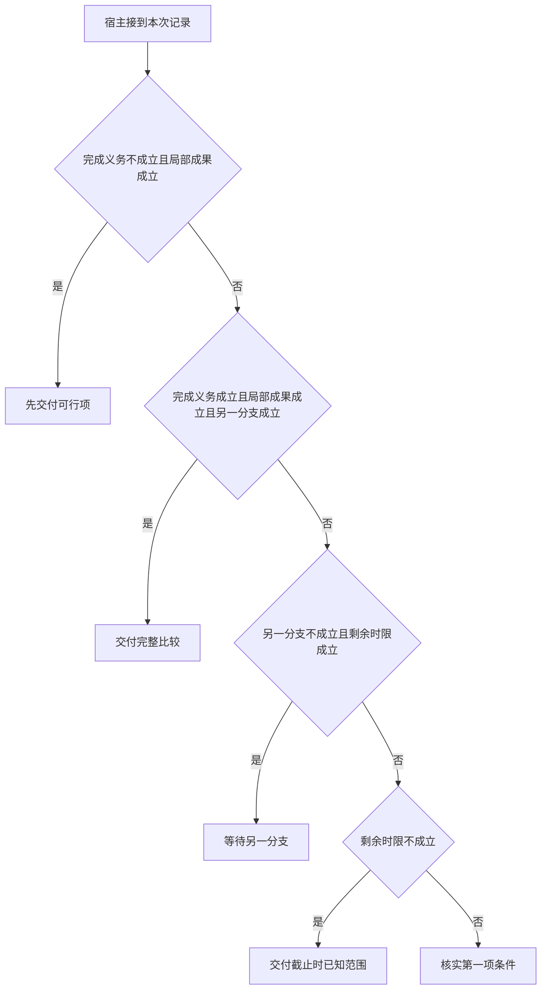

# “任一可用”与“完整比较”

第一家已经证实可用，第二家仍在等待。
存在性目标可以提前收束，排他或穷举目标却需要另一份证据。
等待结束与证明业务结论是两层不同信号。

本篇用一个封闭的教学决策器说明这一问题。输入是宿主收到的记录，不保证每个下游字段都已经获准使用。前置检查未成立时，下游即使带着缓存值，也不能拿来作业务断言。

为使问题可判，第一个分支的“局部成果”特指已经证实的一项可行选择。“另一分支已返回”表示取得可用事实，并不单独声明它一定可行。

## 先解决一个具体问题

**乙超时而甲可用时，父任务能不能说“只有甲可用”？**

可确认甲这一项，但排他结论还需乙不符合的证据。
存在性和完整比较义务不同。
先发布局部事实时要明确乙截至目前仍未核实。


先取一个能走到「核实第一项条件」的输入：用户接受任一可行项、还没有已核实的局部事实、另一分支也已有效返回、截止前仍能完成下一动作。
把这四个条件代回后文的图，前面各个拦截分支都未满足，最终才有“当前证据还不足以完成比较”这个判断。
还原这个现场时要分别问：哪些位来自可信状态，哪些只是在接口中出现、尚未获得解释资格的字段。

## 先沿一次决策走到底



从上到下取第一条成立的出口。只改一个开关时，只有它之前的检查都未截断，该变化才可能到达真实动作。

“完成义务”的两种输入分别是“用户要求完整比较”与“用户接受任一可行项”。
全称和存在性结论对证据的要求不同。

“局部成果”的两种输入分别是“已取得可交付的局部事实”与“还没有已核实的局部事实”。
部分完成需要实际观察，不能用进度话术代替。

“另一分支”的两种输入分别是“另一分支也已有效返回”与“另一分支仍缺有效证据”。
单路成功不能证明其他候选都不符合。

“剩余时限”的两种输入分别是“截止前仍能完成下一动作”与“剩余时限不足”。
总时间应包含排队、动作和结果交付。

## 最少需要哪几项观察

### 先交付可行项

存在性目标已经得到实际见证。
在本节的全部组合中，有 4 种产生「先交付可行项」，这只是逻辑空间的计数，不能当作实际用户请求的比例。

只取得用户接受任一可行项、已取得可交付的局部事实，已经足以要求宿主「先交付可行项」。
保持这些已知项，其余开关自由变化，仍有 4 种补全，判断没有翻转。

若删掉关于完成义务的证据，另一份允许的现场是用户要求完整比较、已取得可交付的局部事实、另一分支仍缺有效证据、剩余时限不足，它会使宿主「交付截止时已知范围」。

若删掉关于局部成果的证据，另一份允许的现场是用户接受任一可行项、还没有已核实的局部事实、另一分支仍缺有效证据、剩余时限不足，它会使宿主「交付截止时已知范围」。

### 交付完整比较

两处都取得可用证据。
在本节的全部组合中，有 2 种产生「交付完整比较」，这只是逻辑空间的计数，不能当作实际用户请求的比例。

只取得用户要求完整比较、已取得可交付的局部事实、另一分支也已有效返回，已经足以要求宿主「交付完整比较」。
保持这些已知项，其余开关自由变化，仍有 2 种补全，判断没有翻转。

若删掉关于完成义务的证据，另一份允许的现场是用户接受任一可行项、已取得可交付的局部事实、另一分支也已有效返回、剩余时限不足，它会使宿主「先交付可行项」。

若删掉关于局部成果的证据，另一份允许的现场是用户要求完整比较、还没有已核实的局部事实、另一分支也已有效返回、剩余时限不足，它会使宿主「交付截止时已知范围」。

若删掉关于另一分支的证据，另一份允许的现场是用户要求完整比较、已取得可交付的局部事实、另一分支仍缺有效证据、剩余时限不足，它会使宿主「交付截止时已知范围」。

### 等待另一分支

仍可能在时限内补齐。
在本节的全部组合中，有 3 种产生「等待另一分支」，这只是逻辑空间的计数，不能当作实际用户请求的比例。

只取得还没有已核实的局部事实、另一分支仍缺有效证据、截止前仍能完成下一动作，已经足以要求宿主「等待另一分支」。

若删掉关于局部成果的证据，另一份允许的现场是用户接受任一可行项、已取得可交付的局部事实、另一分支仍缺有效证据、截止前仍能完成下一动作，它会使宿主「先交付可行项」。

若删掉关于另一分支的证据，另一份允许的现场是用户接受任一可行项、还没有已核实的局部事实、另一分支也已有效返回、截止前仍能完成下一动作，它会使宿主「核实第一项条件」。

若删掉关于剩余时限的证据，另一份允许的现场是用户接受任一可行项、还没有已核实的局部事实、另一分支仍缺有效证据、剩余时限不足，它会使宿主「交付截止时已知范围」。

只取得用户要求完整比较、另一分支仍缺有效证据、截止前仍能完成下一动作，已经足以要求宿主「等待另一分支」。

若删掉关于完成义务的证据，另一份允许的现场是用户接受任一可行项、已取得可交付的局部事实、另一分支仍缺有效证据、截止前仍能完成下一动作，它会使宿主「先交付可行项」。

若删掉关于另一分支的证据，另一份允许的现场是用户要求完整比较、还没有已核实的局部事实、另一分支也已有效返回、截止前仍能完成下一动作，它会使宿主「核实第一项条件」。

若删掉关于剩余时限的证据，另一份允许的现场是用户要求完整比较、还没有已核实的局部事实、另一分支仍缺有效证据、剩余时限不足，它会使宿主「交付截止时已知范围」。

### 交付截止时已知范围

不能把超时分支算作不符合。
在本节的全部组合中，有 5 种产生「交付截止时已知范围」，这只是逻辑空间的计数，不能当作实际用户请求的比例。

只取得还没有已核实的局部事实、剩余时限不足，已经足以要求宿主「交付截止时已知范围」。

若删掉关于局部成果的证据，另一份允许的现场是用户接受任一可行项、已取得可交付的局部事实、另一分支仍缺有效证据、剩余时限不足，它会使宿主「先交付可行项」。

若删掉关于剩余时限的证据，另一份允许的现场是用户接受任一可行项、还没有已核实的局部事实、另一分支仍缺有效证据、截止前仍能完成下一动作，它会使宿主「等待另一分支」。

只取得用户要求完整比较、另一分支仍缺有效证据、剩余时限不足，已经足以要求宿主「交付截止时已知范围」。

若删掉关于完成义务的证据，另一份允许的现场是用户接受任一可行项、已取得可交付的局部事实、另一分支仍缺有效证据、剩余时限不足，它会使宿主「先交付可行项」。

若删掉关于另一分支的证据，另一份允许的现场是用户要求完整比较、已取得可交付的局部事实、另一分支也已有效返回、剩余时限不足，它会使宿主「交付完整比较」。

若删掉关于剩余时限的证据，另一份允许的现场是用户要求完整比较、还没有已核实的局部事实、另一分支仍缺有效证据、截止前仍能完成下一动作，它会使宿主「等待另一分支」。

### 核实第一项条件

当前证据还不足以完成比较。
在本节的全部组合中，有 2 种产生「核实第一项条件」，这只是逻辑空间的计数，不能当作实际用户请求的比例。

只取得还没有已核实的局部事实、另一分支也已有效返回、截止前仍能完成下一动作，已经足以要求宿主「核实第一项条件」。

若删掉关于局部成果的证据，另一份允许的现场是用户接受任一可行项、已取得可交付的局部事实、另一分支也已有效返回、截止前仍能完成下一动作，它会使宿主「先交付可行项」。

若删掉关于另一分支的证据，另一份允许的现场是用户接受任一可行项、还没有已核实的局部事实、另一分支仍缺有效证据、截止前仍能完成下一动作，它会使宿主「等待另一分支」。

若删掉关于剩余时限的证据，另一份允许的现场是用户接受任一可行项、还没有已核实的局部事实、另一分支也已有效返回、剩余时限不足，它会使宿主「交付截止时已知范围」。

## 以同一份契约解释截然不同的现场

<details>
<summary>展开推演与对应反例</summary>

下列样本按最先命中的业务分支排列。四位编码只作本篇页内定位，顺序与开头的四项输入一致。可以先猜下一动作，再展开相邻样本。

### 能够触发“先交付可行项”的现场

**样本 0100**

业务侧交来用户接受任一可行项、已取得可交付的局部事实，执行侧还记录了另一分支仍缺有效证据、剩余时限不足。
把样本压成最短证明，保留用户接受任一可行项、已取得可交付的局部事实就能支持「先交付可行项」。

在这份记录上，分别翻转「完成义务」、「局部成果」中的任一项，其他项完全不变时，下一动作都会改变。

保持其余观察不动，单独切换「另一分支」、「剩余时限」仍得到「先交付可行项」，它们在这个现场不是决定性变量。

要从本例改走「交付截止时已知范围」，至少需要变动 1 项，一组最少改动是将已取得可交付的局部事实换成还没有已核实的局部事实。

要从本例改走「等待另一分支」，至少需要变动 2 项，一组最少改动是将已取得可交付的局部事实、剩余时限不足换成还没有已核实的局部事实、截止前仍能完成下一动作。

要从本例改走「交付完整比较」，至少需要变动 2 项，一组最少改动是将用户接受任一可行项、另一分支仍缺有效证据换成用户要求完整比较、另一分支也已有效返回。

要从本例改走「核实第一项条件」，至少需要变动 3 项，一组最少改动是将已取得可交付的局部事实、另一分支仍缺有效证据、剩余时限不足换成还没有已核实的局部事实、另一分支也已有效返回、截止前仍能完成下一动作。

**样本 0101**

业务侧交来用户接受任一可行项、已取得可交付的局部事实，执行侧还记录了另一分支仍缺有效证据、截止前仍能完成下一动作。


要从本例改走「等待另一分支」，至少需要变动 1 项，一组最少改动是将已取得可交付的局部事实换成还没有已核实的局部事实。

要从本例改走「交付截止时已知范围」，至少需要变动 2 项，一组最少改动是将已取得可交付的局部事实、截止前仍能完成下一动作换成还没有已核实的局部事实、剩余时限不足。

要从本例改走「核实第一项条件」，至少需要变动 2 项，一组最少改动是将已取得可交付的局部事实、另一分支仍缺有效证据换成还没有已核实的局部事实、另一分支也已有效返回。


**样本 0110**

业务侧交来用户接受任一可行项、已取得可交付的局部事实，执行侧还记录了另一分支也已有效返回、剩余时限不足。


要从本例改走「交付完整比较」，至少需要变动 1 项，一组最少改动是将用户接受任一可行项换成用户要求完整比较。

要从本例改走「核实第一项条件」，至少需要变动 2 项，一组最少改动是将已取得可交付的局部事实、剩余时限不足换成还没有已核实的局部事实、截止前仍能完成下一动作。

要从本例改走「等待另一分支」，至少需要变动 3 项，一组最少改动是将已取得可交付的局部事实、另一分支也已有效返回、剩余时限不足换成还没有已核实的局部事实、另一分支仍缺有效证据、截止前仍能完成下一动作。

**样本 0111**

业务侧交来用户接受任一可行项、已取得可交付的局部事实，执行侧还记录了另一分支也已有效返回、截止前仍能完成下一动作。


要从本例改走「核实第一项条件」，至少需要变动 1 项，一组最少改动是将已取得可交付的局部事实换成还没有已核实的局部事实。


要从本例改走「等待另一分支」，至少需要变动 2 项，一组最少改动是将已取得可交付的局部事实、另一分支也已有效返回换成还没有已核实的局部事实、另一分支仍缺有效证据。


### 能够触发“交付完整比较”的现场

**样本 1110**

业务侧交来用户要求完整比较、已取得可交付的局部事实，执行侧还记录了另一分支也已有效返回、剩余时限不足。
把样本压成最短证明，保留用户要求完整比较、已取得可交付的局部事实、另一分支也已有效返回就能支持「交付完整比较」。

在这份记录上，分别翻转「完成义务」、「局部成果」、「另一分支」中的任一项，其他项完全不变时，下一动作都会改变。

保持其余观察不动，单独切换「剩余时限」仍得到「交付完整比较」，它们在这个现场不是决定性变量。

本例没走更靠前的「先交付可行项」，因为用户要求完整比较与那个入口的必要条件不符。

要从本例改走「先交付可行项」，至少需要变动 1 项，一组最少改动是将用户要求完整比较换成用户接受任一可行项。


要从本例改走「等待另一分支」，至少需要变动 2 项，一组最少改动是将另一分支也已有效返回、剩余时限不足换成另一分支仍缺有效证据、截止前仍能完成下一动作。

**样本 1111**

业务侧交来用户要求完整比较、已取得可交付的局部事实，执行侧还记录了另一分支也已有效返回、截止前仍能完成下一动作。


要从本例改走「等待另一分支」，至少需要变动 1 项，一组最少改动是将另一分支也已有效返回换成另一分支仍缺有效证据。


### 能够触发“等待另一分支”的现场

**样本 0001**

业务侧交来用户接受任一可行项、还没有已核实的局部事实，执行侧还记录了另一分支仍缺有效证据、截止前仍能完成下一动作。
把样本压成最短证明，保留还没有已核实的局部事实、另一分支仍缺有效证据、截止前仍能完成下一动作就能支持「等待另一分支」。

在这份记录上，分别翻转「局部成果」、「另一分支」、「剩余时限」中的任一项，其他项完全不变时，下一动作都会改变。

保持其余观察不动，单独切换「完成义务」仍得到「等待另一分支」，它们在这个现场不是决定性变量。

本例没走更靠前的「先交付可行项」，因为还没有已核实的局部事实与那个入口的必要条件不符。

本例没走更靠前的「交付完整比较」，因为用户接受任一可行项、还没有已核实的局部事实、另一分支仍缺有效证据与那个入口的必要条件不符。

要从本例改走「交付截止时已知范围」，至少需要变动 1 项，一组最少改动是将截止前仍能完成下一动作换成剩余时限不足。

要从本例改走「核实第一项条件」，至少需要变动 1 项，一组最少改动是将另一分支仍缺有效证据换成另一分支也已有效返回。

要从本例改走「先交付可行项」，至少需要变动 1 项，一组最少改动是将还没有已核实的局部事实换成已取得可交付的局部事实。

要从本例改走「交付完整比较」，至少需要变动 3 项，一组最少改动是将用户接受任一可行项、还没有已核实的局部事实、另一分支仍缺有效证据换成用户要求完整比较、已取得可交付的局部事实、另一分支也已有效返回。

**样本 1001**

业务侧交来用户要求完整比较、还没有已核实的局部事实，执行侧还记录了另一分支仍缺有效证据、截止前仍能完成下一动作。
把样本压成最短证明，保留用户要求完整比较、另一分支仍缺有效证据、截止前仍能完成下一动作就能支持「等待另一分支」。

在这份记录上，分别翻转「另一分支」、「剩余时限」中的任一项，其他项完全不变时，下一动作都会改变。

保持其余观察不动，单独切换「完成义务」、「局部成果」仍得到「等待另一分支」，它们在这个现场不是决定性变量。

本例没走更靠前的「先交付可行项」，因为用户要求完整比较、还没有已核实的局部事实与那个入口的必要条件不符。

本例没走更靠前的「交付完整比较」，因为还没有已核实的局部事实、另一分支仍缺有效证据与那个入口的必要条件不符。


要从本例改走「先交付可行项」，至少需要变动 2 项，一组最少改动是将用户要求完整比较、还没有已核实的局部事实换成用户接受任一可行项、已取得可交付的局部事实。

要从本例改走「交付完整比较」，至少需要变动 2 项，一组最少改动是将还没有已核实的局部事实、另一分支仍缺有效证据换成已取得可交付的局部事实、另一分支也已有效返回。

**样本 1101**

业务侧交来用户要求完整比较、已取得可交付的局部事实，执行侧还记录了另一分支仍缺有效证据、截止前仍能完成下一动作。

在这份记录上，分别翻转「完成义务」、「另一分支」、「剩余时限」中的任一项，其他项完全不变时，下一动作都会改变。

保持其余观察不动，单独切换「局部成果」仍得到「等待另一分支」，它们在这个现场不是决定性变量。


本例没走更靠前的「交付完整比较」，因为另一分支仍缺有效证据与那个入口的必要条件不符。


要从本例改走「交付完整比较」，至少需要变动 1 项，一组最少改动是将另一分支仍缺有效证据换成另一分支也已有效返回。


### 能够触发“交付截止时已知范围”的现场

**样本 0000**

业务侧交来用户接受任一可行项、还没有已核实的局部事实，执行侧还记录了另一分支仍缺有效证据、剩余时限不足。
把样本压成最短证明，保留还没有已核实的局部事实、剩余时限不足就能支持「交付截止时已知范围」。

在这份记录上，分别翻转「局部成果」、「剩余时限」中的任一项，其他项完全不变时，下一动作都会改变。

保持其余观察不动，单独切换「完成义务」、「另一分支」仍得到「交付截止时已知范围」，它们在这个现场不是决定性变量。


本例没走更靠前的「等待另一分支」，因为剩余时限不足与那个入口的必要条件不符。

要从本例改走「等待另一分支」，至少需要变动 1 项，一组最少改动是将剩余时限不足换成截止前仍能完成下一动作。


要从本例改走「核实第一项条件」，至少需要变动 2 项，一组最少改动是将另一分支仍缺有效证据、剩余时限不足换成另一分支也已有效返回、截止前仍能完成下一动作。


**样本 0010**

业务侧交来用户接受任一可行项、还没有已核实的局部事实，执行侧还记录了另一分支也已有效返回、剩余时限不足。


本例没走更靠前的「交付完整比较」，因为用户接受任一可行项、还没有已核实的局部事实与那个入口的必要条件不符。

本例没走更靠前的「等待另一分支」，因为另一分支也已有效返回、剩余时限不足与那个入口的必要条件不符。

要从本例改走「核实第一项条件」，至少需要变动 1 项，一组最少改动是将剩余时限不足换成截止前仍能完成下一动作。


要从本例改走「交付完整比较」，至少需要变动 2 项，一组最少改动是将用户接受任一可行项、还没有已核实的局部事实换成用户要求完整比较、已取得可交付的局部事实。

**样本 1000**

业务侧交来用户要求完整比较、还没有已核实的局部事实，执行侧还记录了另一分支仍缺有效证据、剩余时限不足。

在这份记录上，分别翻转「剩余时限」中的任一项，其他项完全不变时，下一动作都会改变。

保持其余观察不动，单独切换「完成义务」、「局部成果」、「另一分支」仍得到「交付截止时已知范围」，它们在这个现场不是决定性变量。


**样本 1010**

业务侧交来用户要求完整比较、还没有已核实的局部事实，执行侧还记录了另一分支也已有效返回、剩余时限不足。


本例没走更靠前的「交付完整比较」，因为还没有已核实的局部事实与那个入口的必要条件不符。


要从本例改走「交付完整比较」，至少需要变动 1 项，一组最少改动是将还没有已核实的局部事实换成已取得可交付的局部事实。


**样本 1100**

业务侧交来用户要求完整比较、已取得可交付的局部事实，执行侧还记录了另一分支仍缺有效证据、剩余时限不足。
把样本压成最短证明，保留用户要求完整比较、另一分支仍缺有效证据、剩余时限不足就能支持「交付截止时已知范围」。


保持其余观察不动，单独切换「局部成果」仍得到「交付截止时已知范围」，它们在这个现场不是决定性变量。


### 能够触发“核实第一项条件”的现场

**样本 0011**

业务侧交来用户接受任一可行项、还没有已核实的局部事实，执行侧还记录了另一分支也已有效返回、截止前仍能完成下一动作。
把样本压成最短证明，保留还没有已核实的局部事实、另一分支也已有效返回、截止前仍能完成下一动作就能支持「核实第一项条件」。


保持其余观察不动，单独切换「完成义务」仍得到「核实第一项条件」，它们在这个现场不是决定性变量。


本例没走更靠前的「等待另一分支」，因为另一分支也已有效返回与那个入口的必要条件不符。

本例没走更靠前的「交付截止时已知范围」，因为截止前仍能完成下一动作与那个入口的必要条件不符。


**样本 1011**

业务侧交来用户要求完整比较、还没有已核实的局部事实，执行侧还记录了另一分支也已有效返回、截止前仍能完成下一动作。


</details>

## 当你只能看见一半记录

<details>
<summary>展开推演与对应反例</summary>

这次隐藏两个字段，保留另两个。对每个可见现场，检查四种合法补全是否同意。如仍有歧义，选择能使最坏剩余候选动作最少的字段继续查。并列时采用本篇字段顺序。

### 只保留完成义务与局部成果

已知用户接受任一可行项、还没有已核实的局部事实时，四种补全的动作分布为等待另一分支（1 种）、交付截止时已知范围（2 种）、核实第一项条件（1 种）。

在用户接受任一可行项、还没有已核实的局部事实这个现场补读「另一分支」，最坏还剩 2 种动作，计算时只衡量歧义，尚未扣读取代价。
若补来的观察为“另一分支仍缺有效证据”，范围缩成「交付截止时已知范围」、「等待另一分支」。若为“另一分支也已有效返回”，则保留「交付截止时已知范围」、「核实第一项条件」。

区分不了的两条执行可以具体写成 0000 与 0001：它们共享已展示字段，却分别需要「交付截止时已知范围」和「等待另一分支」。

已知用户接受任一可行项、已取得可交付的局部事实时，四种补全的动作分布为先交付可行项（4 种）。

就“先交付可行项”这个动作而言，在用户接受任一可行项、已取得可交付的局部事实的前提下，另外两项观察不会推翻它。

已知用户要求完整比较、还没有已核实的局部事实时，四种补全的动作分布为等待另一分支（1 种）、交付截止时已知范围（2 种）、核实第一项条件（1 种）。

在用户要求完整比较、还没有已核实的局部事实这个现场补读「另一分支」，最坏还剩 2 种动作，计算时只衡量歧义，尚未扣读取代价。

区分不了的两条执行可以具体写成 1000 与 1001：它们共享已展示字段，却分别需要「交付截止时已知范围」和「等待另一分支」。

已知用户要求完整比较、已取得可交付的局部事实时，四种补全的动作分布为交付完整比较（2 种）、等待另一分支（1 种）、交付截止时已知范围（1 种）。

在用户要求完整比较、已取得可交付的局部事实这个现场补读「另一分支」，最坏还剩 2 种动作，计算时只衡量歧义，尚未扣读取代价。
若补来的观察为“另一分支仍缺有效证据”，范围缩成「交付截止时已知范围」、「等待另一分支」。若为“另一分支也已有效返回”，则保留「交付完整比较」。

区分不了的两条执行可以具体写成 1100 与 1101：它们共享已展示字段，却分别需要「交付截止时已知范围」和「等待另一分支」。

### 只保留完成义务与另一分支

已知用户接受任一可行项、另一分支仍缺有效证据时，四种补全的动作分布为先交付可行项（2 种）、等待另一分支（1 种）、交付截止时已知范围（1 种）。

在用户接受任一可行项、另一分支仍缺有效证据这个现场补读「局部成果」，最坏还剩 2 种动作，计算时只衡量歧义，尚未扣读取代价。
若补来的观察为“还没有已核实的局部事实”，范围缩成「交付截止时已知范围」、「等待另一分支」。若为“已取得可交付的局部事实”，则保留「先交付可行项」。


已知用户接受任一可行项、另一分支也已有效返回时，四种补全的动作分布为先交付可行项（2 种）、交付截止时已知范围（1 种）、核实第一项条件（1 种）。

在用户接受任一可行项、另一分支也已有效返回这个现场补读「局部成果」，最坏还剩 2 种动作，计算时只衡量歧义，尚未扣读取代价。
若补来的观察为“还没有已核实的局部事实”，范围缩成「交付截止时已知范围」、「核实第一项条件」。若为“已取得可交付的局部事实”，则保留「先交付可行项」。

区分不了的两条执行可以具体写成 0010 与 0011：它们共享已展示字段，却分别需要「交付截止时已知范围」和「核实第一项条件」。

已知用户要求完整比较、另一分支仍缺有效证据时，四种补全的动作分布为等待另一分支（2 种）、交付截止时已知范围（2 种）。

在用户要求完整比较、另一分支仍缺有效证据这个现场补读「剩余时限」，最坏还剩 1 种动作，计算时只衡量歧义，尚未扣读取代价。
若补来的观察为“剩余时限不足”，范围缩成「交付截止时已知范围」。若为“截止前仍能完成下一动作”，则保留「等待另一分支」。


已知用户要求完整比较、另一分支也已有效返回时，四种补全的动作分布为交付完整比较（2 种）、交付截止时已知范围（1 种）、核实第一项条件（1 种）。

在用户要求完整比较、另一分支也已有效返回这个现场补读「局部成果」，最坏还剩 2 种动作，计算时只衡量歧义，尚未扣读取代价。
若补来的观察为“还没有已核实的局部事实”，范围缩成「交付截止时已知范围」、「核实第一项条件」。若为“已取得可交付的局部事实”，则保留「交付完整比较」。

区分不了的两条执行可以具体写成 1010 与 1011：它们共享已展示字段，却分别需要「交付截止时已知范围」和「核实第一项条件」。

### 只保留局部成果与另一分支

已知还没有已核实的局部事实、另一分支仍缺有效证据时，四种补全的动作分布为等待另一分支（2 种）、交付截止时已知范围（2 种）。

在还没有已核实的局部事实、另一分支仍缺有效证据这个现场补读「剩余时限」，最坏还剩 1 种动作，计算时只衡量歧义，尚未扣读取代价。


已知还没有已核实的局部事实、另一分支也已有效返回时，四种补全的动作分布为交付截止时已知范围（2 种）、核实第一项条件（2 种）。

在还没有已核实的局部事实、另一分支也已有效返回这个现场补读「剩余时限」，最坏还剩 1 种动作，计算时只衡量歧义，尚未扣读取代价。
若补来的观察为“剩余时限不足”，范围缩成「交付截止时已知范围」。若为“截止前仍能完成下一动作”，则保留「核实第一项条件」。


已知已取得可交付的局部事实、另一分支仍缺有效证据时，四种补全的动作分布为先交付可行项（2 种）、等待另一分支（1 种）、交付截止时已知范围（1 种）。

在已取得可交付的局部事实、另一分支仍缺有效证据这个现场补读「完成义务」，最坏还剩 2 种动作，计算时只衡量歧义，尚未扣读取代价。
若补来的观察为“用户接受任一可行项”，范围缩成「先交付可行项」。若为“用户要求完整比较”，则保留「交付截止时已知范围」、「等待另一分支」。

区分不了的两条执行可以具体写成 0100 与 1100：它们共享已展示字段，却分别需要「先交付可行项」和「交付截止时已知范围」。

已知已取得可交付的局部事实、另一分支也已有效返回时，四种补全的动作分布为先交付可行项（2 种）、交付完整比较（2 种）。

在已取得可交付的局部事实、另一分支也已有效返回这个现场补读「完成义务」，最坏还剩 1 种动作，计算时只衡量歧义，尚未扣读取代价。
若补来的观察为“用户接受任一可行项”，范围缩成「先交付可行项」。若为“用户要求完整比较”，则保留「交付完整比较」。

区分不了的两条执行可以具体写成 0110 与 1110：它们共享已展示字段，却分别需要「先交付可行项」和「交付完整比较」。

### 只保留完成义务与剩余时限

已知用户接受任一可行项、剩余时限不足时，四种补全的动作分布为先交付可行项（2 种）、交付截止时已知范围（2 种）。

在用户接受任一可行项、剩余时限不足这个现场补读「局部成果」，最坏还剩 1 种动作，计算时只衡量歧义，尚未扣读取代价。
若补来的观察为“还没有已核实的局部事实”，范围缩成「交付截止时已知范围」。若为“已取得可交付的局部事实”，则保留「先交付可行项」。

区分不了的两条执行可以具体写成 0000 与 0100：它们共享已展示字段，却分别需要「交付截止时已知范围」和「先交付可行项」。

已知用户接受任一可行项、截止前仍能完成下一动作时，四种补全的动作分布为先交付可行项（2 种）、等待另一分支（1 种）、核实第一项条件（1 种）。

在用户接受任一可行项、截止前仍能完成下一动作这个现场补读「局部成果」，最坏还剩 2 种动作，计算时只衡量歧义，尚未扣读取代价。
若补来的观察为“还没有已核实的局部事实”，范围缩成「等待另一分支」、「核实第一项条件」。若为“已取得可交付的局部事实”，则保留「先交付可行项」。

区分不了的两条执行可以具体写成 0001 与 0011：它们共享已展示字段，却分别需要「等待另一分支」和「核实第一项条件」。

已知用户要求完整比较、剩余时限不足时，四种补全的动作分布为交付完整比较（1 种）、交付截止时已知范围（3 种）。

在用户要求完整比较、剩余时限不足这个现场补读「局部成果」，最坏还剩 2 种动作，计算时只衡量歧义，尚未扣读取代价。
若补来的观察为“还没有已核实的局部事实”，范围缩成「交付截止时已知范围」。若为“已取得可交付的局部事实”，则保留「交付截止时已知范围」、「交付完整比较」。

区分不了的两条执行可以具体写成 1000 与 1110：它们共享已展示字段，却分别需要「交付截止时已知范围」和「交付完整比较」。

已知用户要求完整比较、截止前仍能完成下一动作时，四种补全的动作分布为交付完整比较（1 种）、等待另一分支（2 种）、核实第一项条件（1 种）。

在用户要求完整比较、截止前仍能完成下一动作这个现场补读「局部成果」，最坏还剩 2 种动作，计算时只衡量歧义，尚未扣读取代价。
若补来的观察为“还没有已核实的局部事实”，范围缩成「等待另一分支」、「核实第一项条件」。若为“已取得可交付的局部事实”，则保留「等待另一分支」、「交付完整比较」。

区分不了的两条执行可以具体写成 1001 与 1011：它们共享已展示字段，却分别需要「等待另一分支」和「核实第一项条件」。

### 只保留局部成果与剩余时限

已知还没有已核实的局部事实、剩余时限不足时，四种补全的动作分布为交付截止时已知范围（4 种）。

就“交付截止时已知范围”这个动作而言，在还没有已核实的局部事实、剩余时限不足的前提下，另外两项观察不会推翻它。

已知还没有已核实的局部事实、截止前仍能完成下一动作时，四种补全的动作分布为等待另一分支（2 种）、核实第一项条件（2 种）。

在还没有已核实的局部事实、截止前仍能完成下一动作这个现场补读「另一分支」，最坏还剩 1 种动作，计算时只衡量歧义，尚未扣读取代价。
若补来的观察为“另一分支仍缺有效证据”，范围缩成「等待另一分支」。若为“另一分支也已有效返回”，则保留「核实第一项条件」。


已知已取得可交付的局部事实、剩余时限不足时，四种补全的动作分布为先交付可行项（2 种）、交付完整比较（1 种）、交付截止时已知范围（1 种）。

在已取得可交付的局部事实、剩余时限不足这个现场补读「完成义务」，最坏还剩 2 种动作，计算时只衡量歧义，尚未扣读取代价。
若补来的观察为“用户接受任一可行项”，范围缩成「先交付可行项」。若为“用户要求完整比较”，则保留「交付截止时已知范围」、「交付完整比较」。


已知已取得可交付的局部事实、截止前仍能完成下一动作时，四种补全的动作分布为先交付可行项（2 种）、交付完整比较（1 种）、等待另一分支（1 种）。

在已取得可交付的局部事实、截止前仍能完成下一动作这个现场补读「完成义务」，最坏还剩 2 种动作，计算时只衡量歧义，尚未扣读取代价。
若补来的观察为“用户接受任一可行项”，范围缩成「先交付可行项」。若为“用户要求完整比较”，则保留「等待另一分支」、「交付完整比较」。

区分不了的两条执行可以具体写成 0101 与 1101：它们共享已展示字段，却分别需要「先交付可行项」和「等待另一分支」。

### 只保留另一分支与剩余时限

已知另一分支仍缺有效证据、剩余时限不足时，四种补全的动作分布为先交付可行项（1 种）、交付截止时已知范围（3 种）。

在另一分支仍缺有效证据、剩余时限不足这个现场补读「完成义务」，最坏还剩 2 种动作，计算时只衡量歧义，尚未扣读取代价。
若补来的观察为“用户接受任一可行项”，范围缩成「交付截止时已知范围」、「先交付可行项」。若为“用户要求完整比较”，则保留「交付截止时已知范围」。


已知另一分支仍缺有效证据、截止前仍能完成下一动作时，四种补全的动作分布为先交付可行项（1 种）、等待另一分支（3 种）。

在另一分支仍缺有效证据、截止前仍能完成下一动作这个现场补读「完成义务」，最坏还剩 2 种动作，计算时只衡量歧义，尚未扣读取代价。
若补来的观察为“用户接受任一可行项”，范围缩成「等待另一分支」、「先交付可行项」。若为“用户要求完整比较”，则保留「等待另一分支」。

区分不了的两条执行可以具体写成 0001 与 0101：它们共享已展示字段，却分别需要「等待另一分支」和「先交付可行项」。

已知另一分支也已有效返回、剩余时限不足时，四种补全的动作分布为先交付可行项（1 种）、交付完整比较（1 种）、交付截止时已知范围（2 种）。

在另一分支也已有效返回、剩余时限不足这个现场补读「完成义务」，最坏还剩 2 种动作，计算时只衡量歧义，尚未扣读取代价。
若补来的观察为“用户接受任一可行项”，范围缩成「交付截止时已知范围」、「先交付可行项」。若为“用户要求完整比较”，则保留「交付截止时已知范围」、「交付完整比较」。

区分不了的两条执行可以具体写成 0010 与 0110：它们共享已展示字段，却分别需要「交付截止时已知范围」和「先交付可行项」。

已知另一分支也已有效返回、截止前仍能完成下一动作时，四种补全的动作分布为先交付可行项（1 种）、交付完整比较（1 种）、核实第一项条件（2 种）。

在另一分支也已有效返回、截止前仍能完成下一动作这个现场补读「完成义务」，最坏还剩 2 种动作，计算时只衡量歧义，尚未扣读取代价。
若补来的观察为“用户接受任一可行项”，范围缩成「核实第一项条件」、「先交付可行项」。若为“用户要求完整比较”，则保留「核实第一项条件」、「交付完整比较」。

区分不了的两条执行可以具体写成 0011 与 0111：它们共享已展示字段，却分别需要「核实第一项条件」和「先交付可行项」。

</details>

## 单因素干预与边界测试

<details>
<summary>展开推演与对应反例</summary>

### 只改变完成义务

固定另外三个条件得到八对现场，从“用户接受任一可行项”转为“用户要求完整比较”时，4 对翻转动作，另外 4 对保持不变。

令还没有已核实的局部事实、另一分支仍缺有效证据、剩余时限不足，完成义务的两个取值均得到「交付截止时已知范围」。在八对中，共有 2 对表现为这一种稳定出口。

令还没有已核实的局部事实、另一分支仍缺有效证据、截止前仍能完成下一动作，完成义务的两个取值均得到「等待另一分支」。在八对中，共有 1 对表现为这一种稳定出口。

令还没有已核实的局部事实、另一分支也已有效返回、截止前仍能完成下一动作，完成义务的两个取值均得到「核实第一项条件」。在八对中，共有 1 对表现为这一种稳定出口。

有 1 对现场沿「先交付可行项」变到「交付截止时已知范围」，可复现的一组受控背景为已取得可交付的局部事实、另一分支仍缺有效证据、剩余时限不足。

有 1 对现场沿「先交付可行项」变到「等待另一分支」，可复现的一组受控背景为已取得可交付的局部事实、另一分支仍缺有效证据、截止前仍能完成下一动作。

有 2 对现场沿「先交付可行项」变到「交付完整比较」，可复现的一组受控背景为已取得可交付的局部事实、另一分支也已有效返回、剩余时限不足。

### 只改变局部成果

固定另外三个条件得到八对现场，从“还没有已核实的局部事实”转为“已取得可交付的局部事实”时，6 对翻转动作，另外 2 对保持不变。

有 2 对现场沿「交付截止时已知范围」变到「先交付可行项」，可复现的一组受控背景为用户接受任一可行项、另一分支仍缺有效证据、剩余时限不足。

有 1 对现场沿「等待另一分支」变到「先交付可行项」，可复现的一组受控背景为用户接受任一可行项、另一分支仍缺有效证据、截止前仍能完成下一动作。

有 1 对现场沿「核实第一项条件」变到「先交付可行项」，可复现的一组受控背景为用户接受任一可行项、另一分支也已有效返回、截止前仍能完成下一动作。

令用户要求完整比较、另一分支仍缺有效证据、剩余时限不足，局部成果的两个取值均得到「交付截止时已知范围」。在八对中，共有 1 对表现为这一种稳定出口。

令用户要求完整比较、另一分支仍缺有效证据、截止前仍能完成下一动作，局部成果的两个取值均得到「等待另一分支」。在八对中，共有 1 对表现为这一种稳定出口。

有 1 对现场沿「交付截止时已知范围」变到「交付完整比较」，可复现的一组受控背景为用户要求完整比较、另一分支也已有效返回、剩余时限不足。

有 1 对现场沿「核实第一项条件」变到「交付完整比较」，可复现的一组受控背景为用户要求完整比较、另一分支也已有效返回、截止前仍能完成下一动作。

### 只改变另一分支

固定另外三个条件得到八对现场，从“另一分支仍缺有效证据”转为“另一分支也已有效返回”时，4 对翻转动作，另外 4 对保持不变。

令用户接受任一可行项、还没有已核实的局部事实、剩余时限不足，另一分支的两个取值均得到「交付截止时已知范围」。在八对中，共有 2 对表现为这一种稳定出口。

有 2 对现场沿「等待另一分支」变到「核实第一项条件」，可复现的一组受控背景为用户接受任一可行项、还没有已核实的局部事实、截止前仍能完成下一动作。

令用户接受任一可行项、已取得可交付的局部事实、剩余时限不足，另一分支的两个取值均得到「先交付可行项」。在八对中，共有 2 对表现为这一种稳定出口。

有 1 对现场沿「交付截止时已知范围」变到「交付完整比较」，可复现的一组受控背景为用户要求完整比较、已取得可交付的局部事实、剩余时限不足。

有 1 对现场沿「等待另一分支」变到「交付完整比较」，可复现的一组受控背景为用户要求完整比较、已取得可交付的局部事实、截止前仍能完成下一动作。

### 只改变剩余时限

固定另外三个条件得到八对现场，从“剩余时限不足”转为“截止前仍能完成下一动作”时，5 对翻转动作，另外 3 对保持不变。

有 3 对现场沿「交付截止时已知范围」变到「等待另一分支」，可复现的一组受控背景为用户接受任一可行项、还没有已核实的局部事实、另一分支仍缺有效证据。

有 2 对现场沿「交付截止时已知范围」变到「核实第一项条件」，可复现的一组受控背景为用户接受任一可行项、还没有已核实的局部事实、另一分支也已有效返回。

令用户接受任一可行项、已取得可交付的局部事实、另一分支仍缺有效证据，剩余时限的两个取值均得到「先交付可行项」。在八对中，共有 2 对表现为这一种稳定出口。

令用户要求完整比较、已取得可交付的局部事实、另一分支也已有效返回，剩余时限的两个取值均得到「交付完整比较」。在八对中，共有 1 对表现为这一种稳定出口。

</details>

## 哪些回归样本真能抓住实现错误

<details>
<summary>展开推演与对应反例</summary>

如果删除“先交付可行项”这个分支，在本篇 16 种输入里有 4 种会改走另一出口。

反例 0100 的完整记录为用户接受任一可行项、已取得可交付的局部事实、另一分支仍缺有效证据、剩余时限不足。正确结果是「先交付可行项」，这个改坏的实现却给出「交付截止时已知范围」。

如果删除“交付完整比较”这个分支，在本篇 16 种输入里有 2 种会改走另一出口。

反例 1110 的完整记录为用户要求完整比较、已取得可交付的局部事实、另一分支也已有效返回、剩余时限不足。正确结果是「交付完整比较」，这个改坏的实现却给出「交付截止时已知范围」。

如果删除“等待另一分支”这个分支，在本篇 16 种输入里有 3 种会改走另一出口。

反例 0001 的完整记录为用户接受任一可行项、还没有已核实的局部事实、另一分支仍缺有效证据、截止前仍能完成下一动作。正确结果是「等待另一分支」，这个改坏的实现却给出「核实第一项条件」。

如果删除“交付截止时已知范围”这个分支，在本篇 16 种输入里有 5 种会改走另一出口。

反例 0000 的完整记录为用户接受任一可行项、还没有已核实的局部事实、另一分支仍缺有效证据、剩余时限不足。正确结果是「交付截止时已知范围」，这个改坏的实现却给出「核实第一项条件」。

如果交换“先交付可行项”和“交付完整比较”的判断次序，在本篇 16 种输入里有 0 种会改走另一出口。

对于“交换“先交付可行项”和“交付完整比较”的判断次序”这项修改，在声明输入域内没有区分它的样本，不能宣称测试捕捉到了故障。

如果交换“交付完整比较”和“等待另一分支”的判断次序，在本篇 16 种输入里有 0 种会改走另一出口。

对于“交换“交付完整比较”和“等待另一分支”的判断次序”这项修改，在声明输入域内没有区分它的样本，不能宣称测试捕捉到了故障。

如果交换“等待另一分支”和“交付截止时已知范围”的判断次序，在本篇 16 种输入里有 0 种会改走另一出口。

对于“交换“等待另一分支”和“交付截止时已知范围”的判断次序”这项修改，在声明输入域内没有区分它的样本，不能宣称测试捕捉到了故障。

补入样本 0000（用户接受任一可行项、还没有已核实的局部事实、另一分支仍缺有效证据、剩余时限不足）能新增检出「删除“交付截止时已知范围”这个分支」。

补入样本 0001（用户接受任一可行项、还没有已核实的局部事实、另一分支仍缺有效证据、截止前仍能完成下一动作）能新增检出「删除“等待另一分支”这个分支」。

补入样本 0100（用户接受任一可行项、已取得可交付的局部事实、另一分支仍缺有效证据、剩余时限不足）能新增检出「删除“先交付可行项”这个分支」。

补入样本 1110（用户要求完整比较、已取得可交付的局部事实、另一分支也已有效返回、剩余时限不足）能新增检出「删除“交付完整比较”这个分支」。

这里每次选覆盖尚未捕获缺陷最多的样本，并不保证用例数全局最小。它给出的反例能作为 Java 单测输入。真实模型是否会自主产生这些提议，仍须单独评测。

</details>

## 把状态覆盖换成有抽样偏差的评测批次

<details>
<summary>展开推演与对应反例</summary>

前面的十六种记录各有一票。现在只改样本构成：对一个给定字段，把成立侧的每种记录各取三份、另一侧各取一份。这是人为配比的 32 份回放，不是线上频率估计。
将偏向成立与偏向不成立的两次批次对照，可以隔离分母变化。底层宿主和所有答案保持相同，比例仍可能移动。

### 改变“完成义务”的样本配比

只看「先交付可行项」，在用户要求完整比较的八个不同输入中有 0 个命中，在用户接受任一可行项的另八个输入中有 4 个命中。
把「完成义务」成立侧按三倍取样，「先交付可行项」占 4/32，反过来向未成立侧倾斜后占 12/32。
这次重加权使「先交付可行项」的占比相差 25 个百分点。若按两种不同的“完成义务”分布跑新旧版，不能把这项差异全部归功于实现。

只看「交付完整比较」，在用户要求完整比较的八个不同输入中有 2 个命中，在用户接受任一可行项的另八个输入中有 0 个命中。
把「完成义务」成立侧按三倍取样，「交付完整比较」占 6/32，反过来向未成立侧倾斜后占 2/32。
这次重加权使「交付完整比较」的占比相差 12.5 个百分点。若按两种不同的“完成义务”分布跑新旧版，不能把这项差异全部归功于实现。

只看「等待另一分支」，在用户要求完整比较的八个不同输入中有 2 个命中，在用户接受任一可行项的另八个输入中有 1 个命中。
把「完成义务」成立侧按三倍取样，「等待另一分支」占 7/32，反过来向未成立侧倾斜后占 5/32。
这次重加权使「等待另一分支」的占比相差 6.25 个百分点。若按两种不同的“完成义务”分布跑新旧版，不能把这项差异全部归功于实现。

只看「交付截止时已知范围」，在用户要求完整比较的八个不同输入中有 3 个命中，在用户接受任一可行项的另八个输入中有 2 个命中。
把「完成义务」成立侧按三倍取样，「交付截止时已知范围」占 11/32，反过来向未成立侧倾斜后占 9/32。
这次重加权使「交付截止时已知范围」的占比相差 6.25 个百分点。若按两种不同的“完成义务”分布跑新旧版，不能把这项差异全部归功于实现。

只看「核实第一项条件」，在用户要求完整比较的八个不同输入中有 1 个命中，在用户接受任一可行项的另八个输入中有 1 个命中。
把「完成义务」成立侧按三倍取样，「核实第一项条件」占 4/32，反过来向未成立侧倾斜后占 4/32。
两批「核实第一项条件」的边际比例相同，是因为这个出口在“完成义务”的两侧计数相等，这不能单独证明每一对现场都不受它影响。

### 改变“局部成果”的样本配比

只看「先交付可行项」，在已取得可交付的局部事实的八个不同输入中有 4 个命中，在还没有已核实的局部事实的另八个输入中有 0 个命中。
把「局部成果」成立侧按三倍取样，「先交付可行项」占 12/32，反过来向未成立侧倾斜后占 4/32。
这次重加权使「先交付可行项」的占比相差 25 个百分点。若按两种不同的“局部成果”分布跑新旧版，不能把这项差异全部归功于实现。

只看「交付完整比较」，在已取得可交付的局部事实的八个不同输入中有 2 个命中，在还没有已核实的局部事实的另八个输入中有 0 个命中。
把「局部成果」成立侧按三倍取样，「交付完整比较」占 6/32，反过来向未成立侧倾斜后占 2/32。
这次重加权使「交付完整比较」的占比相差 12.5 个百分点。若按两种不同的“局部成果”分布跑新旧版，不能把这项差异全部归功于实现。

只看「等待另一分支」，在已取得可交付的局部事实的八个不同输入中有 1 个命中，在还没有已核实的局部事实的另八个输入中有 2 个命中。
把「局部成果」成立侧按三倍取样，「等待另一分支」占 5/32，反过来向未成立侧倾斜后占 7/32。
这次重加权使「等待另一分支」的占比相差 6.25 个百分点。若按两种不同的“局部成果”分布跑新旧版，不能把这项差异全部归功于实现。

只看「交付截止时已知范围」，在已取得可交付的局部事实的八个不同输入中有 1 个命中，在还没有已核实的局部事实的另八个输入中有 4 个命中。
把「局部成果」成立侧按三倍取样，「交付截止时已知范围」占 7/32，反过来向未成立侧倾斜后占 13/32。
这次重加权使「交付截止时已知范围」的占比相差 18.75 个百分点。若按两种不同的“局部成果”分布跑新旧版，不能把这项差异全部归功于实现。

只看「核实第一项条件」，在已取得可交付的局部事实的八个不同输入中有 0 个命中，在还没有已核实的局部事实的另八个输入中有 2 个命中。
把「局部成果」成立侧按三倍取样，「核实第一项条件」占 2/32，反过来向未成立侧倾斜后占 6/32。
这次重加权使「核实第一项条件」的占比相差 12.5 个百分点。若按两种不同的“局部成果”分布跑新旧版，不能把这项差异全部归功于实现。

### 改变“另一分支”的样本配比

只看「先交付可行项」，在另一分支也已有效返回的八个不同输入中有 2 个命中，在另一分支仍缺有效证据的另八个输入中有 2 个命中。
把「另一分支」成立侧按三倍取样，「先交付可行项」占 8/32，反过来向未成立侧倾斜后占 8/32。
两批「先交付可行项」的边际比例相同，是因为这个出口在“另一分支”的两侧计数相等，这不能单独证明每一对现场都不受它影响。

只看「交付完整比较」，在另一分支也已有效返回的八个不同输入中有 2 个命中，在另一分支仍缺有效证据的另八个输入中有 0 个命中。
把「另一分支」成立侧按三倍取样，「交付完整比较」占 6/32，反过来向未成立侧倾斜后占 2/32。
这次重加权使「交付完整比较」的占比相差 12.5 个百分点。若按两种不同的“另一分支”分布跑新旧版，不能把这项差异全部归功于实现。

只看「等待另一分支」，在另一分支也已有效返回的八个不同输入中有 0 个命中，在另一分支仍缺有效证据的另八个输入中有 3 个命中。
把「另一分支」成立侧按三倍取样，「等待另一分支」占 3/32，反过来向未成立侧倾斜后占 9/32。
这次重加权使「等待另一分支」的占比相差 18.75 个百分点。若按两种不同的“另一分支”分布跑新旧版，不能把这项差异全部归功于实现。

只看「交付截止时已知范围」，在另一分支也已有效返回的八个不同输入中有 2 个命中，在另一分支仍缺有效证据的另八个输入中有 3 个命中。
把「另一分支」成立侧按三倍取样，「交付截止时已知范围」占 9/32，反过来向未成立侧倾斜后占 11/32。
这次重加权使「交付截止时已知范围」的占比相差 6.25 个百分点。若按两种不同的“另一分支”分布跑新旧版，不能把这项差异全部归功于实现。

只看「核实第一项条件」，在另一分支也已有效返回的八个不同输入中有 2 个命中，在另一分支仍缺有效证据的另八个输入中有 0 个命中。
把「另一分支」成立侧按三倍取样，「核实第一项条件」占 6/32，反过来向未成立侧倾斜后占 2/32。
这次重加权使「核实第一项条件」的占比相差 12.5 个百分点。若按两种不同的“另一分支”分布跑新旧版，不能把这项差异全部归功于实现。

### 改变“剩余时限”的样本配比

只看「先交付可行项」，在截止前仍能完成下一动作的八个不同输入中有 2 个命中，在剩余时限不足的另八个输入中有 2 个命中。
把「剩余时限」成立侧按三倍取样，「先交付可行项」占 8/32，反过来向未成立侧倾斜后占 8/32。
两批「先交付可行项」的边际比例相同，是因为这个出口在“剩余时限”的两侧计数相等，这不能单独证明每一对现场都不受它影响。

只看「交付完整比较」，在截止前仍能完成下一动作的八个不同输入中有 1 个命中，在剩余时限不足的另八个输入中有 1 个命中。
把「剩余时限」成立侧按三倍取样，「交付完整比较」占 4/32，反过来向未成立侧倾斜后占 4/32。
两批「交付完整比较」的边际比例相同，是因为这个出口在“剩余时限”的两侧计数相等，这不能单独证明每一对现场都不受它影响。

只看「等待另一分支」，在截止前仍能完成下一动作的八个不同输入中有 3 个命中，在剩余时限不足的另八个输入中有 0 个命中。
把「剩余时限」成立侧按三倍取样，「等待另一分支」占 9/32，反过来向未成立侧倾斜后占 3/32。
这次重加权使「等待另一分支」的占比相差 18.75 个百分点。若按两种不同的“剩余时限”分布跑新旧版，不能把这项差异全部归功于实现。

只看「交付截止时已知范围」，在截止前仍能完成下一动作的八个不同输入中有 0 个命中，在剩余时限不足的另八个输入中有 5 个命中。
把「剩余时限」成立侧按三倍取样，「交付截止时已知范围」占 5/32，反过来向未成立侧倾斜后占 15/32。
这次重加权使「交付截止时已知范围」的占比相差 31.25 个百分点。若按两种不同的“剩余时限”分布跑新旧版，不能把这项差异全部归功于实现。

只看「核实第一项条件」，在截止前仍能完成下一动作的八个不同输入中有 2 个命中，在剩余时限不足的另八个输入中有 0 个命中。
把「剩余时限」成立侧按三倍取样，「核实第一项条件」占 6/32，反过来向未成立侧倾斜后占 2/32。
这次重加权使「核实第一项条件」的占比相差 12.5 个百分点。若按两种不同的“剩余时限”分布跑新旧版，不能把这项差异全部归功于实现。

</details>

## 只看终态，能逆推出多少原始事实

<details>
<summary>展开推演与对应反例</summary>

### 只保留“先交付可行项”这条结果时

在本节契约与完整输入域内，仅知「先交付可行项」就能倒推出用户接受任一可行项，这一推断依赖版本未变且日志中的终态可信。

在本节契约与完整输入域内，仅知「先交付可行项」就能倒推出已取得可交付的局部事实，这一推断依赖版本未变且日志中的终态可信。

「先交付可行项」不能证明另一分支取哪一侧：0100 和 0110 有相同终态，却分别记为“另一分支仍缺有效证据”和“另一分支也已有效返回”。

「先交付可行项」不能证明剩余时限取哪一侧：0100 和 0101 有相同终态，却分别记为“剩余时限不足”和“截止前仍能完成下一动作”。

反查「先交付可行项」的诊断日志，优先保留能区分样本 0100 与 0000 的「局部成果」，否则很容易把邻近的「交付截止时已知范围」看成同一种故障。

### 只保留“交付完整比较”这条结果时

在本节契约与完整输入域内，仅知「交付完整比较」就能倒推出用户要求完整比较，这一推断依赖版本未变且日志中的终态可信。

在本节契约与完整输入域内，仅知「交付完整比较」就能倒推出已取得可交付的局部事实，这一推断依赖版本未变且日志中的终态可信。

在本节契约与完整输入域内，仅知「交付完整比较」就能倒推出另一分支也已有效返回，这一推断依赖版本未变且日志中的终态可信。

「交付完整比较」不能证明剩余时限取哪一侧：1110 和 1111 有相同终态，却分别记为“剩余时限不足”和“截止前仍能完成下一动作”。

反查「交付完整比较」的诊断日志，优先保留能区分样本 1110 与 0110 的「完成义务」，否则很容易把邻近的「先交付可行项」看成同一种故障。

### 只保留“等待另一分支”这条结果时

「等待另一分支」不能证明完成义务取哪一侧：0001 和 1001 有相同终态，却分别记为“用户接受任一可行项”和“用户要求完整比较”。

「等待另一分支」不能证明局部成果取哪一侧：0001 和 1101 有相同终态，却分别记为“还没有已核实的局部事实”和“已取得可交付的局部事实”。

在本节契约与完整输入域内，仅知「等待另一分支」就能倒推出另一分支仍缺有效证据，这一推断依赖版本未变且日志中的终态可信。

在本节契约与完整输入域内，仅知「等待另一分支」就能倒推出截止前仍能完成下一动作，这一推断依赖版本未变且日志中的终态可信。

反查「等待另一分支」的诊断日志，优先保留能区分样本 0001 与 0000 的「剩余时限」，否则很容易把邻近的「交付截止时已知范围」看成同一种故障。

### 只保留“交付截止时已知范围”这条结果时

「交付截止时已知范围」不能证明完成义务取哪一侧：0000 和 1000 有相同终态，却分别记为“用户接受任一可行项”和“用户要求完整比较”。

「交付截止时已知范围」不能证明局部成果取哪一侧：0000 和 1100 有相同终态，却分别记为“还没有已核实的局部事实”和“已取得可交付的局部事实”。

「交付截止时已知范围」不能证明另一分支取哪一侧：0000 和 0010 有相同终态，却分别记为“另一分支仍缺有效证据”和“另一分支也已有效返回”。

在本节契约与完整输入域内，仅知「交付截止时已知范围」就能倒推出剩余时限不足，这一推断依赖版本未变且日志中的终态可信。

反查「交付截止时已知范围」的诊断日志，优先保留能区分样本 0000 与 0001 的「剩余时限」，否则很容易把邻近的「等待另一分支」看成同一种故障。

### 只保留“核实第一项条件”这条结果时

「核实第一项条件」不能证明完成义务取哪一侧：0011 和 1011 有相同终态，却分别记为“用户接受任一可行项”和“用户要求完整比较”。

在本节契约与完整输入域内，仅知「核实第一项条件」就能倒推出还没有已核实的局部事实，这一推断依赖版本未变且日志中的终态可信。

在本节契约与完整输入域内，仅知「核实第一项条件」就能倒推出另一分支也已有效返回，这一推断依赖版本未变且日志中的终态可信。

在本节契约与完整输入域内，仅知「核实第一项条件」就能倒推出截止前仍能完成下一动作，这一推断依赖版本未变且日志中的终态可信。

反查「核实第一项条件」的诊断日志，优先保留能区分样本 0011 与 0001 的「另一分支」，否则很容易把邻近的「等待另一分支」看成同一种故障。

</details>

## 面试复述与复算

面试题可以从“乙超时而甲可用时，父任务能不能说“只有甲可用”？”起步。先给出本篇的触发条件和一条真实执行端可检查的证据，再用一个相邻反例限定结论的适用范围。

在仓库根目录执行下列命令可以重算本篇的一个输入。四位数字依次选择正文列出的四项条件，0 表示未成立或低档，1 表示成立或高档。
```powershell
node examples/reading-cases/replay.mjs 7 4 0101
```

[本周主文](../theory.md) · [配套实验](../lab.md) · [下一篇研读](05.md)
