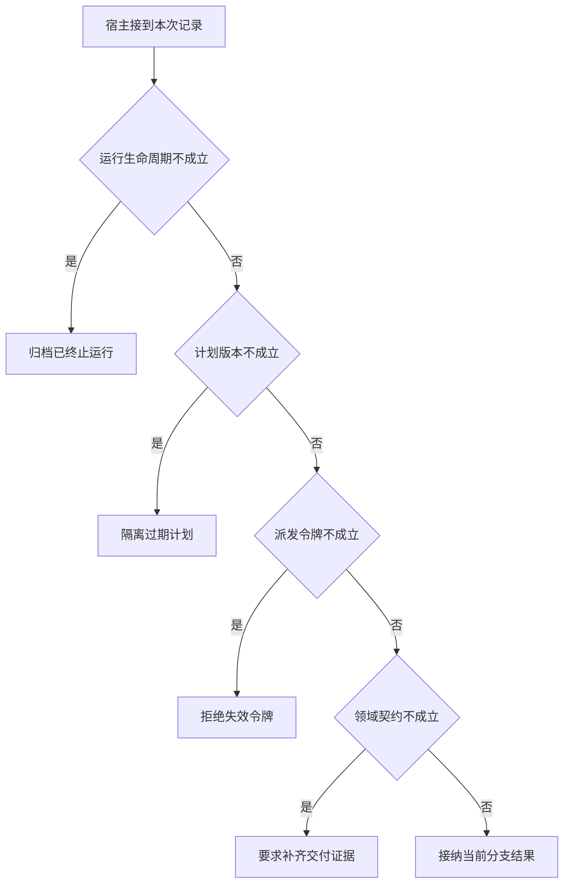

# 旧计划的正确回执能否覆盖新计划

重规划后 B 的旧回执可能晚于新任务返回。
它说的事实在旧日期上正确，却不能写进当前报告。
归并器要校验运行、计划、派发令牌与领域完成契约。

本篇用一个封闭的教学决策器说明这一问题。输入是宿主收到的记录，不保证每个下游字段都已经获准使用。前置检查未成立时，下游即使带着缓存值，也不能拿来作业务断言。

## 先解决一个具体问题

**worker 回来时 planVersion 对不上，是否应该直接丢失所有信息？**

不能覆盖新计划。可以归档历史，让仍同对象、同版本且可审查的只读事实在显式校验后复用。
取消等待不代表远端必然已经停止。


先取一个能走到「接纳当前分支结果」的输入：本轮尚在处理、回执属于当前计划、派发令牌仍有效、交付满足业务完成条件。
把这四个条件代回后文的图，前面各个拦截分支都未满足，最终才有“派发上下文与领域事实都已匹配”这个判断。
还原这个现场时要分别问：哪些位来自可信状态，哪些只是在接口中出现、尚未获得解释资格的字段。

## 先沿一次决策走到底



从上到下取第一条成立的出口。只改一个开关时，只有它之前的检查都未截断，该变化才可能到达真实动作。

“运行生命周期”的两种输入分别是“本轮尚在处理”与“本轮已经终止”。
过期回执可归档，不能悄悄覆盖已交付的终态。

“计划版本”的两种输入分别是“回执属于当前计划”与“回执来自已替换的计划”。
旧任务上的正确事实可能不适用新对象。

“派发令牌”的两种输入分别是“派发令牌仍有效”与“派发令牌已过期或撤销”。
重新派发后要防止旧执行者占用当前交付权。

“领域契约”的两种输入分别是“交付满足业务完成条件”与“只有未经核验的完成声明”。
worker状态终止不能代替父任务验收。

## 最少需要哪几项观察

### 归档已终止运行

禁止改写已交付终态。
在本节的全部组合中，有 8 种产生「归档已终止运行」，这只是逻辑空间的计数，不能当作实际用户请求的比例。

只取得本轮已经终止，已经足以要求宿主「归档已终止运行」。
保持这些已知项，其余开关自由变化，仍有 8 种补全，判断没有翻转。

若删掉关于运行生命周期的证据，另一份允许的现场是本轮尚在处理、回执来自已替换的计划、派发令牌已过期或撤销、只有未经核验的完成声明，它会使宿主「隔离过期计划」。

### 隔离过期计划

旧计划事实不等于当前目标。
在本节的全部组合中，有 4 种产生「隔离过期计划」，这只是逻辑空间的计数，不能当作实际用户请求的比例。

只取得本轮尚在处理、回执来自已替换的计划，已经足以要求宿主「隔离过期计划」。
保持这些已知项，其余开关自由变化，仍有 4 种补全，判断没有翻转。

若删掉关于运行生命周期的证据，另一份允许的现场是本轮已经终止、回执来自已替换的计划、派发令牌已过期或撤销、只有未经核验的完成声明，它会使宿主「归档已终止运行」。

若删掉关于计划版本的证据，另一份允许的现场是本轮尚在处理、回执属于当前计划、派发令牌已过期或撤销、只有未经核验的完成声明，它会使宿主「拒绝失效令牌」。

### 拒绝失效令牌

旧执行者已失去交付权。
在本节的全部组合中，有 2 种产生「拒绝失效令牌」，这只是逻辑空间的计数，不能当作实际用户请求的比例。

只取得本轮尚在处理、回执属于当前计划、派发令牌已过期或撤销，已经足以要求宿主「拒绝失效令牌」。
保持这些已知项，其余开关自由变化，仍有 2 种补全，判断没有翻转。

若删掉关于运行生命周期的证据，另一份允许的现场是本轮已经终止、回执属于当前计划、派发令牌已过期或撤销、只有未经核验的完成声明，它会使宿主「归档已终止运行」。

若删掉关于计划版本的证据，另一份允许的现场是本轮尚在处理、回执来自已替换的计划、派发令牌已过期或撤销、只有未经核验的完成声明，它会使宿主「隔离过期计划」。

若删掉关于派发令牌的证据，另一份允许的现场是本轮尚在处理、回执属于当前计划、派发令牌仍有效、只有未经核验的完成声明，它会使宿主「要求补齐交付证据」。

### 要求补齐交付证据

worker自报完成不足以采纳。
在本节的全部组合中，有 1 种产生「要求补齐交付证据」，这只是逻辑空间的计数，不能当作实际用户请求的比例。

只取得本轮尚在处理、回执属于当前计划、派发令牌仍有效、只有未经核验的完成声明，已经足以要求宿主「要求补齐交付证据」。
保持这些已知项，其余开关自由变化，仍有 1 种补全，判断没有翻转。

若删掉关于运行生命周期的证据，另一份允许的现场是本轮已经终止、回执属于当前计划、派发令牌仍有效、只有未经核验的完成声明，它会使宿主「归档已终止运行」。

若删掉关于计划版本的证据，另一份允许的现场是本轮尚在处理、回执来自已替换的计划、派发令牌仍有效、只有未经核验的完成声明，它会使宿主「隔离过期计划」。

若删掉关于派发令牌的证据，另一份允许的现场是本轮尚在处理、回执属于当前计划、派发令牌已过期或撤销、只有未经核验的完成声明，它会使宿主「拒绝失效令牌」。

若删掉关于领域契约的证据，另一份允许的现场是本轮尚在处理、回执属于当前计划、派发令牌仍有效、交付满足业务完成条件，它会使宿主「接纳当前分支结果」。

### 接纳当前分支结果

派发上下文与领域事实都已匹配。
在本节的全部组合中，有 1 种产生「接纳当前分支结果」，这只是逻辑空间的计数，不能当作实际用户请求的比例。

只取得本轮尚在处理、回执属于当前计划、派发令牌仍有效、交付满足业务完成条件，已经足以要求宿主「接纳当前分支结果」。

若删掉关于运行生命周期的证据，另一份允许的现场是本轮已经终止、回执属于当前计划、派发令牌仍有效、交付满足业务完成条件，它会使宿主「归档已终止运行」。

若删掉关于计划版本的证据，另一份允许的现场是本轮尚在处理、回执来自已替换的计划、派发令牌仍有效、交付满足业务完成条件，它会使宿主「隔离过期计划」。

若删掉关于派发令牌的证据，另一份允许的现场是本轮尚在处理、回执属于当前计划、派发令牌已过期或撤销、交付满足业务完成条件，它会使宿主「拒绝失效令牌」。

若删掉关于领域契约的证据，另一份允许的现场是本轮尚在处理、回执属于当前计划、派发令牌仍有效、只有未经核验的完成声明，它会使宿主「要求补齐交付证据」。

## 以同一份契约解释截然不同的现场

<details>
<summary>展开推演与对应反例</summary>

下列样本按最先命中的业务分支排列。四位编码只作本篇页内定位，顺序与开头的四项输入一致。可以先猜下一动作，再展开相邻样本。

### 能够触发“归档已终止运行”的现场

**样本 0000**

业务侧交来本轮已经终止、回执来自已替换的计划，执行侧还记录了派发令牌已过期或撤销、只有未经核验的完成声明。
把样本压成最短证明，保留本轮已经终止就能支持「归档已终止运行」。

在这份记录上，分别翻转「运行生命周期」中的任一项，其他项完全不变时，下一动作都会改变。

保持其余观察不动，单独切换「计划版本」、「派发令牌」、「领域契约」仍得到「归档已终止运行」，它们在这个现场不是决定性变量。

要从本例改走「隔离过期计划」，至少需要变动 1 项，一组最少改动是将本轮已经终止换成本轮尚在处理。

要从本例改走「拒绝失效令牌」，至少需要变动 2 项，一组最少改动是将本轮已经终止、回执来自已替换的计划换成本轮尚在处理、回执属于当前计划。

要从本例改走「要求补齐交付证据」，至少需要变动 3 项，一组最少改动是将本轮已经终止、回执来自已替换的计划、派发令牌已过期或撤销换成本轮尚在处理、回执属于当前计划、派发令牌仍有效。

要从本例改走「接纳当前分支结果」，至少需要变动 4 项，一组最少改动是将本轮已经终止、回执来自已替换的计划、派发令牌已过期或撤销、只有未经核验的完成声明换成本轮尚在处理、回执属于当前计划、派发令牌仍有效、交付满足业务完成条件。

**样本 0001**

业务侧交来本轮已经终止、回执来自已替换的计划，执行侧还记录了派发令牌已过期或撤销、交付满足业务完成条件。


要从本例改走「接纳当前分支结果」，至少需要变动 3 项，一组最少改动是将本轮已经终止、回执来自已替换的计划、派发令牌已过期或撤销换成本轮尚在处理、回执属于当前计划、派发令牌仍有效。

要从本例改走「要求补齐交付证据」，至少需要变动 4 项，一组最少改动是将本轮已经终止、回执来自已替换的计划、派发令牌已过期或撤销、交付满足业务完成条件换成本轮尚在处理、回执属于当前计划、派发令牌仍有效、只有未经核验的完成声明。

**样本 0010**

业务侧交来本轮已经终止、回执来自已替换的计划，执行侧还记录了派发令牌仍有效、只有未经核验的完成声明。


要从本例改走「要求补齐交付证据」，至少需要变动 2 项，一组最少改动是将本轮已经终止、回执来自已替换的计划换成本轮尚在处理、回执属于当前计划。

要从本例改走「拒绝失效令牌」，至少需要变动 3 项，一组最少改动是将本轮已经终止、回执来自已替换的计划、派发令牌仍有效换成本轮尚在处理、回执属于当前计划、派发令牌已过期或撤销。

要从本例改走「接纳当前分支结果」，至少需要变动 3 项，一组最少改动是将本轮已经终止、回执来自已替换的计划、只有未经核验的完成声明换成本轮尚在处理、回执属于当前计划、交付满足业务完成条件。

**样本 0011**

业务侧交来本轮已经终止、回执来自已替换的计划，执行侧还记录了派发令牌仍有效、交付满足业务完成条件。


要从本例改走「接纳当前分支结果」，至少需要变动 2 项，一组最少改动是将本轮已经终止、回执来自已替换的计划换成本轮尚在处理、回执属于当前计划。


要从本例改走「要求补齐交付证据」，至少需要变动 3 项，一组最少改动是将本轮已经终止、回执来自已替换的计划、交付满足业务完成条件换成本轮尚在处理、回执属于当前计划、只有未经核验的完成声明。

**样本 0100**

业务侧交来本轮已经终止、回执属于当前计划，执行侧还记录了派发令牌已过期或撤销、只有未经核验的完成声明。


要从本例改走「拒绝失效令牌」，至少需要变动 1 项，一组最少改动是将本轮已经终止换成本轮尚在处理。

要从本例改走「隔离过期计划」，至少需要变动 2 项，一组最少改动是将本轮已经终止、回执属于当前计划换成本轮尚在处理、回执来自已替换的计划。

要从本例改走「要求补齐交付证据」，至少需要变动 2 项，一组最少改动是将本轮已经终止、派发令牌已过期或撤销换成本轮尚在处理、派发令牌仍有效。

要从本例改走「接纳当前分支结果」，至少需要变动 3 项，一组最少改动是将本轮已经终止、派发令牌已过期或撤销、只有未经核验的完成声明换成本轮尚在处理、派发令牌仍有效、交付满足业务完成条件。

**样本 0101**

业务侧交来本轮已经终止、回执属于当前计划，执行侧还记录了派发令牌已过期或撤销、交付满足业务完成条件。


要从本例改走「接纳当前分支结果」，至少需要变动 2 项，一组最少改动是将本轮已经终止、派发令牌已过期或撤销换成本轮尚在处理、派发令牌仍有效。

要从本例改走「要求补齐交付证据」，至少需要变动 3 项，一组最少改动是将本轮已经终止、派发令牌已过期或撤销、交付满足业务完成条件换成本轮尚在处理、派发令牌仍有效、只有未经核验的完成声明。

**样本 0110**

业务侧交来本轮已经终止、回执属于当前计划，执行侧还记录了派发令牌仍有效、只有未经核验的完成声明。


要从本例改走「要求补齐交付证据」，至少需要变动 1 项，一组最少改动是将本轮已经终止换成本轮尚在处理。


要从本例改走「拒绝失效令牌」，至少需要变动 2 项，一组最少改动是将本轮已经终止、派发令牌仍有效换成本轮尚在处理、派发令牌已过期或撤销。

要从本例改走「接纳当前分支结果」，至少需要变动 2 项，一组最少改动是将本轮已经终止、只有未经核验的完成声明换成本轮尚在处理、交付满足业务完成条件。

**样本 0111**

业务侧交来本轮已经终止、回执属于当前计划，执行侧还记录了派发令牌仍有效、交付满足业务完成条件。


要从本例改走「接纳当前分支结果」，至少需要变动 1 项，一组最少改动是将本轮已经终止换成本轮尚在处理。


要从本例改走「要求补齐交付证据」，至少需要变动 2 项，一组最少改动是将本轮已经终止、交付满足业务完成条件换成本轮尚在处理、只有未经核验的完成声明。

### 能够触发“隔离过期计划”的现场

**样本 1000**

业务侧交来本轮尚在处理、回执来自已替换的计划，执行侧还记录了派发令牌已过期或撤销、只有未经核验的完成声明。
把样本压成最短证明，保留本轮尚在处理、回执来自已替换的计划就能支持「隔离过期计划」。

在这份记录上，分别翻转「运行生命周期」、「计划版本」中的任一项，其他项完全不变时，下一动作都会改变。

保持其余观察不动，单独切换「派发令牌」、「领域契约」仍得到「隔离过期计划」，它们在这个现场不是决定性变量。

本例没走更靠前的「归档已终止运行」，因为本轮尚在处理与那个入口的必要条件不符。

要从本例改走「归档已终止运行」，至少需要变动 1 项，一组最少改动是将本轮尚在处理换成本轮已经终止。

要从本例改走「拒绝失效令牌」，至少需要变动 1 项，一组最少改动是将回执来自已替换的计划换成回执属于当前计划。

要从本例改走「要求补齐交付证据」，至少需要变动 2 项，一组最少改动是将回执来自已替换的计划、派发令牌已过期或撤销换成回执属于当前计划、派发令牌仍有效。

要从本例改走「接纳当前分支结果」，至少需要变动 3 项，一组最少改动是将回执来自已替换的计划、派发令牌已过期或撤销、只有未经核验的完成声明换成回执属于当前计划、派发令牌仍有效、交付满足业务完成条件。

**样本 1001**

业务侧交来本轮尚在处理、回执来自已替换的计划，执行侧还记录了派发令牌已过期或撤销、交付满足业务完成条件。


要从本例改走「接纳当前分支结果」，至少需要变动 2 项，一组最少改动是将回执来自已替换的计划、派发令牌已过期或撤销换成回执属于当前计划、派发令牌仍有效。

要从本例改走「要求补齐交付证据」，至少需要变动 3 项，一组最少改动是将回执来自已替换的计划、派发令牌已过期或撤销、交付满足业务完成条件换成回执属于当前计划、派发令牌仍有效、只有未经核验的完成声明。

**样本 1010**

业务侧交来本轮尚在处理、回执来自已替换的计划，执行侧还记录了派发令牌仍有效、只有未经核验的完成声明。


要从本例改走「要求补齐交付证据」，至少需要变动 1 项，一组最少改动是将回执来自已替换的计划换成回执属于当前计划。

要从本例改走「拒绝失效令牌」，至少需要变动 2 项，一组最少改动是将回执来自已替换的计划、派发令牌仍有效换成回执属于当前计划、派发令牌已过期或撤销。

要从本例改走「接纳当前分支结果」，至少需要变动 2 项，一组最少改动是将回执来自已替换的计划、只有未经核验的完成声明换成回执属于当前计划、交付满足业务完成条件。

**样本 1011**

业务侧交来本轮尚在处理、回执来自已替换的计划，执行侧还记录了派发令牌仍有效、交付满足业务完成条件。


要从本例改走「接纳当前分支结果」，至少需要变动 1 项，一组最少改动是将回执来自已替换的计划换成回执属于当前计划。


要从本例改走「要求补齐交付证据」，至少需要变动 2 项，一组最少改动是将回执来自已替换的计划、交付满足业务完成条件换成回执属于当前计划、只有未经核验的完成声明。

### 能够触发“拒绝失效令牌”的现场

**样本 1100**

业务侧交来本轮尚在处理、回执属于当前计划，执行侧还记录了派发令牌已过期或撤销、只有未经核验的完成声明。
把样本压成最短证明，保留本轮尚在处理、回执属于当前计划、派发令牌已过期或撤销就能支持「拒绝失效令牌」。

在这份记录上，分别翻转「运行生命周期」、「计划版本」、「派发令牌」中的任一项，其他项完全不变时，下一动作都会改变。

保持其余观察不动，单独切换「领域契约」仍得到「拒绝失效令牌」，它们在这个现场不是决定性变量。


本例没走更靠前的「隔离过期计划」，因为回执属于当前计划与那个入口的必要条件不符。


要从本例改走「隔离过期计划」，至少需要变动 1 项，一组最少改动是将回执属于当前计划换成回执来自已替换的计划。

要从本例改走「要求补齐交付证据」，至少需要变动 1 项，一组最少改动是将派发令牌已过期或撤销换成派发令牌仍有效。

要从本例改走「接纳当前分支结果」，至少需要变动 2 项，一组最少改动是将派发令牌已过期或撤销、只有未经核验的完成声明换成派发令牌仍有效、交付满足业务完成条件。

**样本 1101**

业务侧交来本轮尚在处理、回执属于当前计划，执行侧还记录了派发令牌已过期或撤销、交付满足业务完成条件。


要从本例改走「接纳当前分支结果」，至少需要变动 1 项，一组最少改动是将派发令牌已过期或撤销换成派发令牌仍有效。

要从本例改走「要求补齐交付证据」，至少需要变动 2 项，一组最少改动是将派发令牌已过期或撤销、交付满足业务完成条件换成派发令牌仍有效、只有未经核验的完成声明。

### 能够触发“要求补齐交付证据”的现场

**样本 1110**

业务侧交来本轮尚在处理、回执属于当前计划，执行侧还记录了派发令牌仍有效、只有未经核验的完成声明。
把样本压成最短证明，保留本轮尚在处理、回执属于当前计划、派发令牌仍有效、只有未经核验的完成声明就能支持「要求补齐交付证据」。

在这份记录上，分别翻转「运行生命周期」、「计划版本」、「派发令牌」、「领域契约」中的任一项，其他项完全不变时，下一动作都会改变。


本例没走更靠前的「拒绝失效令牌」，因为派发令牌仍有效与那个入口的必要条件不符。


要从本例改走「拒绝失效令牌」，至少需要变动 1 项，一组最少改动是将派发令牌仍有效换成派发令牌已过期或撤销。

要从本例改走「接纳当前分支结果」，至少需要变动 1 项，一组最少改动是将只有未经核验的完成声明换成交付满足业务完成条件。

### 能够触发“接纳当前分支结果”的现场

**样本 1111**

业务侧交来本轮尚在处理、回执属于当前计划，执行侧还记录了派发令牌仍有效、交付满足业务完成条件。
把样本压成最短证明，保留本轮尚在处理、回执属于当前计划、派发令牌仍有效、交付满足业务完成条件就能支持「接纳当前分支结果」。


本例没走更靠前的「要求补齐交付证据」，因为交付满足业务完成条件与那个入口的必要条件不符。


要从本例改走「要求补齐交付证据」，至少需要变动 1 项，一组最少改动是将交付满足业务完成条件换成只有未经核验的完成声明。

</details>

## 当你只能看见一半记录

<details>
<summary>展开推演与对应反例</summary>

这次隐藏两个字段，保留另两个。对每个可见现场，检查四种合法补全是否同意。如仍有歧义，选择能使最坏剩余候选动作最少的字段继续查。并列时采用本篇字段顺序。

### 只保留运行生命周期与计划版本

已知本轮已经终止、回执来自已替换的计划时，四种补全的动作分布为归档已终止运行（4 种）。

就“归档已终止运行”这个动作而言，在本轮已经终止、回执来自已替换的计划的前提下，另外两项观察不会推翻它。

已知本轮已经终止、回执属于当前计划时，四种补全的动作分布为归档已终止运行（4 种）。

就“归档已终止运行”这个动作而言，在本轮已经终止、回执属于当前计划的前提下，另外两项观察不会推翻它。

已知本轮尚在处理、回执来自已替换的计划时，四种补全的动作分布为隔离过期计划（4 种）。

就“隔离过期计划”这个动作而言，在本轮尚在处理、回执来自已替换的计划的前提下，另外两项观察不会推翻它。

已知本轮尚在处理、回执属于当前计划时，四种补全的动作分布为拒绝失效令牌（2 种）、要求补齐交付证据（1 种）、接纳当前分支结果（1 种）。

在本轮尚在处理、回执属于当前计划这个现场补读「派发令牌」，最坏还剩 2 种动作，计算时只衡量歧义，尚未扣读取代价。
若补来的观察为“派发令牌已过期或撤销”，范围缩成「拒绝失效令牌」。若为“派发令牌仍有效”，则保留「要求补齐交付证据」、「接纳当前分支结果」。

区分不了的两条执行可以具体写成 1100 与 1110：它们共享已展示字段，却分别需要「拒绝失效令牌」和「要求补齐交付证据」。

### 只保留运行生命周期与派发令牌

已知本轮已经终止、派发令牌已过期或撤销时，四种补全的动作分布为归档已终止运行（4 种）。

就“归档已终止运行”这个动作而言，在本轮已经终止、派发令牌已过期或撤销的前提下，另外两项观察不会推翻它。

已知本轮已经终止、派发令牌仍有效时，四种补全的动作分布为归档已终止运行（4 种）。

就“归档已终止运行”这个动作而言，在本轮已经终止、派发令牌仍有效的前提下，另外两项观察不会推翻它。

已知本轮尚在处理、派发令牌已过期或撤销时，四种补全的动作分布为隔离过期计划（2 种）、拒绝失效令牌（2 种）。

在本轮尚在处理、派发令牌已过期或撤销这个现场补读「计划版本」，最坏还剩 1 种动作，计算时只衡量歧义，尚未扣读取代价。
若补来的观察为“回执来自已替换的计划”，范围缩成「隔离过期计划」。若为“回执属于当前计划”，则保留「拒绝失效令牌」。

区分不了的两条执行可以具体写成 1000 与 1100：它们共享已展示字段，却分别需要「隔离过期计划」和「拒绝失效令牌」。

已知本轮尚在处理、派发令牌仍有效时，四种补全的动作分布为隔离过期计划（2 种）、要求补齐交付证据（1 种）、接纳当前分支结果（1 种）。

在本轮尚在处理、派发令牌仍有效这个现场补读「计划版本」，最坏还剩 2 种动作，计算时只衡量歧义，尚未扣读取代价。
若补来的观察为“回执来自已替换的计划”，范围缩成「隔离过期计划」。若为“回执属于当前计划”，则保留「要求补齐交付证据」、「接纳当前分支结果」。

区分不了的两条执行可以具体写成 1010 与 1110：它们共享已展示字段，却分别需要「隔离过期计划」和「要求补齐交付证据」。

### 只保留计划版本与派发令牌

已知回执来自已替换的计划、派发令牌已过期或撤销时，四种补全的动作分布为归档已终止运行（2 种）、隔离过期计划（2 种）。

在回执来自已替换的计划、派发令牌已过期或撤销这个现场补读「运行生命周期」，最坏还剩 1 种动作，计算时只衡量歧义，尚未扣读取代价。
若补来的观察为“本轮已经终止”，范围缩成「归档已终止运行」。若为“本轮尚在处理”，则保留「隔离过期计划」。

区分不了的两条执行可以具体写成 0000 与 1000：它们共享已展示字段，却分别需要「归档已终止运行」和「隔离过期计划」。

已知回执来自已替换的计划、派发令牌仍有效时，四种补全的动作分布为归档已终止运行（2 种）、隔离过期计划（2 种）。

在回执来自已替换的计划、派发令牌仍有效这个现场补读「运行生命周期」，最坏还剩 1 种动作，计算时只衡量歧义，尚未扣读取代价。

区分不了的两条执行可以具体写成 0010 与 1010：它们共享已展示字段，却分别需要「归档已终止运行」和「隔离过期计划」。

已知回执属于当前计划、派发令牌已过期或撤销时，四种补全的动作分布为归档已终止运行（2 种）、拒绝失效令牌（2 种）。

在回执属于当前计划、派发令牌已过期或撤销这个现场补读「运行生命周期」，最坏还剩 1 种动作，计算时只衡量歧义，尚未扣读取代价。
若补来的观察为“本轮已经终止”，范围缩成「归档已终止运行」。若为“本轮尚在处理”，则保留「拒绝失效令牌」。

区分不了的两条执行可以具体写成 0100 与 1100：它们共享已展示字段，却分别需要「归档已终止运行」和「拒绝失效令牌」。

已知回执属于当前计划、派发令牌仍有效时，四种补全的动作分布为归档已终止运行（2 种）、要求补齐交付证据（1 种）、接纳当前分支结果（1 种）。

在回执属于当前计划、派发令牌仍有效这个现场补读「运行生命周期」，最坏还剩 2 种动作，计算时只衡量歧义，尚未扣读取代价。
若补来的观察为“本轮已经终止”，范围缩成「归档已终止运行」。若为“本轮尚在处理”，则保留「要求补齐交付证据」、「接纳当前分支结果」。

区分不了的两条执行可以具体写成 0110 与 1110：它们共享已展示字段，却分别需要「归档已终止运行」和「要求补齐交付证据」。

### 只保留运行生命周期与领域契约

已知本轮已经终止、只有未经核验的完成声明时，四种补全的动作分布为归档已终止运行（4 种）。

就“归档已终止运行”这个动作而言，在本轮已经终止、只有未经核验的完成声明的前提下，另外两项观察不会推翻它。

已知本轮已经终止、交付满足业务完成条件时，四种补全的动作分布为归档已终止运行（4 种）。

就“归档已终止运行”这个动作而言，在本轮已经终止、交付满足业务完成条件的前提下，另外两项观察不会推翻它。

已知本轮尚在处理、只有未经核验的完成声明时，四种补全的动作分布为隔离过期计划（2 种）、拒绝失效令牌（1 种）、要求补齐交付证据（1 种）。

在本轮尚在处理、只有未经核验的完成声明这个现场补读「计划版本」，最坏还剩 2 种动作，计算时只衡量歧义，尚未扣读取代价。
若补来的观察为“回执来自已替换的计划”，范围缩成「隔离过期计划」。若为“回执属于当前计划”，则保留「拒绝失效令牌」、「要求补齐交付证据」。


已知本轮尚在处理、交付满足业务完成条件时，四种补全的动作分布为隔离过期计划（2 种）、拒绝失效令牌（1 种）、接纳当前分支结果（1 种）。

在本轮尚在处理、交付满足业务完成条件这个现场补读「计划版本」，最坏还剩 2 种动作，计算时只衡量歧义，尚未扣读取代价。
若补来的观察为“回执来自已替换的计划”，范围缩成「隔离过期计划」。若为“回执属于当前计划”，则保留「拒绝失效令牌」、「接纳当前分支结果」。

区分不了的两条执行可以具体写成 1001 与 1101：它们共享已展示字段，却分别需要「隔离过期计划」和「拒绝失效令牌」。

### 只保留计划版本与领域契约

已知回执来自已替换的计划、只有未经核验的完成声明时，四种补全的动作分布为归档已终止运行（2 种）、隔离过期计划（2 种）。

在回执来自已替换的计划、只有未经核验的完成声明这个现场补读「运行生命周期」，最坏还剩 1 种动作，计算时只衡量歧义，尚未扣读取代价。


已知回执来自已替换的计划、交付满足业务完成条件时，四种补全的动作分布为归档已终止运行（2 种）、隔离过期计划（2 种）。

在回执来自已替换的计划、交付满足业务完成条件这个现场补读「运行生命周期」，最坏还剩 1 种动作，计算时只衡量歧义，尚未扣读取代价。

区分不了的两条执行可以具体写成 0001 与 1001：它们共享已展示字段，却分别需要「归档已终止运行」和「隔离过期计划」。

已知回执属于当前计划、只有未经核验的完成声明时，四种补全的动作分布为归档已终止运行（2 种）、拒绝失效令牌（1 种）、要求补齐交付证据（1 种）。

在回执属于当前计划、只有未经核验的完成声明这个现场补读「运行生命周期」，最坏还剩 2 种动作，计算时只衡量歧义，尚未扣读取代价。
若补来的观察为“本轮已经终止”，范围缩成「归档已终止运行」。若为“本轮尚在处理”，则保留「拒绝失效令牌」、「要求补齐交付证据」。


已知回执属于当前计划、交付满足业务完成条件时，四种补全的动作分布为归档已终止运行（2 种）、拒绝失效令牌（1 种）、接纳当前分支结果（1 种）。

在回执属于当前计划、交付满足业务完成条件这个现场补读「运行生命周期」，最坏还剩 2 种动作，计算时只衡量歧义，尚未扣读取代价。
若补来的观察为“本轮已经终止”，范围缩成「归档已终止运行」。若为“本轮尚在处理”，则保留「拒绝失效令牌」、「接纳当前分支结果」。

区分不了的两条执行可以具体写成 0101 与 1101：它们共享已展示字段，却分别需要「归档已终止运行」和「拒绝失效令牌」。

### 只保留派发令牌与领域契约

已知派发令牌已过期或撤销、只有未经核验的完成声明时，四种补全的动作分布为归档已终止运行（2 种）、隔离过期计划（1 种）、拒绝失效令牌（1 种）。

在派发令牌已过期或撤销、只有未经核验的完成声明这个现场补读「运行生命周期」，最坏还剩 2 种动作，计算时只衡量歧义，尚未扣读取代价。
若补来的观察为“本轮已经终止”，范围缩成「归档已终止运行」。若为“本轮尚在处理”，则保留「隔离过期计划」、「拒绝失效令牌」。


已知派发令牌已过期或撤销、交付满足业务完成条件时，四种补全的动作分布为归档已终止运行（2 种）、隔离过期计划（1 种）、拒绝失效令牌（1 种）。

在派发令牌已过期或撤销、交付满足业务完成条件这个现场补读「运行生命周期」，最坏还剩 2 种动作，计算时只衡量歧义，尚未扣读取代价。


已知派发令牌仍有效、只有未经核验的完成声明时，四种补全的动作分布为归档已终止运行（2 种）、隔离过期计划（1 种）、要求补齐交付证据（1 种）。

在派发令牌仍有效、只有未经核验的完成声明这个现场补读「运行生命周期」，最坏还剩 2 种动作，计算时只衡量歧义，尚未扣读取代价。
若补来的观察为“本轮已经终止”，范围缩成「归档已终止运行」。若为“本轮尚在处理”，则保留「隔离过期计划」、「要求补齐交付证据」。


已知派发令牌仍有效、交付满足业务完成条件时，四种补全的动作分布为归档已终止运行（2 种）、隔离过期计划（1 种）、接纳当前分支结果（1 种）。

在派发令牌仍有效、交付满足业务完成条件这个现场补读「运行生命周期」，最坏还剩 2 种动作，计算时只衡量歧义，尚未扣读取代价。
若补来的观察为“本轮已经终止”，范围缩成「归档已终止运行」。若为“本轮尚在处理”，则保留「隔离过期计划」、「接纳当前分支结果」。

区分不了的两条执行可以具体写成 0011 与 1011：它们共享已展示字段，却分别需要「归档已终止运行」和「隔离过期计划」。

</details>

## 单因素干预与边界测试

<details>
<summary>展开推演与对应反例</summary>

### 只改变运行生命周期

固定另外三个条件得到八对现场，从“本轮已经终止”转为“本轮尚在处理”时，8 对翻转动作，另外 0 对保持不变。

有 4 对现场沿「归档已终止运行」变到「隔离过期计划」，可复现的一组受控背景为回执来自已替换的计划、派发令牌已过期或撤销、只有未经核验的完成声明。

有 2 对现场沿「归档已终止运行」变到「拒绝失效令牌」，可复现的一组受控背景为回执属于当前计划、派发令牌已过期或撤销、只有未经核验的完成声明。

有 1 对现场沿「归档已终止运行」变到「要求补齐交付证据」，可复现的一组受控背景为回执属于当前计划、派发令牌仍有效、只有未经核验的完成声明。

有 1 对现场沿「归档已终止运行」变到「接纳当前分支结果」，可复现的一组受控背景为回执属于当前计划、派发令牌仍有效、交付满足业务完成条件。

### 只改变计划版本

固定另外三个条件得到八对现场，从“回执来自已替换的计划”转为“回执属于当前计划”时，4 对翻转动作，另外 4 对保持不变。

令本轮已经终止、派发令牌已过期或撤销、只有未经核验的完成声明，计划版本的两个取值均得到「归档已终止运行」。在八对中，共有 4 对表现为这一种稳定出口。

有 2 对现场沿「隔离过期计划」变到「拒绝失效令牌」，可复现的一组受控背景为本轮尚在处理、派发令牌已过期或撤销、只有未经核验的完成声明。

有 1 对现场沿「隔离过期计划」变到「要求补齐交付证据」，可复现的一组受控背景为本轮尚在处理、派发令牌仍有效、只有未经核验的完成声明。

有 1 对现场沿「隔离过期计划」变到「接纳当前分支结果」，可复现的一组受控背景为本轮尚在处理、派发令牌仍有效、交付满足业务完成条件。

### 只改变派发令牌

固定另外三个条件得到八对现场，从“派发令牌已过期或撤销”转为“派发令牌仍有效”时，2 对翻转动作，另外 6 对保持不变。

令本轮已经终止、回执来自已替换的计划、只有未经核验的完成声明，派发令牌的两个取值均得到「归档已终止运行」。在八对中，共有 4 对表现为这一种稳定出口。

令本轮尚在处理、回执来自已替换的计划、只有未经核验的完成声明，派发令牌的两个取值均得到「隔离过期计划」。在八对中，共有 2 对表现为这一种稳定出口。

有 1 对现场沿「拒绝失效令牌」变到「要求补齐交付证据」，可复现的一组受控背景为本轮尚在处理、回执属于当前计划、只有未经核验的完成声明。

有 1 对现场沿「拒绝失效令牌」变到「接纳当前分支结果」，可复现的一组受控背景为本轮尚在处理、回执属于当前计划、交付满足业务完成条件。

### 只改变领域契约

固定另外三个条件得到八对现场，从“只有未经核验的完成声明”转为“交付满足业务完成条件”时，1 对翻转动作，另外 7 对保持不变。

令本轮已经终止、回执来自已替换的计划、派发令牌已过期或撤销，领域契约的两个取值均得到「归档已终止运行」。在八对中，共有 4 对表现为这一种稳定出口。

令本轮尚在处理、回执来自已替换的计划、派发令牌已过期或撤销，领域契约的两个取值均得到「隔离过期计划」。在八对中，共有 2 对表现为这一种稳定出口。

令本轮尚在处理、回执属于当前计划、派发令牌已过期或撤销，领域契约的两个取值均得到「拒绝失效令牌」。在八对中，共有 1 对表现为这一种稳定出口。

有 1 对现场沿「要求补齐交付证据」变到「接纳当前分支结果」，可复现的一组受控背景为本轮尚在处理、回执属于当前计划、派发令牌仍有效。

</details>

## 哪些回归样本真能抓住实现错误

<details>
<summary>展开推演与对应反例</summary>

如果删除“归档已终止运行”这个分支，在本篇 16 种输入里有 8 种会改走另一出口。

反例 0000 的完整记录为本轮已经终止、回执来自已替换的计划、派发令牌已过期或撤销、只有未经核验的完成声明。正确结果是「归档已终止运行」，这个改坏的实现却给出「隔离过期计划」。

如果删除“隔离过期计划”这个分支，在本篇 16 种输入里有 4 种会改走另一出口。

反例 1000 的完整记录为本轮尚在处理、回执来自已替换的计划、派发令牌已过期或撤销、只有未经核验的完成声明。正确结果是「隔离过期计划」，这个改坏的实现却给出「拒绝失效令牌」。

如果删除“拒绝失效令牌”这个分支，在本篇 16 种输入里有 2 种会改走另一出口。

反例 1100 的完整记录为本轮尚在处理、回执属于当前计划、派发令牌已过期或撤销、只有未经核验的完成声明。正确结果是「拒绝失效令牌」，这个改坏的实现却给出「要求补齐交付证据」。

如果删除“要求补齐交付证据”这个分支，在本篇 16 种输入里有 1 种会改走另一出口。

反例 1110 的完整记录为本轮尚在处理、回执属于当前计划、派发令牌仍有效、只有未经核验的完成声明。正确结果是「要求补齐交付证据」，这个改坏的实现却给出「接纳当前分支结果」。

如果交换“归档已终止运行”和“隔离过期计划”的判断次序，在本篇 16 种输入里有 4 种会改走另一出口。


如果交换“隔离过期计划”和“拒绝失效令牌”的判断次序，在本篇 16 种输入里有 2 种会改走另一出口。


如果交换“拒绝失效令牌”和“要求补齐交付证据”的判断次序，在本篇 16 种输入里有 1 种会改走另一出口。


补入样本 0000（本轮已经终止、回执来自已替换的计划、派发令牌已过期或撤销、只有未经核验的完成声明）能新增检出「删除“归档已终止运行”这个分支」、「交换“归档已终止运行”和“隔离过期计划”的判断次序」。

补入样本 1000（本轮尚在处理、回执来自已替换的计划、派发令牌已过期或撤销、只有未经核验的完成声明）能新增检出「删除“隔离过期计划”这个分支」、「交换“隔离过期计划”和“拒绝失效令牌”的判断次序」。

补入样本 1100（本轮尚在处理、回执属于当前计划、派发令牌已过期或撤销、只有未经核验的完成声明）能新增检出「删除“拒绝失效令牌”这个分支」、「交换“拒绝失效令牌”和“要求补齐交付证据”的判断次序」。

补入样本 1110（本轮尚在处理、回执属于当前计划、派发令牌仍有效、只有未经核验的完成声明）能新增检出「删除“要求补齐交付证据”这个分支」。

这里每次选覆盖尚未捕获缺陷最多的样本，并不保证用例数全局最小。它给出的反例能作为 Java 单测输入。真实模型是否会自主产生这些提议，仍须单独评测。

</details>

## 把状态覆盖换成有抽样偏差的评测批次

<details>
<summary>展开推演与对应反例</summary>

前面的十六种记录各有一票。现在只改样本构成：对一个给定字段，把成立侧的每种记录各取三份、另一侧各取一份。这是人为配比的 32 份回放，不是线上频率估计。
将偏向成立与偏向不成立的两次批次对照，可以隔离分母变化。底层宿主和所有答案保持相同，比例仍可能移动。

### 改变“运行生命周期”的样本配比

只看「归档已终止运行」，在本轮尚在处理的八个不同输入中有 0 个命中，在本轮已经终止的另八个输入中有 8 个命中。
把「运行生命周期」成立侧按三倍取样，「归档已终止运行」占 8/32，反过来向未成立侧倾斜后占 24/32。
这次重加权使「归档已终止运行」的占比相差 50 个百分点。若按两种不同的“运行生命周期”分布跑新旧版，不能把这项差异全部归功于实现。

只看「隔离过期计划」，在本轮尚在处理的八个不同输入中有 4 个命中，在本轮已经终止的另八个输入中有 0 个命中。
把「运行生命周期」成立侧按三倍取样，「隔离过期计划」占 12/32，反过来向未成立侧倾斜后占 4/32。
这次重加权使「隔离过期计划」的占比相差 25 个百分点。若按两种不同的“运行生命周期”分布跑新旧版，不能把这项差异全部归功于实现。

只看「拒绝失效令牌」，在本轮尚在处理的八个不同输入中有 2 个命中，在本轮已经终止的另八个输入中有 0 个命中。
把「运行生命周期」成立侧按三倍取样，「拒绝失效令牌」占 6/32，反过来向未成立侧倾斜后占 2/32。
这次重加权使「拒绝失效令牌」的占比相差 12.5 个百分点。若按两种不同的“运行生命周期”分布跑新旧版，不能把这项差异全部归功于实现。

只看「要求补齐交付证据」，在本轮尚在处理的八个不同输入中有 1 个命中，在本轮已经终止的另八个输入中有 0 个命中。
把「运行生命周期」成立侧按三倍取样，「要求补齐交付证据」占 3/32，反过来向未成立侧倾斜后占 1/32。
这次重加权使「要求补齐交付证据」的占比相差 6.25 个百分点。若按两种不同的“运行生命周期”分布跑新旧版，不能把这项差异全部归功于实现。

只看「接纳当前分支结果」，在本轮尚在处理的八个不同输入中有 1 个命中，在本轮已经终止的另八个输入中有 0 个命中。
把「运行生命周期」成立侧按三倍取样，「接纳当前分支结果」占 3/32，反过来向未成立侧倾斜后占 1/32。
这次重加权使「接纳当前分支结果」的占比相差 6.25 个百分点。若按两种不同的“运行生命周期”分布跑新旧版，不能把这项差异全部归功于实现。

### 改变“计划版本”的样本配比

只看「归档已终止运行」，在回执属于当前计划的八个不同输入中有 4 个命中，在回执来自已替换的计划的另八个输入中有 4 个命中。
把「计划版本」成立侧按三倍取样，「归档已终止运行」占 16/32，反过来向未成立侧倾斜后占 16/32。
两批「归档已终止运行」的边际比例相同，是因为这个出口在“计划版本”的两侧计数相等，这不能单独证明每一对现场都不受它影响。

只看「隔离过期计划」，在回执属于当前计划的八个不同输入中有 0 个命中，在回执来自已替换的计划的另八个输入中有 4 个命中。
把「计划版本」成立侧按三倍取样，「隔离过期计划」占 4/32，反过来向未成立侧倾斜后占 12/32。
这次重加权使「隔离过期计划」的占比相差 25 个百分点。若按两种不同的“计划版本”分布跑新旧版，不能把这项差异全部归功于实现。

只看「拒绝失效令牌」，在回执属于当前计划的八个不同输入中有 2 个命中，在回执来自已替换的计划的另八个输入中有 0 个命中。
把「计划版本」成立侧按三倍取样，「拒绝失效令牌」占 6/32，反过来向未成立侧倾斜后占 2/32。
这次重加权使「拒绝失效令牌」的占比相差 12.5 个百分点。若按两种不同的“计划版本”分布跑新旧版，不能把这项差异全部归功于实现。

只看「要求补齐交付证据」，在回执属于当前计划的八个不同输入中有 1 个命中，在回执来自已替换的计划的另八个输入中有 0 个命中。
把「计划版本」成立侧按三倍取样，「要求补齐交付证据」占 3/32，反过来向未成立侧倾斜后占 1/32。
这次重加权使「要求补齐交付证据」的占比相差 6.25 个百分点。若按两种不同的“计划版本”分布跑新旧版，不能把这项差异全部归功于实现。

只看「接纳当前分支结果」，在回执属于当前计划的八个不同输入中有 1 个命中，在回执来自已替换的计划的另八个输入中有 0 个命中。
把「计划版本」成立侧按三倍取样，「接纳当前分支结果」占 3/32，反过来向未成立侧倾斜后占 1/32。
这次重加权使「接纳当前分支结果」的占比相差 6.25 个百分点。若按两种不同的“计划版本”分布跑新旧版，不能把这项差异全部归功于实现。

### 改变“派发令牌”的样本配比

只看「归档已终止运行」，在派发令牌仍有效的八个不同输入中有 4 个命中，在派发令牌已过期或撤销的另八个输入中有 4 个命中。
把「派发令牌」成立侧按三倍取样，「归档已终止运行」占 16/32，反过来向未成立侧倾斜后占 16/32。
两批「归档已终止运行」的边际比例相同，是因为这个出口在“派发令牌”的两侧计数相等，这不能单独证明每一对现场都不受它影响。

只看「隔离过期计划」，在派发令牌仍有效的八个不同输入中有 2 个命中，在派发令牌已过期或撤销的另八个输入中有 2 个命中。
把「派发令牌」成立侧按三倍取样，「隔离过期计划」占 8/32，反过来向未成立侧倾斜后占 8/32。
两批「隔离过期计划」的边际比例相同，是因为这个出口在“派发令牌”的两侧计数相等，这不能单独证明每一对现场都不受它影响。

只看「拒绝失效令牌」，在派发令牌仍有效的八个不同输入中有 0 个命中，在派发令牌已过期或撤销的另八个输入中有 2 个命中。
把「派发令牌」成立侧按三倍取样，「拒绝失效令牌」占 2/32，反过来向未成立侧倾斜后占 6/32。
这次重加权使「拒绝失效令牌」的占比相差 12.5 个百分点。若按两种不同的“派发令牌”分布跑新旧版，不能把这项差异全部归功于实现。

只看「要求补齐交付证据」，在派发令牌仍有效的八个不同输入中有 1 个命中，在派发令牌已过期或撤销的另八个输入中有 0 个命中。
把「派发令牌」成立侧按三倍取样，「要求补齐交付证据」占 3/32，反过来向未成立侧倾斜后占 1/32。
这次重加权使「要求补齐交付证据」的占比相差 6.25 个百分点。若按两种不同的“派发令牌”分布跑新旧版，不能把这项差异全部归功于实现。

只看「接纳当前分支结果」，在派发令牌仍有效的八个不同输入中有 1 个命中，在派发令牌已过期或撤销的另八个输入中有 0 个命中。
把「派发令牌」成立侧按三倍取样，「接纳当前分支结果」占 3/32，反过来向未成立侧倾斜后占 1/32。
这次重加权使「接纳当前分支结果」的占比相差 6.25 个百分点。若按两种不同的“派发令牌”分布跑新旧版，不能把这项差异全部归功于实现。

### 改变“领域契约”的样本配比

只看「归档已终止运行」，在交付满足业务完成条件的八个不同输入中有 4 个命中，在只有未经核验的完成声明的另八个输入中有 4 个命中。
把「领域契约」成立侧按三倍取样，「归档已终止运行」占 16/32，反过来向未成立侧倾斜后占 16/32。
两批「归档已终止运行」的边际比例相同，是因为这个出口在“领域契约”的两侧计数相等，这不能单独证明每一对现场都不受它影响。

只看「隔离过期计划」，在交付满足业务完成条件的八个不同输入中有 2 个命中，在只有未经核验的完成声明的另八个输入中有 2 个命中。
把「领域契约」成立侧按三倍取样，「隔离过期计划」占 8/32，反过来向未成立侧倾斜后占 8/32。
两批「隔离过期计划」的边际比例相同，是因为这个出口在“领域契约”的两侧计数相等，这不能单独证明每一对现场都不受它影响。

只看「拒绝失效令牌」，在交付满足业务完成条件的八个不同输入中有 1 个命中，在只有未经核验的完成声明的另八个输入中有 1 个命中。
把「领域契约」成立侧按三倍取样，「拒绝失效令牌」占 4/32，反过来向未成立侧倾斜后占 4/32。
两批「拒绝失效令牌」的边际比例相同，是因为这个出口在“领域契约”的两侧计数相等，这不能单独证明每一对现场都不受它影响。

只看「要求补齐交付证据」，在交付满足业务完成条件的八个不同输入中有 0 个命中，在只有未经核验的完成声明的另八个输入中有 1 个命中。
把「领域契约」成立侧按三倍取样，「要求补齐交付证据」占 1/32，反过来向未成立侧倾斜后占 3/32。
这次重加权使「要求补齐交付证据」的占比相差 6.25 个百分点。若按两种不同的“领域契约”分布跑新旧版，不能把这项差异全部归功于实现。

只看「接纳当前分支结果」，在交付满足业务完成条件的八个不同输入中有 1 个命中，在只有未经核验的完成声明的另八个输入中有 0 个命中。
把「领域契约」成立侧按三倍取样，「接纳当前分支结果」占 3/32，反过来向未成立侧倾斜后占 1/32。
这次重加权使「接纳当前分支结果」的占比相差 6.25 个百分点。若按两种不同的“领域契约”分布跑新旧版，不能把这项差异全部归功于实现。

</details>

## 只看终态，能逆推出多少原始事实

<details>
<summary>展开推演与对应反例</summary>

### 只保留“归档已终止运行”这条结果时

在本节契约与完整输入域内，仅知「归档已终止运行」就能倒推出本轮已经终止，这一推断依赖版本未变且日志中的终态可信。

「归档已终止运行」不能证明计划版本取哪一侧：0000 和 0100 有相同终态，却分别记为“回执来自已替换的计划”和“回执属于当前计划”。

「归档已终止运行」不能证明派发令牌取哪一侧：0000 和 0010 有相同终态，却分别记为“派发令牌已过期或撤销”和“派发令牌仍有效”。

「归档已终止运行」不能证明领域契约取哪一侧：0000 和 0001 有相同终态，却分别记为“只有未经核验的完成声明”和“交付满足业务完成条件”。

反查「归档已终止运行」的诊断日志，优先保留能区分样本 0000 与 1000 的「运行生命周期」，否则很容易把邻近的「隔离过期计划」看成同一种故障。

### 只保留“隔离过期计划”这条结果时

在本节契约与完整输入域内，仅知「隔离过期计划」就能倒推出本轮尚在处理，这一推断依赖版本未变且日志中的终态可信。

在本节契约与完整输入域内，仅知「隔离过期计划」就能倒推出回执来自已替换的计划，这一推断依赖版本未变且日志中的终态可信。

「隔离过期计划」不能证明派发令牌取哪一侧：1000 和 1010 有相同终态，却分别记为“派发令牌已过期或撤销”和“派发令牌仍有效”。

「隔离过期计划」不能证明领域契约取哪一侧：1000 和 1001 有相同终态，却分别记为“只有未经核验的完成声明”和“交付满足业务完成条件”。

反查「隔离过期计划」的诊断日志，优先保留能区分样本 1000 与 0000 的「运行生命周期」，否则很容易把邻近的「归档已终止运行」看成同一种故障。

### 只保留“拒绝失效令牌”这条结果时

在本节契约与完整输入域内，仅知「拒绝失效令牌」就能倒推出本轮尚在处理，这一推断依赖版本未变且日志中的终态可信。

在本节契约与完整输入域内，仅知「拒绝失效令牌」就能倒推出回执属于当前计划，这一推断依赖版本未变且日志中的终态可信。

在本节契约与完整输入域内，仅知「拒绝失效令牌」就能倒推出派发令牌已过期或撤销，这一推断依赖版本未变且日志中的终态可信。

「拒绝失效令牌」不能证明领域契约取哪一侧：1100 和 1101 有相同终态，却分别记为“只有未经核验的完成声明”和“交付满足业务完成条件”。

反查「拒绝失效令牌」的诊断日志，优先保留能区分样本 1100 与 0100 的「运行生命周期」，否则很容易把邻近的「归档已终止运行」看成同一种故障。

### 只保留“要求补齐交付证据”这条结果时

在本节契约与完整输入域内，仅知「要求补齐交付证据」就能倒推出本轮尚在处理，这一推断依赖版本未变且日志中的终态可信。

在本节契约与完整输入域内，仅知「要求补齐交付证据」就能倒推出回执属于当前计划，这一推断依赖版本未变且日志中的终态可信。

在本节契约与完整输入域内，仅知「要求补齐交付证据」就能倒推出派发令牌仍有效，这一推断依赖版本未变且日志中的终态可信。

在本节契约与完整输入域内，仅知「要求补齐交付证据」就能倒推出只有未经核验的完成声明，这一推断依赖版本未变且日志中的终态可信。

反查「要求补齐交付证据」的诊断日志，优先保留能区分样本 1110 与 0110 的「运行生命周期」，否则很容易把邻近的「归档已终止运行」看成同一种故障。

### 只保留“接纳当前分支结果”这条结果时

在本节契约与完整输入域内，仅知「接纳当前分支结果」就能倒推出本轮尚在处理，这一推断依赖版本未变且日志中的终态可信。

在本节契约与完整输入域内，仅知「接纳当前分支结果」就能倒推出回执属于当前计划，这一推断依赖版本未变且日志中的终态可信。

在本节契约与完整输入域内，仅知「接纳当前分支结果」就能倒推出派发令牌仍有效，这一推断依赖版本未变且日志中的终态可信。

在本节契约与完整输入域内，仅知「接纳当前分支结果」就能倒推出交付满足业务完成条件，这一推断依赖版本未变且日志中的终态可信。

反查「接纳当前分支结果」的诊断日志，优先保留能区分样本 1111 与 0111 的「运行生命周期」，否则很容易把邻近的「归档已终止运行」看成同一种故障。

</details>

## 面试复述与复算

面试题可以从“worker 回来时 planVersion 对不上，是否应该直接丢失所有信息？”起步。先给出本篇的触发条件和一条真实执行端可检查的证据，再用一个相邻反例限定结论的适用范围。

在仓库根目录执行下列命令可以重算本篇的一个输入。四位数字依次选择正文列出的四项条件，0 表示未成立或低档，1 表示成立或高档。
```powershell
node examples/reading-cases/replay.mjs 7 5 0101
```

[本周主文](../theory.md) · [配套实验](../lab.md) · [下一篇研读](06.md)
