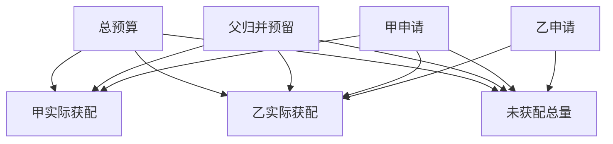

# 父子任务共用一份工具预算

两名 worker 在同一父请求中预留额度，父任务必须留下归并资源。
采用先甲后乙的政策，算出局部不足如何传回父任务。
没有外发的预留可以按政策归还，已发出但无回执的调用不能当作从未消耗。

## 先解决一个具体问题

**为什么不在所有子任务都返回后才统一扣预算？**

那时超额副作用已经发生。
要么预分配互斥额度，要么在每次投递前原子预留。父级需要保留最终核验资源，并记录取消前是否已发往下游。


先从具体的低档设定开始：总预算取 5次、父归并预留取 1次、甲申请取 2次、乙申请取 3次。
三个结果依次是甲实际获配 2次、乙实际获配 2次、未获配总量 1次。
先手算这个起点，读完后再把另一个输入切到高档，这样能知道数字变化时究竟改变了哪个假设。

## 先写清输入边界和三个观测量

用 a 表示总预算，取 5次 或 9次，这两点是用于隔离因果影响的教学输入。

用 b 表示父归并预留，取 1次 或 2次，这两点是用于隔离因果影响的教学输入。

用 c 表示甲申请，取 2次 或 5次，这两点是用于隔离因果影响的教学输入。

用 d 表示乙申请，取 3次 或 6次，这两点是用于隔离因果影响的教学输入。

「甲实际获配」的计算式为 `min(c,a-b)`，按业务量展开是 `min(甲申请,总预算-父归并预留)`，输出单位为次。

「乙实际获配」的计算式为 `min(d,max(0,a-b-c))`，按业务量展开是 `min(乙申请,max(0,总预算-父归并预留-甲申请))`，输出单位为次。

「未获配总量」的计算式为 `max(0,c+d-(a-b))`，按业务量展开是 `max(0,甲申请+乙申请-(总预算-父归并预留))`，输出单位为次。

公式中 ceil 与 floor 分别向上、向下取整，% 在表达式中作取余，** 为乘方，三元条件按“条件 ? 成立值 : 其他值”读取。展示数值最多保留三位小数，比较和反推采用未舍入值。



图上的箭头表示该输入出现在计算式中。同一输入通向多个指标时，三个读数可能共同移动。分支、取整或相互抵消又会使某些边在具体样本上没有可见增量。

## 从输入按单位逐步算到可比较的结果

<details>
<summary>展开推演与对应反例</summary>

### 样本 0000：总预算 5、父归并预留 1

这一组设定为总预算为 5次、父归并预留为 1次、甲申请为 2次、乙申请为 3次。

代入「甲实际获配」：`min(2,5-1)`，得到 2次。

代入「乙实际获配」：`min(3,max(0,5-1-2))`，得到 2次。

代入「未获配总量」：`max(0,2+3-(5-1))`，得到 1次。

以「乙实际获配」作主读数时，本组单独切换甲申请的绝对变化最大或并列最大，读数会从 2次 变为 0次。

本组固定其余输入时，分别改变「乙申请」均不会改变 2次 这个主读数，是否影响另一指标仍需另算。

对角样本 1111 的主读数为 2次。它同时改了四项，差额不能充当任一单个因素的净收益。

### 样本 0001：总预算 5、父归并预留 1

这一组设定为总预算为 5次、父归并预留为 1次、甲申请为 2次、乙申请为 6次。


代入「乙实际获配」：`min(6,max(0,5-1-2))`，得到 2次。

代入「未获配总量」：`max(0,2+6-(5-1))`，得到 4次。

以「乙实际获配」作主读数时，本组单独切换总预算的绝对变化最大或并列最大，读数会从 2次 变为 6次。


对角样本 1110 的主读数为 2次。它同时改了四项，差额不能充当任一单个因素的净收益。

### 样本 0010：总预算 5、父归并预留 1

这一组设定为总预算为 5次、父归并预留为 1次、甲申请为 5次、乙申请为 3次。

代入「甲实际获配」：`min(5,5-1)`，得到 4次。

代入「乙实际获配」：`min(3,max(0,5-1-5))`，得到 0次。

代入「未获配总量」：`max(0,5+3-(5-1))`，得到 4次。

以「乙实际获配」作主读数时，本组单独切换总预算的绝对变化最大或并列最大，读数会从 0次 变为 3次。

本组固定其余输入时，分别改变「父归并预留」、「乙申请」均不会改变 0次 这个主读数，是否影响另一指标仍需另算。

对角样本 1101 的主读数为 5次。它同时改了四项，差额不能充当任一单个因素的净收益。

### 样本 0011：总预算 5、父归并预留 1

这一组设定为总预算为 5次、父归并预留为 1次、甲申请为 5次、乙申请为 6次。


代入「乙实际获配」：`min(6,max(0,5-1-5))`，得到 0次。

代入「未获配总量」：`max(0,5+6-(5-1))`，得到 7次。


对角样本 1100 的主读数为 3次。它同时改了四项，差额不能充当任一单个因素的净收益。

### 样本 0100：总预算 5、父归并预留 2

这一组设定为总预算为 5次、父归并预留为 2次、甲申请为 2次、乙申请为 3次。

代入「甲实际获配」：`min(2,5-2)`，得到 2次。

代入「乙实际获配」：`min(3,max(0,5-2-2))`，得到 1次。

代入「未获配总量」：`max(0,2+3-(5-2))`，得到 2次。

以「乙实际获配」作主读数时，本组单独切换总预算的绝对变化最大或并列最大，读数会从 1次 变为 3次。

本组固定其余输入时，分别改变「乙申请」均不会改变 1次 这个主读数，是否影响另一指标仍需另算。

对角样本 1011 的主读数为 3次。它同时改了四项，差额不能充当任一单个因素的净收益。

### 样本 0101：总预算 5、父归并预留 2

这一组设定为总预算为 5次、父归并预留为 2次、甲申请为 2次、乙申请为 6次。


代入「乙实际获配」：`min(6,max(0,5-2-2))`，得到 1次。

代入「未获配总量」：`max(0,2+6-(5-2))`，得到 5次。

以「乙实际获配」作主读数时，本组单独切换总预算的绝对变化最大或并列最大，读数会从 1次 变为 5次。


对角样本 1010 的主读数为 3次。它同时改了四项，差额不能充当任一单个因素的净收益。

### 样本 0110：总预算 5、父归并预留 2

这一组设定为总预算为 5次、父归并预留为 2次、甲申请为 5次、乙申请为 3次。

代入「甲实际获配」：`min(5,5-2)`，得到 3次。

代入「乙实际获配」：`min(3,max(0,5-2-5))`，得到 0次。

代入「未获配总量」：`max(0,5+3-(5-2))`，得到 5次。

以「乙实际获配」作主读数时，本组单独切换总预算的绝对变化最大或并列最大，读数会从 0次 变为 2次。


对角样本 1001 的主读数为 6次。它同时改了四项，差额不能充当任一单个因素的净收益。

### 样本 0111：总预算 5、父归并预留 2

这一组设定为总预算为 5次、父归并预留为 2次、甲申请为 5次、乙申请为 6次。


代入「乙实际获配」：`min(6,max(0,5-2-5))`，得到 0次。

代入「未获配总量」：`max(0,5+6-(5-2))`，得到 8次。


对角样本 1000 的主读数为 3次。它同时改了四项，差额不能充当任一单个因素的净收益。

### 样本 1000：总预算 9、父归并预留 1

这一组设定为总预算为 9次、父归并预留为 1次、甲申请为 2次、乙申请为 3次。

代入「甲实际获配」：`min(2,9-1)`，得到 2次。

代入「乙实际获配」：`min(3,max(0,9-1-2))`，得到 3次。

代入「未获配总量」：`max(0,2+3-(9-1))`，得到 0次。

以「乙实际获配」作主读数时，本组单独切换乙申请的绝对变化最大或并列最大，读数会从 3次 变为 6次。

本组固定其余输入时，分别改变「父归并预留」、「甲申请」均不会改变 3次 这个主读数，是否影响另一指标仍需另算。

对角样本 0111 的主读数为 0次。它同时改了四项，差额不能充当任一单个因素的净收益。

### 样本 1001：总预算 9、父归并预留 1

这一组设定为总预算为 9次、父归并预留为 1次、甲申请为 2次、乙申请为 6次。


代入「乙实际获配」：`min(6,max(0,9-1-2))`，得到 6次。

代入「未获配总量」：`max(0,2+6-(9-1))`，得到 0次。

以「乙实际获配」作主读数时，本组单独切换总预算的绝对变化最大或并列最大，读数会从 6次 变为 2次。

对角样本 0110 的主读数为 0次。它同时改了四项，差额不能充当任一单个因素的净收益。

### 样本 1010：总预算 9、父归并预留 1

这一组设定为总预算为 9次、父归并预留为 1次、甲申请为 5次、乙申请为 3次。

代入「甲实际获配」：`min(5,9-1)`，得到 5次。

代入「乙实际获配」：`min(3,max(0,9-1-5))`，得到 3次。

代入「未获配总量」：`max(0,5+3-(9-1))`，得到 0次。

以「乙实际获配」作主读数时，本组单独切换总预算的绝对变化最大或并列最大，读数会从 3次 变为 0次。

本组固定其余输入时，分别改变「甲申请」、「乙申请」均不会改变 3次 这个主读数，是否影响另一指标仍需另算。

对角样本 0101 的主读数为 1次。它同时改了四项，差额不能充当任一单个因素的净收益。

### 样本 1011：总预算 9、父归并预留 1

这一组设定为总预算为 9次、父归并预留为 1次、甲申请为 5次、乙申请为 6次。


代入「乙实际获配」：`min(6,max(0,9-1-5))`，得到 3次。

代入「未获配总量」：`max(0,5+6-(9-1))`，得到 3次。


本组固定其余输入时，分别改变「乙申请」均不会改变 3次 这个主读数，是否影响另一指标仍需另算。

对角样本 0100 的主读数为 1次。它同时改了四项，差额不能充当任一单个因素的净收益。

### 样本 1100：总预算 9、父归并预留 2

这一组设定为总预算为 9次、父归并预留为 2次、甲申请为 2次、乙申请为 3次。

代入「甲实际获配」：`min(2,9-2)`，得到 2次。

代入「乙实际获配」：`min(3,max(0,9-2-2))`，得到 3次。

代入「未获配总量」：`max(0,2+3-(9-2))`，得到 0次。

以「乙实际获配」作主读数时，本组单独切换总预算的绝对变化最大或并列最大，读数会从 3次 变为 1次。

本组固定其余输入时，分别改变「父归并预留」均不会改变 3次 这个主读数，是否影响另一指标仍需另算。

对角样本 0011 的主读数为 0次。它同时改了四项，差额不能充当任一单个因素的净收益。

### 样本 1101：总预算 9、父归并预留 2

这一组设定为总预算为 9次、父归并预留为 2次、甲申请为 2次、乙申请为 6次。


代入「乙实际获配」：`min(6,max(0,9-2-2))`，得到 5次。

代入「未获配总量」：`max(0,2+6-(9-2))`，得到 1次。

以「乙实际获配」作主读数时，本组单独切换总预算的绝对变化最大或并列最大，读数会从 5次 变为 1次。

对角样本 0010 的主读数为 0次。它同时改了四项，差额不能充当任一单个因素的净收益。

### 样本 1110：总预算 9、父归并预留 2

这一组设定为总预算为 9次、父归并预留为 2次、甲申请为 5次、乙申请为 3次。

代入「甲实际获配」：`min(5,9-2)`，得到 5次。

代入「乙实际获配」：`min(3,max(0,9-2-5))`，得到 2次。

代入「未获配总量」：`max(0,5+3-(9-2))`，得到 1次。

以「乙实际获配」作主读数时，本组单独切换总预算的绝对变化最大或并列最大，读数会从 2次 变为 0次。


对角样本 0001 的主读数为 2次。它同时改了四项，差额不能充当任一单个因素的净收益。

### 样本 1111：总预算 9、父归并预留 2

这一组设定为总预算为 9次、父归并预留为 2次、甲申请为 5次、乙申请为 6次。


代入「乙实际获配」：`min(6,max(0,9-2-5))`，得到 2次。

代入「未获配总量」：`max(0,5+6-(9-2))`，得到 4次。

以「乙实际获配」作主读数时，本组单独切换甲申请的绝对变化最大或并列最大，读数会从 2次 变为 5次。


对角样本 0000 的主读数为 2次。它同时改了四项，差额不能充当任一单个因素的净收益。

</details>

## 逐个干预：其余条件固定时，变化真的发生在哪里

<details>
<summary>展开推演与对应反例</summary>

### 只改变总预算

固定父归并预留为 1次、甲申请为 2次、乙申请为 3次，只把总预算从 5次改到 9次。
这一对的甲实际获配从 2次 变为 2次，乙实际获配的差为 1次，未获配总量的差为 -1次。

固定父归并预留为 1次、甲申请为 2次、乙申请为 6次，只把总预算从 5次改到 9次。
这一对的甲实际获配从 2次 变为 2次，乙实际获配的差为 4次，未获配总量的差为 -4次。

固定父归并预留为 1次、甲申请为 5次、乙申请为 3次，只把总预算从 5次改到 9次。
这一对的甲实际获配从 4次 变为 5次，乙实际获配的差为 3次，未获配总量的差为 -4次。

固定父归并预留为 1次、甲申请为 5次、乙申请为 6次，只把总预算从 5次改到 9次。

固定父归并预留为 2次、甲申请为 2次、乙申请为 3次，只把总预算从 5次改到 9次。
这一对的甲实际获配从 2次 变为 2次，乙实际获配的差为 2次，未获配总量的差为 -2次。

固定父归并预留为 2次、甲申请为 2次、乙申请为 6次，只把总预算从 5次改到 9次。

固定父归并预留为 2次、甲申请为 5次、乙申请为 3次，只把总预算从 5次改到 9次。
这一对的甲实际获配从 3次 变为 5次，乙实际获配的差为 2次，未获配总量的差为 -4次。

固定父归并预留为 2次、甲申请为 5次、乙申请为 6次，只把总预算从 5次改到 9次。

综合八组受控背景，总预算升到较高设定时「甲实际获配」的差值区间是 0次 至 2次，共有 4 对出现可观察变化。

综合八组受控背景，总预算升到较高设定时「乙实际获配」的差值区间是 1次 至 4次，共有 8 对出现可观察变化。

综合八组受控背景，总预算升到较高设定时「未获配总量」的差值区间是 -4次 至 -1次，共有 8 对出现可观察变化。

### 只改变父归并预留

固定总预算为 5次、甲申请为 2次、乙申请为 3次，只把父归并预留从 1次改到 2次。
这一对的甲实际获配从 2次 变为 2次，乙实际获配的差为 -1次，未获配总量的差为 1次。

固定总预算为 5次、甲申请为 2次、乙申请为 6次，只把父归并预留从 1次改到 2次。

固定总预算为 5次、甲申请为 5次、乙申请为 3次，只把父归并预留从 1次改到 2次。
这一对的甲实际获配从 4次 变为 3次，乙实际获配的差为 0次，未获配总量的差为 1次。

固定总预算为 5次、甲申请为 5次、乙申请为 6次，只把父归并预留从 1次改到 2次。

固定总预算为 9次、甲申请为 2次、乙申请为 3次，只把父归并预留从 1次改到 2次。
这一对的甲实际获配从 2次 变为 2次，乙实际获配的差为 0次，未获配总量的差为 0次。

固定总预算为 9次、甲申请为 2次、乙申请为 6次，只把父归并预留从 1次改到 2次。

固定总预算为 9次、甲申请为 5次、乙申请为 3次，只把父归并预留从 1次改到 2次。
这一对的甲实际获配从 5次 变为 5次，乙实际获配的差为 -1次，未获配总量的差为 1次。

固定总预算为 9次、甲申请为 5次、乙申请为 6次，只把父归并预留从 1次改到 2次。

综合八组受控背景，父归并预留升到较高设定时「甲实际获配」的差值区间是 -1次 至 0次，共有 2 对出现可观察变化。

综合八组受控背景，父归并预留升到较高设定时「乙实际获配」的差值区间是 -1次 至 0次，共有 5 对出现可观察变化。

综合八组受控背景，父归并预留升到较高设定时「未获配总量」的差值区间是 0次 至 1次，共有 7 对出现可观察变化。

### 只改变甲申请

固定总预算为 5次、父归并预留为 1次、乙申请为 3次，只把甲申请从 2次改到 5次。
这一对的甲实际获配从 2次 变为 4次，乙实际获配的差为 -2次，未获配总量的差为 3次。

固定总预算为 5次、父归并预留为 1次、乙申请为 6次，只把甲申请从 2次改到 5次。

固定总预算为 5次、父归并预留为 2次、乙申请为 3次，只把甲申请从 2次改到 5次。
这一对的甲实际获配从 2次 变为 3次，乙实际获配的差为 -1次，未获配总量的差为 3次。

固定总预算为 5次、父归并预留为 2次、乙申请为 6次，只把甲申请从 2次改到 5次。

固定总预算为 9次、父归并预留为 1次、乙申请为 3次，只把甲申请从 2次改到 5次。
这一对的甲实际获配从 2次 变为 5次，乙实际获配的差为 0次，未获配总量的差为 0次。

固定总预算为 9次、父归并预留为 1次、乙申请为 6次，只把甲申请从 2次改到 5次。
这一对的甲实际获配从 2次 变为 5次，乙实际获配的差为 -3次，未获配总量的差为 3次。

固定总预算为 9次、父归并预留为 2次、乙申请为 3次，只把甲申请从 2次改到 5次。
这一对的甲实际获配从 2次 变为 5次，乙实际获配的差为 -1次，未获配总量的差为 1次。

固定总预算为 9次、父归并预留为 2次、乙申请为 6次，只把甲申请从 2次改到 5次。

综合八组受控背景，甲申请升到较高设定时「甲实际获配」的差值区间是 1次 至 3次，共有 8 对出现可观察变化。

综合八组受控背景，甲申请升到较高设定时「乙实际获配」的差值区间是 -3次 至 0次，共有 7 对出现可观察变化。

综合八组受控背景，甲申请升到较高设定时「未获配总量」的差值区间是 0次 至 3次，共有 7 对出现可观察变化。

### 只改变乙申请

固定总预算为 5次、父归并预留为 1次、甲申请为 2次，只把乙申请从 3次改到 6次。
这一对的甲实际获配从 2次 变为 2次，乙实际获配的差为 0次，未获配总量的差为 3次。

固定总预算为 5次、父归并预留为 1次、甲申请为 5次，只把乙申请从 3次改到 6次。
这一对的甲实际获配从 4次 变为 4次，乙实际获配的差为 0次，未获配总量的差为 3次。

固定总预算为 5次、父归并预留为 2次、甲申请为 2次，只把乙申请从 3次改到 6次。

固定总预算为 5次、父归并预留为 2次、甲申请为 5次，只把乙申请从 3次改到 6次。
这一对的甲实际获配从 3次 变为 3次，乙实际获配的差为 0次，未获配总量的差为 3次。

固定总预算为 9次、父归并预留为 1次、甲申请为 2次，只把乙申请从 3次改到 6次。
这一对的甲实际获配从 2次 变为 2次，乙实际获配的差为 3次，未获配总量的差为 0次。

固定总预算为 9次、父归并预留为 1次、甲申请为 5次，只把乙申请从 3次改到 6次。
这一对的甲实际获配从 5次 变为 5次，乙实际获配的差为 0次，未获配总量的差为 3次。

固定总预算为 9次、父归并预留为 2次、甲申请为 2次，只把乙申请从 3次改到 6次。
这一对的甲实际获配从 2次 变为 2次，乙实际获配的差为 2次，未获配总量的差为 1次。

固定总预算为 9次、父归并预留为 2次、甲申请为 5次，只把乙申请从 3次改到 6次。

综合八组受控背景，乙申请升到较高设定时「甲实际获配」的差值区间是 0次，共有 0 对出现可观察变化。

综合八组受控背景，乙申请升到较高设定时「乙实际获配」的差值区间是 0次 至 3次，共有 2 对出现可观察变化。

综合八组受控背景，乙申请升到较高设定时「未获配总量」的差值区间是 0次 至 3次，共有 7 对出现可观察变化。

</details>

## 只拿到部分输入，结论还能缩小到多大范围

<details>
<summary>展开推演与对应反例</summary>

### 已知总预算和父归并预留

当总预算为 5次、父归并预留为 1次时，另两项有四种补全，主读数「乙实际获配」只能限定为 0次 至 2次。
这个条件下，取甲申请为 5次、乙申请为 3次可得到下界 0次，取甲申请为 2次、乙申请为 3次可达到上界 2次。

用同样可见的总预算为 5次、父归并预留为 1次去推「甲实际获配」，能得到的范围为 2次 至 4次，不能把另一个指标的单位代入。

用同样可见的总预算为 5次、父归并预留为 1次去推「未获配总量」，能得到的范围为 1次 至 7次，不能把另一个指标的单位代入。

若只许再问一项，按最坏区间宽度优先核对甲申请，补得低档时为 2次，高档时为 0次。

当总预算为 5次、父归并预留为 2次时，另两项有四种补全，主读数「乙实际获配」只能限定为 0次 至 1次。
这个条件下，取甲申请为 5次、乙申请为 3次可得到下界 0次，取甲申请为 2次、乙申请为 3次可达到上界 1次。

用同样可见的总预算为 5次、父归并预留为 2次去推「甲实际获配」，能得到的范围为 2次 至 3次，不能把另一个指标的单位代入。

用同样可见的总预算为 5次、父归并预留为 2次去推「未获配总量」，能得到的范围为 2次 至 8次，不能把另一个指标的单位代入。

若只许再问一项，按最坏区间宽度优先核对甲申请，补得低档时为 1次，高档时为 0次。

当总预算为 9次、父归并预留为 1次时，另两项有四种补全，主读数「乙实际获配」只能限定为 3次 至 6次。
这个条件下，取甲申请为 2次、乙申请为 3次可得到下界 3次，取甲申请为 2次、乙申请为 6次可达到上界 6次。

用同样可见的总预算为 9次、父归并预留为 1次去推「甲实际获配」，能得到的范围为 2次 至 5次，不能把另一个指标的单位代入。

用同样可见的总预算为 9次、父归并预留为 1次去推「未获配总量」，能得到的范围为 0次 至 3次，不能把另一个指标的单位代入。

若只许再问一项，按最坏区间宽度优先核对甲申请，补得低档时为 3次 至 6次，高档时为 3次。

当总预算为 9次、父归并预留为 2次时，另两项有四种补全，主读数「乙实际获配」只能限定为 2次 至 5次。
这个条件下，取甲申请为 5次、乙申请为 3次可得到下界 2次，取甲申请为 2次、乙申请为 6次可达到上界 5次。

用同样可见的总预算为 9次、父归并预留为 2次去推「甲实际获配」，能得到的范围为 2次 至 5次，不能把另一个指标的单位代入。

用同样可见的总预算为 9次、父归并预留为 2次去推「未获配总量」，能得到的范围为 0次 至 4次，不能把另一个指标的单位代入。

若只许再问一项，按最坏区间宽度优先核对甲申请，补得低档时为 3次 至 5次，高档时为 2次。

### 已知总预算和甲申请

当总预算为 5次、甲申请为 2次时，另两项有四种补全，主读数「乙实际获配」只能限定为 1次 至 2次。
这个条件下，取父归并预留为 2次、乙申请为 3次可得到下界 1次，取父归并预留为 1次、乙申请为 3次可达到上界 2次。

用同样可见的总预算为 5次、甲申请为 2次去推「甲实际获配」，能得到的范围为 2次，不能把另一个指标的单位代入。

用同样可见的总预算为 5次、甲申请为 2次去推「未获配总量」，能得到的范围为 1次 至 5次，不能把另一个指标的单位代入。

若只许再问一项，按最坏区间宽度优先核对父归并预留，补得低档时为 2次，高档时为 1次。

当总预算为 5次、甲申请为 5次时，另两项有四种补全，主读数「乙实际获配」只能限定为 0次。
这个条件下，取父归并预留为 1次、乙申请为 3次可得到下界 0次，取父归并预留为 1次、乙申请为 3次可达到上界 0次。

用同样可见的总预算为 5次、甲申请为 5次去推「甲实际获配」，能得到的范围为 3次 至 4次，不能把另一个指标的单位代入。

用同样可见的总预算为 5次、甲申请为 5次去推「未获配总量」，能得到的范围为 4次 至 8次，不能把另一个指标的单位代入。

当总预算为 9次、甲申请为 2次时，另两项有四种补全，主读数「乙实际获配」只能限定为 3次 至 6次。
这个条件下，取父归并预留为 1次、乙申请为 3次可得到下界 3次，取父归并预留为 1次、乙申请为 6次可达到上界 6次。

用同样可见的总预算为 9次、甲申请为 2次去推「甲实际获配」，能得到的范围为 2次，不能把另一个指标的单位代入。

用同样可见的总预算为 9次、甲申请为 2次去推「未获配总量」，能得到的范围为 0次 至 1次，不能把另一个指标的单位代入。

若只许再问一项，按最坏区间宽度优先核对乙申请，补得低档时为 3次，高档时为 5次 至 6次。

当总预算为 9次、甲申请为 5次时，另两项有四种补全，主读数「乙实际获配」只能限定为 2次 至 3次。
这个条件下，取父归并预留为 2次、乙申请为 3次可得到下界 2次，取父归并预留为 1次、乙申请为 3次可达到上界 3次。

用同样可见的总预算为 9次、甲申请为 5次去推「甲实际获配」，能得到的范围为 5次，不能把另一个指标的单位代入。

用同样可见的总预算为 9次、甲申请为 5次去推「未获配总量」，能得到的范围为 0次 至 4次，不能把另一个指标的单位代入。

若只许再问一项，按最坏区间宽度优先核对父归并预留，补得低档时为 3次，高档时为 2次。

### 已知父归并预留和甲申请

当父归并预留为 1次、甲申请为 2次时，另两项有四种补全，主读数「乙实际获配」只能限定为 2次 至 6次。
这个条件下，取总预算为 5次、乙申请为 3次可得到下界 2次，取总预算为 9次、乙申请为 6次可达到上界 6次。

用同样可见的父归并预留为 1次、甲申请为 2次去推「甲实际获配」，能得到的范围为 2次，不能把另一个指标的单位代入。

用同样可见的父归并预留为 1次、甲申请为 2次去推「未获配总量」，能得到的范围为 0次 至 4次，不能把另一个指标的单位代入。

若只许再问一项，按最坏区间宽度优先核对总预算，补得低档时为 2次，高档时为 3次 至 6次。

当父归并预留为 1次、甲申请为 5次时，另两项有四种补全，主读数「乙实际获配」只能限定为 0次 至 3次。
这个条件下，取总预算为 5次、乙申请为 3次可得到下界 0次，取总预算为 9次、乙申请为 3次可达到上界 3次。

用同样可见的父归并预留为 1次、甲申请为 5次去推「甲实际获配」，能得到的范围为 4次 至 5次，不能把另一个指标的单位代入。

用同样可见的父归并预留为 1次、甲申请为 5次去推「未获配总量」，能得到的范围为 0次 至 7次，不能把另一个指标的单位代入。

若只许再问一项，按最坏区间宽度优先核对总预算，补得低档时为 0次，高档时为 3次。

当父归并预留为 2次、甲申请为 2次时，另两项有四种补全，主读数「乙实际获配」只能限定为 1次 至 5次。
这个条件下，取总预算为 5次、乙申请为 3次可得到下界 1次，取总预算为 9次、乙申请为 6次可达到上界 5次。

用同样可见的父归并预留为 2次、甲申请为 2次去推「甲实际获配」，能得到的范围为 2次，不能把另一个指标的单位代入。

用同样可见的父归并预留为 2次、甲申请为 2次去推「未获配总量」，能得到的范围为 0次 至 5次，不能把另一个指标的单位代入。

若只许再问一项，按最坏区间宽度优先核对总预算，补得低档时为 1次，高档时为 3次 至 5次。

当父归并预留为 2次、甲申请为 5次时，另两项有四种补全，主读数「乙实际获配」只能限定为 0次 至 2次。
这个条件下，取总预算为 5次、乙申请为 3次可得到下界 0次，取总预算为 9次、乙申请为 3次可达到上界 2次。

用同样可见的父归并预留为 2次、甲申请为 5次去推「甲实际获配」，能得到的范围为 3次 至 5次，不能把另一个指标的单位代入。

用同样可见的父归并预留为 2次、甲申请为 5次去推「未获配总量」，能得到的范围为 1次 至 8次，不能把另一个指标的单位代入。

若只许再问一项，按最坏区间宽度优先核对总预算，补得低档时为 0次，高档时为 2次。

### 已知总预算和乙申请

当总预算为 5次、乙申请为 3次时，另两项有四种补全，主读数「乙实际获配」只能限定为 0次 至 2次。
这个条件下，取父归并预留为 1次、甲申请为 5次可得到下界 0次，取父归并预留为 1次、甲申请为 2次可达到上界 2次。

用同样可见的总预算为 5次、乙申请为 3次去推「甲实际获配」，能得到的范围为 2次 至 4次，不能把另一个指标的单位代入。

用同样可见的总预算为 5次、乙申请为 3次去推「未获配总量」，能得到的范围为 1次 至 5次，不能把另一个指标的单位代入。

若只许再问一项，按最坏区间宽度优先核对甲申请，补得低档时为 1次 至 2次，高档时为 0次。

当总预算为 5次、乙申请为 6次时，另两项有四种补全，主读数「乙实际获配」只能限定为 0次 至 2次。

用同样可见的总预算为 5次、乙申请为 6次去推「甲实际获配」，能得到的范围为 2次 至 4次，不能把另一个指标的单位代入。

用同样可见的总预算为 5次、乙申请为 6次去推「未获配总量」，能得到的范围为 4次 至 8次，不能把另一个指标的单位代入。


当总预算为 9次、乙申请为 3次时，另两项有四种补全，主读数「乙实际获配」只能限定为 2次 至 3次。
这个条件下，取父归并预留为 2次、甲申请为 5次可得到下界 2次，取父归并预留为 1次、甲申请为 2次可达到上界 3次。

用同样可见的总预算为 9次、乙申请为 3次去推「甲实际获配」，能得到的范围为 2次 至 5次，不能把另一个指标的单位代入。

用同样可见的总预算为 9次、乙申请为 3次去推「未获配总量」，能得到的范围为 0次 至 1次，不能把另一个指标的单位代入。

若只许再问一项，按最坏区间宽度优先核对父归并预留，补得低档时为 3次，高档时为 2次 至 3次。

当总预算为 9次、乙申请为 6次时，另两项有四种补全，主读数「乙实际获配」只能限定为 2次 至 6次。
这个条件下，取父归并预留为 2次、甲申请为 5次可得到下界 2次，取父归并预留为 1次、甲申请为 2次可达到上界 6次。

用同样可见的总预算为 9次、乙申请为 6次去推「甲实际获配」，能得到的范围为 2次 至 5次，不能把另一个指标的单位代入。

用同样可见的总预算为 9次、乙申请为 6次去推「未获配总量」，能得到的范围为 0次 至 4次，不能把另一个指标的单位代入。

若只许再问一项，按最坏区间宽度优先核对甲申请，补得低档时为 5次 至 6次，高档时为 2次 至 3次。

### 已知父归并预留和乙申请

当父归并预留为 1次、乙申请为 3次时，另两项有四种补全，主读数「乙实际获配」只能限定为 0次 至 3次。
这个条件下，取总预算为 5次、甲申请为 5次可得到下界 0次，取总预算为 9次、甲申请为 2次可达到上界 3次。

用同样可见的父归并预留为 1次、乙申请为 3次去推「甲实际获配」，能得到的范围为 2次 至 5次，不能把另一个指标的单位代入。

用同样可见的父归并预留为 1次、乙申请为 3次去推「未获配总量」，能得到的范围为 0次 至 4次，不能把另一个指标的单位代入。

若只许再问一项，按最坏区间宽度优先核对总预算，补得低档时为 0次 至 2次，高档时为 3次。

当父归并预留为 1次、乙申请为 6次时，另两项有四种补全，主读数「乙实际获配」只能限定为 0次 至 6次。
这个条件下，取总预算为 5次、甲申请为 5次可得到下界 0次，取总预算为 9次、甲申请为 2次可达到上界 6次。

用同样可见的父归并预留为 1次、乙申请为 6次去推「甲实际获配」，能得到的范围为 2次 至 5次，不能把另一个指标的单位代入。

用同样可见的父归并预留为 1次、乙申请为 6次去推「未获配总量」，能得到的范围为 0次 至 7次，不能把另一个指标的单位代入。

若只许再问一项，按最坏区间宽度优先核对总预算，补得低档时为 0次 至 2次，高档时为 3次 至 6次。

当父归并预留为 2次、乙申请为 3次时，另两项有四种补全，主读数「乙实际获配」只能限定为 0次 至 3次。

用同样可见的父归并预留为 2次、乙申请为 3次去推「甲实际获配」，能得到的范围为 2次 至 5次，不能把另一个指标的单位代入。

用同样可见的父归并预留为 2次、乙申请为 3次去推「未获配总量」，能得到的范围为 0次 至 5次，不能把另一个指标的单位代入。

若只许再问一项，按最坏区间宽度优先核对总预算，补得低档时为 0次 至 1次，高档时为 2次 至 3次。

当父归并预留为 2次、乙申请为 6次时，另两项有四种补全，主读数「乙实际获配」只能限定为 0次 至 5次。
这个条件下，取总预算为 5次、甲申请为 5次可得到下界 0次，取总预算为 9次、甲申请为 2次可达到上界 5次。

用同样可见的父归并预留为 2次、乙申请为 6次去推「甲实际获配」，能得到的范围为 2次 至 5次，不能把另一个指标的单位代入。

用同样可见的父归并预留为 2次、乙申请为 6次去推「未获配总量」，能得到的范围为 1次 至 8次，不能把另一个指标的单位代入。

若只许再问一项，按最坏区间宽度优先核对总预算，补得低档时为 0次 至 1次，高档时为 2次 至 5次。

### 已知甲申请和乙申请

当甲申请为 2次、乙申请为 3次时，另两项有四种补全，主读数「乙实际获配」只能限定为 1次 至 3次。
这个条件下，取总预算为 5次、父归并预留为 2次可得到下界 1次，取总预算为 9次、父归并预留为 1次可达到上界 3次。

用同样可见的甲申请为 2次、乙申请为 3次去推「甲实际获配」，能得到的范围为 2次，不能把另一个指标的单位代入。

用同样可见的甲申请为 2次、乙申请为 3次去推「未获配总量」，能得到的范围为 0次 至 2次，不能把另一个指标的单位代入。

若只许再问一项，按最坏区间宽度优先核对总预算，补得低档时为 1次 至 2次，高档时为 3次。

当甲申请为 2次、乙申请为 6次时，另两项有四种补全，主读数「乙实际获配」只能限定为 1次 至 6次。
这个条件下，取总预算为 5次、父归并预留为 2次可得到下界 1次，取总预算为 9次、父归并预留为 1次可达到上界 6次。

用同样可见的甲申请为 2次、乙申请为 6次去推「甲实际获配」，能得到的范围为 2次，不能把另一个指标的单位代入。

用同样可见的甲申请为 2次、乙申请为 6次去推「未获配总量」，能得到的范围为 0次 至 5次，不能把另一个指标的单位代入。

若只许再问一项，按最坏区间宽度优先核对总预算，补得低档时为 1次 至 2次，高档时为 5次 至 6次。

当甲申请为 5次、乙申请为 3次时，另两项有四种补全，主读数「乙实际获配」只能限定为 0次 至 3次。
这个条件下，取总预算为 5次、父归并预留为 1次可得到下界 0次，取总预算为 9次、父归并预留为 1次可达到上界 3次。

用同样可见的甲申请为 5次、乙申请为 3次去推「甲实际获配」，能得到的范围为 3次 至 5次，不能把另一个指标的单位代入。

用同样可见的甲申请为 5次、乙申请为 3次去推「未获配总量」，能得到的范围为 0次 至 5次，不能把另一个指标的单位代入。

若只许再问一项，按最坏区间宽度优先核对总预算，补得低档时为 0次，高档时为 2次 至 3次。

当甲申请为 5次、乙申请为 6次时，另两项有四种补全，主读数「乙实际获配」只能限定为 0次 至 3次。

用同样可见的甲申请为 5次、乙申请为 6次去推「甲实际获配」，能得到的范围为 3次 至 5次，不能把另一个指标的单位代入。

用同样可见的甲申请为 5次、乙申请为 6次去推「未获配总量」，能得到的范围为 3次 至 8次，不能把另一个指标的单位代入。


</details>

## 反过来审查一份报表：能从结果还原哪些输入

<details>
<summary>展开推演与对应反例</summary>

### 仅保留“甲实际获配”的读数

报表只写「甲实际获配=2次」时，在本实验的离散取值中有 8 组输入与之相容。

对这个 2次 的「甲实际获配」读数，所有相容样本都要求甲申请为 2次。

只凭「甲实际获配」的 2次 无法确定总预算：0000 与 1000 的取值分别为 5 和 9次。

报表只写「甲实际获配=4次」时，在本实验的离散取值中有 2 组输入与之相容。

对这个 4次 的「甲实际获配」读数，所有相容样本都要求总预算为 5次、父归并预留为 1次、甲申请为 5次。

只凭「甲实际获配」的 4次 无法确定乙申请：0010 与 0011 的取值分别为 3 和 6次。

报表只写「甲实际获配=3次」时，在本实验的离散取值中有 2 组输入与之相容。

对这个 3次 的「甲实际获配」读数，所有相容样本都要求总预算为 5次、父归并预留为 2次、甲申请为 5次。

只凭「甲实际获配」的 3次 无法确定乙申请：0110 与 0111 的取值分别为 3 和 6次。

报表只写「甲实际获配=5次」时，在本实验的离散取值中有 4 组输入与之相容。

对这个 5次 的「甲实际获配」读数，所有相容样本都要求总预算为 9次、甲申请为 5次。

只凭「甲实际获配」的 5次 无法确定父归并预留：1010 与 1110 的取值分别为 1 和 2次。

### 仅保留“乙实际获配”的读数

报表只写「乙实际获配=2次」时，在本实验的离散取值中有 4 组输入与之相容。

只凭「乙实际获配」的 2次 无法确定总预算：0000 与 1110 的取值分别为 5 和 9次。

报表只写「乙实际获配=0次」时，在本实验的离散取值中有 4 组输入与之相容。

对这个 0次 的「乙实际获配」读数，所有相容样本都要求总预算为 5次、甲申请为 5次。

只凭「乙实际获配」的 0次 无法确定父归并预留：0010 与 0110 的取值分别为 1 和 2次。

报表只写「乙实际获配=1次」时，在本实验的离散取值中有 2 组输入与之相容。

对这个 1次 的「乙实际获配」读数，所有相容样本都要求总预算为 5次、父归并预留为 2次、甲申请为 2次。

只凭「乙实际获配」的 1次 无法确定乙申请：0100 与 0101 的取值分别为 3 和 6次。

报表只写「乙实际获配=3次」时，在本实验的离散取值中有 4 组输入与之相容。

对这个 3次 的「乙实际获配」读数，所有相容样本都要求总预算为 9次。

只凭「乙实际获配」的 3次 无法确定父归并预留：1000 与 1100 的取值分别为 1 和 2次。

报表只写「乙实际获配=6次」时，在本实验的离散取值中有 1 组输入与之相容。

对这个 6次 的「乙实际获配」读数，所有相容样本都要求总预算为 9次、父归并预留为 1次、甲申请为 2次、乙申请为 6次。

报表只写「乙实际获配=5次」时，在本实验的离散取值中有 1 组输入与之相容。

对这个 5次 的「乙实际获配」读数，所有相容样本都要求总预算为 9次、父归并预留为 2次、甲申请为 2次、乙申请为 6次。

### 仅保留“未获配总量”的读数

报表只写「未获配总量=1次」时，在本实验的离散取值中有 3 组输入与之相容。

只凭「未获配总量」的 1次 无法确定总预算：0000 与 1101 的取值分别为 5 和 9次。

报表只写「未获配总量=4次」时，在本实验的离散取值中有 3 组输入与之相容。

只凭「未获配总量」的 4次 无法确定总预算：0001 与 1111 的取值分别为 5 和 9次。

报表只写「未获配总量=7次」时，在本实验的离散取值中有 1 组输入与之相容。

对这个 7次 的「未获配总量」读数，所有相容样本都要求总预算为 5次、父归并预留为 1次、甲申请为 5次、乙申请为 6次。

报表只写「未获配总量=2次」时，在本实验的离散取值中有 1 组输入与之相容。

对这个 2次 的「未获配总量」读数，所有相容样本都要求总预算为 5次、父归并预留为 2次、甲申请为 2次、乙申请为 3次。

报表只写「未获配总量=5次」时，在本实验的离散取值中有 2 组输入与之相容。

对这个 5次 的「未获配总量」读数，所有相容样本都要求总预算为 5次、父归并预留为 2次。

只凭「未获配总量」的 5次 无法确定甲申请：0101 与 0110 的取值分别为 2 和 5次。

报表只写「未获配总量=8次」时，在本实验的离散取值中有 1 组输入与之相容。

对这个 8次 的「未获配总量」读数，所有相容样本都要求总预算为 5次、父归并预留为 2次、甲申请为 5次、乙申请为 6次。

报表只写「未获配总量=0次」时，在本实验的离散取值中有 4 组输入与之相容。

对这个 0次 的「未获配总量」读数，所有相容样本都要求总预算为 9次。

只凭「未获配总量」的 0次 无法确定父归并预留：1000 与 1100 的取值分别为 1 和 2次。

报表只写「未获配总量=3次」时，在本实验的离散取值中有 1 组输入与之相容。

对这个 3次 的「未获配总量」读数，所有相容样本都要求总预算为 9次、父归并预留为 1次、甲申请为 5次、乙申请为 6次。

</details>

## 给错误算法找反例，再给正确算法画使用边界

<details>
<summary>展开推演与对应反例</summary>

### 向每个子任务复制父级全部余量

把「乙实际获配」错写成 `min(d,a-b)`，在 16 组教学输入中有 12 组会与参照计算不同。

对于总预算为 5次、父归并预留为 1次、甲申请为 2次、乙申请为 3次，这个错误口径得 3次，参照式为 2次，偏差为 1次。

对于总预算为 5次、父归并预留为 1次、甲申请为 2次、乙申请为 6次，这个错误口径得 4次，参照式为 2次，偏差为 2次。

对于总预算为 5次、父归并预留为 1次、甲申请为 5次、乙申请为 3次，这个错误口径得 3次，参照式为 0次，偏差为 3次。

对于总预算为 5次、父归并预留为 1次、甲申请为 5次、乙申请为 6次，这个错误口径得 4次，参照式为 0次，偏差为 4次。

对于总预算为 5次、父归并预留为 2次、甲申请为 2次、乙申请为 3次，这个错误口径得 3次，参照式为 1次，偏差为 2次。

对于总预算为 5次、父归并预留为 2次、甲申请为 2次、乙申请为 6次，这个错误口径得 3次，参照式为 1次，偏差为 2次。

对于总预算为 5次、父归并预留为 2次、甲申请为 5次、乙申请为 3次，这个错误口径得 3次，参照式为 0次，偏差为 3次。

对于总预算为 5次、父归并预留为 2次、甲申请为 5次、乙申请为 6次，这个错误口径得 3次，参照式为 0次，偏差为 3次。

样本 1000 令错误式 `min(d,a-b)` 恰好也给出 3次，因此仅拿这次「乙实际获配」做回归发现不了该缺陷。

样本 1001 令错误式 `min(d,a-b)` 恰好也给出 6次，因此仅拿这次「乙实际获配」做回归发现不了该缺陷。

样本 1010 令错误式 `min(d,a-b)` 恰好也给出 3次，因此仅拿这次「乙实际获配」做回归发现不了该缺陷。

对于总预算为 9次、父归并预留为 1次、甲申请为 5次、乙申请为 6次，这个错误口径得 6次，参照式为 3次，偏差为 3次。

样本 1100 令错误式 `min(d,a-b)` 恰好也给出 3次，因此仅拿这次「乙实际获配」做回归发现不了该缺陷。

对于总预算为 9次、父归并预留为 2次、甲申请为 2次、乙申请为 6次，这个错误口径得 6次，参照式为 5次，偏差为 1次。

对于总预算为 9次、父归并预留为 2次、甲申请为 5次、乙申请为 3次，这个错误口径得 3次，参照式为 2次，偏差为 1次。

对于总预算为 9次、父归并预留为 2次、甲申请为 5次、乙申请为 6次，这个错误口径得 6次，参照式为 2次，偏差为 4次。

### 没有给父级归并留资源

把「乙实际获配」错写成 `min(d,max(0,a-c))`，在 16 组教学输入中有 8 组会与参照计算不同。


对于总预算为 5次、父归并预留为 1次、甲申请为 2次、乙申请为 6次，这个错误口径得 3次，参照式为 2次，偏差为 1次。

样本 0010 令错误式 `min(d,max(0,a-c))` 恰好也给出 0次，因此仅拿这次「乙实际获配」做回归发现不了该缺陷。

样本 0011 令错误式 `min(d,max(0,a-c))` 恰好也给出 0次，因此仅拿这次「乙实际获配」做回归发现不了该缺陷。


样本 0110 令错误式 `min(d,max(0,a-c))` 恰好也给出 0次，因此仅拿这次「乙实际获配」做回归发现不了该缺陷。

样本 0111 令错误式 `min(d,max(0,a-c))` 恰好也给出 0次，因此仅拿这次「乙实际获配」做回归发现不了该缺陷。

样本 1000 令错误式 `min(d,max(0,a-c))` 恰好也给出 3次，因此仅拿这次「乙实际获配」做回归发现不了该缺陷。

样本 1001 令错误式 `min(d,max(0,a-c))` 恰好也给出 6次，因此仅拿这次「乙实际获配」做回归发现不了该缺陷。

样本 1010 令错误式 `min(d,max(0,a-c))` 恰好也给出 3次，因此仅拿这次「乙实际获配」做回归发现不了该缺陷。

对于总预算为 9次、父归并预留为 1次、甲申请为 5次、乙申请为 6次，这个错误口径得 4次，参照式为 3次，偏差为 1次。

样本 1100 令错误式 `min(d,max(0,a-c))` 恰好也给出 3次，因此仅拿这次「乙实际获配」做回归发现不了该缺陷。


对于总预算为 9次、父归并预留为 2次、甲申请为 5次、乙申请为 6次，这个错误口径得 4次，参照式为 2次，偏差为 2次。

</details>

## 从教学算例回到可验证的工程结论

要把这些数写入项目说明，先用真实输入替换教学常数，列明样本分母、实际资源限制和观测边界，再验证公式所需前提。两点敏感性只描述这两个设定之间的差异。

## 面试复述与复算

面试题可以从“为什么不在所有子任务都返回后才统一扣预算？”起步。先给出本篇的触发条件和一条真实执行端可检查的证据，再用一个相邻反例限定结论的适用范围。

在仓库根目录执行下列命令可以重算本篇的一个输入。四位数字依次选择正文列出的四项条件，0 表示未成立或低档，1 表示成立或高档。
```powershell
node examples/reading-cases/replay.mjs 7 6 0101
```

[本周主文](../theory.md) · [配套实验](../lab.md) · [下一篇研读](07.md)
