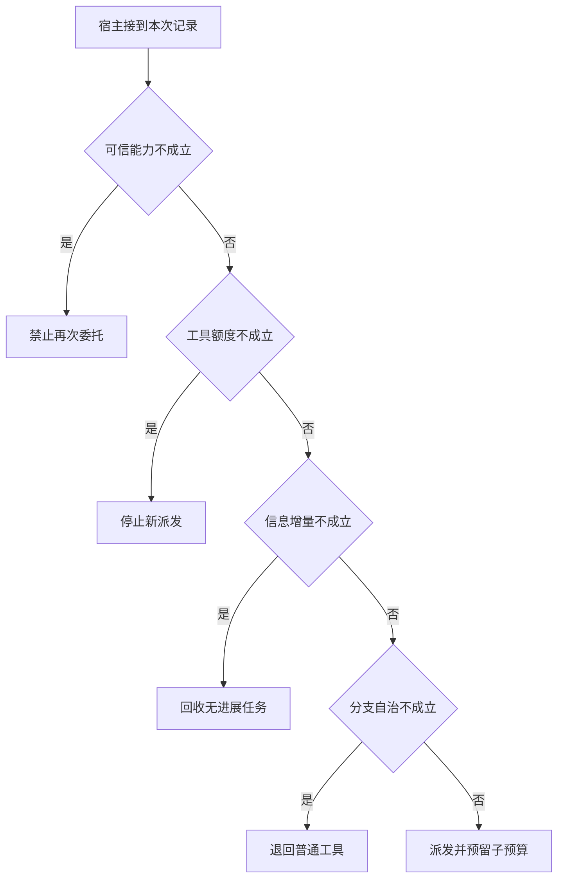

# 递归委托与统一预算

父任务派给子任务以后还要预留最后的核验。
若每个子任务都看见父任务的全部额度，等归并时才扣账会突破全局上限。
没有新信息的递归也应有退出路径。

本篇用一个封闭的教学决策器说明这一问题。输入是宿主收到的记录，不保证每个下游字段都已经获准使用。前置检查未成立时，下游即使带着缓存值，也不能拿来作业务断言。

## 先解决一个具体问题

**让两个模型辩论直到一致，能替代外部取证吗？**

如果两者共享一段错误摘要，一致只是重复同一个盲点。
把待争议的命题、可接受的来源、预算与无法裁决时的退出写进契约，再比较独立分工是否有用。


先取一个能走到「派发并预留子预算」的输入：宿主确认当前主体获准、可预留本次尝试额度、本次增加了新信息、分支内需独立选下一步。
把这四个条件代回后文的图，前面各个拦截分支都未满足，最终才有“有独立需求与可用资源”这个判断。
还原这个现场时要分别问：哪些位来自可信状态，哪些只是在接口中出现、尚未获得解释资格的字段。

## 先沿一次决策走到底



从上到下取第一条成立的出口。只改一个开关时，只有它之前的检查都未截断，该变化才可能到达真实动作。

“可信能力”的两种输入分别是“宿主确认当前主体获准”与“当前主体未获授权”。
权限取自可信入口或执行端，不由模型生成。

“工具额度”的两种输入分别是“可预留本次尝试额度”与“下游尝试额度不足”。
实际投递之前要核算重试或整批调用所需资源。

“信息增量”的两种输入分别是“本次增加了新信息”与“同版本同范围没有新增事实”。
换一个调用编号不自动代表任务有进展。

“分支自治”的两种输入分别是“分支内需独立选下一步”与“分支只执行已知函数”。
并行普通工具与独立决策者有不同代价。

## 最少需要哪几项观察

### 禁止再次委托

父级未授予能力。
在本节的全部组合中，有 8 种产生「禁止再次委托」，这只是逻辑空间的计数，不能当作实际用户请求的比例。

只取得当前主体未获授权，已经足以要求宿主「禁止再次委托」。
保持这些已知项，其余开关自由变化，仍有 8 种补全，判断没有翻转。

若删掉关于可信能力的证据，另一份允许的现场是宿主确认当前主体获准、下游尝试额度不足、同版本同范围没有新增事实、分支只执行已知函数，它会使宿主「停止新派发」。

### 停止新派发

统一尝试账本已用尽。
在本节的全部组合中，有 4 种产生「停止新派发」，这只是逻辑空间的计数，不能当作实际用户请求的比例。

只取得宿主确认当前主体获准、下游尝试额度不足，已经足以要求宿主「停止新派发」。
保持这些已知项，其余开关自由变化，仍有 4 种补全，判断没有翻转。

若删掉关于可信能力的证据，另一份允许的现场是当前主体未获授权、下游尝试额度不足、同版本同范围没有新增事实、分支只执行已知函数，它会使宿主「禁止再次委托」。

若删掉关于工具额度的证据，另一份允许的现场是宿主确认当前主体获准、可预留本次尝试额度、同版本同范围没有新增事实、分支只执行已知函数，它会使宿主「回收无进展任务」。

### 回收无进展任务

本轮没有新增能改变判断的观察。
在本节的全部组合中，有 2 种产生「回收无进展任务」，这只是逻辑空间的计数，不能当作实际用户请求的比例。

只取得宿主确认当前主体获准、可预留本次尝试额度、同版本同范围没有新增事实，已经足以要求宿主「回收无进展任务」。
保持这些已知项，其余开关自由变化，仍有 2 种补全，判断没有翻转。

若删掉关于可信能力的证据，另一份允许的现场是当前主体未获授权、可预留本次尝试额度、同版本同范围没有新增事实、分支只执行已知函数，它会使宿主「禁止再次委托」。

若删掉关于工具额度的证据，另一份允许的现场是宿主确认当前主体获准、下游尝试额度不足、同版本同范围没有新增事实、分支只执行已知函数，它会使宿主「停止新派发」。

若删掉关于信息增量的证据，另一份允许的现场是宿主确认当前主体获准、可预留本次尝试额度、本次增加了新信息、分支只执行已知函数，它会使宿主「退回普通工具」。

### 退回普通工具

不需要分支内策略决策。
在本节的全部组合中，有 1 种产生「退回普通工具」，这只是逻辑空间的计数，不能当作实际用户请求的比例。

只取得宿主确认当前主体获准、可预留本次尝试额度、本次增加了新信息、分支只执行已知函数，已经足以要求宿主「退回普通工具」。
保持这些已知项，其余开关自由变化，仍有 1 种补全，判断没有翻转。

若删掉关于可信能力的证据，另一份允许的现场是当前主体未获授权、可预留本次尝试额度、本次增加了新信息、分支只执行已知函数，它会使宿主「禁止再次委托」。

若删掉关于工具额度的证据，另一份允许的现场是宿主确认当前主体获准、下游尝试额度不足、本次增加了新信息、分支只执行已知函数，它会使宿主「停止新派发」。

若删掉关于信息增量的证据，另一份允许的现场是宿主确认当前主体获准、可预留本次尝试额度、同版本同范围没有新增事实、分支只执行已知函数，它会使宿主「回收无进展任务」。

若删掉关于分支自治的证据，另一份允许的现场是宿主确认当前主体获准、可预留本次尝试额度、本次增加了新信息、分支内需独立选下一步，它会使宿主「派发并预留子预算」。

### 派发并预留子预算

有独立需求与可用资源。
在本节的全部组合中，有 1 种产生「派发并预留子预算」，这只是逻辑空间的计数，不能当作实际用户请求的比例。

只取得宿主确认当前主体获准、可预留本次尝试额度、本次增加了新信息、分支内需独立选下一步，已经足以要求宿主「派发并预留子预算」。

若删掉关于可信能力的证据，另一份允许的现场是当前主体未获授权、可预留本次尝试额度、本次增加了新信息、分支内需独立选下一步，它会使宿主「禁止再次委托」。

若删掉关于工具额度的证据，另一份允许的现场是宿主确认当前主体获准、下游尝试额度不足、本次增加了新信息、分支内需独立选下一步，它会使宿主「停止新派发」。

若删掉关于信息增量的证据，另一份允许的现场是宿主确认当前主体获准、可预留本次尝试额度、同版本同范围没有新增事实、分支内需独立选下一步，它会使宿主「回收无进展任务」。

若删掉关于分支自治的证据，另一份允许的现场是宿主确认当前主体获准、可预留本次尝试额度、本次增加了新信息、分支只执行已知函数，它会使宿主「退回普通工具」。

## 以同一份契约解释截然不同的现场

<details>
<summary>展开推演与对应反例</summary>

下列样本按最先命中的业务分支排列。四位编码只作本篇页内定位，顺序与开头的四项输入一致。可以先猜下一动作，再展开相邻样本。

### 能够触发“禁止再次委托”的现场

**样本 0000**

业务侧交来当前主体未获授权、下游尝试额度不足，执行侧还记录了同版本同范围没有新增事实、分支只执行已知函数。
把样本压成最短证明，保留当前主体未获授权就能支持「禁止再次委托」。

在这份记录上，分别翻转「可信能力」中的任一项，其他项完全不变时，下一动作都会改变。

保持其余观察不动，单独切换「工具额度」、「信息增量」、「分支自治」仍得到「禁止再次委托」，它们在这个现场不是决定性变量。

要从本例改走「停止新派发」，至少需要变动 1 项，一组最少改动是将当前主体未获授权换成宿主确认当前主体获准。

要从本例改走「回收无进展任务」，至少需要变动 2 项，一组最少改动是将当前主体未获授权、下游尝试额度不足换成宿主确认当前主体获准、可预留本次尝试额度。

要从本例改走「退回普通工具」，至少需要变动 3 项，一组最少改动是将当前主体未获授权、下游尝试额度不足、同版本同范围没有新增事实换成宿主确认当前主体获准、可预留本次尝试额度、本次增加了新信息。

要从本例改走「派发并预留子预算」，至少需要变动 4 项，一组最少改动是将当前主体未获授权、下游尝试额度不足、同版本同范围没有新增事实、分支只执行已知函数换成宿主确认当前主体获准、可预留本次尝试额度、本次增加了新信息、分支内需独立选下一步。

**样本 0001**

业务侧交来当前主体未获授权、下游尝试额度不足，执行侧还记录了同版本同范围没有新增事实、分支内需独立选下一步。


要从本例改走「派发并预留子预算」，至少需要变动 3 项，一组最少改动是将当前主体未获授权、下游尝试额度不足、同版本同范围没有新增事实换成宿主确认当前主体获准、可预留本次尝试额度、本次增加了新信息。

要从本例改走「退回普通工具」，至少需要变动 4 项，一组最少改动是将当前主体未获授权、下游尝试额度不足、同版本同范围没有新增事实、分支内需独立选下一步换成宿主确认当前主体获准、可预留本次尝试额度、本次增加了新信息、分支只执行已知函数。

**样本 0010**

业务侧交来当前主体未获授权、下游尝试额度不足，执行侧还记录了本次增加了新信息、分支只执行已知函数。


要从本例改走「退回普通工具」，至少需要变动 2 项，一组最少改动是将当前主体未获授权、下游尝试额度不足换成宿主确认当前主体获准、可预留本次尝试额度。

要从本例改走「回收无进展任务」，至少需要变动 3 项，一组最少改动是将当前主体未获授权、下游尝试额度不足、本次增加了新信息换成宿主确认当前主体获准、可预留本次尝试额度、同版本同范围没有新增事实。

要从本例改走「派发并预留子预算」，至少需要变动 3 项，一组最少改动是将当前主体未获授权、下游尝试额度不足、分支只执行已知函数换成宿主确认当前主体获准、可预留本次尝试额度、分支内需独立选下一步。

**样本 0011**

业务侧交来当前主体未获授权、下游尝试额度不足，执行侧还记录了本次增加了新信息、分支内需独立选下一步。


要从本例改走「派发并预留子预算」，至少需要变动 2 项，一组最少改动是将当前主体未获授权、下游尝试额度不足换成宿主确认当前主体获准、可预留本次尝试额度。


要从本例改走「退回普通工具」，至少需要变动 3 项，一组最少改动是将当前主体未获授权、下游尝试额度不足、分支内需独立选下一步换成宿主确认当前主体获准、可预留本次尝试额度、分支只执行已知函数。

**样本 0100**

业务侧交来当前主体未获授权、可预留本次尝试额度，执行侧还记录了同版本同范围没有新增事实、分支只执行已知函数。


要从本例改走「回收无进展任务」，至少需要变动 1 项，一组最少改动是将当前主体未获授权换成宿主确认当前主体获准。

要从本例改走「停止新派发」，至少需要变动 2 项，一组最少改动是将当前主体未获授权、可预留本次尝试额度换成宿主确认当前主体获准、下游尝试额度不足。

要从本例改走「退回普通工具」，至少需要变动 2 项，一组最少改动是将当前主体未获授权、同版本同范围没有新增事实换成宿主确认当前主体获准、本次增加了新信息。

要从本例改走「派发并预留子预算」，至少需要变动 3 项，一组最少改动是将当前主体未获授权、同版本同范围没有新增事实、分支只执行已知函数换成宿主确认当前主体获准、本次增加了新信息、分支内需独立选下一步。

**样本 0101**

业务侧交来当前主体未获授权、可预留本次尝试额度，执行侧还记录了同版本同范围没有新增事实、分支内需独立选下一步。


要从本例改走「派发并预留子预算」，至少需要变动 2 项，一组最少改动是将当前主体未获授权、同版本同范围没有新增事实换成宿主确认当前主体获准、本次增加了新信息。

要从本例改走「退回普通工具」，至少需要变动 3 项，一组最少改动是将当前主体未获授权、同版本同范围没有新增事实、分支内需独立选下一步换成宿主确认当前主体获准、本次增加了新信息、分支只执行已知函数。

**样本 0110**

业务侧交来当前主体未获授权、可预留本次尝试额度，执行侧还记录了本次增加了新信息、分支只执行已知函数。


要从本例改走「退回普通工具」，至少需要变动 1 项，一组最少改动是将当前主体未获授权换成宿主确认当前主体获准。


要从本例改走「回收无进展任务」，至少需要变动 2 项，一组最少改动是将当前主体未获授权、本次增加了新信息换成宿主确认当前主体获准、同版本同范围没有新增事实。

要从本例改走「派发并预留子预算」，至少需要变动 2 项，一组最少改动是将当前主体未获授权、分支只执行已知函数换成宿主确认当前主体获准、分支内需独立选下一步。

**样本 0111**

业务侧交来当前主体未获授权、可预留本次尝试额度，执行侧还记录了本次增加了新信息、分支内需独立选下一步。


要从本例改走「派发并预留子预算」，至少需要变动 1 项，一组最少改动是将当前主体未获授权换成宿主确认当前主体获准。


要从本例改走「退回普通工具」，至少需要变动 2 项，一组最少改动是将当前主体未获授权、分支内需独立选下一步换成宿主确认当前主体获准、分支只执行已知函数。

### 能够触发“停止新派发”的现场

**样本 1000**

业务侧交来宿主确认当前主体获准、下游尝试额度不足，执行侧还记录了同版本同范围没有新增事实、分支只执行已知函数。
把样本压成最短证明，保留宿主确认当前主体获准、下游尝试额度不足就能支持「停止新派发」。

在这份记录上，分别翻转「可信能力」、「工具额度」中的任一项，其他项完全不变时，下一动作都会改变。

保持其余观察不动，单独切换「信息增量」、「分支自治」仍得到「停止新派发」，它们在这个现场不是决定性变量。

本例没走更靠前的「禁止再次委托」，因为宿主确认当前主体获准与那个入口的必要条件不符。

要从本例改走「禁止再次委托」，至少需要变动 1 项，一组最少改动是将宿主确认当前主体获准换成当前主体未获授权。

要从本例改走「回收无进展任务」，至少需要变动 1 项，一组最少改动是将下游尝试额度不足换成可预留本次尝试额度。

要从本例改走「退回普通工具」，至少需要变动 2 项，一组最少改动是将下游尝试额度不足、同版本同范围没有新增事实换成可预留本次尝试额度、本次增加了新信息。

要从本例改走「派发并预留子预算」，至少需要变动 3 项，一组最少改动是将下游尝试额度不足、同版本同范围没有新增事实、分支只执行已知函数换成可预留本次尝试额度、本次增加了新信息、分支内需独立选下一步。

**样本 1001**

业务侧交来宿主确认当前主体获准、下游尝试额度不足，执行侧还记录了同版本同范围没有新增事实、分支内需独立选下一步。


要从本例改走「派发并预留子预算」，至少需要变动 2 项，一组最少改动是将下游尝试额度不足、同版本同范围没有新增事实换成可预留本次尝试额度、本次增加了新信息。

要从本例改走「退回普通工具」，至少需要变动 3 项，一组最少改动是将下游尝试额度不足、同版本同范围没有新增事实、分支内需独立选下一步换成可预留本次尝试额度、本次增加了新信息、分支只执行已知函数。

**样本 1010**

业务侧交来宿主确认当前主体获准、下游尝试额度不足，执行侧还记录了本次增加了新信息、分支只执行已知函数。


要从本例改走「退回普通工具」，至少需要变动 1 项，一组最少改动是将下游尝试额度不足换成可预留本次尝试额度。

要从本例改走「回收无进展任务」，至少需要变动 2 项，一组最少改动是将下游尝试额度不足、本次增加了新信息换成可预留本次尝试额度、同版本同范围没有新增事实。

要从本例改走「派发并预留子预算」，至少需要变动 2 项，一组最少改动是将下游尝试额度不足、分支只执行已知函数换成可预留本次尝试额度、分支内需独立选下一步。

**样本 1011**

业务侧交来宿主确认当前主体获准、下游尝试额度不足，执行侧还记录了本次增加了新信息、分支内需独立选下一步。


要从本例改走「派发并预留子预算」，至少需要变动 1 项，一组最少改动是将下游尝试额度不足换成可预留本次尝试额度。


要从本例改走「退回普通工具」，至少需要变动 2 项，一组最少改动是将下游尝试额度不足、分支内需独立选下一步换成可预留本次尝试额度、分支只执行已知函数。

### 能够触发“回收无进展任务”的现场

**样本 1100**

业务侧交来宿主确认当前主体获准、可预留本次尝试额度，执行侧还记录了同版本同范围没有新增事实、分支只执行已知函数。
把样本压成最短证明，保留宿主确认当前主体获准、可预留本次尝试额度、同版本同范围没有新增事实就能支持「回收无进展任务」。

在这份记录上，分别翻转「可信能力」、「工具额度」、「信息增量」中的任一项，其他项完全不变时，下一动作都会改变。

保持其余观察不动，单独切换「分支自治」仍得到「回收无进展任务」，它们在这个现场不是决定性变量。


本例没走更靠前的「停止新派发」，因为可预留本次尝试额度与那个入口的必要条件不符。


要从本例改走「停止新派发」，至少需要变动 1 项，一组最少改动是将可预留本次尝试额度换成下游尝试额度不足。

要从本例改走「退回普通工具」，至少需要变动 1 项，一组最少改动是将同版本同范围没有新增事实换成本次增加了新信息。

要从本例改走「派发并预留子预算」，至少需要变动 2 项，一组最少改动是将同版本同范围没有新增事实、分支只执行已知函数换成本次增加了新信息、分支内需独立选下一步。

**样本 1101**

业务侧交来宿主确认当前主体获准、可预留本次尝试额度，执行侧还记录了同版本同范围没有新增事实、分支内需独立选下一步。


要从本例改走「派发并预留子预算」，至少需要变动 1 项，一组最少改动是将同版本同范围没有新增事实换成本次增加了新信息。

要从本例改走「退回普通工具」，至少需要变动 2 项，一组最少改动是将同版本同范围没有新增事实、分支内需独立选下一步换成本次增加了新信息、分支只执行已知函数。

### 能够触发“退回普通工具”的现场

**样本 1110**

业务侧交来宿主确认当前主体获准、可预留本次尝试额度，执行侧还记录了本次增加了新信息、分支只执行已知函数。
把样本压成最短证明，保留宿主确认当前主体获准、可预留本次尝试额度、本次增加了新信息、分支只执行已知函数就能支持「退回普通工具」。

在这份记录上，分别翻转「可信能力」、「工具额度」、「信息增量」、「分支自治」中的任一项，其他项完全不变时，下一动作都会改变。


本例没走更靠前的「回收无进展任务」，因为本次增加了新信息与那个入口的必要条件不符。


要从本例改走「回收无进展任务」，至少需要变动 1 项，一组最少改动是将本次增加了新信息换成同版本同范围没有新增事实。

要从本例改走「派发并预留子预算」，至少需要变动 1 项，一组最少改动是将分支只执行已知函数换成分支内需独立选下一步。

### 能够触发“派发并预留子预算”的现场

**样本 1111**

业务侧交来宿主确认当前主体获准、可预留本次尝试额度，执行侧还记录了本次增加了新信息、分支内需独立选下一步。
把样本压成最短证明，保留宿主确认当前主体获准、可预留本次尝试额度、本次增加了新信息、分支内需独立选下一步就能支持「派发并预留子预算」。


本例没走更靠前的「退回普通工具」，因为分支内需独立选下一步与那个入口的必要条件不符。


要从本例改走「退回普通工具」，至少需要变动 1 项，一组最少改动是将分支内需独立选下一步换成分支只执行已知函数。

</details>

## 当你只能看见一半记录

<details>
<summary>展开推演与对应反例</summary>

这次隐藏两个字段，保留另两个。对每个可见现场，检查四种合法补全是否同意。如仍有歧义，选择能使最坏剩余候选动作最少的字段继续查。并列时采用本篇字段顺序。

### 只保留可信能力与工具额度

已知当前主体未获授权、下游尝试额度不足时，四种补全的动作分布为禁止再次委托（4 种）。

就“禁止再次委托”这个动作而言，在当前主体未获授权、下游尝试额度不足的前提下，另外两项观察不会推翻它。

已知当前主体未获授权、可预留本次尝试额度时，四种补全的动作分布为禁止再次委托（4 种）。

就“禁止再次委托”这个动作而言，在当前主体未获授权、可预留本次尝试额度的前提下，另外两项观察不会推翻它。

已知宿主确认当前主体获准、下游尝试额度不足时，四种补全的动作分布为停止新派发（4 种）。

就“停止新派发”这个动作而言，在宿主确认当前主体获准、下游尝试额度不足的前提下，另外两项观察不会推翻它。

已知宿主确认当前主体获准、可预留本次尝试额度时，四种补全的动作分布为回收无进展任务（2 种）、退回普通工具（1 种）、派发并预留子预算（1 种）。

在宿主确认当前主体获准、可预留本次尝试额度这个现场补读「信息增量」，最坏还剩 2 种动作，计算时只衡量歧义，尚未扣读取代价。
若补来的观察为“同版本同范围没有新增事实”，范围缩成「回收无进展任务」。若为“本次增加了新信息”，则保留「退回普通工具」、「派发并预留子预算」。

区分不了的两条执行可以具体写成 1100 与 1110：它们共享已展示字段，却分别需要「回收无进展任务」和「退回普通工具」。

### 只保留可信能力与信息增量

已知当前主体未获授权、同版本同范围没有新增事实时，四种补全的动作分布为禁止再次委托（4 种）。

就“禁止再次委托”这个动作而言，在当前主体未获授权、同版本同范围没有新增事实的前提下，另外两项观察不会推翻它。

已知当前主体未获授权、本次增加了新信息时，四种补全的动作分布为禁止再次委托（4 种）。

就“禁止再次委托”这个动作而言，在当前主体未获授权、本次增加了新信息的前提下，另外两项观察不会推翻它。

已知宿主确认当前主体获准、同版本同范围没有新增事实时，四种补全的动作分布为停止新派发（2 种）、回收无进展任务（2 种）。

在宿主确认当前主体获准、同版本同范围没有新增事实这个现场补读「工具额度」，最坏还剩 1 种动作，计算时只衡量歧义，尚未扣读取代价。
若补来的观察为“下游尝试额度不足”，范围缩成「停止新派发」。若为“可预留本次尝试额度”，则保留「回收无进展任务」。

区分不了的两条执行可以具体写成 1000 与 1100：它们共享已展示字段，却分别需要「停止新派发」和「回收无进展任务」。

已知宿主确认当前主体获准、本次增加了新信息时，四种补全的动作分布为停止新派发（2 种）、退回普通工具（1 种）、派发并预留子预算（1 种）。

在宿主确认当前主体获准、本次增加了新信息这个现场补读「工具额度」，最坏还剩 2 种动作，计算时只衡量歧义，尚未扣读取代价。
若补来的观察为“下游尝试额度不足”，范围缩成「停止新派发」。若为“可预留本次尝试额度”，则保留「退回普通工具」、「派发并预留子预算」。

区分不了的两条执行可以具体写成 1010 与 1110：它们共享已展示字段，却分别需要「停止新派发」和「退回普通工具」。

### 只保留工具额度与信息增量

已知下游尝试额度不足、同版本同范围没有新增事实时，四种补全的动作分布为禁止再次委托（2 种）、停止新派发（2 种）。

在下游尝试额度不足、同版本同范围没有新增事实这个现场补读「可信能力」，最坏还剩 1 种动作，计算时只衡量歧义，尚未扣读取代价。
若补来的观察为“当前主体未获授权”，范围缩成「禁止再次委托」。若为“宿主确认当前主体获准”，则保留「停止新派发」。

区分不了的两条执行可以具体写成 0000 与 1000：它们共享已展示字段，却分别需要「禁止再次委托」和「停止新派发」。

已知下游尝试额度不足、本次增加了新信息时，四种补全的动作分布为禁止再次委托（2 种）、停止新派发（2 种）。

在下游尝试额度不足、本次增加了新信息这个现场补读「可信能力」，最坏还剩 1 种动作，计算时只衡量歧义，尚未扣读取代价。

区分不了的两条执行可以具体写成 0010 与 1010：它们共享已展示字段，却分别需要「禁止再次委托」和「停止新派发」。

已知可预留本次尝试额度、同版本同范围没有新增事实时，四种补全的动作分布为禁止再次委托（2 种）、回收无进展任务（2 种）。

在可预留本次尝试额度、同版本同范围没有新增事实这个现场补读「可信能力」，最坏还剩 1 种动作，计算时只衡量歧义，尚未扣读取代价。
若补来的观察为“当前主体未获授权”，范围缩成「禁止再次委托」。若为“宿主确认当前主体获准”，则保留「回收无进展任务」。

区分不了的两条执行可以具体写成 0100 与 1100：它们共享已展示字段，却分别需要「禁止再次委托」和「回收无进展任务」。

已知可预留本次尝试额度、本次增加了新信息时，四种补全的动作分布为禁止再次委托（2 种）、退回普通工具（1 种）、派发并预留子预算（1 种）。

在可预留本次尝试额度、本次增加了新信息这个现场补读「可信能力」，最坏还剩 2 种动作，计算时只衡量歧义，尚未扣读取代价。
若补来的观察为“当前主体未获授权”，范围缩成「禁止再次委托」。若为“宿主确认当前主体获准”，则保留「退回普通工具」、「派发并预留子预算」。

区分不了的两条执行可以具体写成 0110 与 1110：它们共享已展示字段，却分别需要「禁止再次委托」和「退回普通工具」。

### 只保留可信能力与分支自治

已知当前主体未获授权、分支只执行已知函数时，四种补全的动作分布为禁止再次委托（4 种）。

就“禁止再次委托”这个动作而言，在当前主体未获授权、分支只执行已知函数的前提下，另外两项观察不会推翻它。

已知当前主体未获授权、分支内需独立选下一步时，四种补全的动作分布为禁止再次委托（4 种）。

就“禁止再次委托”这个动作而言，在当前主体未获授权、分支内需独立选下一步的前提下，另外两项观察不会推翻它。

已知宿主确认当前主体获准、分支只执行已知函数时，四种补全的动作分布为停止新派发（2 种）、回收无进展任务（1 种）、退回普通工具（1 种）。

在宿主确认当前主体获准、分支只执行已知函数这个现场补读「工具额度」，最坏还剩 2 种动作，计算时只衡量歧义，尚未扣读取代价。
若补来的观察为“下游尝试额度不足”，范围缩成「停止新派发」。若为“可预留本次尝试额度”，则保留「回收无进展任务」、「退回普通工具」。


已知宿主确认当前主体获准、分支内需独立选下一步时，四种补全的动作分布为停止新派发（2 种）、回收无进展任务（1 种）、派发并预留子预算（1 种）。

在宿主确认当前主体获准、分支内需独立选下一步这个现场补读「工具额度」，最坏还剩 2 种动作，计算时只衡量歧义，尚未扣读取代价。
若补来的观察为“下游尝试额度不足”，范围缩成「停止新派发」。若为“可预留本次尝试额度”，则保留「回收无进展任务」、「派发并预留子预算」。

区分不了的两条执行可以具体写成 1001 与 1101：它们共享已展示字段，却分别需要「停止新派发」和「回收无进展任务」。

### 只保留工具额度与分支自治

已知下游尝试额度不足、分支只执行已知函数时，四种补全的动作分布为禁止再次委托（2 种）、停止新派发（2 种）。

在下游尝试额度不足、分支只执行已知函数这个现场补读「可信能力」，最坏还剩 1 种动作，计算时只衡量歧义，尚未扣读取代价。


已知下游尝试额度不足、分支内需独立选下一步时，四种补全的动作分布为禁止再次委托（2 种）、停止新派发（2 种）。

在下游尝试额度不足、分支内需独立选下一步这个现场补读「可信能力」，最坏还剩 1 种动作，计算时只衡量歧义，尚未扣读取代价。

区分不了的两条执行可以具体写成 0001 与 1001：它们共享已展示字段，却分别需要「禁止再次委托」和「停止新派发」。

已知可预留本次尝试额度、分支只执行已知函数时，四种补全的动作分布为禁止再次委托（2 种）、回收无进展任务（1 种）、退回普通工具（1 种）。

在可预留本次尝试额度、分支只执行已知函数这个现场补读「可信能力」，最坏还剩 2 种动作，计算时只衡量歧义，尚未扣读取代价。
若补来的观察为“当前主体未获授权”，范围缩成「禁止再次委托」。若为“宿主确认当前主体获准”，则保留「回收无进展任务」、「退回普通工具」。


已知可预留本次尝试额度、分支内需独立选下一步时，四种补全的动作分布为禁止再次委托（2 种）、回收无进展任务（1 种）、派发并预留子预算（1 种）。

在可预留本次尝试额度、分支内需独立选下一步这个现场补读「可信能力」，最坏还剩 2 种动作，计算时只衡量歧义，尚未扣读取代价。
若补来的观察为“当前主体未获授权”，范围缩成「禁止再次委托」。若为“宿主确认当前主体获准”，则保留「回收无进展任务」、「派发并预留子预算」。

区分不了的两条执行可以具体写成 0101 与 1101：它们共享已展示字段，却分别需要「禁止再次委托」和「回收无进展任务」。

### 只保留信息增量与分支自治

已知同版本同范围没有新增事实、分支只执行已知函数时，四种补全的动作分布为禁止再次委托（2 种）、停止新派发（1 种）、回收无进展任务（1 种）。

在同版本同范围没有新增事实、分支只执行已知函数这个现场补读「可信能力」，最坏还剩 2 种动作，计算时只衡量歧义，尚未扣读取代价。
若补来的观察为“当前主体未获授权”，范围缩成「禁止再次委托」。若为“宿主确认当前主体获准”，则保留「停止新派发」、「回收无进展任务」。


已知同版本同范围没有新增事实、分支内需独立选下一步时，四种补全的动作分布为禁止再次委托（2 种）、停止新派发（1 种）、回收无进展任务（1 种）。

在同版本同范围没有新增事实、分支内需独立选下一步这个现场补读「可信能力」，最坏还剩 2 种动作，计算时只衡量歧义，尚未扣读取代价。


已知本次增加了新信息、分支只执行已知函数时，四种补全的动作分布为禁止再次委托（2 种）、停止新派发（1 种）、退回普通工具（1 种）。

在本次增加了新信息、分支只执行已知函数这个现场补读「可信能力」，最坏还剩 2 种动作，计算时只衡量歧义，尚未扣读取代价。
若补来的观察为“当前主体未获授权”，范围缩成「禁止再次委托」。若为“宿主确认当前主体获准”，则保留「停止新派发」、「退回普通工具」。


已知本次增加了新信息、分支内需独立选下一步时，四种补全的动作分布为禁止再次委托（2 种）、停止新派发（1 种）、派发并预留子预算（1 种）。

在本次增加了新信息、分支内需独立选下一步这个现场补读「可信能力」，最坏还剩 2 种动作，计算时只衡量歧义，尚未扣读取代价。
若补来的观察为“当前主体未获授权”，范围缩成「禁止再次委托」。若为“宿主确认当前主体获准”，则保留「停止新派发」、「派发并预留子预算」。

区分不了的两条执行可以具体写成 0011 与 1011：它们共享已展示字段，却分别需要「禁止再次委托」和「停止新派发」。

</details>

## 单因素干预与边界测试

<details>
<summary>展开推演与对应反例</summary>

### 只改变可信能力

固定另外三个条件得到八对现场，从“当前主体未获授权”转为“宿主确认当前主体获准”时，8 对翻转动作，另外 0 对保持不变。

有 4 对现场沿「禁止再次委托」变到「停止新派发」，可复现的一组受控背景为下游尝试额度不足、同版本同范围没有新增事实、分支只执行已知函数。

有 2 对现场沿「禁止再次委托」变到「回收无进展任务」，可复现的一组受控背景为可预留本次尝试额度、同版本同范围没有新增事实、分支只执行已知函数。

有 1 对现场沿「禁止再次委托」变到「退回普通工具」，可复现的一组受控背景为可预留本次尝试额度、本次增加了新信息、分支只执行已知函数。

有 1 对现场沿「禁止再次委托」变到「派发并预留子预算」，可复现的一组受控背景为可预留本次尝试额度、本次增加了新信息、分支内需独立选下一步。

### 只改变工具额度

固定另外三个条件得到八对现场，从“下游尝试额度不足”转为“可预留本次尝试额度”时，4 对翻转动作，另外 4 对保持不变。

令当前主体未获授权、同版本同范围没有新增事实、分支只执行已知函数，工具额度的两个取值均得到「禁止再次委托」。在八对中，共有 4 对表现为这一种稳定出口。

有 2 对现场沿「停止新派发」变到「回收无进展任务」，可复现的一组受控背景为宿主确认当前主体获准、同版本同范围没有新增事实、分支只执行已知函数。

有 1 对现场沿「停止新派发」变到「退回普通工具」，可复现的一组受控背景为宿主确认当前主体获准、本次增加了新信息、分支只执行已知函数。

有 1 对现场沿「停止新派发」变到「派发并预留子预算」，可复现的一组受控背景为宿主确认当前主体获准、本次增加了新信息、分支内需独立选下一步。

### 只改变信息增量

固定另外三个条件得到八对现场，从“同版本同范围没有新增事实”转为“本次增加了新信息”时，2 对翻转动作，另外 6 对保持不变。

令当前主体未获授权、下游尝试额度不足、分支只执行已知函数，信息增量的两个取值均得到「禁止再次委托」。在八对中，共有 4 对表现为这一种稳定出口。

令宿主确认当前主体获准、下游尝试额度不足、分支只执行已知函数，信息增量的两个取值均得到「停止新派发」。在八对中，共有 2 对表现为这一种稳定出口。

有 1 对现场沿「回收无进展任务」变到「退回普通工具」，可复现的一组受控背景为宿主确认当前主体获准、可预留本次尝试额度、分支只执行已知函数。

有 1 对现场沿「回收无进展任务」变到「派发并预留子预算」，可复现的一组受控背景为宿主确认当前主体获准、可预留本次尝试额度、分支内需独立选下一步。

### 只改变分支自治

固定另外三个条件得到八对现场，从“分支只执行已知函数”转为“分支内需独立选下一步”时，1 对翻转动作，另外 7 对保持不变。

令当前主体未获授权、下游尝试额度不足、同版本同范围没有新增事实，分支自治的两个取值均得到「禁止再次委托」。在八对中，共有 4 对表现为这一种稳定出口。

令宿主确认当前主体获准、下游尝试额度不足、同版本同范围没有新增事实，分支自治的两个取值均得到「停止新派发」。在八对中，共有 2 对表现为这一种稳定出口。

令宿主确认当前主体获准、可预留本次尝试额度、同版本同范围没有新增事实，分支自治的两个取值均得到「回收无进展任务」。在八对中，共有 1 对表现为这一种稳定出口。

有 1 对现场沿「退回普通工具」变到「派发并预留子预算」，可复现的一组受控背景为宿主确认当前主体获准、可预留本次尝试额度、本次增加了新信息。

</details>

## 哪些回归样本真能抓住实现错误

<details>
<summary>展开推演与对应反例</summary>

如果删除“禁止再次委托”这个分支，在本篇 16 种输入里有 8 种会改走另一出口。

反例 0000 的完整记录为当前主体未获授权、下游尝试额度不足、同版本同范围没有新增事实、分支只执行已知函数。正确结果是「禁止再次委托」，这个改坏的实现却给出「停止新派发」。

如果删除“停止新派发”这个分支，在本篇 16 种输入里有 4 种会改走另一出口。

反例 1000 的完整记录为宿主确认当前主体获准、下游尝试额度不足、同版本同范围没有新增事实、分支只执行已知函数。正确结果是「停止新派发」，这个改坏的实现却给出「回收无进展任务」。

如果删除“回收无进展任务”这个分支，在本篇 16 种输入里有 2 种会改走另一出口。

反例 1100 的完整记录为宿主确认当前主体获准、可预留本次尝试额度、同版本同范围没有新增事实、分支只执行已知函数。正确结果是「回收无进展任务」，这个改坏的实现却给出「退回普通工具」。

如果删除“退回普通工具”这个分支，在本篇 16 种输入里有 1 种会改走另一出口。

反例 1110 的完整记录为宿主确认当前主体获准、可预留本次尝试额度、本次增加了新信息、分支只执行已知函数。正确结果是「退回普通工具」，这个改坏的实现却给出「派发并预留子预算」。

如果交换“禁止再次委托”和“停止新派发”的判断次序，在本篇 16 种输入里有 4 种会改走另一出口。


如果交换“停止新派发”和“回收无进展任务”的判断次序，在本篇 16 种输入里有 2 种会改走另一出口。


如果交换“回收无进展任务”和“退回普通工具”的判断次序，在本篇 16 种输入里有 1 种会改走另一出口。


补入样本 0000（当前主体未获授权、下游尝试额度不足、同版本同范围没有新增事实、分支只执行已知函数）能新增检出「删除“禁止再次委托”这个分支」、「交换“禁止再次委托”和“停止新派发”的判断次序」。

补入样本 1000（宿主确认当前主体获准、下游尝试额度不足、同版本同范围没有新增事实、分支只执行已知函数）能新增检出「删除“停止新派发”这个分支」、「交换“停止新派发”和“回收无进展任务”的判断次序」。

补入样本 1100（宿主确认当前主体获准、可预留本次尝试额度、同版本同范围没有新增事实、分支只执行已知函数）能新增检出「删除“回收无进展任务”这个分支」、「交换“回收无进展任务”和“退回普通工具”的判断次序」。

补入样本 1110（宿主确认当前主体获准、可预留本次尝试额度、本次增加了新信息、分支只执行已知函数）能新增检出「删除“退回普通工具”这个分支」。

这里每次选覆盖尚未捕获缺陷最多的样本，并不保证用例数全局最小。它给出的反例能作为 Java 单测输入。真实模型是否会自主产生这些提议，仍须单独评测。

</details>

## 把状态覆盖换成有抽样偏差的评测批次

<details>
<summary>展开推演与对应反例</summary>

前面的十六种记录各有一票。现在只改样本构成：对一个给定字段，把成立侧的每种记录各取三份、另一侧各取一份。这是人为配比的 32 份回放，不是线上频率估计。
将偏向成立与偏向不成立的两次批次对照，可以隔离分母变化。底层宿主和所有答案保持相同，比例仍可能移动。

### 改变“可信能力”的样本配比

只看「禁止再次委托」，在宿主确认当前主体获准的八个不同输入中有 0 个命中，在当前主体未获授权的另八个输入中有 8 个命中。
把「可信能力」成立侧按三倍取样，「禁止再次委托」占 8/32，反过来向未成立侧倾斜后占 24/32。
这次重加权使「禁止再次委托」的占比相差 50 个百分点。若按两种不同的“可信能力”分布跑新旧版，不能把这项差异全部归功于实现。

只看「停止新派发」，在宿主确认当前主体获准的八个不同输入中有 4 个命中，在当前主体未获授权的另八个输入中有 0 个命中。
把「可信能力」成立侧按三倍取样，「停止新派发」占 12/32，反过来向未成立侧倾斜后占 4/32。
这次重加权使「停止新派发」的占比相差 25 个百分点。若按两种不同的“可信能力”分布跑新旧版，不能把这项差异全部归功于实现。

只看「回收无进展任务」，在宿主确认当前主体获准的八个不同输入中有 2 个命中，在当前主体未获授权的另八个输入中有 0 个命中。
把「可信能力」成立侧按三倍取样，「回收无进展任务」占 6/32，反过来向未成立侧倾斜后占 2/32。
这次重加权使「回收无进展任务」的占比相差 12.5 个百分点。若按两种不同的“可信能力”分布跑新旧版，不能把这项差异全部归功于实现。

只看「退回普通工具」，在宿主确认当前主体获准的八个不同输入中有 1 个命中，在当前主体未获授权的另八个输入中有 0 个命中。
把「可信能力」成立侧按三倍取样，「退回普通工具」占 3/32，反过来向未成立侧倾斜后占 1/32。
这次重加权使「退回普通工具」的占比相差 6.25 个百分点。若按两种不同的“可信能力”分布跑新旧版，不能把这项差异全部归功于实现。

只看「派发并预留子预算」，在宿主确认当前主体获准的八个不同输入中有 1 个命中，在当前主体未获授权的另八个输入中有 0 个命中。
把「可信能力」成立侧按三倍取样，「派发并预留子预算」占 3/32，反过来向未成立侧倾斜后占 1/32。
这次重加权使「派发并预留子预算」的占比相差 6.25 个百分点。若按两种不同的“可信能力”分布跑新旧版，不能把这项差异全部归功于实现。

### 改变“工具额度”的样本配比

只看「禁止再次委托」，在可预留本次尝试额度的八个不同输入中有 4 个命中，在下游尝试额度不足的另八个输入中有 4 个命中。
把「工具额度」成立侧按三倍取样，「禁止再次委托」占 16/32，反过来向未成立侧倾斜后占 16/32。
两批「禁止再次委托」的边际比例相同，是因为这个出口在“工具额度”的两侧计数相等，这不能单独证明每一对现场都不受它影响。

只看「停止新派发」，在可预留本次尝试额度的八个不同输入中有 0 个命中，在下游尝试额度不足的另八个输入中有 4 个命中。
把「工具额度」成立侧按三倍取样，「停止新派发」占 4/32，反过来向未成立侧倾斜后占 12/32。
这次重加权使「停止新派发」的占比相差 25 个百分点。若按两种不同的“工具额度”分布跑新旧版，不能把这项差异全部归功于实现。

只看「回收无进展任务」，在可预留本次尝试额度的八个不同输入中有 2 个命中，在下游尝试额度不足的另八个输入中有 0 个命中。
把「工具额度」成立侧按三倍取样，「回收无进展任务」占 6/32，反过来向未成立侧倾斜后占 2/32。
这次重加权使「回收无进展任务」的占比相差 12.5 个百分点。若按两种不同的“工具额度”分布跑新旧版，不能把这项差异全部归功于实现。

只看「退回普通工具」，在可预留本次尝试额度的八个不同输入中有 1 个命中，在下游尝试额度不足的另八个输入中有 0 个命中。
把「工具额度」成立侧按三倍取样，「退回普通工具」占 3/32，反过来向未成立侧倾斜后占 1/32。
这次重加权使「退回普通工具」的占比相差 6.25 个百分点。若按两种不同的“工具额度”分布跑新旧版，不能把这项差异全部归功于实现。

只看「派发并预留子预算」，在可预留本次尝试额度的八个不同输入中有 1 个命中，在下游尝试额度不足的另八个输入中有 0 个命中。
把「工具额度」成立侧按三倍取样，「派发并预留子预算」占 3/32，反过来向未成立侧倾斜后占 1/32。
这次重加权使「派发并预留子预算」的占比相差 6.25 个百分点。若按两种不同的“工具额度”分布跑新旧版，不能把这项差异全部归功于实现。

### 改变“信息增量”的样本配比

只看「禁止再次委托」，在本次增加了新信息的八个不同输入中有 4 个命中，在同版本同范围没有新增事实的另八个输入中有 4 个命中。
把「信息增量」成立侧按三倍取样，「禁止再次委托」占 16/32，反过来向未成立侧倾斜后占 16/32。
两批「禁止再次委托」的边际比例相同，是因为这个出口在“信息增量”的两侧计数相等，这不能单独证明每一对现场都不受它影响。

只看「停止新派发」，在本次增加了新信息的八个不同输入中有 2 个命中，在同版本同范围没有新增事实的另八个输入中有 2 个命中。
把「信息增量」成立侧按三倍取样，「停止新派发」占 8/32，反过来向未成立侧倾斜后占 8/32。
两批「停止新派发」的边际比例相同，是因为这个出口在“信息增量”的两侧计数相等，这不能单独证明每一对现场都不受它影响。

只看「回收无进展任务」，在本次增加了新信息的八个不同输入中有 0 个命中，在同版本同范围没有新增事实的另八个输入中有 2 个命中。
把「信息增量」成立侧按三倍取样，「回收无进展任务」占 2/32，反过来向未成立侧倾斜后占 6/32。
这次重加权使「回收无进展任务」的占比相差 12.5 个百分点。若按两种不同的“信息增量”分布跑新旧版，不能把这项差异全部归功于实现。

只看「退回普通工具」，在本次增加了新信息的八个不同输入中有 1 个命中，在同版本同范围没有新增事实的另八个输入中有 0 个命中。
把「信息增量」成立侧按三倍取样，「退回普通工具」占 3/32，反过来向未成立侧倾斜后占 1/32。
这次重加权使「退回普通工具」的占比相差 6.25 个百分点。若按两种不同的“信息增量”分布跑新旧版，不能把这项差异全部归功于实现。

只看「派发并预留子预算」，在本次增加了新信息的八个不同输入中有 1 个命中，在同版本同范围没有新增事实的另八个输入中有 0 个命中。
把「信息增量」成立侧按三倍取样，「派发并预留子预算」占 3/32，反过来向未成立侧倾斜后占 1/32。
这次重加权使「派发并预留子预算」的占比相差 6.25 个百分点。若按两种不同的“信息增量”分布跑新旧版，不能把这项差异全部归功于实现。

### 改变“分支自治”的样本配比

只看「禁止再次委托」，在分支内需独立选下一步的八个不同输入中有 4 个命中，在分支只执行已知函数的另八个输入中有 4 个命中。
把「分支自治」成立侧按三倍取样，「禁止再次委托」占 16/32，反过来向未成立侧倾斜后占 16/32。
两批「禁止再次委托」的边际比例相同，是因为这个出口在“分支自治”的两侧计数相等，这不能单独证明每一对现场都不受它影响。

只看「停止新派发」，在分支内需独立选下一步的八个不同输入中有 2 个命中，在分支只执行已知函数的另八个输入中有 2 个命中。
把「分支自治」成立侧按三倍取样，「停止新派发」占 8/32，反过来向未成立侧倾斜后占 8/32。
两批「停止新派发」的边际比例相同，是因为这个出口在“分支自治”的两侧计数相等，这不能单独证明每一对现场都不受它影响。

只看「回收无进展任务」，在分支内需独立选下一步的八个不同输入中有 1 个命中，在分支只执行已知函数的另八个输入中有 1 个命中。
把「分支自治」成立侧按三倍取样，「回收无进展任务」占 4/32，反过来向未成立侧倾斜后占 4/32。
两批「回收无进展任务」的边际比例相同，是因为这个出口在“分支自治”的两侧计数相等，这不能单独证明每一对现场都不受它影响。

只看「退回普通工具」，在分支内需独立选下一步的八个不同输入中有 0 个命中，在分支只执行已知函数的另八个输入中有 1 个命中。
把「分支自治」成立侧按三倍取样，「退回普通工具」占 1/32，反过来向未成立侧倾斜后占 3/32。
这次重加权使「退回普通工具」的占比相差 6.25 个百分点。若按两种不同的“分支自治”分布跑新旧版，不能把这项差异全部归功于实现。

只看「派发并预留子预算」，在分支内需独立选下一步的八个不同输入中有 1 个命中，在分支只执行已知函数的另八个输入中有 0 个命中。
把「分支自治」成立侧按三倍取样，「派发并预留子预算」占 3/32，反过来向未成立侧倾斜后占 1/32。
这次重加权使「派发并预留子预算」的占比相差 6.25 个百分点。若按两种不同的“分支自治”分布跑新旧版，不能把这项差异全部归功于实现。

</details>

## 只看终态，能逆推出多少原始事实

<details>
<summary>展开推演与对应反例</summary>

### 只保留“禁止再次委托”这条结果时

在本节契约与完整输入域内，仅知「禁止再次委托」就能倒推出当前主体未获授权，这一推断依赖版本未变且日志中的终态可信。

「禁止再次委托」不能证明工具额度取哪一侧：0000 和 0100 有相同终态，却分别记为“下游尝试额度不足”和“可预留本次尝试额度”。

「禁止再次委托」不能证明信息增量取哪一侧：0000 和 0010 有相同终态，却分别记为“同版本同范围没有新增事实”和“本次增加了新信息”。

「禁止再次委托」不能证明分支自治取哪一侧：0000 和 0001 有相同终态，却分别记为“分支只执行已知函数”和“分支内需独立选下一步”。

反查「禁止再次委托」的诊断日志，优先保留能区分样本 0000 与 1000 的「可信能力」，否则很容易把邻近的「停止新派发」看成同一种故障。

### 只保留“停止新派发”这条结果时

在本节契约与完整输入域内，仅知「停止新派发」就能倒推出宿主确认当前主体获准，这一推断依赖版本未变且日志中的终态可信。

在本节契约与完整输入域内，仅知「停止新派发」就能倒推出下游尝试额度不足，这一推断依赖版本未变且日志中的终态可信。

「停止新派发」不能证明信息增量取哪一侧：1000 和 1010 有相同终态，却分别记为“同版本同范围没有新增事实”和“本次增加了新信息”。

「停止新派发」不能证明分支自治取哪一侧：1000 和 1001 有相同终态，却分别记为“分支只执行已知函数”和“分支内需独立选下一步”。

反查「停止新派发」的诊断日志，优先保留能区分样本 1000 与 0000 的「可信能力」，否则很容易把邻近的「禁止再次委托」看成同一种故障。

### 只保留“回收无进展任务”这条结果时

在本节契约与完整输入域内，仅知「回收无进展任务」就能倒推出宿主确认当前主体获准，这一推断依赖版本未变且日志中的终态可信。

在本节契约与完整输入域内，仅知「回收无进展任务」就能倒推出可预留本次尝试额度，这一推断依赖版本未变且日志中的终态可信。

在本节契约与完整输入域内，仅知「回收无进展任务」就能倒推出同版本同范围没有新增事实，这一推断依赖版本未变且日志中的终态可信。

「回收无进展任务」不能证明分支自治取哪一侧：1100 和 1101 有相同终态，却分别记为“分支只执行已知函数”和“分支内需独立选下一步”。

反查「回收无进展任务」的诊断日志，优先保留能区分样本 1100 与 0100 的「可信能力」，否则很容易把邻近的「禁止再次委托」看成同一种故障。

### 只保留“退回普通工具”这条结果时

在本节契约与完整输入域内，仅知「退回普通工具」就能倒推出宿主确认当前主体获准，这一推断依赖版本未变且日志中的终态可信。

在本节契约与完整输入域内，仅知「退回普通工具」就能倒推出可预留本次尝试额度，这一推断依赖版本未变且日志中的终态可信。

在本节契约与完整输入域内，仅知「退回普通工具」就能倒推出本次增加了新信息，这一推断依赖版本未变且日志中的终态可信。

在本节契约与完整输入域内，仅知「退回普通工具」就能倒推出分支只执行已知函数，这一推断依赖版本未变且日志中的终态可信。

反查「退回普通工具」的诊断日志，优先保留能区分样本 1110 与 0110 的「可信能力」，否则很容易把邻近的「禁止再次委托」看成同一种故障。

### 只保留“派发并预留子预算”这条结果时

在本节契约与完整输入域内，仅知「派发并预留子预算」就能倒推出宿主确认当前主体获准，这一推断依赖版本未变且日志中的终态可信。

在本节契约与完整输入域内，仅知「派发并预留子预算」就能倒推出可预留本次尝试额度，这一推断依赖版本未变且日志中的终态可信。

在本节契约与完整输入域内，仅知「派发并预留子预算」就能倒推出本次增加了新信息，这一推断依赖版本未变且日志中的终态可信。

在本节契约与完整输入域内，仅知「派发并预留子预算」就能倒推出分支内需独立选下一步，这一推断依赖版本未变且日志中的终态可信。

反查「派发并预留子预算」的诊断日志，优先保留能区分样本 1111 与 0111 的「可信能力」，否则很容易把邻近的「禁止再次委托」看成同一种故障。

</details>

## 面试复述与复算

面试题可以从“让两个模型辩论直到一致，能替代外部取证吗？”起步。先给出本篇的触发条件和一条真实执行端可检查的证据，再用一个相邻反例限定结论的适用范围。

在仓库根目录执行下列命令可以重算本篇的一个输入。四位数字依次选择正文列出的四项条件，0 表示未成立或低档，1 表示成立或高档。
```powershell
node examples/reading-cases/replay.mjs 7 7 0101
```

[本周主文](../theory.md) · [配套实验](../lab.md)
