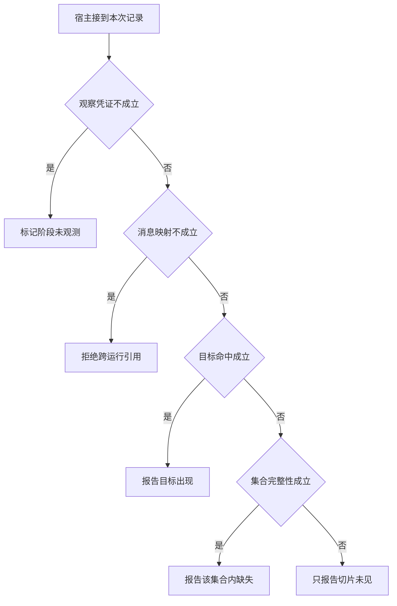

# 一份 POI 快照支持多强的诊断

目标 P7 在排序前缀中没出现，另一次请求却出现了它。
验证器要先核对输入属于当前运行。只有完整集合才支持集合内缺失，仍不足以命名具体过滤规则。

本篇用一个封闭的教学决策器说明这一问题。输入是宿主收到的记录，不保证每个下游字段都已经获准使用。前置检查未成立时，下游即使带着缓存值，也不能拿来作业务断言。

缺失只对已完整记录的那个阶段成立。由集合成员关系不能直接定位某条过滤规则。

## 先解决一个具体问题

**P7 没出现在排序前两名，可以把原因写到哪一步？**

只可陈述它未在可见前缀出现。
若完整候选中有 P7，就排除了“完全未入候选”，但要区分排第三和被过滤仍需完整下阶段或过滤事件。


先取一个能走到「只报告切片未见」的输入：已有本轮业务回执、回执属于待处理调用、记录只是可见切片、可见部分没有对象。
把这四个条件代回后文的图，前面各个拦截分支都未满足，最终才有“有限日志不能证明整个集合缺失”这个判断。
还原这个现场时要分别问：哪些位来自可信状态，哪些只是在接口中出现、尚未获得解释资格的字段。

## 先沿一次决策走到底



从上到下取第一条成立的出口。只改一个开关时，只有它之前的检查都未截断，该变化才可能到达真实动作。

“观察凭证”的两种输入分别是“已有本轮业务回执”与“只有尚未执行的提议”。
模型的调用提议不能证明应用已取得新事实。

“消息映射”的两种输入分别是“回执属于待处理调用”与“无法对应本次调用”。
仅凭返回顺序归并可能将另一请求的观察放进历史。

“集合完整性”的两种输入分别是“记录覆盖全体目标集合”与“记录只是可见切片”。
否定存在性时须证明查过了所声称的范围。

“目标命中”的两种输入分别是“对象出现在可见记录”与“可见部分没有对象”。
存在可以由一个命中支持，缺失还需证明覆盖面。

## 最少需要哪几项观察

### 标记阶段未观测

缺少本轮阶段读取。
在本节的全部组合中，有 8 种产生「标记阶段未观测」，这只是逻辑空间的计数，不能当作实际用户请求的比例。

只取得只有尚未执行的提议，已经足以要求宿主「标记阶段未观测」。
保持这些已知项，其余开关自由变化，仍有 8 种补全，判断没有翻转。

若删掉关于观察凭证的证据，另一份允许的现场是已有本轮业务回执、无法对应本次调用、记录只是可见切片、可见部分没有对象，它会使宿主「拒绝跨运行引用」。

### 拒绝跨运行引用

另一请求不能替本次提供证据。
在本节的全部组合中，有 4 种产生「拒绝跨运行引用」，这只是逻辑空间的计数，不能当作实际用户请求的比例。

只取得已有本轮业务回执、无法对应本次调用，已经足以要求宿主「拒绝跨运行引用」。
保持这些已知项，其余开关自由变化，仍有 4 种补全，判断没有翻转。

若删掉关于观察凭证的证据，另一份允许的现场是只有尚未执行的提议、无法对应本次调用、记录只是可见切片、可见部分没有对象，它会使宿主「标记阶段未观测」。

若删掉关于消息映射的证据，另一份允许的现场是已有本轮业务回执、回执属于待处理调用、记录只是可见切片、可见部分没有对象，它会使宿主「只报告切片未见」。

### 报告目标出现

当前记录中确实命中。
在本节的全部组合中，有 2 种产生「报告目标出现」，这只是逻辑空间的计数，不能当作实际用户请求的比例。

只取得已有本轮业务回执、回执属于待处理调用、对象出现在可见记录，已经足以要求宿主「报告目标出现」。
保持这些已知项，其余开关自由变化，仍有 2 种补全，判断没有翻转。

若删掉关于观察凭证的证据，另一份允许的现场是只有尚未执行的提议、回执属于待处理调用、记录只是可见切片、对象出现在可见记录，它会使宿主「标记阶段未观测」。

若删掉关于消息映射的证据，另一份允许的现场是已有本轮业务回执、无法对应本次调用、记录只是可见切片、对象出现在可见记录，它会使宿主「拒绝跨运行引用」。

若删掉关于目标命中的证据，另一份允许的现场是已有本轮业务回执、回执属于待处理调用、记录只是可见切片、可见部分没有对象，它会使宿主「只报告切片未见」。

### 报告该集合内缺失

完整输出未见该目标。
在本节的全部组合中，有 1 种产生「报告该集合内缺失」，这只是逻辑空间的计数，不能当作实际用户请求的比例。

只取得已有本轮业务回执、回执属于待处理调用、记录覆盖全体目标集合、可见部分没有对象，已经足以要求宿主「报告该集合内缺失」。
保持这些已知项，其余开关自由变化，仍有 1 种补全，判断没有翻转。

若删掉关于观察凭证的证据，另一份允许的现场是只有尚未执行的提议、回执属于待处理调用、记录覆盖全体目标集合、可见部分没有对象，它会使宿主「标记阶段未观测」。

若删掉关于消息映射的证据，另一份允许的现场是已有本轮业务回执、无法对应本次调用、记录覆盖全体目标集合、可见部分没有对象，它会使宿主「拒绝跨运行引用」。

若删掉关于集合完整性的证据，另一份允许的现场是已有本轮业务回执、回执属于待处理调用、记录只是可见切片、可见部分没有对象，它会使宿主「只报告切片未见」。

若删掉关于目标命中的证据，另一份允许的现场是已有本轮业务回执、回执属于待处理调用、记录覆盖全体目标集合、对象出现在可见记录，它会使宿主「报告目标出现」。

### 只报告切片未见

有限日志不能证明整个集合缺失。
在本节的全部组合中，有 1 种产生「只报告切片未见」，这只是逻辑空间的计数，不能当作实际用户请求的比例。

只取得已有本轮业务回执、回执属于待处理调用、记录只是可见切片、可见部分没有对象，已经足以要求宿主「只报告切片未见」。

若删掉关于观察凭证的证据，另一份允许的现场是只有尚未执行的提议、回执属于待处理调用、记录只是可见切片、可见部分没有对象，它会使宿主「标记阶段未观测」。

若删掉关于消息映射的证据，另一份允许的现场是已有本轮业务回执、无法对应本次调用、记录只是可见切片、可见部分没有对象，它会使宿主「拒绝跨运行引用」。

若删掉关于集合完整性的证据，另一份允许的现场是已有本轮业务回执、回执属于待处理调用、记录覆盖全体目标集合、可见部分没有对象，它会使宿主「报告该集合内缺失」。

若删掉关于目标命中的证据，另一份允许的现场是已有本轮业务回执、回执属于待处理调用、记录只是可见切片、对象出现在可见记录，它会使宿主「报告目标出现」。

## 以同一份契约解释截然不同的现场

<details>
<summary>展开推演与对应反例</summary>

下列样本按最先命中的业务分支排列。四位编码只作本篇页内定位，顺序与开头的四项输入一致。可以先猜下一动作，再展开相邻样本。

### 能够触发“标记阶段未观测”的现场

**样本 0000**

业务侧交来只有尚未执行的提议、无法对应本次调用，执行侧还记录了记录只是可见切片、可见部分没有对象。
把样本压成最短证明，保留只有尚未执行的提议就能支持「标记阶段未观测」。

在这份记录上，分别翻转「观察凭证」中的任一项，其他项完全不变时，下一动作都会改变。

保持其余观察不动，单独切换「消息映射」、「集合完整性」、「目标命中」仍得到「标记阶段未观测」，它们在这个现场不是决定性变量。

要从本例改走「拒绝跨运行引用」，至少需要变动 1 项，一组最少改动是将只有尚未执行的提议换成已有本轮业务回执。

要从本例改走「只报告切片未见」，至少需要变动 2 项，一组最少改动是将只有尚未执行的提议、无法对应本次调用换成已有本轮业务回执、回执属于待处理调用。

要从本例改走「报告目标出现」，至少需要变动 3 项，一组最少改动是将只有尚未执行的提议、无法对应本次调用、可见部分没有对象换成已有本轮业务回执、回执属于待处理调用、对象出现在可见记录。

要从本例改走「报告该集合内缺失」，至少需要变动 3 项，一组最少改动是将只有尚未执行的提议、无法对应本次调用、记录只是可见切片换成已有本轮业务回执、回执属于待处理调用、记录覆盖全体目标集合。

**样本 0001**

业务侧交来只有尚未执行的提议、无法对应本次调用，执行侧还记录了记录只是可见切片、对象出现在可见记录。


要从本例改走「报告目标出现」，至少需要变动 2 项，一组最少改动是将只有尚未执行的提议、无法对应本次调用换成已有本轮业务回执、回执属于待处理调用。

要从本例改走「只报告切片未见」，至少需要变动 3 项，一组最少改动是将只有尚未执行的提议、无法对应本次调用、对象出现在可见记录换成已有本轮业务回执、回执属于待处理调用、可见部分没有对象。

要从本例改走「报告该集合内缺失」，至少需要变动 4 项，一组最少改动是将只有尚未执行的提议、无法对应本次调用、记录只是可见切片、对象出现在可见记录换成已有本轮业务回执、回执属于待处理调用、记录覆盖全体目标集合、可见部分没有对象。

**样本 0010**

业务侧交来只有尚未执行的提议、无法对应本次调用，执行侧还记录了记录覆盖全体目标集合、可见部分没有对象。


要从本例改走「报告该集合内缺失」，至少需要变动 2 项，一组最少改动是将只有尚未执行的提议、无法对应本次调用换成已有本轮业务回执、回执属于待处理调用。

要从本例改走「只报告切片未见」，至少需要变动 3 项，一组最少改动是将只有尚未执行的提议、无法对应本次调用、记录覆盖全体目标集合换成已有本轮业务回执、回执属于待处理调用、记录只是可见切片。


**样本 0011**

业务侧交来只有尚未执行的提议、无法对应本次调用，执行侧还记录了记录覆盖全体目标集合、对象出现在可见记录。


要从本例改走「报告该集合内缺失」，至少需要变动 3 项，一组最少改动是将只有尚未执行的提议、无法对应本次调用、对象出现在可见记录换成已有本轮业务回执、回执属于待处理调用、可见部分没有对象。

要从本例改走「只报告切片未见」，至少需要变动 4 项，一组最少改动是将只有尚未执行的提议、无法对应本次调用、记录覆盖全体目标集合、对象出现在可见记录换成已有本轮业务回执、回执属于待处理调用、记录只是可见切片、可见部分没有对象。

**样本 0100**

业务侧交来只有尚未执行的提议、回执属于待处理调用，执行侧还记录了记录只是可见切片、可见部分没有对象。


要从本例改走「只报告切片未见」，至少需要变动 1 项，一组最少改动是将只有尚未执行的提议换成已有本轮业务回执。

要从本例改走「拒绝跨运行引用」，至少需要变动 2 项，一组最少改动是将只有尚未执行的提议、回执属于待处理调用换成已有本轮业务回执、无法对应本次调用。

要从本例改走「报告目标出现」，至少需要变动 2 项，一组最少改动是将只有尚未执行的提议、可见部分没有对象换成已有本轮业务回执、对象出现在可见记录。

要从本例改走「报告该集合内缺失」，至少需要变动 2 项，一组最少改动是将只有尚未执行的提议、记录只是可见切片换成已有本轮业务回执、记录覆盖全体目标集合。

**样本 0101**

业务侧交来只有尚未执行的提议、回执属于待处理调用，执行侧还记录了记录只是可见切片、对象出现在可见记录。


要从本例改走「报告目标出现」，至少需要变动 1 项，一组最少改动是将只有尚未执行的提议换成已有本轮业务回执。


要从本例改走「只报告切片未见」，至少需要变动 2 项，一组最少改动是将只有尚未执行的提议、对象出现在可见记录换成已有本轮业务回执、可见部分没有对象。

要从本例改走「报告该集合内缺失」，至少需要变动 3 项，一组最少改动是将只有尚未执行的提议、记录只是可见切片、对象出现在可见记录换成已有本轮业务回执、记录覆盖全体目标集合、可见部分没有对象。

**样本 0110**

业务侧交来只有尚未执行的提议、回执属于待处理调用，执行侧还记录了记录覆盖全体目标集合、可见部分没有对象。


要从本例改走「报告该集合内缺失」，至少需要变动 1 项，一组最少改动是将只有尚未执行的提议换成已有本轮业务回执。


要从本例改走「只报告切片未见」，至少需要变动 2 项，一组最少改动是将只有尚未执行的提议、记录覆盖全体目标集合换成已有本轮业务回执、记录只是可见切片。


**样本 0111**

业务侧交来只有尚未执行的提议、回执属于待处理调用，执行侧还记录了记录覆盖全体目标集合、对象出现在可见记录。


要从本例改走「报告该集合内缺失」，至少需要变动 2 项，一组最少改动是将只有尚未执行的提议、对象出现在可见记录换成已有本轮业务回执、可见部分没有对象。

要从本例改走「只报告切片未见」，至少需要变动 3 项，一组最少改动是将只有尚未执行的提议、记录覆盖全体目标集合、对象出现在可见记录换成已有本轮业务回执、记录只是可见切片、可见部分没有对象。

### 能够触发“拒绝跨运行引用”的现场

**样本 1000**

业务侧交来已有本轮业务回执、无法对应本次调用，执行侧还记录了记录只是可见切片、可见部分没有对象。
把样本压成最短证明，保留已有本轮业务回执、无法对应本次调用就能支持「拒绝跨运行引用」。

在这份记录上，分别翻转「观察凭证」、「消息映射」中的任一项，其他项完全不变时，下一动作都会改变。

保持其余观察不动，单独切换「集合完整性」、「目标命中」仍得到「拒绝跨运行引用」，它们在这个现场不是决定性变量。

本例没走更靠前的「标记阶段未观测」，因为已有本轮业务回执与那个入口的必要条件不符。

要从本例改走「标记阶段未观测」，至少需要变动 1 项，一组最少改动是将已有本轮业务回执换成只有尚未执行的提议。

要从本例改走「只报告切片未见」，至少需要变动 1 项，一组最少改动是将无法对应本次调用换成回执属于待处理调用。

要从本例改走「报告目标出现」，至少需要变动 2 项，一组最少改动是将无法对应本次调用、可见部分没有对象换成回执属于待处理调用、对象出现在可见记录。

要从本例改走「报告该集合内缺失」，至少需要变动 2 项，一组最少改动是将无法对应本次调用、记录只是可见切片换成回执属于待处理调用、记录覆盖全体目标集合。

**样本 1001**

业务侧交来已有本轮业务回执、无法对应本次调用，执行侧还记录了记录只是可见切片、对象出现在可见记录。


要从本例改走「报告目标出现」，至少需要变动 1 项，一组最少改动是将无法对应本次调用换成回执属于待处理调用。

要从本例改走「只报告切片未见」，至少需要变动 2 项，一组最少改动是将无法对应本次调用、对象出现在可见记录换成回执属于待处理调用、可见部分没有对象。

要从本例改走「报告该集合内缺失」，至少需要变动 3 项，一组最少改动是将无法对应本次调用、记录只是可见切片、对象出现在可见记录换成回执属于待处理调用、记录覆盖全体目标集合、可见部分没有对象。

**样本 1010**

业务侧交来已有本轮业务回执、无法对应本次调用，执行侧还记录了记录覆盖全体目标集合、可见部分没有对象。


要从本例改走「报告该集合内缺失」，至少需要变动 1 项，一组最少改动是将无法对应本次调用换成回执属于待处理调用。

要从本例改走「只报告切片未见」，至少需要变动 2 项，一组最少改动是将无法对应本次调用、记录覆盖全体目标集合换成回执属于待处理调用、记录只是可见切片。


**样本 1011**

业务侧交来已有本轮业务回执、无法对应本次调用，执行侧还记录了记录覆盖全体目标集合、对象出现在可见记录。


要从本例改走「报告该集合内缺失」，至少需要变动 2 项，一组最少改动是将无法对应本次调用、对象出现在可见记录换成回执属于待处理调用、可见部分没有对象。

要从本例改走「只报告切片未见」，至少需要变动 3 项，一组最少改动是将无法对应本次调用、记录覆盖全体目标集合、对象出现在可见记录换成回执属于待处理调用、记录只是可见切片、可见部分没有对象。

### 能够触发“报告目标出现”的现场

**样本 1101**

业务侧交来已有本轮业务回执、回执属于待处理调用，执行侧还记录了记录只是可见切片、对象出现在可见记录。
把样本压成最短证明，保留已有本轮业务回执、回执属于待处理调用、对象出现在可见记录就能支持「报告目标出现」。

在这份记录上，分别翻转「观察凭证」、「消息映射」、「目标命中」中的任一项，其他项完全不变时，下一动作都会改变。

保持其余观察不动，单独切换「集合完整性」仍得到「报告目标出现」，它们在这个现场不是决定性变量。


本例没走更靠前的「拒绝跨运行引用」，因为回执属于待处理调用与那个入口的必要条件不符。


要从本例改走「拒绝跨运行引用」，至少需要变动 1 项，一组最少改动是将回执属于待处理调用换成无法对应本次调用。

要从本例改走「只报告切片未见」，至少需要变动 1 项，一组最少改动是将对象出现在可见记录换成可见部分没有对象。

要从本例改走「报告该集合内缺失」，至少需要变动 2 项，一组最少改动是将记录只是可见切片、对象出现在可见记录换成记录覆盖全体目标集合、可见部分没有对象。

**样本 1111**

业务侧交来已有本轮业务回执、回执属于待处理调用，执行侧还记录了记录覆盖全体目标集合、对象出现在可见记录。


要从本例改走「报告该集合内缺失」，至少需要变动 1 项，一组最少改动是将对象出现在可见记录换成可见部分没有对象。

要从本例改走「只报告切片未见」，至少需要变动 2 项，一组最少改动是将记录覆盖全体目标集合、对象出现在可见记录换成记录只是可见切片、可见部分没有对象。

### 能够触发“报告该集合内缺失”的现场

**样本 1110**

业务侧交来已有本轮业务回执、回执属于待处理调用，执行侧还记录了记录覆盖全体目标集合、可见部分没有对象。
把样本压成最短证明，保留已有本轮业务回执、回执属于待处理调用、记录覆盖全体目标集合、可见部分没有对象就能支持「报告该集合内缺失」。

在这份记录上，分别翻转「观察凭证」、「消息映射」、「集合完整性」、「目标命中」中的任一项，其他项完全不变时，下一动作都会改变。


本例没走更靠前的「报告目标出现」，因为可见部分没有对象与那个入口的必要条件不符。


要从本例改走「只报告切片未见」，至少需要变动 1 项，一组最少改动是将记录覆盖全体目标集合换成记录只是可见切片。

要从本例改走「报告目标出现」，至少需要变动 1 项，一组最少改动是将可见部分没有对象换成对象出现在可见记录。

### 能够触发“只报告切片未见”的现场

**样本 1100**

业务侧交来已有本轮业务回执、回执属于待处理调用，执行侧还记录了记录只是可见切片、可见部分没有对象。
把样本压成最短证明，保留已有本轮业务回执、回执属于待处理调用、记录只是可见切片、可见部分没有对象就能支持「只报告切片未见」。


本例没走更靠前的「报告该集合内缺失」，因为记录只是可见切片与那个入口的必要条件不符。


要从本例改走「报告该集合内缺失」，至少需要变动 1 项，一组最少改动是将记录只是可见切片换成记录覆盖全体目标集合。

</details>

## 当你只能看见一半记录

<details>
<summary>展开推演与对应反例</summary>

这次隐藏两个字段，保留另两个。对每个可见现场，检查四种合法补全是否同意。如仍有歧义，选择能使最坏剩余候选动作最少的字段继续查。并列时采用本篇字段顺序。

### 只保留观察凭证与消息映射

已知只有尚未执行的提议、无法对应本次调用时，四种补全的动作分布为标记阶段未观测（4 种）。

就“标记阶段未观测”这个动作而言，在只有尚未执行的提议、无法对应本次调用的前提下，另外两项观察不会推翻它。

已知只有尚未执行的提议、回执属于待处理调用时，四种补全的动作分布为标记阶段未观测（4 种）。

就“标记阶段未观测”这个动作而言，在只有尚未执行的提议、回执属于待处理调用的前提下，另外两项观察不会推翻它。

已知已有本轮业务回执、无法对应本次调用时，四种补全的动作分布为拒绝跨运行引用（4 种）。

就“拒绝跨运行引用”这个动作而言，在已有本轮业务回执、无法对应本次调用的前提下，另外两项观察不会推翻它。

已知已有本轮业务回执、回执属于待处理调用时，四种补全的动作分布为报告目标出现（2 种）、报告该集合内缺失（1 种）、只报告切片未见（1 种）。

在已有本轮业务回执、回执属于待处理调用这个现场补读「集合完整性」，最坏还剩 2 种动作，计算时只衡量歧义，尚未扣读取代价。
若补来的观察为“记录只是可见切片”，范围缩成「只报告切片未见」、「报告目标出现」。若为“记录覆盖全体目标集合”，则保留「报告该集合内缺失」、「报告目标出现」。

区分不了的两条执行可以具体写成 1100 与 1101：它们共享已展示字段，却分别需要「只报告切片未见」和「报告目标出现」。

### 只保留观察凭证与集合完整性

已知只有尚未执行的提议、记录只是可见切片时，四种补全的动作分布为标记阶段未观测（4 种）。

就“标记阶段未观测”这个动作而言，在只有尚未执行的提议、记录只是可见切片的前提下，另外两项观察不会推翻它。

已知只有尚未执行的提议、记录覆盖全体目标集合时，四种补全的动作分布为标记阶段未观测（4 种）。

就“标记阶段未观测”这个动作而言，在只有尚未执行的提议、记录覆盖全体目标集合的前提下，另外两项观察不会推翻它。

已知已有本轮业务回执、记录只是可见切片时，四种补全的动作分布为拒绝跨运行引用（2 种）、报告目标出现（1 种）、只报告切片未见（1 种）。

在已有本轮业务回执、记录只是可见切片这个现场补读「消息映射」，最坏还剩 2 种动作，计算时只衡量歧义，尚未扣读取代价。
若补来的观察为“无法对应本次调用”，范围缩成「拒绝跨运行引用」。若为“回执属于待处理调用”，则保留「只报告切片未见」、「报告目标出现」。

区分不了的两条执行可以具体写成 1000 与 1100：它们共享已展示字段，却分别需要「拒绝跨运行引用」和「只报告切片未见」。

已知已有本轮业务回执、记录覆盖全体目标集合时，四种补全的动作分布为拒绝跨运行引用（2 种）、报告目标出现（1 种）、报告该集合内缺失（1 种）。

在已有本轮业务回执、记录覆盖全体目标集合这个现场补读「消息映射」，最坏还剩 2 种动作，计算时只衡量歧义，尚未扣读取代价。
若补来的观察为“无法对应本次调用”，范围缩成「拒绝跨运行引用」。若为“回执属于待处理调用”，则保留「报告该集合内缺失」、「报告目标出现」。

区分不了的两条执行可以具体写成 1010 与 1110：它们共享已展示字段，却分别需要「拒绝跨运行引用」和「报告该集合内缺失」。

### 只保留消息映射与集合完整性

已知无法对应本次调用、记录只是可见切片时，四种补全的动作分布为标记阶段未观测（2 种）、拒绝跨运行引用（2 种）。

在无法对应本次调用、记录只是可见切片这个现场补读「观察凭证」，最坏还剩 1 种动作，计算时只衡量歧义，尚未扣读取代价。
若补来的观察为“只有尚未执行的提议”，范围缩成「标记阶段未观测」。若为“已有本轮业务回执”，则保留「拒绝跨运行引用」。

区分不了的两条执行可以具体写成 0000 与 1000：它们共享已展示字段，却分别需要「标记阶段未观测」和「拒绝跨运行引用」。

已知无法对应本次调用、记录覆盖全体目标集合时，四种补全的动作分布为标记阶段未观测（2 种）、拒绝跨运行引用（2 种）。

在无法对应本次调用、记录覆盖全体目标集合这个现场补读「观察凭证」，最坏还剩 1 种动作，计算时只衡量歧义，尚未扣读取代价。

区分不了的两条执行可以具体写成 0010 与 1010：它们共享已展示字段，却分别需要「标记阶段未观测」和「拒绝跨运行引用」。

已知回执属于待处理调用、记录只是可见切片时，四种补全的动作分布为标记阶段未观测（2 种）、报告目标出现（1 种）、只报告切片未见（1 种）。

在回执属于待处理调用、记录只是可见切片这个现场补读「观察凭证」，最坏还剩 2 种动作，计算时只衡量歧义，尚未扣读取代价。
若补来的观察为“只有尚未执行的提议”，范围缩成「标记阶段未观测」。若为“已有本轮业务回执”，则保留「只报告切片未见」、「报告目标出现」。

区分不了的两条执行可以具体写成 0100 与 1100：它们共享已展示字段，却分别需要「标记阶段未观测」和「只报告切片未见」。

已知回执属于待处理调用、记录覆盖全体目标集合时，四种补全的动作分布为标记阶段未观测（2 种）、报告目标出现（1 种）、报告该集合内缺失（1 种）。

在回执属于待处理调用、记录覆盖全体目标集合这个现场补读「观察凭证」，最坏还剩 2 种动作，计算时只衡量歧义，尚未扣读取代价。
若补来的观察为“只有尚未执行的提议”，范围缩成「标记阶段未观测」。若为“已有本轮业务回执”，则保留「报告该集合内缺失」、「报告目标出现」。

区分不了的两条执行可以具体写成 0110 与 1110：它们共享已展示字段，却分别需要「标记阶段未观测」和「报告该集合内缺失」。

### 只保留观察凭证与目标命中

已知只有尚未执行的提议、可见部分没有对象时，四种补全的动作分布为标记阶段未观测（4 种）。

就“标记阶段未观测”这个动作而言，在只有尚未执行的提议、可见部分没有对象的前提下，另外两项观察不会推翻它。

已知只有尚未执行的提议、对象出现在可见记录时，四种补全的动作分布为标记阶段未观测（4 种）。

就“标记阶段未观测”这个动作而言，在只有尚未执行的提议、对象出现在可见记录的前提下，另外两项观察不会推翻它。

已知已有本轮业务回执、可见部分没有对象时，四种补全的动作分布为拒绝跨运行引用（2 种）、报告该集合内缺失（1 种）、只报告切片未见（1 种）。

在已有本轮业务回执、可见部分没有对象这个现场补读「消息映射」，最坏还剩 2 种动作，计算时只衡量歧义，尚未扣读取代价。
若补来的观察为“无法对应本次调用”，范围缩成「拒绝跨运行引用」。若为“回执属于待处理调用”，则保留「只报告切片未见」、「报告该集合内缺失」。


已知已有本轮业务回执、对象出现在可见记录时，四种补全的动作分布为拒绝跨运行引用（2 种）、报告目标出现（2 种）。

在已有本轮业务回执、对象出现在可见记录这个现场补读「消息映射」，最坏还剩 1 种动作，计算时只衡量歧义，尚未扣读取代价。
若补来的观察为“无法对应本次调用”，范围缩成「拒绝跨运行引用」。若为“回执属于待处理调用”，则保留「报告目标出现」。

区分不了的两条执行可以具体写成 1001 与 1101：它们共享已展示字段，却分别需要「拒绝跨运行引用」和「报告目标出现」。

### 只保留消息映射与目标命中

已知无法对应本次调用、可见部分没有对象时，四种补全的动作分布为标记阶段未观测（2 种）、拒绝跨运行引用（2 种）。

在无法对应本次调用、可见部分没有对象这个现场补读「观察凭证」，最坏还剩 1 种动作，计算时只衡量歧义，尚未扣读取代价。


已知无法对应本次调用、对象出现在可见记录时，四种补全的动作分布为标记阶段未观测（2 种）、拒绝跨运行引用（2 种）。

在无法对应本次调用、对象出现在可见记录这个现场补读「观察凭证」，最坏还剩 1 种动作，计算时只衡量歧义，尚未扣读取代价。

区分不了的两条执行可以具体写成 0001 与 1001：它们共享已展示字段，却分别需要「标记阶段未观测」和「拒绝跨运行引用」。

已知回执属于待处理调用、可见部分没有对象时，四种补全的动作分布为标记阶段未观测（2 种）、报告该集合内缺失（1 种）、只报告切片未见（1 种）。

在回执属于待处理调用、可见部分没有对象这个现场补读「观察凭证」，最坏还剩 2 种动作，计算时只衡量歧义，尚未扣读取代价。
若补来的观察为“只有尚未执行的提议”，范围缩成「标记阶段未观测」。若为“已有本轮业务回执”，则保留「只报告切片未见」、「报告该集合内缺失」。


已知回执属于待处理调用、对象出现在可见记录时，四种补全的动作分布为标记阶段未观测（2 种）、报告目标出现（2 种）。

在回执属于待处理调用、对象出现在可见记录这个现场补读「观察凭证」，最坏还剩 1 种动作，计算时只衡量歧义，尚未扣读取代价。
若补来的观察为“只有尚未执行的提议”，范围缩成「标记阶段未观测」。若为“已有本轮业务回执”，则保留「报告目标出现」。

区分不了的两条执行可以具体写成 0101 与 1101：它们共享已展示字段，却分别需要「标记阶段未观测」和「报告目标出现」。

### 只保留集合完整性与目标命中

已知记录只是可见切片、可见部分没有对象时，四种补全的动作分布为标记阶段未观测（2 种）、拒绝跨运行引用（1 种）、只报告切片未见（1 种）。

在记录只是可见切片、可见部分没有对象这个现场补读「观察凭证」，最坏还剩 2 种动作，计算时只衡量歧义，尚未扣读取代价。
若补来的观察为“只有尚未执行的提议”，范围缩成「标记阶段未观测」。若为“已有本轮业务回执”，则保留「拒绝跨运行引用」、「只报告切片未见」。


已知记录只是可见切片、对象出现在可见记录时，四种补全的动作分布为标记阶段未观测（2 种）、拒绝跨运行引用（1 种）、报告目标出现（1 种）。

在记录只是可见切片、对象出现在可见记录这个现场补读「观察凭证」，最坏还剩 2 种动作，计算时只衡量歧义，尚未扣读取代价。
若补来的观察为“只有尚未执行的提议”，范围缩成「标记阶段未观测」。若为“已有本轮业务回执”，则保留「拒绝跨运行引用」、「报告目标出现」。


已知记录覆盖全体目标集合、可见部分没有对象时，四种补全的动作分布为标记阶段未观测（2 种）、拒绝跨运行引用（1 种）、报告该集合内缺失（1 种）。

在记录覆盖全体目标集合、可见部分没有对象这个现场补读「观察凭证」，最坏还剩 2 种动作，计算时只衡量歧义，尚未扣读取代价。
若补来的观察为“只有尚未执行的提议”，范围缩成「标记阶段未观测」。若为“已有本轮业务回执”，则保留「拒绝跨运行引用」、「报告该集合内缺失」。


已知记录覆盖全体目标集合、对象出现在可见记录时，四种补全的动作分布为标记阶段未观测（2 种）、拒绝跨运行引用（1 种）、报告目标出现（1 种）。

在记录覆盖全体目标集合、对象出现在可见记录这个现场补读「观察凭证」，最坏还剩 2 种动作，计算时只衡量歧义，尚未扣读取代价。

区分不了的两条执行可以具体写成 0011 与 1011：它们共享已展示字段，却分别需要「标记阶段未观测」和「拒绝跨运行引用」。

</details>

## 单因素干预与边界测试

<details>
<summary>展开推演与对应反例</summary>

### 只改变观察凭证

固定另外三个条件得到八对现场，从“只有尚未执行的提议”转为“已有本轮业务回执”时，8 对翻转动作，另外 0 对保持不变。

有 4 对现场沿「标记阶段未观测」变到「拒绝跨运行引用」，可复现的一组受控背景为无法对应本次调用、记录只是可见切片、可见部分没有对象。

有 1 对现场沿「标记阶段未观测」变到「只报告切片未见」，可复现的一组受控背景为回执属于待处理调用、记录只是可见切片、可见部分没有对象。

有 2 对现场沿「标记阶段未观测」变到「报告目标出现」，可复现的一组受控背景为回执属于待处理调用、记录只是可见切片、对象出现在可见记录。

有 1 对现场沿「标记阶段未观测」变到「报告该集合内缺失」，可复现的一组受控背景为回执属于待处理调用、记录覆盖全体目标集合、可见部分没有对象。

### 只改变消息映射

固定另外三个条件得到八对现场，从“无法对应本次调用”转为“回执属于待处理调用”时，4 对翻转动作，另外 4 对保持不变。

令只有尚未执行的提议、记录只是可见切片、可见部分没有对象，消息映射的两个取值均得到「标记阶段未观测」。在八对中，共有 4 对表现为这一种稳定出口。

有 1 对现场沿「拒绝跨运行引用」变到「只报告切片未见」，可复现的一组受控背景为已有本轮业务回执、记录只是可见切片、可见部分没有对象。

有 2 对现场沿「拒绝跨运行引用」变到「报告目标出现」，可复现的一组受控背景为已有本轮业务回执、记录只是可见切片、对象出现在可见记录。

有 1 对现场沿「拒绝跨运行引用」变到「报告该集合内缺失」，可复现的一组受控背景为已有本轮业务回执、记录覆盖全体目标集合、可见部分没有对象。

### 只改变集合完整性

固定另外三个条件得到八对现场，从“记录只是可见切片”转为“记录覆盖全体目标集合”时，1 对翻转动作，另外 7 对保持不变。

令只有尚未执行的提议、无法对应本次调用、可见部分没有对象，集合完整性的两个取值均得到「标记阶段未观测」。在八对中，共有 4 对表现为这一种稳定出口。

令已有本轮业务回执、无法对应本次调用、可见部分没有对象，集合完整性的两个取值均得到「拒绝跨运行引用」。在八对中，共有 2 对表现为这一种稳定出口。

有 1 对现场沿「只报告切片未见」变到「报告该集合内缺失」，可复现的一组受控背景为已有本轮业务回执、回执属于待处理调用、可见部分没有对象。

令已有本轮业务回执、回执属于待处理调用、对象出现在可见记录，集合完整性的两个取值均得到「报告目标出现」。在八对中，共有 1 对表现为这一种稳定出口。

### 只改变目标命中

固定另外三个条件得到八对现场，从“可见部分没有对象”转为“对象出现在可见记录”时，2 对翻转动作，另外 6 对保持不变。

令只有尚未执行的提议、无法对应本次调用、记录只是可见切片，目标命中的两个取值均得到「标记阶段未观测」。在八对中，共有 4 对表现为这一种稳定出口。

令已有本轮业务回执、无法对应本次调用、记录只是可见切片，目标命中的两个取值均得到「拒绝跨运行引用」。在八对中，共有 2 对表现为这一种稳定出口。

有 1 对现场沿「只报告切片未见」变到「报告目标出现」，可复现的一组受控背景为已有本轮业务回执、回执属于待处理调用、记录只是可见切片。

有 1 对现场沿「报告该集合内缺失」变到「报告目标出现」，可复现的一组受控背景为已有本轮业务回执、回执属于待处理调用、记录覆盖全体目标集合。

</details>

## 哪些回归样本真能抓住实现错误

<details>
<summary>展开推演与对应反例</summary>

如果删除“标记阶段未观测”这个分支，在本篇 16 种输入里有 8 种会改走另一出口。

反例 0000 的完整记录为只有尚未执行的提议、无法对应本次调用、记录只是可见切片、可见部分没有对象。正确结果是「标记阶段未观测」，这个改坏的实现却给出「拒绝跨运行引用」。

如果删除“拒绝跨运行引用”这个分支，在本篇 16 种输入里有 4 种会改走另一出口。

反例 1000 的完整记录为已有本轮业务回执、无法对应本次调用、记录只是可见切片、可见部分没有对象。正确结果是「拒绝跨运行引用」，这个改坏的实现却给出「只报告切片未见」。

如果删除“报告目标出现”这个分支，在本篇 16 种输入里有 2 种会改走另一出口。

反例 1101 的完整记录为已有本轮业务回执、回执属于待处理调用、记录只是可见切片、对象出现在可见记录。正确结果是「报告目标出现」，这个改坏的实现却给出「只报告切片未见」。

如果删除“报告该集合内缺失”这个分支，在本篇 16 种输入里有 1 种会改走另一出口。

反例 1110 的完整记录为已有本轮业务回执、回执属于待处理调用、记录覆盖全体目标集合、可见部分没有对象。正确结果是「报告该集合内缺失」，这个改坏的实现却给出「只报告切片未见」。

如果交换“标记阶段未观测”和“拒绝跨运行引用”的判断次序，在本篇 16 种输入里有 4 种会改走另一出口。


如果交换“拒绝跨运行引用”和“报告目标出现”的判断次序，在本篇 16 种输入里有 2 种会改走另一出口。

反例 1001 的完整记录为已有本轮业务回执、无法对应本次调用、记录只是可见切片、对象出现在可见记录。正确结果是「拒绝跨运行引用」，这个改坏的实现却给出「报告目标出现」。

如果交换“报告目标出现”和“报告该集合内缺失”的判断次序，在本篇 16 种输入里有 1 种会改走另一出口。

反例 1111 的完整记录为已有本轮业务回执、回执属于待处理调用、记录覆盖全体目标集合、对象出现在可见记录。正确结果是「报告目标出现」，这个改坏的实现却给出「报告该集合内缺失」。

补入样本 0000（只有尚未执行的提议、无法对应本次调用、记录只是可见切片、可见部分没有对象）能新增检出「删除“标记阶段未观测”这个分支」、「交换“标记阶段未观测”和“拒绝跨运行引用”的判断次序」。

补入样本 1001（已有本轮业务回执、无法对应本次调用、记录只是可见切片、对象出现在可见记录）能新增检出「删除“拒绝跨运行引用”这个分支」、「交换“拒绝跨运行引用”和“报告目标出现”的判断次序」。

补入样本 1111（已有本轮业务回执、回执属于待处理调用、记录覆盖全体目标集合、对象出现在可见记录）能新增检出「删除“报告目标出现”这个分支」、「交换“报告目标出现”和“报告该集合内缺失”的判断次序」。

补入样本 1110（已有本轮业务回执、回执属于待处理调用、记录覆盖全体目标集合、可见部分没有对象）能新增检出「删除“报告该集合内缺失”这个分支」。

这里每次选覆盖尚未捕获缺陷最多的样本，并不保证用例数全局最小。它给出的反例能作为 Java 单测输入。真实模型是否会自主产生这些提议，仍须单独评测。

</details>

## 把状态覆盖换成有抽样偏差的评测批次

<details>
<summary>展开推演与对应反例</summary>

前面的十六种记录各有一票。现在只改样本构成：对一个给定字段，把成立侧的每种记录各取三份、另一侧各取一份。这是人为配比的 32 份回放，不是线上频率估计。
将偏向成立与偏向不成立的两次批次对照，可以隔离分母变化。底层宿主和所有答案保持相同，比例仍可能移动。

### 改变“观察凭证”的样本配比

只看「标记阶段未观测」，在已有本轮业务回执的八个不同输入中有 0 个命中，在只有尚未执行的提议的另八个输入中有 8 个命中。
把「观察凭证」成立侧按三倍取样，「标记阶段未观测」占 8/32，反过来向未成立侧倾斜后占 24/32。
这次重加权使「标记阶段未观测」的占比相差 50 个百分点。若按两种不同的“观察凭证”分布跑新旧版，不能把这项差异全部归功于实现。

只看「拒绝跨运行引用」，在已有本轮业务回执的八个不同输入中有 4 个命中，在只有尚未执行的提议的另八个输入中有 0 个命中。
把「观察凭证」成立侧按三倍取样，「拒绝跨运行引用」占 12/32，反过来向未成立侧倾斜后占 4/32。
这次重加权使「拒绝跨运行引用」的占比相差 25 个百分点。若按两种不同的“观察凭证”分布跑新旧版，不能把这项差异全部归功于实现。

只看「报告目标出现」，在已有本轮业务回执的八个不同输入中有 2 个命中，在只有尚未执行的提议的另八个输入中有 0 个命中。
把「观察凭证」成立侧按三倍取样，「报告目标出现」占 6/32，反过来向未成立侧倾斜后占 2/32。
这次重加权使「报告目标出现」的占比相差 12.5 个百分点。若按两种不同的“观察凭证”分布跑新旧版，不能把这项差异全部归功于实现。

只看「报告该集合内缺失」，在已有本轮业务回执的八个不同输入中有 1 个命中，在只有尚未执行的提议的另八个输入中有 0 个命中。
把「观察凭证」成立侧按三倍取样，「报告该集合内缺失」占 3/32，反过来向未成立侧倾斜后占 1/32。
这次重加权使「报告该集合内缺失」的占比相差 6.25 个百分点。若按两种不同的“观察凭证”分布跑新旧版，不能把这项差异全部归功于实现。

只看「只报告切片未见」，在已有本轮业务回执的八个不同输入中有 1 个命中，在只有尚未执行的提议的另八个输入中有 0 个命中。
把「观察凭证」成立侧按三倍取样，「只报告切片未见」占 3/32，反过来向未成立侧倾斜后占 1/32。
这次重加权使「只报告切片未见」的占比相差 6.25 个百分点。若按两种不同的“观察凭证”分布跑新旧版，不能把这项差异全部归功于实现。

### 改变“消息映射”的样本配比

只看「标记阶段未观测」，在回执属于待处理调用的八个不同输入中有 4 个命中，在无法对应本次调用的另八个输入中有 4 个命中。
把「消息映射」成立侧按三倍取样，「标记阶段未观测」占 16/32，反过来向未成立侧倾斜后占 16/32。
两批「标记阶段未观测」的边际比例相同，是因为这个出口在“消息映射”的两侧计数相等，这不能单独证明每一对现场都不受它影响。

只看「拒绝跨运行引用」，在回执属于待处理调用的八个不同输入中有 0 个命中，在无法对应本次调用的另八个输入中有 4 个命中。
把「消息映射」成立侧按三倍取样，「拒绝跨运行引用」占 4/32，反过来向未成立侧倾斜后占 12/32。
这次重加权使「拒绝跨运行引用」的占比相差 25 个百分点。若按两种不同的“消息映射”分布跑新旧版，不能把这项差异全部归功于实现。

只看「报告目标出现」，在回执属于待处理调用的八个不同输入中有 2 个命中，在无法对应本次调用的另八个输入中有 0 个命中。
把「消息映射」成立侧按三倍取样，「报告目标出现」占 6/32，反过来向未成立侧倾斜后占 2/32。
这次重加权使「报告目标出现」的占比相差 12.5 个百分点。若按两种不同的“消息映射”分布跑新旧版，不能把这项差异全部归功于实现。

只看「报告该集合内缺失」，在回执属于待处理调用的八个不同输入中有 1 个命中，在无法对应本次调用的另八个输入中有 0 个命中。
把「消息映射」成立侧按三倍取样，「报告该集合内缺失」占 3/32，反过来向未成立侧倾斜后占 1/32。
这次重加权使「报告该集合内缺失」的占比相差 6.25 个百分点。若按两种不同的“消息映射”分布跑新旧版，不能把这项差异全部归功于实现。

只看「只报告切片未见」，在回执属于待处理调用的八个不同输入中有 1 个命中，在无法对应本次调用的另八个输入中有 0 个命中。
把「消息映射」成立侧按三倍取样，「只报告切片未见」占 3/32，反过来向未成立侧倾斜后占 1/32。
这次重加权使「只报告切片未见」的占比相差 6.25 个百分点。若按两种不同的“消息映射”分布跑新旧版，不能把这项差异全部归功于实现。

### 改变“集合完整性”的样本配比

只看「标记阶段未观测」，在记录覆盖全体目标集合的八个不同输入中有 4 个命中，在记录只是可见切片的另八个输入中有 4 个命中。
把「集合完整性」成立侧按三倍取样，「标记阶段未观测」占 16/32，反过来向未成立侧倾斜后占 16/32。
两批「标记阶段未观测」的边际比例相同，是因为这个出口在“集合完整性”的两侧计数相等，这不能单独证明每一对现场都不受它影响。

只看「拒绝跨运行引用」，在记录覆盖全体目标集合的八个不同输入中有 2 个命中，在记录只是可见切片的另八个输入中有 2 个命中。
把「集合完整性」成立侧按三倍取样，「拒绝跨运行引用」占 8/32，反过来向未成立侧倾斜后占 8/32。
两批「拒绝跨运行引用」的边际比例相同，是因为这个出口在“集合完整性”的两侧计数相等，这不能单独证明每一对现场都不受它影响。

只看「报告目标出现」，在记录覆盖全体目标集合的八个不同输入中有 1 个命中，在记录只是可见切片的另八个输入中有 1 个命中。
把「集合完整性」成立侧按三倍取样，「报告目标出现」占 4/32，反过来向未成立侧倾斜后占 4/32。
两批「报告目标出现」的边际比例相同，是因为这个出口在“集合完整性”的两侧计数相等，这不能单独证明每一对现场都不受它影响。

只看「报告该集合内缺失」，在记录覆盖全体目标集合的八个不同输入中有 1 个命中，在记录只是可见切片的另八个输入中有 0 个命中。
把「集合完整性」成立侧按三倍取样，「报告该集合内缺失」占 3/32，反过来向未成立侧倾斜后占 1/32。
这次重加权使「报告该集合内缺失」的占比相差 6.25 个百分点。若按两种不同的“集合完整性”分布跑新旧版，不能把这项差异全部归功于实现。

只看「只报告切片未见」，在记录覆盖全体目标集合的八个不同输入中有 0 个命中，在记录只是可见切片的另八个输入中有 1 个命中。
把「集合完整性」成立侧按三倍取样，「只报告切片未见」占 1/32，反过来向未成立侧倾斜后占 3/32。
这次重加权使「只报告切片未见」的占比相差 6.25 个百分点。若按两种不同的“集合完整性”分布跑新旧版，不能把这项差异全部归功于实现。

### 改变“目标命中”的样本配比

只看「标记阶段未观测」，在对象出现在可见记录的八个不同输入中有 4 个命中，在可见部分没有对象的另八个输入中有 4 个命中。
把「目标命中」成立侧按三倍取样，「标记阶段未观测」占 16/32，反过来向未成立侧倾斜后占 16/32。
两批「标记阶段未观测」的边际比例相同，是因为这个出口在“目标命中”的两侧计数相等，这不能单独证明每一对现场都不受它影响。

只看「拒绝跨运行引用」，在对象出现在可见记录的八个不同输入中有 2 个命中，在可见部分没有对象的另八个输入中有 2 个命中。
把「目标命中」成立侧按三倍取样，「拒绝跨运行引用」占 8/32，反过来向未成立侧倾斜后占 8/32。
两批「拒绝跨运行引用」的边际比例相同，是因为这个出口在“目标命中”的两侧计数相等，这不能单独证明每一对现场都不受它影响。

只看「报告目标出现」，在对象出现在可见记录的八个不同输入中有 2 个命中，在可见部分没有对象的另八个输入中有 0 个命中。
把「目标命中」成立侧按三倍取样，「报告目标出现」占 6/32，反过来向未成立侧倾斜后占 2/32。
这次重加权使「报告目标出现」的占比相差 12.5 个百分点。若按两种不同的“目标命中”分布跑新旧版，不能把这项差异全部归功于实现。

只看「报告该集合内缺失」，在对象出现在可见记录的八个不同输入中有 0 个命中，在可见部分没有对象的另八个输入中有 1 个命中。
把「目标命中」成立侧按三倍取样，「报告该集合内缺失」占 1/32，反过来向未成立侧倾斜后占 3/32。
这次重加权使「报告该集合内缺失」的占比相差 6.25 个百分点。若按两种不同的“目标命中”分布跑新旧版，不能把这项差异全部归功于实现。

只看「只报告切片未见」，在对象出现在可见记录的八个不同输入中有 0 个命中，在可见部分没有对象的另八个输入中有 1 个命中。
把「目标命中」成立侧按三倍取样，「只报告切片未见」占 1/32，反过来向未成立侧倾斜后占 3/32。
这次重加权使「只报告切片未见」的占比相差 6.25 个百分点。若按两种不同的“目标命中”分布跑新旧版，不能把这项差异全部归功于实现。

</details>

## 只看终态，能逆推出多少原始事实

<details>
<summary>展开推演与对应反例</summary>

### 只保留“标记阶段未观测”这条结果时

在本节契约与完整输入域内，仅知「标记阶段未观测」就能倒推出只有尚未执行的提议，这一推断依赖版本未变且日志中的终态可信。

「标记阶段未观测」不能证明消息映射取哪一侧：0000 和 0100 有相同终态，却分别记为“无法对应本次调用”和“回执属于待处理调用”。

「标记阶段未观测」不能证明集合完整性取哪一侧：0000 和 0010 有相同终态，却分别记为“记录只是可见切片”和“记录覆盖全体目标集合”。

「标记阶段未观测」不能证明目标命中取哪一侧：0000 和 0001 有相同终态，却分别记为“可见部分没有对象”和“对象出现在可见记录”。

反查「标记阶段未观测」的诊断日志，优先保留能区分样本 0000 与 1000 的「观察凭证」，否则很容易把邻近的「拒绝跨运行引用」看成同一种故障。

### 只保留“拒绝跨运行引用”这条结果时

在本节契约与完整输入域内，仅知「拒绝跨运行引用」就能倒推出已有本轮业务回执，这一推断依赖版本未变且日志中的终态可信。

在本节契约与完整输入域内，仅知「拒绝跨运行引用」就能倒推出无法对应本次调用，这一推断依赖版本未变且日志中的终态可信。

「拒绝跨运行引用」不能证明集合完整性取哪一侧：1000 和 1010 有相同终态，却分别记为“记录只是可见切片”和“记录覆盖全体目标集合”。

「拒绝跨运行引用」不能证明目标命中取哪一侧：1000 和 1001 有相同终态，却分别记为“可见部分没有对象”和“对象出现在可见记录”。

反查「拒绝跨运行引用」的诊断日志，优先保留能区分样本 1000 与 0000 的「观察凭证」，否则很容易把邻近的「标记阶段未观测」看成同一种故障。

### 只保留“报告目标出现”这条结果时

在本节契约与完整输入域内，仅知「报告目标出现」就能倒推出已有本轮业务回执，这一推断依赖版本未变且日志中的终态可信。

在本节契约与完整输入域内，仅知「报告目标出现」就能倒推出回执属于待处理调用，这一推断依赖版本未变且日志中的终态可信。

「报告目标出现」不能证明集合完整性取哪一侧：1101 和 1111 有相同终态，却分别记为“记录只是可见切片”和“记录覆盖全体目标集合”。

在本节契约与完整输入域内，仅知「报告目标出现」就能倒推出对象出现在可见记录，这一推断依赖版本未变且日志中的终态可信。

反查「报告目标出现」的诊断日志，优先保留能区分样本 1101 与 0101 的「观察凭证」，否则很容易把邻近的「标记阶段未观测」看成同一种故障。

### 只保留“报告该集合内缺失”这条结果时

在本节契约与完整输入域内，仅知「报告该集合内缺失」就能倒推出已有本轮业务回执，这一推断依赖版本未变且日志中的终态可信。

在本节契约与完整输入域内，仅知「报告该集合内缺失」就能倒推出回执属于待处理调用，这一推断依赖版本未变且日志中的终态可信。

在本节契约与完整输入域内，仅知「报告该集合内缺失」就能倒推出记录覆盖全体目标集合，这一推断依赖版本未变且日志中的终态可信。

在本节契约与完整输入域内，仅知「报告该集合内缺失」就能倒推出可见部分没有对象，这一推断依赖版本未变且日志中的终态可信。

反查「报告该集合内缺失」的诊断日志，优先保留能区分样本 1110 与 0110 的「观察凭证」，否则很容易把邻近的「标记阶段未观测」看成同一种故障。

### 只保留“只报告切片未见”这条结果时

在本节契约与完整输入域内，仅知「只报告切片未见」就能倒推出已有本轮业务回执，这一推断依赖版本未变且日志中的终态可信。

在本节契约与完整输入域内，仅知「只报告切片未见」就能倒推出回执属于待处理调用，这一推断依赖版本未变且日志中的终态可信。

在本节契约与完整输入域内，仅知「只报告切片未见」就能倒推出记录只是可见切片，这一推断依赖版本未变且日志中的终态可信。

在本节契约与完整输入域内，仅知「只报告切片未见」就能倒推出可见部分没有对象，这一推断依赖版本未变且日志中的终态可信。

反查「只报告切片未见」的诊断日志，优先保留能区分样本 1100 与 0100 的「观察凭证」，否则很容易把邻近的「标记阶段未观测」看成同一种故障。

</details>

## 面试复述与复算

面试题可以从“P7 没出现在排序前两名，可以把原因写到哪一步？”起步。先给出本篇的触发条件和一条真实执行端可检查的证据，再用一个相邻反例限定结论的适用范围。

在仓库根目录执行下列命令可以重算本篇的一个输入。四位数字依次选择正文列出的四项条件，0 表示未成立或低档，1 表示成立或高档。
```powershell
node examples/reading-cases/replay.mjs 8 1 0101
```

[本周主文](../theory.md) · [配套实验](../lab.md) · [下一篇研读](02.md)
