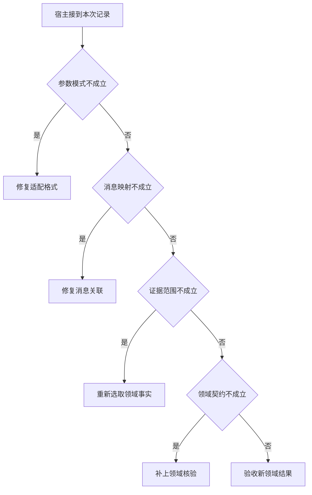

# 将运行时迁移到商户资料预审

把读阶段日志替换为读材料，再将时间区间断言替换为集合差集。
可复用的是请求关联和上限，必须重写的是领域证据与业务验收。
这个迁移试验能暴露接口里的隐含耦合。

本篇用一个封闭的教学决策器说明这一问题。输入是宿主收到的记录，不保证每个下游字段都已经获准使用。前置检查未成立时，下游即使带着缓存值，也不能拿来作业务断言。

## 先解决一个具体问题

**怎样证明你的系统可从场馆查询迁移到商户预审？**

用同一调用关联、预算、状态转移和权限入口，只替换领域观察与验证器。
若停止条件仍然写死“拿到时段”，迁移用例会直接暴露这个耦合。


先取一个能走到「验收新领域结果」的输入：参数通过结构检查、回执属于待处理调用、资料属于目标服务、交付满足业务完成条件。
把这四个条件代回后文的图，前面各个拦截分支都未满足，最终才有“共同运行层和业务断言均成立”这个判断。
还原这个现场时要分别问：哪些位来自可信状态，哪些只是在接口中出现、尚未获得解释资格的字段。

## 先沿一次决策走到底



从上到下取第一条成立的出口。只改一个开关时，只有它之前的检查都未截断，该变化才可能到达真实动作。

“参数模式”的两种输入分别是“参数通过结构检查”与“缺少可执行的必填参数”。
能解码文本并不等于可以调用业务方法。

“消息映射”的两种输入分别是“回执属于待处理调用”与“无法对应本次调用”。
仅凭返回顺序归并可能将另一请求的观察放进历史。

“证据范围”的两种输入分别是“资料属于目标服务”与“资料来自另一服务区域”。
同楼地点也可能服务不同，引用要绑定业务对象。

“领域契约”的两种输入分别是“交付满足业务完成条件”与“只有未经核验的完成声明”。
worker状态终止不能代替父任务验收。

## 最少需要哪几项观察

### 修复适配格式

不满足共同动作契约。
在本节的全部组合中，有 8 种产生「修复适配格式」，这只是逻辑空间的计数，不能当作实际用户请求的比例。

只取得缺少可执行的必填参数，已经足以要求宿主「修复适配格式」。
保持这些已知项，其余开关自由变化，仍有 8 种补全，判断没有翻转。

若删掉关于参数模式的证据，另一份允许的现场是参数通过结构检查、无法对应本次调用、资料来自另一服务区域、只有未经核验的完成声明，它会使宿主「修复消息关联」。

### 修复消息关联

回执不能复归原动作。
在本节的全部组合中，有 4 种产生「修复消息关联」，这只是逻辑空间的计数，不能当作实际用户请求的比例。

只取得参数通过结构检查、无法对应本次调用，已经足以要求宿主「修复消息关联」。
保持这些已知项，其余开关自由变化，仍有 4 种补全，判断没有翻转。

若删掉关于参数模式的证据，另一份允许的现场是缺少可执行的必填参数、无法对应本次调用、资料来自另一服务区域、只有未经核验的完成声明，它会使宿主「修复适配格式」。

若删掉关于消息映射的证据，另一份允许的现场是参数通过结构检查、回执属于待处理调用、资料来自另一服务区域、只有未经核验的完成声明，它会使宿主「重新选取领域事实」。

### 重新选取领域事实

当前观察属于错误对象或范围。
在本节的全部组合中，有 2 种产生「重新选取领域事实」，这只是逻辑空间的计数，不能当作实际用户请求的比例。

只取得参数通过结构检查、回执属于待处理调用、资料来自另一服务区域，已经足以要求宿主「重新选取领域事实」。
保持这些已知项，其余开关自由变化，仍有 2 种补全，判断没有翻转。

若删掉关于参数模式的证据，另一份允许的现场是缺少可执行的必填参数、回执属于待处理调用、资料来自另一服务区域、只有未经核验的完成声明，它会使宿主「修复适配格式」。

若删掉关于消息映射的证据，另一份允许的现场是参数通过结构检查、无法对应本次调用、资料来自另一服务区域、只有未经核验的完成声明，它会使宿主「修复消息关联」。

若删掉关于证据范围的证据，另一份允许的现场是参数通过结构检查、回执属于待处理调用、资料属于目标服务、只有未经核验的完成声明，它会使宿主「补上领域核验」。

### 补上领域核验

返回数据不等于用户目标已完成。
在本节的全部组合中，有 1 种产生「补上领域核验」，这只是逻辑空间的计数，不能当作实际用户请求的比例。

只取得参数通过结构检查、回执属于待处理调用、资料属于目标服务、只有未经核验的完成声明，已经足以要求宿主「补上领域核验」。
保持这些已知项，其余开关自由变化，仍有 1 种补全，判断没有翻转。

若删掉关于参数模式的证据，另一份允许的现场是缺少可执行的必填参数、回执属于待处理调用、资料属于目标服务、只有未经核验的完成声明，它会使宿主「修复适配格式」。

若删掉关于消息映射的证据，另一份允许的现场是参数通过结构检查、无法对应本次调用、资料属于目标服务、只有未经核验的完成声明，它会使宿主「修复消息关联」。

若删掉关于证据范围的证据，另一份允许的现场是参数通过结构检查、回执属于待处理调用、资料来自另一服务区域、只有未经核验的完成声明，它会使宿主「重新选取领域事实」。

若删掉关于领域契约的证据，另一份允许的现场是参数通过结构检查、回执属于待处理调用、资料属于目标服务、交付满足业务完成条件，它会使宿主「验收新领域结果」。

### 验收新领域结果

共同运行层和业务断言均成立。
在本节的全部组合中，有 1 种产生「验收新领域结果」，这只是逻辑空间的计数，不能当作实际用户请求的比例。

只取得参数通过结构检查、回执属于待处理调用、资料属于目标服务、交付满足业务完成条件，已经足以要求宿主「验收新领域结果」。

若删掉关于参数模式的证据，另一份允许的现场是缺少可执行的必填参数、回执属于待处理调用、资料属于目标服务、交付满足业务完成条件，它会使宿主「修复适配格式」。

若删掉关于消息映射的证据，另一份允许的现场是参数通过结构检查、无法对应本次调用、资料属于目标服务、交付满足业务完成条件，它会使宿主「修复消息关联」。

若删掉关于证据范围的证据，另一份允许的现场是参数通过结构检查、回执属于待处理调用、资料来自另一服务区域、交付满足业务完成条件，它会使宿主「重新选取领域事实」。

若删掉关于领域契约的证据，另一份允许的现场是参数通过结构检查、回执属于待处理调用、资料属于目标服务、只有未经核验的完成声明，它会使宿主「补上领域核验」。

## 以同一份契约解释截然不同的现场

<details>
<summary>展开推演与对应反例</summary>

下列样本按最先命中的业务分支排列。四位编码只作本篇页内定位，顺序与开头的四项输入一致。可以先猜下一动作，再展开相邻样本。

### 能够触发“修复适配格式”的现场

**样本 0000**

业务侧交来缺少可执行的必填参数、无法对应本次调用，执行侧还记录了资料来自另一服务区域、只有未经核验的完成声明。
把样本压成最短证明，保留缺少可执行的必填参数就能支持「修复适配格式」。

在这份记录上，分别翻转「参数模式」中的任一项，其他项完全不变时，下一动作都会改变。

保持其余观察不动，单独切换「消息映射」、「证据范围」、「领域契约」仍得到「修复适配格式」，它们在这个现场不是决定性变量。

要从本例改走「修复消息关联」，至少需要变动 1 项，一组最少改动是将缺少可执行的必填参数换成参数通过结构检查。

要从本例改走「重新选取领域事实」，至少需要变动 2 项，一组最少改动是将缺少可执行的必填参数、无法对应本次调用换成参数通过结构检查、回执属于待处理调用。

要从本例改走「补上领域核验」，至少需要变动 3 项，一组最少改动是将缺少可执行的必填参数、无法对应本次调用、资料来自另一服务区域换成参数通过结构检查、回执属于待处理调用、资料属于目标服务。

要从本例改走「验收新领域结果」，至少需要变动 4 项，一组最少改动是将缺少可执行的必填参数、无法对应本次调用、资料来自另一服务区域、只有未经核验的完成声明换成参数通过结构检查、回执属于待处理调用、资料属于目标服务、交付满足业务完成条件。

**样本 0001**

业务侧交来缺少可执行的必填参数、无法对应本次调用，执行侧还记录了资料来自另一服务区域、交付满足业务完成条件。


要从本例改走「验收新领域结果」，至少需要变动 3 项，一组最少改动是将缺少可执行的必填参数、无法对应本次调用、资料来自另一服务区域换成参数通过结构检查、回执属于待处理调用、资料属于目标服务。

要从本例改走「补上领域核验」，至少需要变动 4 项，一组最少改动是将缺少可执行的必填参数、无法对应本次调用、资料来自另一服务区域、交付满足业务完成条件换成参数通过结构检查、回执属于待处理调用、资料属于目标服务、只有未经核验的完成声明。

**样本 0010**

业务侧交来缺少可执行的必填参数、无法对应本次调用，执行侧还记录了资料属于目标服务、只有未经核验的完成声明。


要从本例改走「补上领域核验」，至少需要变动 2 项，一组最少改动是将缺少可执行的必填参数、无法对应本次调用换成参数通过结构检查、回执属于待处理调用。

要从本例改走「重新选取领域事实」，至少需要变动 3 项，一组最少改动是将缺少可执行的必填参数、无法对应本次调用、资料属于目标服务换成参数通过结构检查、回执属于待处理调用、资料来自另一服务区域。

要从本例改走「验收新领域结果」，至少需要变动 3 项，一组最少改动是将缺少可执行的必填参数、无法对应本次调用、只有未经核验的完成声明换成参数通过结构检查、回执属于待处理调用、交付满足业务完成条件。

**样本 0011**

业务侧交来缺少可执行的必填参数、无法对应本次调用，执行侧还记录了资料属于目标服务、交付满足业务完成条件。


要从本例改走「验收新领域结果」，至少需要变动 2 项，一组最少改动是将缺少可执行的必填参数、无法对应本次调用换成参数通过结构检查、回执属于待处理调用。


要从本例改走「补上领域核验」，至少需要变动 3 项，一组最少改动是将缺少可执行的必填参数、无法对应本次调用、交付满足业务完成条件换成参数通过结构检查、回执属于待处理调用、只有未经核验的完成声明。

**样本 0100**

业务侧交来缺少可执行的必填参数、回执属于待处理调用，执行侧还记录了资料来自另一服务区域、只有未经核验的完成声明。


要从本例改走「重新选取领域事实」，至少需要变动 1 项，一组最少改动是将缺少可执行的必填参数换成参数通过结构检查。

要从本例改走「修复消息关联」，至少需要变动 2 项，一组最少改动是将缺少可执行的必填参数、回执属于待处理调用换成参数通过结构检查、无法对应本次调用。

要从本例改走「补上领域核验」，至少需要变动 2 项，一组最少改动是将缺少可执行的必填参数、资料来自另一服务区域换成参数通过结构检查、资料属于目标服务。

要从本例改走「验收新领域结果」，至少需要变动 3 项，一组最少改动是将缺少可执行的必填参数、资料来自另一服务区域、只有未经核验的完成声明换成参数通过结构检查、资料属于目标服务、交付满足业务完成条件。

**样本 0101**

业务侧交来缺少可执行的必填参数、回执属于待处理调用，执行侧还记录了资料来自另一服务区域、交付满足业务完成条件。


要从本例改走「验收新领域结果」，至少需要变动 2 项，一组最少改动是将缺少可执行的必填参数、资料来自另一服务区域换成参数通过结构检查、资料属于目标服务。

要从本例改走「补上领域核验」，至少需要变动 3 项，一组最少改动是将缺少可执行的必填参数、资料来自另一服务区域、交付满足业务完成条件换成参数通过结构检查、资料属于目标服务、只有未经核验的完成声明。

**样本 0110**

业务侧交来缺少可执行的必填参数、回执属于待处理调用，执行侧还记录了资料属于目标服务、只有未经核验的完成声明。


要从本例改走「补上领域核验」，至少需要变动 1 项，一组最少改动是将缺少可执行的必填参数换成参数通过结构检查。


要从本例改走「重新选取领域事实」，至少需要变动 2 项，一组最少改动是将缺少可执行的必填参数、资料属于目标服务换成参数通过结构检查、资料来自另一服务区域。

要从本例改走「验收新领域结果」，至少需要变动 2 项，一组最少改动是将缺少可执行的必填参数、只有未经核验的完成声明换成参数通过结构检查、交付满足业务完成条件。

**样本 0111**

业务侧交来缺少可执行的必填参数、回执属于待处理调用，执行侧还记录了资料属于目标服务、交付满足业务完成条件。


要从本例改走「验收新领域结果」，至少需要变动 1 项，一组最少改动是将缺少可执行的必填参数换成参数通过结构检查。


要从本例改走「补上领域核验」，至少需要变动 2 项，一组最少改动是将缺少可执行的必填参数、交付满足业务完成条件换成参数通过结构检查、只有未经核验的完成声明。

### 能够触发“修复消息关联”的现场

**样本 1000**

业务侧交来参数通过结构检查、无法对应本次调用，执行侧还记录了资料来自另一服务区域、只有未经核验的完成声明。
把样本压成最短证明，保留参数通过结构检查、无法对应本次调用就能支持「修复消息关联」。

在这份记录上，分别翻转「参数模式」、「消息映射」中的任一项，其他项完全不变时，下一动作都会改变。

保持其余观察不动，单独切换「证据范围」、「领域契约」仍得到「修复消息关联」，它们在这个现场不是决定性变量。

本例没走更靠前的「修复适配格式」，因为参数通过结构检查与那个入口的必要条件不符。

要从本例改走「修复适配格式」，至少需要变动 1 项，一组最少改动是将参数通过结构检查换成缺少可执行的必填参数。

要从本例改走「重新选取领域事实」，至少需要变动 1 项，一组最少改动是将无法对应本次调用换成回执属于待处理调用。

要从本例改走「补上领域核验」，至少需要变动 2 项，一组最少改动是将无法对应本次调用、资料来自另一服务区域换成回执属于待处理调用、资料属于目标服务。

要从本例改走「验收新领域结果」，至少需要变动 3 项，一组最少改动是将无法对应本次调用、资料来自另一服务区域、只有未经核验的完成声明换成回执属于待处理调用、资料属于目标服务、交付满足业务完成条件。

**样本 1001**

业务侧交来参数通过结构检查、无法对应本次调用，执行侧还记录了资料来自另一服务区域、交付满足业务完成条件。


要从本例改走「验收新领域结果」，至少需要变动 2 项，一组最少改动是将无法对应本次调用、资料来自另一服务区域换成回执属于待处理调用、资料属于目标服务。

要从本例改走「补上领域核验」，至少需要变动 3 项，一组最少改动是将无法对应本次调用、资料来自另一服务区域、交付满足业务完成条件换成回执属于待处理调用、资料属于目标服务、只有未经核验的完成声明。

**样本 1010**

业务侧交来参数通过结构检查、无法对应本次调用，执行侧还记录了资料属于目标服务、只有未经核验的完成声明。


要从本例改走「补上领域核验」，至少需要变动 1 项，一组最少改动是将无法对应本次调用换成回执属于待处理调用。

要从本例改走「重新选取领域事实」，至少需要变动 2 项，一组最少改动是将无法对应本次调用、资料属于目标服务换成回执属于待处理调用、资料来自另一服务区域。

要从本例改走「验收新领域结果」，至少需要变动 2 项，一组最少改动是将无法对应本次调用、只有未经核验的完成声明换成回执属于待处理调用、交付满足业务完成条件。

**样本 1011**

业务侧交来参数通过结构检查、无法对应本次调用，执行侧还记录了资料属于目标服务、交付满足业务完成条件。


要从本例改走「验收新领域结果」，至少需要变动 1 项，一组最少改动是将无法对应本次调用换成回执属于待处理调用。


要从本例改走「补上领域核验」，至少需要变动 2 项，一组最少改动是将无法对应本次调用、交付满足业务完成条件换成回执属于待处理调用、只有未经核验的完成声明。

### 能够触发“重新选取领域事实”的现场

**样本 1100**

业务侧交来参数通过结构检查、回执属于待处理调用，执行侧还记录了资料来自另一服务区域、只有未经核验的完成声明。
把样本压成最短证明，保留参数通过结构检查、回执属于待处理调用、资料来自另一服务区域就能支持「重新选取领域事实」。

在这份记录上，分别翻转「参数模式」、「消息映射」、「证据范围」中的任一项，其他项完全不变时，下一动作都会改变。

保持其余观察不动，单独切换「领域契约」仍得到「重新选取领域事实」，它们在这个现场不是决定性变量。


本例没走更靠前的「修复消息关联」，因为回执属于待处理调用与那个入口的必要条件不符。


要从本例改走「修复消息关联」，至少需要变动 1 项，一组最少改动是将回执属于待处理调用换成无法对应本次调用。

要从本例改走「补上领域核验」，至少需要变动 1 项，一组最少改动是将资料来自另一服务区域换成资料属于目标服务。

要从本例改走「验收新领域结果」，至少需要变动 2 项，一组最少改动是将资料来自另一服务区域、只有未经核验的完成声明换成资料属于目标服务、交付满足业务完成条件。

**样本 1101**

业务侧交来参数通过结构检查、回执属于待处理调用，执行侧还记录了资料来自另一服务区域、交付满足业务完成条件。


要从本例改走「验收新领域结果」，至少需要变动 1 项，一组最少改动是将资料来自另一服务区域换成资料属于目标服务。

要从本例改走「补上领域核验」，至少需要变动 2 项，一组最少改动是将资料来自另一服务区域、交付满足业务完成条件换成资料属于目标服务、只有未经核验的完成声明。

### 能够触发“补上领域核验”的现场

**样本 1110**

业务侧交来参数通过结构检查、回执属于待处理调用，执行侧还记录了资料属于目标服务、只有未经核验的完成声明。
把样本压成最短证明，保留参数通过结构检查、回执属于待处理调用、资料属于目标服务、只有未经核验的完成声明就能支持「补上领域核验」。

在这份记录上，分别翻转「参数模式」、「消息映射」、「证据范围」、「领域契约」中的任一项，其他项完全不变时，下一动作都会改变。


本例没走更靠前的「重新选取领域事实」，因为资料属于目标服务与那个入口的必要条件不符。


要从本例改走「重新选取领域事实」，至少需要变动 1 项，一组最少改动是将资料属于目标服务换成资料来自另一服务区域。

要从本例改走「验收新领域结果」，至少需要变动 1 项，一组最少改动是将只有未经核验的完成声明换成交付满足业务完成条件。

### 能够触发“验收新领域结果”的现场

**样本 1111**

业务侧交来参数通过结构检查、回执属于待处理调用，执行侧还记录了资料属于目标服务、交付满足业务完成条件。
把样本压成最短证明，保留参数通过结构检查、回执属于待处理调用、资料属于目标服务、交付满足业务完成条件就能支持「验收新领域结果」。


本例没走更靠前的「补上领域核验」，因为交付满足业务完成条件与那个入口的必要条件不符。


要从本例改走「补上领域核验」，至少需要变动 1 项，一组最少改动是将交付满足业务完成条件换成只有未经核验的完成声明。

</details>

## 当你只能看见一半记录

<details>
<summary>展开推演与对应反例</summary>

这次隐藏两个字段，保留另两个。对每个可见现场，检查四种合法补全是否同意。如仍有歧义，选择能使最坏剩余候选动作最少的字段继续查。并列时采用本篇字段顺序。

### 只保留参数模式与消息映射

已知缺少可执行的必填参数、无法对应本次调用时，四种补全的动作分布为修复适配格式（4 种）。

就“修复适配格式”这个动作而言，在缺少可执行的必填参数、无法对应本次调用的前提下，另外两项观察不会推翻它。

已知缺少可执行的必填参数、回执属于待处理调用时，四种补全的动作分布为修复适配格式（4 种）。

就“修复适配格式”这个动作而言，在缺少可执行的必填参数、回执属于待处理调用的前提下，另外两项观察不会推翻它。

已知参数通过结构检查、无法对应本次调用时，四种补全的动作分布为修复消息关联（4 种）。

就“修复消息关联”这个动作而言，在参数通过结构检查、无法对应本次调用的前提下，另外两项观察不会推翻它。

已知参数通过结构检查、回执属于待处理调用时，四种补全的动作分布为重新选取领域事实（2 种）、补上领域核验（1 种）、验收新领域结果（1 种）。

在参数通过结构检查、回执属于待处理调用这个现场补读「证据范围」，最坏还剩 2 种动作，计算时只衡量歧义，尚未扣读取代价。
若补来的观察为“资料来自另一服务区域”，范围缩成「重新选取领域事实」。若为“资料属于目标服务”，则保留「补上领域核验」、「验收新领域结果」。

区分不了的两条执行可以具体写成 1100 与 1110：它们共享已展示字段，却分别需要「重新选取领域事实」和「补上领域核验」。

### 只保留参数模式与证据范围

已知缺少可执行的必填参数、资料来自另一服务区域时，四种补全的动作分布为修复适配格式（4 种）。

就“修复适配格式”这个动作而言，在缺少可执行的必填参数、资料来自另一服务区域的前提下，另外两项观察不会推翻它。

已知缺少可执行的必填参数、资料属于目标服务时，四种补全的动作分布为修复适配格式（4 种）。

就“修复适配格式”这个动作而言，在缺少可执行的必填参数、资料属于目标服务的前提下，另外两项观察不会推翻它。

已知参数通过结构检查、资料来自另一服务区域时，四种补全的动作分布为修复消息关联（2 种）、重新选取领域事实（2 种）。

在参数通过结构检查、资料来自另一服务区域这个现场补读「消息映射」，最坏还剩 1 种动作，计算时只衡量歧义，尚未扣读取代价。
若补来的观察为“无法对应本次调用”，范围缩成「修复消息关联」。若为“回执属于待处理调用”，则保留「重新选取领域事实」。

区分不了的两条执行可以具体写成 1000 与 1100：它们共享已展示字段，却分别需要「修复消息关联」和「重新选取领域事实」。

已知参数通过结构检查、资料属于目标服务时，四种补全的动作分布为修复消息关联（2 种）、补上领域核验（1 种）、验收新领域结果（1 种）。

在参数通过结构检查、资料属于目标服务这个现场补读「消息映射」，最坏还剩 2 种动作，计算时只衡量歧义，尚未扣读取代价。
若补来的观察为“无法对应本次调用”，范围缩成「修复消息关联」。若为“回执属于待处理调用”，则保留「补上领域核验」、「验收新领域结果」。

区分不了的两条执行可以具体写成 1010 与 1110：它们共享已展示字段，却分别需要「修复消息关联」和「补上领域核验」。

### 只保留消息映射与证据范围

已知无法对应本次调用、资料来自另一服务区域时，四种补全的动作分布为修复适配格式（2 种）、修复消息关联（2 种）。

在无法对应本次调用、资料来自另一服务区域这个现场补读「参数模式」，最坏还剩 1 种动作，计算时只衡量歧义，尚未扣读取代价。
若补来的观察为“缺少可执行的必填参数”，范围缩成「修复适配格式」。若为“参数通过结构检查”，则保留「修复消息关联」。

区分不了的两条执行可以具体写成 0000 与 1000：它们共享已展示字段，却分别需要「修复适配格式」和「修复消息关联」。

已知无法对应本次调用、资料属于目标服务时，四种补全的动作分布为修复适配格式（2 种）、修复消息关联（2 种）。

在无法对应本次调用、资料属于目标服务这个现场补读「参数模式」，最坏还剩 1 种动作，计算时只衡量歧义，尚未扣读取代价。

区分不了的两条执行可以具体写成 0010 与 1010：它们共享已展示字段，却分别需要「修复适配格式」和「修复消息关联」。

已知回执属于待处理调用、资料来自另一服务区域时，四种补全的动作分布为修复适配格式（2 种）、重新选取领域事实（2 种）。

在回执属于待处理调用、资料来自另一服务区域这个现场补读「参数模式」，最坏还剩 1 种动作，计算时只衡量歧义，尚未扣读取代价。
若补来的观察为“缺少可执行的必填参数”，范围缩成「修复适配格式」。若为“参数通过结构检查”，则保留「重新选取领域事实」。

区分不了的两条执行可以具体写成 0100 与 1100：它们共享已展示字段，却分别需要「修复适配格式」和「重新选取领域事实」。

已知回执属于待处理调用、资料属于目标服务时，四种补全的动作分布为修复适配格式（2 种）、补上领域核验（1 种）、验收新领域结果（1 种）。

在回执属于待处理调用、资料属于目标服务这个现场补读「参数模式」，最坏还剩 2 种动作，计算时只衡量歧义，尚未扣读取代价。
若补来的观察为“缺少可执行的必填参数”，范围缩成「修复适配格式」。若为“参数通过结构检查”，则保留「补上领域核验」、「验收新领域结果」。

区分不了的两条执行可以具体写成 0110 与 1110：它们共享已展示字段，却分别需要「修复适配格式」和「补上领域核验」。

### 只保留参数模式与领域契约

已知缺少可执行的必填参数、只有未经核验的完成声明时，四种补全的动作分布为修复适配格式（4 种）。

就“修复适配格式”这个动作而言，在缺少可执行的必填参数、只有未经核验的完成声明的前提下，另外两项观察不会推翻它。

已知缺少可执行的必填参数、交付满足业务完成条件时，四种补全的动作分布为修复适配格式（4 种）。

就“修复适配格式”这个动作而言，在缺少可执行的必填参数、交付满足业务完成条件的前提下，另外两项观察不会推翻它。

已知参数通过结构检查、只有未经核验的完成声明时，四种补全的动作分布为修复消息关联（2 种）、重新选取领域事实（1 种）、补上领域核验（1 种）。

在参数通过结构检查、只有未经核验的完成声明这个现场补读「消息映射」，最坏还剩 2 种动作，计算时只衡量歧义，尚未扣读取代价。
若补来的观察为“无法对应本次调用”，范围缩成「修复消息关联」。若为“回执属于待处理调用”，则保留「重新选取领域事实」、「补上领域核验」。


已知参数通过结构检查、交付满足业务完成条件时，四种补全的动作分布为修复消息关联（2 种）、重新选取领域事实（1 种）、验收新领域结果（1 种）。

在参数通过结构检查、交付满足业务完成条件这个现场补读「消息映射」，最坏还剩 2 种动作，计算时只衡量歧义，尚未扣读取代价。
若补来的观察为“无法对应本次调用”，范围缩成「修复消息关联」。若为“回执属于待处理调用”，则保留「重新选取领域事实」、「验收新领域结果」。

区分不了的两条执行可以具体写成 1001 与 1101：它们共享已展示字段，却分别需要「修复消息关联」和「重新选取领域事实」。

### 只保留消息映射与领域契约

已知无法对应本次调用、只有未经核验的完成声明时，四种补全的动作分布为修复适配格式（2 种）、修复消息关联（2 种）。

在无法对应本次调用、只有未经核验的完成声明这个现场补读「参数模式」，最坏还剩 1 种动作，计算时只衡量歧义，尚未扣读取代价。


已知无法对应本次调用、交付满足业务完成条件时，四种补全的动作分布为修复适配格式（2 种）、修复消息关联（2 种）。

在无法对应本次调用、交付满足业务完成条件这个现场补读「参数模式」，最坏还剩 1 种动作，计算时只衡量歧义，尚未扣读取代价。

区分不了的两条执行可以具体写成 0001 与 1001：它们共享已展示字段，却分别需要「修复适配格式」和「修复消息关联」。

已知回执属于待处理调用、只有未经核验的完成声明时，四种补全的动作分布为修复适配格式（2 种）、重新选取领域事实（1 种）、补上领域核验（1 种）。

在回执属于待处理调用、只有未经核验的完成声明这个现场补读「参数模式」，最坏还剩 2 种动作，计算时只衡量歧义，尚未扣读取代价。
若补来的观察为“缺少可执行的必填参数”，范围缩成「修复适配格式」。若为“参数通过结构检查”，则保留「重新选取领域事实」、「补上领域核验」。


已知回执属于待处理调用、交付满足业务完成条件时，四种补全的动作分布为修复适配格式（2 种）、重新选取领域事实（1 种）、验收新领域结果（1 种）。

在回执属于待处理调用、交付满足业务完成条件这个现场补读「参数模式」，最坏还剩 2 种动作，计算时只衡量歧义，尚未扣读取代价。
若补来的观察为“缺少可执行的必填参数”，范围缩成「修复适配格式」。若为“参数通过结构检查”，则保留「重新选取领域事实」、「验收新领域结果」。

区分不了的两条执行可以具体写成 0101 与 1101：它们共享已展示字段，却分别需要「修复适配格式」和「重新选取领域事实」。

### 只保留证据范围与领域契约

已知资料来自另一服务区域、只有未经核验的完成声明时，四种补全的动作分布为修复适配格式（2 种）、修复消息关联（1 种）、重新选取领域事实（1 种）。

在资料来自另一服务区域、只有未经核验的完成声明这个现场补读「参数模式」，最坏还剩 2 种动作，计算时只衡量歧义，尚未扣读取代价。
若补来的观察为“缺少可执行的必填参数”，范围缩成「修复适配格式」。若为“参数通过结构检查”，则保留「修复消息关联」、「重新选取领域事实」。


已知资料来自另一服务区域、交付满足业务完成条件时，四种补全的动作分布为修复适配格式（2 种）、修复消息关联（1 种）、重新选取领域事实（1 种）。

在资料来自另一服务区域、交付满足业务完成条件这个现场补读「参数模式」，最坏还剩 2 种动作，计算时只衡量歧义，尚未扣读取代价。


已知资料属于目标服务、只有未经核验的完成声明时，四种补全的动作分布为修复适配格式（2 种）、修复消息关联（1 种）、补上领域核验（1 种）。

在资料属于目标服务、只有未经核验的完成声明这个现场补读「参数模式」，最坏还剩 2 种动作，计算时只衡量歧义，尚未扣读取代价。
若补来的观察为“缺少可执行的必填参数”，范围缩成「修复适配格式」。若为“参数通过结构检查”，则保留「修复消息关联」、「补上领域核验」。


已知资料属于目标服务、交付满足业务完成条件时，四种补全的动作分布为修复适配格式（2 种）、修复消息关联（1 种）、验收新领域结果（1 种）。

在资料属于目标服务、交付满足业务完成条件这个现场补读「参数模式」，最坏还剩 2 种动作，计算时只衡量歧义，尚未扣读取代价。
若补来的观察为“缺少可执行的必填参数”，范围缩成「修复适配格式」。若为“参数通过结构检查”，则保留「修复消息关联」、「验收新领域结果」。

区分不了的两条执行可以具体写成 0011 与 1011：它们共享已展示字段，却分别需要「修复适配格式」和「修复消息关联」。

</details>

## 单因素干预与边界测试

<details>
<summary>展开推演与对应反例</summary>

### 只改变参数模式

固定另外三个条件得到八对现场，从“缺少可执行的必填参数”转为“参数通过结构检查”时，8 对翻转动作，另外 0 对保持不变。

有 4 对现场沿「修复适配格式」变到「修复消息关联」，可复现的一组受控背景为无法对应本次调用、资料来自另一服务区域、只有未经核验的完成声明。

有 2 对现场沿「修复适配格式」变到「重新选取领域事实」，可复现的一组受控背景为回执属于待处理调用、资料来自另一服务区域、只有未经核验的完成声明。

有 1 对现场沿「修复适配格式」变到「补上领域核验」，可复现的一组受控背景为回执属于待处理调用、资料属于目标服务、只有未经核验的完成声明。

有 1 对现场沿「修复适配格式」变到「验收新领域结果」，可复现的一组受控背景为回执属于待处理调用、资料属于目标服务、交付满足业务完成条件。

### 只改变消息映射

固定另外三个条件得到八对现场，从“无法对应本次调用”转为“回执属于待处理调用”时，4 对翻转动作，另外 4 对保持不变。

令缺少可执行的必填参数、资料来自另一服务区域、只有未经核验的完成声明，消息映射的两个取值均得到「修复适配格式」。在八对中，共有 4 对表现为这一种稳定出口。

有 2 对现场沿「修复消息关联」变到「重新选取领域事实」，可复现的一组受控背景为参数通过结构检查、资料来自另一服务区域、只有未经核验的完成声明。

有 1 对现场沿「修复消息关联」变到「补上领域核验」，可复现的一组受控背景为参数通过结构检查、资料属于目标服务、只有未经核验的完成声明。

有 1 对现场沿「修复消息关联」变到「验收新领域结果」，可复现的一组受控背景为参数通过结构检查、资料属于目标服务、交付满足业务完成条件。

### 只改变证据范围

固定另外三个条件得到八对现场，从“资料来自另一服务区域”转为“资料属于目标服务”时，2 对翻转动作，另外 6 对保持不变。

令缺少可执行的必填参数、无法对应本次调用、只有未经核验的完成声明，证据范围的两个取值均得到「修复适配格式」。在八对中，共有 4 对表现为这一种稳定出口。

令参数通过结构检查、无法对应本次调用、只有未经核验的完成声明，证据范围的两个取值均得到「修复消息关联」。在八对中，共有 2 对表现为这一种稳定出口。

有 1 对现场沿「重新选取领域事实」变到「补上领域核验」，可复现的一组受控背景为参数通过结构检查、回执属于待处理调用、只有未经核验的完成声明。

有 1 对现场沿「重新选取领域事实」变到「验收新领域结果」，可复现的一组受控背景为参数通过结构检查、回执属于待处理调用、交付满足业务完成条件。

### 只改变领域契约

固定另外三个条件得到八对现场，从“只有未经核验的完成声明”转为“交付满足业务完成条件”时，1 对翻转动作，另外 7 对保持不变。

令缺少可执行的必填参数、无法对应本次调用、资料来自另一服务区域，领域契约的两个取值均得到「修复适配格式」。在八对中，共有 4 对表现为这一种稳定出口。

令参数通过结构检查、无法对应本次调用、资料来自另一服务区域，领域契约的两个取值均得到「修复消息关联」。在八对中，共有 2 对表现为这一种稳定出口。

令参数通过结构检查、回执属于待处理调用、资料来自另一服务区域，领域契约的两个取值均得到「重新选取领域事实」。在八对中，共有 1 对表现为这一种稳定出口。

有 1 对现场沿「补上领域核验」变到「验收新领域结果」，可复现的一组受控背景为参数通过结构检查、回执属于待处理调用、资料属于目标服务。

</details>

## 哪些回归样本真能抓住实现错误

<details>
<summary>展开推演与对应反例</summary>

如果删除“修复适配格式”这个分支，在本篇 16 种输入里有 8 种会改走另一出口。

反例 0000 的完整记录为缺少可执行的必填参数、无法对应本次调用、资料来自另一服务区域、只有未经核验的完成声明。正确结果是「修复适配格式」，这个改坏的实现却给出「修复消息关联」。

如果删除“修复消息关联”这个分支，在本篇 16 种输入里有 4 种会改走另一出口。

反例 1000 的完整记录为参数通过结构检查、无法对应本次调用、资料来自另一服务区域、只有未经核验的完成声明。正确结果是「修复消息关联」，这个改坏的实现却给出「重新选取领域事实」。

如果删除“重新选取领域事实”这个分支，在本篇 16 种输入里有 2 种会改走另一出口。

反例 1100 的完整记录为参数通过结构检查、回执属于待处理调用、资料来自另一服务区域、只有未经核验的完成声明。正确结果是「重新选取领域事实」，这个改坏的实现却给出「补上领域核验」。

如果删除“补上领域核验”这个分支，在本篇 16 种输入里有 1 种会改走另一出口。

反例 1110 的完整记录为参数通过结构检查、回执属于待处理调用、资料属于目标服务、只有未经核验的完成声明。正确结果是「补上领域核验」，这个改坏的实现却给出「验收新领域结果」。

如果交换“修复适配格式”和“修复消息关联”的判断次序，在本篇 16 种输入里有 4 种会改走另一出口。


如果交换“修复消息关联”和“重新选取领域事实”的判断次序，在本篇 16 种输入里有 2 种会改走另一出口。


如果交换“重新选取领域事实”和“补上领域核验”的判断次序，在本篇 16 种输入里有 1 种会改走另一出口。


补入样本 0000（缺少可执行的必填参数、无法对应本次调用、资料来自另一服务区域、只有未经核验的完成声明）能新增检出「删除“修复适配格式”这个分支」、「交换“修复适配格式”和“修复消息关联”的判断次序」。

补入样本 1000（参数通过结构检查、无法对应本次调用、资料来自另一服务区域、只有未经核验的完成声明）能新增检出「删除“修复消息关联”这个分支」、「交换“修复消息关联”和“重新选取领域事实”的判断次序」。

补入样本 1100（参数通过结构检查、回执属于待处理调用、资料来自另一服务区域、只有未经核验的完成声明）能新增检出「删除“重新选取领域事实”这个分支」、「交换“重新选取领域事实”和“补上领域核验”的判断次序」。

补入样本 1110（参数通过结构检查、回执属于待处理调用、资料属于目标服务、只有未经核验的完成声明）能新增检出「删除“补上领域核验”这个分支」。

这里每次选覆盖尚未捕获缺陷最多的样本，并不保证用例数全局最小。它给出的反例能作为 Java 单测输入。真实模型是否会自主产生这些提议，仍须单独评测。

</details>

## 把状态覆盖换成有抽样偏差的评测批次

<details>
<summary>展开推演与对应反例</summary>

前面的十六种记录各有一票。现在只改样本构成：对一个给定字段，把成立侧的每种记录各取三份、另一侧各取一份。这是人为配比的 32 份回放，不是线上频率估计。
将偏向成立与偏向不成立的两次批次对照，可以隔离分母变化。底层宿主和所有答案保持相同，比例仍可能移动。

### 改变“参数模式”的样本配比

只看「修复适配格式」，在参数通过结构检查的八个不同输入中有 0 个命中，在缺少可执行的必填参数的另八个输入中有 8 个命中。
把「参数模式」成立侧按三倍取样，「修复适配格式」占 8/32，反过来向未成立侧倾斜后占 24/32。
这次重加权使「修复适配格式」的占比相差 50 个百分点。若按两种不同的“参数模式”分布跑新旧版，不能把这项差异全部归功于实现。

只看「修复消息关联」，在参数通过结构检查的八个不同输入中有 4 个命中，在缺少可执行的必填参数的另八个输入中有 0 个命中。
把「参数模式」成立侧按三倍取样，「修复消息关联」占 12/32，反过来向未成立侧倾斜后占 4/32。
这次重加权使「修复消息关联」的占比相差 25 个百分点。若按两种不同的“参数模式”分布跑新旧版，不能把这项差异全部归功于实现。

只看「重新选取领域事实」，在参数通过结构检查的八个不同输入中有 2 个命中，在缺少可执行的必填参数的另八个输入中有 0 个命中。
把「参数模式」成立侧按三倍取样，「重新选取领域事实」占 6/32，反过来向未成立侧倾斜后占 2/32。
这次重加权使「重新选取领域事实」的占比相差 12.5 个百分点。若按两种不同的“参数模式”分布跑新旧版，不能把这项差异全部归功于实现。

只看「补上领域核验」，在参数通过结构检查的八个不同输入中有 1 个命中，在缺少可执行的必填参数的另八个输入中有 0 个命中。
把「参数模式」成立侧按三倍取样，「补上领域核验」占 3/32，反过来向未成立侧倾斜后占 1/32。
这次重加权使「补上领域核验」的占比相差 6.25 个百分点。若按两种不同的“参数模式”分布跑新旧版，不能把这项差异全部归功于实现。

只看「验收新领域结果」，在参数通过结构检查的八个不同输入中有 1 个命中，在缺少可执行的必填参数的另八个输入中有 0 个命中。
把「参数模式」成立侧按三倍取样，「验收新领域结果」占 3/32，反过来向未成立侧倾斜后占 1/32。
这次重加权使「验收新领域结果」的占比相差 6.25 个百分点。若按两种不同的“参数模式”分布跑新旧版，不能把这项差异全部归功于实现。

### 改变“消息映射”的样本配比

只看「修复适配格式」，在回执属于待处理调用的八个不同输入中有 4 个命中，在无法对应本次调用的另八个输入中有 4 个命中。
把「消息映射」成立侧按三倍取样，「修复适配格式」占 16/32，反过来向未成立侧倾斜后占 16/32。
两批「修复适配格式」的边际比例相同，是因为这个出口在“消息映射”的两侧计数相等，这不能单独证明每一对现场都不受它影响。

只看「修复消息关联」，在回执属于待处理调用的八个不同输入中有 0 个命中，在无法对应本次调用的另八个输入中有 4 个命中。
把「消息映射」成立侧按三倍取样，「修复消息关联」占 4/32，反过来向未成立侧倾斜后占 12/32。
这次重加权使「修复消息关联」的占比相差 25 个百分点。若按两种不同的“消息映射”分布跑新旧版，不能把这项差异全部归功于实现。

只看「重新选取领域事实」，在回执属于待处理调用的八个不同输入中有 2 个命中，在无法对应本次调用的另八个输入中有 0 个命中。
把「消息映射」成立侧按三倍取样，「重新选取领域事实」占 6/32，反过来向未成立侧倾斜后占 2/32。
这次重加权使「重新选取领域事实」的占比相差 12.5 个百分点。若按两种不同的“消息映射”分布跑新旧版，不能把这项差异全部归功于实现。

只看「补上领域核验」，在回执属于待处理调用的八个不同输入中有 1 个命中，在无法对应本次调用的另八个输入中有 0 个命中。
把「消息映射」成立侧按三倍取样，「补上领域核验」占 3/32，反过来向未成立侧倾斜后占 1/32。
这次重加权使「补上领域核验」的占比相差 6.25 个百分点。若按两种不同的“消息映射”分布跑新旧版，不能把这项差异全部归功于实现。

只看「验收新领域结果」，在回执属于待处理调用的八个不同输入中有 1 个命中，在无法对应本次调用的另八个输入中有 0 个命中。
把「消息映射」成立侧按三倍取样，「验收新领域结果」占 3/32，反过来向未成立侧倾斜后占 1/32。
这次重加权使「验收新领域结果」的占比相差 6.25 个百分点。若按两种不同的“消息映射”分布跑新旧版，不能把这项差异全部归功于实现。

### 改变“证据范围”的样本配比

只看「修复适配格式」，在资料属于目标服务的八个不同输入中有 4 个命中，在资料来自另一服务区域的另八个输入中有 4 个命中。
把「证据范围」成立侧按三倍取样，「修复适配格式」占 16/32，反过来向未成立侧倾斜后占 16/32。
两批「修复适配格式」的边际比例相同，是因为这个出口在“证据范围”的两侧计数相等，这不能单独证明每一对现场都不受它影响。

只看「修复消息关联」，在资料属于目标服务的八个不同输入中有 2 个命中，在资料来自另一服务区域的另八个输入中有 2 个命中。
把「证据范围」成立侧按三倍取样，「修复消息关联」占 8/32，反过来向未成立侧倾斜后占 8/32。
两批「修复消息关联」的边际比例相同，是因为这个出口在“证据范围”的两侧计数相等，这不能单独证明每一对现场都不受它影响。

只看「重新选取领域事实」，在资料属于目标服务的八个不同输入中有 0 个命中，在资料来自另一服务区域的另八个输入中有 2 个命中。
把「证据范围」成立侧按三倍取样，「重新选取领域事实」占 2/32，反过来向未成立侧倾斜后占 6/32。
这次重加权使「重新选取领域事实」的占比相差 12.5 个百分点。若按两种不同的“证据范围”分布跑新旧版，不能把这项差异全部归功于实现。

只看「补上领域核验」，在资料属于目标服务的八个不同输入中有 1 个命中，在资料来自另一服务区域的另八个输入中有 0 个命中。
把「证据范围」成立侧按三倍取样，「补上领域核验」占 3/32，反过来向未成立侧倾斜后占 1/32。
这次重加权使「补上领域核验」的占比相差 6.25 个百分点。若按两种不同的“证据范围”分布跑新旧版，不能把这项差异全部归功于实现。

只看「验收新领域结果」，在资料属于目标服务的八个不同输入中有 1 个命中，在资料来自另一服务区域的另八个输入中有 0 个命中。
把「证据范围」成立侧按三倍取样，「验收新领域结果」占 3/32，反过来向未成立侧倾斜后占 1/32。
这次重加权使「验收新领域结果」的占比相差 6.25 个百分点。若按两种不同的“证据范围”分布跑新旧版，不能把这项差异全部归功于实现。

### 改变“领域契约”的样本配比

只看「修复适配格式」，在交付满足业务完成条件的八个不同输入中有 4 个命中，在只有未经核验的完成声明的另八个输入中有 4 个命中。
把「领域契约」成立侧按三倍取样，「修复适配格式」占 16/32，反过来向未成立侧倾斜后占 16/32。
两批「修复适配格式」的边际比例相同，是因为这个出口在“领域契约”的两侧计数相等，这不能单独证明每一对现场都不受它影响。

只看「修复消息关联」，在交付满足业务完成条件的八个不同输入中有 2 个命中，在只有未经核验的完成声明的另八个输入中有 2 个命中。
把「领域契约」成立侧按三倍取样，「修复消息关联」占 8/32，反过来向未成立侧倾斜后占 8/32。
两批「修复消息关联」的边际比例相同，是因为这个出口在“领域契约”的两侧计数相等，这不能单独证明每一对现场都不受它影响。

只看「重新选取领域事实」，在交付满足业务完成条件的八个不同输入中有 1 个命中，在只有未经核验的完成声明的另八个输入中有 1 个命中。
把「领域契约」成立侧按三倍取样，「重新选取领域事实」占 4/32，反过来向未成立侧倾斜后占 4/32。
两批「重新选取领域事实」的边际比例相同，是因为这个出口在“领域契约”的两侧计数相等，这不能单独证明每一对现场都不受它影响。

只看「补上领域核验」，在交付满足业务完成条件的八个不同输入中有 0 个命中，在只有未经核验的完成声明的另八个输入中有 1 个命中。
把「领域契约」成立侧按三倍取样，「补上领域核验」占 1/32，反过来向未成立侧倾斜后占 3/32。
这次重加权使「补上领域核验」的占比相差 6.25 个百分点。若按两种不同的“领域契约”分布跑新旧版，不能把这项差异全部归功于实现。

只看「验收新领域结果」，在交付满足业务完成条件的八个不同输入中有 1 个命中，在只有未经核验的完成声明的另八个输入中有 0 个命中。
把「领域契约」成立侧按三倍取样，「验收新领域结果」占 3/32，反过来向未成立侧倾斜后占 1/32。
这次重加权使「验收新领域结果」的占比相差 6.25 个百分点。若按两种不同的“领域契约”分布跑新旧版，不能把这项差异全部归功于实现。

</details>

## 只看终态，能逆推出多少原始事实

<details>
<summary>展开推演与对应反例</summary>

### 只保留“修复适配格式”这条结果时

在本节契约与完整输入域内，仅知「修复适配格式」就能倒推出缺少可执行的必填参数，这一推断依赖版本未变且日志中的终态可信。

「修复适配格式」不能证明消息映射取哪一侧：0000 和 0100 有相同终态，却分别记为“无法对应本次调用”和“回执属于待处理调用”。

「修复适配格式」不能证明证据范围取哪一侧：0000 和 0010 有相同终态，却分别记为“资料来自另一服务区域”和“资料属于目标服务”。

「修复适配格式」不能证明领域契约取哪一侧：0000 和 0001 有相同终态，却分别记为“只有未经核验的完成声明”和“交付满足业务完成条件”。

反查「修复适配格式」的诊断日志，优先保留能区分样本 0000 与 1000 的「参数模式」，否则很容易把邻近的「修复消息关联」看成同一种故障。

### 只保留“修复消息关联”这条结果时

在本节契约与完整输入域内，仅知「修复消息关联」就能倒推出参数通过结构检查，这一推断依赖版本未变且日志中的终态可信。

在本节契约与完整输入域内，仅知「修复消息关联」就能倒推出无法对应本次调用，这一推断依赖版本未变且日志中的终态可信。

「修复消息关联」不能证明证据范围取哪一侧：1000 和 1010 有相同终态，却分别记为“资料来自另一服务区域”和“资料属于目标服务”。

「修复消息关联」不能证明领域契约取哪一侧：1000 和 1001 有相同终态，却分别记为“只有未经核验的完成声明”和“交付满足业务完成条件”。

反查「修复消息关联」的诊断日志，优先保留能区分样本 1000 与 0000 的「参数模式」，否则很容易把邻近的「修复适配格式」看成同一种故障。

### 只保留“重新选取领域事实”这条结果时

在本节契约与完整输入域内，仅知「重新选取领域事实」就能倒推出参数通过结构检查，这一推断依赖版本未变且日志中的终态可信。

在本节契约与完整输入域内，仅知「重新选取领域事实」就能倒推出回执属于待处理调用，这一推断依赖版本未变且日志中的终态可信。

在本节契约与完整输入域内，仅知「重新选取领域事实」就能倒推出资料来自另一服务区域，这一推断依赖版本未变且日志中的终态可信。

「重新选取领域事实」不能证明领域契约取哪一侧：1100 和 1101 有相同终态，却分别记为“只有未经核验的完成声明”和“交付满足业务完成条件”。

反查「重新选取领域事实」的诊断日志，优先保留能区分样本 1100 与 0100 的「参数模式」，否则很容易把邻近的「修复适配格式」看成同一种故障。

### 只保留“补上领域核验”这条结果时

在本节契约与完整输入域内，仅知「补上领域核验」就能倒推出参数通过结构检查，这一推断依赖版本未变且日志中的终态可信。

在本节契约与完整输入域内，仅知「补上领域核验」就能倒推出回执属于待处理调用，这一推断依赖版本未变且日志中的终态可信。

在本节契约与完整输入域内，仅知「补上领域核验」就能倒推出资料属于目标服务，这一推断依赖版本未变且日志中的终态可信。

在本节契约与完整输入域内，仅知「补上领域核验」就能倒推出只有未经核验的完成声明，这一推断依赖版本未变且日志中的终态可信。

反查「补上领域核验」的诊断日志，优先保留能区分样本 1110 与 0110 的「参数模式」，否则很容易把邻近的「修复适配格式」看成同一种故障。

### 只保留“验收新领域结果”这条结果时

在本节契约与完整输入域内，仅知「验收新领域结果」就能倒推出参数通过结构检查，这一推断依赖版本未变且日志中的终态可信。

在本节契约与完整输入域内，仅知「验收新领域结果」就能倒推出回执属于待处理调用，这一推断依赖版本未变且日志中的终态可信。

在本节契约与完整输入域内，仅知「验收新领域结果」就能倒推出资料属于目标服务，这一推断依赖版本未变且日志中的终态可信。

在本节契约与完整输入域内，仅知「验收新领域结果」就能倒推出交付满足业务完成条件，这一推断依赖版本未变且日志中的终态可信。

反查「验收新领域结果」的诊断日志，优先保留能区分样本 1111 与 0111 的「参数模式」，否则很容易把邻近的「修复适配格式」看成同一种故障。

</details>

## 面试复述与复算

面试题可以从“怎样证明你的系统可从场馆查询迁移到商户预审？”起步。先给出本篇的触发条件和一条真实执行端可检查的证据，再用一个相邻反例限定结论的适用范围。

在仓库根目录执行下列命令可以重算本篇的一个输入。四位数字依次选择正文列出的四项条件，0 表示未成立或低档，1 表示成立或高档。
```powershell
node examples/reading-cases/replay.mjs 8 2 0101
```

[本周主文](../theory.md) · [配套实验](../lab.md) · [下一篇研读](03.md)
