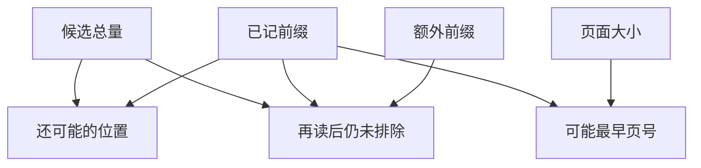

# 排序切片能排除哪些名次

完整排序的元素互不重复，前缀中没出现目标。
只能给可能名次或页面设下界，不能推断某条过滤规则实际执行过。
页号从1起。最后一项以补读后仍未命中为前提。
目标也可能不在排序输出。

## 先解决一个具体问题

**从未命中的排序前缀能恢复真实 rank 吗？**

只能在目标确实属于完整输出时给出下界。
若目标根本未进输出，它没有这张排序表上的名次。
还要明确 rank 从零还是一开始，页号口径也应固定。


先从具体的低档设定开始：候选总量取 40个、已记前缀取 8名、页面大小取 5个、额外前缀取 4名。
三个结果依次是还可能的位置 32个、可能最早页号 2页、再读后仍未排除 28个。
先手算这个起点，读完后再把另一个输入切到高档，这样能知道数字变化时究竟改变了哪个假设。

## 先写清输入边界和三个观测量

用 a 表示候选总量，取 40个 或 90个，这两点是用于隔离因果影响的教学输入。

用 b 表示已记前缀，取 8名 或 20名，这两点是用于隔离因果影响的教学输入。

用 c 表示页面大小，取 5个 或 10个，这两点是用于隔离因果影响的教学输入。

用 d 表示额外前缀，取 4名 或 12名，这两点是用于隔离因果影响的教学输入。

「还可能的位置」的计算式为 `a-b`，按业务量展开是 `候选总量-已记前缀`，输出单位为个。

「可能最早页号」的计算式为 `floor(b/c)+1`，按业务量展开是 `floor(已记前缀/页面大小)+1`，输出单位为页。

「再读后仍未排除」的计算式为 `max(0,a-b-d)`，按业务量展开是 `max(0,候选总量-已记前缀-额外前缀)`，输出单位为个。

公式中 ceil 与 floor 分别向上、向下取整，% 在表达式中作取余，** 为乘方，三元条件按“条件 ? 成立值 : 其他值”读取。展示数值最多保留三位小数，比较和反推采用未舍入值。



图上的箭头表示该输入出现在计算式中。同一输入通向多个指标时，三个读数可能共同移动。分支、取整或相互抵消又会使某些边在具体样本上没有可见增量。

## 从输入按单位逐步算到可比较的结果

<details>
<summary>展开推演与对应反例</summary>

### 样本 0000：候选总量 40、已记前缀 8

这一组设定为候选总量为 40个、已记前缀为 8名、页面大小为 5个、额外前缀为 4名。

代入「还可能的位置」：`40-8`，得到 32个。

代入「可能最早页号」：`floor(8/5)+1`，得到 2页。

代入「再读后仍未排除」：`max(0,40-8-4)`，得到 28个。

以「再读后仍未排除」作主读数时，本组单独切换候选总量的绝对变化最大或并列最大，读数会从 28个 变为 78个。

本组固定其余输入时，分别改变「页面大小」均不会改变 28个 这个主读数，是否影响另一指标仍需另算。

对角样本 1111 的主读数为 58个。它同时改了四项，差额不能充当任一单个因素的净收益。

### 样本 0001：候选总量 40、已记前缀 8

这一组设定为候选总量为 40个、已记前缀为 8名、页面大小为 5个、额外前缀为 12名。


代入「再读后仍未排除」：`max(0,40-8-12)`，得到 20个。

以「再读后仍未排除」作主读数时，本组单独切换候选总量的绝对变化最大或并列最大，读数会从 20个 变为 70个。

本组固定其余输入时，分别改变「页面大小」均不会改变 20个 这个主读数，是否影响另一指标仍需另算。

对角样本 1110 的主读数为 66个。它同时改了四项，差额不能充当任一单个因素的净收益。

### 样本 0010：候选总量 40、已记前缀 8

这一组设定为候选总量为 40个、已记前缀为 8名、页面大小为 10个、额外前缀为 4名。


代入「可能最早页号」：`floor(8/10)+1`，得到 1页。


对角样本 1101 的主读数为 58个。它同时改了四项，差额不能充当任一单个因素的净收益。

### 样本 0011：候选总量 40、已记前缀 8

这一组设定为候选总量为 40个、已记前缀为 8名、页面大小为 10个、额外前缀为 12名。


对角样本 1100 的主读数为 66个。它同时改了四项，差额不能充当任一单个因素的净收益。

### 样本 0100：候选总量 40、已记前缀 20

这一组设定为候选总量为 40个、已记前缀为 20名、页面大小为 5个、额外前缀为 4名。

代入「还可能的位置」：`40-20`，得到 20个。

代入「可能最早页号」：`floor(20/5)+1`，得到 5页。

代入「再读后仍未排除」：`max(0,40-20-4)`，得到 16个。

以「再读后仍未排除」作主读数时，本组单独切换候选总量的绝对变化最大或并列最大，读数会从 16个 变为 66个。

本组固定其余输入时，分别改变「页面大小」均不会改变 16个 这个主读数，是否影响另一指标仍需另算。

对角样本 1011 的主读数为 70个。它同时改了四项，差额不能充当任一单个因素的净收益。

### 样本 0101：候选总量 40、已记前缀 20

这一组设定为候选总量为 40个、已记前缀为 20名、页面大小为 5个、额外前缀为 12名。


代入「再读后仍未排除」：`max(0,40-20-12)`，得到 8个。

以「再读后仍未排除」作主读数时，本组单独切换候选总量的绝对变化最大或并列最大，读数会从 8个 变为 58个。

本组固定其余输入时，分别改变「页面大小」均不会改变 8个 这个主读数，是否影响另一指标仍需另算。

对角样本 1010 的主读数为 78个。它同时改了四项，差额不能充当任一单个因素的净收益。

### 样本 0110：候选总量 40、已记前缀 20

这一组设定为候选总量为 40个、已记前缀为 20名、页面大小为 10个、额外前缀为 4名。


代入「可能最早页号」：`floor(20/10)+1`，得到 3页。


对角样本 1001 的主读数为 70个。它同时改了四项，差额不能充当任一单个因素的净收益。

### 样本 0111：候选总量 40、已记前缀 20

这一组设定为候选总量为 40个、已记前缀为 20名、页面大小为 10个、额外前缀为 12名。


对角样本 1000 的主读数为 78个。它同时改了四项，差额不能充当任一单个因素的净收益。

### 样本 1000：候选总量 90、已记前缀 8

这一组设定为候选总量为 90个、已记前缀为 8名、页面大小为 5个、额外前缀为 4名。

代入「还可能的位置」：`90-8`，得到 82个。


代入「再读后仍未排除」：`max(0,90-8-4)`，得到 78个。

以「再读后仍未排除」作主读数时，本组单独切换候选总量的绝对变化最大或并列最大，读数会从 78个 变为 28个。

本组固定其余输入时，分别改变「页面大小」均不会改变 78个 这个主读数，是否影响另一指标仍需另算。

对角样本 0111 的主读数为 8个。它同时改了四项，差额不能充当任一单个因素的净收益。

### 样本 1001：候选总量 90、已记前缀 8

这一组设定为候选总量为 90个、已记前缀为 8名、页面大小为 5个、额外前缀为 12名。


代入「再读后仍未排除」：`max(0,90-8-12)`，得到 70个。

以「再读后仍未排除」作主读数时，本组单独切换候选总量的绝对变化最大或并列最大，读数会从 70个 变为 20个。

本组固定其余输入时，分别改变「页面大小」均不会改变 70个 这个主读数，是否影响另一指标仍需另算。

对角样本 0110 的主读数为 16个。它同时改了四项，差额不能充当任一单个因素的净收益。

### 样本 1010：候选总量 90、已记前缀 8

这一组设定为候选总量为 90个、已记前缀为 8名、页面大小为 10个、额外前缀为 4名。


对角样本 0101 的主读数为 8个。它同时改了四项，差额不能充当任一单个因素的净收益。

### 样本 1011：候选总量 90、已记前缀 8

这一组设定为候选总量为 90个、已记前缀为 8名、页面大小为 10个、额外前缀为 12名。


对角样本 0100 的主读数为 16个。它同时改了四项，差额不能充当任一单个因素的净收益。

### 样本 1100：候选总量 90、已记前缀 20

这一组设定为候选总量为 90个、已记前缀为 20名、页面大小为 5个、额外前缀为 4名。

代入「还可能的位置」：`90-20`，得到 70个。


代入「再读后仍未排除」：`max(0,90-20-4)`，得到 66个。

以「再读后仍未排除」作主读数时，本组单独切换候选总量的绝对变化最大或并列最大，读数会从 66个 变为 16个。

本组固定其余输入时，分别改变「页面大小」均不会改变 66个 这个主读数，是否影响另一指标仍需另算。

对角样本 0011 的主读数为 20个。它同时改了四项，差额不能充当任一单个因素的净收益。

### 样本 1101：候选总量 90、已记前缀 20

这一组设定为候选总量为 90个、已记前缀为 20名、页面大小为 5个、额外前缀为 12名。


代入「再读后仍未排除」：`max(0,90-20-12)`，得到 58个。

以「再读后仍未排除」作主读数时，本组单独切换候选总量的绝对变化最大或并列最大，读数会从 58个 变为 8个。

本组固定其余输入时，分别改变「页面大小」均不会改变 58个 这个主读数，是否影响另一指标仍需另算。

对角样本 0010 的主读数为 28个。它同时改了四项，差额不能充当任一单个因素的净收益。

### 样本 1110：候选总量 90、已记前缀 20

这一组设定为候选总量为 90个、已记前缀为 20名、页面大小为 10个、额外前缀为 4名。


对角样本 0001 的主读数为 20个。它同时改了四项，差额不能充当任一单个因素的净收益。

### 样本 1111：候选总量 90、已记前缀 20

这一组设定为候选总量为 90个、已记前缀为 20名、页面大小为 10个、额外前缀为 12名。


对角样本 0000 的主读数为 28个。它同时改了四项，差额不能充当任一单个因素的净收益。

</details>

## 逐个干预：其余条件固定时，变化真的发生在哪里

<details>
<summary>展开推演与对应反例</summary>

### 只改变候选总量

固定已记前缀为 8名、页面大小为 5个、额外前缀为 4名，只把候选总量从 40个改到 90个。
这一对的还可能的位置从 32个 变为 82个，可能最早页号的差为 0页，再读后仍未排除的差为 50个。

固定已记前缀为 8名、页面大小为 5个、额外前缀为 12名，只把候选总量从 40个改到 90个。

固定已记前缀为 8名、页面大小为 10个、额外前缀为 4名，只把候选总量从 40个改到 90个。

固定已记前缀为 8名、页面大小为 10个、额外前缀为 12名，只把候选总量从 40个改到 90个。

固定已记前缀为 20名、页面大小为 5个、额外前缀为 4名，只把候选总量从 40个改到 90个。
这一对的还可能的位置从 20个 变为 70个，可能最早页号的差为 0页，再读后仍未排除的差为 50个。

固定已记前缀为 20名、页面大小为 5个、额外前缀为 12名，只把候选总量从 40个改到 90个。

固定已记前缀为 20名、页面大小为 10个、额外前缀为 4名，只把候选总量从 40个改到 90个。

固定已记前缀为 20名、页面大小为 10个、额外前缀为 12名，只把候选总量从 40个改到 90个。

综合八组受控背景，候选总量升到较高设定时「还可能的位置」的差值区间是 50个，共有 8 对出现可观察变化。

综合八组受控背景，候选总量升到较高设定时「可能最早页号」的差值区间是 0页，共有 0 对出现可观察变化。

综合八组受控背景，候选总量升到较高设定时「再读后仍未排除」的差值区间是 50个，共有 8 对出现可观察变化。

### 只改变已记前缀

固定候选总量为 40个、页面大小为 5个、额外前缀为 4名，只把已记前缀从 8名改到 20名。
这一对的还可能的位置从 32个 变为 20个，可能最早页号的差为 3页，再读后仍未排除的差为 -12个。

固定候选总量为 40个、页面大小为 5个、额外前缀为 12名，只把已记前缀从 8名改到 20名。

固定候选总量为 40个、页面大小为 10个、额外前缀为 4名，只把已记前缀从 8名改到 20名。
这一对的还可能的位置从 32个 变为 20个，可能最早页号的差为 2页，再读后仍未排除的差为 -12个。

固定候选总量为 40个、页面大小为 10个、额外前缀为 12名，只把已记前缀从 8名改到 20名。

固定候选总量为 90个、页面大小为 5个、额外前缀为 4名，只把已记前缀从 8名改到 20名。
这一对的还可能的位置从 82个 变为 70个，可能最早页号的差为 3页，再读后仍未排除的差为 -12个。

固定候选总量为 90个、页面大小为 5个、额外前缀为 12名，只把已记前缀从 8名改到 20名。

固定候选总量为 90个、页面大小为 10个、额外前缀为 4名，只把已记前缀从 8名改到 20名。
这一对的还可能的位置从 82个 变为 70个，可能最早页号的差为 2页，再读后仍未排除的差为 -12个。

固定候选总量为 90个、页面大小为 10个、额外前缀为 12名，只把已记前缀从 8名改到 20名。

综合八组受控背景，已记前缀升到较高设定时「还可能的位置」的差值区间是 -12个，共有 8 对出现可观察变化。

综合八组受控背景，已记前缀升到较高设定时「可能最早页号」的差值区间是 2页 至 3页，共有 8 对出现可观察变化。

综合八组受控背景，已记前缀升到较高设定时「再读后仍未排除」的差值区间是 -12个，共有 8 对出现可观察变化。

### 只改变页面大小

固定候选总量为 40个、已记前缀为 8名、额外前缀为 4名，只把页面大小从 5个改到 10个。
这一对的还可能的位置从 32个 变为 32个，可能最早页号的差为 -1页，再读后仍未排除的差为 0个。

固定候选总量为 40个、已记前缀为 8名、额外前缀为 12名，只把页面大小从 5个改到 10个。

固定候选总量为 40个、已记前缀为 20名、额外前缀为 4名，只把页面大小从 5个改到 10个。
这一对的还可能的位置从 20个 变为 20个，可能最早页号的差为 -2页，再读后仍未排除的差为 0个。

固定候选总量为 40个、已记前缀为 20名、额外前缀为 12名，只把页面大小从 5个改到 10个。

固定候选总量为 90个、已记前缀为 8名、额外前缀为 4名，只把页面大小从 5个改到 10个。
这一对的还可能的位置从 82个 变为 82个，可能最早页号的差为 -1页，再读后仍未排除的差为 0个。

固定候选总量为 90个、已记前缀为 8名、额外前缀为 12名，只把页面大小从 5个改到 10个。

固定候选总量为 90个、已记前缀为 20名、额外前缀为 4名，只把页面大小从 5个改到 10个。
这一对的还可能的位置从 70个 变为 70个，可能最早页号的差为 -2页，再读后仍未排除的差为 0个。

固定候选总量为 90个、已记前缀为 20名、额外前缀为 12名，只把页面大小从 5个改到 10个。

综合八组受控背景，页面大小升到较高设定时「还可能的位置」的差值区间是 0个，共有 0 对出现可观察变化。

综合八组受控背景，页面大小升到较高设定时「可能最早页号」的差值区间是 -2页 至 -1页，共有 8 对出现可观察变化。

综合八组受控背景，页面大小升到较高设定时「再读后仍未排除」的差值区间是 0个，共有 0 对出现可观察变化。

### 只改变额外前缀

固定候选总量为 40个、已记前缀为 8名、页面大小为 5个，只把额外前缀从 4名改到 12名。
这一对的还可能的位置从 32个 变为 32个，可能最早页号的差为 0页，再读后仍未排除的差为 -8个。

固定候选总量为 40个、已记前缀为 8名、页面大小为 10个，只把额外前缀从 4名改到 12名。

固定候选总量为 40个、已记前缀为 20名、页面大小为 5个，只把额外前缀从 4名改到 12名。
这一对的还可能的位置从 20个 变为 20个，可能最早页号的差为 0页，再读后仍未排除的差为 -8个。

固定候选总量为 40个、已记前缀为 20名、页面大小为 10个，只把额外前缀从 4名改到 12名。

固定候选总量为 90个、已记前缀为 8名、页面大小为 5个，只把额外前缀从 4名改到 12名。
这一对的还可能的位置从 82个 变为 82个，可能最早页号的差为 0页，再读后仍未排除的差为 -8个。

固定候选总量为 90个、已记前缀为 8名、页面大小为 10个，只把额外前缀从 4名改到 12名。

固定候选总量为 90个、已记前缀为 20名、页面大小为 5个，只把额外前缀从 4名改到 12名。
这一对的还可能的位置从 70个 变为 70个，可能最早页号的差为 0页，再读后仍未排除的差为 -8个。

固定候选总量为 90个、已记前缀为 20名、页面大小为 10个，只把额外前缀从 4名改到 12名。

综合八组受控背景，额外前缀升到较高设定时「还可能的位置」的差值区间是 0个，共有 0 对出现可观察变化。

综合八组受控背景，额外前缀升到较高设定时「可能最早页号」的差值区间是 0页，共有 0 对出现可观察变化。

综合八组受控背景，额外前缀升到较高设定时「再读后仍未排除」的差值区间是 -8个，共有 8 对出现可观察变化。

</details>

## 只拿到部分输入，结论还能缩小到多大范围

<details>
<summary>展开推演与对应反例</summary>

### 已知候选总量和已记前缀

当候选总量为 40个、已记前缀为 8名时，另两项有四种补全，主读数「再读后仍未排除」只能限定为 20个 至 28个。
这个条件下，取页面大小为 5个、额外前缀为 12名可得到下界 20个，取页面大小为 5个、额外前缀为 4名可达到上界 28个。

用同样可见的候选总量为 40个、已记前缀为 8名去推「还可能的位置」，能得到的范围为 32个，不能把另一个指标的单位代入。

用同样可见的候选总量为 40个、已记前缀为 8名去推「可能最早页号」，能得到的范围为 1页 至 2页，不能把另一个指标的单位代入。

若只许再问一项，按最坏区间宽度优先核对额外前缀，补得低档时为 28个，高档时为 20个。

当候选总量为 40个、已记前缀为 20名时，另两项有四种补全，主读数「再读后仍未排除」只能限定为 8个 至 16个。
这个条件下，取页面大小为 5个、额外前缀为 12名可得到下界 8个，取页面大小为 5个、额外前缀为 4名可达到上界 16个。

用同样可见的候选总量为 40个、已记前缀为 20名去推「还可能的位置」，能得到的范围为 20个，不能把另一个指标的单位代入。

用同样可见的候选总量为 40个、已记前缀为 20名去推「可能最早页号」，能得到的范围为 3页 至 5页，不能把另一个指标的单位代入。

若只许再问一项，按最坏区间宽度优先核对额外前缀，补得低档时为 16个，高档时为 8个。

当候选总量为 90个、已记前缀为 8名时，另两项有四种补全，主读数「再读后仍未排除」只能限定为 70个 至 78个。
这个条件下，取页面大小为 5个、额外前缀为 12名可得到下界 70个，取页面大小为 5个、额外前缀为 4名可达到上界 78个。

用同样可见的候选总量为 90个、已记前缀为 8名去推「还可能的位置」，能得到的范围为 82个，不能把另一个指标的单位代入。

用同样可见的候选总量为 90个、已记前缀为 8名去推「可能最早页号」，能得到的范围为 1页 至 2页，不能把另一个指标的单位代入。

若只许再问一项，按最坏区间宽度优先核对额外前缀，补得低档时为 78个，高档时为 70个。

当候选总量为 90个、已记前缀为 20名时，另两项有四种补全，主读数「再读后仍未排除」只能限定为 58个 至 66个。
这个条件下，取页面大小为 5个、额外前缀为 12名可得到下界 58个，取页面大小为 5个、额外前缀为 4名可达到上界 66个。

用同样可见的候选总量为 90个、已记前缀为 20名去推「还可能的位置」，能得到的范围为 70个，不能把另一个指标的单位代入。

用同样可见的候选总量为 90个、已记前缀为 20名去推「可能最早页号」，能得到的范围为 3页 至 5页，不能把另一个指标的单位代入。

若只许再问一项，按最坏区间宽度优先核对额外前缀，补得低档时为 66个，高档时为 58个。

### 已知候选总量和页面大小

当候选总量为 40个、页面大小为 5个时，另两项有四种补全，主读数「再读后仍未排除」只能限定为 8个 至 28个。
这个条件下，取已记前缀为 20名、额外前缀为 12名可得到下界 8个，取已记前缀为 8名、额外前缀为 4名可达到上界 28个。

用同样可见的候选总量为 40个、页面大小为 5个去推「还可能的位置」，能得到的范围为 20个 至 32个，不能把另一个指标的单位代入。

用同样可见的候选总量为 40个、页面大小为 5个去推「可能最早页号」，能得到的范围为 2页 至 5页，不能把另一个指标的单位代入。

若只许再问一项，按最坏区间宽度优先核对已记前缀，补得低档时为 20个 至 28个，高档时为 8个 至 16个。

当候选总量为 40个、页面大小为 10个时，另两项有四种补全，主读数「再读后仍未排除」只能限定为 8个 至 28个。

用同样可见的候选总量为 40个、页面大小为 10个去推「还可能的位置」，能得到的范围为 20个 至 32个，不能把另一个指标的单位代入。

用同样可见的候选总量为 40个、页面大小为 10个去推「可能最早页号」，能得到的范围为 1页 至 3页，不能把另一个指标的单位代入。


当候选总量为 90个、页面大小为 5个时，另两项有四种补全，主读数「再读后仍未排除」只能限定为 58个 至 78个。
这个条件下，取已记前缀为 20名、额外前缀为 12名可得到下界 58个，取已记前缀为 8名、额外前缀为 4名可达到上界 78个。

用同样可见的候选总量为 90个、页面大小为 5个去推「还可能的位置」，能得到的范围为 70个 至 82个，不能把另一个指标的单位代入。

用同样可见的候选总量为 90个、页面大小为 5个去推「可能最早页号」，能得到的范围为 2页 至 5页，不能把另一个指标的单位代入。

若只许再问一项，按最坏区间宽度优先核对已记前缀，补得低档时为 70个 至 78个，高档时为 58个 至 66个。

当候选总量为 90个、页面大小为 10个时，另两项有四种补全，主读数「再读后仍未排除」只能限定为 58个 至 78个。

用同样可见的候选总量为 90个、页面大小为 10个去推「还可能的位置」，能得到的范围为 70个 至 82个，不能把另一个指标的单位代入。

用同样可见的候选总量为 90个、页面大小为 10个去推「可能最早页号」，能得到的范围为 1页 至 3页，不能把另一个指标的单位代入。


### 已知已记前缀和页面大小

当已记前缀为 8名、页面大小为 5个时，另两项有四种补全，主读数「再读后仍未排除」只能限定为 20个 至 78个。
这个条件下，取候选总量为 40个、额外前缀为 12名可得到下界 20个，取候选总量为 90个、额外前缀为 4名可达到上界 78个。

用同样可见的已记前缀为 8名、页面大小为 5个去推「还可能的位置」，能得到的范围为 32个 至 82个，不能把另一个指标的单位代入。

用同样可见的已记前缀为 8名、页面大小为 5个去推「可能最早页号」，能得到的范围为 2页，不能把另一个指标的单位代入。

若只许再问一项，按最坏区间宽度优先核对候选总量，补得低档时为 20个 至 28个，高档时为 70个 至 78个。

当已记前缀为 8名、页面大小为 10个时，另两项有四种补全，主读数「再读后仍未排除」只能限定为 20个 至 78个。

用同样可见的已记前缀为 8名、页面大小为 10个去推「还可能的位置」，能得到的范围为 32个 至 82个，不能把另一个指标的单位代入。

用同样可见的已记前缀为 8名、页面大小为 10个去推「可能最早页号」，能得到的范围为 1页，不能把另一个指标的单位代入。


当已记前缀为 20名、页面大小为 5个时，另两项有四种补全，主读数「再读后仍未排除」只能限定为 8个 至 66个。
这个条件下，取候选总量为 40个、额外前缀为 12名可得到下界 8个，取候选总量为 90个、额外前缀为 4名可达到上界 66个。

用同样可见的已记前缀为 20名、页面大小为 5个去推「还可能的位置」，能得到的范围为 20个 至 70个，不能把另一个指标的单位代入。

用同样可见的已记前缀为 20名、页面大小为 5个去推「可能最早页号」，能得到的范围为 5页，不能把另一个指标的单位代入。

若只许再问一项，按最坏区间宽度优先核对候选总量，补得低档时为 8个 至 16个，高档时为 58个 至 66个。

当已记前缀为 20名、页面大小为 10个时，另两项有四种补全，主读数「再读后仍未排除」只能限定为 8个 至 66个。

用同样可见的已记前缀为 20名、页面大小为 10个去推「还可能的位置」，能得到的范围为 20个 至 70个，不能把另一个指标的单位代入。

用同样可见的已记前缀为 20名、页面大小为 10个去推「可能最早页号」，能得到的范围为 3页，不能把另一个指标的单位代入。


### 已知候选总量和额外前缀

当候选总量为 40个、额外前缀为 4名时，另两项有四种补全，主读数「再读后仍未排除」只能限定为 16个 至 28个。
这个条件下，取已记前缀为 20名、页面大小为 5个可得到下界 16个，取已记前缀为 8名、页面大小为 5个可达到上界 28个。

用同样可见的候选总量为 40个、额外前缀为 4名去推「还可能的位置」，能得到的范围为 20个 至 32个，不能把另一个指标的单位代入。

用同样可见的候选总量为 40个、额外前缀为 4名去推「可能最早页号」，能得到的范围为 1页 至 5页，不能把另一个指标的单位代入。

若只许再问一项，按最坏区间宽度优先核对已记前缀，补得低档时为 28个，高档时为 16个。

当候选总量为 40个、额外前缀为 12名时，另两项有四种补全，主读数「再读后仍未排除」只能限定为 8个 至 20个。
这个条件下，取已记前缀为 20名、页面大小为 5个可得到下界 8个，取已记前缀为 8名、页面大小为 5个可达到上界 20个。

用同样可见的候选总量为 40个、额外前缀为 12名去推「还可能的位置」，能得到的范围为 20个 至 32个，不能把另一个指标的单位代入。

用同样可见的候选总量为 40个、额外前缀为 12名去推「可能最早页号」，能得到的范围为 1页 至 5页，不能把另一个指标的单位代入。

若只许再问一项，按最坏区间宽度优先核对已记前缀，补得低档时为 20个，高档时为 8个。

当候选总量为 90个、额外前缀为 4名时，另两项有四种补全，主读数「再读后仍未排除」只能限定为 66个 至 78个。
这个条件下，取已记前缀为 20名、页面大小为 5个可得到下界 66个，取已记前缀为 8名、页面大小为 5个可达到上界 78个。

用同样可见的候选总量为 90个、额外前缀为 4名去推「还可能的位置」，能得到的范围为 70个 至 82个，不能把另一个指标的单位代入。

用同样可见的候选总量为 90个、额外前缀为 4名去推「可能最早页号」，能得到的范围为 1页 至 5页，不能把另一个指标的单位代入。

若只许再问一项，按最坏区间宽度优先核对已记前缀，补得低档时为 78个，高档时为 66个。

当候选总量为 90个、额外前缀为 12名时，另两项有四种补全，主读数「再读后仍未排除」只能限定为 58个 至 70个。
这个条件下，取已记前缀为 20名、页面大小为 5个可得到下界 58个，取已记前缀为 8名、页面大小为 5个可达到上界 70个。

用同样可见的候选总量为 90个、额外前缀为 12名去推「还可能的位置」，能得到的范围为 70个 至 82个，不能把另一个指标的单位代入。

用同样可见的候选总量为 90个、额外前缀为 12名去推「可能最早页号」，能得到的范围为 1页 至 5页，不能把另一个指标的单位代入。

若只许再问一项，按最坏区间宽度优先核对已记前缀，补得低档时为 70个，高档时为 58个。

### 已知已记前缀和额外前缀

当已记前缀为 8名、额外前缀为 4名时，另两项有四种补全，主读数「再读后仍未排除」只能限定为 28个 至 78个。
这个条件下，取候选总量为 40个、页面大小为 5个可得到下界 28个，取候选总量为 90个、页面大小为 5个可达到上界 78个。

用同样可见的已记前缀为 8名、额外前缀为 4名去推「还可能的位置」，能得到的范围为 32个 至 82个，不能把另一个指标的单位代入。

用同样可见的已记前缀为 8名、额外前缀为 4名去推「可能最早页号」，能得到的范围为 1页 至 2页，不能把另一个指标的单位代入。

若只许再问一项，按最坏区间宽度优先核对候选总量，补得低档时为 28个，高档时为 78个。

当已记前缀为 8名、额外前缀为 12名时，另两项有四种补全，主读数「再读后仍未排除」只能限定为 20个 至 70个。
这个条件下，取候选总量为 40个、页面大小为 5个可得到下界 20个，取候选总量为 90个、页面大小为 5个可达到上界 70个。

用同样可见的已记前缀为 8名、额外前缀为 12名去推「还可能的位置」，能得到的范围为 32个 至 82个，不能把另一个指标的单位代入。

用同样可见的已记前缀为 8名、额外前缀为 12名去推「可能最早页号」，能得到的范围为 1页 至 2页，不能把另一个指标的单位代入。

若只许再问一项，按最坏区间宽度优先核对候选总量，补得低档时为 20个，高档时为 70个。

当已记前缀为 20名、额外前缀为 4名时，另两项有四种补全，主读数「再读后仍未排除」只能限定为 16个 至 66个。
这个条件下，取候选总量为 40个、页面大小为 5个可得到下界 16个，取候选总量为 90个、页面大小为 5个可达到上界 66个。

用同样可见的已记前缀为 20名、额外前缀为 4名去推「还可能的位置」，能得到的范围为 20个 至 70个，不能把另一个指标的单位代入。

用同样可见的已记前缀为 20名、额外前缀为 4名去推「可能最早页号」，能得到的范围为 3页 至 5页，不能把另一个指标的单位代入。

若只许再问一项，按最坏区间宽度优先核对候选总量，补得低档时为 16个，高档时为 66个。

当已记前缀为 20名、额外前缀为 12名时，另两项有四种补全，主读数「再读后仍未排除」只能限定为 8个 至 58个。
这个条件下，取候选总量为 40个、页面大小为 5个可得到下界 8个，取候选总量为 90个、页面大小为 5个可达到上界 58个。

用同样可见的已记前缀为 20名、额外前缀为 12名去推「还可能的位置」，能得到的范围为 20个 至 70个，不能把另一个指标的单位代入。

用同样可见的已记前缀为 20名、额外前缀为 12名去推「可能最早页号」，能得到的范围为 3页 至 5页，不能把另一个指标的单位代入。

若只许再问一项，按最坏区间宽度优先核对候选总量，补得低档时为 8个，高档时为 58个。

### 已知页面大小和额外前缀

当页面大小为 5个、额外前缀为 4名时，另两项有四种补全，主读数「再读后仍未排除」只能限定为 16个 至 78个。
这个条件下，取候选总量为 40个、已记前缀为 20名可得到下界 16个，取候选总量为 90个、已记前缀为 8名可达到上界 78个。

用同样可见的页面大小为 5个、额外前缀为 4名去推「还可能的位置」，能得到的范围为 20个 至 82个，不能把另一个指标的单位代入。

用同样可见的页面大小为 5个、额外前缀为 4名去推「可能最早页号」，能得到的范围为 2页 至 5页，不能把另一个指标的单位代入。

若只许再问一项，按最坏区间宽度优先核对候选总量，补得低档时为 16个 至 28个，高档时为 66个 至 78个。

当页面大小为 5个、额外前缀为 12名时，另两项有四种补全，主读数「再读后仍未排除」只能限定为 8个 至 70个。
这个条件下，取候选总量为 40个、已记前缀为 20名可得到下界 8个，取候选总量为 90个、已记前缀为 8名可达到上界 70个。

用同样可见的页面大小为 5个、额外前缀为 12名去推「还可能的位置」，能得到的范围为 20个 至 82个，不能把另一个指标的单位代入。

用同样可见的页面大小为 5个、额外前缀为 12名去推「可能最早页号」，能得到的范围为 2页 至 5页，不能把另一个指标的单位代入。

若只许再问一项，按最坏区间宽度优先核对候选总量，补得低档时为 8个 至 20个，高档时为 58个 至 70个。

当页面大小为 10个、额外前缀为 4名时，另两项有四种补全，主读数「再读后仍未排除」只能限定为 16个 至 78个。

用同样可见的页面大小为 10个、额外前缀为 4名去推「还可能的位置」，能得到的范围为 20个 至 82个，不能把另一个指标的单位代入。

用同样可见的页面大小为 10个、额外前缀为 4名去推「可能最早页号」，能得到的范围为 1页 至 3页，不能把另一个指标的单位代入。


当页面大小为 10个、额外前缀为 12名时，另两项有四种补全，主读数「再读后仍未排除」只能限定为 8个 至 70个。

用同样可见的页面大小为 10个、额外前缀为 12名去推「还可能的位置」，能得到的范围为 20个 至 82个，不能把另一个指标的单位代入。

用同样可见的页面大小为 10个、额外前缀为 12名去推「可能最早页号」，能得到的范围为 1页 至 3页，不能把另一个指标的单位代入。


</details>

## 反过来审查一份报表：能从结果还原哪些输入

<details>
<summary>展开推演与对应反例</summary>

### 仅保留“还可能的位置”的读数

报表只写「还可能的位置=32个」时，在本实验的离散取值中有 4 组输入与之相容。

对这个 32个 的「还可能的位置」读数，所有相容样本都要求候选总量为 40个、已记前缀为 8名。

只凭「还可能的位置」的 32个 无法确定页面大小：0000 与 0010 的取值分别为 5 和 10个。

报表只写「还可能的位置=20个」时，在本实验的离散取值中有 4 组输入与之相容。

对这个 20个 的「还可能的位置」读数，所有相容样本都要求候选总量为 40个、已记前缀为 20名。

只凭「还可能的位置」的 20个 无法确定页面大小：0100 与 0110 的取值分别为 5 和 10个。

报表只写「还可能的位置=82个」时，在本实验的离散取值中有 4 组输入与之相容。

对这个 82个 的「还可能的位置」读数，所有相容样本都要求候选总量为 90个、已记前缀为 8名。

只凭「还可能的位置」的 82个 无法确定页面大小：1000 与 1010 的取值分别为 5 和 10个。

报表只写「还可能的位置=70个」时，在本实验的离散取值中有 4 组输入与之相容。

对这个 70个 的「还可能的位置」读数，所有相容样本都要求候选总量为 90个、已记前缀为 20名。

只凭「还可能的位置」的 70个 无法确定页面大小：1100 与 1110 的取值分别为 5 和 10个。

### 仅保留“可能最早页号”的读数

报表只写「可能最早页号=2页」时，在本实验的离散取值中有 4 组输入与之相容。

对这个 2页 的「可能最早页号」读数，所有相容样本都要求已记前缀为 8名、页面大小为 5个。

只凭「可能最早页号」的 2页 无法确定候选总量：0000 与 1000 的取值分别为 40 和 90个。

报表只写「可能最早页号=1页」时，在本实验的离散取值中有 4 组输入与之相容。

对这个 1页 的「可能最早页号」读数，所有相容样本都要求已记前缀为 8名、页面大小为 10个。

只凭「可能最早页号」的 1页 无法确定候选总量：0010 与 1010 的取值分别为 40 和 90个。

报表只写「可能最早页号=5页」时，在本实验的离散取值中有 4 组输入与之相容。

对这个 5页 的「可能最早页号」读数，所有相容样本都要求已记前缀为 20名、页面大小为 5个。

只凭「可能最早页号」的 5页 无法确定候选总量：0100 与 1100 的取值分别为 40 和 90个。

报表只写「可能最早页号=3页」时，在本实验的离散取值中有 4 组输入与之相容。

对这个 3页 的「可能最早页号」读数，所有相容样本都要求已记前缀为 20名、页面大小为 10个。

只凭「可能最早页号」的 3页 无法确定候选总量：0110 与 1110 的取值分别为 40 和 90个。

### 仅保留“再读后仍未排除”的读数

报表只写「再读后仍未排除=28个」时，在本实验的离散取值中有 2 组输入与之相容。

对这个 28个 的「再读后仍未排除」读数，所有相容样本都要求候选总量为 40个、已记前缀为 8名、额外前缀为 4名。

只凭「再读后仍未排除」的 28个 无法确定页面大小：0000 与 0010 的取值分别为 5 和 10个。

报表只写「再读后仍未排除=20个」时，在本实验的离散取值中有 2 组输入与之相容。

对这个 20个 的「再读后仍未排除」读数，所有相容样本都要求候选总量为 40个、已记前缀为 8名、额外前缀为 12名。

只凭「再读后仍未排除」的 20个 无法确定页面大小：0001 与 0011 的取值分别为 5 和 10个。

报表只写「再读后仍未排除=16个」时，在本实验的离散取值中有 2 组输入与之相容。

对这个 16个 的「再读后仍未排除」读数，所有相容样本都要求候选总量为 40个、已记前缀为 20名、额外前缀为 4名。

只凭「再读后仍未排除」的 16个 无法确定页面大小：0100 与 0110 的取值分别为 5 和 10个。

报表只写「再读后仍未排除=8个」时，在本实验的离散取值中有 2 组输入与之相容。

对这个 8个 的「再读后仍未排除」读数，所有相容样本都要求候选总量为 40个、已记前缀为 20名、额外前缀为 12名。

只凭「再读后仍未排除」的 8个 无法确定页面大小：0101 与 0111 的取值分别为 5 和 10个。

报表只写「再读后仍未排除=78个」时，在本实验的离散取值中有 2 组输入与之相容。

对这个 78个 的「再读后仍未排除」读数，所有相容样本都要求候选总量为 90个、已记前缀为 8名、额外前缀为 4名。

只凭「再读后仍未排除」的 78个 无法确定页面大小：1000 与 1010 的取值分别为 5 和 10个。

报表只写「再读后仍未排除=70个」时，在本实验的离散取值中有 2 组输入与之相容。

对这个 70个 的「再读后仍未排除」读数，所有相容样本都要求候选总量为 90个、已记前缀为 8名、额外前缀为 12名。

只凭「再读后仍未排除」的 70个 无法确定页面大小：1001 与 1011 的取值分别为 5 和 10个。

报表只写「再读后仍未排除=66个」时，在本实验的离散取值中有 2 组输入与之相容。

对这个 66个 的「再读后仍未排除」读数，所有相容样本都要求候选总量为 90个、已记前缀为 20名、额外前缀为 4名。

只凭「再读后仍未排除」的 66个 无法确定页面大小：1100 与 1110 的取值分别为 5 和 10个。

报表只写「再读后仍未排除=58个」时，在本实验的离散取值中有 2 组输入与之相容。

对这个 58个 的「再读后仍未排除」读数，所有相容样本都要求候选总量为 90个、已记前缀为 20名、额外前缀为 12名。

只凭「再读后仍未排除」的 58个 无法确定页面大小：1101 与 1111 的取值分别为 5 和 10个。

</details>

## 给错误算法找反例，再给正确算法画使用边界

<details>
<summary>展开推演与对应反例</summary>

### 把不完整前缀当成全量缺失

把「再读后仍未排除」错写成 `0`，在 16 组教学输入中有 16 组会与参照计算不同。

对于候选总量为 40个、已记前缀为 8名、页面大小为 5个、额外前缀为 4名，这个错误口径得 0个，参照式为 28个，偏差为 -28个。

对于候选总量为 40个、已记前缀为 8名、页面大小为 5个、额外前缀为 12名，这个错误口径得 0个，参照式为 20个，偏差为 -20个。

对于候选总量为 40个、已记前缀为 8名、页面大小为 10个、额外前缀为 4名，这个错误口径得 0个，参照式为 28个，偏差为 -28个。

对于候选总量为 40个、已记前缀为 8名、页面大小为 10个、额外前缀为 12名，这个错误口径得 0个，参照式为 20个，偏差为 -20个。

对于候选总量为 40个、已记前缀为 20名、页面大小为 5个、额外前缀为 4名，这个错误口径得 0个，参照式为 16个，偏差为 -16个。

对于候选总量为 40个、已记前缀为 20名、页面大小为 5个、额外前缀为 12名，这个错误口径得 0个，参照式为 8个，偏差为 -8个。

对于候选总量为 40个、已记前缀为 20名、页面大小为 10个、额外前缀为 4名，这个错误口径得 0个，参照式为 16个，偏差为 -16个。

对于候选总量为 40个、已记前缀为 20名、页面大小为 10个、额外前缀为 12名，这个错误口径得 0个，参照式为 8个，偏差为 -8个。

对于候选总量为 90个、已记前缀为 8名、页面大小为 5个、额外前缀为 4名，这个错误口径得 0个，参照式为 78个，偏差为 -78个。

对于候选总量为 90个、已记前缀为 8名、页面大小为 5个、额外前缀为 12名，这个错误口径得 0个，参照式为 70个，偏差为 -70个。

对于候选总量为 90个、已记前缀为 8名、页面大小为 10个、额外前缀为 4名，这个错误口径得 0个，参照式为 78个，偏差为 -78个。

对于候选总量为 90个、已记前缀为 8名、页面大小为 10个、额外前缀为 12名，这个错误口径得 0个，参照式为 70个，偏差为 -70个。

对于候选总量为 90个、已记前缀为 20名、页面大小为 5个、额外前缀为 4名，这个错误口径得 0个，参照式为 66个，偏差为 -66个。

对于候选总量为 90个、已记前缀为 20名、页面大小为 5个、额外前缀为 12名，这个错误口径得 0个，参照式为 58个，偏差为 -58个。

对于候选总量为 90个、已记前缀为 20名、页面大小为 10个、额外前缀为 4名，这个错误口径得 0个，参照式为 66个，偏差为 -66个。

对于候选总量为 90个、已记前缀为 20名、页面大小为 10个、额外前缀为 12名，这个错误口径得 0个，参照式为 58个，偏差为 -58个。

### 把已经补读的范围仍然算未知

把「再读后仍未排除」错写成 `a-b`，在 16 组教学输入中有 16 组会与参照计算不同。

对于候选总量为 40个、已记前缀为 8名、页面大小为 5个、额外前缀为 4名，这个错误口径得 32个，参照式为 28个，偏差为 4个。

对于候选总量为 40个、已记前缀为 8名、页面大小为 5个、额外前缀为 12名，这个错误口径得 32个，参照式为 20个，偏差为 12个。

对于候选总量为 40个、已记前缀为 8名、页面大小为 10个、额外前缀为 4名，这个错误口径得 32个，参照式为 28个，偏差为 4个。

对于候选总量为 40个、已记前缀为 8名、页面大小为 10个、额外前缀为 12名，这个错误口径得 32个，参照式为 20个，偏差为 12个。

对于候选总量为 40个、已记前缀为 20名、页面大小为 5个、额外前缀为 4名，这个错误口径得 20个，参照式为 16个，偏差为 4个。

对于候选总量为 40个、已记前缀为 20名、页面大小为 5个、额外前缀为 12名，这个错误口径得 20个，参照式为 8个，偏差为 12个。

对于候选总量为 40个、已记前缀为 20名、页面大小为 10个、额外前缀为 4名，这个错误口径得 20个，参照式为 16个，偏差为 4个。

对于候选总量为 40个、已记前缀为 20名、页面大小为 10个、额外前缀为 12名，这个错误口径得 20个，参照式为 8个，偏差为 12个。

对于候选总量为 90个、已记前缀为 8名、页面大小为 5个、额外前缀为 4名，这个错误口径得 82个，参照式为 78个，偏差为 4个。

对于候选总量为 90个、已记前缀为 8名、页面大小为 5个、额外前缀为 12名，这个错误口径得 82个，参照式为 70个，偏差为 12个。

对于候选总量为 90个、已记前缀为 8名、页面大小为 10个、额外前缀为 4名，这个错误口径得 82个，参照式为 78个，偏差为 4个。

对于候选总量为 90个、已记前缀为 8名、页面大小为 10个、额外前缀为 12名，这个错误口径得 82个，参照式为 70个，偏差为 12个。

对于候选总量为 90个、已记前缀为 20名、页面大小为 5个、额外前缀为 4名，这个错误口径得 70个，参照式为 66个，偏差为 4个。

对于候选总量为 90个、已记前缀为 20名、页面大小为 5个、额外前缀为 12名，这个错误口径得 70个，参照式为 58个，偏差为 12个。

对于候选总量为 90个、已记前缀为 20名、页面大小为 10个、额外前缀为 4名，这个错误口径得 70个，参照式为 66个，偏差为 4个。

对于候选总量为 90个、已记前缀为 20名、页面大小为 10个、额外前缀为 12名，这个错误口径得 70个，参照式为 58个，偏差为 12个。

</details>

## 从教学算例回到可验证的工程结论

要把这些数写入项目说明，先用真实输入替换教学常数，列明样本分母、实际资源限制和观测边界，再验证公式所需前提。两点敏感性只描述这两个设定之间的差异。

## 面试复述与复算

面试题可以从“从未命中的排序前缀能恢复真实 rank 吗？”起步。先给出本篇的触发条件和一条真实执行端可检查的证据，再用一个相邻反例限定结论的适用范围。

在仓库根目录执行下列命令可以重算本篇的一个输入。四位数字依次选择正文列出的四项条件，0 表示未成立或低档，1 表示成立或高档。
```powershell
node examples/reading-cases/replay.mjs 8 3 0101
```

[本周主文](../theory.md) · [配套实验](../lab.md) · [下一篇研读](04.md)
