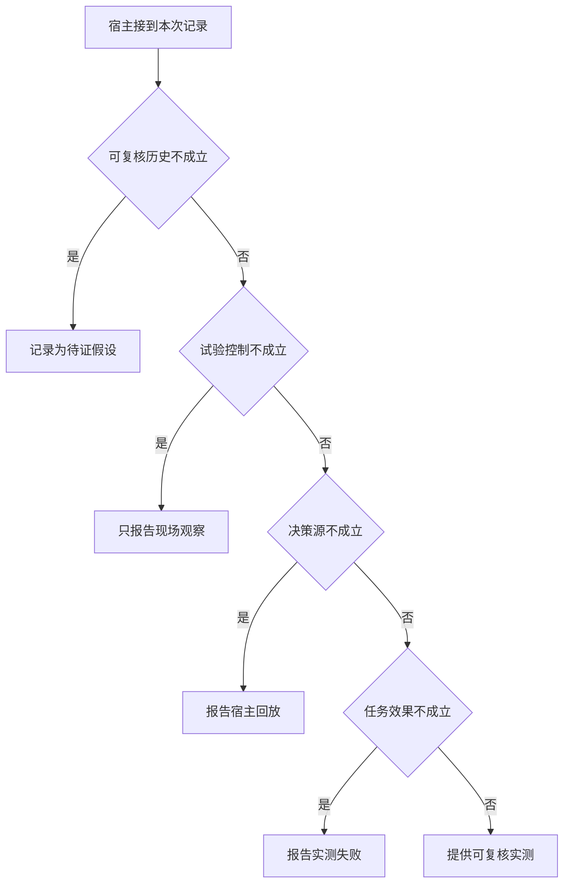

# 作品中的主张需要哪类试验证据

同一问题在 IDE 里成功一次，与冻结程序和资料后能重放，是两种不同主张。
作品要允许旁人沿终态找到动作及来源。真实模型选择也不能由离线样例代为证明。

本篇用一个封闭的教学决策器说明这一问题。输入是宿主收到的记录，不保证每个下游字段都已经获准使用。前置检查未成立时，下游即使带着缓存值，也不能拿来作业务断言。

## 先解决一个具体问题

**简历里该怎么写“复现”而不扩大事实？**

原始提议重放能说明程序在该输入的行为，两次真实模型跑相同任务才会再次测到选工具。
记录模型、数据、工具及应用版本和未覆盖面，再说明能被重复的是哪一项。


先取一个能走到「提供可复核实测」的输入：关键事件均可追溯、其余关键条件已经冻结、真实模型提出动作、外部后置条件成立。
把这四个条件代回后文的图，前面各个拦截分支都未满足，最终才有“任务与环境及实际效果可验证”这个判断。
还原这个现场时要分别问：哪些位来自可信状态，哪些只是在接口中出现、尚未获得解释资格的字段。

## 先沿一次决策走到底



从上到下取第一条成立的出口。只改一个开关时，只有它之前的检查都未截断，该变化才可能到达真实动作。

“可复核历史”的两种输入分别是“关键事件均可追溯”与“关键事件记录缺失”。
看不见的事件不能被解释为从未发生。

“试验控制”的两种输入分别是“其余关键条件已经冻结”与“环境或资料随版本变化”。
孤立机制归因要保持其他条件可比。

“决策源”的两种输入分别是“真实模型提出动作”与“脚本重放固定动作”。
回放能验证宿主分支，不直接验证真实选工具质量。

“任务效果”的两种输入分别是“外部后置条件成立”与“用户目标未达成”。
回复称已写入不能证明数据库真的发生变化。

## 最少需要哪几项观察

### 记录为待证假设

缺少外部核验记录。
在本节的全部组合中，有 8 种产生「记录为待证假设」，这只是逻辑空间的计数，不能当作实际用户请求的比例。

只取得关键事件记录缺失，已经足以要求宿主「记录为待证假设」。
保持这些已知项，其余开关自由变化，仍有 8 种补全，判断没有翻转。

若删掉关于可复核历史的证据，另一份允许的现场是关键事件均可追溯、环境或资料随版本变化、脚本重放固定动作、用户目标未达成，它会使宿主「只报告现场观察」。

### 只报告现场观察

资料或实现未冻结。
在本节的全部组合中，有 4 种产生「只报告现场观察」，这只是逻辑空间的计数，不能当作实际用户请求的比例。

只取得关键事件均可追溯、环境或资料随版本变化，已经足以要求宿主「只报告现场观察」。
保持这些已知项，其余开关自由变化，仍有 4 种补全，判断没有翻转。

若删掉关于可复核历史的证据，另一份允许的现场是关键事件记录缺失、环境或资料随版本变化、脚本重放固定动作、用户目标未达成，它会使宿主「记录为待证假设」。

若删掉关于试验控制的证据，另一份允许的现场是关键事件均可追溯、其余关键条件已经冻结、脚本重放固定动作、用户目标未达成，它会使宿主「报告宿主回放」。

### 报告宿主回放

脚本能检验分支但不测真实策略。
在本节的全部组合中，有 2 种产生「报告宿主回放」，这只是逻辑空间的计数，不能当作实际用户请求的比例。

只取得关键事件均可追溯、其余关键条件已经冻结、脚本重放固定动作，已经足以要求宿主「报告宿主回放」。
保持这些已知项，其余开关自由变化，仍有 2 种补全，判断没有翻转。

若删掉关于可复核历史的证据，另一份允许的现场是关键事件记录缺失、其余关键条件已经冻结、脚本重放固定动作、用户目标未达成，它会使宿主「记录为待证假设」。

若删掉关于试验控制的证据，另一份允许的现场是关键事件均可追溯、环境或资料随版本变化、脚本重放固定动作、用户目标未达成，它会使宿主「只报告现场观察」。

若删掉关于决策源的证据，另一份允许的现场是关键事件均可追溯、其余关键条件已经冻结、真实模型提出动作、用户目标未达成，它会使宿主「报告实测失败」。

### 报告实测失败

真实请求发生过也可能未完成任务。
在本节的全部组合中，有 1 种产生「报告实测失败」，这只是逻辑空间的计数，不能当作实际用户请求的比例。

只取得关键事件均可追溯、其余关键条件已经冻结、真实模型提出动作、用户目标未达成，已经足以要求宿主「报告实测失败」。
保持这些已知项，其余开关自由变化，仍有 1 种补全，判断没有翻转。

若删掉关于可复核历史的证据，另一份允许的现场是关键事件记录缺失、其余关键条件已经冻结、真实模型提出动作、用户目标未达成，它会使宿主「记录为待证假设」。

若删掉关于试验控制的证据，另一份允许的现场是关键事件均可追溯、环境或资料随版本变化、真实模型提出动作、用户目标未达成，它会使宿主「只报告现场观察」。

若删掉关于决策源的证据，另一份允许的现场是关键事件均可追溯、其余关键条件已经冻结、脚本重放固定动作、用户目标未达成，它会使宿主「报告宿主回放」。

若删掉关于任务效果的证据，另一份允许的现场是关键事件均可追溯、其余关键条件已经冻结、真实模型提出动作、外部后置条件成立，它会使宿主「提供可复核实测」。

### 提供可复核实测

任务与环境及实际效果可验证。
在本节的全部组合中，有 1 种产生「提供可复核实测」，这只是逻辑空间的计数，不能当作实际用户请求的比例。

只取得关键事件均可追溯、其余关键条件已经冻结、真实模型提出动作、外部后置条件成立，已经足以要求宿主「提供可复核实测」。

若删掉关于可复核历史的证据，另一份允许的现场是关键事件记录缺失、其余关键条件已经冻结、真实模型提出动作、外部后置条件成立，它会使宿主「记录为待证假设」。

若删掉关于试验控制的证据，另一份允许的现场是关键事件均可追溯、环境或资料随版本变化、真实模型提出动作、外部后置条件成立，它会使宿主「只报告现场观察」。

若删掉关于决策源的证据，另一份允许的现场是关键事件均可追溯、其余关键条件已经冻结、脚本重放固定动作、外部后置条件成立，它会使宿主「报告宿主回放」。

若删掉关于任务效果的证据，另一份允许的现场是关键事件均可追溯、其余关键条件已经冻结、真实模型提出动作、用户目标未达成，它会使宿主「报告实测失败」。

## 以同一份契约解释截然不同的现场

<details>
<summary>展开推演与对应反例</summary>

下列样本按最先命中的业务分支排列。四位编码只作本篇页内定位，顺序与开头的四项输入一致。可以先猜下一动作，再展开相邻样本。

### 能够触发“记录为待证假设”的现场

**样本 0000**

业务侧交来关键事件记录缺失、环境或资料随版本变化，执行侧还记录了脚本重放固定动作、用户目标未达成。
把样本压成最短证明，保留关键事件记录缺失就能支持「记录为待证假设」。

在这份记录上，分别翻转「可复核历史」中的任一项，其他项完全不变时，下一动作都会改变。

保持其余观察不动，单独切换「试验控制」、「决策源」、「任务效果」仍得到「记录为待证假设」，它们在这个现场不是决定性变量。

要从本例改走「只报告现场观察」，至少需要变动 1 项，一组最少改动是将关键事件记录缺失换成关键事件均可追溯。

要从本例改走「报告宿主回放」，至少需要变动 2 项，一组最少改动是将关键事件记录缺失、环境或资料随版本变化换成关键事件均可追溯、其余关键条件已经冻结。

要从本例改走「报告实测失败」，至少需要变动 3 项，一组最少改动是将关键事件记录缺失、环境或资料随版本变化、脚本重放固定动作换成关键事件均可追溯、其余关键条件已经冻结、真实模型提出动作。

要从本例改走「提供可复核实测」，至少需要变动 4 项，一组最少改动是将关键事件记录缺失、环境或资料随版本变化、脚本重放固定动作、用户目标未达成换成关键事件均可追溯、其余关键条件已经冻结、真实模型提出动作、外部后置条件成立。

**样本 0001**

业务侧交来关键事件记录缺失、环境或资料随版本变化，执行侧还记录了脚本重放固定动作、外部后置条件成立。


要从本例改走「提供可复核实测」，至少需要变动 3 项，一组最少改动是将关键事件记录缺失、环境或资料随版本变化、脚本重放固定动作换成关键事件均可追溯、其余关键条件已经冻结、真实模型提出动作。

要从本例改走「报告实测失败」，至少需要变动 4 项，一组最少改动是将关键事件记录缺失、环境或资料随版本变化、脚本重放固定动作、外部后置条件成立换成关键事件均可追溯、其余关键条件已经冻结、真实模型提出动作、用户目标未达成。

**样本 0010**

业务侧交来关键事件记录缺失、环境或资料随版本变化，执行侧还记录了真实模型提出动作、用户目标未达成。


要从本例改走「报告实测失败」，至少需要变动 2 项，一组最少改动是将关键事件记录缺失、环境或资料随版本变化换成关键事件均可追溯、其余关键条件已经冻结。

要从本例改走「报告宿主回放」，至少需要变动 3 项，一组最少改动是将关键事件记录缺失、环境或资料随版本变化、真实模型提出动作换成关键事件均可追溯、其余关键条件已经冻结、脚本重放固定动作。

要从本例改走「提供可复核实测」，至少需要变动 3 项，一组最少改动是将关键事件记录缺失、环境或资料随版本变化、用户目标未达成换成关键事件均可追溯、其余关键条件已经冻结、外部后置条件成立。

**样本 0011**

业务侧交来关键事件记录缺失、环境或资料随版本变化，执行侧还记录了真实模型提出动作、外部后置条件成立。


要从本例改走「提供可复核实测」，至少需要变动 2 项，一组最少改动是将关键事件记录缺失、环境或资料随版本变化换成关键事件均可追溯、其余关键条件已经冻结。


要从本例改走「报告实测失败」，至少需要变动 3 项，一组最少改动是将关键事件记录缺失、环境或资料随版本变化、外部后置条件成立换成关键事件均可追溯、其余关键条件已经冻结、用户目标未达成。

**样本 0100**

业务侧交来关键事件记录缺失、其余关键条件已经冻结，执行侧还记录了脚本重放固定动作、用户目标未达成。


要从本例改走「报告宿主回放」，至少需要变动 1 项，一组最少改动是将关键事件记录缺失换成关键事件均可追溯。

要从本例改走「只报告现场观察」，至少需要变动 2 项，一组最少改动是将关键事件记录缺失、其余关键条件已经冻结换成关键事件均可追溯、环境或资料随版本变化。

要从本例改走「报告实测失败」，至少需要变动 2 项，一组最少改动是将关键事件记录缺失、脚本重放固定动作换成关键事件均可追溯、真实模型提出动作。

要从本例改走「提供可复核实测」，至少需要变动 3 项，一组最少改动是将关键事件记录缺失、脚本重放固定动作、用户目标未达成换成关键事件均可追溯、真实模型提出动作、外部后置条件成立。

**样本 0101**

业务侧交来关键事件记录缺失、其余关键条件已经冻结，执行侧还记录了脚本重放固定动作、外部后置条件成立。


要从本例改走「提供可复核实测」，至少需要变动 2 项，一组最少改动是将关键事件记录缺失、脚本重放固定动作换成关键事件均可追溯、真实模型提出动作。

要从本例改走「报告实测失败」，至少需要变动 3 项，一组最少改动是将关键事件记录缺失、脚本重放固定动作、外部后置条件成立换成关键事件均可追溯、真实模型提出动作、用户目标未达成。

**样本 0110**

业务侧交来关键事件记录缺失、其余关键条件已经冻结，执行侧还记录了真实模型提出动作、用户目标未达成。


要从本例改走「报告实测失败」，至少需要变动 1 项，一组最少改动是将关键事件记录缺失换成关键事件均可追溯。


要从本例改走「报告宿主回放」，至少需要变动 2 项，一组最少改动是将关键事件记录缺失、真实模型提出动作换成关键事件均可追溯、脚本重放固定动作。

要从本例改走「提供可复核实测」，至少需要变动 2 项，一组最少改动是将关键事件记录缺失、用户目标未达成换成关键事件均可追溯、外部后置条件成立。

**样本 0111**

业务侧交来关键事件记录缺失、其余关键条件已经冻结，执行侧还记录了真实模型提出动作、外部后置条件成立。


要从本例改走「提供可复核实测」，至少需要变动 1 项，一组最少改动是将关键事件记录缺失换成关键事件均可追溯。


要从本例改走「报告实测失败」，至少需要变动 2 项，一组最少改动是将关键事件记录缺失、外部后置条件成立换成关键事件均可追溯、用户目标未达成。

### 能够触发“只报告现场观察”的现场

**样本 1000**

业务侧交来关键事件均可追溯、环境或资料随版本变化，执行侧还记录了脚本重放固定动作、用户目标未达成。
把样本压成最短证明，保留关键事件均可追溯、环境或资料随版本变化就能支持「只报告现场观察」。

在这份记录上，分别翻转「可复核历史」、「试验控制」中的任一项，其他项完全不变时，下一动作都会改变。

保持其余观察不动，单独切换「决策源」、「任务效果」仍得到「只报告现场观察」，它们在这个现场不是决定性变量。

本例没走更靠前的「记录为待证假设」，因为关键事件均可追溯与那个入口的必要条件不符。

要从本例改走「记录为待证假设」，至少需要变动 1 项，一组最少改动是将关键事件均可追溯换成关键事件记录缺失。

要从本例改走「报告宿主回放」，至少需要变动 1 项，一组最少改动是将环境或资料随版本变化换成其余关键条件已经冻结。

要从本例改走「报告实测失败」，至少需要变动 2 项，一组最少改动是将环境或资料随版本变化、脚本重放固定动作换成其余关键条件已经冻结、真实模型提出动作。

要从本例改走「提供可复核实测」，至少需要变动 3 项，一组最少改动是将环境或资料随版本变化、脚本重放固定动作、用户目标未达成换成其余关键条件已经冻结、真实模型提出动作、外部后置条件成立。

**样本 1001**

业务侧交来关键事件均可追溯、环境或资料随版本变化，执行侧还记录了脚本重放固定动作、外部后置条件成立。


要从本例改走「提供可复核实测」，至少需要变动 2 项，一组最少改动是将环境或资料随版本变化、脚本重放固定动作换成其余关键条件已经冻结、真实模型提出动作。

要从本例改走「报告实测失败」，至少需要变动 3 项，一组最少改动是将环境或资料随版本变化、脚本重放固定动作、外部后置条件成立换成其余关键条件已经冻结、真实模型提出动作、用户目标未达成。

**样本 1010**

业务侧交来关键事件均可追溯、环境或资料随版本变化，执行侧还记录了真实模型提出动作、用户目标未达成。


要从本例改走「报告实测失败」，至少需要变动 1 项，一组最少改动是将环境或资料随版本变化换成其余关键条件已经冻结。

要从本例改走「报告宿主回放」，至少需要变动 2 项，一组最少改动是将环境或资料随版本变化、真实模型提出动作换成其余关键条件已经冻结、脚本重放固定动作。

要从本例改走「提供可复核实测」，至少需要变动 2 项，一组最少改动是将环境或资料随版本变化、用户目标未达成换成其余关键条件已经冻结、外部后置条件成立。

**样本 1011**

业务侧交来关键事件均可追溯、环境或资料随版本变化，执行侧还记录了真实模型提出动作、外部后置条件成立。


要从本例改走「提供可复核实测」，至少需要变动 1 项，一组最少改动是将环境或资料随版本变化换成其余关键条件已经冻结。


要从本例改走「报告实测失败」，至少需要变动 2 项，一组最少改动是将环境或资料随版本变化、外部后置条件成立换成其余关键条件已经冻结、用户目标未达成。

### 能够触发“报告宿主回放”的现场

**样本 1100**

业务侧交来关键事件均可追溯、其余关键条件已经冻结，执行侧还记录了脚本重放固定动作、用户目标未达成。
把样本压成最短证明，保留关键事件均可追溯、其余关键条件已经冻结、脚本重放固定动作就能支持「报告宿主回放」。

在这份记录上，分别翻转「可复核历史」、「试验控制」、「决策源」中的任一项，其他项完全不变时，下一动作都会改变。

保持其余观察不动，单独切换「任务效果」仍得到「报告宿主回放」，它们在这个现场不是决定性变量。


本例没走更靠前的「只报告现场观察」，因为其余关键条件已经冻结与那个入口的必要条件不符。


要从本例改走「只报告现场观察」，至少需要变动 1 项，一组最少改动是将其余关键条件已经冻结换成环境或资料随版本变化。

要从本例改走「报告实测失败」，至少需要变动 1 项，一组最少改动是将脚本重放固定动作换成真实模型提出动作。

要从本例改走「提供可复核实测」，至少需要变动 2 项，一组最少改动是将脚本重放固定动作、用户目标未达成换成真实模型提出动作、外部后置条件成立。

**样本 1101**

业务侧交来关键事件均可追溯、其余关键条件已经冻结，执行侧还记录了脚本重放固定动作、外部后置条件成立。


要从本例改走「提供可复核实测」，至少需要变动 1 项，一组最少改动是将脚本重放固定动作换成真实模型提出动作。

要从本例改走「报告实测失败」，至少需要变动 2 项，一组最少改动是将脚本重放固定动作、外部后置条件成立换成真实模型提出动作、用户目标未达成。

### 能够触发“报告实测失败”的现场

**样本 1110**

业务侧交来关键事件均可追溯、其余关键条件已经冻结，执行侧还记录了真实模型提出动作、用户目标未达成。
把样本压成最短证明，保留关键事件均可追溯、其余关键条件已经冻结、真实模型提出动作、用户目标未达成就能支持「报告实测失败」。

在这份记录上，分别翻转「可复核历史」、「试验控制」、「决策源」、「任务效果」中的任一项，其他项完全不变时，下一动作都会改变。


本例没走更靠前的「报告宿主回放」，因为真实模型提出动作与那个入口的必要条件不符。


要从本例改走「报告宿主回放」，至少需要变动 1 项，一组最少改动是将真实模型提出动作换成脚本重放固定动作。

要从本例改走「提供可复核实测」，至少需要变动 1 项，一组最少改动是将用户目标未达成换成外部后置条件成立。

### 能够触发“提供可复核实测”的现场

**样本 1111**

业务侧交来关键事件均可追溯、其余关键条件已经冻结，执行侧还记录了真实模型提出动作、外部后置条件成立。
把样本压成最短证明，保留关键事件均可追溯、其余关键条件已经冻结、真实模型提出动作、外部后置条件成立就能支持「提供可复核实测」。


本例没走更靠前的「报告实测失败」，因为外部后置条件成立与那个入口的必要条件不符。


要从本例改走「报告实测失败」，至少需要变动 1 项，一组最少改动是将外部后置条件成立换成用户目标未达成。

</details>

## 当你只能看见一半记录

<details>
<summary>展开推演与对应反例</summary>

这次隐藏两个字段，保留另两个。对每个可见现场，检查四种合法补全是否同意。如仍有歧义，选择能使最坏剩余候选动作最少的字段继续查。并列时采用本篇字段顺序。

### 只保留可复核历史与试验控制

已知关键事件记录缺失、环境或资料随版本变化时，四种补全的动作分布为记录为待证假设（4 种）。

就“记录为待证假设”这个动作而言，在关键事件记录缺失、环境或资料随版本变化的前提下，另外两项观察不会推翻它。

已知关键事件记录缺失、其余关键条件已经冻结时，四种补全的动作分布为记录为待证假设（4 种）。

就“记录为待证假设”这个动作而言，在关键事件记录缺失、其余关键条件已经冻结的前提下，另外两项观察不会推翻它。

已知关键事件均可追溯、环境或资料随版本变化时，四种补全的动作分布为只报告现场观察（4 种）。

就“只报告现场观察”这个动作而言，在关键事件均可追溯、环境或资料随版本变化的前提下，另外两项观察不会推翻它。

已知关键事件均可追溯、其余关键条件已经冻结时，四种补全的动作分布为报告宿主回放（2 种）、报告实测失败（1 种）、提供可复核实测（1 种）。

在关键事件均可追溯、其余关键条件已经冻结这个现场补读「决策源」，最坏还剩 2 种动作，计算时只衡量歧义，尚未扣读取代价。
若补来的观察为“脚本重放固定动作”，范围缩成「报告宿主回放」。若为“真实模型提出动作”，则保留「报告实测失败」、「提供可复核实测」。

区分不了的两条执行可以具体写成 1100 与 1110：它们共享已展示字段，却分别需要「报告宿主回放」和「报告实测失败」。

### 只保留可复核历史与决策源

已知关键事件记录缺失、脚本重放固定动作时，四种补全的动作分布为记录为待证假设（4 种）。

就“记录为待证假设”这个动作而言，在关键事件记录缺失、脚本重放固定动作的前提下，另外两项观察不会推翻它。

已知关键事件记录缺失、真实模型提出动作时，四种补全的动作分布为记录为待证假设（4 种）。

就“记录为待证假设”这个动作而言，在关键事件记录缺失、真实模型提出动作的前提下，另外两项观察不会推翻它。

已知关键事件均可追溯、脚本重放固定动作时，四种补全的动作分布为只报告现场观察（2 种）、报告宿主回放（2 种）。

在关键事件均可追溯、脚本重放固定动作这个现场补读「试验控制」，最坏还剩 1 种动作，计算时只衡量歧义，尚未扣读取代价。
若补来的观察为“环境或资料随版本变化”，范围缩成「只报告现场观察」。若为“其余关键条件已经冻结”，则保留「报告宿主回放」。

区分不了的两条执行可以具体写成 1000 与 1100：它们共享已展示字段，却分别需要「只报告现场观察」和「报告宿主回放」。

已知关键事件均可追溯、真实模型提出动作时，四种补全的动作分布为只报告现场观察（2 种）、报告实测失败（1 种）、提供可复核实测（1 种）。

在关键事件均可追溯、真实模型提出动作这个现场补读「试验控制」，最坏还剩 2 种动作，计算时只衡量歧义，尚未扣读取代价。
若补来的观察为“环境或资料随版本变化”，范围缩成「只报告现场观察」。若为“其余关键条件已经冻结”，则保留「报告实测失败」、「提供可复核实测」。

区分不了的两条执行可以具体写成 1010 与 1110：它们共享已展示字段，却分别需要「只报告现场观察」和「报告实测失败」。

### 只保留试验控制与决策源

已知环境或资料随版本变化、脚本重放固定动作时，四种补全的动作分布为记录为待证假设（2 种）、只报告现场观察（2 种）。

在环境或资料随版本变化、脚本重放固定动作这个现场补读「可复核历史」，最坏还剩 1 种动作，计算时只衡量歧义，尚未扣读取代价。
若补来的观察为“关键事件记录缺失”，范围缩成「记录为待证假设」。若为“关键事件均可追溯”，则保留「只报告现场观察」。

区分不了的两条执行可以具体写成 0000 与 1000：它们共享已展示字段，却分别需要「记录为待证假设」和「只报告现场观察」。

已知环境或资料随版本变化、真实模型提出动作时，四种补全的动作分布为记录为待证假设（2 种）、只报告现场观察（2 种）。

在环境或资料随版本变化、真实模型提出动作这个现场补读「可复核历史」，最坏还剩 1 种动作，计算时只衡量歧义，尚未扣读取代价。

区分不了的两条执行可以具体写成 0010 与 1010：它们共享已展示字段，却分别需要「记录为待证假设」和「只报告现场观察」。

已知其余关键条件已经冻结、脚本重放固定动作时，四种补全的动作分布为记录为待证假设（2 种）、报告宿主回放（2 种）。

在其余关键条件已经冻结、脚本重放固定动作这个现场补读「可复核历史」，最坏还剩 1 种动作，计算时只衡量歧义，尚未扣读取代价。
若补来的观察为“关键事件记录缺失”，范围缩成「记录为待证假设」。若为“关键事件均可追溯”，则保留「报告宿主回放」。

区分不了的两条执行可以具体写成 0100 与 1100：它们共享已展示字段，却分别需要「记录为待证假设」和「报告宿主回放」。

已知其余关键条件已经冻结、真实模型提出动作时，四种补全的动作分布为记录为待证假设（2 种）、报告实测失败（1 种）、提供可复核实测（1 种）。

在其余关键条件已经冻结、真实模型提出动作这个现场补读「可复核历史」，最坏还剩 2 种动作，计算时只衡量歧义，尚未扣读取代价。
若补来的观察为“关键事件记录缺失”，范围缩成「记录为待证假设」。若为“关键事件均可追溯”，则保留「报告实测失败」、「提供可复核实测」。

区分不了的两条执行可以具体写成 0110 与 1110：它们共享已展示字段，却分别需要「记录为待证假设」和「报告实测失败」。

### 只保留可复核历史与任务效果

已知关键事件记录缺失、用户目标未达成时，四种补全的动作分布为记录为待证假设（4 种）。

就“记录为待证假设”这个动作而言，在关键事件记录缺失、用户目标未达成的前提下，另外两项观察不会推翻它。

已知关键事件记录缺失、外部后置条件成立时，四种补全的动作分布为记录为待证假设（4 种）。

就“记录为待证假设”这个动作而言，在关键事件记录缺失、外部后置条件成立的前提下，另外两项观察不会推翻它。

已知关键事件均可追溯、用户目标未达成时，四种补全的动作分布为只报告现场观察（2 种）、报告宿主回放（1 种）、报告实测失败（1 种）。

在关键事件均可追溯、用户目标未达成这个现场补读「试验控制」，最坏还剩 2 种动作，计算时只衡量歧义，尚未扣读取代价。
若补来的观察为“环境或资料随版本变化”，范围缩成「只报告现场观察」。若为“其余关键条件已经冻结”，则保留「报告宿主回放」、「报告实测失败」。


已知关键事件均可追溯、外部后置条件成立时，四种补全的动作分布为只报告现场观察（2 种）、报告宿主回放（1 种）、提供可复核实测（1 种）。

在关键事件均可追溯、外部后置条件成立这个现场补读「试验控制」，最坏还剩 2 种动作，计算时只衡量歧义，尚未扣读取代价。
若补来的观察为“环境或资料随版本变化”，范围缩成「只报告现场观察」。若为“其余关键条件已经冻结”，则保留「报告宿主回放」、「提供可复核实测」。

区分不了的两条执行可以具体写成 1001 与 1101：它们共享已展示字段，却分别需要「只报告现场观察」和「报告宿主回放」。

### 只保留试验控制与任务效果

已知环境或资料随版本变化、用户目标未达成时，四种补全的动作分布为记录为待证假设（2 种）、只报告现场观察（2 种）。

在环境或资料随版本变化、用户目标未达成这个现场补读「可复核历史」，最坏还剩 1 种动作，计算时只衡量歧义，尚未扣读取代价。


已知环境或资料随版本变化、外部后置条件成立时，四种补全的动作分布为记录为待证假设（2 种）、只报告现场观察（2 种）。

在环境或资料随版本变化、外部后置条件成立这个现场补读「可复核历史」，最坏还剩 1 种动作，计算时只衡量歧义，尚未扣读取代价。

区分不了的两条执行可以具体写成 0001 与 1001：它们共享已展示字段，却分别需要「记录为待证假设」和「只报告现场观察」。

已知其余关键条件已经冻结、用户目标未达成时，四种补全的动作分布为记录为待证假设（2 种）、报告宿主回放（1 种）、报告实测失败（1 种）。

在其余关键条件已经冻结、用户目标未达成这个现场补读「可复核历史」，最坏还剩 2 种动作，计算时只衡量歧义，尚未扣读取代价。
若补来的观察为“关键事件记录缺失”，范围缩成「记录为待证假设」。若为“关键事件均可追溯”，则保留「报告宿主回放」、「报告实测失败」。


已知其余关键条件已经冻结、外部后置条件成立时，四种补全的动作分布为记录为待证假设（2 种）、报告宿主回放（1 种）、提供可复核实测（1 种）。

在其余关键条件已经冻结、外部后置条件成立这个现场补读「可复核历史」，最坏还剩 2 种动作，计算时只衡量歧义，尚未扣读取代价。
若补来的观察为“关键事件记录缺失”，范围缩成「记录为待证假设」。若为“关键事件均可追溯”，则保留「报告宿主回放」、「提供可复核实测」。

区分不了的两条执行可以具体写成 0101 与 1101：它们共享已展示字段，却分别需要「记录为待证假设」和「报告宿主回放」。

### 只保留决策源与任务效果

已知脚本重放固定动作、用户目标未达成时，四种补全的动作分布为记录为待证假设（2 种）、只报告现场观察（1 种）、报告宿主回放（1 种）。

在脚本重放固定动作、用户目标未达成这个现场补读「可复核历史」，最坏还剩 2 种动作，计算时只衡量歧义，尚未扣读取代价。
若补来的观察为“关键事件记录缺失”，范围缩成「记录为待证假设」。若为“关键事件均可追溯”，则保留「只报告现场观察」、「报告宿主回放」。


已知脚本重放固定动作、外部后置条件成立时，四种补全的动作分布为记录为待证假设（2 种）、只报告现场观察（1 种）、报告宿主回放（1 种）。

在脚本重放固定动作、外部后置条件成立这个现场补读「可复核历史」，最坏还剩 2 种动作，计算时只衡量歧义，尚未扣读取代价。


已知真实模型提出动作、用户目标未达成时，四种补全的动作分布为记录为待证假设（2 种）、只报告现场观察（1 种）、报告实测失败（1 种）。

在真实模型提出动作、用户目标未达成这个现场补读「可复核历史」，最坏还剩 2 种动作，计算时只衡量歧义，尚未扣读取代价。
若补来的观察为“关键事件记录缺失”，范围缩成「记录为待证假设」。若为“关键事件均可追溯”，则保留「只报告现场观察」、「报告实测失败」。


已知真实模型提出动作、外部后置条件成立时，四种补全的动作分布为记录为待证假设（2 种）、只报告现场观察（1 种）、提供可复核实测（1 种）。

在真实模型提出动作、外部后置条件成立这个现场补读「可复核历史」，最坏还剩 2 种动作，计算时只衡量歧义，尚未扣读取代价。
若补来的观察为“关键事件记录缺失”，范围缩成「记录为待证假设」。若为“关键事件均可追溯”，则保留「只报告现场观察」、「提供可复核实测」。

区分不了的两条执行可以具体写成 0011 与 1011：它们共享已展示字段，却分别需要「记录为待证假设」和「只报告现场观察」。

</details>

## 单因素干预与边界测试

<details>
<summary>展开推演与对应反例</summary>

### 只改变可复核历史

固定另外三个条件得到八对现场，从“关键事件记录缺失”转为“关键事件均可追溯”时，8 对翻转动作，另外 0 对保持不变。

有 4 对现场沿「记录为待证假设」变到「只报告现场观察」，可复现的一组受控背景为环境或资料随版本变化、脚本重放固定动作、用户目标未达成。

有 2 对现场沿「记录为待证假设」变到「报告宿主回放」，可复现的一组受控背景为其余关键条件已经冻结、脚本重放固定动作、用户目标未达成。

有 1 对现场沿「记录为待证假设」变到「报告实测失败」，可复现的一组受控背景为其余关键条件已经冻结、真实模型提出动作、用户目标未达成。

有 1 对现场沿「记录为待证假设」变到「提供可复核实测」，可复现的一组受控背景为其余关键条件已经冻结、真实模型提出动作、外部后置条件成立。

### 只改变试验控制

固定另外三个条件得到八对现场，从“环境或资料随版本变化”转为“其余关键条件已经冻结”时，4 对翻转动作，另外 4 对保持不变。

令关键事件记录缺失、脚本重放固定动作、用户目标未达成，试验控制的两个取值均得到「记录为待证假设」。在八对中，共有 4 对表现为这一种稳定出口。

有 2 对现场沿「只报告现场观察」变到「报告宿主回放」，可复现的一组受控背景为关键事件均可追溯、脚本重放固定动作、用户目标未达成。

有 1 对现场沿「只报告现场观察」变到「报告实测失败」，可复现的一组受控背景为关键事件均可追溯、真实模型提出动作、用户目标未达成。

有 1 对现场沿「只报告现场观察」变到「提供可复核实测」，可复现的一组受控背景为关键事件均可追溯、真实模型提出动作、外部后置条件成立。

### 只改变决策源

固定另外三个条件得到八对现场，从“脚本重放固定动作”转为“真实模型提出动作”时，2 对翻转动作，另外 6 对保持不变。

令关键事件记录缺失、环境或资料随版本变化、用户目标未达成，决策源的两个取值均得到「记录为待证假设」。在八对中，共有 4 对表现为这一种稳定出口。

令关键事件均可追溯、环境或资料随版本变化、用户目标未达成，决策源的两个取值均得到「只报告现场观察」。在八对中，共有 2 对表现为这一种稳定出口。

有 1 对现场沿「报告宿主回放」变到「报告实测失败」，可复现的一组受控背景为关键事件均可追溯、其余关键条件已经冻结、用户目标未达成。

有 1 对现场沿「报告宿主回放」变到「提供可复核实测」，可复现的一组受控背景为关键事件均可追溯、其余关键条件已经冻结、外部后置条件成立。

### 只改变任务效果

固定另外三个条件得到八对现场，从“用户目标未达成”转为“外部后置条件成立”时，1 对翻转动作，另外 7 对保持不变。

令关键事件记录缺失、环境或资料随版本变化、脚本重放固定动作，任务效果的两个取值均得到「记录为待证假设」。在八对中，共有 4 对表现为这一种稳定出口。

令关键事件均可追溯、环境或资料随版本变化、脚本重放固定动作，任务效果的两个取值均得到「只报告现场观察」。在八对中，共有 2 对表现为这一种稳定出口。

令关键事件均可追溯、其余关键条件已经冻结、脚本重放固定动作，任务效果的两个取值均得到「报告宿主回放」。在八对中，共有 1 对表现为这一种稳定出口。

有 1 对现场沿「报告实测失败」变到「提供可复核实测」，可复现的一组受控背景为关键事件均可追溯、其余关键条件已经冻结、真实模型提出动作。

</details>

## 哪些回归样本真能抓住实现错误

<details>
<summary>展开推演与对应反例</summary>

如果删除“记录为待证假设”这个分支，在本篇 16 种输入里有 8 种会改走另一出口。

反例 0000 的完整记录为关键事件记录缺失、环境或资料随版本变化、脚本重放固定动作、用户目标未达成。正确结果是「记录为待证假设」，这个改坏的实现却给出「只报告现场观察」。

如果删除“只报告现场观察”这个分支，在本篇 16 种输入里有 4 种会改走另一出口。

反例 1000 的完整记录为关键事件均可追溯、环境或资料随版本变化、脚本重放固定动作、用户目标未达成。正确结果是「只报告现场观察」，这个改坏的实现却给出「报告宿主回放」。

如果删除“报告宿主回放”这个分支，在本篇 16 种输入里有 2 种会改走另一出口。

反例 1100 的完整记录为关键事件均可追溯、其余关键条件已经冻结、脚本重放固定动作、用户目标未达成。正确结果是「报告宿主回放」，这个改坏的实现却给出「报告实测失败」。

如果删除“报告实测失败”这个分支，在本篇 16 种输入里有 1 种会改走另一出口。

反例 1110 的完整记录为关键事件均可追溯、其余关键条件已经冻结、真实模型提出动作、用户目标未达成。正确结果是「报告实测失败」，这个改坏的实现却给出「提供可复核实测」。

如果交换“记录为待证假设”和“只报告现场观察”的判断次序，在本篇 16 种输入里有 4 种会改走另一出口。


如果交换“只报告现场观察”和“报告宿主回放”的判断次序，在本篇 16 种输入里有 2 种会改走另一出口。


如果交换“报告宿主回放”和“报告实测失败”的判断次序，在本篇 16 种输入里有 1 种会改走另一出口。


补入样本 0000（关键事件记录缺失、环境或资料随版本变化、脚本重放固定动作、用户目标未达成）能新增检出「删除“记录为待证假设”这个分支」、「交换“记录为待证假设”和“只报告现场观察”的判断次序」。

补入样本 1000（关键事件均可追溯、环境或资料随版本变化、脚本重放固定动作、用户目标未达成）能新增检出「删除“只报告现场观察”这个分支」、「交换“只报告现场观察”和“报告宿主回放”的判断次序」。

补入样本 1100（关键事件均可追溯、其余关键条件已经冻结、脚本重放固定动作、用户目标未达成）能新增检出「删除“报告宿主回放”这个分支」、「交换“报告宿主回放”和“报告实测失败”的判断次序」。

补入样本 1110（关键事件均可追溯、其余关键条件已经冻结、真实模型提出动作、用户目标未达成）能新增检出「删除“报告实测失败”这个分支」。

这里每次选覆盖尚未捕获缺陷最多的样本，并不保证用例数全局最小。它给出的反例能作为 Java 单测输入。真实模型是否会自主产生这些提议，仍须单独评测。

</details>

## 把状态覆盖换成有抽样偏差的评测批次

<details>
<summary>展开推演与对应反例</summary>

前面的十六种记录各有一票。现在只改样本构成：对一个给定字段，把成立侧的每种记录各取三份、另一侧各取一份。这是人为配比的 32 份回放，不是线上频率估计。
将偏向成立与偏向不成立的两次批次对照，可以隔离分母变化。底层宿主和所有答案保持相同，比例仍可能移动。

### 改变“可复核历史”的样本配比

只看「记录为待证假设」，在关键事件均可追溯的八个不同输入中有 0 个命中，在关键事件记录缺失的另八个输入中有 8 个命中。
把「可复核历史」成立侧按三倍取样，「记录为待证假设」占 8/32，反过来向未成立侧倾斜后占 24/32。
这次重加权使「记录为待证假设」的占比相差 50 个百分点。若按两种不同的“可复核历史”分布跑新旧版，不能把这项差异全部归功于实现。

只看「只报告现场观察」，在关键事件均可追溯的八个不同输入中有 4 个命中，在关键事件记录缺失的另八个输入中有 0 个命中。
把「可复核历史」成立侧按三倍取样，「只报告现场观察」占 12/32，反过来向未成立侧倾斜后占 4/32。
这次重加权使「只报告现场观察」的占比相差 25 个百分点。若按两种不同的“可复核历史”分布跑新旧版，不能把这项差异全部归功于实现。

只看「报告宿主回放」，在关键事件均可追溯的八个不同输入中有 2 个命中，在关键事件记录缺失的另八个输入中有 0 个命中。
把「可复核历史」成立侧按三倍取样，「报告宿主回放」占 6/32，反过来向未成立侧倾斜后占 2/32。
这次重加权使「报告宿主回放」的占比相差 12.5 个百分点。若按两种不同的“可复核历史”分布跑新旧版，不能把这项差异全部归功于实现。

只看「报告实测失败」，在关键事件均可追溯的八个不同输入中有 1 个命中，在关键事件记录缺失的另八个输入中有 0 个命中。
把「可复核历史」成立侧按三倍取样，「报告实测失败」占 3/32，反过来向未成立侧倾斜后占 1/32。
这次重加权使「报告实测失败」的占比相差 6.25 个百分点。若按两种不同的“可复核历史”分布跑新旧版，不能把这项差异全部归功于实现。

只看「提供可复核实测」，在关键事件均可追溯的八个不同输入中有 1 个命中，在关键事件记录缺失的另八个输入中有 0 个命中。
把「可复核历史」成立侧按三倍取样，「提供可复核实测」占 3/32，反过来向未成立侧倾斜后占 1/32。
这次重加权使「提供可复核实测」的占比相差 6.25 个百分点。若按两种不同的“可复核历史”分布跑新旧版，不能把这项差异全部归功于实现。

### 改变“试验控制”的样本配比

只看「记录为待证假设」，在其余关键条件已经冻结的八个不同输入中有 4 个命中，在环境或资料随版本变化的另八个输入中有 4 个命中。
把「试验控制」成立侧按三倍取样，「记录为待证假设」占 16/32，反过来向未成立侧倾斜后占 16/32。
两批「记录为待证假设」的边际比例相同，是因为这个出口在“试验控制”的两侧计数相等，这不能单独证明每一对现场都不受它影响。

只看「只报告现场观察」，在其余关键条件已经冻结的八个不同输入中有 0 个命中，在环境或资料随版本变化的另八个输入中有 4 个命中。
把「试验控制」成立侧按三倍取样，「只报告现场观察」占 4/32，反过来向未成立侧倾斜后占 12/32。
这次重加权使「只报告现场观察」的占比相差 25 个百分点。若按两种不同的“试验控制”分布跑新旧版，不能把这项差异全部归功于实现。

只看「报告宿主回放」，在其余关键条件已经冻结的八个不同输入中有 2 个命中，在环境或资料随版本变化的另八个输入中有 0 个命中。
把「试验控制」成立侧按三倍取样，「报告宿主回放」占 6/32，反过来向未成立侧倾斜后占 2/32。
这次重加权使「报告宿主回放」的占比相差 12.5 个百分点。若按两种不同的“试验控制”分布跑新旧版，不能把这项差异全部归功于实现。

只看「报告实测失败」，在其余关键条件已经冻结的八个不同输入中有 1 个命中，在环境或资料随版本变化的另八个输入中有 0 个命中。
把「试验控制」成立侧按三倍取样，「报告实测失败」占 3/32，反过来向未成立侧倾斜后占 1/32。
这次重加权使「报告实测失败」的占比相差 6.25 个百分点。若按两种不同的“试验控制”分布跑新旧版，不能把这项差异全部归功于实现。

只看「提供可复核实测」，在其余关键条件已经冻结的八个不同输入中有 1 个命中，在环境或资料随版本变化的另八个输入中有 0 个命中。
把「试验控制」成立侧按三倍取样，「提供可复核实测」占 3/32，反过来向未成立侧倾斜后占 1/32。
这次重加权使「提供可复核实测」的占比相差 6.25 个百分点。若按两种不同的“试验控制”分布跑新旧版，不能把这项差异全部归功于实现。

### 改变“决策源”的样本配比

只看「记录为待证假设」，在真实模型提出动作的八个不同输入中有 4 个命中，在脚本重放固定动作的另八个输入中有 4 个命中。
把「决策源」成立侧按三倍取样，「记录为待证假设」占 16/32，反过来向未成立侧倾斜后占 16/32。
两批「记录为待证假设」的边际比例相同，是因为这个出口在“决策源”的两侧计数相等，这不能单独证明每一对现场都不受它影响。

只看「只报告现场观察」，在真实模型提出动作的八个不同输入中有 2 个命中，在脚本重放固定动作的另八个输入中有 2 个命中。
把「决策源」成立侧按三倍取样，「只报告现场观察」占 8/32，反过来向未成立侧倾斜后占 8/32。
两批「只报告现场观察」的边际比例相同，是因为这个出口在“决策源”的两侧计数相等，这不能单独证明每一对现场都不受它影响。

只看「报告宿主回放」，在真实模型提出动作的八个不同输入中有 0 个命中，在脚本重放固定动作的另八个输入中有 2 个命中。
把「决策源」成立侧按三倍取样，「报告宿主回放」占 2/32，反过来向未成立侧倾斜后占 6/32。
这次重加权使「报告宿主回放」的占比相差 12.5 个百分点。若按两种不同的“决策源”分布跑新旧版，不能把这项差异全部归功于实现。

只看「报告实测失败」，在真实模型提出动作的八个不同输入中有 1 个命中，在脚本重放固定动作的另八个输入中有 0 个命中。
把「决策源」成立侧按三倍取样，「报告实测失败」占 3/32，反过来向未成立侧倾斜后占 1/32。
这次重加权使「报告实测失败」的占比相差 6.25 个百分点。若按两种不同的“决策源”分布跑新旧版，不能把这项差异全部归功于实现。

只看「提供可复核实测」，在真实模型提出动作的八个不同输入中有 1 个命中，在脚本重放固定动作的另八个输入中有 0 个命中。
把「决策源」成立侧按三倍取样，「提供可复核实测」占 3/32，反过来向未成立侧倾斜后占 1/32。
这次重加权使「提供可复核实测」的占比相差 6.25 个百分点。若按两种不同的“决策源”分布跑新旧版，不能把这项差异全部归功于实现。

### 改变“任务效果”的样本配比

只看「记录为待证假设」，在外部后置条件成立的八个不同输入中有 4 个命中，在用户目标未达成的另八个输入中有 4 个命中。
把「任务效果」成立侧按三倍取样，「记录为待证假设」占 16/32，反过来向未成立侧倾斜后占 16/32。
两批「记录为待证假设」的边际比例相同，是因为这个出口在“任务效果”的两侧计数相等，这不能单独证明每一对现场都不受它影响。

只看「只报告现场观察」，在外部后置条件成立的八个不同输入中有 2 个命中，在用户目标未达成的另八个输入中有 2 个命中。
把「任务效果」成立侧按三倍取样，「只报告现场观察」占 8/32，反过来向未成立侧倾斜后占 8/32。
两批「只报告现场观察」的边际比例相同，是因为这个出口在“任务效果”的两侧计数相等，这不能单独证明每一对现场都不受它影响。

只看「报告宿主回放」，在外部后置条件成立的八个不同输入中有 1 个命中，在用户目标未达成的另八个输入中有 1 个命中。
把「任务效果」成立侧按三倍取样，「报告宿主回放」占 4/32，反过来向未成立侧倾斜后占 4/32。
两批「报告宿主回放」的边际比例相同，是因为这个出口在“任务效果”的两侧计数相等，这不能单独证明每一对现场都不受它影响。

只看「报告实测失败」，在外部后置条件成立的八个不同输入中有 0 个命中，在用户目标未达成的另八个输入中有 1 个命中。
把「任务效果」成立侧按三倍取样，「报告实测失败」占 1/32，反过来向未成立侧倾斜后占 3/32。
这次重加权使「报告实测失败」的占比相差 6.25 个百分点。若按两种不同的“任务效果”分布跑新旧版，不能把这项差异全部归功于实现。

只看「提供可复核实测」，在外部后置条件成立的八个不同输入中有 1 个命中，在用户目标未达成的另八个输入中有 0 个命中。
把「任务效果」成立侧按三倍取样，「提供可复核实测」占 3/32，反过来向未成立侧倾斜后占 1/32。
这次重加权使「提供可复核实测」的占比相差 6.25 个百分点。若按两种不同的“任务效果”分布跑新旧版，不能把这项差异全部归功于实现。

</details>

## 只看终态，能逆推出多少原始事实

<details>
<summary>展开推演与对应反例</summary>

### 只保留“记录为待证假设”这条结果时

在本节契约与完整输入域内，仅知「记录为待证假设」就能倒推出关键事件记录缺失，这一推断依赖版本未变且日志中的终态可信。

「记录为待证假设」不能证明试验控制取哪一侧：0000 和 0100 有相同终态，却分别记为“环境或资料随版本变化”和“其余关键条件已经冻结”。

「记录为待证假设」不能证明决策源取哪一侧：0000 和 0010 有相同终态，却分别记为“脚本重放固定动作”和“真实模型提出动作”。

「记录为待证假设」不能证明任务效果取哪一侧：0000 和 0001 有相同终态，却分别记为“用户目标未达成”和“外部后置条件成立”。

反查「记录为待证假设」的诊断日志，优先保留能区分样本 0000 与 1000 的「可复核历史」，否则很容易把邻近的「只报告现场观察」看成同一种故障。

### 只保留“只报告现场观察”这条结果时

在本节契约与完整输入域内，仅知「只报告现场观察」就能倒推出关键事件均可追溯，这一推断依赖版本未变且日志中的终态可信。

在本节契约与完整输入域内，仅知「只报告现场观察」就能倒推出环境或资料随版本变化，这一推断依赖版本未变且日志中的终态可信。

「只报告现场观察」不能证明决策源取哪一侧：1000 和 1010 有相同终态，却分别记为“脚本重放固定动作”和“真实模型提出动作”。

「只报告现场观察」不能证明任务效果取哪一侧：1000 和 1001 有相同终态，却分别记为“用户目标未达成”和“外部后置条件成立”。

反查「只报告现场观察」的诊断日志，优先保留能区分样本 1000 与 0000 的「可复核历史」，否则很容易把邻近的「记录为待证假设」看成同一种故障。

### 只保留“报告宿主回放”这条结果时

在本节契约与完整输入域内，仅知「报告宿主回放」就能倒推出关键事件均可追溯，这一推断依赖版本未变且日志中的终态可信。

在本节契约与完整输入域内，仅知「报告宿主回放」就能倒推出其余关键条件已经冻结，这一推断依赖版本未变且日志中的终态可信。

在本节契约与完整输入域内，仅知「报告宿主回放」就能倒推出脚本重放固定动作，这一推断依赖版本未变且日志中的终态可信。

「报告宿主回放」不能证明任务效果取哪一侧：1100 和 1101 有相同终态，却分别记为“用户目标未达成”和“外部后置条件成立”。

反查「报告宿主回放」的诊断日志，优先保留能区分样本 1100 与 0100 的「可复核历史」，否则很容易把邻近的「记录为待证假设」看成同一种故障。

### 只保留“报告实测失败”这条结果时

在本节契约与完整输入域内，仅知「报告实测失败」就能倒推出关键事件均可追溯，这一推断依赖版本未变且日志中的终态可信。

在本节契约与完整输入域内，仅知「报告实测失败」就能倒推出其余关键条件已经冻结，这一推断依赖版本未变且日志中的终态可信。

在本节契约与完整输入域内，仅知「报告实测失败」就能倒推出真实模型提出动作，这一推断依赖版本未变且日志中的终态可信。

在本节契约与完整输入域内，仅知「报告实测失败」就能倒推出用户目标未达成，这一推断依赖版本未变且日志中的终态可信。

反查「报告实测失败」的诊断日志，优先保留能区分样本 1110 与 0110 的「可复核历史」，否则很容易把邻近的「记录为待证假设」看成同一种故障。

### 只保留“提供可复核实测”这条结果时

在本节契约与完整输入域内，仅知「提供可复核实测」就能倒推出关键事件均可追溯，这一推断依赖版本未变且日志中的终态可信。

在本节契约与完整输入域内，仅知「提供可复核实测」就能倒推出其余关键条件已经冻结，这一推断依赖版本未变且日志中的终态可信。

在本节契约与完整输入域内，仅知「提供可复核实测」就能倒推出真实模型提出动作，这一推断依赖版本未变且日志中的终态可信。

在本节契约与完整输入域内，仅知「提供可复核实测」就能倒推出外部后置条件成立，这一推断依赖版本未变且日志中的终态可信。

反查「提供可复核实测」的诊断日志，优先保留能区分样本 1111 与 0111 的「可复核历史」，否则很容易把邻近的「记录为待证假设」看成同一种故障。

</details>

## 面试复述与复算

面试题可以从“简历里该怎么写“复现”而不扩大事实？”起步。先给出本篇的触发条件和一条真实执行端可检查的证据，再用一个相邻反例限定结论的适用范围。

在仓库根目录执行下列命令可以重算本篇的一个输入。四位数字依次选择正文列出的四项条件，0 表示未成立或低档，1 表示成立或高档。
```powershell
node examples/reading-cases/replay.mjs 8 4 0101
```

[本周主文](../theory.md) · [配套实验](../lab.md) · [下一篇研读](05.md)
