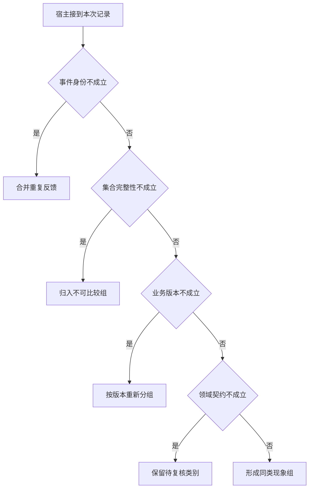

# 何时可以聚合多个相同症状

十份报告可能来自同一条截断日志。
按执行去重后，还要区分完整阶段与未记录阶段，并按版本分组。
聚合得到的是可检验的共性观察，不自动是代码根因。

本篇用一个封闭的教学决策器说明这一问题。输入是宿主收到的记录，不保证每个下游字段都已经获准使用。前置检查未成立时，下游即使带着缓存值，也不能拿来作业务断言。

## 先解决一个具体问题

**同症状出现十次就能认定共性根因吗？**

按独立执行去重，并检查版本、记录范围和最早分歧是否可比。
十个相同现象可以支持调查模式，若要定位代码因果，还要有针对性的版本或反事实对照。


先取一个能走到「形成同类现象组」的输入：本事件首次出现、记录覆盖全体目标集合、资料版本仍适用、交付满足业务完成条件。
把这四个条件代回后文的图，前面各个拦截分支都未满足，最终才有“去重覆盖与业务口径可比较”这个判断。
还原这个现场时要分别问：哪些位来自可信状态，哪些只是在接口中出现、尚未获得解释资格的字段。

## 先沿一次决策走到底



从上到下取第一条成立的出口。只改一个开关时，只有它之前的检查都未截断，该变化才可能到达真实动作。

“事件身份”的两种输入分别是“本事件首次出现”与“该事件已经处理”。
重复投递与模型再次请求同一参数要分别处理。

“集合完整性”的两种输入分别是“记录覆盖全体目标集合”与“记录只是可见切片”。
否定存在性时须证明查过了所声称的范围。

“业务版本”的两种输入分别是“资料版本仍适用”与“观察所依据版本已过期”。
写入前应重新验证可能变化的业务前提。

“领域契约”的两种输入分别是“交付满足业务完成条件”与“只有未经核验的完成声明”。
worker状态终止不能代替父任务验收。

## 最少需要哪几项观察

### 合并重复反馈

复制同一执行不增加独立证据。
在本节的全部组合中，有 8 种产生「合并重复反馈」，这只是逻辑空间的计数，不能当作实际用户请求的比例。

只取得该事件已经处理，已经足以要求宿主「合并重复反馈」。
保持这些已知项，其余开关自由变化，仍有 8 种补全，判断没有翻转。

若删掉关于事件身份的证据，另一份允许的现场是本事件首次出现、记录只是可见切片、观察所依据版本已过期、只有未经核验的完成声明，它会使宿主「归入不可比较组」。

### 归入不可比较组

截断与完整缺失不能混合。
在本节的全部组合中，有 4 种产生「归入不可比较组」，这只是逻辑空间的计数，不能当作实际用户请求的比例。

只取得本事件首次出现、记录只是可见切片，已经足以要求宿主「归入不可比较组」。
保持这些已知项，其余开关自由变化，仍有 4 种补全，判断没有翻转。

若删掉关于事件身份的证据，另一份允许的现场是该事件已经处理、记录只是可见切片、观察所依据版本已过期、只有未经核验的完成声明，它会使宿主「合并重复反馈」。

若删掉关于集合完整性的证据，另一份允许的现场是本事件首次出现、记录覆盖全体目标集合、观察所依据版本已过期、只有未经核验的完成声明，它会使宿主「按版本重新分组」。

### 按版本重新分组

规则版本不同会改变阶段解释。
在本节的全部组合中，有 2 种产生「按版本重新分组」，这只是逻辑空间的计数，不能当作实际用户请求的比例。

只取得本事件首次出现、记录覆盖全体目标集合、观察所依据版本已过期，已经足以要求宿主「按版本重新分组」。
保持这些已知项，其余开关自由变化，仍有 2 种补全，判断没有翻转。

若删掉关于事件身份的证据，另一份允许的现场是该事件已经处理、记录覆盖全体目标集合、观察所依据版本已过期、只有未经核验的完成声明，它会使宿主「合并重复反馈」。

若删掉关于集合完整性的证据，另一份允许的现场是本事件首次出现、记录只是可见切片、观察所依据版本已过期、只有未经核验的完成声明，它会使宿主「归入不可比较组」。

若删掉关于业务版本的证据，另一份允许的现场是本事件首次出现、记录覆盖全体目标集合、资料版本仍适用、只有未经核验的完成声明，它会使宿主「保留待复核类别」。

### 保留待复核类别

缺乏对应阶段的明确观察。
在本节的全部组合中，有 1 种产生「保留待复核类别」，这只是逻辑空间的计数，不能当作实际用户请求的比例。

只取得本事件首次出现、记录覆盖全体目标集合、资料版本仍适用、只有未经核验的完成声明，已经足以要求宿主「保留待复核类别」。
保持这些已知项，其余开关自由变化，仍有 1 种补全，判断没有翻转。

若删掉关于事件身份的证据，另一份允许的现场是该事件已经处理、记录覆盖全体目标集合、资料版本仍适用、只有未经核验的完成声明，它会使宿主「合并重复反馈」。

若删掉关于集合完整性的证据，另一份允许的现场是本事件首次出现、记录只是可见切片、资料版本仍适用、只有未经核验的完成声明，它会使宿主「归入不可比较组」。

若删掉关于业务版本的证据，另一份允许的现场是本事件首次出现、记录覆盖全体目标集合、观察所依据版本已过期、只有未经核验的完成声明，它会使宿主「按版本重新分组」。

若删掉关于领域契约的证据，另一份允许的现场是本事件首次出现、记录覆盖全体目标集合、资料版本仍适用、交付满足业务完成条件，它会使宿主「形成同类现象组」。

### 形成同类现象组

去重覆盖与业务口径可比较。
在本节的全部组合中，有 1 种产生「形成同类现象组」，这只是逻辑空间的计数，不能当作实际用户请求的比例。

只取得本事件首次出现、记录覆盖全体目标集合、资料版本仍适用、交付满足业务完成条件，已经足以要求宿主「形成同类现象组」。

若删掉关于事件身份的证据，另一份允许的现场是该事件已经处理、记录覆盖全体目标集合、资料版本仍适用、交付满足业务完成条件，它会使宿主「合并重复反馈」。

若删掉关于集合完整性的证据，另一份允许的现场是本事件首次出现、记录只是可见切片、资料版本仍适用、交付满足业务完成条件，它会使宿主「归入不可比较组」。

若删掉关于业务版本的证据，另一份允许的现场是本事件首次出现、记录覆盖全体目标集合、观察所依据版本已过期、交付满足业务完成条件，它会使宿主「按版本重新分组」。

若删掉关于领域契约的证据，另一份允许的现场是本事件首次出现、记录覆盖全体目标集合、资料版本仍适用、只有未经核验的完成声明，它会使宿主「保留待复核类别」。

## 以同一份契约解释截然不同的现场

<details>
<summary>展开推演与对应反例</summary>

下列样本按最先命中的业务分支排列。四位编码只作本篇页内定位，顺序与开头的四项输入一致。可以先猜下一动作，再展开相邻样本。

### 能够触发“合并重复反馈”的现场

**样本 0000**

业务侧交来该事件已经处理、记录只是可见切片，执行侧还记录了观察所依据版本已过期、只有未经核验的完成声明。
把样本压成最短证明，保留该事件已经处理就能支持「合并重复反馈」。

在这份记录上，分别翻转「事件身份」中的任一项，其他项完全不变时，下一动作都会改变。

保持其余观察不动，单独切换「集合完整性」、「业务版本」、「领域契约」仍得到「合并重复反馈」，它们在这个现场不是决定性变量。

要从本例改走「归入不可比较组」，至少需要变动 1 项，一组最少改动是将该事件已经处理换成本事件首次出现。

要从本例改走「按版本重新分组」，至少需要变动 2 项，一组最少改动是将该事件已经处理、记录只是可见切片换成本事件首次出现、记录覆盖全体目标集合。

要从本例改走「保留待复核类别」，至少需要变动 3 项，一组最少改动是将该事件已经处理、记录只是可见切片、观察所依据版本已过期换成本事件首次出现、记录覆盖全体目标集合、资料版本仍适用。

要从本例改走「形成同类现象组」，至少需要变动 4 项，一组最少改动是将该事件已经处理、记录只是可见切片、观察所依据版本已过期、只有未经核验的完成声明换成本事件首次出现、记录覆盖全体目标集合、资料版本仍适用、交付满足业务完成条件。

**样本 0001**

业务侧交来该事件已经处理、记录只是可见切片，执行侧还记录了观察所依据版本已过期、交付满足业务完成条件。


要从本例改走「形成同类现象组」，至少需要变动 3 项，一组最少改动是将该事件已经处理、记录只是可见切片、观察所依据版本已过期换成本事件首次出现、记录覆盖全体目标集合、资料版本仍适用。

要从本例改走「保留待复核类别」，至少需要变动 4 项，一组最少改动是将该事件已经处理、记录只是可见切片、观察所依据版本已过期、交付满足业务完成条件换成本事件首次出现、记录覆盖全体目标集合、资料版本仍适用、只有未经核验的完成声明。

**样本 0010**

业务侧交来该事件已经处理、记录只是可见切片，执行侧还记录了资料版本仍适用、只有未经核验的完成声明。


要从本例改走「保留待复核类别」，至少需要变动 2 项，一组最少改动是将该事件已经处理、记录只是可见切片换成本事件首次出现、记录覆盖全体目标集合。

要从本例改走「按版本重新分组」，至少需要变动 3 项，一组最少改动是将该事件已经处理、记录只是可见切片、资料版本仍适用换成本事件首次出现、记录覆盖全体目标集合、观察所依据版本已过期。

要从本例改走「形成同类现象组」，至少需要变动 3 项，一组最少改动是将该事件已经处理、记录只是可见切片、只有未经核验的完成声明换成本事件首次出现、记录覆盖全体目标集合、交付满足业务完成条件。

**样本 0011**

业务侧交来该事件已经处理、记录只是可见切片，执行侧还记录了资料版本仍适用、交付满足业务完成条件。


要从本例改走「形成同类现象组」，至少需要变动 2 项，一组最少改动是将该事件已经处理、记录只是可见切片换成本事件首次出现、记录覆盖全体目标集合。


要从本例改走「保留待复核类别」，至少需要变动 3 项，一组最少改动是将该事件已经处理、记录只是可见切片、交付满足业务完成条件换成本事件首次出现、记录覆盖全体目标集合、只有未经核验的完成声明。

**样本 0100**

业务侧交来该事件已经处理、记录覆盖全体目标集合，执行侧还记录了观察所依据版本已过期、只有未经核验的完成声明。


要从本例改走「按版本重新分组」，至少需要变动 1 项，一组最少改动是将该事件已经处理换成本事件首次出现。

要从本例改走「归入不可比较组」，至少需要变动 2 项，一组最少改动是将该事件已经处理、记录覆盖全体目标集合换成本事件首次出现、记录只是可见切片。

要从本例改走「保留待复核类别」，至少需要变动 2 项，一组最少改动是将该事件已经处理、观察所依据版本已过期换成本事件首次出现、资料版本仍适用。

要从本例改走「形成同类现象组」，至少需要变动 3 项，一组最少改动是将该事件已经处理、观察所依据版本已过期、只有未经核验的完成声明换成本事件首次出现、资料版本仍适用、交付满足业务完成条件。

**样本 0101**

业务侧交来该事件已经处理、记录覆盖全体目标集合，执行侧还记录了观察所依据版本已过期、交付满足业务完成条件。


要从本例改走「形成同类现象组」，至少需要变动 2 项，一组最少改动是将该事件已经处理、观察所依据版本已过期换成本事件首次出现、资料版本仍适用。

要从本例改走「保留待复核类别」，至少需要变动 3 项，一组最少改动是将该事件已经处理、观察所依据版本已过期、交付满足业务完成条件换成本事件首次出现、资料版本仍适用、只有未经核验的完成声明。

**样本 0110**

业务侧交来该事件已经处理、记录覆盖全体目标集合，执行侧还记录了资料版本仍适用、只有未经核验的完成声明。


要从本例改走「保留待复核类别」，至少需要变动 1 项，一组最少改动是将该事件已经处理换成本事件首次出现。


要从本例改走「按版本重新分组」，至少需要变动 2 项，一组最少改动是将该事件已经处理、资料版本仍适用换成本事件首次出现、观察所依据版本已过期。

要从本例改走「形成同类现象组」，至少需要变动 2 项，一组最少改动是将该事件已经处理、只有未经核验的完成声明换成本事件首次出现、交付满足业务完成条件。

**样本 0111**

业务侧交来该事件已经处理、记录覆盖全体目标集合，执行侧还记录了资料版本仍适用、交付满足业务完成条件。


要从本例改走「形成同类现象组」，至少需要变动 1 项，一组最少改动是将该事件已经处理换成本事件首次出现。


要从本例改走「保留待复核类别」，至少需要变动 2 项，一组最少改动是将该事件已经处理、交付满足业务完成条件换成本事件首次出现、只有未经核验的完成声明。

### 能够触发“归入不可比较组”的现场

**样本 1000**

业务侧交来本事件首次出现、记录只是可见切片，执行侧还记录了观察所依据版本已过期、只有未经核验的完成声明。
把样本压成最短证明，保留本事件首次出现、记录只是可见切片就能支持「归入不可比较组」。

在这份记录上，分别翻转「事件身份」、「集合完整性」中的任一项，其他项完全不变时，下一动作都会改变。

保持其余观察不动，单独切换「业务版本」、「领域契约」仍得到「归入不可比较组」，它们在这个现场不是决定性变量。

本例没走更靠前的「合并重复反馈」，因为本事件首次出现与那个入口的必要条件不符。

要从本例改走「合并重复反馈」，至少需要变动 1 项，一组最少改动是将本事件首次出现换成该事件已经处理。

要从本例改走「按版本重新分组」，至少需要变动 1 项，一组最少改动是将记录只是可见切片换成记录覆盖全体目标集合。

要从本例改走「保留待复核类别」，至少需要变动 2 项，一组最少改动是将记录只是可见切片、观察所依据版本已过期换成记录覆盖全体目标集合、资料版本仍适用。

要从本例改走「形成同类现象组」，至少需要变动 3 项，一组最少改动是将记录只是可见切片、观察所依据版本已过期、只有未经核验的完成声明换成记录覆盖全体目标集合、资料版本仍适用、交付满足业务完成条件。

**样本 1001**

业务侧交来本事件首次出现、记录只是可见切片，执行侧还记录了观察所依据版本已过期、交付满足业务完成条件。


要从本例改走「形成同类现象组」，至少需要变动 2 项，一组最少改动是将记录只是可见切片、观察所依据版本已过期换成记录覆盖全体目标集合、资料版本仍适用。

要从本例改走「保留待复核类别」，至少需要变动 3 项，一组最少改动是将记录只是可见切片、观察所依据版本已过期、交付满足业务完成条件换成记录覆盖全体目标集合、资料版本仍适用、只有未经核验的完成声明。

**样本 1010**

业务侧交来本事件首次出现、记录只是可见切片，执行侧还记录了资料版本仍适用、只有未经核验的完成声明。


要从本例改走「保留待复核类别」，至少需要变动 1 项，一组最少改动是将记录只是可见切片换成记录覆盖全体目标集合。

要从本例改走「按版本重新分组」，至少需要变动 2 项，一组最少改动是将记录只是可见切片、资料版本仍适用换成记录覆盖全体目标集合、观察所依据版本已过期。

要从本例改走「形成同类现象组」，至少需要变动 2 项，一组最少改动是将记录只是可见切片、只有未经核验的完成声明换成记录覆盖全体目标集合、交付满足业务完成条件。

**样本 1011**

业务侧交来本事件首次出现、记录只是可见切片，执行侧还记录了资料版本仍适用、交付满足业务完成条件。


要从本例改走「形成同类现象组」，至少需要变动 1 项，一组最少改动是将记录只是可见切片换成记录覆盖全体目标集合。


要从本例改走「保留待复核类别」，至少需要变动 2 项，一组最少改动是将记录只是可见切片、交付满足业务完成条件换成记录覆盖全体目标集合、只有未经核验的完成声明。

### 能够触发“按版本重新分组”的现场

**样本 1100**

业务侧交来本事件首次出现、记录覆盖全体目标集合，执行侧还记录了观察所依据版本已过期、只有未经核验的完成声明。
把样本压成最短证明，保留本事件首次出现、记录覆盖全体目标集合、观察所依据版本已过期就能支持「按版本重新分组」。

在这份记录上，分别翻转「事件身份」、「集合完整性」、「业务版本」中的任一项，其他项完全不变时，下一动作都会改变。

保持其余观察不动，单独切换「领域契约」仍得到「按版本重新分组」，它们在这个现场不是决定性变量。


本例没走更靠前的「归入不可比较组」，因为记录覆盖全体目标集合与那个入口的必要条件不符。


要从本例改走「归入不可比较组」，至少需要变动 1 项，一组最少改动是将记录覆盖全体目标集合换成记录只是可见切片。

要从本例改走「保留待复核类别」，至少需要变动 1 项，一组最少改动是将观察所依据版本已过期换成资料版本仍适用。

要从本例改走「形成同类现象组」，至少需要变动 2 项，一组最少改动是将观察所依据版本已过期、只有未经核验的完成声明换成资料版本仍适用、交付满足业务完成条件。

**样本 1101**

业务侧交来本事件首次出现、记录覆盖全体目标集合，执行侧还记录了观察所依据版本已过期、交付满足业务完成条件。


要从本例改走「形成同类现象组」，至少需要变动 1 项，一组最少改动是将观察所依据版本已过期换成资料版本仍适用。

要从本例改走「保留待复核类别」，至少需要变动 2 项，一组最少改动是将观察所依据版本已过期、交付满足业务完成条件换成资料版本仍适用、只有未经核验的完成声明。

### 能够触发“保留待复核类别”的现场

**样本 1110**

业务侧交来本事件首次出现、记录覆盖全体目标集合，执行侧还记录了资料版本仍适用、只有未经核验的完成声明。
把样本压成最短证明，保留本事件首次出现、记录覆盖全体目标集合、资料版本仍适用、只有未经核验的完成声明就能支持「保留待复核类别」。

在这份记录上，分别翻转「事件身份」、「集合完整性」、「业务版本」、「领域契约」中的任一项，其他项完全不变时，下一动作都会改变。


本例没走更靠前的「按版本重新分组」，因为资料版本仍适用与那个入口的必要条件不符。


要从本例改走「按版本重新分组」，至少需要变动 1 项，一组最少改动是将资料版本仍适用换成观察所依据版本已过期。

要从本例改走「形成同类现象组」，至少需要变动 1 项，一组最少改动是将只有未经核验的完成声明换成交付满足业务完成条件。

### 能够触发“形成同类现象组”的现场

**样本 1111**

业务侧交来本事件首次出现、记录覆盖全体目标集合，执行侧还记录了资料版本仍适用、交付满足业务完成条件。
把样本压成最短证明，保留本事件首次出现、记录覆盖全体目标集合、资料版本仍适用、交付满足业务完成条件就能支持「形成同类现象组」。


本例没走更靠前的「保留待复核类别」，因为交付满足业务完成条件与那个入口的必要条件不符。


要从本例改走「保留待复核类别」，至少需要变动 1 项，一组最少改动是将交付满足业务完成条件换成只有未经核验的完成声明。

</details>

## 当你只能看见一半记录

<details>
<summary>展开推演与对应反例</summary>

这次隐藏两个字段，保留另两个。对每个可见现场，检查四种合法补全是否同意。如仍有歧义，选择能使最坏剩余候选动作最少的字段继续查。并列时采用本篇字段顺序。

### 只保留事件身份与集合完整性

已知该事件已经处理、记录只是可见切片时，四种补全的动作分布为合并重复反馈（4 种）。

就“合并重复反馈”这个动作而言，在该事件已经处理、记录只是可见切片的前提下，另外两项观察不会推翻它。

已知该事件已经处理、记录覆盖全体目标集合时，四种补全的动作分布为合并重复反馈（4 种）。

就“合并重复反馈”这个动作而言，在该事件已经处理、记录覆盖全体目标集合的前提下，另外两项观察不会推翻它。

已知本事件首次出现、记录只是可见切片时，四种补全的动作分布为归入不可比较组（4 种）。

就“归入不可比较组”这个动作而言，在本事件首次出现、记录只是可见切片的前提下，另外两项观察不会推翻它。

已知本事件首次出现、记录覆盖全体目标集合时，四种补全的动作分布为按版本重新分组（2 种）、保留待复核类别（1 种）、形成同类现象组（1 种）。

在本事件首次出现、记录覆盖全体目标集合这个现场补读「业务版本」，最坏还剩 2 种动作，计算时只衡量歧义，尚未扣读取代价。
若补来的观察为“观察所依据版本已过期”，范围缩成「按版本重新分组」。若为“资料版本仍适用”，则保留「保留待复核类别」、「形成同类现象组」。

区分不了的两条执行可以具体写成 1100 与 1110：它们共享已展示字段，却分别需要「按版本重新分组」和「保留待复核类别」。

### 只保留事件身份与业务版本

已知该事件已经处理、观察所依据版本已过期时，四种补全的动作分布为合并重复反馈（4 种）。

就“合并重复反馈”这个动作而言，在该事件已经处理、观察所依据版本已过期的前提下，另外两项观察不会推翻它。

已知该事件已经处理、资料版本仍适用时，四种补全的动作分布为合并重复反馈（4 种）。

就“合并重复反馈”这个动作而言，在该事件已经处理、资料版本仍适用的前提下，另外两项观察不会推翻它。

已知本事件首次出现、观察所依据版本已过期时，四种补全的动作分布为归入不可比较组（2 种）、按版本重新分组（2 种）。

在本事件首次出现、观察所依据版本已过期这个现场补读「集合完整性」，最坏还剩 1 种动作，计算时只衡量歧义，尚未扣读取代价。
若补来的观察为“记录只是可见切片”，范围缩成「归入不可比较组」。若为“记录覆盖全体目标集合”，则保留「按版本重新分组」。

区分不了的两条执行可以具体写成 1000 与 1100：它们共享已展示字段，却分别需要「归入不可比较组」和「按版本重新分组」。

已知本事件首次出现、资料版本仍适用时，四种补全的动作分布为归入不可比较组（2 种）、保留待复核类别（1 种）、形成同类现象组（1 种）。

在本事件首次出现、资料版本仍适用这个现场补读「集合完整性」，最坏还剩 2 种动作，计算时只衡量歧义，尚未扣读取代价。
若补来的观察为“记录只是可见切片”，范围缩成「归入不可比较组」。若为“记录覆盖全体目标集合”，则保留「保留待复核类别」、「形成同类现象组」。

区分不了的两条执行可以具体写成 1010 与 1110：它们共享已展示字段，却分别需要「归入不可比较组」和「保留待复核类别」。

### 只保留集合完整性与业务版本

已知记录只是可见切片、观察所依据版本已过期时，四种补全的动作分布为合并重复反馈（2 种）、归入不可比较组（2 种）。

在记录只是可见切片、观察所依据版本已过期这个现场补读「事件身份」，最坏还剩 1 种动作，计算时只衡量歧义，尚未扣读取代价。
若补来的观察为“该事件已经处理”，范围缩成「合并重复反馈」。若为“本事件首次出现”，则保留「归入不可比较组」。

区分不了的两条执行可以具体写成 0000 与 1000：它们共享已展示字段，却分别需要「合并重复反馈」和「归入不可比较组」。

已知记录只是可见切片、资料版本仍适用时，四种补全的动作分布为合并重复反馈（2 种）、归入不可比较组（2 种）。

在记录只是可见切片、资料版本仍适用这个现场补读「事件身份」，最坏还剩 1 种动作，计算时只衡量歧义，尚未扣读取代价。

区分不了的两条执行可以具体写成 0010 与 1010：它们共享已展示字段，却分别需要「合并重复反馈」和「归入不可比较组」。

已知记录覆盖全体目标集合、观察所依据版本已过期时，四种补全的动作分布为合并重复反馈（2 种）、按版本重新分组（2 种）。

在记录覆盖全体目标集合、观察所依据版本已过期这个现场补读「事件身份」，最坏还剩 1 种动作，计算时只衡量歧义，尚未扣读取代价。
若补来的观察为“该事件已经处理”，范围缩成「合并重复反馈」。若为“本事件首次出现”，则保留「按版本重新分组」。

区分不了的两条执行可以具体写成 0100 与 1100：它们共享已展示字段，却分别需要「合并重复反馈」和「按版本重新分组」。

已知记录覆盖全体目标集合、资料版本仍适用时，四种补全的动作分布为合并重复反馈（2 种）、保留待复核类别（1 种）、形成同类现象组（1 种）。

在记录覆盖全体目标集合、资料版本仍适用这个现场补读「事件身份」，最坏还剩 2 种动作，计算时只衡量歧义，尚未扣读取代价。
若补来的观察为“该事件已经处理”，范围缩成「合并重复反馈」。若为“本事件首次出现”，则保留「保留待复核类别」、「形成同类现象组」。

区分不了的两条执行可以具体写成 0110 与 1110：它们共享已展示字段，却分别需要「合并重复反馈」和「保留待复核类别」。

### 只保留事件身份与领域契约

已知该事件已经处理、只有未经核验的完成声明时，四种补全的动作分布为合并重复反馈（4 种）。

就“合并重复反馈”这个动作而言，在该事件已经处理、只有未经核验的完成声明的前提下，另外两项观察不会推翻它。

已知该事件已经处理、交付满足业务完成条件时，四种补全的动作分布为合并重复反馈（4 种）。

就“合并重复反馈”这个动作而言，在该事件已经处理、交付满足业务完成条件的前提下，另外两项观察不会推翻它。

已知本事件首次出现、只有未经核验的完成声明时，四种补全的动作分布为归入不可比较组（2 种）、按版本重新分组（1 种）、保留待复核类别（1 种）。

在本事件首次出现、只有未经核验的完成声明这个现场补读「集合完整性」，最坏还剩 2 种动作，计算时只衡量歧义，尚未扣读取代价。
若补来的观察为“记录只是可见切片”，范围缩成「归入不可比较组」。若为“记录覆盖全体目标集合”，则保留「按版本重新分组」、「保留待复核类别」。


已知本事件首次出现、交付满足业务完成条件时，四种补全的动作分布为归入不可比较组（2 种）、按版本重新分组（1 种）、形成同类现象组（1 种）。

在本事件首次出现、交付满足业务完成条件这个现场补读「集合完整性」，最坏还剩 2 种动作，计算时只衡量歧义，尚未扣读取代价。
若补来的观察为“记录只是可见切片”，范围缩成「归入不可比较组」。若为“记录覆盖全体目标集合”，则保留「按版本重新分组」、「形成同类现象组」。

区分不了的两条执行可以具体写成 1001 与 1101：它们共享已展示字段，却分别需要「归入不可比较组」和「按版本重新分组」。

### 只保留集合完整性与领域契约

已知记录只是可见切片、只有未经核验的完成声明时，四种补全的动作分布为合并重复反馈（2 种）、归入不可比较组（2 种）。

在记录只是可见切片、只有未经核验的完成声明这个现场补读「事件身份」，最坏还剩 1 种动作，计算时只衡量歧义，尚未扣读取代价。


已知记录只是可见切片、交付满足业务完成条件时，四种补全的动作分布为合并重复反馈（2 种）、归入不可比较组（2 种）。

在记录只是可见切片、交付满足业务完成条件这个现场补读「事件身份」，最坏还剩 1 种动作，计算时只衡量歧义，尚未扣读取代价。

区分不了的两条执行可以具体写成 0001 与 1001：它们共享已展示字段，却分别需要「合并重复反馈」和「归入不可比较组」。

已知记录覆盖全体目标集合、只有未经核验的完成声明时，四种补全的动作分布为合并重复反馈（2 种）、按版本重新分组（1 种）、保留待复核类别（1 种）。

在记录覆盖全体目标集合、只有未经核验的完成声明这个现场补读「事件身份」，最坏还剩 2 种动作，计算时只衡量歧义，尚未扣读取代价。
若补来的观察为“该事件已经处理”，范围缩成「合并重复反馈」。若为“本事件首次出现”，则保留「按版本重新分组」、「保留待复核类别」。


已知记录覆盖全体目标集合、交付满足业务完成条件时，四种补全的动作分布为合并重复反馈（2 种）、按版本重新分组（1 种）、形成同类现象组（1 种）。

在记录覆盖全体目标集合、交付满足业务完成条件这个现场补读「事件身份」，最坏还剩 2 种动作，计算时只衡量歧义，尚未扣读取代价。
若补来的观察为“该事件已经处理”，范围缩成「合并重复反馈」。若为“本事件首次出现”，则保留「按版本重新分组」、「形成同类现象组」。

区分不了的两条执行可以具体写成 0101 与 1101：它们共享已展示字段，却分别需要「合并重复反馈」和「按版本重新分组」。

### 只保留业务版本与领域契约

已知观察所依据版本已过期、只有未经核验的完成声明时，四种补全的动作分布为合并重复反馈（2 种）、归入不可比较组（1 种）、按版本重新分组（1 种）。

在观察所依据版本已过期、只有未经核验的完成声明这个现场补读「事件身份」，最坏还剩 2 种动作，计算时只衡量歧义，尚未扣读取代价。
若补来的观察为“该事件已经处理”，范围缩成「合并重复反馈」。若为“本事件首次出现”，则保留「归入不可比较组」、「按版本重新分组」。


已知观察所依据版本已过期、交付满足业务完成条件时，四种补全的动作分布为合并重复反馈（2 种）、归入不可比较组（1 种）、按版本重新分组（1 种）。

在观察所依据版本已过期、交付满足业务完成条件这个现场补读「事件身份」，最坏还剩 2 种动作，计算时只衡量歧义，尚未扣读取代价。


已知资料版本仍适用、只有未经核验的完成声明时，四种补全的动作分布为合并重复反馈（2 种）、归入不可比较组（1 种）、保留待复核类别（1 种）。

在资料版本仍适用、只有未经核验的完成声明这个现场补读「事件身份」，最坏还剩 2 种动作，计算时只衡量歧义，尚未扣读取代价。
若补来的观察为“该事件已经处理”，范围缩成「合并重复反馈」。若为“本事件首次出现”，则保留「归入不可比较组」、「保留待复核类别」。


已知资料版本仍适用、交付满足业务完成条件时，四种补全的动作分布为合并重复反馈（2 种）、归入不可比较组（1 种）、形成同类现象组（1 种）。

在资料版本仍适用、交付满足业务完成条件这个现场补读「事件身份」，最坏还剩 2 种动作，计算时只衡量歧义，尚未扣读取代价。
若补来的观察为“该事件已经处理”，范围缩成「合并重复反馈」。若为“本事件首次出现”，则保留「归入不可比较组」、「形成同类现象组」。

区分不了的两条执行可以具体写成 0011 与 1011：它们共享已展示字段，却分别需要「合并重复反馈」和「归入不可比较组」。

</details>

## 单因素干预与边界测试

<details>
<summary>展开推演与对应反例</summary>

### 只改变事件身份

固定另外三个条件得到八对现场，从“该事件已经处理”转为“本事件首次出现”时，8 对翻转动作，另外 0 对保持不变。

有 4 对现场沿「合并重复反馈」变到「归入不可比较组」，可复现的一组受控背景为记录只是可见切片、观察所依据版本已过期、只有未经核验的完成声明。

有 2 对现场沿「合并重复反馈」变到「按版本重新分组」，可复现的一组受控背景为记录覆盖全体目标集合、观察所依据版本已过期、只有未经核验的完成声明。

有 1 对现场沿「合并重复反馈」变到「保留待复核类别」，可复现的一组受控背景为记录覆盖全体目标集合、资料版本仍适用、只有未经核验的完成声明。

有 1 对现场沿「合并重复反馈」变到「形成同类现象组」，可复现的一组受控背景为记录覆盖全体目标集合、资料版本仍适用、交付满足业务完成条件。

### 只改变集合完整性

固定另外三个条件得到八对现场，从“记录只是可见切片”转为“记录覆盖全体目标集合”时，4 对翻转动作，另外 4 对保持不变。

令该事件已经处理、观察所依据版本已过期、只有未经核验的完成声明，集合完整性的两个取值均得到「合并重复反馈」。在八对中，共有 4 对表现为这一种稳定出口。

有 2 对现场沿「归入不可比较组」变到「按版本重新分组」，可复现的一组受控背景为本事件首次出现、观察所依据版本已过期、只有未经核验的完成声明。

有 1 对现场沿「归入不可比较组」变到「保留待复核类别」，可复现的一组受控背景为本事件首次出现、资料版本仍适用、只有未经核验的完成声明。

有 1 对现场沿「归入不可比较组」变到「形成同类现象组」，可复现的一组受控背景为本事件首次出现、资料版本仍适用、交付满足业务完成条件。

### 只改变业务版本

固定另外三个条件得到八对现场，从“观察所依据版本已过期”转为“资料版本仍适用”时，2 对翻转动作，另外 6 对保持不变。

令该事件已经处理、记录只是可见切片、只有未经核验的完成声明，业务版本的两个取值均得到「合并重复反馈」。在八对中，共有 4 对表现为这一种稳定出口。

令本事件首次出现、记录只是可见切片、只有未经核验的完成声明，业务版本的两个取值均得到「归入不可比较组」。在八对中，共有 2 对表现为这一种稳定出口。

有 1 对现场沿「按版本重新分组」变到「保留待复核类别」，可复现的一组受控背景为本事件首次出现、记录覆盖全体目标集合、只有未经核验的完成声明。

有 1 对现场沿「按版本重新分组」变到「形成同类现象组」，可复现的一组受控背景为本事件首次出现、记录覆盖全体目标集合、交付满足业务完成条件。

### 只改变领域契约

固定另外三个条件得到八对现场，从“只有未经核验的完成声明”转为“交付满足业务完成条件”时，1 对翻转动作，另外 7 对保持不变。

令该事件已经处理、记录只是可见切片、观察所依据版本已过期，领域契约的两个取值均得到「合并重复反馈」。在八对中，共有 4 对表现为这一种稳定出口。

令本事件首次出现、记录只是可见切片、观察所依据版本已过期，领域契约的两个取值均得到「归入不可比较组」。在八对中，共有 2 对表现为这一种稳定出口。

令本事件首次出现、记录覆盖全体目标集合、观察所依据版本已过期，领域契约的两个取值均得到「按版本重新分组」。在八对中，共有 1 对表现为这一种稳定出口。

有 1 对现场沿「保留待复核类别」变到「形成同类现象组」，可复现的一组受控背景为本事件首次出现、记录覆盖全体目标集合、资料版本仍适用。

</details>

## 哪些回归样本真能抓住实现错误

<details>
<summary>展开推演与对应反例</summary>

如果删除“合并重复反馈”这个分支，在本篇 16 种输入里有 8 种会改走另一出口。

反例 0000 的完整记录为该事件已经处理、记录只是可见切片、观察所依据版本已过期、只有未经核验的完成声明。正确结果是「合并重复反馈」，这个改坏的实现却给出「归入不可比较组」。

如果删除“归入不可比较组”这个分支，在本篇 16 种输入里有 4 种会改走另一出口。

反例 1000 的完整记录为本事件首次出现、记录只是可见切片、观察所依据版本已过期、只有未经核验的完成声明。正确结果是「归入不可比较组」，这个改坏的实现却给出「按版本重新分组」。

如果删除“按版本重新分组”这个分支，在本篇 16 种输入里有 2 种会改走另一出口。

反例 1100 的完整记录为本事件首次出现、记录覆盖全体目标集合、观察所依据版本已过期、只有未经核验的完成声明。正确结果是「按版本重新分组」，这个改坏的实现却给出「保留待复核类别」。

如果删除“保留待复核类别”这个分支，在本篇 16 种输入里有 1 种会改走另一出口。

反例 1110 的完整记录为本事件首次出现、记录覆盖全体目标集合、资料版本仍适用、只有未经核验的完成声明。正确结果是「保留待复核类别」，这个改坏的实现却给出「形成同类现象组」。

如果交换“合并重复反馈”和“归入不可比较组”的判断次序，在本篇 16 种输入里有 4 种会改走另一出口。


如果交换“归入不可比较组”和“按版本重新分组”的判断次序，在本篇 16 种输入里有 2 种会改走另一出口。


如果交换“按版本重新分组”和“保留待复核类别”的判断次序，在本篇 16 种输入里有 1 种会改走另一出口。


补入样本 0000（该事件已经处理、记录只是可见切片、观察所依据版本已过期、只有未经核验的完成声明）能新增检出「删除“合并重复反馈”这个分支」、「交换“合并重复反馈”和“归入不可比较组”的判断次序」。

补入样本 1000（本事件首次出现、记录只是可见切片、观察所依据版本已过期、只有未经核验的完成声明）能新增检出「删除“归入不可比较组”这个分支」、「交换“归入不可比较组”和“按版本重新分组”的判断次序」。

补入样本 1100（本事件首次出现、记录覆盖全体目标集合、观察所依据版本已过期、只有未经核验的完成声明）能新增检出「删除“按版本重新分组”这个分支」、「交换“按版本重新分组”和“保留待复核类别”的判断次序」。

补入样本 1110（本事件首次出现、记录覆盖全体目标集合、资料版本仍适用、只有未经核验的完成声明）能新增检出「删除“保留待复核类别”这个分支」。

这里每次选覆盖尚未捕获缺陷最多的样本，并不保证用例数全局最小。它给出的反例能作为 Java 单测输入。真实模型是否会自主产生这些提议，仍须单独评测。

</details>

## 把状态覆盖换成有抽样偏差的评测批次

<details>
<summary>展开推演与对应反例</summary>

前面的十六种记录各有一票。现在只改样本构成：对一个给定字段，把成立侧的每种记录各取三份、另一侧各取一份。这是人为配比的 32 份回放，不是线上频率估计。
将偏向成立与偏向不成立的两次批次对照，可以隔离分母变化。底层宿主和所有答案保持相同，比例仍可能移动。

### 改变“事件身份”的样本配比

只看「合并重复反馈」，在本事件首次出现的八个不同输入中有 0 个命中，在该事件已经处理的另八个输入中有 8 个命中。
把「事件身份」成立侧按三倍取样，「合并重复反馈」占 8/32，反过来向未成立侧倾斜后占 24/32。
这次重加权使「合并重复反馈」的占比相差 50 个百分点。若按两种不同的“事件身份”分布跑新旧版，不能把这项差异全部归功于实现。

只看「归入不可比较组」，在本事件首次出现的八个不同输入中有 4 个命中，在该事件已经处理的另八个输入中有 0 个命中。
把「事件身份」成立侧按三倍取样，「归入不可比较组」占 12/32，反过来向未成立侧倾斜后占 4/32。
这次重加权使「归入不可比较组」的占比相差 25 个百分点。若按两种不同的“事件身份”分布跑新旧版，不能把这项差异全部归功于实现。

只看「按版本重新分组」，在本事件首次出现的八个不同输入中有 2 个命中，在该事件已经处理的另八个输入中有 0 个命中。
把「事件身份」成立侧按三倍取样，「按版本重新分组」占 6/32，反过来向未成立侧倾斜后占 2/32。
这次重加权使「按版本重新分组」的占比相差 12.5 个百分点。若按两种不同的“事件身份”分布跑新旧版，不能把这项差异全部归功于实现。

只看「保留待复核类别」，在本事件首次出现的八个不同输入中有 1 个命中，在该事件已经处理的另八个输入中有 0 个命中。
把「事件身份」成立侧按三倍取样，「保留待复核类别」占 3/32，反过来向未成立侧倾斜后占 1/32。
这次重加权使「保留待复核类别」的占比相差 6.25 个百分点。若按两种不同的“事件身份”分布跑新旧版，不能把这项差异全部归功于实现。

只看「形成同类现象组」，在本事件首次出现的八个不同输入中有 1 个命中，在该事件已经处理的另八个输入中有 0 个命中。
把「事件身份」成立侧按三倍取样，「形成同类现象组」占 3/32，反过来向未成立侧倾斜后占 1/32。
这次重加权使「形成同类现象组」的占比相差 6.25 个百分点。若按两种不同的“事件身份”分布跑新旧版，不能把这项差异全部归功于实现。

### 改变“集合完整性”的样本配比

只看「合并重复反馈」，在记录覆盖全体目标集合的八个不同输入中有 4 个命中，在记录只是可见切片的另八个输入中有 4 个命中。
把「集合完整性」成立侧按三倍取样，「合并重复反馈」占 16/32，反过来向未成立侧倾斜后占 16/32。
两批「合并重复反馈」的边际比例相同，是因为这个出口在“集合完整性”的两侧计数相等，这不能单独证明每一对现场都不受它影响。

只看「归入不可比较组」，在记录覆盖全体目标集合的八个不同输入中有 0 个命中，在记录只是可见切片的另八个输入中有 4 个命中。
把「集合完整性」成立侧按三倍取样，「归入不可比较组」占 4/32，反过来向未成立侧倾斜后占 12/32。
这次重加权使「归入不可比较组」的占比相差 25 个百分点。若按两种不同的“集合完整性”分布跑新旧版，不能把这项差异全部归功于实现。

只看「按版本重新分组」，在记录覆盖全体目标集合的八个不同输入中有 2 个命中，在记录只是可见切片的另八个输入中有 0 个命中。
把「集合完整性」成立侧按三倍取样，「按版本重新分组」占 6/32，反过来向未成立侧倾斜后占 2/32。
这次重加权使「按版本重新分组」的占比相差 12.5 个百分点。若按两种不同的“集合完整性”分布跑新旧版，不能把这项差异全部归功于实现。

只看「保留待复核类别」，在记录覆盖全体目标集合的八个不同输入中有 1 个命中，在记录只是可见切片的另八个输入中有 0 个命中。
把「集合完整性」成立侧按三倍取样，「保留待复核类别」占 3/32，反过来向未成立侧倾斜后占 1/32。
这次重加权使「保留待复核类别」的占比相差 6.25 个百分点。若按两种不同的“集合完整性”分布跑新旧版，不能把这项差异全部归功于实现。

只看「形成同类现象组」，在记录覆盖全体目标集合的八个不同输入中有 1 个命中，在记录只是可见切片的另八个输入中有 0 个命中。
把「集合完整性」成立侧按三倍取样，「形成同类现象组」占 3/32，反过来向未成立侧倾斜后占 1/32。
这次重加权使「形成同类现象组」的占比相差 6.25 个百分点。若按两种不同的“集合完整性”分布跑新旧版，不能把这项差异全部归功于实现。

### 改变“业务版本”的样本配比

只看「合并重复反馈」，在资料版本仍适用的八个不同输入中有 4 个命中，在观察所依据版本已过期的另八个输入中有 4 个命中。
把「业务版本」成立侧按三倍取样，「合并重复反馈」占 16/32，反过来向未成立侧倾斜后占 16/32。
两批「合并重复反馈」的边际比例相同，是因为这个出口在“业务版本”的两侧计数相等，这不能单独证明每一对现场都不受它影响。

只看「归入不可比较组」，在资料版本仍适用的八个不同输入中有 2 个命中，在观察所依据版本已过期的另八个输入中有 2 个命中。
把「业务版本」成立侧按三倍取样，「归入不可比较组」占 8/32，反过来向未成立侧倾斜后占 8/32。
两批「归入不可比较组」的边际比例相同，是因为这个出口在“业务版本”的两侧计数相等，这不能单独证明每一对现场都不受它影响。

只看「按版本重新分组」，在资料版本仍适用的八个不同输入中有 0 个命中，在观察所依据版本已过期的另八个输入中有 2 个命中。
把「业务版本」成立侧按三倍取样，「按版本重新分组」占 2/32，反过来向未成立侧倾斜后占 6/32。
这次重加权使「按版本重新分组」的占比相差 12.5 个百分点。若按两种不同的“业务版本”分布跑新旧版，不能把这项差异全部归功于实现。

只看「保留待复核类别」，在资料版本仍适用的八个不同输入中有 1 个命中，在观察所依据版本已过期的另八个输入中有 0 个命中。
把「业务版本」成立侧按三倍取样，「保留待复核类别」占 3/32，反过来向未成立侧倾斜后占 1/32。
这次重加权使「保留待复核类别」的占比相差 6.25 个百分点。若按两种不同的“业务版本”分布跑新旧版，不能把这项差异全部归功于实现。

只看「形成同类现象组」，在资料版本仍适用的八个不同输入中有 1 个命中，在观察所依据版本已过期的另八个输入中有 0 个命中。
把「业务版本」成立侧按三倍取样，「形成同类现象组」占 3/32，反过来向未成立侧倾斜后占 1/32。
这次重加权使「形成同类现象组」的占比相差 6.25 个百分点。若按两种不同的“业务版本”分布跑新旧版，不能把这项差异全部归功于实现。

### 改变“领域契约”的样本配比

只看「合并重复反馈」，在交付满足业务完成条件的八个不同输入中有 4 个命中，在只有未经核验的完成声明的另八个输入中有 4 个命中。
把「领域契约」成立侧按三倍取样，「合并重复反馈」占 16/32，反过来向未成立侧倾斜后占 16/32。
两批「合并重复反馈」的边际比例相同，是因为这个出口在“领域契约”的两侧计数相等，这不能单独证明每一对现场都不受它影响。

只看「归入不可比较组」，在交付满足业务完成条件的八个不同输入中有 2 个命中，在只有未经核验的完成声明的另八个输入中有 2 个命中。
把「领域契约」成立侧按三倍取样，「归入不可比较组」占 8/32，反过来向未成立侧倾斜后占 8/32。
两批「归入不可比较组」的边际比例相同，是因为这个出口在“领域契约”的两侧计数相等，这不能单独证明每一对现场都不受它影响。

只看「按版本重新分组」，在交付满足业务完成条件的八个不同输入中有 1 个命中，在只有未经核验的完成声明的另八个输入中有 1 个命中。
把「领域契约」成立侧按三倍取样，「按版本重新分组」占 4/32，反过来向未成立侧倾斜后占 4/32。
两批「按版本重新分组」的边际比例相同，是因为这个出口在“领域契约”的两侧计数相等，这不能单独证明每一对现场都不受它影响。

只看「保留待复核类别」，在交付满足业务完成条件的八个不同输入中有 0 个命中，在只有未经核验的完成声明的另八个输入中有 1 个命中。
把「领域契约」成立侧按三倍取样，「保留待复核类别」占 1/32，反过来向未成立侧倾斜后占 3/32。
这次重加权使「保留待复核类别」的占比相差 6.25 个百分点。若按两种不同的“领域契约”分布跑新旧版，不能把这项差异全部归功于实现。

只看「形成同类现象组」，在交付满足业务完成条件的八个不同输入中有 1 个命中，在只有未经核验的完成声明的另八个输入中有 0 个命中。
把「领域契约」成立侧按三倍取样，「形成同类现象组」占 3/32，反过来向未成立侧倾斜后占 1/32。
这次重加权使「形成同类现象组」的占比相差 6.25 个百分点。若按两种不同的“领域契约”分布跑新旧版，不能把这项差异全部归功于实现。

</details>

## 只看终态，能逆推出多少原始事实

<details>
<summary>展开推演与对应反例</summary>

### 只保留“合并重复反馈”这条结果时

在本节契约与完整输入域内，仅知「合并重复反馈」就能倒推出该事件已经处理，这一推断依赖版本未变且日志中的终态可信。

「合并重复反馈」不能证明集合完整性取哪一侧：0000 和 0100 有相同终态，却分别记为“记录只是可见切片”和“记录覆盖全体目标集合”。

「合并重复反馈」不能证明业务版本取哪一侧：0000 和 0010 有相同终态，却分别记为“观察所依据版本已过期”和“资料版本仍适用”。

「合并重复反馈」不能证明领域契约取哪一侧：0000 和 0001 有相同终态，却分别记为“只有未经核验的完成声明”和“交付满足业务完成条件”。

反查「合并重复反馈」的诊断日志，优先保留能区分样本 0000 与 1000 的「事件身份」，否则很容易把邻近的「归入不可比较组」看成同一种故障。

### 只保留“归入不可比较组”这条结果时

在本节契约与完整输入域内，仅知「归入不可比较组」就能倒推出本事件首次出现，这一推断依赖版本未变且日志中的终态可信。

在本节契约与完整输入域内，仅知「归入不可比较组」就能倒推出记录只是可见切片，这一推断依赖版本未变且日志中的终态可信。

「归入不可比较组」不能证明业务版本取哪一侧：1000 和 1010 有相同终态，却分别记为“观察所依据版本已过期”和“资料版本仍适用”。

「归入不可比较组」不能证明领域契约取哪一侧：1000 和 1001 有相同终态，却分别记为“只有未经核验的完成声明”和“交付满足业务完成条件”。

反查「归入不可比较组」的诊断日志，优先保留能区分样本 1000 与 0000 的「事件身份」，否则很容易把邻近的「合并重复反馈」看成同一种故障。

### 只保留“按版本重新分组”这条结果时

在本节契约与完整输入域内，仅知「按版本重新分组」就能倒推出本事件首次出现，这一推断依赖版本未变且日志中的终态可信。

在本节契约与完整输入域内，仅知「按版本重新分组」就能倒推出记录覆盖全体目标集合，这一推断依赖版本未变且日志中的终态可信。

在本节契约与完整输入域内，仅知「按版本重新分组」就能倒推出观察所依据版本已过期，这一推断依赖版本未变且日志中的终态可信。

「按版本重新分组」不能证明领域契约取哪一侧：1100 和 1101 有相同终态，却分别记为“只有未经核验的完成声明”和“交付满足业务完成条件”。

反查「按版本重新分组」的诊断日志，优先保留能区分样本 1100 与 0100 的「事件身份」，否则很容易把邻近的「合并重复反馈」看成同一种故障。

### 只保留“保留待复核类别”这条结果时

在本节契约与完整输入域内，仅知「保留待复核类别」就能倒推出本事件首次出现，这一推断依赖版本未变且日志中的终态可信。

在本节契约与完整输入域内，仅知「保留待复核类别」就能倒推出记录覆盖全体目标集合，这一推断依赖版本未变且日志中的终态可信。

在本节契约与完整输入域内，仅知「保留待复核类别」就能倒推出资料版本仍适用，这一推断依赖版本未变且日志中的终态可信。

在本节契约与完整输入域内，仅知「保留待复核类别」就能倒推出只有未经核验的完成声明，这一推断依赖版本未变且日志中的终态可信。

反查「保留待复核类别」的诊断日志，优先保留能区分样本 1110 与 0110 的「事件身份」，否则很容易把邻近的「合并重复反馈」看成同一种故障。

### 只保留“形成同类现象组”这条结果时

在本节契约与完整输入域内，仅知「形成同类现象组」就能倒推出本事件首次出现，这一推断依赖版本未变且日志中的终态可信。

在本节契约与完整输入域内，仅知「形成同类现象组」就能倒推出记录覆盖全体目标集合，这一推断依赖版本未变且日志中的终态可信。

在本节契约与完整输入域内，仅知「形成同类现象组」就能倒推出资料版本仍适用，这一推断依赖版本未变且日志中的终态可信。

在本节契约与完整输入域内，仅知「形成同类现象组」就能倒推出交付满足业务完成条件，这一推断依赖版本未变且日志中的终态可信。

反查「形成同类现象组」的诊断日志，优先保留能区分样本 1111 与 0111 的「事件身份」，否则很容易把邻近的「合并重复反馈」看成同一种故障。

</details>

## 面试复述与复算

面试题可以从“同症状出现十次就能认定共性根因吗？”起步。先给出本篇的触发条件和一条真实执行端可检查的证据，再用一个相邻反例限定结论的适用范围。

在仓库根目录执行下列命令可以重算本篇的一个输入。四位数字依次选择正文列出的四项条件，0 表示未成立或低档，1 表示成立或高档。
```powershell
node examples/reading-cases/replay.mjs 8 5 0101
```

[本周主文](../theory.md) · [配套实验](../lab.md) · [下一篇研读](06.md)
