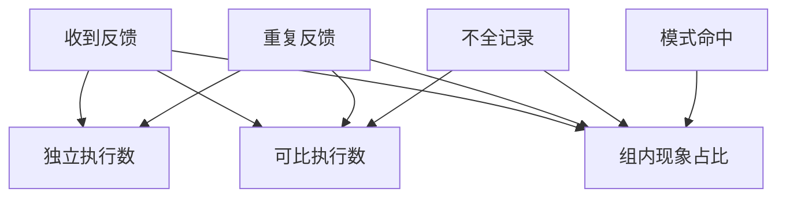

# 同一个诊断症状究竟有多少独立样本

按原始执行去除重复反馈，再扣除记录不全的样本。
两次筛选使用不同的分母，最终只能描述可比较组中的现象。
不全记录是去重后的计数。
共同现象尚未证明是同一项代码修改造成。

## 先解决一个具体问题

**为什么要同时报告去重后样本数和可比较样本数？**

前者说明有多少独立执行，后者说明多少能支持某一强度的分析。
遗漏的样本也许系统性更难，不能用完整组的占比直接外推所有反馈。


先从具体的低档设定开始：收到反馈取 50份、重复反馈取 5份、不全记录取 4份、模式命中取 6份。
三个结果依次是独立执行数 45份、可比执行数 41份、组内现象占比 14.634%。
先手算这个起点，读完后再把另一个输入切到高档，这样能知道数字变化时究竟改变了哪个假设。

## 先写清输入边界和三个观测量

用 a 表示收到反馈，取 50份 或 90份，这两点是用于隔离因果影响的教学输入。

用 b 表示重复反馈，取 5份 或 12份，这两点是用于隔离因果影响的教学输入。

用 c 表示不全记录，取 4份 或 11份，这两点是用于隔离因果影响的教学输入。

用 d 表示模式命中，取 6份 或 17份，这两点是用于隔离因果影响的教学输入。

「独立执行数」的计算式为 `a-b`，按业务量展开是 `收到反馈-重复反馈`，输出单位为份。

「可比执行数」的计算式为 `a-b-c`，按业务量展开是 `收到反馈-重复反馈-不全记录`，输出单位为份。

「组内现象占比」的计算式为 `100*d/(a-b-c)`，按业务量展开是 `100×模式命中/(收到反馈-重复反馈-不全记录)`，输出单位为%。

公式中 ceil 与 floor 分别向上、向下取整，% 在表达式中作取余，** 为乘方，三元条件按“条件 ? 成立值 : 其他值”读取。展示数值最多保留三位小数，比较和反推采用未舍入值。



图上的箭头表示该输入出现在计算式中。同一输入通向多个指标时，三个读数可能共同移动。分支、取整或相互抵消又会使某些边在具体样本上没有可见增量。

## 从输入按单位逐步算到可比较的结果

<details>
<summary>展开推演与对应反例</summary>

### 样本 0000：收到反馈 50、重复反馈 5

这一组设定为收到反馈为 50份、重复反馈为 5份、不全记录为 4份、模式命中为 6份。

代入「独立执行数」：`50-5`，得到 45份。

代入「可比执行数」：`50-5-4`，得到 41份。

代入「组内现象占比」：`100*6/(50-5-4)`，得到 14.634%。

以「组内现象占比」作主读数时，本组单独切换模式命中的绝对变化最大或并列最大，读数会从 14.634% 变为 41.463%。

对角样本 1111 的主读数为 25.373%。它同时改了四项，差额不能充当任一单个因素的净收益。

### 样本 0001：收到反馈 50、重复反馈 5

这一组设定为收到反馈为 50份、重复反馈为 5份、不全记录为 4份、模式命中为 17份。


代入「组内现象占比」：`100*17/(50-5-4)`，得到 41.463%。

以「组内现象占比」作主读数时，本组单独切换模式命中的绝对变化最大或并列最大，读数会从 41.463% 变为 14.634%。

对角样本 1110 的主读数为 8.955%。它同时改了四项，差额不能充当任一单个因素的净收益。

### 样本 0010：收到反馈 50、重复反馈 5

这一组设定为收到反馈为 50份、重复反馈为 5份、不全记录为 11份、模式命中为 6份。


代入「可比执行数」：`50-5-11`，得到 34份。

代入「组内现象占比」：`100*6/(50-5-11)`，得到 17.647%。

以「组内现象占比」作主读数时，本组单独切换模式命中的绝对变化最大或并列最大，读数会从 17.647% 变为 50%。

对角样本 1101 的主读数为 22.973%。它同时改了四项，差额不能充当任一单个因素的净收益。

### 样本 0011：收到反馈 50、重复反馈 5

这一组设定为收到反馈为 50份、重复反馈为 5份、不全记录为 11份、模式命中为 17份。


代入「组内现象占比」：`100*17/(50-5-11)`，得到 50%。

以「组内现象占比」作主读数时，本组单独切换模式命中的绝对变化最大或并列最大，读数会从 50% 变为 17.647%。

对角样本 1100 的主读数为 8.108%。它同时改了四项，差额不能充当任一单个因素的净收益。

### 样本 0100：收到反馈 50、重复反馈 12

这一组设定为收到反馈为 50份、重复反馈为 12份、不全记录为 4份、模式命中为 6份。

代入「独立执行数」：`50-12`，得到 38份。

代入「可比执行数」：`50-12-4`，得到 34份。

代入「组内现象占比」：`100*6/(50-12-4)`，得到 17.647%。


对角样本 1011 的主读数为 22.973%。它同时改了四项，差额不能充当任一单个因素的净收益。

### 样本 0101：收到反馈 50、重复反馈 12

这一组设定为收到反馈为 50份、重复反馈为 12份、不全记录为 4份、模式命中为 17份。


代入「组内现象占比」：`100*17/(50-12-4)`，得到 50%。


对角样本 1010 的主读数为 8.108%。它同时改了四项，差额不能充当任一单个因素的净收益。

### 样本 0110：收到反馈 50、重复反馈 12

这一组设定为收到反馈为 50份、重复反馈为 12份、不全记录为 11份、模式命中为 6份。


代入「可比执行数」：`50-12-11`，得到 27份。

代入「组内现象占比」：`100*6/(50-12-11)`，得到 22.222%。

以「组内现象占比」作主读数时，本组单独切换模式命中的绝对变化最大或并列最大，读数会从 22.222% 变为 62.963%。

对角样本 1001 的主读数为 20.988%。它同时改了四项，差额不能充当任一单个因素的净收益。

### 样本 0111：收到反馈 50、重复反馈 12

这一组设定为收到反馈为 50份、重复反馈为 12份、不全记录为 11份、模式命中为 17份。


代入「组内现象占比」：`100*17/(50-12-11)`，得到 62.963%。

以「组内现象占比」作主读数时，本组单独切换模式命中的绝对变化最大或并列最大，读数会从 62.963% 变为 22.222%。

对角样本 1000 的主读数为 7.407%。它同时改了四项，差额不能充当任一单个因素的净收益。

### 样本 1000：收到反馈 90、重复反馈 5

这一组设定为收到反馈为 90份、重复反馈为 5份、不全记录为 4份、模式命中为 6份。

代入「独立执行数」：`90-5`，得到 85份。

代入「可比执行数」：`90-5-4`，得到 81份。

代入「组内现象占比」：`100*6/(90-5-4)`，得到 7.407%。

以「组内现象占比」作主读数时，本组单独切换模式命中的绝对变化最大或并列最大，读数会从 7.407% 变为 20.988%。

对角样本 0111 的主读数为 62.963%。它同时改了四项，差额不能充当任一单个因素的净收益。

### 样本 1001：收到反馈 90、重复反馈 5

这一组设定为收到反馈为 90份、重复反馈为 5份、不全记录为 4份、模式命中为 17份。


代入「组内现象占比」：`100*17/(90-5-4)`，得到 20.988%。

以「组内现象占比」作主读数时，本组单独切换收到反馈的绝对变化最大或并列最大，读数会从 20.988% 变为 41.463%。

对角样本 0110 的主读数为 22.222%。它同时改了四项，差额不能充当任一单个因素的净收益。

### 样本 1010：收到反馈 90、重复反馈 5

这一组设定为收到反馈为 90份、重复反馈为 5份、不全记录为 11份、模式命中为 6份。


代入「可比执行数」：`90-5-11`，得到 74份。

代入「组内现象占比」：`100*6/(90-5-11)`，得到 8.108%。

以「组内现象占比」作主读数时，本组单独切换模式命中的绝对变化最大或并列最大，读数会从 8.108% 变为 22.973%。

对角样本 0101 的主读数为 50%。它同时改了四项，差额不能充当任一单个因素的净收益。

### 样本 1011：收到反馈 90、重复反馈 5

这一组设定为收到反馈为 90份、重复反馈为 5份、不全记录为 11份、模式命中为 17份。


代入「组内现象占比」：`100*17/(90-5-11)`，得到 22.973%。

以「组内现象占比」作主读数时，本组单独切换收到反馈的绝对变化最大或并列最大，读数会从 22.973% 变为 50%。

对角样本 0100 的主读数为 17.647%。它同时改了四项，差额不能充当任一单个因素的净收益。

### 样本 1100：收到反馈 90、重复反馈 12

这一组设定为收到反馈为 90份、重复反馈为 12份、不全记录为 4份、模式命中为 6份。

代入「独立执行数」：`90-12`，得到 78份。

代入「可比执行数」：`90-12-4`，得到 74份。

代入「组内现象占比」：`100*6/(90-12-4)`，得到 8.108%。


对角样本 0011 的主读数为 50%。它同时改了四项，差额不能充当任一单个因素的净收益。

### 样本 1101：收到反馈 90、重复反馈 12

这一组设定为收到反馈为 90份、重复反馈为 12份、不全记录为 4份、模式命中为 17份。


代入「组内现象占比」：`100*17/(90-12-4)`，得到 22.973%。


对角样本 0010 的主读数为 17.647%。它同时改了四项，差额不能充当任一单个因素的净收益。

### 样本 1110：收到反馈 90、重复反馈 12

这一组设定为收到反馈为 90份、重复反馈为 12份、不全记录为 11份、模式命中为 6份。


代入「可比执行数」：`90-12-11`，得到 67份。

代入「组内现象占比」：`100*6/(90-12-11)`，得到 8.955%。

以「组内现象占比」作主读数时，本组单独切换模式命中的绝对变化最大或并列最大，读数会从 8.955% 变为 25.373%。

对角样本 0001 的主读数为 41.463%。它同时改了四项，差额不能充当任一单个因素的净收益。

### 样本 1111：收到反馈 90、重复反馈 12

这一组设定为收到反馈为 90份、重复反馈为 12份、不全记录为 11份、模式命中为 17份。


代入「组内现象占比」：`100*17/(90-12-11)`，得到 25.373%。

以「组内现象占比」作主读数时，本组单独切换收到反馈的绝对变化最大或并列最大，读数会从 25.373% 变为 62.963%。

对角样本 0000 的主读数为 14.634%。它同时改了四项，差额不能充当任一单个因素的净收益。

</details>

## 逐个干预：其余条件固定时，变化真的发生在哪里

<details>
<summary>展开推演与对应反例</summary>

### 只改变收到反馈

固定重复反馈为 5份、不全记录为 4份、模式命中为 6份，只把收到反馈从 50份改到 90份。
这一对的独立执行数从 45份 变为 85份，可比执行数的差为 40份，组内现象占比的差为 -7.227%。

固定重复反馈为 5份、不全记录为 4份、模式命中为 17份，只把收到反馈从 50份改到 90份。
这一对的独立执行数从 45份 变为 85份，可比执行数的差为 40份，组内现象占比的差为 -20.476%。

固定重复反馈为 5份、不全记录为 11份、模式命中为 6份，只把收到反馈从 50份改到 90份。
这一对的独立执行数从 45份 变为 85份，可比执行数的差为 40份，组内现象占比的差为 -9.539%。

固定重复反馈为 5份、不全记录为 11份、模式命中为 17份，只把收到反馈从 50份改到 90份。
这一对的独立执行数从 45份 变为 85份，可比执行数的差为 40份，组内现象占比的差为 -27.027%。

固定重复反馈为 12份、不全记录为 4份、模式命中为 6份，只把收到反馈从 50份改到 90份。
这一对的独立执行数从 38份 变为 78份，可比执行数的差为 40份，组内现象占比的差为 -9.539%。

固定重复反馈为 12份、不全记录为 4份、模式命中为 17份，只把收到反馈从 50份改到 90份。
这一对的独立执行数从 38份 变为 78份，可比执行数的差为 40份，组内现象占比的差为 -27.027%。

固定重复反馈为 12份、不全记录为 11份、模式命中为 6份，只把收到反馈从 50份改到 90份。
这一对的独立执行数从 38份 变为 78份，可比执行数的差为 40份，组内现象占比的差为 -13.267%。

固定重复反馈为 12份、不全记录为 11份、模式命中为 17份，只把收到反馈从 50份改到 90份。
这一对的独立执行数从 38份 变为 78份，可比执行数的差为 40份，组内现象占比的差为 -37.59%。

综合八组受控背景，收到反馈升到较高设定时「独立执行数」的差值区间是 40份，共有 8 对出现可观察变化。

综合八组受控背景，收到反馈升到较高设定时「可比执行数」的差值区间是 40份，共有 8 对出现可观察变化。

综合八组受控背景，收到反馈升到较高设定时「组内现象占比」的差值区间是 -37.59% 至 -7.227%，共有 8 对出现可观察变化。

### 只改变重复反馈

固定收到反馈为 50份、不全记录为 4份、模式命中为 6份，只把重复反馈从 5份改到 12份。
这一对的独立执行数从 45份 变为 38份，可比执行数的差为 -7份，组内现象占比的差为 3.013%。

固定收到反馈为 50份、不全记录为 4份、模式命中为 17份，只把重复反馈从 5份改到 12份。
这一对的独立执行数从 45份 变为 38份，可比执行数的差为 -7份，组内现象占比的差为 8.537%。

固定收到反馈为 50份、不全记录为 11份、模式命中为 6份，只把重复反馈从 5份改到 12份。
这一对的独立执行数从 45份 变为 38份，可比执行数的差为 -7份，组内现象占比的差为 4.575%。

固定收到反馈为 50份、不全记录为 11份、模式命中为 17份，只把重复反馈从 5份改到 12份。
这一对的独立执行数从 45份 变为 38份，可比执行数的差为 -7份，组内现象占比的差为 12.963%。

固定收到反馈为 90份、不全记录为 4份、模式命中为 6份，只把重复反馈从 5份改到 12份。
这一对的独立执行数从 85份 变为 78份，可比执行数的差为 -7份，组内现象占比的差为 0.701%。

固定收到反馈为 90份、不全记录为 4份、模式命中为 17份，只把重复反馈从 5份改到 12份。
这一对的独立执行数从 85份 变为 78份，可比执行数的差为 -7份，组内现象占比的差为 1.985%。

固定收到反馈为 90份、不全记录为 11份、模式命中为 6份，只把重复反馈从 5份改到 12份。
这一对的独立执行数从 85份 变为 78份，可比执行数的差为 -7份，组内现象占比的差为 0.847%。

固定收到反馈为 90份、不全记录为 11份、模式命中为 17份，只把重复反馈从 5份改到 12份。
这一对的独立执行数从 85份 变为 78份，可比执行数的差为 -7份，组内现象占比的差为 2.4%。

综合八组受控背景，重复反馈升到较高设定时「独立执行数」的差值区间是 -7份，共有 8 对出现可观察变化。

综合八组受控背景，重复反馈升到较高设定时「可比执行数」的差值区间是 -7份，共有 8 对出现可观察变化。

综合八组受控背景，重复反馈升到较高设定时「组内现象占比」的差值区间是 0.701% 至 12.963%，共有 8 对出现可观察变化。

### 只改变不全记录

固定收到反馈为 50份、重复反馈为 5份、模式命中为 6份，只把不全记录从 4份改到 11份。
这一对的独立执行数从 45份 变为 45份，可比执行数的差为 -7份，组内现象占比的差为 3.013%。

固定收到反馈为 50份、重复反馈为 5份、模式命中为 17份，只把不全记录从 4份改到 11份。
这一对的独立执行数从 45份 变为 45份，可比执行数的差为 -7份，组内现象占比的差为 8.537%。

固定收到反馈为 50份、重复反馈为 12份、模式命中为 6份，只把不全记录从 4份改到 11份。
这一对的独立执行数从 38份 变为 38份，可比执行数的差为 -7份，组内现象占比的差为 4.575%。

固定收到反馈为 50份、重复反馈为 12份、模式命中为 17份，只把不全记录从 4份改到 11份。
这一对的独立执行数从 38份 变为 38份，可比执行数的差为 -7份，组内现象占比的差为 12.963%。

固定收到反馈为 90份、重复反馈为 5份、模式命中为 6份，只把不全记录从 4份改到 11份。
这一对的独立执行数从 85份 变为 85份，可比执行数的差为 -7份，组内现象占比的差为 0.701%。

固定收到反馈为 90份、重复反馈为 5份、模式命中为 17份，只把不全记录从 4份改到 11份。
这一对的独立执行数从 85份 变为 85份，可比执行数的差为 -7份，组内现象占比的差为 1.985%。

固定收到反馈为 90份、重复反馈为 12份、模式命中为 6份，只把不全记录从 4份改到 11份。
这一对的独立执行数从 78份 变为 78份，可比执行数的差为 -7份，组内现象占比的差为 0.847%。

固定收到反馈为 90份、重复反馈为 12份、模式命中为 17份，只把不全记录从 4份改到 11份。
这一对的独立执行数从 78份 变为 78份，可比执行数的差为 -7份，组内现象占比的差为 2.4%。

综合八组受控背景，不全记录升到较高设定时「独立执行数」的差值区间是 0份，共有 0 对出现可观察变化。

综合八组受控背景，不全记录升到较高设定时「可比执行数」的差值区间是 -7份，共有 8 对出现可观察变化。

综合八组受控背景，不全记录升到较高设定时「组内现象占比」的差值区间是 0.701% 至 12.963%，共有 8 对出现可观察变化。

### 只改变模式命中

固定收到反馈为 50份、重复反馈为 5份、不全记录为 4份，只把模式命中从 6份改到 17份。
这一对的独立执行数从 45份 变为 45份，可比执行数的差为 0份，组内现象占比的差为 26.829%。

固定收到反馈为 50份、重复反馈为 5份、不全记录为 11份，只把模式命中从 6份改到 17份。
这一对的独立执行数从 45份 变为 45份，可比执行数的差为 0份，组内现象占比的差为 32.353%。

固定收到反馈为 50份、重复反馈为 12份、不全记录为 4份，只把模式命中从 6份改到 17份。
这一对的独立执行数从 38份 变为 38份，可比执行数的差为 0份，组内现象占比的差为 32.353%。

固定收到反馈为 50份、重复反馈为 12份、不全记录为 11份，只把模式命中从 6份改到 17份。
这一对的独立执行数从 38份 变为 38份，可比执行数的差为 0份，组内现象占比的差为 40.741%。

固定收到反馈为 90份、重复反馈为 5份、不全记录为 4份，只把模式命中从 6份改到 17份。
这一对的独立执行数从 85份 变为 85份，可比执行数的差为 0份，组内现象占比的差为 13.58%。

固定收到反馈为 90份、重复反馈为 5份、不全记录为 11份，只把模式命中从 6份改到 17份。
这一对的独立执行数从 85份 变为 85份，可比执行数的差为 0份，组内现象占比的差为 14.865%。

固定收到反馈为 90份、重复反馈为 12份、不全记录为 4份，只把模式命中从 6份改到 17份。
这一对的独立执行数从 78份 变为 78份，可比执行数的差为 0份，组内现象占比的差为 14.865%。

固定收到反馈为 90份、重复反馈为 12份、不全记录为 11份，只把模式命中从 6份改到 17份。
这一对的独立执行数从 78份 变为 78份，可比执行数的差为 0份，组内现象占比的差为 16.418%。

综合八组受控背景，模式命中升到较高设定时「独立执行数」的差值区间是 0份，共有 0 对出现可观察变化。

综合八组受控背景，模式命中升到较高设定时「可比执行数」的差值区间是 0份，共有 0 对出现可观察变化。

综合八组受控背景，模式命中升到较高设定时「组内现象占比」的差值区间是 13.58% 至 40.741%，共有 8 对出现可观察变化。

</details>

## 只拿到部分输入，结论还能缩小到多大范围

<details>
<summary>展开推演与对应反例</summary>

### 已知收到反馈和重复反馈

当收到反馈为 50份、重复反馈为 5份时，另两项有四种补全，主读数「组内现象占比」只能限定为 14.634% 至 50%。
这个条件下，取不全记录为 4份、模式命中为 6份可得到下界 14.634%，取不全记录为 11份、模式命中为 17份可达到上界 50%。

用同样可见的收到反馈为 50份、重复反馈为 5份去推「独立执行数」，能得到的范围为 45份，不能把另一个指标的单位代入。

用同样可见的收到反馈为 50份、重复反馈为 5份去推「可比执行数」，能得到的范围为 34份 至 41份，不能把另一个指标的单位代入。

若只许再问一项，按最坏区间宽度优先核对模式命中，补得低档时为 14.634% 至 17.647%，高档时为 41.463% 至 50%。

当收到反馈为 50份、重复反馈为 12份时，另两项有四种补全，主读数「组内现象占比」只能限定为 17.647% 至 62.963%。
这个条件下，取不全记录为 4份、模式命中为 6份可得到下界 17.647%，取不全记录为 11份、模式命中为 17份可达到上界 62.963%。

用同样可见的收到反馈为 50份、重复反馈为 12份去推「独立执行数」，能得到的范围为 38份，不能把另一个指标的单位代入。

用同样可见的收到反馈为 50份、重复反馈为 12份去推「可比执行数」，能得到的范围为 27份 至 34份，不能把另一个指标的单位代入。

若只许再问一项，按最坏区间宽度优先核对模式命中，补得低档时为 17.647% 至 22.222%，高档时为 50% 至 62.963%。

当收到反馈为 90份、重复反馈为 5份时，另两项有四种补全，主读数「组内现象占比」只能限定为 7.407% 至 22.973%。
这个条件下，取不全记录为 4份、模式命中为 6份可得到下界 7.407%，取不全记录为 11份、模式命中为 17份可达到上界 22.973%。

用同样可见的收到反馈为 90份、重复反馈为 5份去推「独立执行数」，能得到的范围为 85份，不能把另一个指标的单位代入。

用同样可见的收到反馈为 90份、重复反馈为 5份去推「可比执行数」，能得到的范围为 74份 至 81份，不能把另一个指标的单位代入。

若只许再问一项，按最坏区间宽度优先核对模式命中，补得低档时为 7.407% 至 8.108%，高档时为 20.988% 至 22.973%。

当收到反馈为 90份、重复反馈为 12份时，另两项有四种补全，主读数「组内现象占比」只能限定为 8.108% 至 25.373%。
这个条件下，取不全记录为 4份、模式命中为 6份可得到下界 8.108%，取不全记录为 11份、模式命中为 17份可达到上界 25.373%。

用同样可见的收到反馈为 90份、重复反馈为 12份去推「独立执行数」，能得到的范围为 78份，不能把另一个指标的单位代入。

用同样可见的收到反馈为 90份、重复反馈为 12份去推「可比执行数」，能得到的范围为 67份 至 74份，不能把另一个指标的单位代入。

若只许再问一项，按最坏区间宽度优先核对模式命中，补得低档时为 8.108% 至 8.955%，高档时为 22.973% 至 25.373%。

### 已知收到反馈和不全记录

当收到反馈为 50份、不全记录为 4份时，另两项有四种补全，主读数「组内现象占比」只能限定为 14.634% 至 50%。
这个条件下，取重复反馈为 5份、模式命中为 6份可得到下界 14.634%，取重复反馈为 12份、模式命中为 17份可达到上界 50%。

用同样可见的收到反馈为 50份、不全记录为 4份去推「独立执行数」，能得到的范围为 38份 至 45份，不能把另一个指标的单位代入。

用同样可见的收到反馈为 50份、不全记录为 4份去推「可比执行数」，能得到的范围为 34份 至 41份，不能把另一个指标的单位代入。


当收到反馈为 50份、不全记录为 11份时，另两项有四种补全，主读数「组内现象占比」只能限定为 17.647% 至 62.963%。
这个条件下，取重复反馈为 5份、模式命中为 6份可得到下界 17.647%，取重复反馈为 12份、模式命中为 17份可达到上界 62.963%。

用同样可见的收到反馈为 50份、不全记录为 11份去推「独立执行数」，能得到的范围为 38份 至 45份，不能把另一个指标的单位代入。

用同样可见的收到反馈为 50份、不全记录为 11份去推「可比执行数」，能得到的范围为 27份 至 34份，不能把另一个指标的单位代入。


当收到反馈为 90份、不全记录为 4份时，另两项有四种补全，主读数「组内现象占比」只能限定为 7.407% 至 22.973%。
这个条件下，取重复反馈为 5份、模式命中为 6份可得到下界 7.407%，取重复反馈为 12份、模式命中为 17份可达到上界 22.973%。

用同样可见的收到反馈为 90份、不全记录为 4份去推「独立执行数」，能得到的范围为 78份 至 85份，不能把另一个指标的单位代入。

用同样可见的收到反馈为 90份、不全记录为 4份去推「可比执行数」，能得到的范围为 74份 至 81份，不能把另一个指标的单位代入。


当收到反馈为 90份、不全记录为 11份时，另两项有四种补全，主读数「组内现象占比」只能限定为 8.108% 至 25.373%。
这个条件下，取重复反馈为 5份、模式命中为 6份可得到下界 8.108%，取重复反馈为 12份、模式命中为 17份可达到上界 25.373%。

用同样可见的收到反馈为 90份、不全记录为 11份去推「独立执行数」，能得到的范围为 78份 至 85份，不能把另一个指标的单位代入。

用同样可见的收到反馈为 90份、不全记录为 11份去推「可比执行数」，能得到的范围为 67份 至 74份，不能把另一个指标的单位代入。


### 已知重复反馈和不全记录

当重复反馈为 5份、不全记录为 4份时，另两项有四种补全，主读数「组内现象占比」只能限定为 7.407% 至 41.463%。
这个条件下，取收到反馈为 90份、模式命中为 6份可得到下界 7.407%，取收到反馈为 50份、模式命中为 17份可达到上界 41.463%。

用同样可见的重复反馈为 5份、不全记录为 4份去推「独立执行数」，能得到的范围为 45份 至 85份，不能把另一个指标的单位代入。

用同样可见的重复反馈为 5份、不全记录为 4份去推「可比执行数」，能得到的范围为 41份 至 81份，不能把另一个指标的单位代入。

若只许再问一项，按最坏区间宽度优先核对模式命中，补得低档时为 7.407% 至 14.634%，高档时为 20.988% 至 41.463%。

当重复反馈为 5份、不全记录为 11份时，另两项有四种补全，主读数「组内现象占比」只能限定为 8.108% 至 50%。
这个条件下，取收到反馈为 90份、模式命中为 6份可得到下界 8.108%，取收到反馈为 50份、模式命中为 17份可达到上界 50%。

用同样可见的重复反馈为 5份、不全记录为 11份去推「独立执行数」，能得到的范围为 45份 至 85份，不能把另一个指标的单位代入。

用同样可见的重复反馈为 5份、不全记录为 11份去推「可比执行数」，能得到的范围为 34份 至 74份，不能把另一个指标的单位代入。

若只许再问一项，按最坏区间宽度优先核对模式命中，补得低档时为 8.108% 至 17.647%，高档时为 22.973% 至 50%。

当重复反馈为 12份、不全记录为 4份时，另两项有四种补全，主读数「组内现象占比」只能限定为 8.108% 至 50%。

用同样可见的重复反馈为 12份、不全记录为 4份去推「独立执行数」，能得到的范围为 38份 至 78份，不能把另一个指标的单位代入。

用同样可见的重复反馈为 12份、不全记录为 4份去推「可比执行数」，能得到的范围为 34份 至 74份，不能把另一个指标的单位代入。


当重复反馈为 12份、不全记录为 11份时，另两项有四种补全，主读数「组内现象占比」只能限定为 8.955% 至 62.963%。
这个条件下，取收到反馈为 90份、模式命中为 6份可得到下界 8.955%，取收到反馈为 50份、模式命中为 17份可达到上界 62.963%。

用同样可见的重复反馈为 12份、不全记录为 11份去推「独立执行数」，能得到的范围为 38份 至 78份，不能把另一个指标的单位代入。

用同样可见的重复反馈为 12份、不全记录为 11份去推「可比执行数」，能得到的范围为 27份 至 67份，不能把另一个指标的单位代入。

若只许再问一项，按最坏区间宽度优先核对模式命中，补得低档时为 8.955% 至 22.222%，高档时为 25.373% 至 62.963%。

### 已知收到反馈和模式命中

当收到反馈为 50份、模式命中为 6份时，另两项有四种补全，主读数「组内现象占比」只能限定为 14.634% 至 22.222%。
这个条件下，取重复反馈为 5份、不全记录为 4份可得到下界 14.634%，取重复反馈为 12份、不全记录为 11份可达到上界 22.222%。

用同样可见的收到反馈为 50份、模式命中为 6份去推「独立执行数」，能得到的范围为 38份 至 45份，不能把另一个指标的单位代入。

用同样可见的收到反馈为 50份、模式命中为 6份去推「可比执行数」，能得到的范围为 27份 至 41份，不能把另一个指标的单位代入。

若只许再问一项，按最坏区间宽度优先核对重复反馈，补得低档时为 14.634% 至 17.647%，高档时为 17.647% 至 22.222%。

当收到反馈为 50份、模式命中为 17份时，另两项有四种补全，主读数「组内现象占比」只能限定为 41.463% 至 62.963%。
这个条件下，取重复反馈为 5份、不全记录为 4份可得到下界 41.463%，取重复反馈为 12份、不全记录为 11份可达到上界 62.963%。

用同样可见的收到反馈为 50份、模式命中为 17份去推「独立执行数」，能得到的范围为 38份 至 45份，不能把另一个指标的单位代入。

用同样可见的收到反馈为 50份、模式命中为 17份去推「可比执行数」，能得到的范围为 27份 至 41份，不能把另一个指标的单位代入。

若只许再问一项，按最坏区间宽度优先核对重复反馈，补得低档时为 41.463% 至 50%，高档时为 50% 至 62.963%。

当收到反馈为 90份、模式命中为 6份时，另两项有四种补全，主读数「组内现象占比」只能限定为 7.407% 至 8.955%。
这个条件下，取重复反馈为 5份、不全记录为 4份可得到下界 7.407%，取重复反馈为 12份、不全记录为 11份可达到上界 8.955%。

用同样可见的收到反馈为 90份、模式命中为 6份去推「独立执行数」，能得到的范围为 78份 至 85份，不能把另一个指标的单位代入。

用同样可见的收到反馈为 90份、模式命中为 6份去推「可比执行数」，能得到的范围为 67份 至 81份，不能把另一个指标的单位代入。

若只许再问一项，按最坏区间宽度优先核对重复反馈，补得低档时为 7.407% 至 8.108%，高档时为 8.108% 至 8.955%。

当收到反馈为 90份、模式命中为 17份时，另两项有四种补全，主读数「组内现象占比」只能限定为 20.988% 至 25.373%。
这个条件下，取重复反馈为 5份、不全记录为 4份可得到下界 20.988%，取重复反馈为 12份、不全记录为 11份可达到上界 25.373%。

用同样可见的收到反馈为 90份、模式命中为 17份去推「独立执行数」，能得到的范围为 78份 至 85份，不能把另一个指标的单位代入。

用同样可见的收到反馈为 90份、模式命中为 17份去推「可比执行数」，能得到的范围为 67份 至 81份，不能把另一个指标的单位代入。

若只许再问一项，按最坏区间宽度优先核对重复反馈，补得低档时为 20.988% 至 22.973%，高档时为 22.973% 至 25.373%。

### 已知重复反馈和模式命中

当重复反馈为 5份、模式命中为 6份时，另两项有四种补全，主读数「组内现象占比」只能限定为 7.407% 至 17.647%。
这个条件下，取收到反馈为 90份、不全记录为 4份可得到下界 7.407%，取收到反馈为 50份、不全记录为 11份可达到上界 17.647%。

用同样可见的重复反馈为 5份、模式命中为 6份去推「独立执行数」，能得到的范围为 45份 至 85份，不能把另一个指标的单位代入。

用同样可见的重复反馈为 5份、模式命中为 6份去推「可比执行数」，能得到的范围为 34份 至 81份，不能把另一个指标的单位代入。

若只许再问一项，按最坏区间宽度优先核对收到反馈，补得低档时为 14.634% 至 17.647%，高档时为 7.407% 至 8.108%。

当重复反馈为 5份、模式命中为 17份时，另两项有四种补全，主读数「组内现象占比」只能限定为 20.988% 至 50%。
这个条件下，取收到反馈为 90份、不全记录为 4份可得到下界 20.988%，取收到反馈为 50份、不全记录为 11份可达到上界 50%。

用同样可见的重复反馈为 5份、模式命中为 17份去推「独立执行数」，能得到的范围为 45份 至 85份，不能把另一个指标的单位代入。

用同样可见的重复反馈为 5份、模式命中为 17份去推「可比执行数」，能得到的范围为 34份 至 81份，不能把另一个指标的单位代入。

若只许再问一项，按最坏区间宽度优先核对收到反馈，补得低档时为 41.463% 至 50%，高档时为 20.988% 至 22.973%。

当重复反馈为 12份、模式命中为 6份时，另两项有四种补全，主读数「组内现象占比」只能限定为 8.108% 至 22.222%。
这个条件下，取收到反馈为 90份、不全记录为 4份可得到下界 8.108%，取收到反馈为 50份、不全记录为 11份可达到上界 22.222%。

用同样可见的重复反馈为 12份、模式命中为 6份去推「独立执行数」，能得到的范围为 38份 至 78份，不能把另一个指标的单位代入。

用同样可见的重复反馈为 12份、模式命中为 6份去推「可比执行数」，能得到的范围为 27份 至 74份，不能把另一个指标的单位代入。

若只许再问一项，按最坏区间宽度优先核对收到反馈，补得低档时为 17.647% 至 22.222%，高档时为 8.108% 至 8.955%。

当重复反馈为 12份、模式命中为 17份时，另两项有四种补全，主读数「组内现象占比」只能限定为 22.973% 至 62.963%。
这个条件下，取收到反馈为 90份、不全记录为 4份可得到下界 22.973%，取收到反馈为 50份、不全记录为 11份可达到上界 62.963%。

用同样可见的重复反馈为 12份、模式命中为 17份去推「独立执行数」，能得到的范围为 38份 至 78份，不能把另一个指标的单位代入。

用同样可见的重复反馈为 12份、模式命中为 17份去推「可比执行数」，能得到的范围为 27份 至 74份，不能把另一个指标的单位代入。

若只许再问一项，按最坏区间宽度优先核对收到反馈，补得低档时为 50% 至 62.963%，高档时为 22.973% 至 25.373%。

### 已知不全记录和模式命中

当不全记录为 4份、模式命中为 6份时，另两项有四种补全，主读数「组内现象占比」只能限定为 7.407% 至 17.647%。
这个条件下，取收到反馈为 90份、重复反馈为 5份可得到下界 7.407%，取收到反馈为 50份、重复反馈为 12份可达到上界 17.647%。

用同样可见的不全记录为 4份、模式命中为 6份去推「独立执行数」，能得到的范围为 38份 至 85份，不能把另一个指标的单位代入。

用同样可见的不全记录为 4份、模式命中为 6份去推「可比执行数」，能得到的范围为 34份 至 81份，不能把另一个指标的单位代入。


当不全记录为 4份、模式命中为 17份时，另两项有四种补全，主读数「组内现象占比」只能限定为 20.988% 至 50%。
这个条件下，取收到反馈为 90份、重复反馈为 5份可得到下界 20.988%，取收到反馈为 50份、重复反馈为 12份可达到上界 50%。

用同样可见的不全记录为 4份、模式命中为 17份去推「独立执行数」，能得到的范围为 38份 至 85份，不能把另一个指标的单位代入。

用同样可见的不全记录为 4份、模式命中为 17份去推「可比执行数」，能得到的范围为 34份 至 81份，不能把另一个指标的单位代入。


当不全记录为 11份、模式命中为 6份时，另两项有四种补全，主读数「组内现象占比」只能限定为 8.108% 至 22.222%。
这个条件下，取收到反馈为 90份、重复反馈为 5份可得到下界 8.108%，取收到反馈为 50份、重复反馈为 12份可达到上界 22.222%。

用同样可见的不全记录为 11份、模式命中为 6份去推「独立执行数」，能得到的范围为 38份 至 85份，不能把另一个指标的单位代入。

用同样可见的不全记录为 11份、模式命中为 6份去推「可比执行数」，能得到的范围为 27份 至 74份，不能把另一个指标的单位代入。


当不全记录为 11份、模式命中为 17份时，另两项有四种补全，主读数「组内现象占比」只能限定为 22.973% 至 62.963%。
这个条件下，取收到反馈为 90份、重复反馈为 5份可得到下界 22.973%，取收到反馈为 50份、重复反馈为 12份可达到上界 62.963%。

用同样可见的不全记录为 11份、模式命中为 17份去推「独立执行数」，能得到的范围为 38份 至 85份，不能把另一个指标的单位代入。

用同样可见的不全记录为 11份、模式命中为 17份去推「可比执行数」，能得到的范围为 27份 至 74份，不能把另一个指标的单位代入。


</details>

## 反过来审查一份报表：能从结果还原哪些输入

<details>
<summary>展开推演与对应反例</summary>

### 仅保留“独立执行数”的读数

报表只写「独立执行数=45份」时，在本实验的离散取值中有 4 组输入与之相容。

对这个 45份 的「独立执行数」读数，所有相容样本都要求收到反馈为 50份、重复反馈为 5份。

只凭「独立执行数」的 45份 无法确定不全记录：0000 与 0010 的取值分别为 4 和 11份。

报表只写「独立执行数=38份」时，在本实验的离散取值中有 4 组输入与之相容。

对这个 38份 的「独立执行数」读数，所有相容样本都要求收到反馈为 50份、重复反馈为 12份。

只凭「独立执行数」的 38份 无法确定不全记录：0100 与 0110 的取值分别为 4 和 11份。

报表只写「独立执行数=85份」时，在本实验的离散取值中有 4 组输入与之相容。

对这个 85份 的「独立执行数」读数，所有相容样本都要求收到反馈为 90份、重复反馈为 5份。

只凭「独立执行数」的 85份 无法确定不全记录：1000 与 1010 的取值分别为 4 和 11份。

报表只写「独立执行数=78份」时，在本实验的离散取值中有 4 组输入与之相容。

对这个 78份 的「独立执行数」读数，所有相容样本都要求收到反馈为 90份、重复反馈为 12份。

只凭「独立执行数」的 78份 无法确定不全记录：1100 与 1110 的取值分别为 4 和 11份。

### 仅保留“可比执行数”的读数

报表只写「可比执行数=41份」时，在本实验的离散取值中有 2 组输入与之相容。

对这个 41份 的「可比执行数」读数，所有相容样本都要求收到反馈为 50份、重复反馈为 5份、不全记录为 4份。

只凭「可比执行数」的 41份 无法确定模式命中：0000 与 0001 的取值分别为 6 和 17份。

报表只写「可比执行数=34份」时，在本实验的离散取值中有 4 组输入与之相容。

对这个 34份 的「可比执行数」读数，所有相容样本都要求收到反馈为 50份。

只凭「可比执行数」的 34份 无法确定重复反馈：0010 与 0100 的取值分别为 5 和 12份。

报表只写「可比执行数=27份」时，在本实验的离散取值中有 2 组输入与之相容。

对这个 27份 的「可比执行数」读数，所有相容样本都要求收到反馈为 50份、重复反馈为 12份、不全记录为 11份。

只凭「可比执行数」的 27份 无法确定模式命中：0110 与 0111 的取值分别为 6 和 17份。

报表只写「可比执行数=81份」时，在本实验的离散取值中有 2 组输入与之相容。

对这个 81份 的「可比执行数」读数，所有相容样本都要求收到反馈为 90份、重复反馈为 5份、不全记录为 4份。

只凭「可比执行数」的 81份 无法确定模式命中：1000 与 1001 的取值分别为 6 和 17份。

报表只写「可比执行数=74份」时，在本实验的离散取值中有 4 组输入与之相容。

对这个 74份 的「可比执行数」读数，所有相容样本都要求收到反馈为 90份。

只凭「可比执行数」的 74份 无法确定重复反馈：1010 与 1100 的取值分别为 5 和 12份。

报表只写「可比执行数=67份」时，在本实验的离散取值中有 2 组输入与之相容。

对这个 67份 的「可比执行数」读数，所有相容样本都要求收到反馈为 90份、重复反馈为 12份、不全记录为 11份。

只凭「可比执行数」的 67份 无法确定模式命中：1110 与 1111 的取值分别为 6 和 17份。

### 仅保留“组内现象占比”的读数

报表只写「组内现象占比=14.634%」时，在本实验的离散取值中有 1 组输入与之相容。

对这个 14.634% 的「组内现象占比」读数，所有相容样本都要求收到反馈为 50份、重复反馈为 5份、不全记录为 4份、模式命中为 6份。

报表只写「组内现象占比=41.463%」时，在本实验的离散取值中有 1 组输入与之相容。

对这个 41.463% 的「组内现象占比」读数，所有相容样本都要求收到反馈为 50份、重复反馈为 5份、不全记录为 4份、模式命中为 17份。

报表只写「组内现象占比=17.647%」时，在本实验的离散取值中有 2 组输入与之相容。

对这个 17.647% 的「组内现象占比」读数，所有相容样本都要求收到反馈为 50份、模式命中为 6份。

只凭「组内现象占比」的 17.647% 无法确定重复反馈：0010 与 0100 的取值分别为 5 和 12份。

报表只写「组内现象占比=50%」时，在本实验的离散取值中有 2 组输入与之相容。

对这个 50% 的「组内现象占比」读数，所有相容样本都要求收到反馈为 50份、模式命中为 17份。

只凭「组内现象占比」的 50% 无法确定重复反馈：0011 与 0101 的取值分别为 5 和 12份。

报表只写「组内现象占比=22.222%」时，在本实验的离散取值中有 1 组输入与之相容。

对这个 22.222% 的「组内现象占比」读数，所有相容样本都要求收到反馈为 50份、重复反馈为 12份、不全记录为 11份、模式命中为 6份。

报表只写「组内现象占比=62.963%」时，在本实验的离散取值中有 1 组输入与之相容。

对这个 62.963% 的「组内现象占比」读数，所有相容样本都要求收到反馈为 50份、重复反馈为 12份、不全记录为 11份、模式命中为 17份。

报表只写「组内现象占比=7.407%」时，在本实验的离散取值中有 1 组输入与之相容。

对这个 7.407% 的「组内现象占比」读数，所有相容样本都要求收到反馈为 90份、重复反馈为 5份、不全记录为 4份、模式命中为 6份。

报表只写「组内现象占比=20.988%」时，在本实验的离散取值中有 1 组输入与之相容。

对这个 20.988% 的「组内现象占比」读数，所有相容样本都要求收到反馈为 90份、重复反馈为 5份、不全记录为 4份、模式命中为 17份。

报表只写「组内现象占比=8.108%」时，在本实验的离散取值中有 2 组输入与之相容。

对这个 8.108% 的「组内现象占比」读数，所有相容样本都要求收到反馈为 90份、模式命中为 6份。

只凭「组内现象占比」的 8.108% 无法确定重复反馈：1010 与 1100 的取值分别为 5 和 12份。

报表只写「组内现象占比=22.973%」时，在本实验的离散取值中有 2 组输入与之相容。

对这个 22.973% 的「组内现象占比」读数，所有相容样本都要求收到反馈为 90份、模式命中为 17份。

只凭「组内现象占比」的 22.973% 无法确定重复反馈：1011 与 1101 的取值分别为 5 和 12份。

报表只写「组内现象占比=8.955%」时，在本实验的离散取值中有 1 组输入与之相容。

对这个 8.955% 的「组内现象占比」读数，所有相容样本都要求收到反馈为 90份、重复反馈为 12份、不全记录为 11份、模式命中为 6份。

报表只写「组内现象占比=25.373%」时，在本实验的离散取值中有 1 组输入与之相容。

对这个 25.373% 的「组内现象占比」读数，所有相容样本都要求收到反馈为 90份、重复反馈为 12份、不全记录为 11份、模式命中为 17份。

</details>

## 给错误算法找反例，再给正确算法画使用边界

<details>
<summary>展开推演与对应反例</summary>

### 直接用原始反馈数作分母

把「组内现象占比」错写成 `100*d/a`，在 16 组教学输入中有 16 组会与参照计算不同。

对于收到反馈为 50份、重复反馈为 5份、不全记录为 4份、模式命中为 6份，这个错误口径得 12%，参照式为 14.634%，偏差为 -2.634%。

对于收到反馈为 50份、重复反馈为 5份、不全记录为 4份、模式命中为 17份，这个错误口径得 34%，参照式为 41.463%，偏差为 -7.463%。

对于收到反馈为 50份、重复反馈为 5份、不全记录为 11份、模式命中为 6份，这个错误口径得 12%，参照式为 17.647%，偏差为 -5.647%。

对于收到反馈为 50份、重复反馈为 5份、不全记录为 11份、模式命中为 17份，这个错误口径得 34%，参照式为 50%，偏差为 -16%。

对于收到反馈为 50份、重复反馈为 12份、不全记录为 4份、模式命中为 6份，这个错误口径得 12%，参照式为 17.647%，偏差为 -5.647%。

对于收到反馈为 50份、重复反馈为 12份、不全记录为 4份、模式命中为 17份，这个错误口径得 34%，参照式为 50%，偏差为 -16%。

对于收到反馈为 50份、重复反馈为 12份、不全记录为 11份、模式命中为 6份，这个错误口径得 12%，参照式为 22.222%，偏差为 -10.222%。

对于收到反馈为 50份、重复反馈为 12份、不全记录为 11份、模式命中为 17份，这个错误口径得 34%，参照式为 62.963%，偏差为 -28.963%。

对于收到反馈为 90份、重复反馈为 5份、不全记录为 4份、模式命中为 6份，这个错误口径得 6.667%，参照式为 7.407%，偏差为 -0.741%。

对于收到反馈为 90份、重复反馈为 5份、不全记录为 4份、模式命中为 17份，这个错误口径得 18.889%，参照式为 20.988%，偏差为 -2.099%。

对于收到反馈为 90份、重复反馈为 5份、不全记录为 11份、模式命中为 6份，这个错误口径得 6.667%，参照式为 8.108%，偏差为 -1.441%。

对于收到反馈为 90份、重复反馈为 5份、不全记录为 11份、模式命中为 17份，这个错误口径得 18.889%，参照式为 22.973%，偏差为 -4.084%。

对于收到反馈为 90份、重复反馈为 12份、不全记录为 4份、模式命中为 6份，这个错误口径得 6.667%，参照式为 8.108%，偏差为 -1.441%。

对于收到反馈为 90份、重复反馈为 12份、不全记录为 4份、模式命中为 17份，这个错误口径得 18.889%，参照式为 22.973%，偏差为 -4.084%。

对于收到反馈为 90份、重复反馈为 12份、不全记录为 11份、模式命中为 6份，这个错误口径得 6.667%，参照式为 8.955%，偏差为 -2.289%。

对于收到反馈为 90份、重复反馈为 12份、不全记录为 11份、模式命中为 17份，这个错误口径得 18.889%，参照式为 25.373%，偏差为 -6.484%。

### 保留不完整执行在组内分母

把「组内现象占比」错写成 `100*d/(a-b)`，在 16 组教学输入中有 16 组会与参照计算不同。

对于收到反馈为 50份、重复反馈为 5份、不全记录为 4份、模式命中为 6份，这个错误口径得 13.333%，参照式为 14.634%，偏差为 -1.301%。

对于收到反馈为 50份、重复反馈为 5份、不全记录为 4份、模式命中为 17份，这个错误口径得 37.778%，参照式为 41.463%，偏差为 -3.686%。

对于收到反馈为 50份、重复反馈为 5份、不全记录为 11份、模式命中为 6份，这个错误口径得 13.333%，参照式为 17.647%，偏差为 -4.314%。

对于收到反馈为 50份、重复反馈为 5份、不全记录为 11份、模式命中为 17份，这个错误口径得 37.778%，参照式为 50%，偏差为 -12.222%。

对于收到反馈为 50份、重复反馈为 12份、不全记录为 4份、模式命中为 6份，这个错误口径得 15.789%，参照式为 17.647%，偏差为 -1.858%。

对于收到反馈为 50份、重复反馈为 12份、不全记录为 4份、模式命中为 17份，这个错误口径得 44.737%，参照式为 50%，偏差为 -5.263%。

对于收到反馈为 50份、重复反馈为 12份、不全记录为 11份、模式命中为 6份，这个错误口径得 15.789%，参照式为 22.222%，偏差为 -6.433%。

对于收到反馈为 50份、重复反馈为 12份、不全记录为 11份、模式命中为 17份，这个错误口径得 44.737%，参照式为 62.963%，偏差为 -18.226%。

对于收到反馈为 90份、重复反馈为 5份、不全记录为 4份、模式命中为 6份，这个错误口径得 7.059%，参照式为 7.407%，偏差为 -0.349%。

对于收到反馈为 90份、重复反馈为 5份、不全记录为 4份、模式命中为 17份，这个错误口径得 20%，参照式为 20.988%，偏差为 -0.988%。

对于收到反馈为 90份、重复反馈为 5份、不全记录为 11份、模式命中为 6份，这个错误口径得 7.059%，参照式为 8.108%，偏差为 -1.049%。

对于收到反馈为 90份、重复反馈为 5份、不全记录为 11份、模式命中为 17份，这个错误口径得 20%，参照式为 22.973%，偏差为 -2.973%。

对于收到反馈为 90份、重复反馈为 12份、不全记录为 4份、模式命中为 6份，这个错误口径得 7.692%，参照式为 8.108%，偏差为 -0.416%。

对于收到反馈为 90份、重复反馈为 12份、不全记录为 4份、模式命中为 17份，这个错误口径得 21.795%，参照式为 22.973%，偏差为 -1.178%。

对于收到反馈为 90份、重复反馈为 12份、不全记录为 11份、模式命中为 6份，这个错误口径得 7.692%，参照式为 8.955%，偏差为 -1.263%。

对于收到反馈为 90份、重复反馈为 12份、不全记录为 11份、模式命中为 17份，这个错误口径得 21.795%，参照式为 25.373%，偏差为 -3.578%。

</details>

## 从教学算例回到可验证的工程结论

要把这些数写入项目说明，先用真实输入替换教学常数，列明样本分母、实际资源限制和观测边界，再验证公式所需前提。两点敏感性只描述这两个设定之间的差异。

## 面试复述与复算

面试题可以从“为什么要同时报告去重后样本数和可比较样本数？”起步。先给出本篇的触发条件和一条真实执行端可检查的证据，再用一个相邻反例限定结论的适用范围。

在仓库根目录执行下列命令可以重算本篇的一个输入。四位数字依次选择正文列出的四项条件，0 表示未成立或低档，1 表示成立或高档。
```powershell
node examples/reading-cases/replay.mjs 8 6 0101
```

[本周主文](../theory.md) · [配套实验](../lab.md) · [下一篇研读](07.md)
