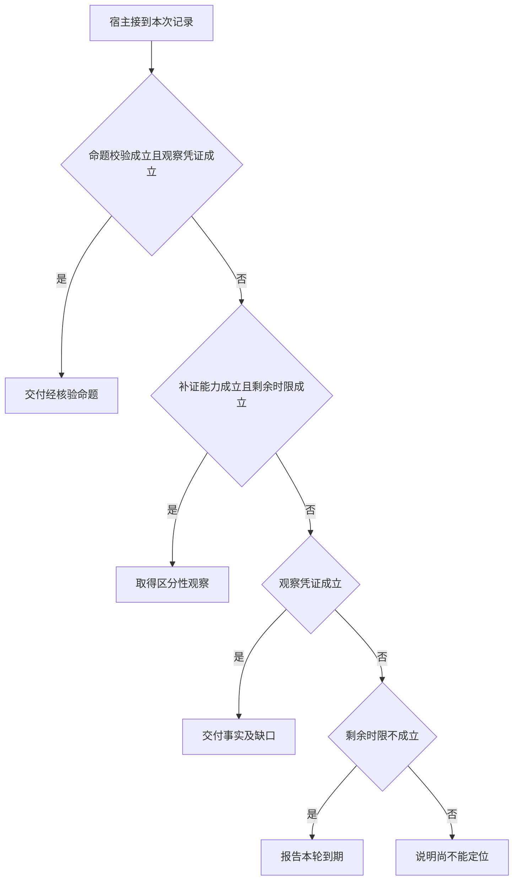

# 不确定时应当补查还是交付中间结论

诊断助手首先承诺交付已核实的事实。
要追加根因解释，得有能区分两个候选原因的工具和时间。
如果根本无从取得关键证据，停在已知边界就是正确行为。

本篇用一个封闭的教学决策器说明这一问题。输入是宿主收到的记录，不保证每个下游字段都已经获准使用。前置检查未成立时，下游即使带着缓存值，也不能拿来作业务断言。

## 先解决一个具体问题

**系统最恰当的下一步是何时停止？**

当没有能区分候选原因的观察或时限不足，应交付已有事实和仍缺的依据。
继续跑通用模型只会改变措辞，不会为一个未记录阶段创造证据。


先取一个能走到「说明尚不能定位」的输入：候选与领域条件冲突、只有尚未执行的提议、目前没有补证来源、截止前仍能完成下一动作。
把这四个条件代回后文的图，前面各个拦截分支都未满足，最终才有“缺证据也没有有用工具”这个判断。
还原这个现场时要分别问：哪些位来自可信状态，哪些只是在接口中出现、尚未获得解释资格的字段。

## 先沿一次决策走到底



从上到下取第一条成立的出口。只改一个开关时，只有它之前的检查都未截断，该变化才可能到达真实动作。

“命题校验”的两种输入分别是“候选通过业务断言”与“候选与领域条件冲突”。
有正确的引用编号仍可能推断出错误结论。

“观察凭证”的两种输入分别是“已有本轮业务回执”与“只有尚未执行的提议”。
模型的调用提议不能证明应用已取得新事实。

“补证能力”的两种输入分别是“有可区分解释的只读来源”与“目前没有补证来源”。
继续请求模型不能自行创造缺失的外部证据。

“剩余时限”的两种输入分别是“截止前仍能完成下一动作”与“剩余时限不足”。
总时间应包含排队、动作和结果交付。

## 最少需要哪几项观察

### 交付经核验命题

业务判断有本次观察支持。
在本节的全部组合中，有 4 种产生「交付经核验命题」，这只是逻辑空间的计数，不能当作实际用户请求的比例。

只取得候选通过业务断言、已有本轮业务回执，已经足以要求宿主「交付经核验命题」。
保持这些已知项，其余开关自由变化，仍有 4 种补全，判断没有翻转。

若删掉关于命题校验的证据，另一份允许的现场是候选与领域条件冲突、已有本轮业务回执、目前没有补证来源、剩余时限不足，它会使宿主「交付事实及缺口」。

若删掉关于观察凭证的证据，另一份允许的现场是候选通过业务断言、只有尚未执行的提议、目前没有补证来源、剩余时限不足，它会使宿主「报告本轮到期」。

### 取得区分性观察

仍能在截止内补查。
在本节的全部组合中，有 3 种产生「取得区分性观察」，这只是逻辑空间的计数，不能当作实际用户请求的比例。

只取得候选与领域条件冲突、有可区分解释的只读来源、截止前仍能完成下一动作，已经足以要求宿主「取得区分性观察」。
保持这些已知项，其余开关自由变化，仍有 2 种补全，判断没有翻转。

若删掉关于命题校验的证据，另一份允许的现场是候选通过业务断言、已有本轮业务回执、有可区分解释的只读来源、截止前仍能完成下一动作，它会使宿主「交付经核验命题」。

若删掉关于补证能力的证据，另一份允许的现场是候选与领域条件冲突、只有尚未执行的提议、目前没有补证来源、截止前仍能完成下一动作，它会使宿主「说明尚不能定位」。

若删掉关于剩余时限的证据，另一份允许的现场是候选与领域条件冲突、只有尚未执行的提议、有可区分解释的只读来源、剩余时限不足，它会使宿主「报告本轮到期」。

只取得只有尚未执行的提议、有可区分解释的只读来源、截止前仍能完成下一动作，已经足以要求宿主「取得区分性观察」。

若删掉关于观察凭证的证据，另一份允许的现场是候选通过业务断言、已有本轮业务回执、有可区分解释的只读来源、截止前仍能完成下一动作，它会使宿主「交付经核验命题」。


### 交付事实及缺口

已有事实但完整归因不足。
在本节的全部组合中，有 3 种产生「交付事实及缺口」，这只是逻辑空间的计数，不能当作实际用户请求的比例。

只取得候选与领域条件冲突、已有本轮业务回执、目前没有补证来源，已经足以要求宿主「交付事实及缺口」。

若删掉关于命题校验的证据，另一份允许的现场是候选通过业务断言、已有本轮业务回执、目前没有补证来源、剩余时限不足，它会使宿主「交付经核验命题」。

若删掉关于观察凭证的证据，另一份允许的现场是候选与领域条件冲突、只有尚未执行的提议、目前没有补证来源、剩余时限不足，它会使宿主「报告本轮到期」。

若删掉关于补证能力的证据，另一份允许的现场是候选与领域条件冲突、已有本轮业务回执、有可区分解释的只读来源、截止前仍能完成下一动作，它会使宿主「取得区分性观察」。

只取得候选与领域条件冲突、已有本轮业务回执、剩余时限不足，已经足以要求宿主「交付事实及缺口」。


若删掉关于剩余时限的证据，另一份允许的现场是候选与领域条件冲突、已有本轮业务回执、有可区分解释的只读来源、截止前仍能完成下一动作，它会使宿主「取得区分性观察」。

### 报告本轮到期

没有时间取得新的可用观察。
在本节的全部组合中，有 4 种产生「报告本轮到期」，这只是逻辑空间的计数，不能当作实际用户请求的比例。

只取得只有尚未执行的提议、剩余时限不足，已经足以要求宿主「报告本轮到期」。

若删掉关于观察凭证的证据，另一份允许的现场是候选与领域条件冲突、已有本轮业务回执、目前没有补证来源、剩余时限不足，它会使宿主「交付事实及缺口」。

若删掉关于剩余时限的证据，另一份允许的现场是候选与领域条件冲突、只有尚未执行的提议、目前没有补证来源、截止前仍能完成下一动作，它会使宿主「说明尚不能定位」。

### 说明尚不能定位

缺证据也没有有用工具。
在本节的全部组合中，有 2 种产生「说明尚不能定位」，这只是逻辑空间的计数，不能当作实际用户请求的比例。

只取得只有尚未执行的提议、目前没有补证来源、截止前仍能完成下一动作，已经足以要求宿主「说明尚不能定位」。

若删掉关于观察凭证的证据，另一份允许的现场是候选与领域条件冲突、已有本轮业务回执、目前没有补证来源、截止前仍能完成下一动作，它会使宿主「交付事实及缺口」。

若删掉关于补证能力的证据，另一份允许的现场是候选与领域条件冲突、只有尚未执行的提议、有可区分解释的只读来源、截止前仍能完成下一动作，它会使宿主「取得区分性观察」。

若删掉关于剩余时限的证据，另一份允许的现场是候选与领域条件冲突、只有尚未执行的提议、目前没有补证来源、剩余时限不足，它会使宿主「报告本轮到期」。

## 以同一份契约解释截然不同的现场

<details>
<summary>展开推演与对应反例</summary>

下列样本按最先命中的业务分支排列。四位编码只作本篇页内定位，顺序与开头的四项输入一致。可以先猜下一动作，再展开相邻样本。

### 能够触发“交付经核验命题”的现场

**样本 1100**

业务侧交来候选通过业务断言、已有本轮业务回执，执行侧还记录了目前没有补证来源、剩余时限不足。
把样本压成最短证明，保留候选通过业务断言、已有本轮业务回执就能支持「交付经核验命题」。

在这份记录上，分别翻转「命题校验」、「观察凭证」中的任一项，其他项完全不变时，下一动作都会改变。

保持其余观察不动，单独切换「补证能力」、「剩余时限」仍得到「交付经核验命题」，它们在这个现场不是决定性变量。

要从本例改走「交付事实及缺口」，至少需要变动 1 项，一组最少改动是将候选通过业务断言换成候选与领域条件冲突。

要从本例改走「报告本轮到期」，至少需要变动 1 项，一组最少改动是将已有本轮业务回执换成只有尚未执行的提议。

要从本例改走「说明尚不能定位」，至少需要变动 2 项，一组最少改动是将已有本轮业务回执、剩余时限不足换成只有尚未执行的提议、截止前仍能完成下一动作。

要从本例改走「取得区分性观察」，至少需要变动 3 项，一组最少改动是将候选通过业务断言、目前没有补证来源、剩余时限不足换成候选与领域条件冲突、有可区分解释的只读来源、截止前仍能完成下一动作。

**样本 1101**

业务侧交来候选通过业务断言、已有本轮业务回执，执行侧还记录了目前没有补证来源、截止前仍能完成下一动作。


要从本例改走「说明尚不能定位」，至少需要变动 1 项，一组最少改动是将已有本轮业务回执换成只有尚未执行的提议。

要从本例改走「取得区分性观察」，至少需要变动 2 项，一组最少改动是将候选通过业务断言、目前没有补证来源换成候选与领域条件冲突、有可区分解释的只读来源。

要从本例改走「报告本轮到期」，至少需要变动 2 项，一组最少改动是将已有本轮业务回执、截止前仍能完成下一动作换成只有尚未执行的提议、剩余时限不足。

**样本 1110**

业务侧交来候选通过业务断言、已有本轮业务回执，执行侧还记录了有可区分解释的只读来源、剩余时限不足。


要从本例改走「取得区分性观察」，至少需要变动 2 项，一组最少改动是将候选通过业务断言、剩余时限不足换成候选与领域条件冲突、截止前仍能完成下一动作。

要从本例改走「说明尚不能定位」，至少需要变动 3 项，一组最少改动是将已有本轮业务回执、有可区分解释的只读来源、剩余时限不足换成只有尚未执行的提议、目前没有补证来源、截止前仍能完成下一动作。

**样本 1111**

业务侧交来候选通过业务断言、已有本轮业务回执，执行侧还记录了有可区分解释的只读来源、截止前仍能完成下一动作。


要从本例改走「取得区分性观察」，至少需要变动 1 项，一组最少改动是将候选通过业务断言换成候选与领域条件冲突。

要从本例改走「交付事实及缺口」，至少需要变动 2 项，一组最少改动是将候选通过业务断言、有可区分解释的只读来源换成候选与领域条件冲突、目前没有补证来源。

要从本例改走「说明尚不能定位」，至少需要变动 2 项，一组最少改动是将已有本轮业务回执、有可区分解释的只读来源换成只有尚未执行的提议、目前没有补证来源。


### 能够触发“取得区分性观察”的现场

**样本 0011**

业务侧交来候选与领域条件冲突、只有尚未执行的提议，执行侧还记录了有可区分解释的只读来源、截止前仍能完成下一动作。
把样本压成最短证明，保留候选与领域条件冲突、有可区分解释的只读来源、截止前仍能完成下一动作就能支持「取得区分性观察」。

在这份记录上，分别翻转「补证能力」、「剩余时限」中的任一项，其他项完全不变时，下一动作都会改变。

保持其余观察不动，单独切换「命题校验」、「观察凭证」仍得到「取得区分性观察」，它们在这个现场不是决定性变量。

本例没走更靠前的「交付经核验命题」，因为候选与领域条件冲突、只有尚未执行的提议与那个入口的必要条件不符。

要从本例改走「说明尚不能定位」，至少需要变动 1 项，一组最少改动是将有可区分解释的只读来源换成目前没有补证来源。

要从本例改走「报告本轮到期」，至少需要变动 1 项，一组最少改动是将截止前仍能完成下一动作换成剩余时限不足。

要从本例改走「交付事实及缺口」，至少需要变动 2 项，一组最少改动是将只有尚未执行的提议、有可区分解释的只读来源换成已有本轮业务回执、目前没有补证来源。

要从本例改走「交付经核验命题」，至少需要变动 2 项，一组最少改动是将候选与领域条件冲突、只有尚未执行的提议换成候选通过业务断言、已有本轮业务回执。

**样本 0111**

业务侧交来候选与领域条件冲突、已有本轮业务回执，执行侧还记录了有可区分解释的只读来源、截止前仍能完成下一动作。

在这份记录上，分别翻转「命题校验」、「补证能力」、「剩余时限」中的任一项，其他项完全不变时，下一动作都会改变。

保持其余观察不动，单独切换「观察凭证」仍得到「取得区分性观察」，它们在这个现场不是决定性变量。

本例没走更靠前的「交付经核验命题」，因为候选与领域条件冲突与那个入口的必要条件不符。

要从本例改走「交付事实及缺口」，至少需要变动 1 项，一组最少改动是将有可区分解释的只读来源换成目前没有补证来源。

要从本例改走「交付经核验命题」，至少需要变动 1 项，一组最少改动是将候选与领域条件冲突换成候选通过业务断言。


**样本 1011**

业务侧交来候选通过业务断言、只有尚未执行的提议，执行侧还记录了有可区分解释的只读来源、截止前仍能完成下一动作。
把样本压成最短证明，保留只有尚未执行的提议、有可区分解释的只读来源、截止前仍能完成下一动作就能支持「取得区分性观察」。

在这份记录上，分别翻转「观察凭证」、「补证能力」、「剩余时限」中的任一项，其他项完全不变时，下一动作都会改变。

保持其余观察不动，单独切换「命题校验」仍得到「取得区分性观察」，它们在这个现场不是决定性变量。

本例没走更靠前的「交付经核验命题」，因为只有尚未执行的提议与那个入口的必要条件不符。


要从本例改走「交付经核验命题」，至少需要变动 1 项，一组最少改动是将只有尚未执行的提议换成已有本轮业务回执。

要从本例改走「交付事实及缺口」，至少需要变动 3 项，一组最少改动是将候选通过业务断言、只有尚未执行的提议、有可区分解释的只读来源换成候选与领域条件冲突、已有本轮业务回执、目前没有补证来源。

### 能够触发“交付事实及缺口”的现场

**样本 0100**

业务侧交来候选与领域条件冲突、已有本轮业务回执，执行侧还记录了目前没有补证来源、剩余时限不足。
把样本压成最短证明，保留候选与领域条件冲突、已有本轮业务回执、目前没有补证来源就能支持「交付事实及缺口」。


保持其余观察不动，单独切换「补证能力」、「剩余时限」仍得到「交付事实及缺口」，它们在这个现场不是决定性变量。


本例没走更靠前的「取得区分性观察」，因为目前没有补证来源、剩余时限不足与那个入口的必要条件不符。


要从本例改走「取得区分性观察」，至少需要变动 2 项，一组最少改动是将目前没有补证来源、剩余时限不足换成有可区分解释的只读来源、截止前仍能完成下一动作。

**样本 0101**

业务侧交来候选与领域条件冲突、已有本轮业务回执，执行侧还记录了目前没有补证来源、截止前仍能完成下一动作。

在这份记录上，分别翻转「命题校验」、「观察凭证」、「补证能力」中的任一项，其他项完全不变时，下一动作都会改变。

保持其余观察不动，单独切换「剩余时限」仍得到「交付事实及缺口」，它们在这个现场不是决定性变量。


本例没走更靠前的「取得区分性观察」，因为目前没有补证来源与那个入口的必要条件不符。


要从本例改走「取得区分性观察」，至少需要变动 1 项，一组最少改动是将目前没有补证来源换成有可区分解释的只读来源。


**样本 0110**

业务侧交来候选与领域条件冲突、已有本轮业务回执，执行侧还记录了有可区分解释的只读来源、剩余时限不足。
把样本压成最短证明，保留候选与领域条件冲突、已有本轮业务回执、剩余时限不足就能支持「交付事实及缺口」。

在这份记录上，分别翻转「命题校验」、「观察凭证」、「剩余时限」中的任一项，其他项完全不变时，下一动作都会改变。

保持其余观察不动，单独切换「补证能力」仍得到「交付事实及缺口」，它们在这个现场不是决定性变量。


本例没走更靠前的「取得区分性观察」，因为剩余时限不足与那个入口的必要条件不符。


要从本例改走「取得区分性观察」，至少需要变动 1 项，一组最少改动是将剩余时限不足换成截止前仍能完成下一动作。


### 能够触发“报告本轮到期”的现场

**样本 0000**

业务侧交来候选与领域条件冲突、只有尚未执行的提议，执行侧还记录了目前没有补证来源、剩余时限不足。
把样本压成最短证明，保留只有尚未执行的提议、剩余时限不足就能支持「报告本轮到期」。

在这份记录上，分别翻转「观察凭证」、「剩余时限」中的任一项，其他项完全不变时，下一动作都会改变。

保持其余观察不动，单独切换「命题校验」、「补证能力」仍得到「报告本轮到期」，它们在这个现场不是决定性变量。


本例没走更靠前的「交付事实及缺口」，因为只有尚未执行的提议与那个入口的必要条件不符。

要从本例改走「说明尚不能定位」，至少需要变动 1 项，一组最少改动是将剩余时限不足换成截止前仍能完成下一动作。

要从本例改走「交付事实及缺口」，至少需要变动 1 项，一组最少改动是将只有尚未执行的提议换成已有本轮业务回执。


**样本 0010**

业务侧交来候选与领域条件冲突、只有尚未执行的提议，执行侧还记录了有可区分解释的只读来源、剩余时限不足。


要从本例改走「说明尚不能定位」，至少需要变动 2 项，一组最少改动是将有可区分解释的只读来源、剩余时限不足换成目前没有补证来源、截止前仍能完成下一动作。


**样本 1000**

业务侧交来候选通过业务断言、只有尚未执行的提议，执行侧还记录了目前没有补证来源、剩余时限不足。


要从本例改走「交付事实及缺口」，至少需要变动 2 项，一组最少改动是将候选通过业务断言、只有尚未执行的提议换成候选与领域条件冲突、已有本轮业务回执。


**样本 1010**

业务侧交来候选通过业务断言、只有尚未执行的提议，执行侧还记录了有可区分解释的只读来源、剩余时限不足。


### 能够触发“说明尚不能定位”的现场

**样本 0001**

业务侧交来候选与领域条件冲突、只有尚未执行的提议，执行侧还记录了目前没有补证来源、截止前仍能完成下一动作。
把样本压成最短证明，保留只有尚未执行的提议、目前没有补证来源、截止前仍能完成下一动作就能支持「说明尚不能定位」。


保持其余观察不动，单独切换「命题校验」仍得到「说明尚不能定位」，它们在这个现场不是决定性变量。


本例没走更靠前的「报告本轮到期」，因为截止前仍能完成下一动作与那个入口的必要条件不符。


**样本 1001**

业务侧交来候选通过业务断言、只有尚未执行的提议，执行侧还记录了目前没有补证来源、截止前仍能完成下一动作。


</details>

## 当你只能看见一半记录

<details>
<summary>展开推演与对应反例</summary>

这次隐藏两个字段，保留另两个。对每个可见现场，检查四种合法补全是否同意。如仍有歧义，选择能使最坏剩余候选动作最少的字段继续查。并列时采用本篇字段顺序。

### 只保留命题校验与观察凭证

已知候选与领域条件冲突、只有尚未执行的提议时，四种补全的动作分布为取得区分性观察（1 种）、报告本轮到期（2 种）、说明尚不能定位（1 种）。

在候选与领域条件冲突、只有尚未执行的提议这个现场补读「补证能力」，最坏还剩 2 种动作，计算时只衡量歧义，尚未扣读取代价。
若补来的观察为“目前没有补证来源”，范围缩成「报告本轮到期」、「说明尚不能定位」。若为“有可区分解释的只读来源”，则保留「报告本轮到期」、「取得区分性观察」。

区分不了的两条执行可以具体写成 0000 与 0001：它们共享已展示字段，却分别需要「报告本轮到期」和「说明尚不能定位」。

已知候选与领域条件冲突、已有本轮业务回执时，四种补全的动作分布为取得区分性观察（1 种）、交付事实及缺口（3 种）。

在候选与领域条件冲突、已有本轮业务回执这个现场补读「补证能力」，最坏还剩 2 种动作，计算时只衡量歧义，尚未扣读取代价。
若补来的观察为“目前没有补证来源”，范围缩成「交付事实及缺口」。若为“有可区分解释的只读来源”，则保留「交付事实及缺口」、「取得区分性观察」。

区分不了的两条执行可以具体写成 0100 与 0111：它们共享已展示字段，却分别需要「交付事实及缺口」和「取得区分性观察」。

已知候选通过业务断言、只有尚未执行的提议时，四种补全的动作分布为取得区分性观察（1 种）、报告本轮到期（2 种）、说明尚不能定位（1 种）。

在候选通过业务断言、只有尚未执行的提议这个现场补读「补证能力」，最坏还剩 2 种动作，计算时只衡量歧义，尚未扣读取代价。

区分不了的两条执行可以具体写成 1000 与 1001：它们共享已展示字段，却分别需要「报告本轮到期」和「说明尚不能定位」。

已知候选通过业务断言、已有本轮业务回执时，四种补全的动作分布为交付经核验命题（4 种）。

就“交付经核验命题”这个动作而言，在候选通过业务断言、已有本轮业务回执的前提下，另外两项观察不会推翻它。

### 只保留命题校验与补证能力

已知候选与领域条件冲突、目前没有补证来源时，四种补全的动作分布为交付事实及缺口（2 种）、报告本轮到期（1 种）、说明尚不能定位（1 种）。

在候选与领域条件冲突、目前没有补证来源这个现场补读「观察凭证」，最坏还剩 2 种动作，计算时只衡量歧义，尚未扣读取代价。
若补来的观察为“只有尚未执行的提议”，范围缩成「报告本轮到期」、「说明尚不能定位」。若为“已有本轮业务回执”，则保留「交付事实及缺口」。


已知候选与领域条件冲突、有可区分解释的只读来源时，四种补全的动作分布为取得区分性观察（2 种）、交付事实及缺口（1 种）、报告本轮到期（1 种）。

在候选与领域条件冲突、有可区分解释的只读来源这个现场补读「观察凭证」，最坏还剩 2 种动作，计算时只衡量歧义，尚未扣读取代价。
若补来的观察为“只有尚未执行的提议”，范围缩成「报告本轮到期」、「取得区分性观察」。若为“已有本轮业务回执”，则保留「交付事实及缺口」、「取得区分性观察」。

区分不了的两条执行可以具体写成 0010 与 0011：它们共享已展示字段，却分别需要「报告本轮到期」和「取得区分性观察」。

已知候选通过业务断言、目前没有补证来源时，四种补全的动作分布为交付经核验命题（2 种）、报告本轮到期（1 种）、说明尚不能定位（1 种）。

在候选通过业务断言、目前没有补证来源这个现场补读「观察凭证」，最坏还剩 2 种动作，计算时只衡量歧义，尚未扣读取代价。
若补来的观察为“只有尚未执行的提议”，范围缩成「报告本轮到期」、「说明尚不能定位」。若为“已有本轮业务回执”，则保留「交付经核验命题」。


已知候选通过业务断言、有可区分解释的只读来源时，四种补全的动作分布为交付经核验命题（2 种）、取得区分性观察（1 种）、报告本轮到期（1 种）。

在候选通过业务断言、有可区分解释的只读来源这个现场补读「观察凭证」，最坏还剩 2 种动作，计算时只衡量歧义，尚未扣读取代价。
若补来的观察为“只有尚未执行的提议”，范围缩成「报告本轮到期」、「取得区分性观察」。若为“已有本轮业务回执”，则保留「交付经核验命题」。

区分不了的两条执行可以具体写成 1010 与 1011：它们共享已展示字段，却分别需要「报告本轮到期」和「取得区分性观察」。

### 只保留观察凭证与补证能力

已知只有尚未执行的提议、目前没有补证来源时，四种补全的动作分布为报告本轮到期（2 种）、说明尚不能定位（2 种）。

在只有尚未执行的提议、目前没有补证来源这个现场补读「剩余时限」，最坏还剩 1 种动作，计算时只衡量歧义，尚未扣读取代价。
若补来的观察为“剩余时限不足”，范围缩成「报告本轮到期」。若为“截止前仍能完成下一动作”，则保留「说明尚不能定位」。


已知只有尚未执行的提议、有可区分解释的只读来源时，四种补全的动作分布为取得区分性观察（2 种）、报告本轮到期（2 种）。

在只有尚未执行的提议、有可区分解释的只读来源这个现场补读「剩余时限」，最坏还剩 1 种动作，计算时只衡量歧义，尚未扣读取代价。
若补来的观察为“剩余时限不足”，范围缩成「报告本轮到期」。若为“截止前仍能完成下一动作”，则保留「取得区分性观察」。


已知已有本轮业务回执、目前没有补证来源时，四种补全的动作分布为交付经核验命题（2 种）、交付事实及缺口（2 种）。

在已有本轮业务回执、目前没有补证来源这个现场补读「命题校验」，最坏还剩 1 种动作，计算时只衡量歧义，尚未扣读取代价。
若补来的观察为“候选与领域条件冲突”，范围缩成「交付事实及缺口」。若为“候选通过业务断言”，则保留「交付经核验命题」。

区分不了的两条执行可以具体写成 0100 与 1100：它们共享已展示字段，却分别需要「交付事实及缺口」和「交付经核验命题」。

已知已有本轮业务回执、有可区分解释的只读来源时，四种补全的动作分布为交付经核验命题（2 种）、取得区分性观察（1 种）、交付事实及缺口（1 种）。

在已有本轮业务回执、有可区分解释的只读来源这个现场补读「命题校验」，最坏还剩 2 种动作，计算时只衡量歧义，尚未扣读取代价。
若补来的观察为“候选与领域条件冲突”，范围缩成「交付事实及缺口」、「取得区分性观察」。若为“候选通过业务断言”，则保留「交付经核验命题」。

区分不了的两条执行可以具体写成 0110 与 0111：它们共享已展示字段，却分别需要「交付事实及缺口」和「取得区分性观察」。

### 只保留命题校验与剩余时限

已知候选与领域条件冲突、剩余时限不足时，四种补全的动作分布为交付事实及缺口（2 种）、报告本轮到期（2 种）。

在候选与领域条件冲突、剩余时限不足这个现场补读「观察凭证」，最坏还剩 1 种动作，计算时只衡量歧义，尚未扣读取代价。
若补来的观察为“只有尚未执行的提议”，范围缩成「报告本轮到期」。若为“已有本轮业务回执”，则保留「交付事实及缺口」。

区分不了的两条执行可以具体写成 0000 与 0100：它们共享已展示字段，却分别需要「报告本轮到期」和「交付事实及缺口」。

已知候选与领域条件冲突、截止前仍能完成下一动作时，四种补全的动作分布为取得区分性观察（2 种）、交付事实及缺口（1 种）、说明尚不能定位（1 种）。

在候选与领域条件冲突、截止前仍能完成下一动作这个现场补读「观察凭证」，最坏还剩 2 种动作，计算时只衡量歧义，尚未扣读取代价。
若补来的观察为“只有尚未执行的提议”，范围缩成「说明尚不能定位」、「取得区分性观察」。若为“已有本轮业务回执”，则保留「交付事实及缺口」、「取得区分性观察」。

区分不了的两条执行可以具体写成 0001 与 0011：它们共享已展示字段，却分别需要「说明尚不能定位」和「取得区分性观察」。

已知候选通过业务断言、剩余时限不足时，四种补全的动作分布为交付经核验命题（2 种）、报告本轮到期（2 种）。

在候选通过业务断言、剩余时限不足这个现场补读「观察凭证」，最坏还剩 1 种动作，计算时只衡量歧义，尚未扣读取代价。
若补来的观察为“只有尚未执行的提议”，范围缩成「报告本轮到期」。若为“已有本轮业务回执”，则保留「交付经核验命题」。

区分不了的两条执行可以具体写成 1000 与 1100：它们共享已展示字段，却分别需要「报告本轮到期」和「交付经核验命题」。

已知候选通过业务断言、截止前仍能完成下一动作时，四种补全的动作分布为交付经核验命题（2 种）、取得区分性观察（1 种）、说明尚不能定位（1 种）。

在候选通过业务断言、截止前仍能完成下一动作这个现场补读「观察凭证」，最坏还剩 2 种动作，计算时只衡量歧义，尚未扣读取代价。
若补来的观察为“只有尚未执行的提议”，范围缩成「说明尚不能定位」、「取得区分性观察」。若为“已有本轮业务回执”，则保留「交付经核验命题」。

区分不了的两条执行可以具体写成 1001 与 1011：它们共享已展示字段，却分别需要「说明尚不能定位」和「取得区分性观察」。

### 只保留观察凭证与剩余时限

已知只有尚未执行的提议、剩余时限不足时，四种补全的动作分布为报告本轮到期（4 种）。

就“报告本轮到期”这个动作而言，在只有尚未执行的提议、剩余时限不足的前提下，另外两项观察不会推翻它。

已知只有尚未执行的提议、截止前仍能完成下一动作时，四种补全的动作分布为取得区分性观察（2 种）、说明尚不能定位（2 种）。

在只有尚未执行的提议、截止前仍能完成下一动作这个现场补读「补证能力」，最坏还剩 1 种动作，计算时只衡量歧义，尚未扣读取代价。
若补来的观察为“目前没有补证来源”，范围缩成「说明尚不能定位」。若为“有可区分解释的只读来源”，则保留「取得区分性观察」。


已知已有本轮业务回执、剩余时限不足时，四种补全的动作分布为交付经核验命题（2 种）、交付事实及缺口（2 种）。

在已有本轮业务回执、剩余时限不足这个现场补读「命题校验」，最坏还剩 1 种动作，计算时只衡量歧义，尚未扣读取代价。


已知已有本轮业务回执、截止前仍能完成下一动作时，四种补全的动作分布为交付经核验命题（2 种）、取得区分性观察（1 种）、交付事实及缺口（1 种）。

在已有本轮业务回执、截止前仍能完成下一动作这个现场补读「命题校验」，最坏还剩 2 种动作，计算时只衡量歧义，尚未扣读取代价。

区分不了的两条执行可以具体写成 0101 与 0111：它们共享已展示字段，却分别需要「交付事实及缺口」和「取得区分性观察」。

### 只保留补证能力与剩余时限

已知目前没有补证来源、剩余时限不足时，四种补全的动作分布为交付经核验命题（1 种）、交付事实及缺口（1 种）、报告本轮到期（2 种）。

在目前没有补证来源、剩余时限不足这个现场补读「命题校验」，最坏还剩 2 种动作，计算时只衡量歧义，尚未扣读取代价。
若补来的观察为“候选与领域条件冲突”，范围缩成「报告本轮到期」、「交付事实及缺口」。若为“候选通过业务断言”，则保留「报告本轮到期」、「交付经核验命题」。


已知目前没有补证来源、截止前仍能完成下一动作时，四种补全的动作分布为交付经核验命题（1 种）、交付事实及缺口（1 种）、说明尚不能定位（2 种）。

在目前没有补证来源、截止前仍能完成下一动作这个现场补读「命题校验」，最坏还剩 2 种动作，计算时只衡量歧义，尚未扣读取代价。
若补来的观察为“候选与领域条件冲突”，范围缩成「说明尚不能定位」、「交付事实及缺口」。若为“候选通过业务断言”，则保留「说明尚不能定位」、「交付经核验命题」。

区分不了的两条执行可以具体写成 0001 与 0101：它们共享已展示字段，却分别需要「说明尚不能定位」和「交付事实及缺口」。

已知有可区分解释的只读来源、剩余时限不足时，四种补全的动作分布为交付经核验命题（1 种）、交付事实及缺口（1 种）、报告本轮到期（2 种）。

在有可区分解释的只读来源、剩余时限不足这个现场补读「命题校验」，最坏还剩 2 种动作，计算时只衡量歧义，尚未扣读取代价。

区分不了的两条执行可以具体写成 0010 与 0110：它们共享已展示字段，却分别需要「报告本轮到期」和「交付事实及缺口」。

已知有可区分解释的只读来源、截止前仍能完成下一动作时，四种补全的动作分布为交付经核验命题（1 种）、取得区分性观察（3 种）。

在有可区分解释的只读来源、截止前仍能完成下一动作这个现场补读「命题校验」，最坏还剩 2 种动作，计算时只衡量歧义，尚未扣读取代价。
若补来的观察为“候选与领域条件冲突”，范围缩成「取得区分性观察」。若为“候选通过业务断言”，则保留「取得区分性观察」、「交付经核验命题」。

区分不了的两条执行可以具体写成 0011 与 1111：它们共享已展示字段，却分别需要「取得区分性观察」和「交付经核验命题」。

</details>

## 单因素干预与边界测试

<details>
<summary>展开推演与对应反例</summary>

### 只改变命题校验

固定另外三个条件得到八对现场，从“候选与领域条件冲突”转为“候选通过业务断言”时，4 对翻转动作，另外 4 对保持不变。

令只有尚未执行的提议、目前没有补证来源、剩余时限不足，命题校验的两个取值均得到「报告本轮到期」。在八对中，共有 2 对表现为这一种稳定出口。

令只有尚未执行的提议、目前没有补证来源、截止前仍能完成下一动作，命题校验的两个取值均得到「说明尚不能定位」。在八对中，共有 1 对表现为这一种稳定出口。

令只有尚未执行的提议、有可区分解释的只读来源、截止前仍能完成下一动作，命题校验的两个取值均得到「取得区分性观察」。在八对中，共有 1 对表现为这一种稳定出口。

有 3 对现场沿「交付事实及缺口」变到「交付经核验命题」，可复现的一组受控背景为已有本轮业务回执、目前没有补证来源、剩余时限不足。

有 1 对现场沿「取得区分性观察」变到「交付经核验命题」，可复现的一组受控背景为已有本轮业务回执、有可区分解释的只读来源、截止前仍能完成下一动作。

### 只改变观察凭证

固定另外三个条件得到八对现场，从“只有尚未执行的提议”转为“已有本轮业务回执”时，7 对翻转动作，另外 1 对保持不变。

有 2 对现场沿「报告本轮到期」变到「交付事实及缺口」，可复现的一组受控背景为候选与领域条件冲突、目前没有补证来源、剩余时限不足。

有 1 对现场沿「说明尚不能定位」变到「交付事实及缺口」，可复现的一组受控背景为候选与领域条件冲突、目前没有补证来源、截止前仍能完成下一动作。

令候选与领域条件冲突、有可区分解释的只读来源、截止前仍能完成下一动作，观察凭证的两个取值均得到「取得区分性观察」。在八对中，共有 1 对表现为这一种稳定出口。

有 2 对现场沿「报告本轮到期」变到「交付经核验命题」，可复现的一组受控背景为候选通过业务断言、目前没有补证来源、剩余时限不足。

有 1 对现场沿「说明尚不能定位」变到「交付经核验命题」，可复现的一组受控背景为候选通过业务断言、目前没有补证来源、截止前仍能完成下一动作。

有 1 对现场沿「取得区分性观察」变到「交付经核验命题」，可复现的一组受控背景为候选通过业务断言、有可区分解释的只读来源、截止前仍能完成下一动作。

### 只改变补证能力

固定另外三个条件得到八对现场，从“目前没有补证来源”转为“有可区分解释的只读来源”时，3 对翻转动作，另外 5 对保持不变。

令候选与领域条件冲突、只有尚未执行的提议、剩余时限不足，补证能力的两个取值均得到「报告本轮到期」。在八对中，共有 2 对表现为这一种稳定出口。

有 2 对现场沿「说明尚不能定位」变到「取得区分性观察」，可复现的一组受控背景为候选与领域条件冲突、只有尚未执行的提议、截止前仍能完成下一动作。

令候选与领域条件冲突、已有本轮业务回执、剩余时限不足，补证能力的两个取值均得到「交付事实及缺口」。在八对中，共有 1 对表现为这一种稳定出口。

有 1 对现场沿「交付事实及缺口」变到「取得区分性观察」，可复现的一组受控背景为候选与领域条件冲突、已有本轮业务回执、截止前仍能完成下一动作。

令候选通过业务断言、已有本轮业务回执、剩余时限不足，补证能力的两个取值均得到「交付经核验命题」。在八对中，共有 2 对表现为这一种稳定出口。

### 只改变剩余时限

固定另外三个条件得到八对现场，从“剩余时限不足”转为“截止前仍能完成下一动作”时，5 对翻转动作，另外 3 对保持不变。

有 2 对现场沿「报告本轮到期」变到「说明尚不能定位」，可复现的一组受控背景为候选与领域条件冲突、只有尚未执行的提议、目前没有补证来源。

有 2 对现场沿「报告本轮到期」变到「取得区分性观察」，可复现的一组受控背景为候选与领域条件冲突、只有尚未执行的提议、有可区分解释的只读来源。

令候选与领域条件冲突、已有本轮业务回执、目前没有补证来源，剩余时限的两个取值均得到「交付事实及缺口」。在八对中，共有 1 对表现为这一种稳定出口。

有 1 对现场沿「交付事实及缺口」变到「取得区分性观察」，可复现的一组受控背景为候选与领域条件冲突、已有本轮业务回执、有可区分解释的只读来源。

令候选通过业务断言、已有本轮业务回执、目前没有补证来源，剩余时限的两个取值均得到「交付经核验命题」。在八对中，共有 2 对表现为这一种稳定出口。

</details>

## 哪些回归样本真能抓住实现错误

<details>
<summary>展开推演与对应反例</summary>

如果删除“交付经核验命题”这个分支，在本篇 16 种输入里有 4 种会改走另一出口。

反例 1100 的完整记录为候选通过业务断言、已有本轮业务回执、目前没有补证来源、剩余时限不足。正确结果是「交付经核验命题」，这个改坏的实现却给出「交付事实及缺口」。

如果删除“取得区分性观察”这个分支，在本篇 16 种输入里有 3 种会改走另一出口。

反例 0011 的完整记录为候选与领域条件冲突、只有尚未执行的提议、有可区分解释的只读来源、截止前仍能完成下一动作。正确结果是「取得区分性观察」，这个改坏的实现却给出「说明尚不能定位」。

如果删除“交付事实及缺口”这个分支，在本篇 16 种输入里有 3 种会改走另一出口。

反例 0100 的完整记录为候选与领域条件冲突、已有本轮业务回执、目前没有补证来源、剩余时限不足。正确结果是「交付事实及缺口」，这个改坏的实现却给出「报告本轮到期」。

如果删除“报告本轮到期”这个分支，在本篇 16 种输入里有 4 种会改走另一出口。

反例 0000 的完整记录为候选与领域条件冲突、只有尚未执行的提议、目前没有补证来源、剩余时限不足。正确结果是「报告本轮到期」，这个改坏的实现却给出「说明尚不能定位」。

如果交换“交付经核验命题”和“取得区分性观察”的判断次序，在本篇 16 种输入里有 1 种会改走另一出口。

反例 1111 的完整记录为候选通过业务断言、已有本轮业务回执、有可区分解释的只读来源、截止前仍能完成下一动作。正确结果是「交付经核验命题」，这个改坏的实现却给出「取得区分性观察」。

如果交换“取得区分性观察”和“交付事实及缺口”的判断次序，在本篇 16 种输入里有 1 种会改走另一出口。

反例 0111 的完整记录为候选与领域条件冲突、已有本轮业务回执、有可区分解释的只读来源、截止前仍能完成下一动作。正确结果是「取得区分性观察」，这个改坏的实现却给出「交付事实及缺口」。

如果交换“交付事实及缺口”和“报告本轮到期”的判断次序，在本篇 16 种输入里有 2 种会改走另一出口。


补入样本 0100（候选与领域条件冲突、已有本轮业务回执、目前没有补证来源、剩余时限不足）能新增检出「删除“交付事实及缺口”这个分支」、「交换“交付事实及缺口”和“报告本轮到期”的判断次序」。

补入样本 0111（候选与领域条件冲突、已有本轮业务回执、有可区分解释的只读来源、截止前仍能完成下一动作）能新增检出「删除“取得区分性观察”这个分支」、「交换“取得区分性观察”和“交付事实及缺口”的判断次序」。

补入样本 1111（候选通过业务断言、已有本轮业务回执、有可区分解释的只读来源、截止前仍能完成下一动作）能新增检出「删除“交付经核验命题”这个分支」、「交换“交付经核验命题”和“取得区分性观察”的判断次序」。

补入样本 0000（候选与领域条件冲突、只有尚未执行的提议、目前没有补证来源、剩余时限不足）能新增检出「删除“报告本轮到期”这个分支」。

这里每次选覆盖尚未捕获缺陷最多的样本，并不保证用例数全局最小。它给出的反例能作为 Java 单测输入。真实模型是否会自主产生这些提议，仍须单独评测。

</details>

## 把状态覆盖换成有抽样偏差的评测批次

<details>
<summary>展开推演与对应反例</summary>

前面的十六种记录各有一票。现在只改样本构成：对一个给定字段，把成立侧的每种记录各取三份、另一侧各取一份。这是人为配比的 32 份回放，不是线上频率估计。
将偏向成立与偏向不成立的两次批次对照，可以隔离分母变化。底层宿主和所有答案保持相同，比例仍可能移动。

### 改变“命题校验”的样本配比

只看「交付经核验命题」，在候选通过业务断言的八个不同输入中有 4 个命中，在候选与领域条件冲突的另八个输入中有 0 个命中。
把「命题校验」成立侧按三倍取样，「交付经核验命题」占 12/32，反过来向未成立侧倾斜后占 4/32。
这次重加权使「交付经核验命题」的占比相差 25 个百分点。若按两种不同的“命题校验”分布跑新旧版，不能把这项差异全部归功于实现。

只看「取得区分性观察」，在候选通过业务断言的八个不同输入中有 1 个命中，在候选与领域条件冲突的另八个输入中有 2 个命中。
把「命题校验」成立侧按三倍取样，「取得区分性观察」占 5/32，反过来向未成立侧倾斜后占 7/32。
这次重加权使「取得区分性观察」的占比相差 6.25 个百分点。若按两种不同的“命题校验”分布跑新旧版，不能把这项差异全部归功于实现。

只看「交付事实及缺口」，在候选通过业务断言的八个不同输入中有 0 个命中，在候选与领域条件冲突的另八个输入中有 3 个命中。
把「命题校验」成立侧按三倍取样，「交付事实及缺口」占 3/32，反过来向未成立侧倾斜后占 9/32。
这次重加权使「交付事实及缺口」的占比相差 18.75 个百分点。若按两种不同的“命题校验”分布跑新旧版，不能把这项差异全部归功于实现。

只看「报告本轮到期」，在候选通过业务断言的八个不同输入中有 2 个命中，在候选与领域条件冲突的另八个输入中有 2 个命中。
把「命题校验」成立侧按三倍取样，「报告本轮到期」占 8/32，反过来向未成立侧倾斜后占 8/32。
两批「报告本轮到期」的边际比例相同，是因为这个出口在“命题校验”的两侧计数相等，这不能单独证明每一对现场都不受它影响。

只看「说明尚不能定位」，在候选通过业务断言的八个不同输入中有 1 个命中，在候选与领域条件冲突的另八个输入中有 1 个命中。
把「命题校验」成立侧按三倍取样，「说明尚不能定位」占 4/32，反过来向未成立侧倾斜后占 4/32。
两批「说明尚不能定位」的边际比例相同，是因为这个出口在“命题校验”的两侧计数相等，这不能单独证明每一对现场都不受它影响。

### 改变“观察凭证”的样本配比

只看「交付经核验命题」，在已有本轮业务回执的八个不同输入中有 4 个命中，在只有尚未执行的提议的另八个输入中有 0 个命中。
把「观察凭证」成立侧按三倍取样，「交付经核验命题」占 12/32，反过来向未成立侧倾斜后占 4/32。
这次重加权使「交付经核验命题」的占比相差 25 个百分点。若按两种不同的“观察凭证”分布跑新旧版，不能把这项差异全部归功于实现。

只看「取得区分性观察」，在已有本轮业务回执的八个不同输入中有 1 个命中，在只有尚未执行的提议的另八个输入中有 2 个命中。
把「观察凭证」成立侧按三倍取样，「取得区分性观察」占 5/32，反过来向未成立侧倾斜后占 7/32。
这次重加权使「取得区分性观察」的占比相差 6.25 个百分点。若按两种不同的“观察凭证”分布跑新旧版，不能把这项差异全部归功于实现。

只看「交付事实及缺口」，在已有本轮业务回执的八个不同输入中有 3 个命中，在只有尚未执行的提议的另八个输入中有 0 个命中。
把「观察凭证」成立侧按三倍取样，「交付事实及缺口」占 9/32，反过来向未成立侧倾斜后占 3/32。
这次重加权使「交付事实及缺口」的占比相差 18.75 个百分点。若按两种不同的“观察凭证”分布跑新旧版，不能把这项差异全部归功于实现。

只看「报告本轮到期」，在已有本轮业务回执的八个不同输入中有 0 个命中，在只有尚未执行的提议的另八个输入中有 4 个命中。
把「观察凭证」成立侧按三倍取样，「报告本轮到期」占 4/32，反过来向未成立侧倾斜后占 12/32。
这次重加权使「报告本轮到期」的占比相差 25 个百分点。若按两种不同的“观察凭证”分布跑新旧版，不能把这项差异全部归功于实现。

只看「说明尚不能定位」，在已有本轮业务回执的八个不同输入中有 0 个命中，在只有尚未执行的提议的另八个输入中有 2 个命中。
把「观察凭证」成立侧按三倍取样，「说明尚不能定位」占 2/32，反过来向未成立侧倾斜后占 6/32。
这次重加权使「说明尚不能定位」的占比相差 12.5 个百分点。若按两种不同的“观察凭证”分布跑新旧版，不能把这项差异全部归功于实现。

### 改变“补证能力”的样本配比

只看「交付经核验命题」，在有可区分解释的只读来源的八个不同输入中有 2 个命中，在目前没有补证来源的另八个输入中有 2 个命中。
把「补证能力」成立侧按三倍取样，「交付经核验命题」占 8/32，反过来向未成立侧倾斜后占 8/32。
两批「交付经核验命题」的边际比例相同，是因为这个出口在“补证能力”的两侧计数相等，这不能单独证明每一对现场都不受它影响。

只看「取得区分性观察」，在有可区分解释的只读来源的八个不同输入中有 3 个命中，在目前没有补证来源的另八个输入中有 0 个命中。
把「补证能力」成立侧按三倍取样，「取得区分性观察」占 9/32，反过来向未成立侧倾斜后占 3/32。
这次重加权使「取得区分性观察」的占比相差 18.75 个百分点。若按两种不同的“补证能力”分布跑新旧版，不能把这项差异全部归功于实现。

只看「交付事实及缺口」，在有可区分解释的只读来源的八个不同输入中有 1 个命中，在目前没有补证来源的另八个输入中有 2 个命中。
把「补证能力」成立侧按三倍取样，「交付事实及缺口」占 5/32，反过来向未成立侧倾斜后占 7/32。
这次重加权使「交付事实及缺口」的占比相差 6.25 个百分点。若按两种不同的“补证能力”分布跑新旧版，不能把这项差异全部归功于实现。

只看「报告本轮到期」，在有可区分解释的只读来源的八个不同输入中有 2 个命中，在目前没有补证来源的另八个输入中有 2 个命中。
把「补证能力」成立侧按三倍取样，「报告本轮到期」占 8/32，反过来向未成立侧倾斜后占 8/32。
两批「报告本轮到期」的边际比例相同，是因为这个出口在“补证能力”的两侧计数相等，这不能单独证明每一对现场都不受它影响。

只看「说明尚不能定位」，在有可区分解释的只读来源的八个不同输入中有 0 个命中，在目前没有补证来源的另八个输入中有 2 个命中。
把「补证能力」成立侧按三倍取样，「说明尚不能定位」占 2/32，反过来向未成立侧倾斜后占 6/32。
这次重加权使「说明尚不能定位」的占比相差 12.5 个百分点。若按两种不同的“补证能力”分布跑新旧版，不能把这项差异全部归功于实现。

### 改变“剩余时限”的样本配比

只看「交付经核验命题」，在截止前仍能完成下一动作的八个不同输入中有 2 个命中，在剩余时限不足的另八个输入中有 2 个命中。
把「剩余时限」成立侧按三倍取样，「交付经核验命题」占 8/32，反过来向未成立侧倾斜后占 8/32。
两批「交付经核验命题」的边际比例相同，是因为这个出口在“剩余时限”的两侧计数相等，这不能单独证明每一对现场都不受它影响。

只看「取得区分性观察」，在截止前仍能完成下一动作的八个不同输入中有 3 个命中，在剩余时限不足的另八个输入中有 0 个命中。
把「剩余时限」成立侧按三倍取样，「取得区分性观察」占 9/32，反过来向未成立侧倾斜后占 3/32。
这次重加权使「取得区分性观察」的占比相差 18.75 个百分点。若按两种不同的“剩余时限”分布跑新旧版，不能把这项差异全部归功于实现。

只看「交付事实及缺口」，在截止前仍能完成下一动作的八个不同输入中有 1 个命中，在剩余时限不足的另八个输入中有 2 个命中。
把「剩余时限」成立侧按三倍取样，「交付事实及缺口」占 5/32，反过来向未成立侧倾斜后占 7/32。
这次重加权使「交付事实及缺口」的占比相差 6.25 个百分点。若按两种不同的“剩余时限”分布跑新旧版，不能把这项差异全部归功于实现。

只看「报告本轮到期」，在截止前仍能完成下一动作的八个不同输入中有 0 个命中，在剩余时限不足的另八个输入中有 4 个命中。
把「剩余时限」成立侧按三倍取样，「报告本轮到期」占 4/32，反过来向未成立侧倾斜后占 12/32。
这次重加权使「报告本轮到期」的占比相差 25 个百分点。若按两种不同的“剩余时限”分布跑新旧版，不能把这项差异全部归功于实现。

只看「说明尚不能定位」，在截止前仍能完成下一动作的八个不同输入中有 2 个命中，在剩余时限不足的另八个输入中有 0 个命中。
把「剩余时限」成立侧按三倍取样，「说明尚不能定位」占 6/32，反过来向未成立侧倾斜后占 2/32。
这次重加权使「说明尚不能定位」的占比相差 12.5 个百分点。若按两种不同的“剩余时限”分布跑新旧版，不能把这项差异全部归功于实现。

</details>

## 只看终态，能逆推出多少原始事实

<details>
<summary>展开推演与对应反例</summary>

### 只保留“交付经核验命题”这条结果时

在本节契约与完整输入域内，仅知「交付经核验命题」就能倒推出候选通过业务断言，这一推断依赖版本未变且日志中的终态可信。

在本节契约与完整输入域内，仅知「交付经核验命题」就能倒推出已有本轮业务回执，这一推断依赖版本未变且日志中的终态可信。

「交付经核验命题」不能证明补证能力取哪一侧：1100 和 1110 有相同终态，却分别记为“目前没有补证来源”和“有可区分解释的只读来源”。

「交付经核验命题」不能证明剩余时限取哪一侧：1100 和 1101 有相同终态，却分别记为“剩余时限不足”和“截止前仍能完成下一动作”。

反查「交付经核验命题」的诊断日志，优先保留能区分样本 1100 与 0100 的「命题校验」，否则很容易把邻近的「交付事实及缺口」看成同一种故障。

### 只保留“取得区分性观察”这条结果时

「取得区分性观察」不能证明命题校验取哪一侧：0011 和 1011 有相同终态，却分别记为“候选与领域条件冲突”和“候选通过业务断言”。

「取得区分性观察」不能证明观察凭证取哪一侧：0011 和 0111 有相同终态，却分别记为“只有尚未执行的提议”和“已有本轮业务回执”。

在本节契约与完整输入域内，仅知「取得区分性观察」就能倒推出有可区分解释的只读来源，这一推断依赖版本未变且日志中的终态可信。

在本节契约与完整输入域内，仅知「取得区分性观察」就能倒推出截止前仍能完成下一动作，这一推断依赖版本未变且日志中的终态可信。

反查「取得区分性观察」的诊断日志，优先保留能区分样本 0011 与 0001 的「补证能力」，否则很容易把邻近的「说明尚不能定位」看成同一种故障。

### 只保留“交付事实及缺口”这条结果时

在本节契约与完整输入域内，仅知「交付事实及缺口」就能倒推出候选与领域条件冲突，这一推断依赖版本未变且日志中的终态可信。

在本节契约与完整输入域内，仅知「交付事实及缺口」就能倒推出已有本轮业务回执，这一推断依赖版本未变且日志中的终态可信。

「交付事实及缺口」不能证明补证能力取哪一侧：0100 和 0110 有相同终态，却分别记为“目前没有补证来源”和“有可区分解释的只读来源”。

「交付事实及缺口」不能证明剩余时限取哪一侧：0100 和 0101 有相同终态，却分别记为“剩余时限不足”和“截止前仍能完成下一动作”。

反查「交付事实及缺口」的诊断日志，优先保留能区分样本 0100 与 0000 的「观察凭证」，否则很容易把邻近的「报告本轮到期」看成同一种故障。

### 只保留“报告本轮到期”这条结果时

「报告本轮到期」不能证明命题校验取哪一侧：0000 和 1000 有相同终态，却分别记为“候选与领域条件冲突”和“候选通过业务断言”。

在本节契约与完整输入域内，仅知「报告本轮到期」就能倒推出只有尚未执行的提议，这一推断依赖版本未变且日志中的终态可信。

「报告本轮到期」不能证明补证能力取哪一侧：0000 和 0010 有相同终态，却分别记为“目前没有补证来源”和“有可区分解释的只读来源”。

在本节契约与完整输入域内，仅知「报告本轮到期」就能倒推出剩余时限不足，这一推断依赖版本未变且日志中的终态可信。

反查「报告本轮到期」的诊断日志，优先保留能区分样本 0000 与 0001 的「剩余时限」，否则很容易把邻近的「说明尚不能定位」看成同一种故障。

### 只保留“说明尚不能定位”这条结果时

「说明尚不能定位」不能证明命题校验取哪一侧：0001 和 1001 有相同终态，却分别记为“候选与领域条件冲突”和“候选通过业务断言”。

在本节契约与完整输入域内，仅知「说明尚不能定位」就能倒推出只有尚未执行的提议，这一推断依赖版本未变且日志中的终态可信。

在本节契约与完整输入域内，仅知「说明尚不能定位」就能倒推出目前没有补证来源，这一推断依赖版本未变且日志中的终态可信。

在本节契约与完整输入域内，仅知「说明尚不能定位」就能倒推出截止前仍能完成下一动作，这一推断依赖版本未变且日志中的终态可信。

反查「说明尚不能定位」的诊断日志，优先保留能区分样本 0001 与 0000 的「剩余时限」，否则很容易把邻近的「报告本轮到期」看成同一种故障。

</details>

## 面试复述与复算

面试题可以从“系统最恰当的下一步是何时停止？”起步。先给出本篇的触发条件和一条真实执行端可检查的证据，再用一个相邻反例限定结论的适用范围。

在仓库根目录执行下列命令可以重算本篇的一个输入。四位数字依次选择正文列出的四项条件，0 表示未成立或低档，1 表示成立或高档。
```powershell
node examples/reading-cases/replay.mjs 8 7 0101
```

[本周主文](../theory.md) · [配套实验](../lab.md)
