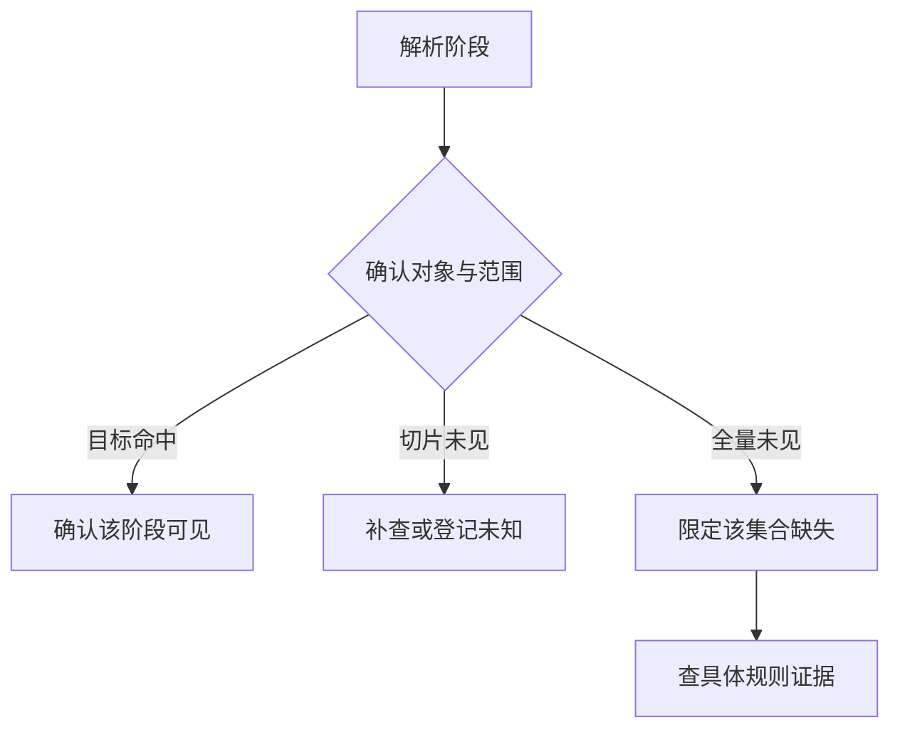
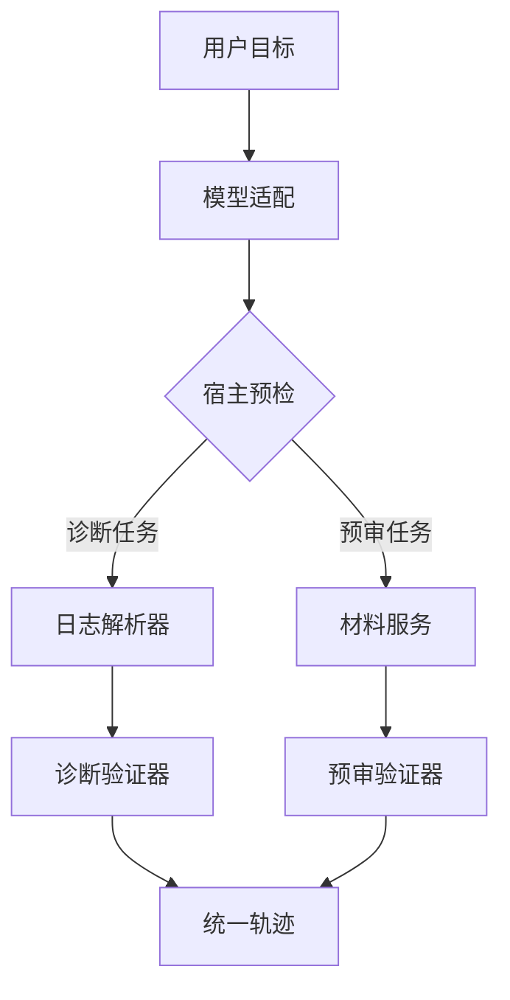
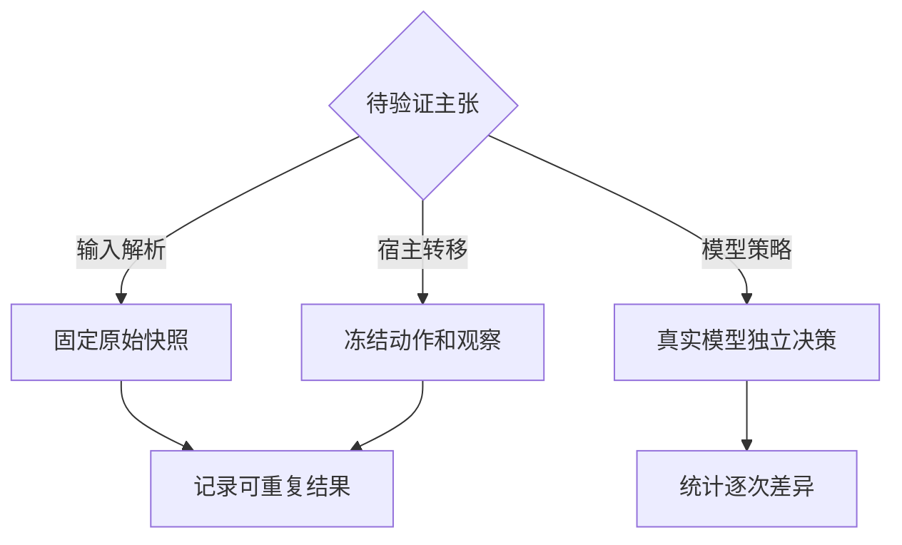
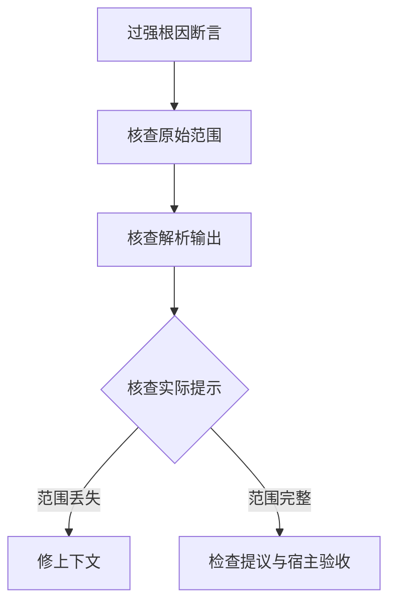

# 第 8 章　设计一套可迁移的 Java Agent，并证明它真的完成了任务

本周读法：先连续阅读机制正文，再按需要进入下面七篇。每篇开头可以直接读案例与流程图，展开部分专门用于手算边界、追问或复算不同输入。场馆资料沿用公开快照，诊断和预审的故障输入为教学模拟。

- [一份 POI 快照支持多强的诊断](readings/01.md)
- [将运行时迁移到商户资料预审](readings/02.md)
- [排序切片能排除哪些名次](readings/03.md)（定量推演）
- [作品中的主张需要哪类试验证据](readings/04.md)
- [何时可以聚合多个相同症状](readings/05.md)
- [同一个诊断症状究竟有多少独立样本](readings/06.md)（定量推演）
- [不确定时应当补查还是交付中间结论](readings/07.md)

想象一次面试。你说做过一个会查开放时间、能解释原因的 Agent。面试官随后把场景换掉：“现在用户给你一条搜索故障记录，希望知道为什么没有出现目标地点。哪些代码能带走？”这个追问很适合有 Java 和检索背景的人。判断系统是否有通用性，不妨拿另一种证据、不一样的成功条件和更危险的副作用来检验它。

## 从一份可读的故障记录开始

下面是完全虚构的教学输入。假定系统已去掉任何用户与生产标识，`coverage` 明确声明记录方式。

**覆盖程度如何限制根因结论**




```json
{"run":"demo-42","target":"P7","transport":"OK","business":"SUCCESS",
 "stages":[
   {"name":"candidates","coverage":"COMPLETE","ids":["P3","P7","P9"]},
   {"name":"ranked","coverage":"TOP_2","ids":["P3","P9"]},
   {"name":"page_1","coverage":"COMPLETE_PAGE","ids":["P3","P9"]}]}
```

手工答一次。能够确认 P7 进入已完整记录的候选，未出现在记录的排序前两名，也未出现在第一页。能够直接断言它被过滤了吗？不能。一个与现有观察完全相容的解释是 P7 排在第三；另一个是它在排序前被过滤。现有证据不足以区分。好的诊断 Agent 要输出两种解释可共享的已知事实，并提出能区分解释的最小追加观察，例如完整排序输入、输出或可核验的过滤事件。若这种观察没有可用工具，任务应以“原因未确定”收束。

为程序写出知识状态会更精确。`PRESENT` 表示在记录中找到了目标；`ABSENT_FROM_COMPLETE_SET` 要求范围确实完整；`NOT_IN_VISIBLE_SLICE` 只说明这一页或前 k 项没出现；`UNOBSERVED` 表示根本没有该阶段观察。相同的 `ids.contains(target)==false`，在四种覆盖条件下不能返回同一个业务结论。这里决定质量的是工具契约和证据推理，换更大模型无法补出未记录的第三名。

## 从诊断器切出可复用运行时

先让一个普通 Java 解析器返回 `StageObservation(stage, target, coverage, membership, locator)`，其中 locator 指向本次输入中的一段可定位数据。再把“查某阶段、比较输入输出、提交候选结论”暴露成工具。运行时负责分派、预算、调用关联、取消和事件记录。诊断领域的验证器负责核对“被过滤”“排序下降”等命题所需的证据条件。把它迁移到商户领域时，观察变成材料版本与集合，验证器改为材料差集和写权限，运行时仍可复用。

**可迁移的宿主与两个领域适配器**




若接口写成 `String run(String question)`，所有模块都只能靠解析中文确认发生了什么。一个更实用的分界是用 Java 的封闭类型约束决策可能性，如 ToolCall、RequestClarification、ProposeAnswer；用受限枚举表示终态，如完成、待补条件、资料不足、拒绝、超限。面向用户的文字在状态确定后生成。类型不能代替所有语义校验，它的价值在于使调用者难以把“没观察到”和“证据确认不存在”写成同一个分支。实现方式可用 record 和 sealed interface，不必先搭一套重量级框架。

对比一下普通 Spring Service。事务和权限应该留在离数据最近的业务服务中；模型只提交提议。利用已有的指标、链路跟踪、异常分类与隔离，保留后端工程成熟之处。变化最大的是输入不是完全确定的：模型调用策略会随措辞、可用工具与观察变化，因此宿主要能够拒绝、追问、降级和回放。这正是面试时能把以往经验讲成 Agent 工程能力的交点。

## 三种“复现”究竟能证明什么

固定同一份输入并运行 Java 解析器，能验证结构化观察是否稳定。固定一组模型提议和工具观察并回放，能验证宿主转移、授权和终态。重新请求真实模型，则在重新抽样，才能检验它会不会自主选择下一观察。若外部数据也变了，这次试验同时改变两个变量。将资料快照、提示版本、工具清单、模型标识、输入、代码提交和时间条件写进实验记录，可以指出究竟冻结了哪几项。无法钉住供应商模型内部版本时，保留公开标识和运行时间，不声称完全确定性复现。

**真实重跑、解析回放和动作回放分别验证什么**




| 想证明的主张 | 最小证据 | 强行扩大后会错在哪里 |
| --- | --- | --- |
| 截断日志不会被断言为完整缺失 | 固定输入，断言解析结果与终态 | 无法证明所有模型都会提出正确工具 |
| 模型能按新观察补查 | 真实模型在可区分的观察变式下产生不同动作 | 不能用两个手写脚本替代 |
| 两套架构在目标负载下有时延差异 | 同输入分布、资源约束与正确性口径下的测量 | 一条演示时延不能代表尾部或容量 |
| 草稿重试没有生成第二条 | 读回业务键、实际草稿数与内容，并发及恢复分开测 | 单进程成功无法保证跨库写入只发生一次 |

这也是如何挑选面试材料的标准。把能由仓库复跑的事实、你需要自己接模型测量的效果、只在设计里考虑过的扩展分开放进叙述。面试官通常会追问“证据在哪里”“换一个失败输入还成立吗”“当时为什么选这个方案”；有了这张映射，就不用靠熟练背诵来覆盖空白。

## 用一次失败讲清因果，而非事后编故事

假设旧版报告写“目标在重排阶段被删掉”。从用户可见的错误逆向查四处：原始记录是否含完整重排输入；解析器是否把 TOP_2 标为有限切片；模型第二轮实际收到的观察是否保留这个标记；验证器是否允许在范围不完整时提交“删除”。若解析器已正确标注，而摘要省略了覆盖范围，根因在上下文组装。修复是强制让覆盖范围与事实绑定，并补一个会触发相同压缩逻辑的回归例。若输入已含范围，模型仍输出过强断言，宿主就应增加领域前提验证。仅靠“换了提示后这次答对”不足以确认两种故障中的哪一种发生过。

**把错因从摘要还原到最早分歧**




一个更强的实验是做反事实替换：保留同一调用与同一提议，单独把证据从 TOP_2 换成 COMPLETE，观察宿主是否改变相应命题的可接受范围。即使完整输出缺目标，也只能说明它未出现在该阶段的完整输出，若要认定具体过滤规则，还需明确的输入、输出及规则证据。允许系统说“已定位到两个可观察阶段之间，具体原因未确定”，能用较少假设交付有用的中间结论。

## 一次八分钟技术面试该怎样展开

首分钟给出输入和成功条件，让面试官知道要判断哪句话。接着用两分钟展示一条正常轨迹，指出模型决策、宿主权限与业务工具的执行点。然后用两分钟换上有限切片或工具超时，让对方看见首次分歧、验证器的反应和交付边界。再用两分钟讲同条件对照：固定工作流哪些题已经足够，哪些题确实需要根据观察改道。最后一分钟交代数据与流量适用范围。每说一个数字，都应该能回到一次运行或明确标注的算例。

可以先这样口述一个设计结论：“我把搜索阶段解析留在 Java，因为检查成员关系与记录覆盖范围是确定的；把选择下一步放给模型，因为字段缺失与用户意图会改变需要核查的阶段；把是否允许发布根因结论留在宿主，因为强结论有明确证据前提。”如果这只是你读完后形成的方案，就用“我会这样设计”；完成过相应实验时，再带上运行记录说“我验证过”。这样既能利用原有领域知识，也能准确说明新增的 Agent 能力。

## 为诊断 Agent 设计一个真正可以推翻的上线前实验

先冻结一组可公开的模拟轨迹。让其中一半包含完整阶段，另一半只含截断列表或缺失阶段。再交叉变化“目标存在、目标不在完整集合、传输失败、业务成功但空”。每题写两列答案：能证明的最强命题，以及绝对不应作出的推断。这样当系统把“无从判断根因”说清楚，也能在正确的题上获得正向评价。反过来，若每道题都答“不知道”，在信息充分题上必须失败。

用确定性程序解析字段并建立基线。给确定性流程和模型驱动的策略相同的输入、动作集合与预算，用同一规则判定是否过度归因、是否完成用户目标。假设完整记录的题上两者相同，缺阶段题上 Agent 更常提对补查动作，下一步仍应问“是否真的新增了决定性观察”。如果工具根本不具备获取完整阶段的能力，多问几次不代表任务变好了。可以增加一组只改变工具可用性的配对题：一份可以继续取全量，另一份只能交付部分结论。一个可靠的系统应随可获得的信息改变停止策略。

面试时可以把这个实验讲成三段。第一段给出旧方法在哪个输入条件下必然失去信息，面试官可以当场指出反例。第二段指出你新增的最小能力，例如输入带覆盖范围、按证据 ID 回查或在宿主禁止超范围结论。第三段用同题和新题说明影响及未覆盖范围。避免说“上了 Agent 就更智能”，改为“在可补证且初始记录不完整的任务族里，选择下一步可能受益；若资料完全不可补，系统应更准确地表达未知”。这个说法可以用观测来证实或推翻，也明确了什么实验最值得继续做。

## 一次面试现场的白板追问

面试官可能把原题再改一次：“现在收到多个人反馈同一个地点，能否自动判断是共性问题？”用同一诊断运行时处理每个 case，按请求保留证据范围、最早可观察分歧和不确定项，然后再做跨 case 聚合。十份反馈都不见 P7，可能来自同一条截断日志被复制，也可能是十个独立请求在同一规则前后出现相同变化。若没有请求标识、版本、样本去重与独立证据，数量增加并不能把“暂未定位”自动提升为“已确定共性原因”。

一种可检验的聚合输出是“在去重后的 N 个请求中，K 个有完整输入与输出，均观察到同一阶段变化；其余因范围不全单列”。这类证据可以支持值得进一步调查的模式，若要声称某个代码改动造成问题，还需版本对照或有针对性的反事实试验。把模型用于提出分组假设，再由程序核对组内版本、字段和证据，是将自动化诊断与传统后端开发结合起来的一种方式。面试时可以直接用这一题证明你知道“候选解释”和“已证实根因”之间需要哪种额外证据。

## 面试推演：你是不是只给老系统套了一层聊天框

先给出能检验这个质疑的对照。固定脚本按“解析所有阶段、套规则、输出报告”走；Agent 使用相同解析器与证据，按观察决定要补查哪项或何时停止。对完整样本，两者可能同样正确，确定性路径甚至更快。对缺阶段、只给一页、用户后来更换目标对象等样本，再看动态策略是否减少过强断言、无用读取或不必要追问，同时把新增模型轮数计入成本。若这些指标都未改善，保留工具和规则即可。能够说明这层模型何时值得保留、何时可以删除，才是一个可证伪的架构主张。

[配套实验](lab.md) · [按天练习](daily.md) · [下一篇](../week-09/theory.md) · [返回文章目录](../../README.md)
