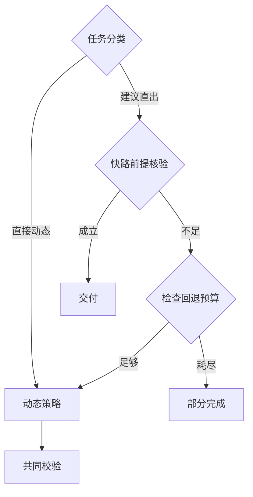

# 第 9 周 · 实践讲义｜为时延敏感的搜索请求选择 Agent 架构

**本周实验的流程参照：快路径无法履约时怎样有界回退**



将实际执行记录与图中边界对齐；图所描述的是课程契约，尚未运行的依赖和分支不能据此标成已验证。


## 不用模型密钥，先验算三条控制路径

```powershell
java examples/architecture/ArchitectureLab.java compare healthy
java examples/architecture/ArchitectureLab.java first healthy
java examples/architecture/ArchitectureLab.java compare timeout
```

[可运行的调度例题](../../examples/architecture/ArchitectureLab.java)使用虚构 A/B 和固定耗时，不调用真实模型。fixed 对两项并行读取，step 以脚本模拟每轮观察后再决定，plan 模拟先计划、并发执行、再汇总。第一题三者都要比较两项，预计 virtualMs 依次为 120、1700、1120。第二题只需第一个可用结果，step 在观察 A 后可以省下一次工具读取。第三题 A 超时，即使 B 返回也不能宣称两者已完成比较。读 events 顺序，修改 first 的固定策略也允许早停，观察之前的优势是否来自策略编写方式。这里的 virtualMs 是按依赖关系累加的教学模型；实测端到端延迟需换真实时钟、执行器和决策源。

## 把路由画成可失败的决定表

以固定、动态、计划三种策略实现同一个 `run(request, deadline, tools)`。为“已知 ID 的时段”加入快路径，同时输入反例“同一 ID 有实时余座吗”。两题文本很像，后者不能以常规开放表结案。记录策略进入、前提检查、回退、首事实、终态五个时间戳。把一次误路由及其回退成本包含在整条请求的统计中。随后禁用回退，验证正确性判分器能识别差别。

在实验报告中加一行“什么观察会推翻我的选择”。例如若动态策略在完整字段题仍经常要求澄清，它的任务完成率和时间可能同时较差；若固定策略在信息缺口题仍能可靠追问，增加模型决策未必有收益。

## 老师先给路由器做反例测试

共享输入“花园街自修室在哪个区”和“花园街这个地址周日七点还能自修吗”。两题都可能命中同一实体；只有第一题的所求字段能由名录直接满足。最小规则依次检查实体唯一性、所求字段集合、资料适用性；三项都满足才直出。若第二题只因出现‘地址’就走快路径，额外速度来自少做了必须的验证。

为每条路由记录原因、已解析地点、剩余时限与回退目的地。关掉路由做一次同题比较，确认省掉的是哪次模型或工具调用，同时核验回答是否等价。用反例防住错误直出后，再讨论快路径命中率。

## 目标与公共边界

把当前 CLI 的核心逻辑提成一个统一请求入口，给 `fixed`、`react`、`plan` 各一个策略。输入、候选、证据版本、模型、工具上限（每题 3 次）和最终输出约束保持一致。每个策略可以用不同数量的模型调用，但记录实际数量和相同的请求总截止时间。基础版比较三者，再实现简单规则路由。双子 Agent 作为扩展。

## 上机步骤（8 小时）

1. **1.5 小时，确立对照。** 用上周已知开发题分四桶：明确字段、附时间条件、两馆比较、歧义或缺资料。每桶至少一题。接口输入含查询、策略及请求 ID，内部使用同一服务入口。所有策略输出可核验事实、来源和完成状态。
2. **2.5 小时，实现三条路径。** 固定流程沿用第 2 周；动态循环沿用第 3 周；计划执行沿用第 7 周。给计划写校验：任务依赖成立、同馆查证去重、部分失败可单独报告。先给证据读取注入固定延迟看执行顺序，再用真实模型测，不混合两批数据。
3. **2 小时，增加按请求路由。** 起步规则只接受“唯一分馆 + 已知单字段”；其余进入动态或计划路径。拿“地址在哪里”和“这个地址附近周日开放吗”作对照，检查是否因为命中“地址”误走快路径。为两馆并行设置最多两个分支，给尚未开始的慢任务传递剩余时限。
4. **2 小时，输出架构决策表。** 保存相同输入在三种策略下的调用顺序、各阶段时长与引用。再让路由方案进入端到端对比。对一次误路由、超时或无收益的规划写出证据，选择第 10 周压测的基线与候选。

| 查询桶 | 基线与候选 | 要回答的工程问题 |
| --- | --- | --- |
| 已知字段 | 每题运行模型 vs 基于唯一编号的直接回复 | 能省多少推理？模糊地名会否被错误直出？ |
| 周末时段 | 固定取证 vs 动态查证 | 两者都能访问正确证据时，多一轮模型是否改善答案？ |
| 两馆比较 | 顺序、并行工具、计划后并行 | 性能差异来自并行还是来自规划？单项失败时能否保留已证实信息？ |
| 歧义/缺证 | 追问、标注未知或部分结果 | 最快的响应有没有把缺失误报成不开放？ |

## 为第 10 周留出观测接口

最小 HTTP 接口约定为 `POST /search`，接受 `query`、`strategy` 和 `stream:true`。可用 JDK 自带 HTTP 服务或已有 Spring Boot 服务。以 `text/event-stream` 回传每个核实后的 `fact` 和终态 `done`，每条事件后刷新缓冲。事件之间留空行。例如地区题可以输出以下训练协议，证据 ID 由课程约定，实际展示层应能把它解析回公开来源。

```text
event: fact
data: {"room_id":"E06","field":"district","value":"油尖旺","evidence_ids":["registry:E06"]}

event: done
data: {"status":"complete"}

```

**验收。** 同一开发查询可切换三种策略；工具查询失败时对应事实保留未知；路由方案的命中、回退和误路由分开计数；提供一张“哪类请求采用哪条路径、以什么条件回退”的决策表。若时间紧，先完成三策略和单请求 trace，用上述 HTTP 适配器作为第 10 周第一步。

[本周理论讲义](./theory.md) · [本周每日课程](./daily.md) · [课程总目录](../../README.md)
