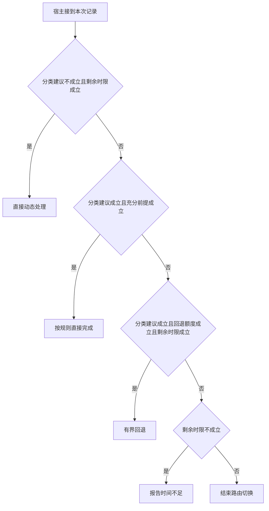

# 路由建议和快路径验收

分类器为节约模型往返建议直出，快路径仍须自行验证字段和日期前提。
失败时把已取观察交给动态路径并继承剩余预算，不能获得新的完整时限。

本篇用一个封闭的教学决策器说明这一问题。输入是宿主收到的记录，不保证每个下游字段都已经获准使用。前置检查未成立时，下游即使带着缓存值，也不能拿来作业务断言。

## 先解决一个具体问题

**如果规则和路由模型对同一输入意见不同，谁能决定直出？**

路由可以建议一条路径，承担交付的快路径仍要证明前提成立。
若不能完整核验就有限回退，并让总请求承担已经花掉的路由和读取时间。


先取一个能走到「结束路由切换」的输入：分类器建议走快路、快速规则不能完整回答、本请求已用完回退机会、截止前仍能完成下一动作。
把这四个条件代回后文的图，前面各个拦截分支都未满足，最终才有“当前不具备直出和回退条件”这个判断。
还原这个现场时要分别问：哪些位来自可信状态，哪些只是在接口中出现、尚未获得解释资格的字段。

## 先沿一次决策走到底



从上到下取第一条成立的出口。只改一个开关时，只有它之前的检查都未截断，该变化才可能到达真实动作。

“分类建议”的两种输入分别是“分类器建议走快路”与“分类器建议动态处理”。
路由建议不能绕过独立验收。

“充分前提”的两种输入分别是“快速规则的充分条件成立”与“快速规则不能完整回答”。
直出路径必须能在本地证明自己适用。

“回退额度”的两种输入分别是“尚可进入一次备用路径”与“本请求已用完回退机会”。
路径间切换也要限制次数。

“剩余时限”的两种输入分别是“截止前仍能完成下一动作”与“剩余时限不足”。
总时间应包含排队、动作和结果交付。

## 最少需要哪几项观察

### 直接动态处理

分类建议与剩余时限允许继续查证。
在本节的全部组合中，有 4 种产生「直接动态处理」，这只是逻辑空间的计数，不能当作实际用户请求的比例。

只取得分类器建议动态处理、截止前仍能完成下一动作，已经足以要求宿主「直接动态处理」。
保持这些已知项，其余开关自由变化，仍有 4 种补全，判断没有翻转。

若删掉关于分类建议的证据，另一份允许的现场是分类器建议走快路、快速规则不能完整回答、本请求已用完回退机会、截止前仍能完成下一动作，它会使宿主「结束路由切换」。

若删掉关于剩余时限的证据，另一份允许的现场是分类器建议动态处理、快速规则不能完整回答、本请求已用完回退机会、剩余时限不足，它会使宿主「报告时间不足」。

### 按规则直接完成

快路径已验证充分前提。
在本节的全部组合中，有 4 种产生「按规则直接完成」，这只是逻辑空间的计数，不能当作实际用户请求的比例。

只取得分类器建议走快路、快速规则的充分条件成立，已经足以要求宿主「按规则直接完成」。

若删掉关于分类建议的证据，另一份允许的现场是分类器建议动态处理、快速规则的充分条件成立、本请求已用完回退机会、剩余时限不足，它会使宿主「报告时间不足」。

若删掉关于充分前提的证据，另一份允许的现场是分类器建议走快路、快速规则不能完整回答、本请求已用完回退机会、剩余时限不足，它会使宿主「报告时间不足」。

### 有界回退

直出前提不足而备用路径仍可用。
在本节的全部组合中，有 1 种产生「有界回退」，这只是逻辑空间的计数，不能当作实际用户请求的比例。

只取得分类器建议走快路、快速规则不能完整回答、尚可进入一次备用路径、截止前仍能完成下一动作，已经足以要求宿主「有界回退」。
保持这些已知项，其余开关自由变化，仍有 1 种补全，判断没有翻转。

若删掉关于分类建议的证据，另一份允许的现场是分类器建议动态处理、快速规则不能完整回答、尚可进入一次备用路径、截止前仍能完成下一动作，它会使宿主「直接动态处理」。

若删掉关于充分前提的证据，另一份允许的现场是分类器建议走快路、快速规则的充分条件成立、尚可进入一次备用路径、截止前仍能完成下一动作，它会使宿主「按规则直接完成」。

若删掉关于回退额度的证据，另一份允许的现场是分类器建议走快路、快速规则不能完整回答、本请求已用完回退机会、截止前仍能完成下一动作，它会使宿主「结束路由切换」。

若删掉关于剩余时限的证据，另一份允许的现场是分类器建议走快路、快速规则不能完整回答、尚可进入一次备用路径、剩余时限不足，它会使宿主「报告时间不足」。

### 报告时间不足

没有时限继续补查。
在本节的全部组合中，有 6 种产生「报告时间不足」，这只是逻辑空间的计数，不能当作实际用户请求的比例。

只取得分类器建议动态处理、剩余时限不足，已经足以要求宿主「报告时间不足」。

若删掉关于分类建议的证据，另一份允许的现场是分类器建议走快路、快速规则的充分条件成立、本请求已用完回退机会、剩余时限不足，它会使宿主「按规则直接完成」。

若删掉关于剩余时限的证据，另一份允许的现场是分类器建议动态处理、快速规则不能完整回答、本请求已用完回退机会、截止前仍能完成下一动作，它会使宿主「直接动态处理」。

只取得快速规则不能完整回答、剩余时限不足，已经足以要求宿主「报告时间不足」。

若删掉关于充分前提的证据，另一份允许的现场是分类器建议走快路、快速规则的充分条件成立、本请求已用完回退机会、剩余时限不足，它会使宿主「按规则直接完成」。


### 结束路由切换

当前不具备直出和回退条件。
在本节的全部组合中，有 1 种产生「结束路由切换」，这只是逻辑空间的计数，不能当作实际用户请求的比例。

只取得分类器建议走快路、快速规则不能完整回答、本请求已用完回退机会、截止前仍能完成下一动作，已经足以要求宿主「结束路由切换」。

若删掉关于分类建议的证据，另一份允许的现场是分类器建议动态处理、快速规则不能完整回答、本请求已用完回退机会、截止前仍能完成下一动作，它会使宿主「直接动态处理」。

若删掉关于充分前提的证据，另一份允许的现场是分类器建议走快路、快速规则的充分条件成立、本请求已用完回退机会、截止前仍能完成下一动作，它会使宿主「按规则直接完成」。

若删掉关于回退额度的证据，另一份允许的现场是分类器建议走快路、快速规则不能完整回答、尚可进入一次备用路径、截止前仍能完成下一动作，它会使宿主「有界回退」。

若删掉关于剩余时限的证据，另一份允许的现场是分类器建议走快路、快速规则不能完整回答、本请求已用完回退机会、剩余时限不足，它会使宿主「报告时间不足」。

## 以同一份契约解释截然不同的现场

<details>
<summary>展开推演与对应反例</summary>

下列样本按最先命中的业务分支排列。四位编码只作本篇页内定位，顺序与开头的四项输入一致。可以先猜下一动作，再展开相邻样本。

### 能够触发“直接动态处理”的现场

**样本 0001**

业务侧交来分类器建议动态处理、快速规则不能完整回答，执行侧还记录了本请求已用完回退机会、截止前仍能完成下一动作。
把样本压成最短证明，保留分类器建议动态处理、截止前仍能完成下一动作就能支持「直接动态处理」。

在这份记录上，分别翻转「分类建议」、「剩余时限」中的任一项，其他项完全不变时，下一动作都会改变。

保持其余观察不动，单独切换「充分前提」、「回退额度」仍得到「直接动态处理」，它们在这个现场不是决定性变量。

要从本例改走「报告时间不足」，至少需要变动 1 项，一组最少改动是将截止前仍能完成下一动作换成剩余时限不足。

要从本例改走「结束路由切换」，至少需要变动 1 项，一组最少改动是将分类器建议动态处理换成分类器建议走快路。

要从本例改走「有界回退」，至少需要变动 2 项，一组最少改动是将分类器建议动态处理、本请求已用完回退机会换成分类器建议走快路、尚可进入一次备用路径。

要从本例改走「按规则直接完成」，至少需要变动 2 项，一组最少改动是将分类器建议动态处理、快速规则不能完整回答换成分类器建议走快路、快速规则的充分条件成立。

**样本 0011**

业务侧交来分类器建议动态处理、快速规则不能完整回答，执行侧还记录了尚可进入一次备用路径、截止前仍能完成下一动作。


要从本例改走「有界回退」，至少需要变动 1 项，一组最少改动是将分类器建议动态处理换成分类器建议走快路。

要从本例改走「结束路由切换」，至少需要变动 2 项，一组最少改动是将分类器建议动态处理、尚可进入一次备用路径换成分类器建议走快路、本请求已用完回退机会。


**样本 0101**

业务侧交来分类器建议动态处理、快速规则的充分条件成立，执行侧还记录了本请求已用完回退机会、截止前仍能完成下一动作。


要从本例改走「按规则直接完成」，至少需要变动 1 项，一组最少改动是将分类器建议动态处理换成分类器建议走快路。

要从本例改走「结束路由切换」，至少需要变动 2 项，一组最少改动是将分类器建议动态处理、快速规则的充分条件成立换成分类器建议走快路、快速规则不能完整回答。

要从本例改走「有界回退」，至少需要变动 3 项，一组最少改动是将分类器建议动态处理、快速规则的充分条件成立、本请求已用完回退机会换成分类器建议走快路、快速规则不能完整回答、尚可进入一次备用路径。

**样本 0111**

业务侧交来分类器建议动态处理、快速规则的充分条件成立，执行侧还记录了尚可进入一次备用路径、截止前仍能完成下一动作。


要从本例改走「有界回退」，至少需要变动 2 项，一组最少改动是将分类器建议动态处理、快速规则的充分条件成立换成分类器建议走快路、快速规则不能完整回答。

要从本例改走「结束路由切换」，至少需要变动 3 项，一组最少改动是将分类器建议动态处理、快速规则的充分条件成立、尚可进入一次备用路径换成分类器建议走快路、快速规则不能完整回答、本请求已用完回退机会。

### 能够触发“按规则直接完成”的现场

**样本 1100**

业务侧交来分类器建议走快路、快速规则的充分条件成立，执行侧还记录了本请求已用完回退机会、剩余时限不足。
把样本压成最短证明，保留分类器建议走快路、快速规则的充分条件成立就能支持「按规则直接完成」。

在这份记录上，分别翻转「分类建议」、「充分前提」中的任一项，其他项完全不变时，下一动作都会改变。

保持其余观察不动，单独切换「回退额度」、「剩余时限」仍得到「按规则直接完成」，它们在这个现场不是决定性变量。

本例没走更靠前的「直接动态处理」，因为分类器建议走快路、剩余时限不足与那个入口的必要条件不符。

要从本例改走「报告时间不足」，至少需要变动 1 项，一组最少改动是将分类器建议走快路换成分类器建议动态处理。

要从本例改走「直接动态处理」，至少需要变动 2 项，一组最少改动是将分类器建议走快路、剩余时限不足换成分类器建议动态处理、截止前仍能完成下一动作。

要从本例改走「结束路由切换」，至少需要变动 2 项，一组最少改动是将快速规则的充分条件成立、剩余时限不足换成快速规则不能完整回答、截止前仍能完成下一动作。

要从本例改走「有界回退」，至少需要变动 3 项，一组最少改动是将快速规则的充分条件成立、本请求已用完回退机会、剩余时限不足换成快速规则不能完整回答、尚可进入一次备用路径、截止前仍能完成下一动作。

**样本 1101**

业务侧交来分类器建议走快路、快速规则的充分条件成立，执行侧还记录了本请求已用完回退机会、截止前仍能完成下一动作。


本例没走更靠前的「直接动态处理」，因为分类器建议走快路与那个入口的必要条件不符。

要从本例改走「直接动态处理」，至少需要变动 1 项，一组最少改动是将分类器建议走快路换成分类器建议动态处理。

要从本例改走「结束路由切换」，至少需要变动 1 项，一组最少改动是将快速规则的充分条件成立换成快速规则不能完整回答。

要从本例改走「报告时间不足」，至少需要变动 2 项，一组最少改动是将分类器建议走快路、截止前仍能完成下一动作换成分类器建议动态处理、剩余时限不足。

要从本例改走「有界回退」，至少需要变动 2 项，一组最少改动是将快速规则的充分条件成立、本请求已用完回退机会换成快速规则不能完整回答、尚可进入一次备用路径。

**样本 1110**

业务侧交来分类器建议走快路、快速规则的充分条件成立，执行侧还记录了尚可进入一次备用路径、剩余时限不足。


要从本例改走「有界回退」，至少需要变动 2 项，一组最少改动是将快速规则的充分条件成立、剩余时限不足换成快速规则不能完整回答、截止前仍能完成下一动作。

要从本例改走「结束路由切换」，至少需要变动 3 项，一组最少改动是将快速规则的充分条件成立、尚可进入一次备用路径、剩余时限不足换成快速规则不能完整回答、本请求已用完回退机会、截止前仍能完成下一动作。

**样本 1111**

业务侧交来分类器建议走快路、快速规则的充分条件成立，执行侧还记录了尚可进入一次备用路径、截止前仍能完成下一动作。


要从本例改走「有界回退」，至少需要变动 1 项，一组最少改动是将快速规则的充分条件成立换成快速规则不能完整回答。


要从本例改走「结束路由切换」，至少需要变动 2 项，一组最少改动是将快速规则的充分条件成立、尚可进入一次备用路径换成快速规则不能完整回答、本请求已用完回退机会。

### 能够触发“有界回退”的现场

**样本 1011**

业务侧交来分类器建议走快路、快速规则不能完整回答，执行侧还记录了尚可进入一次备用路径、截止前仍能完成下一动作。
把样本压成最短证明，保留分类器建议走快路、快速规则不能完整回答、尚可进入一次备用路径、截止前仍能完成下一动作就能支持「有界回退」。

在这份记录上，分别翻转「分类建议」、「充分前提」、「回退额度」、「剩余时限」中的任一项，其他项完全不变时，下一动作都会改变。


本例没走更靠前的「按规则直接完成」，因为快速规则不能完整回答与那个入口的必要条件不符。


要从本例改走「结束路由切换」，至少需要变动 1 项，一组最少改动是将尚可进入一次备用路径换成本请求已用完回退机会。


要从本例改走「按规则直接完成」，至少需要变动 1 项，一组最少改动是将快速规则不能完整回答换成快速规则的充分条件成立。

### 能够触发“报告时间不足”的现场

**样本 0000**

业务侧交来分类器建议动态处理、快速规则不能完整回答，执行侧还记录了本请求已用完回退机会、剩余时限不足。
把样本压成最短证明，保留分类器建议动态处理、剩余时限不足就能支持「报告时间不足」。

在这份记录上，分别翻转「剩余时限」中的任一项，其他项完全不变时，下一动作都会改变。

保持其余观察不动，单独切换「分类建议」、「充分前提」、「回退额度」仍得到「报告时间不足」，它们在这个现场不是决定性变量。

本例没走更靠前的「直接动态处理」，因为剩余时限不足与那个入口的必要条件不符。

本例没走更靠前的「按规则直接完成」，因为分类器建议动态处理、快速规则不能完整回答与那个入口的必要条件不符。

本例没走更靠前的「有界回退」，因为分类器建议动态处理、本请求已用完回退机会、剩余时限不足与那个入口的必要条件不符。

要从本例改走「直接动态处理」，至少需要变动 1 项，一组最少改动是将剩余时限不足换成截止前仍能完成下一动作。

要从本例改走「结束路由切换」，至少需要变动 2 项，一组最少改动是将分类器建议动态处理、剩余时限不足换成分类器建议走快路、截止前仍能完成下一动作。


要从本例改走「有界回退」，至少需要变动 3 项，一组最少改动是将分类器建议动态处理、本请求已用完回退机会、剩余时限不足换成分类器建议走快路、尚可进入一次备用路径、截止前仍能完成下一动作。

**样本 0010**

业务侧交来分类器建议动态处理、快速规则不能完整回答，执行侧还记录了尚可进入一次备用路径、剩余时限不足。


本例没走更靠前的「有界回退」，因为分类器建议动态处理、剩余时限不足与那个入口的必要条件不符。


要从本例改走「有界回退」，至少需要变动 2 项，一组最少改动是将分类器建议动态处理、剩余时限不足换成分类器建议走快路、截止前仍能完成下一动作。


要从本例改走「结束路由切换」，至少需要变动 3 项，一组最少改动是将分类器建议动态处理、尚可进入一次备用路径、剩余时限不足换成分类器建议走快路、本请求已用完回退机会、截止前仍能完成下一动作。

**样本 0100**

业务侧交来分类器建议动态处理、快速规则的充分条件成立，执行侧还记录了本请求已用完回退机会、剩余时限不足。


保持其余观察不动，单独切换「充分前提」、「回退额度」仍得到「报告时间不足」，它们在这个现场不是决定性变量。


本例没走更靠前的「按规则直接完成」，因为分类器建议动态处理与那个入口的必要条件不符。


要从本例改走「结束路由切换」，至少需要变动 3 项，一组最少改动是将分类器建议动态处理、快速规则的充分条件成立、剩余时限不足换成分类器建议走快路、快速规则不能完整回答、截止前仍能完成下一动作。

要从本例改走「有界回退」，至少需要变动 4 项，一组最少改动是将分类器建议动态处理、快速规则的充分条件成立、本请求已用完回退机会、剩余时限不足换成分类器建议走快路、快速规则不能完整回答、尚可进入一次备用路径、截止前仍能完成下一动作。

**样本 0110**

业务侧交来分类器建议动态处理、快速规则的充分条件成立，执行侧还记录了尚可进入一次备用路径、剩余时限不足。


要从本例改走「有界回退」，至少需要变动 3 项，一组最少改动是将分类器建议动态处理、快速规则的充分条件成立、剩余时限不足换成分类器建议走快路、快速规则不能完整回答、截止前仍能完成下一动作。

要从本例改走「结束路由切换」，至少需要变动 4 项，一组最少改动是将分类器建议动态处理、快速规则的充分条件成立、尚可进入一次备用路径、剩余时限不足换成分类器建议走快路、快速规则不能完整回答、本请求已用完回退机会、截止前仍能完成下一动作。

**样本 1000**

业务侧交来分类器建议走快路、快速规则不能完整回答，执行侧还记录了本请求已用完回退机会、剩余时限不足。
把样本压成最短证明，保留快速规则不能完整回答、剩余时限不足就能支持「报告时间不足」。

在这份记录上，分别翻转「充分前提」、「剩余时限」中的任一项，其他项完全不变时，下一动作都会改变。

保持其余观察不动，单独切换「分类建议」、「回退额度」仍得到「报告时间不足」，它们在这个现场不是决定性变量。


本例没走更靠前的「有界回退」，因为本请求已用完回退机会、剩余时限不足与那个入口的必要条件不符。

要从本例改走「结束路由切换」，至少需要变动 1 项，一组最少改动是将剩余时限不足换成截止前仍能完成下一动作。


要从本例改走「有界回退」，至少需要变动 2 项，一组最少改动是将本请求已用完回退机会、剩余时限不足换成尚可进入一次备用路径、截止前仍能完成下一动作。

**样本 1010**

业务侧交来分类器建议走快路、快速规则不能完整回答，执行侧还记录了尚可进入一次备用路径、剩余时限不足。


本例没走更靠前的「有界回退」，因为剩余时限不足与那个入口的必要条件不符。

要从本例改走「有界回退」，至少需要变动 1 项，一组最少改动是将剩余时限不足换成截止前仍能完成下一动作。


要从本例改走「结束路由切换」，至少需要变动 2 项，一组最少改动是将尚可进入一次备用路径、剩余时限不足换成本请求已用完回退机会、截止前仍能完成下一动作。

### 能够触发“结束路由切换”的现场

**样本 1001**

业务侧交来分类器建议走快路、快速规则不能完整回答，执行侧还记录了本请求已用完回退机会、截止前仍能完成下一动作。
把样本压成最短证明，保留分类器建议走快路、快速规则不能完整回答、本请求已用完回退机会、截止前仍能完成下一动作就能支持「结束路由切换」。


本例没走更靠前的「有界回退」，因为本请求已用完回退机会与那个入口的必要条件不符。

本例没走更靠前的「报告时间不足」，因为截止前仍能完成下一动作与那个入口的必要条件不符。


要从本例改走「有界回退」，至少需要变动 1 项，一组最少改动是将本请求已用完回退机会换成尚可进入一次备用路径。


</details>

## 当你只能看见一半记录

<details>
<summary>展开推演与对应反例</summary>

这次隐藏两个字段，保留另两个。对每个可见现场，检查四种合法补全是否同意。如仍有歧义，选择能使最坏剩余候选动作最少的字段继续查。并列时采用本篇字段顺序。

### 只保留分类建议与充分前提

已知分类器建议动态处理、快速规则不能完整回答时，四种补全的动作分布为直接动态处理（2 种）、报告时间不足（2 种）。

在分类器建议动态处理、快速规则不能完整回答这个现场补读「剩余时限」，最坏还剩 1 种动作，计算时只衡量歧义，尚未扣读取代价。
若补来的观察为“剩余时限不足”，范围缩成「报告时间不足」。若为“截止前仍能完成下一动作”，则保留「直接动态处理」。

区分不了的两条执行可以具体写成 0000 与 0001：它们共享已展示字段，却分别需要「报告时间不足」和「直接动态处理」。

已知分类器建议动态处理、快速规则的充分条件成立时，四种补全的动作分布为直接动态处理（2 种）、报告时间不足（2 种）。

在分类器建议动态处理、快速规则的充分条件成立这个现场补读「剩余时限」，最坏还剩 1 种动作，计算时只衡量歧义，尚未扣读取代价。

区分不了的两条执行可以具体写成 0100 与 0101：它们共享已展示字段，却分别需要「报告时间不足」和「直接动态处理」。

已知分类器建议走快路、快速规则不能完整回答时，四种补全的动作分布为有界回退（1 种）、报告时间不足（2 种）、结束路由切换（1 种）。

在分类器建议走快路、快速规则不能完整回答这个现场补读「回退额度」，最坏还剩 2 种动作，计算时只衡量歧义，尚未扣读取代价。
若补来的观察为“本请求已用完回退机会”，范围缩成「报告时间不足」、「结束路由切换」。若为“尚可进入一次备用路径”，则保留「报告时间不足」、「有界回退」。

区分不了的两条执行可以具体写成 1000 与 1001：它们共享已展示字段，却分别需要「报告时间不足」和「结束路由切换」。

已知分类器建议走快路、快速规则的充分条件成立时，四种补全的动作分布为按规则直接完成（4 种）。

就“按规则直接完成”这个动作而言，在分类器建议走快路、快速规则的充分条件成立的前提下，另外两项观察不会推翻它。

### 只保留分类建议与回退额度

已知分类器建议动态处理、本请求已用完回退机会时，四种补全的动作分布为直接动态处理（2 种）、报告时间不足（2 种）。

在分类器建议动态处理、本请求已用完回退机会这个现场补读「剩余时限」，最坏还剩 1 种动作，计算时只衡量歧义，尚未扣读取代价。


已知分类器建议动态处理、尚可进入一次备用路径时，四种补全的动作分布为直接动态处理（2 种）、报告时间不足（2 种）。

在分类器建议动态处理、尚可进入一次备用路径这个现场补读「剩余时限」，最坏还剩 1 种动作，计算时只衡量歧义，尚未扣读取代价。

区分不了的两条执行可以具体写成 0010 与 0011：它们共享已展示字段，却分别需要「报告时间不足」和「直接动态处理」。

已知分类器建议走快路、本请求已用完回退机会时，四种补全的动作分布为按规则直接完成（2 种）、报告时间不足（1 种）、结束路由切换（1 种）。

在分类器建议走快路、本请求已用完回退机会这个现场补读「充分前提」，最坏还剩 2 种动作，计算时只衡量歧义，尚未扣读取代价。
若补来的观察为“快速规则不能完整回答”，范围缩成「报告时间不足」、「结束路由切换」。若为“快速规则的充分条件成立”，则保留「按规则直接完成」。


已知分类器建议走快路、尚可进入一次备用路径时，四种补全的动作分布为按规则直接完成（2 种）、有界回退（1 种）、报告时间不足（1 种）。

在分类器建议走快路、尚可进入一次备用路径这个现场补读「充分前提」，最坏还剩 2 种动作，计算时只衡量歧义，尚未扣读取代价。
若补来的观察为“快速规则不能完整回答”，范围缩成「报告时间不足」、「有界回退」。若为“快速规则的充分条件成立”，则保留「按规则直接完成」。

区分不了的两条执行可以具体写成 1010 与 1011：它们共享已展示字段，却分别需要「报告时间不足」和「有界回退」。

### 只保留充分前提与回退额度

已知快速规则不能完整回答、本请求已用完回退机会时，四种补全的动作分布为直接动态处理（1 种）、报告时间不足（2 种）、结束路由切换（1 种）。

在快速规则不能完整回答、本请求已用完回退机会这个现场补读「分类建议」，最坏还剩 2 种动作，计算时只衡量歧义，尚未扣读取代价。
若补来的观察为“分类器建议动态处理”，范围缩成「报告时间不足」、「直接动态处理」。若为“分类器建议走快路”，则保留「报告时间不足」、「结束路由切换」。


已知快速规则不能完整回答、尚可进入一次备用路径时，四种补全的动作分布为直接动态处理（1 种）、有界回退（1 种）、报告时间不足（2 种）。

在快速规则不能完整回答、尚可进入一次备用路径这个现场补读「分类建议」，最坏还剩 2 种动作，计算时只衡量歧义，尚未扣读取代价。
若补来的观察为“分类器建议动态处理”，范围缩成「报告时间不足」、「直接动态处理」。若为“分类器建议走快路”，则保留「报告时间不足」、「有界回退」。


已知快速规则的充分条件成立、本请求已用完回退机会时，四种补全的动作分布为直接动态处理（1 种）、按规则直接完成（2 种）、报告时间不足（1 种）。

在快速规则的充分条件成立、本请求已用完回退机会这个现场补读「分类建议」，最坏还剩 2 种动作，计算时只衡量歧义，尚未扣读取代价。
若补来的观察为“分类器建议动态处理”，范围缩成「报告时间不足」、「直接动态处理」。若为“分类器建议走快路”，则保留「按规则直接完成」。


已知快速规则的充分条件成立、尚可进入一次备用路径时，四种补全的动作分布为直接动态处理（1 种）、按规则直接完成（2 种）、报告时间不足（1 种）。

在快速规则的充分条件成立、尚可进入一次备用路径这个现场补读「分类建议」，最坏还剩 2 种动作，计算时只衡量歧义，尚未扣读取代价。

区分不了的两条执行可以具体写成 0110 与 0111：它们共享已展示字段，却分别需要「报告时间不足」和「直接动态处理」。

### 只保留分类建议与剩余时限

已知分类器建议动态处理、剩余时限不足时，四种补全的动作分布为报告时间不足（4 种）。

就“报告时间不足”这个动作而言，在分类器建议动态处理、剩余时限不足的前提下，另外两项观察不会推翻它。

已知分类器建议动态处理、截止前仍能完成下一动作时，四种补全的动作分布为直接动态处理（4 种）。

就“直接动态处理”这个动作而言，在分类器建议动态处理、截止前仍能完成下一动作的前提下，另外两项观察不会推翻它。

已知分类器建议走快路、剩余时限不足时，四种补全的动作分布为按规则直接完成（2 种）、报告时间不足（2 种）。

在分类器建议走快路、剩余时限不足这个现场补读「充分前提」，最坏还剩 1 种动作，计算时只衡量歧义，尚未扣读取代价。
若补来的观察为“快速规则不能完整回答”，范围缩成「报告时间不足」。若为“快速规则的充分条件成立”，则保留「按规则直接完成」。

区分不了的两条执行可以具体写成 1000 与 1100：它们共享已展示字段，却分别需要「报告时间不足」和「按规则直接完成」。

已知分类器建议走快路、截止前仍能完成下一动作时，四种补全的动作分布为按规则直接完成（2 种）、有界回退（1 种）、结束路由切换（1 种）。

在分类器建议走快路、截止前仍能完成下一动作这个现场补读「充分前提」，最坏还剩 2 种动作，计算时只衡量歧义，尚未扣读取代价。
若补来的观察为“快速规则不能完整回答”，范围缩成「结束路由切换」、「有界回退」。若为“快速规则的充分条件成立”，则保留「按规则直接完成」。

区分不了的两条执行可以具体写成 1001 与 1011：它们共享已展示字段，却分别需要「结束路由切换」和「有界回退」。

### 只保留充分前提与剩余时限

已知快速规则不能完整回答、剩余时限不足时，四种补全的动作分布为报告时间不足（4 种）。

就“报告时间不足”这个动作而言，在快速规则不能完整回答、剩余时限不足的前提下，另外两项观察不会推翻它。

已知快速规则不能完整回答、截止前仍能完成下一动作时，四种补全的动作分布为直接动态处理（2 种）、有界回退（1 种）、结束路由切换（1 种）。

在快速规则不能完整回答、截止前仍能完成下一动作这个现场补读「分类建议」，最坏还剩 2 种动作，计算时只衡量歧义，尚未扣读取代价。
若补来的观察为“分类器建议动态处理”，范围缩成「直接动态处理」。若为“分类器建议走快路”，则保留「结束路由切换」、「有界回退」。

区分不了的两条执行可以具体写成 0001 与 1001：它们共享已展示字段，却分别需要「直接动态处理」和「结束路由切换」。

已知快速规则的充分条件成立、剩余时限不足时，四种补全的动作分布为按规则直接完成（2 种）、报告时间不足（2 种）。

在快速规则的充分条件成立、剩余时限不足这个现场补读「分类建议」，最坏还剩 1 种动作，计算时只衡量歧义，尚未扣读取代价。
若补来的观察为“分类器建议动态处理”，范围缩成「报告时间不足」。若为“分类器建议走快路”，则保留「按规则直接完成」。

区分不了的两条执行可以具体写成 0100 与 1100：它们共享已展示字段，却分别需要「报告时间不足」和「按规则直接完成」。

已知快速规则的充分条件成立、截止前仍能完成下一动作时，四种补全的动作分布为直接动态处理（2 种）、按规则直接完成（2 种）。

在快速规则的充分条件成立、截止前仍能完成下一动作这个现场补读「分类建议」，最坏还剩 1 种动作，计算时只衡量歧义，尚未扣读取代价。
若补来的观察为“分类器建议动态处理”，范围缩成「直接动态处理」。若为“分类器建议走快路”，则保留「按规则直接完成」。

区分不了的两条执行可以具体写成 0101 与 1101：它们共享已展示字段，却分别需要「直接动态处理」和「按规则直接完成」。

### 只保留回退额度与剩余时限

已知本请求已用完回退机会、剩余时限不足时，四种补全的动作分布为按规则直接完成（1 种）、报告时间不足（3 种）。

在本请求已用完回退机会、剩余时限不足这个现场补读「分类建议」，最坏还剩 2 种动作，计算时只衡量歧义，尚未扣读取代价。
若补来的观察为“分类器建议动态处理”，范围缩成「报告时间不足」。若为“分类器建议走快路”，则保留「报告时间不足」、「按规则直接完成」。

区分不了的两条执行可以具体写成 0000 与 1100：它们共享已展示字段，却分别需要「报告时间不足」和「按规则直接完成」。

已知本请求已用完回退机会、截止前仍能完成下一动作时，四种补全的动作分布为直接动态处理（2 种）、按规则直接完成（1 种）、结束路由切换（1 种）。

在本请求已用完回退机会、截止前仍能完成下一动作这个现场补读「分类建议」，最坏还剩 2 种动作，计算时只衡量歧义，尚未扣读取代价。
若补来的观察为“分类器建议动态处理”，范围缩成「直接动态处理」。若为“分类器建议走快路”，则保留「结束路由切换」、「按规则直接完成」。


已知尚可进入一次备用路径、剩余时限不足时，四种补全的动作分布为按规则直接完成（1 种）、报告时间不足（3 种）。

在尚可进入一次备用路径、剩余时限不足这个现场补读「分类建议」，最坏还剩 2 种动作，计算时只衡量歧义，尚未扣读取代价。

区分不了的两条执行可以具体写成 0010 与 1110：它们共享已展示字段，却分别需要「报告时间不足」和「按规则直接完成」。

已知尚可进入一次备用路径、截止前仍能完成下一动作时，四种补全的动作分布为直接动态处理（2 种）、按规则直接完成（1 种）、有界回退（1 种）。

在尚可进入一次备用路径、截止前仍能完成下一动作这个现场补读「分类建议」，最坏还剩 2 种动作，计算时只衡量歧义，尚未扣读取代价。
若补来的观察为“分类器建议动态处理”，范围缩成「直接动态处理」。若为“分类器建议走快路”，则保留「有界回退」、「按规则直接完成」。

区分不了的两条执行可以具体写成 0011 与 1011：它们共享已展示字段，却分别需要「直接动态处理」和「有界回退」。

</details>

## 单因素干预与边界测试

<details>
<summary>展开推演与对应反例</summary>

### 只改变分类建议

固定另外三个条件得到八对现场，从“分类器建议动态处理”转为“分类器建议走快路”时，6 对翻转动作，另外 2 对保持不变。

令快速规则不能完整回答、本请求已用完回退机会、剩余时限不足，分类建议的两个取值均得到「报告时间不足」。在八对中，共有 2 对表现为这一种稳定出口。

有 1 对现场沿「直接动态处理」变到「结束路由切换」，可复现的一组受控背景为快速规则不能完整回答、本请求已用完回退机会、截止前仍能完成下一动作。

有 1 对现场沿「直接动态处理」变到「有界回退」，可复现的一组受控背景为快速规则不能完整回答、尚可进入一次备用路径、截止前仍能完成下一动作。

有 2 对现场沿「报告时间不足」变到「按规则直接完成」，可复现的一组受控背景为快速规则的充分条件成立、本请求已用完回退机会、剩余时限不足。

有 2 对现场沿「直接动态处理」变到「按规则直接完成」，可复现的一组受控背景为快速规则的充分条件成立、本请求已用完回退机会、截止前仍能完成下一动作。

### 只改变充分前提

固定另外三个条件得到八对现场，从“快速规则不能完整回答”转为“快速规则的充分条件成立”时，4 对翻转动作，另外 4 对保持不变。

令分类器建议动态处理、本请求已用完回退机会、剩余时限不足，充分前提的两个取值均得到「报告时间不足」。在八对中，共有 2 对表现为这一种稳定出口。

令分类器建议动态处理、本请求已用完回退机会、截止前仍能完成下一动作，充分前提的两个取值均得到「直接动态处理」。在八对中，共有 2 对表现为这一种稳定出口。

有 2 对现场沿「报告时间不足」变到「按规则直接完成」，可复现的一组受控背景为分类器建议走快路、本请求已用完回退机会、剩余时限不足。

有 1 对现场沿「结束路由切换」变到「按规则直接完成」，可复现的一组受控背景为分类器建议走快路、本请求已用完回退机会、截止前仍能完成下一动作。

有 1 对现场沿「有界回退」变到「按规则直接完成」，可复现的一组受控背景为分类器建议走快路、尚可进入一次备用路径、截止前仍能完成下一动作。

### 只改变回退额度

固定另外三个条件得到八对现场，从“本请求已用完回退机会”转为“尚可进入一次备用路径”时，1 对翻转动作，另外 7 对保持不变。

令分类器建议动态处理、快速规则不能完整回答、剩余时限不足，回退额度的两个取值均得到「报告时间不足」。在八对中，共有 3 对表现为这一种稳定出口。

令分类器建议动态处理、快速规则不能完整回答、截止前仍能完成下一动作，回退额度的两个取值均得到「直接动态处理」。在八对中，共有 2 对表现为这一种稳定出口。

有 1 对现场沿「结束路由切换」变到「有界回退」，可复现的一组受控背景为分类器建议走快路、快速规则不能完整回答、截止前仍能完成下一动作。

令分类器建议走快路、快速规则的充分条件成立、剩余时限不足，回退额度的两个取值均得到「按规则直接完成」。在八对中，共有 2 对表现为这一种稳定出口。

### 只改变剩余时限

固定另外三个条件得到八对现场，从“剩余时限不足”转为“截止前仍能完成下一动作”时，6 对翻转动作，另外 2 对保持不变。

有 4 对现场沿「报告时间不足」变到「直接动态处理」，可复现的一组受控背景为分类器建议动态处理、快速规则不能完整回答、本请求已用完回退机会。

有 1 对现场沿「报告时间不足」变到「结束路由切换」，可复现的一组受控背景为分类器建议走快路、快速规则不能完整回答、本请求已用完回退机会。

有 1 对现场沿「报告时间不足」变到「有界回退」，可复现的一组受控背景为分类器建议走快路、快速规则不能完整回答、尚可进入一次备用路径。

令分类器建议走快路、快速规则的充分条件成立、本请求已用完回退机会，剩余时限的两个取值均得到「按规则直接完成」。在八对中，共有 2 对表现为这一种稳定出口。

</details>

## 哪些回归样本真能抓住实现错误

<details>
<summary>展开推演与对应反例</summary>

如果删除“直接动态处理”这个分支，在本篇 16 种输入里有 4 种会改走另一出口。

反例 0001 的完整记录为分类器建议动态处理、快速规则不能完整回答、本请求已用完回退机会、截止前仍能完成下一动作。正确结果是「直接动态处理」，这个改坏的实现却给出「结束路由切换」。

如果删除“按规则直接完成”这个分支，在本篇 16 种输入里有 4 种会改走另一出口。

反例 1100 的完整记录为分类器建议走快路、快速规则的充分条件成立、本请求已用完回退机会、剩余时限不足。正确结果是「按规则直接完成」，这个改坏的实现却给出「报告时间不足」。

如果删除“有界回退”这个分支，在本篇 16 种输入里有 1 种会改走另一出口。

反例 1011 的完整记录为分类器建议走快路、快速规则不能完整回答、尚可进入一次备用路径、截止前仍能完成下一动作。正确结果是「有界回退」，这个改坏的实现却给出「结束路由切换」。

如果删除“报告时间不足”这个分支，在本篇 16 种输入里有 6 种会改走另一出口。

反例 0000 的完整记录为分类器建议动态处理、快速规则不能完整回答、本请求已用完回退机会、剩余时限不足。正确结果是「报告时间不足」，这个改坏的实现却给出「结束路由切换」。

如果交换“直接动态处理”和“按规则直接完成”的判断次序，在本篇 16 种输入里有 0 种会改走另一出口。

对于“交换“直接动态处理”和“按规则直接完成”的判断次序”这项修改，在声明输入域内没有区分它的样本，不能宣称测试捕捉到了故障。

如果交换“按规则直接完成”和“有界回退”的判断次序，在本篇 16 种输入里有 1 种会改走另一出口。

反例 1111 的完整记录为分类器建议走快路、快速规则的充分条件成立、尚可进入一次备用路径、截止前仍能完成下一动作。正确结果是「按规则直接完成」，这个改坏的实现却给出「有界回退」。

如果交换“有界回退”和“报告时间不足”的判断次序，在本篇 16 种输入里有 0 种会改走另一出口。

对于“交换“有界回退”和“报告时间不足”的判断次序”这项修改，在声明输入域内没有区分它的样本，不能宣称测试捕捉到了故障。

补入样本 1111（分类器建议走快路、快速规则的充分条件成立、尚可进入一次备用路径、截止前仍能完成下一动作）能新增检出「删除“按规则直接完成”这个分支」、「交换“按规则直接完成”和“有界回退”的判断次序」。

补入样本 0000（分类器建议动态处理、快速规则不能完整回答、本请求已用完回退机会、剩余时限不足）能新增检出「删除“报告时间不足”这个分支」。

补入样本 0001（分类器建议动态处理、快速规则不能完整回答、本请求已用完回退机会、截止前仍能完成下一动作）能新增检出「删除“直接动态处理”这个分支」。

补入样本 1011（分类器建议走快路、快速规则不能完整回答、尚可进入一次备用路径、截止前仍能完成下一动作）能新增检出「删除“有界回退”这个分支」。

这里每次选覆盖尚未捕获缺陷最多的样本，并不保证用例数全局最小。它给出的反例能作为 Java 单测输入。真实模型是否会自主产生这些提议，仍须单独评测。

</details>

## 把状态覆盖换成有抽样偏差的评测批次

<details>
<summary>展开推演与对应反例</summary>

前面的十六种记录各有一票。现在只改样本构成：对一个给定字段，把成立侧的每种记录各取三份、另一侧各取一份。这是人为配比的 32 份回放，不是线上频率估计。
将偏向成立与偏向不成立的两次批次对照，可以隔离分母变化。底层宿主和所有答案保持相同，比例仍可能移动。

### 改变“分类建议”的样本配比

只看「直接动态处理」，在分类器建议走快路的八个不同输入中有 0 个命中，在分类器建议动态处理的另八个输入中有 4 个命中。
把「分类建议」成立侧按三倍取样，「直接动态处理」占 4/32，反过来向未成立侧倾斜后占 12/32。
这次重加权使「直接动态处理」的占比相差 25 个百分点。若按两种不同的“分类建议”分布跑新旧版，不能把这项差异全部归功于实现。

只看「按规则直接完成」，在分类器建议走快路的八个不同输入中有 4 个命中，在分类器建议动态处理的另八个输入中有 0 个命中。
把「分类建议」成立侧按三倍取样，「按规则直接完成」占 12/32，反过来向未成立侧倾斜后占 4/32。
这次重加权使「按规则直接完成」的占比相差 25 个百分点。若按两种不同的“分类建议”分布跑新旧版，不能把这项差异全部归功于实现。

只看「有界回退」，在分类器建议走快路的八个不同输入中有 1 个命中，在分类器建议动态处理的另八个输入中有 0 个命中。
把「分类建议」成立侧按三倍取样，「有界回退」占 3/32，反过来向未成立侧倾斜后占 1/32。
这次重加权使「有界回退」的占比相差 6.25 个百分点。若按两种不同的“分类建议”分布跑新旧版，不能把这项差异全部归功于实现。

只看「报告时间不足」，在分类器建议走快路的八个不同输入中有 2 个命中，在分类器建议动态处理的另八个输入中有 4 个命中。
把「分类建议」成立侧按三倍取样，「报告时间不足」占 10/32，反过来向未成立侧倾斜后占 14/32。
这次重加权使「报告时间不足」的占比相差 12.5 个百分点。若按两种不同的“分类建议”分布跑新旧版，不能把这项差异全部归功于实现。

只看「结束路由切换」，在分类器建议走快路的八个不同输入中有 1 个命中，在分类器建议动态处理的另八个输入中有 0 个命中。
把「分类建议」成立侧按三倍取样，「结束路由切换」占 3/32，反过来向未成立侧倾斜后占 1/32。
这次重加权使「结束路由切换」的占比相差 6.25 个百分点。若按两种不同的“分类建议”分布跑新旧版，不能把这项差异全部归功于实现。

### 改变“充分前提”的样本配比

只看「直接动态处理」，在快速规则的充分条件成立的八个不同输入中有 2 个命中，在快速规则不能完整回答的另八个输入中有 2 个命中。
把「充分前提」成立侧按三倍取样，「直接动态处理」占 8/32，反过来向未成立侧倾斜后占 8/32。
两批「直接动态处理」的边际比例相同，是因为这个出口在“充分前提”的两侧计数相等，这不能单独证明每一对现场都不受它影响。

只看「按规则直接完成」，在快速规则的充分条件成立的八个不同输入中有 4 个命中，在快速规则不能完整回答的另八个输入中有 0 个命中。
把「充分前提」成立侧按三倍取样，「按规则直接完成」占 12/32，反过来向未成立侧倾斜后占 4/32。
这次重加权使「按规则直接完成」的占比相差 25 个百分点。若按两种不同的“充分前提”分布跑新旧版，不能把这项差异全部归功于实现。

只看「有界回退」，在快速规则的充分条件成立的八个不同输入中有 0 个命中，在快速规则不能完整回答的另八个输入中有 1 个命中。
把「充分前提」成立侧按三倍取样，「有界回退」占 1/32，反过来向未成立侧倾斜后占 3/32。
这次重加权使「有界回退」的占比相差 6.25 个百分点。若按两种不同的“充分前提”分布跑新旧版，不能把这项差异全部归功于实现。

只看「报告时间不足」，在快速规则的充分条件成立的八个不同输入中有 2 个命中，在快速规则不能完整回答的另八个输入中有 4 个命中。
把「充分前提」成立侧按三倍取样，「报告时间不足」占 10/32，反过来向未成立侧倾斜后占 14/32。
这次重加权使「报告时间不足」的占比相差 12.5 个百分点。若按两种不同的“充分前提”分布跑新旧版，不能把这项差异全部归功于实现。

只看「结束路由切换」，在快速规则的充分条件成立的八个不同输入中有 0 个命中，在快速规则不能完整回答的另八个输入中有 1 个命中。
把「充分前提」成立侧按三倍取样，「结束路由切换」占 1/32，反过来向未成立侧倾斜后占 3/32。
这次重加权使「结束路由切换」的占比相差 6.25 个百分点。若按两种不同的“充分前提”分布跑新旧版，不能把这项差异全部归功于实现。

### 改变“回退额度”的样本配比

只看「直接动态处理」，在尚可进入一次备用路径的八个不同输入中有 2 个命中，在本请求已用完回退机会的另八个输入中有 2 个命中。
把「回退额度」成立侧按三倍取样，「直接动态处理」占 8/32，反过来向未成立侧倾斜后占 8/32。
两批「直接动态处理」的边际比例相同，是因为这个出口在“回退额度”的两侧计数相等，这不能单独证明每一对现场都不受它影响。

只看「按规则直接完成」，在尚可进入一次备用路径的八个不同输入中有 2 个命中，在本请求已用完回退机会的另八个输入中有 2 个命中。
把「回退额度」成立侧按三倍取样，「按规则直接完成」占 8/32，反过来向未成立侧倾斜后占 8/32。
两批「按规则直接完成」的边际比例相同，是因为这个出口在“回退额度”的两侧计数相等，这不能单独证明每一对现场都不受它影响。

只看「有界回退」，在尚可进入一次备用路径的八个不同输入中有 1 个命中，在本请求已用完回退机会的另八个输入中有 0 个命中。
把「回退额度」成立侧按三倍取样，「有界回退」占 3/32，反过来向未成立侧倾斜后占 1/32。
这次重加权使「有界回退」的占比相差 6.25 个百分点。若按两种不同的“回退额度”分布跑新旧版，不能把这项差异全部归功于实现。

只看「报告时间不足」，在尚可进入一次备用路径的八个不同输入中有 3 个命中，在本请求已用完回退机会的另八个输入中有 3 个命中。
把「回退额度」成立侧按三倍取样，「报告时间不足」占 12/32，反过来向未成立侧倾斜后占 12/32。
两批「报告时间不足」的边际比例相同，是因为这个出口在“回退额度”的两侧计数相等，这不能单独证明每一对现场都不受它影响。

只看「结束路由切换」，在尚可进入一次备用路径的八个不同输入中有 0 个命中，在本请求已用完回退机会的另八个输入中有 1 个命中。
把「回退额度」成立侧按三倍取样，「结束路由切换」占 1/32，反过来向未成立侧倾斜后占 3/32。
这次重加权使「结束路由切换」的占比相差 6.25 个百分点。若按两种不同的“回退额度”分布跑新旧版，不能把这项差异全部归功于实现。

### 改变“剩余时限”的样本配比

只看「直接动态处理」，在截止前仍能完成下一动作的八个不同输入中有 4 个命中，在剩余时限不足的另八个输入中有 0 个命中。
把「剩余时限」成立侧按三倍取样，「直接动态处理」占 12/32，反过来向未成立侧倾斜后占 4/32。
这次重加权使「直接动态处理」的占比相差 25 个百分点。若按两种不同的“剩余时限”分布跑新旧版，不能把这项差异全部归功于实现。

只看「按规则直接完成」，在截止前仍能完成下一动作的八个不同输入中有 2 个命中，在剩余时限不足的另八个输入中有 2 个命中。
把「剩余时限」成立侧按三倍取样，「按规则直接完成」占 8/32，反过来向未成立侧倾斜后占 8/32。
两批「按规则直接完成」的边际比例相同，是因为这个出口在“剩余时限”的两侧计数相等，这不能单独证明每一对现场都不受它影响。

只看「有界回退」，在截止前仍能完成下一动作的八个不同输入中有 1 个命中，在剩余时限不足的另八个输入中有 0 个命中。
把「剩余时限」成立侧按三倍取样，「有界回退」占 3/32，反过来向未成立侧倾斜后占 1/32。
这次重加权使「有界回退」的占比相差 6.25 个百分点。若按两种不同的“剩余时限”分布跑新旧版，不能把这项差异全部归功于实现。

只看「报告时间不足」，在截止前仍能完成下一动作的八个不同输入中有 0 个命中，在剩余时限不足的另八个输入中有 6 个命中。
把「剩余时限」成立侧按三倍取样，「报告时间不足」占 6/32，反过来向未成立侧倾斜后占 18/32。
这次重加权使「报告时间不足」的占比相差 37.5 个百分点。若按两种不同的“剩余时限”分布跑新旧版，不能把这项差异全部归功于实现。

只看「结束路由切换」，在截止前仍能完成下一动作的八个不同输入中有 1 个命中，在剩余时限不足的另八个输入中有 0 个命中。
把「剩余时限」成立侧按三倍取样，「结束路由切换」占 3/32，反过来向未成立侧倾斜后占 1/32。
这次重加权使「结束路由切换」的占比相差 6.25 个百分点。若按两种不同的“剩余时限”分布跑新旧版，不能把这项差异全部归功于实现。

</details>

## 只看终态，能逆推出多少原始事实

<details>
<summary>展开推演与对应反例</summary>

### 只保留“直接动态处理”这条结果时

在本节契约与完整输入域内，仅知「直接动态处理」就能倒推出分类器建议动态处理，这一推断依赖版本未变且日志中的终态可信。

「直接动态处理」不能证明充分前提取哪一侧：0001 和 0101 有相同终态，却分别记为“快速规则不能完整回答”和“快速规则的充分条件成立”。

「直接动态处理」不能证明回退额度取哪一侧：0001 和 0011 有相同终态，却分别记为“本请求已用完回退机会”和“尚可进入一次备用路径”。

在本节契约与完整输入域内，仅知「直接动态处理」就能倒推出截止前仍能完成下一动作，这一推断依赖版本未变且日志中的终态可信。

反查「直接动态处理」的诊断日志，优先保留能区分样本 0001 与 0000 的「剩余时限」，否则很容易把邻近的「报告时间不足」看成同一种故障。

### 只保留“按规则直接完成”这条结果时

在本节契约与完整输入域内，仅知「按规则直接完成」就能倒推出分类器建议走快路，这一推断依赖版本未变且日志中的终态可信。

在本节契约与完整输入域内，仅知「按规则直接完成」就能倒推出快速规则的充分条件成立，这一推断依赖版本未变且日志中的终态可信。

「按规则直接完成」不能证明回退额度取哪一侧：1100 和 1110 有相同终态，却分别记为“本请求已用完回退机会”和“尚可进入一次备用路径”。

「按规则直接完成」不能证明剩余时限取哪一侧：1100 和 1101 有相同终态，却分别记为“剩余时限不足”和“截止前仍能完成下一动作”。

反查「按规则直接完成」的诊断日志，优先保留能区分样本 1100 与 0100 的「分类建议」，否则很容易把邻近的「报告时间不足」看成同一种故障。

### 只保留“有界回退”这条结果时

在本节契约与完整输入域内，仅知「有界回退」就能倒推出分类器建议走快路，这一推断依赖版本未变且日志中的终态可信。

在本节契约与完整输入域内，仅知「有界回退」就能倒推出快速规则不能完整回答，这一推断依赖版本未变且日志中的终态可信。

在本节契约与完整输入域内，仅知「有界回退」就能倒推出尚可进入一次备用路径，这一推断依赖版本未变且日志中的终态可信。

在本节契约与完整输入域内，仅知「有界回退」就能倒推出截止前仍能完成下一动作，这一推断依赖版本未变且日志中的终态可信。

反查「有界回退」的诊断日志，优先保留能区分样本 1011 与 0011 的「分类建议」，否则很容易把邻近的「直接动态处理」看成同一种故障。

### 只保留“报告时间不足”这条结果时

「报告时间不足」不能证明分类建议取哪一侧：0000 和 1000 有相同终态，却分别记为“分类器建议动态处理”和“分类器建议走快路”。

「报告时间不足」不能证明充分前提取哪一侧：0000 和 0100 有相同终态，却分别记为“快速规则不能完整回答”和“快速规则的充分条件成立”。

「报告时间不足」不能证明回退额度取哪一侧：0000 和 0010 有相同终态，却分别记为“本请求已用完回退机会”和“尚可进入一次备用路径”。

在本节契约与完整输入域内，仅知「报告时间不足」就能倒推出剩余时限不足，这一推断依赖版本未变且日志中的终态可信。

反查「报告时间不足」的诊断日志，优先保留能区分样本 0000 与 0001 的「剩余时限」，否则很容易把邻近的「直接动态处理」看成同一种故障。

### 只保留“结束路由切换”这条结果时

在本节契约与完整输入域内，仅知「结束路由切换」就能倒推出分类器建议走快路，这一推断依赖版本未变且日志中的终态可信。

在本节契约与完整输入域内，仅知「结束路由切换」就能倒推出快速规则不能完整回答，这一推断依赖版本未变且日志中的终态可信。

在本节契约与完整输入域内，仅知「结束路由切换」就能倒推出本请求已用完回退机会，这一推断依赖版本未变且日志中的终态可信。

在本节契约与完整输入域内，仅知「结束路由切换」就能倒推出截止前仍能完成下一动作，这一推断依赖版本未变且日志中的终态可信。

反查「结束路由切换」的诊断日志，优先保留能区分样本 1001 与 0001 的「分类建议」，否则很容易把邻近的「直接动态处理」看成同一种故障。

</details>

## 面试复述与复算

面试题可以从“如果规则和路由模型对同一输入意见不同，谁能决定直出？”起步。先给出本篇的触发条件和一条真实执行端可检查的证据，再用一个相邻反例限定结论的适用范围。

在仓库根目录执行下列命令可以重算本篇的一个输入。四位数字依次选择正文列出的四项条件，0 表示未成立或低档，1 表示成立或高档。
```powershell
node examples/reading-cases/replay.mjs 9 1 0101
```

[本周主文](../theory.md) · [配套实验](../lab.md) · [下一篇研读](02.md)
