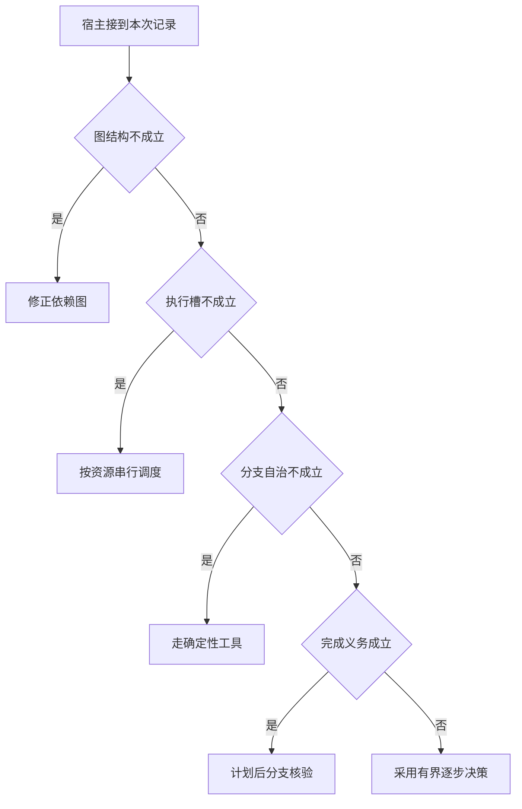

# 按信息依赖选择控制策略

用户问哪一家符合，与比较所有候选的完整条件不同。
先核验图和资源，再决定是否有必要让每个分支自行探索。
采用图框架并不能自动证明系统更自治。

本篇用一个封闭的教学决策器说明这一问题。输入是宿主收到的记录，不保证每个下游字段都已经获准使用。前置检查未成立时，下游即使带着缓存值，也不能拿来作业务断言。

## 先解决一个具体问题

**你会对哪些 POI 查询开放多轮 Agent 决策？**

已知对象的固定字段常能直接由规则返回。诊断意图、资料冲突或需要选择追加观察的任务更值得试动态策略。
用相同数据能力比较完成质量与整条路径代价。


先取一个能走到「采用有界逐步决策」的输入：依赖图合法且无环、分支内需独立选下一步、用户接受任一可行项、当前还有空闲执行槽。
把这四个条件代回后文的图，前面各个拦截分支都未满足，最终才有“存在性目标可随新观察提前结束”这个判断。
还原这个现场时要分别问：哪些位来自可信状态，哪些只是在接口中出现、尚未获得解释资格的字段。

## 先沿一次决策走到底



从上到下取第一条成立的出口。只改一个开关时，只有它之前的检查都未截断，该变化才可能到达真实动作。

“图结构”的两种输入分别是“依赖图合法且无环”与“依赖错误或存在环”。
计划可读不等于执行器能调度。

“分支自治”的两种输入分别是“分支内需独立选下一步”与“分支只执行已知函数”。
并行普通工具与独立决策者有不同代价。

“完成义务”的两种输入分别是“用户要求完整比较”与“用户接受任一可行项”。
全称和存在性结论对证据的要求不同。

“执行槽”的两种输入分别是“当前还有空闲执行槽”与“当前隔离池已满”。
独立分支也可能竞争同一个有限资源。

## 最少需要哪几项观察

### 修正依赖图

不合法结构无法安全执行。
在本节的全部组合中，有 8 种产生「修正依赖图」，这只是逻辑空间的计数，不能当作实际用户请求的比例。

只取得依赖错误或存在环，已经足以要求宿主「修正依赖图」。
保持这些已知项，其余开关自由变化，仍有 8 种补全，判断没有翻转。

若删掉关于图结构的证据，另一份允许的现场是依赖图合法且无环、分支只执行已知函数、用户接受任一可行项、当前隔离池已满，它会使宿主「按资源串行调度」。

### 按资源串行调度

并行槽不足时独立任务也会等候。
在本节的全部组合中，有 4 种产生「按资源串行调度」，这只是逻辑空间的计数，不能当作实际用户请求的比例。

只取得依赖图合法且无环、当前隔离池已满，已经足以要求宿主「按资源串行调度」。
保持这些已知项，其余开关自由变化，仍有 4 种补全，判断没有翻转。

若删掉关于图结构的证据，另一份允许的现场是依赖错误或存在环、分支只执行已知函数、用户接受任一可行项、当前隔离池已满，它会使宿主「修正依赖图」。

若删掉关于执行槽的证据，另一份允许的现场是依赖图合法且无环、分支只执行已知函数、用户接受任一可行项、当前还有空闲执行槽，它会使宿主「走确定性工具」。

### 走确定性工具

各分支都只需要已知函数。
在本节的全部组合中，有 2 种产生「走确定性工具」，这只是逻辑空间的计数，不能当作实际用户请求的比例。

只取得依赖图合法且无环、分支只执行已知函数、当前还有空闲执行槽，已经足以要求宿主「走确定性工具」。
保持这些已知项，其余开关自由变化，仍有 2 种补全，判断没有翻转。

若删掉关于图结构的证据，另一份允许的现场是依赖错误或存在环、分支只执行已知函数、用户接受任一可行项、当前还有空闲执行槽，它会使宿主「修正依赖图」。

若删掉关于分支自治的证据，另一份允许的现场是依赖图合法且无环、分支内需独立选下一步、用户接受任一可行项、当前还有空闲执行槽，它会使宿主「采用有界逐步决策」。

若删掉关于执行槽的证据，另一份允许的现场是依赖图合法且无环、分支只执行已知函数、用户接受任一可行项、当前隔离池已满，它会使宿主「按资源串行调度」。

### 计划后分支核验

完整目标要求跟踪各项独立任务。
在本节的全部组合中，有 1 种产生「计划后分支核验」，这只是逻辑空间的计数，不能当作实际用户请求的比例。

只取得依赖图合法且无环、分支内需独立选下一步、用户要求完整比较、当前还有空闲执行槽，已经足以要求宿主「计划后分支核验」。
保持这些已知项，其余开关自由变化，仍有 1 种补全，判断没有翻转。

若删掉关于图结构的证据，另一份允许的现场是依赖错误或存在环、分支内需独立选下一步、用户要求完整比较、当前还有空闲执行槽，它会使宿主「修正依赖图」。

若删掉关于分支自治的证据，另一份允许的现场是依赖图合法且无环、分支只执行已知函数、用户要求完整比较、当前还有空闲执行槽，它会使宿主「走确定性工具」。

若删掉关于完成义务的证据，另一份允许的现场是依赖图合法且无环、分支内需独立选下一步、用户接受任一可行项、当前还有空闲执行槽，它会使宿主「采用有界逐步决策」。

若删掉关于执行槽的证据，另一份允许的现场是依赖图合法且无环、分支内需独立选下一步、用户要求完整比较、当前隔离池已满，它会使宿主「按资源串行调度」。

### 采用有界逐步决策

存在性目标可随新观察提前结束。
在本节的全部组合中，有 1 种产生「采用有界逐步决策」，这只是逻辑空间的计数，不能当作实际用户请求的比例。

只取得依赖图合法且无环、分支内需独立选下一步、用户接受任一可行项、当前还有空闲执行槽，已经足以要求宿主「采用有界逐步决策」。

若删掉关于图结构的证据，另一份允许的现场是依赖错误或存在环、分支内需独立选下一步、用户接受任一可行项、当前还有空闲执行槽，它会使宿主「修正依赖图」。

若删掉关于分支自治的证据，另一份允许的现场是依赖图合法且无环、分支只执行已知函数、用户接受任一可行项、当前还有空闲执行槽，它会使宿主「走确定性工具」。

若删掉关于完成义务的证据，另一份允许的现场是依赖图合法且无环、分支内需独立选下一步、用户要求完整比较、当前还有空闲执行槽，它会使宿主「计划后分支核验」。

若删掉关于执行槽的证据，另一份允许的现场是依赖图合法且无环、分支内需独立选下一步、用户接受任一可行项、当前隔离池已满，它会使宿主「按资源串行调度」。

## 以同一份契约解释截然不同的现场

<details>
<summary>展开推演与对应反例</summary>

下列样本按最先命中的业务分支排列。四位编码只作本篇页内定位，顺序与开头的四项输入一致。可以先猜下一动作，再展开相邻样本。

### 能够触发“修正依赖图”的现场

**样本 0000**

业务侧交来依赖错误或存在环、分支只执行已知函数，执行侧还记录了用户接受任一可行项、当前隔离池已满。
把样本压成最短证明，保留依赖错误或存在环就能支持「修正依赖图」。

在这份记录上，分别翻转「图结构」中的任一项，其他项完全不变时，下一动作都会改变。

保持其余观察不动，单独切换「分支自治」、「完成义务」、「执行槽」仍得到「修正依赖图」，它们在这个现场不是决定性变量。

要从本例改走「按资源串行调度」，至少需要变动 1 项，一组最少改动是将依赖错误或存在环换成依赖图合法且无环。

要从本例改走「走确定性工具」，至少需要变动 2 项，一组最少改动是将依赖错误或存在环、当前隔离池已满换成依赖图合法且无环、当前还有空闲执行槽。

要从本例改走「采用有界逐步决策」，至少需要变动 3 项，一组最少改动是将依赖错误或存在环、分支只执行已知函数、当前隔离池已满换成依赖图合法且无环、分支内需独立选下一步、当前还有空闲执行槽。

要从本例改走「计划后分支核验」，至少需要变动 4 项，一组最少改动是将依赖错误或存在环、分支只执行已知函数、用户接受任一可行项、当前隔离池已满换成依赖图合法且无环、分支内需独立选下一步、用户要求完整比较、当前还有空闲执行槽。

**样本 0001**

业务侧交来依赖错误或存在环、分支只执行已知函数，执行侧还记录了用户接受任一可行项、当前还有空闲执行槽。


要从本例改走「走确定性工具」，至少需要变动 1 项，一组最少改动是将依赖错误或存在环换成依赖图合法且无环。

要从本例改走「按资源串行调度」，至少需要变动 2 项，一组最少改动是将依赖错误或存在环、当前还有空闲执行槽换成依赖图合法且无环、当前隔离池已满。

要从本例改走「采用有界逐步决策」，至少需要变动 2 项，一组最少改动是将依赖错误或存在环、分支只执行已知函数换成依赖图合法且无环、分支内需独立选下一步。

要从本例改走「计划后分支核验」，至少需要变动 3 项，一组最少改动是将依赖错误或存在环、分支只执行已知函数、用户接受任一可行项换成依赖图合法且无环、分支内需独立选下一步、用户要求完整比较。

**样本 0010**

业务侧交来依赖错误或存在环、分支只执行已知函数，执行侧还记录了用户要求完整比较、当前隔离池已满。


要从本例改走「计划后分支核验」，至少需要变动 3 项，一组最少改动是将依赖错误或存在环、分支只执行已知函数、当前隔离池已满换成依赖图合法且无环、分支内需独立选下一步、当前还有空闲执行槽。

要从本例改走「采用有界逐步决策」，至少需要变动 4 项，一组最少改动是将依赖错误或存在环、分支只执行已知函数、用户要求完整比较、当前隔离池已满换成依赖图合法且无环、分支内需独立选下一步、用户接受任一可行项、当前还有空闲执行槽。

**样本 0011**

业务侧交来依赖错误或存在环、分支只执行已知函数，执行侧还记录了用户要求完整比较、当前还有空闲执行槽。


要从本例改走「计划后分支核验」，至少需要变动 2 项，一组最少改动是将依赖错误或存在环、分支只执行已知函数换成依赖图合法且无环、分支内需独立选下一步。

要从本例改走「采用有界逐步决策」，至少需要变动 3 项，一组最少改动是将依赖错误或存在环、分支只执行已知函数、用户要求完整比较换成依赖图合法且无环、分支内需独立选下一步、用户接受任一可行项。

**样本 0100**

业务侧交来依赖错误或存在环、分支内需独立选下一步，执行侧还记录了用户接受任一可行项、当前隔离池已满。


要从本例改走「采用有界逐步决策」，至少需要变动 2 项，一组最少改动是将依赖错误或存在环、当前隔离池已满换成依赖图合法且无环、当前还有空闲执行槽。

要从本例改走「走确定性工具」，至少需要变动 3 项，一组最少改动是将依赖错误或存在环、分支内需独立选下一步、当前隔离池已满换成依赖图合法且无环、分支只执行已知函数、当前还有空闲执行槽。

要从本例改走「计划后分支核验」，至少需要变动 3 项，一组最少改动是将依赖错误或存在环、用户接受任一可行项、当前隔离池已满换成依赖图合法且无环、用户要求完整比较、当前还有空闲执行槽。

**样本 0101**

业务侧交来依赖错误或存在环、分支内需独立选下一步，执行侧还记录了用户接受任一可行项、当前还有空闲执行槽。


要从本例改走「采用有界逐步决策」，至少需要变动 1 项，一组最少改动是将依赖错误或存在环换成依赖图合法且无环。

要从本例改走「走确定性工具」，至少需要变动 2 项，一组最少改动是将依赖错误或存在环、分支内需独立选下一步换成依赖图合法且无环、分支只执行已知函数。


要从本例改走「计划后分支核验」，至少需要变动 2 项，一组最少改动是将依赖错误或存在环、用户接受任一可行项换成依赖图合法且无环、用户要求完整比较。

**样本 0110**

业务侧交来依赖错误或存在环、分支内需独立选下一步，执行侧还记录了用户要求完整比较、当前隔离池已满。


要从本例改走「计划后分支核验」，至少需要变动 2 项，一组最少改动是将依赖错误或存在环、当前隔离池已满换成依赖图合法且无环、当前还有空闲执行槽。


要从本例改走「采用有界逐步决策」，至少需要变动 3 项，一组最少改动是将依赖错误或存在环、用户要求完整比较、当前隔离池已满换成依赖图合法且无环、用户接受任一可行项、当前还有空闲执行槽。

**样本 0111**

业务侧交来依赖错误或存在环、分支内需独立选下一步，执行侧还记录了用户要求完整比较、当前还有空闲执行槽。


要从本例改走「计划后分支核验」，至少需要变动 1 项，一组最少改动是将依赖错误或存在环换成依赖图合法且无环。


要从本例改走「采用有界逐步决策」，至少需要变动 2 项，一组最少改动是将依赖错误或存在环、用户要求完整比较换成依赖图合法且无环、用户接受任一可行项。


### 能够触发“按资源串行调度”的现场

**样本 1000**

业务侧交来依赖图合法且无环、分支只执行已知函数，执行侧还记录了用户接受任一可行项、当前隔离池已满。
把样本压成最短证明，保留依赖图合法且无环、当前隔离池已满就能支持「按资源串行调度」。

在这份记录上，分别翻转「图结构」、「执行槽」中的任一项，其他项完全不变时，下一动作都会改变。

保持其余观察不动，单独切换「分支自治」、「完成义务」仍得到「按资源串行调度」，它们在这个现场不是决定性变量。

本例没走更靠前的「修正依赖图」，因为依赖图合法且无环与那个入口的必要条件不符。

要从本例改走「修正依赖图」，至少需要变动 1 项，一组最少改动是将依赖图合法且无环换成依赖错误或存在环。

要从本例改走「走确定性工具」，至少需要变动 1 项，一组最少改动是将当前隔离池已满换成当前还有空闲执行槽。

要从本例改走「采用有界逐步决策」，至少需要变动 2 项，一组最少改动是将分支只执行已知函数、当前隔离池已满换成分支内需独立选下一步、当前还有空闲执行槽。

要从本例改走「计划后分支核验」，至少需要变动 3 项，一组最少改动是将分支只执行已知函数、用户接受任一可行项、当前隔离池已满换成分支内需独立选下一步、用户要求完整比较、当前还有空闲执行槽。

**样本 1010**

业务侧交来依赖图合法且无环、分支只执行已知函数，执行侧还记录了用户要求完整比较、当前隔离池已满。


要从本例改走「计划后分支核验」，至少需要变动 2 项，一组最少改动是将分支只执行已知函数、当前隔离池已满换成分支内需独立选下一步、当前还有空闲执行槽。

要从本例改走「采用有界逐步决策」，至少需要变动 3 项，一组最少改动是将分支只执行已知函数、用户要求完整比较、当前隔离池已满换成分支内需独立选下一步、用户接受任一可行项、当前还有空闲执行槽。

**样本 1100**

业务侧交来依赖图合法且无环、分支内需独立选下一步，执行侧还记录了用户接受任一可行项、当前隔离池已满。


要从本例改走「采用有界逐步决策」，至少需要变动 1 项，一组最少改动是将当前隔离池已满换成当前还有空闲执行槽。

要从本例改走「走确定性工具」，至少需要变动 2 项，一组最少改动是将分支内需独立选下一步、当前隔离池已满换成分支只执行已知函数、当前还有空闲执行槽。

要从本例改走「计划后分支核验」，至少需要变动 2 项，一组最少改动是将用户接受任一可行项、当前隔离池已满换成用户要求完整比较、当前还有空闲执行槽。

**样本 1110**

业务侧交来依赖图合法且无环、分支内需独立选下一步，执行侧还记录了用户要求完整比较、当前隔离池已满。


要从本例改走「计划后分支核验」，至少需要变动 1 项，一组最少改动是将当前隔离池已满换成当前还有空闲执行槽。


要从本例改走「采用有界逐步决策」，至少需要变动 2 项，一组最少改动是将用户要求完整比较、当前隔离池已满换成用户接受任一可行项、当前还有空闲执行槽。

### 能够触发“走确定性工具”的现场

**样本 1001**

业务侧交来依赖图合法且无环、分支只执行已知函数，执行侧还记录了用户接受任一可行项、当前还有空闲执行槽。
把样本压成最短证明，保留依赖图合法且无环、分支只执行已知函数、当前还有空闲执行槽就能支持「走确定性工具」。

在这份记录上，分别翻转「图结构」、「分支自治」、「执行槽」中的任一项，其他项完全不变时，下一动作都会改变。

保持其余观察不动，单独切换「完成义务」仍得到「走确定性工具」，它们在这个现场不是决定性变量。


本例没走更靠前的「按资源串行调度」，因为当前还有空闲执行槽与那个入口的必要条件不符。


要从本例改走「按资源串行调度」，至少需要变动 1 项，一组最少改动是将当前还有空闲执行槽换成当前隔离池已满。

要从本例改走「采用有界逐步决策」，至少需要变动 1 项，一组最少改动是将分支只执行已知函数换成分支内需独立选下一步。

要从本例改走「计划后分支核验」，至少需要变动 2 项，一组最少改动是将分支只执行已知函数、用户接受任一可行项换成分支内需独立选下一步、用户要求完整比较。

**样本 1011**

业务侧交来依赖图合法且无环、分支只执行已知函数，执行侧还记录了用户要求完整比较、当前还有空闲执行槽。


要从本例改走「计划后分支核验」，至少需要变动 1 项，一组最少改动是将分支只执行已知函数换成分支内需独立选下一步。

要从本例改走「采用有界逐步决策」，至少需要变动 2 项，一组最少改动是将分支只执行已知函数、用户要求完整比较换成分支内需独立选下一步、用户接受任一可行项。

### 能够触发“计划后分支核验”的现场

**样本 1111**

业务侧交来依赖图合法且无环、分支内需独立选下一步，执行侧还记录了用户要求完整比较、当前还有空闲执行槽。
把样本压成最短证明，保留依赖图合法且无环、分支内需独立选下一步、用户要求完整比较、当前还有空闲执行槽就能支持「计划后分支核验」。

在这份记录上，分别翻转「图结构」、「分支自治」、「完成义务」、「执行槽」中的任一项，其他项完全不变时，下一动作都会改变。


本例没走更靠前的「走确定性工具」，因为分支内需独立选下一步与那个入口的必要条件不符。


要从本例改走「走确定性工具」，至少需要变动 1 项，一组最少改动是将分支内需独立选下一步换成分支只执行已知函数。

要从本例改走「采用有界逐步决策」，至少需要变动 1 项，一组最少改动是将用户要求完整比较换成用户接受任一可行项。


### 能够触发“采用有界逐步决策”的现场

**样本 1101**

业务侧交来依赖图合法且无环、分支内需独立选下一步，执行侧还记录了用户接受任一可行项、当前还有空闲执行槽。
把样本压成最短证明，保留依赖图合法且无环、分支内需独立选下一步、用户接受任一可行项、当前还有空闲执行槽就能支持「采用有界逐步决策」。


本例没走更靠前的「计划后分支核验」，因为用户接受任一可行项与那个入口的必要条件不符。


要从本例改走「计划后分支核验」，至少需要变动 1 项，一组最少改动是将用户接受任一可行项换成用户要求完整比较。

</details>

## 当你只能看见一半记录

<details>
<summary>展开推演与对应反例</summary>

这次隐藏两个字段，保留另两个。对每个可见现场，检查四种合法补全是否同意。如仍有歧义，选择能使最坏剩余候选动作最少的字段继续查。并列时采用本篇字段顺序。

### 只保留图结构与分支自治

已知依赖错误或存在环、分支只执行已知函数时，四种补全的动作分布为修正依赖图（4 种）。

就“修正依赖图”这个动作而言，在依赖错误或存在环、分支只执行已知函数的前提下，另外两项观察不会推翻它。

已知依赖错误或存在环、分支内需独立选下一步时，四种补全的动作分布为修正依赖图（4 种）。

就“修正依赖图”这个动作而言，在依赖错误或存在环、分支内需独立选下一步的前提下，另外两项观察不会推翻它。

已知依赖图合法且无环、分支只执行已知函数时，四种补全的动作分布为按资源串行调度（2 种）、走确定性工具（2 种）。

在依赖图合法且无环、分支只执行已知函数这个现场补读「执行槽」，最坏还剩 1 种动作，计算时只衡量歧义，尚未扣读取代价。
若补来的观察为“当前隔离池已满”，范围缩成「按资源串行调度」。若为“当前还有空闲执行槽”，则保留「走确定性工具」。

区分不了的两条执行可以具体写成 1000 与 1001：它们共享已展示字段，却分别需要「按资源串行调度」和「走确定性工具」。

已知依赖图合法且无环、分支内需独立选下一步时，四种补全的动作分布为按资源串行调度（2 种）、计划后分支核验（1 种）、采用有界逐步决策（1 种）。

在依赖图合法且无环、分支内需独立选下一步这个现场补读「完成义务」，最坏还剩 2 种动作，计算时只衡量歧义，尚未扣读取代价。
若补来的观察为“用户接受任一可行项”，范围缩成「按资源串行调度」、「采用有界逐步决策」。若为“用户要求完整比较”，则保留「按资源串行调度」、「计划后分支核验」。

区分不了的两条执行可以具体写成 1100 与 1101：它们共享已展示字段，却分别需要「按资源串行调度」和「采用有界逐步决策」。

### 只保留图结构与完成义务

已知依赖错误或存在环、用户接受任一可行项时，四种补全的动作分布为修正依赖图（4 种）。

就“修正依赖图”这个动作而言，在依赖错误或存在环、用户接受任一可行项的前提下，另外两项观察不会推翻它。

已知依赖错误或存在环、用户要求完整比较时，四种补全的动作分布为修正依赖图（4 种）。

就“修正依赖图”这个动作而言，在依赖错误或存在环、用户要求完整比较的前提下，另外两项观察不会推翻它。

已知依赖图合法且无环、用户接受任一可行项时，四种补全的动作分布为按资源串行调度（2 种）、走确定性工具（1 种）、采用有界逐步决策（1 种）。

在依赖图合法且无环、用户接受任一可行项这个现场补读「分支自治」，最坏还剩 2 种动作，计算时只衡量歧义，尚未扣读取代价。
若补来的观察为“分支只执行已知函数”，范围缩成「按资源串行调度」、「走确定性工具」。若为“分支内需独立选下一步”，则保留「按资源串行调度」、「采用有界逐步决策」。


已知依赖图合法且无环、用户要求完整比较时，四种补全的动作分布为按资源串行调度（2 种）、走确定性工具（1 种）、计划后分支核验（1 种）。

在依赖图合法且无环、用户要求完整比较这个现场补读「分支自治」，最坏还剩 2 种动作，计算时只衡量歧义，尚未扣读取代价。
若补来的观察为“分支只执行已知函数”，范围缩成「按资源串行调度」、「走确定性工具」。若为“分支内需独立选下一步”，则保留「按资源串行调度」、「计划后分支核验」。

区分不了的两条执行可以具体写成 1010 与 1011：它们共享已展示字段，却分别需要「按资源串行调度」和「走确定性工具」。

### 只保留分支自治与完成义务

已知分支只执行已知函数、用户接受任一可行项时，四种补全的动作分布为修正依赖图（2 种）、按资源串行调度（1 种）、走确定性工具（1 种）。

在分支只执行已知函数、用户接受任一可行项这个现场补读「图结构」，最坏还剩 2 种动作，计算时只衡量歧义，尚未扣读取代价。
若补来的观察为“依赖错误或存在环”，范围缩成「修正依赖图」。若为“依赖图合法且无环”，则保留「按资源串行调度」、「走确定性工具」。

区分不了的两条执行可以具体写成 0000 与 1000：它们共享已展示字段，却分别需要「修正依赖图」和「按资源串行调度」。

已知分支只执行已知函数、用户要求完整比较时，四种补全的动作分布为修正依赖图（2 种）、按资源串行调度（1 种）、走确定性工具（1 种）。

在分支只执行已知函数、用户要求完整比较这个现场补读「图结构」，最坏还剩 2 种动作，计算时只衡量歧义，尚未扣读取代价。

区分不了的两条执行可以具体写成 0010 与 1010：它们共享已展示字段，却分别需要「修正依赖图」和「按资源串行调度」。

已知分支内需独立选下一步、用户接受任一可行项时，四种补全的动作分布为修正依赖图（2 种）、按资源串行调度（1 种）、采用有界逐步决策（1 种）。

在分支内需独立选下一步、用户接受任一可行项这个现场补读「图结构」，最坏还剩 2 种动作，计算时只衡量歧义，尚未扣读取代价。
若补来的观察为“依赖错误或存在环”，范围缩成「修正依赖图」。若为“依赖图合法且无环”，则保留「按资源串行调度」、「采用有界逐步决策」。

区分不了的两条执行可以具体写成 0100 与 1100：它们共享已展示字段，却分别需要「修正依赖图」和「按资源串行调度」。

已知分支内需独立选下一步、用户要求完整比较时，四种补全的动作分布为修正依赖图（2 种）、按资源串行调度（1 种）、计划后分支核验（1 种）。

在分支内需独立选下一步、用户要求完整比较这个现场补读「图结构」，最坏还剩 2 种动作，计算时只衡量歧义，尚未扣读取代价。
若补来的观察为“依赖错误或存在环”，范围缩成「修正依赖图」。若为“依赖图合法且无环”，则保留「按资源串行调度」、「计划后分支核验」。

区分不了的两条执行可以具体写成 0110 与 1110：它们共享已展示字段，却分别需要「修正依赖图」和「按资源串行调度」。

### 只保留图结构与执行槽

已知依赖错误或存在环、当前隔离池已满时，四种补全的动作分布为修正依赖图（4 种）。

就“修正依赖图”这个动作而言，在依赖错误或存在环、当前隔离池已满的前提下，另外两项观察不会推翻它。

已知依赖错误或存在环、当前还有空闲执行槽时，四种补全的动作分布为修正依赖图（4 种）。

就“修正依赖图”这个动作而言，在依赖错误或存在环、当前还有空闲执行槽的前提下，另外两项观察不会推翻它。

已知依赖图合法且无环、当前隔离池已满时，四种补全的动作分布为按资源串行调度（4 种）。

就“按资源串行调度”这个动作而言，在依赖图合法且无环、当前隔离池已满的前提下，另外两项观察不会推翻它。

已知依赖图合法且无环、当前还有空闲执行槽时，四种补全的动作分布为走确定性工具（2 种）、计划后分支核验（1 种）、采用有界逐步决策（1 种）。

在依赖图合法且无环、当前还有空闲执行槽这个现场补读「分支自治」，最坏还剩 2 种动作，计算时只衡量歧义，尚未扣读取代价。
若补来的观察为“分支只执行已知函数”，范围缩成「走确定性工具」。若为“分支内需独立选下一步”，则保留「采用有界逐步决策」、「计划后分支核验」。

区分不了的两条执行可以具体写成 1001 与 1101：它们共享已展示字段，却分别需要「走确定性工具」和「采用有界逐步决策」。

### 只保留分支自治与执行槽

已知分支只执行已知函数、当前隔离池已满时，四种补全的动作分布为修正依赖图（2 种）、按资源串行调度（2 种）。

在分支只执行已知函数、当前隔离池已满这个现场补读「图结构」，最坏还剩 1 种动作，计算时只衡量歧义，尚未扣读取代价。
若补来的观察为“依赖错误或存在环”，范围缩成「修正依赖图」。若为“依赖图合法且无环”，则保留「按资源串行调度」。


已知分支只执行已知函数、当前还有空闲执行槽时，四种补全的动作分布为修正依赖图（2 种）、走确定性工具（2 种）。

在分支只执行已知函数、当前还有空闲执行槽这个现场补读「图结构」，最坏还剩 1 种动作，计算时只衡量歧义，尚未扣读取代价。
若补来的观察为“依赖错误或存在环”，范围缩成「修正依赖图」。若为“依赖图合法且无环”，则保留「走确定性工具」。

区分不了的两条执行可以具体写成 0001 与 1001：它们共享已展示字段，却分别需要「修正依赖图」和「走确定性工具」。

已知分支内需独立选下一步、当前隔离池已满时，四种补全的动作分布为修正依赖图（2 种）、按资源串行调度（2 种）。

在分支内需独立选下一步、当前隔离池已满这个现场补读「图结构」，最坏还剩 1 种动作，计算时只衡量歧义，尚未扣读取代价。


已知分支内需独立选下一步、当前还有空闲执行槽时，四种补全的动作分布为修正依赖图（2 种）、计划后分支核验（1 种）、采用有界逐步决策（1 种）。

在分支内需独立选下一步、当前还有空闲执行槽这个现场补读「图结构」，最坏还剩 2 种动作，计算时只衡量歧义，尚未扣读取代价。
若补来的观察为“依赖错误或存在环”，范围缩成「修正依赖图」。若为“依赖图合法且无环”，则保留「采用有界逐步决策」、「计划后分支核验」。

区分不了的两条执行可以具体写成 0101 与 1101：它们共享已展示字段，却分别需要「修正依赖图」和「采用有界逐步决策」。

### 只保留完成义务与执行槽

已知用户接受任一可行项、当前隔离池已满时，四种补全的动作分布为修正依赖图（2 种）、按资源串行调度（2 种）。

在用户接受任一可行项、当前隔离池已满这个现场补读「图结构」，最坏还剩 1 种动作，计算时只衡量歧义，尚未扣读取代价。


已知用户接受任一可行项、当前还有空闲执行槽时，四种补全的动作分布为修正依赖图（2 种）、走确定性工具（1 种）、采用有界逐步决策（1 种）。

在用户接受任一可行项、当前还有空闲执行槽这个现场补读「图结构」，最坏还剩 2 种动作，计算时只衡量歧义，尚未扣读取代价。
若补来的观察为“依赖错误或存在环”，范围缩成「修正依赖图」。若为“依赖图合法且无环”，则保留「走确定性工具」、「采用有界逐步决策」。


已知用户要求完整比较、当前隔离池已满时，四种补全的动作分布为修正依赖图（2 种）、按资源串行调度（2 种）。

在用户要求完整比较、当前隔离池已满这个现场补读「图结构」，最坏还剩 1 种动作，计算时只衡量歧义，尚未扣读取代价。


已知用户要求完整比较、当前还有空闲执行槽时，四种补全的动作分布为修正依赖图（2 种）、走确定性工具（1 种）、计划后分支核验（1 种）。

在用户要求完整比较、当前还有空闲执行槽这个现场补读「图结构」，最坏还剩 2 种动作，计算时只衡量歧义，尚未扣读取代价。
若补来的观察为“依赖错误或存在环”，范围缩成「修正依赖图」。若为“依赖图合法且无环”，则保留「走确定性工具」、「计划后分支核验」。

区分不了的两条执行可以具体写成 0011 与 1011：它们共享已展示字段，却分别需要「修正依赖图」和「走确定性工具」。

</details>

## 单因素干预与边界测试

<details>
<summary>展开推演与对应反例</summary>

### 只改变图结构

固定另外三个条件得到八对现场，从“依赖错误或存在环”转为“依赖图合法且无环”时，8 对翻转动作，另外 0 对保持不变。

有 4 对现场沿「修正依赖图」变到「按资源串行调度」，可复现的一组受控背景为分支只执行已知函数、用户接受任一可行项、当前隔离池已满。

有 2 对现场沿「修正依赖图」变到「走确定性工具」，可复现的一组受控背景为分支只执行已知函数、用户接受任一可行项、当前还有空闲执行槽。

有 1 对现场沿「修正依赖图」变到「采用有界逐步决策」，可复现的一组受控背景为分支内需独立选下一步、用户接受任一可行项、当前还有空闲执行槽。

有 1 对现场沿「修正依赖图」变到「计划后分支核验」，可复现的一组受控背景为分支内需独立选下一步、用户要求完整比较、当前还有空闲执行槽。

### 只改变分支自治

固定另外三个条件得到八对现场，从“分支只执行已知函数”转为“分支内需独立选下一步”时，2 对翻转动作，另外 6 对保持不变。

令依赖错误或存在环、用户接受任一可行项、当前隔离池已满，分支自治的两个取值均得到「修正依赖图」。在八对中，共有 4 对表现为这一种稳定出口。

令依赖图合法且无环、用户接受任一可行项、当前隔离池已满，分支自治的两个取值均得到「按资源串行调度」。在八对中，共有 2 对表现为这一种稳定出口。

有 1 对现场沿「走确定性工具」变到「采用有界逐步决策」，可复现的一组受控背景为依赖图合法且无环、用户接受任一可行项、当前还有空闲执行槽。

有 1 对现场沿「走确定性工具」变到「计划后分支核验」，可复现的一组受控背景为依赖图合法且无环、用户要求完整比较、当前还有空闲执行槽。

### 只改变完成义务

固定另外三个条件得到八对现场，从“用户接受任一可行项”转为“用户要求完整比较”时，1 对翻转动作，另外 7 对保持不变。

令依赖错误或存在环、分支只执行已知函数、当前隔离池已满，完成义务的两个取值均得到「修正依赖图」。在八对中，共有 4 对表现为这一种稳定出口。

令依赖图合法且无环、分支只执行已知函数、当前隔离池已满，完成义务的两个取值均得到「按资源串行调度」。在八对中，共有 2 对表现为这一种稳定出口。

令依赖图合法且无环、分支只执行已知函数、当前还有空闲执行槽，完成义务的两个取值均得到「走确定性工具」。在八对中，共有 1 对表现为这一种稳定出口。

有 1 对现场沿「采用有界逐步决策」变到「计划后分支核验」，可复现的一组受控背景为依赖图合法且无环、分支内需独立选下一步、当前还有空闲执行槽。

### 只改变执行槽

固定另外三个条件得到八对现场，从“当前隔离池已满”转为“当前还有空闲执行槽”时，4 对翻转动作，另外 4 对保持不变。

令依赖错误或存在环、分支只执行已知函数、用户接受任一可行项，执行槽的两个取值均得到「修正依赖图」。在八对中，共有 4 对表现为这一种稳定出口。

有 2 对现场沿「按资源串行调度」变到「走确定性工具」，可复现的一组受控背景为依赖图合法且无环、分支只执行已知函数、用户接受任一可行项。

有 1 对现场沿「按资源串行调度」变到「采用有界逐步决策」，可复现的一组受控背景为依赖图合法且无环、分支内需独立选下一步、用户接受任一可行项。

有 1 对现场沿「按资源串行调度」变到「计划后分支核验」，可复现的一组受控背景为依赖图合法且无环、分支内需独立选下一步、用户要求完整比较。

</details>

## 哪些回归样本真能抓住实现错误

<details>
<summary>展开推演与对应反例</summary>

如果删除“修正依赖图”这个分支，在本篇 16 种输入里有 8 种会改走另一出口。

反例 0000 的完整记录为依赖错误或存在环、分支只执行已知函数、用户接受任一可行项、当前隔离池已满。正确结果是「修正依赖图」，这个改坏的实现却给出「按资源串行调度」。

如果删除“按资源串行调度”这个分支，在本篇 16 种输入里有 4 种会改走另一出口。

反例 1000 的完整记录为依赖图合法且无环、分支只执行已知函数、用户接受任一可行项、当前隔离池已满。正确结果是「按资源串行调度」，这个改坏的实现却给出「走确定性工具」。

如果删除“走确定性工具”这个分支，在本篇 16 种输入里有 2 种会改走另一出口。

反例 1001 的完整记录为依赖图合法且无环、分支只执行已知函数、用户接受任一可行项、当前还有空闲执行槽。正确结果是「走确定性工具」，这个改坏的实现却给出「采用有界逐步决策」。

如果删除“计划后分支核验”这个分支，在本篇 16 种输入里有 1 种会改走另一出口。

反例 1111 的完整记录为依赖图合法且无环、分支内需独立选下一步、用户要求完整比较、当前还有空闲执行槽。正确结果是「计划后分支核验」，这个改坏的实现却给出「采用有界逐步决策」。

如果交换“修正依赖图”和“按资源串行调度”的判断次序，在本篇 16 种输入里有 4 种会改走另一出口。


如果交换“按资源串行调度”和“走确定性工具”的判断次序，在本篇 16 种输入里有 2 种会改走另一出口。


如果交换“走确定性工具”和“计划后分支核验”的判断次序，在本篇 16 种输入里有 1 种会改走另一出口。

反例 1011 的完整记录为依赖图合法且无环、分支只执行已知函数、用户要求完整比较、当前还有空闲执行槽。正确结果是「走确定性工具」，这个改坏的实现却给出「计划后分支核验」。

补入样本 0000（依赖错误或存在环、分支只执行已知函数、用户接受任一可行项、当前隔离池已满）能新增检出「删除“修正依赖图”这个分支」、「交换“修正依赖图”和“按资源串行调度”的判断次序」。

补入样本 1000（依赖图合法且无环、分支只执行已知函数、用户接受任一可行项、当前隔离池已满）能新增检出「删除“按资源串行调度”这个分支」、「交换“按资源串行调度”和“走确定性工具”的判断次序」。

补入样本 1011（依赖图合法且无环、分支只执行已知函数、用户要求完整比较、当前还有空闲执行槽）能新增检出「删除“走确定性工具”这个分支」、「交换“走确定性工具”和“计划后分支核验”的判断次序」。

补入样本 1111（依赖图合法且无环、分支内需独立选下一步、用户要求完整比较、当前还有空闲执行槽）能新增检出「删除“计划后分支核验”这个分支」。

这里每次选覆盖尚未捕获缺陷最多的样本，并不保证用例数全局最小。它给出的反例能作为 Java 单测输入。真实模型是否会自主产生这些提议，仍须单独评测。

</details>

## 把状态覆盖换成有抽样偏差的评测批次

<details>
<summary>展开推演与对应反例</summary>

前面的十六种记录各有一票。现在只改样本构成：对一个给定字段，把成立侧的每种记录各取三份、另一侧各取一份。这是人为配比的 32 份回放，不是线上频率估计。
将偏向成立与偏向不成立的两次批次对照，可以隔离分母变化。底层宿主和所有答案保持相同，比例仍可能移动。

### 改变“图结构”的样本配比

只看「修正依赖图」，在依赖图合法且无环的八个不同输入中有 0 个命中，在依赖错误或存在环的另八个输入中有 8 个命中。
把「图结构」成立侧按三倍取样，「修正依赖图」占 8/32，反过来向未成立侧倾斜后占 24/32。
这次重加权使「修正依赖图」的占比相差 50 个百分点。若按两种不同的“图结构”分布跑新旧版，不能把这项差异全部归功于实现。

只看「按资源串行调度」，在依赖图合法且无环的八个不同输入中有 4 个命中，在依赖错误或存在环的另八个输入中有 0 个命中。
把「图结构」成立侧按三倍取样，「按资源串行调度」占 12/32，反过来向未成立侧倾斜后占 4/32。
这次重加权使「按资源串行调度」的占比相差 25 个百分点。若按两种不同的“图结构”分布跑新旧版，不能把这项差异全部归功于实现。

只看「走确定性工具」，在依赖图合法且无环的八个不同输入中有 2 个命中，在依赖错误或存在环的另八个输入中有 0 个命中。
把「图结构」成立侧按三倍取样，「走确定性工具」占 6/32，反过来向未成立侧倾斜后占 2/32。
这次重加权使「走确定性工具」的占比相差 12.5 个百分点。若按两种不同的“图结构”分布跑新旧版，不能把这项差异全部归功于实现。

只看「计划后分支核验」，在依赖图合法且无环的八个不同输入中有 1 个命中，在依赖错误或存在环的另八个输入中有 0 个命中。
把「图结构」成立侧按三倍取样，「计划后分支核验」占 3/32，反过来向未成立侧倾斜后占 1/32。
这次重加权使「计划后分支核验」的占比相差 6.25 个百分点。若按两种不同的“图结构”分布跑新旧版，不能把这项差异全部归功于实现。

只看「采用有界逐步决策」，在依赖图合法且无环的八个不同输入中有 1 个命中，在依赖错误或存在环的另八个输入中有 0 个命中。
把「图结构」成立侧按三倍取样，「采用有界逐步决策」占 3/32，反过来向未成立侧倾斜后占 1/32。
这次重加权使「采用有界逐步决策」的占比相差 6.25 个百分点。若按两种不同的“图结构”分布跑新旧版，不能把这项差异全部归功于实现。

### 改变“分支自治”的样本配比

只看「修正依赖图」，在分支内需独立选下一步的八个不同输入中有 4 个命中，在分支只执行已知函数的另八个输入中有 4 个命中。
把「分支自治」成立侧按三倍取样，「修正依赖图」占 16/32，反过来向未成立侧倾斜后占 16/32。
两批「修正依赖图」的边际比例相同，是因为这个出口在“分支自治”的两侧计数相等，这不能单独证明每一对现场都不受它影响。

只看「按资源串行调度」，在分支内需独立选下一步的八个不同输入中有 2 个命中，在分支只执行已知函数的另八个输入中有 2 个命中。
把「分支自治」成立侧按三倍取样，「按资源串行调度」占 8/32，反过来向未成立侧倾斜后占 8/32。
两批「按资源串行调度」的边际比例相同，是因为这个出口在“分支自治”的两侧计数相等，这不能单独证明每一对现场都不受它影响。

只看「走确定性工具」，在分支内需独立选下一步的八个不同输入中有 0 个命中，在分支只执行已知函数的另八个输入中有 2 个命中。
把「分支自治」成立侧按三倍取样，「走确定性工具」占 2/32，反过来向未成立侧倾斜后占 6/32。
这次重加权使「走确定性工具」的占比相差 12.5 个百分点。若按两种不同的“分支自治”分布跑新旧版，不能把这项差异全部归功于实现。

只看「计划后分支核验」，在分支内需独立选下一步的八个不同输入中有 1 个命中，在分支只执行已知函数的另八个输入中有 0 个命中。
把「分支自治」成立侧按三倍取样，「计划后分支核验」占 3/32，反过来向未成立侧倾斜后占 1/32。
这次重加权使「计划后分支核验」的占比相差 6.25 个百分点。若按两种不同的“分支自治”分布跑新旧版，不能把这项差异全部归功于实现。

只看「采用有界逐步决策」，在分支内需独立选下一步的八个不同输入中有 1 个命中，在分支只执行已知函数的另八个输入中有 0 个命中。
把「分支自治」成立侧按三倍取样，「采用有界逐步决策」占 3/32，反过来向未成立侧倾斜后占 1/32。
这次重加权使「采用有界逐步决策」的占比相差 6.25 个百分点。若按两种不同的“分支自治”分布跑新旧版，不能把这项差异全部归功于实现。

### 改变“完成义务”的样本配比

只看「修正依赖图」，在用户要求完整比较的八个不同输入中有 4 个命中，在用户接受任一可行项的另八个输入中有 4 个命中。
把「完成义务」成立侧按三倍取样，「修正依赖图」占 16/32，反过来向未成立侧倾斜后占 16/32。
两批「修正依赖图」的边际比例相同，是因为这个出口在“完成义务”的两侧计数相等，这不能单独证明每一对现场都不受它影响。

只看「按资源串行调度」，在用户要求完整比较的八个不同输入中有 2 个命中，在用户接受任一可行项的另八个输入中有 2 个命中。
把「完成义务」成立侧按三倍取样，「按资源串行调度」占 8/32，反过来向未成立侧倾斜后占 8/32。
两批「按资源串行调度」的边际比例相同，是因为这个出口在“完成义务”的两侧计数相等，这不能单独证明每一对现场都不受它影响。

只看「走确定性工具」，在用户要求完整比较的八个不同输入中有 1 个命中，在用户接受任一可行项的另八个输入中有 1 个命中。
把「完成义务」成立侧按三倍取样，「走确定性工具」占 4/32，反过来向未成立侧倾斜后占 4/32。
两批「走确定性工具」的边际比例相同，是因为这个出口在“完成义务”的两侧计数相等，这不能单独证明每一对现场都不受它影响。

只看「计划后分支核验」，在用户要求完整比较的八个不同输入中有 1 个命中，在用户接受任一可行项的另八个输入中有 0 个命中。
把「完成义务」成立侧按三倍取样，「计划后分支核验」占 3/32，反过来向未成立侧倾斜后占 1/32。
这次重加权使「计划后分支核验」的占比相差 6.25 个百分点。若按两种不同的“完成义务”分布跑新旧版，不能把这项差异全部归功于实现。

只看「采用有界逐步决策」，在用户要求完整比较的八个不同输入中有 0 个命中，在用户接受任一可行项的另八个输入中有 1 个命中。
把「完成义务」成立侧按三倍取样，「采用有界逐步决策」占 1/32，反过来向未成立侧倾斜后占 3/32。
这次重加权使「采用有界逐步决策」的占比相差 6.25 个百分点。若按两种不同的“完成义务”分布跑新旧版，不能把这项差异全部归功于实现。

### 改变“执行槽”的样本配比

只看「修正依赖图」，在当前还有空闲执行槽的八个不同输入中有 4 个命中，在当前隔离池已满的另八个输入中有 4 个命中。
把「执行槽」成立侧按三倍取样，「修正依赖图」占 16/32，反过来向未成立侧倾斜后占 16/32。
两批「修正依赖图」的边际比例相同，是因为这个出口在“执行槽”的两侧计数相等，这不能单独证明每一对现场都不受它影响。

只看「按资源串行调度」，在当前还有空闲执行槽的八个不同输入中有 0 个命中，在当前隔离池已满的另八个输入中有 4 个命中。
把「执行槽」成立侧按三倍取样，「按资源串行调度」占 4/32，反过来向未成立侧倾斜后占 12/32。
这次重加权使「按资源串行调度」的占比相差 25 个百分点。若按两种不同的“执行槽”分布跑新旧版，不能把这项差异全部归功于实现。

只看「走确定性工具」，在当前还有空闲执行槽的八个不同输入中有 2 个命中，在当前隔离池已满的另八个输入中有 0 个命中。
把「执行槽」成立侧按三倍取样，「走确定性工具」占 6/32，反过来向未成立侧倾斜后占 2/32。
这次重加权使「走确定性工具」的占比相差 12.5 个百分点。若按两种不同的“执行槽”分布跑新旧版，不能把这项差异全部归功于实现。

只看「计划后分支核验」，在当前还有空闲执行槽的八个不同输入中有 1 个命中，在当前隔离池已满的另八个输入中有 0 个命中。
把「执行槽」成立侧按三倍取样，「计划后分支核验」占 3/32，反过来向未成立侧倾斜后占 1/32。
这次重加权使「计划后分支核验」的占比相差 6.25 个百分点。若按两种不同的“执行槽”分布跑新旧版，不能把这项差异全部归功于实现。

只看「采用有界逐步决策」，在当前还有空闲执行槽的八个不同输入中有 1 个命中，在当前隔离池已满的另八个输入中有 0 个命中。
把「执行槽」成立侧按三倍取样，「采用有界逐步决策」占 3/32，反过来向未成立侧倾斜后占 1/32。
这次重加权使「采用有界逐步决策」的占比相差 6.25 个百分点。若按两种不同的“执行槽”分布跑新旧版，不能把这项差异全部归功于实现。

</details>

## 只看终态，能逆推出多少原始事实

<details>
<summary>展开推演与对应反例</summary>

### 只保留“修正依赖图”这条结果时

在本节契约与完整输入域内，仅知「修正依赖图」就能倒推出依赖错误或存在环，这一推断依赖版本未变且日志中的终态可信。

「修正依赖图」不能证明分支自治取哪一侧：0000 和 0100 有相同终态，却分别记为“分支只执行已知函数”和“分支内需独立选下一步”。

「修正依赖图」不能证明完成义务取哪一侧：0000 和 0010 有相同终态，却分别记为“用户接受任一可行项”和“用户要求完整比较”。

「修正依赖图」不能证明执行槽取哪一侧：0000 和 0001 有相同终态，却分别记为“当前隔离池已满”和“当前还有空闲执行槽”。

反查「修正依赖图」的诊断日志，优先保留能区分样本 0000 与 1000 的「图结构」，否则很容易把邻近的「按资源串行调度」看成同一种故障。

### 只保留“按资源串行调度”这条结果时

在本节契约与完整输入域内，仅知「按资源串行调度」就能倒推出依赖图合法且无环，这一推断依赖版本未变且日志中的终态可信。

「按资源串行调度」不能证明分支自治取哪一侧：1000 和 1100 有相同终态，却分别记为“分支只执行已知函数”和“分支内需独立选下一步”。

「按资源串行调度」不能证明完成义务取哪一侧：1000 和 1010 有相同终态，却分别记为“用户接受任一可行项”和“用户要求完整比较”。

在本节契约与完整输入域内，仅知「按资源串行调度」就能倒推出当前隔离池已满，这一推断依赖版本未变且日志中的终态可信。

反查「按资源串行调度」的诊断日志，优先保留能区分样本 1000 与 0000 的「图结构」，否则很容易把邻近的「修正依赖图」看成同一种故障。

### 只保留“走确定性工具”这条结果时

在本节契约与完整输入域内，仅知「走确定性工具」就能倒推出依赖图合法且无环，这一推断依赖版本未变且日志中的终态可信。

在本节契约与完整输入域内，仅知「走确定性工具」就能倒推出分支只执行已知函数，这一推断依赖版本未变且日志中的终态可信。

「走确定性工具」不能证明完成义务取哪一侧：1001 和 1011 有相同终态，却分别记为“用户接受任一可行项”和“用户要求完整比较”。

在本节契约与完整输入域内，仅知「走确定性工具」就能倒推出当前还有空闲执行槽，这一推断依赖版本未变且日志中的终态可信。

反查「走确定性工具」的诊断日志，优先保留能区分样本 1001 与 0001 的「图结构」，否则很容易把邻近的「修正依赖图」看成同一种故障。

### 只保留“计划后分支核验”这条结果时

在本节契约与完整输入域内，仅知「计划后分支核验」就能倒推出依赖图合法且无环，这一推断依赖版本未变且日志中的终态可信。

在本节契约与完整输入域内，仅知「计划后分支核验」就能倒推出分支内需独立选下一步，这一推断依赖版本未变且日志中的终态可信。

在本节契约与完整输入域内，仅知「计划后分支核验」就能倒推出用户要求完整比较，这一推断依赖版本未变且日志中的终态可信。

在本节契约与完整输入域内，仅知「计划后分支核验」就能倒推出当前还有空闲执行槽，这一推断依赖版本未变且日志中的终态可信。

反查「计划后分支核验」的诊断日志，优先保留能区分样本 1111 与 0111 的「图结构」，否则很容易把邻近的「修正依赖图」看成同一种故障。

### 只保留“采用有界逐步决策”这条结果时

在本节契约与完整输入域内，仅知「采用有界逐步决策」就能倒推出依赖图合法且无环，这一推断依赖版本未变且日志中的终态可信。

在本节契约与完整输入域内，仅知「采用有界逐步决策」就能倒推出分支内需独立选下一步，这一推断依赖版本未变且日志中的终态可信。

在本节契约与完整输入域内，仅知「采用有界逐步决策」就能倒推出用户接受任一可行项，这一推断依赖版本未变且日志中的终态可信。

在本节契约与完整输入域内，仅知「采用有界逐步决策」就能倒推出当前还有空闲执行槽，这一推断依赖版本未变且日志中的终态可信。

反查「采用有界逐步决策」的诊断日志，优先保留能区分样本 1101 与 0101 的「图结构」，否则很容易把邻近的「修正依赖图」看成同一种故障。

</details>

## 面试复述与复算

面试题可以从“你会对哪些 POI 查询开放多轮 Agent 决策？”起步。先给出本篇的触发条件和一条真实执行端可检查的证据，再用一个相邻反例限定结论的适用范围。

在仓库根目录执行下列命令可以重算本篇的一个输入。四位数字依次选择正文列出的四项条件，0 表示未成立或低档，1 表示成立或高档。
```powershell
node examples/reading-cases/replay.mjs 9 2 0101
```

[本周主文](../theory.md) · [配套实验](../lab.md) · [下一篇研读](03.md)
