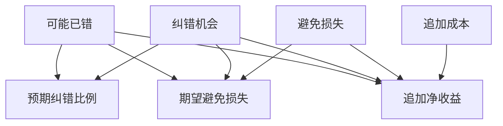

# 多问一次模型要有多少可能收益

追加动作能否纠错取决于当前是否真的错，以及下一来源有多少新信息。
许可是独立硬条件，期望收益只在合法动作之间比较。
两项概率均为教学估计，第二项是已经出错时可纠正的条件概率。

## 先解决一个具体问题

**不确定性很高，为什么也可能不值得多问一次？**

若全部可用工具只提供常规时段，再问一次不会增加实时余位的依据。
当前出错风险与追加动作可纠错的概率要分别估计，有可能前者高而后者接近零。


先从具体的低档设定开始：可能已错取 15%、纠错机会取 20%、避免损失取 40单位、追加成本取 2单位。
三个结果依次是预期纠错比例 3%、期望避免损失 1.2单位、追加净收益 -0.8单位。
先手算这个起点，读完后再把另一个输入切到高档，这样能知道数字变化时究竟改变了哪个假设。

## 先写清输入边界和三个观测量

用 a 表示可能已错，取 15% 或 45%，这两点是用于隔离因果影响的教学输入。

用 b 表示纠错机会，取 20% 或 75%，这两点是用于隔离因果影响的教学输入。

用 c 表示避免损失，取 40单位 或 100单位，这两点是用于隔离因果影响的教学输入。

用 d 表示追加成本，取 2单位 或 10单位，这两点是用于隔离因果影响的教学输入。

「预期纠错比例」的计算式为 `a*b/100`，按业务量展开是 `可能已错×纠错机会/100`，输出单位为%。

「期望避免损失」的计算式为 `a*b*c/10000`，按业务量展开是 `可能已错×纠错机会×避免损失/10000`，输出单位为单位。

「追加净收益」的计算式为 `a*b*c/10000-d`，按业务量展开是 `可能已错×纠错机会×避免损失/10000-追加成本`，输出单位为单位。

公式中 ceil 与 floor 分别向上、向下取整，% 在表达式中作取余，** 为乘方，三元条件按“条件 ? 成立值 : 其他值”读取。展示数值最多保留三位小数，比较和反推采用未舍入值。



图上的箭头表示该输入出现在计算式中。同一输入通向多个指标时，三个读数可能共同移动。分支、取整或相互抵消又会使某些边在具体样本上没有可见增量。

## 从输入按单位逐步算到可比较的结果

<details>
<summary>展开推演与对应反例</summary>

### 样本 0000：可能已错 15、纠错机会 20

这一组设定为可能已错为 15%、纠错机会为 20%、避免损失为 40单位、追加成本为 2单位。

代入「预期纠错比例」：`15*20/100`，得到 3%。

代入「期望避免损失」：`15*20*40/10000`，得到 1.2单位。

代入「追加净收益」：`15*20*40/10000-2`，得到 -0.8单位。

以「追加净收益」作主读数时，本组单独切换追加成本的绝对变化最大或并列最大，读数会从 -0.8单位 变为 -8.8单位。

对角样本 1111 的主读数为 23.75单位。它同时改了四项，差额不能充当任一单个因素的净收益。

### 样本 0001：可能已错 15、纠错机会 20

这一组设定为可能已错为 15%、纠错机会为 20%、避免损失为 40单位、追加成本为 10单位。


代入「追加净收益」：`15*20*40/10000-10`，得到 -8.8单位。

以「追加净收益」作主读数时，本组单独切换追加成本的绝对变化最大或并列最大，读数会从 -8.8单位 变为 -0.8单位。

对角样本 1110 的主读数为 31.75单位。它同时改了四项，差额不能充当任一单个因素的净收益。

### 样本 0010：可能已错 15、纠错机会 20

这一组设定为可能已错为 15%、纠错机会为 20%、避免损失为 100单位、追加成本为 2单位。


代入「期望避免损失」：`15*20*100/10000`，得到 3单位。

代入「追加净收益」：`15*20*100/10000-2`，得到 1单位。

以「追加净收益」作主读数时，本组单独切换纠错机会的绝对变化最大或并列最大，读数会从 1单位 变为 9.25单位。

对角样本 1101 的主读数为 3.5单位。它同时改了四项，差额不能充当任一单个因素的净收益。

### 样本 0011：可能已错 15、纠错机会 20

这一组设定为可能已错为 15%、纠错机会为 20%、避免损失为 100单位、追加成本为 10单位。


代入「追加净收益」：`15*20*100/10000-10`，得到 -7单位。

以「追加净收益」作主读数时，本组单独切换纠错机会的绝对变化最大或并列最大，读数会从 -7单位 变为 1.25单位。

对角样本 1100 的主读数为 11.5单位。它同时改了四项，差额不能充当任一单个因素的净收益。

### 样本 0100：可能已错 15、纠错机会 75

这一组设定为可能已错为 15%、纠错机会为 75%、避免损失为 40单位、追加成本为 2单位。

代入「预期纠错比例」：`15*75/100`，得到 11.25%。

代入「期望避免损失」：`15*75*40/10000`，得到 4.5单位。

代入「追加净收益」：`15*75*40/10000-2`，得到 2.5单位。

以「追加净收益」作主读数时，本组单独切换可能已错的绝对变化最大或并列最大，读数会从 2.5单位 变为 11.5单位。

对角样本 1011 的主读数为 -1单位。它同时改了四项，差额不能充当任一单个因素的净收益。

### 样本 0101：可能已错 15、纠错机会 75

这一组设定为可能已错为 15%、纠错机会为 75%、避免损失为 40单位、追加成本为 10单位。


代入「追加净收益」：`15*75*40/10000-10`，得到 -5.5单位。

以「追加净收益」作主读数时，本组单独切换可能已错的绝对变化最大或并列最大，读数会从 -5.5单位 变为 3.5单位。

对角样本 1010 的主读数为 7单位。它同时改了四项，差额不能充当任一单个因素的净收益。

### 样本 0110：可能已错 15、纠错机会 75

这一组设定为可能已错为 15%、纠错机会为 75%、避免损失为 100单位、追加成本为 2单位。


代入「期望避免损失」：`15*75*100/10000`，得到 11.25单位。

代入「追加净收益」：`15*75*100/10000-2`，得到 9.25单位。

以「追加净收益」作主读数时，本组单独切换可能已错的绝对变化最大或并列最大，读数会从 9.25单位 变为 31.75单位。

对角样本 1001 的主读数为 -6.4单位。它同时改了四项，差额不能充当任一单个因素的净收益。

### 样本 0111：可能已错 15、纠错机会 75

这一组设定为可能已错为 15%、纠错机会为 75%、避免损失为 100单位、追加成本为 10单位。


代入「追加净收益」：`15*75*100/10000-10`，得到 1.25单位。

以「追加净收益」作主读数时，本组单独切换可能已错的绝对变化最大或并列最大，读数会从 1.25单位 变为 23.75单位。

对角样本 1000 的主读数为 1.6单位。它同时改了四项，差额不能充当任一单个因素的净收益。

### 样本 1000：可能已错 45、纠错机会 20

这一组设定为可能已错为 45%、纠错机会为 20%、避免损失为 40单位、追加成本为 2单位。

代入「预期纠错比例」：`45*20/100`，得到 9%。

代入「期望避免损失」：`45*20*40/10000`，得到 3.6单位。

代入「追加净收益」：`45*20*40/10000-2`，得到 1.6单位。

以「追加净收益」作主读数时，本组单独切换纠错机会的绝对变化最大或并列最大，读数会从 1.6单位 变为 11.5单位。

对角样本 0111 的主读数为 1.25单位。它同时改了四项，差额不能充当任一单个因素的净收益。

### 样本 1001：可能已错 45、纠错机会 20

这一组设定为可能已错为 45%、纠错机会为 20%、避免损失为 40单位、追加成本为 10单位。


代入「追加净收益」：`45*20*40/10000-10`，得到 -6.4单位。

以「追加净收益」作主读数时，本组单独切换纠错机会的绝对变化最大或并列最大，读数会从 -6.4单位 变为 3.5单位。

对角样本 0110 的主读数为 9.25单位。它同时改了四项，差额不能充当任一单个因素的净收益。

### 样本 1010：可能已错 45、纠错机会 20

这一组设定为可能已错为 45%、纠错机会为 20%、避免损失为 100单位、追加成本为 2单位。


代入「期望避免损失」：`45*20*100/10000`，得到 9单位。

代入「追加净收益」：`45*20*100/10000-2`，得到 7单位。

以「追加净收益」作主读数时，本组单独切换纠错机会的绝对变化最大或并列最大，读数会从 7单位 变为 31.75单位。

对角样本 0101 的主读数为 -5.5单位。它同时改了四项，差额不能充当任一单个因素的净收益。

### 样本 1011：可能已错 45、纠错机会 20

这一组设定为可能已错为 45%、纠错机会为 20%、避免损失为 100单位、追加成本为 10单位。


代入「追加净收益」：`45*20*100/10000-10`，得到 -1单位。

以「追加净收益」作主读数时，本组单独切换纠错机会的绝对变化最大或并列最大，读数会从 -1单位 变为 23.75单位。

对角样本 0100 的主读数为 2.5单位。它同时改了四项，差额不能充当任一单个因素的净收益。

### 样本 1100：可能已错 45、纠错机会 75

这一组设定为可能已错为 45%、纠错机会为 75%、避免损失为 40单位、追加成本为 2单位。

代入「预期纠错比例」：`45*75/100`，得到 33.75%。

代入「期望避免损失」：`45*75*40/10000`，得到 13.5单位。

代入「追加净收益」：`45*75*40/10000-2`，得到 11.5单位。

以「追加净收益」作主读数时，本组单独切换避免损失的绝对变化最大或并列最大，读数会从 11.5单位 变为 31.75单位。

对角样本 0011 的主读数为 -7单位。它同时改了四项，差额不能充当任一单个因素的净收益。

### 样本 1101：可能已错 45、纠错机会 75

这一组设定为可能已错为 45%、纠错机会为 75%、避免损失为 40单位、追加成本为 10单位。


代入「追加净收益」：`45*75*40/10000-10`，得到 3.5单位。

以「追加净收益」作主读数时，本组单独切换避免损失的绝对变化最大或并列最大，读数会从 3.5单位 变为 23.75单位。

对角样本 0010 的主读数为 1单位。它同时改了四项，差额不能充当任一单个因素的净收益。

### 样本 1110：可能已错 45、纠错机会 75

这一组设定为可能已错为 45%、纠错机会为 75%、避免损失为 100单位、追加成本为 2单位。


代入「期望避免损失」：`45*75*100/10000`，得到 33.75单位。

代入「追加净收益」：`45*75*100/10000-2`，得到 31.75单位。

以「追加净收益」作主读数时，本组单独切换纠错机会的绝对变化最大或并列最大，读数会从 31.75单位 变为 7单位。

对角样本 0001 的主读数为 -8.8单位。它同时改了四项，差额不能充当任一单个因素的净收益。

### 样本 1111：可能已错 45、纠错机会 75

这一组设定为可能已错为 45%、纠错机会为 75%、避免损失为 100单位、追加成本为 10单位。


代入「追加净收益」：`45*75*100/10000-10`，得到 23.75单位。

以「追加净收益」作主读数时，本组单独切换纠错机会的绝对变化最大或并列最大，读数会从 23.75单位 变为 -1单位。

对角样本 0000 的主读数为 -0.8单位。它同时改了四项，差额不能充当任一单个因素的净收益。

</details>

## 逐个干预：其余条件固定时，变化真的发生在哪里

<details>
<summary>展开推演与对应反例</summary>

### 只改变可能已错

固定纠错机会为 20%、避免损失为 40单位、追加成本为 2单位，只把可能已错从 15%改到 45%。
这一对的预期纠错比例从 3% 变为 9%，期望避免损失的差为 2.4单位，追加净收益的差为 2.4单位。

固定纠错机会为 20%、避免损失为 40单位、追加成本为 10单位，只把可能已错从 15%改到 45%。

固定纠错机会为 20%、避免损失为 100单位、追加成本为 2单位，只把可能已错从 15%改到 45%。
这一对的预期纠错比例从 3% 变为 9%，期望避免损失的差为 6单位，追加净收益的差为 6单位。

固定纠错机会为 20%、避免损失为 100单位、追加成本为 10单位，只把可能已错从 15%改到 45%。

固定纠错机会为 75%、避免损失为 40单位、追加成本为 2单位，只把可能已错从 15%改到 45%。
这一对的预期纠错比例从 11.25% 变为 33.75%，期望避免损失的差为 9单位，追加净收益的差为 9单位。

固定纠错机会为 75%、避免损失为 40单位、追加成本为 10单位，只把可能已错从 15%改到 45%。

固定纠错机会为 75%、避免损失为 100单位、追加成本为 2单位，只把可能已错从 15%改到 45%。
这一对的预期纠错比例从 11.25% 变为 33.75%，期望避免损失的差为 22.5单位，追加净收益的差为 22.5单位。

固定纠错机会为 75%、避免损失为 100单位、追加成本为 10单位，只把可能已错从 15%改到 45%。

综合八组受控背景，可能已错升到较高设定时「预期纠错比例」的差值区间是 6% 至 22.5%，共有 8 对出现可观察变化。

综合八组受控背景，可能已错升到较高设定时「期望避免损失」的差值区间是 2.4单位 至 22.5单位，共有 8 对出现可观察变化。

综合八组受控背景，可能已错升到较高设定时「追加净收益」的差值区间是 2.4单位 至 22.5单位，共有 8 对出现可观察变化。

### 只改变纠错机会

固定可能已错为 15%、避免损失为 40单位、追加成本为 2单位，只把纠错机会从 20%改到 75%。
这一对的预期纠错比例从 3% 变为 11.25%，期望避免损失的差为 3.3单位，追加净收益的差为 3.3单位。

固定可能已错为 15%、避免损失为 40单位、追加成本为 10单位，只把纠错机会从 20%改到 75%。

固定可能已错为 15%、避免损失为 100单位、追加成本为 2单位，只把纠错机会从 20%改到 75%。
这一对的预期纠错比例从 3% 变为 11.25%，期望避免损失的差为 8.25单位，追加净收益的差为 8.25单位。

固定可能已错为 15%、避免损失为 100单位、追加成本为 10单位，只把纠错机会从 20%改到 75%。

固定可能已错为 45%、避免损失为 40单位、追加成本为 2单位，只把纠错机会从 20%改到 75%。
这一对的预期纠错比例从 9% 变为 33.75%，期望避免损失的差为 9.9单位，追加净收益的差为 9.9单位。

固定可能已错为 45%、避免损失为 40单位、追加成本为 10单位，只把纠错机会从 20%改到 75%。

固定可能已错为 45%、避免损失为 100单位、追加成本为 2单位，只把纠错机会从 20%改到 75%。
这一对的预期纠错比例从 9% 变为 33.75%，期望避免损失的差为 24.75单位，追加净收益的差为 24.75单位。

固定可能已错为 45%、避免损失为 100单位、追加成本为 10单位，只把纠错机会从 20%改到 75%。

综合八组受控背景，纠错机会升到较高设定时「预期纠错比例」的差值区间是 8.25% 至 24.75%，共有 8 对出现可观察变化。

综合八组受控背景，纠错机会升到较高设定时「期望避免损失」的差值区间是 3.3单位 至 24.75单位，共有 8 对出现可观察变化。

综合八组受控背景，纠错机会升到较高设定时「追加净收益」的差值区间是 3.3单位 至 24.75单位，共有 8 对出现可观察变化。

### 只改变避免损失

固定可能已错为 15%、纠错机会为 20%、追加成本为 2单位，只把避免损失从 40单位改到 100单位。
这一对的预期纠错比例从 3% 变为 3%，期望避免损失的差为 1.8单位，追加净收益的差为 1.8单位。

固定可能已错为 15%、纠错机会为 20%、追加成本为 10单位，只把避免损失从 40单位改到 100单位。

固定可能已错为 15%、纠错机会为 75%、追加成本为 2单位，只把避免损失从 40单位改到 100单位。
这一对的预期纠错比例从 11.25% 变为 11.25%，期望避免损失的差为 6.75单位，追加净收益的差为 6.75单位。

固定可能已错为 15%、纠错机会为 75%、追加成本为 10单位，只把避免损失从 40单位改到 100单位。

固定可能已错为 45%、纠错机会为 20%、追加成本为 2单位，只把避免损失从 40单位改到 100单位。
这一对的预期纠错比例从 9% 变为 9%，期望避免损失的差为 5.4单位，追加净收益的差为 5.4单位。

固定可能已错为 45%、纠错机会为 20%、追加成本为 10单位，只把避免损失从 40单位改到 100单位。

固定可能已错为 45%、纠错机会为 75%、追加成本为 2单位，只把避免损失从 40单位改到 100单位。
这一对的预期纠错比例从 33.75% 变为 33.75%，期望避免损失的差为 20.25单位，追加净收益的差为 20.25单位。

固定可能已错为 45%、纠错机会为 75%、追加成本为 10单位，只把避免损失从 40单位改到 100单位。

综合八组受控背景，避免损失升到较高设定时「预期纠错比例」的差值区间是 0%，共有 0 对出现可观察变化。

综合八组受控背景，避免损失升到较高设定时「期望避免损失」的差值区间是 1.8单位 至 20.25单位，共有 8 对出现可观察变化。

综合八组受控背景，避免损失升到较高设定时「追加净收益」的差值区间是 1.8单位 至 20.25单位，共有 8 对出现可观察变化。

### 只改变追加成本

固定可能已错为 15%、纠错机会为 20%、避免损失为 40单位，只把追加成本从 2单位改到 10单位。
这一对的预期纠错比例从 3% 变为 3%，期望避免损失的差为 0单位，追加净收益的差为 -8单位。

固定可能已错为 15%、纠错机会为 20%、避免损失为 100单位，只把追加成本从 2单位改到 10单位。

固定可能已错为 15%、纠错机会为 75%、避免损失为 40单位，只把追加成本从 2单位改到 10单位。
这一对的预期纠错比例从 11.25% 变为 11.25%，期望避免损失的差为 0单位，追加净收益的差为 -8单位。

固定可能已错为 15%、纠错机会为 75%、避免损失为 100单位，只把追加成本从 2单位改到 10单位。

固定可能已错为 45%、纠错机会为 20%、避免损失为 40单位，只把追加成本从 2单位改到 10单位。
这一对的预期纠错比例从 9% 变为 9%，期望避免损失的差为 0单位，追加净收益的差为 -8单位。

固定可能已错为 45%、纠错机会为 20%、避免损失为 100单位，只把追加成本从 2单位改到 10单位。

固定可能已错为 45%、纠错机会为 75%、避免损失为 40单位，只把追加成本从 2单位改到 10单位。
这一对的预期纠错比例从 33.75% 变为 33.75%，期望避免损失的差为 0单位，追加净收益的差为 -8单位。

固定可能已错为 45%、纠错机会为 75%、避免损失为 100单位，只把追加成本从 2单位改到 10单位。

综合八组受控背景，追加成本升到较高设定时「预期纠错比例」的差值区间是 0%，共有 0 对出现可观察变化。

综合八组受控背景，追加成本升到较高设定时「期望避免损失」的差值区间是 0单位，共有 0 对出现可观察变化。

综合八组受控背景，追加成本升到较高设定时「追加净收益」的差值区间是 -8单位，共有 8 对出现可观察变化。

</details>

## 只拿到部分输入，结论还能缩小到多大范围

<details>
<summary>展开推演与对应反例</summary>

### 已知可能已错和纠错机会

当可能已错为 15%、纠错机会为 20%时，另两项有四种补全，主读数「追加净收益」只能限定为 -8.8单位 至 1单位。
这个条件下，取避免损失为 40单位、追加成本为 10单位可得到下界 -8.8单位，取避免损失为 100单位、追加成本为 2单位可达到上界 1单位。

用同样可见的可能已错为 15%、纠错机会为 20%去推「预期纠错比例」，能得到的范围为 3%，不能把另一个指标的单位代入。

用同样可见的可能已错为 15%、纠错机会为 20%去推「期望避免损失」，能得到的范围为 1.2单位 至 3单位，不能把另一个指标的单位代入。

若只许再问一项，按最坏区间宽度优先核对追加成本，补得低档时为 -0.8单位 至 1单位，高档时为 -8.8单位 至 -7单位。

当可能已错为 15%、纠错机会为 75%时，另两项有四种补全，主读数「追加净收益」只能限定为 -5.5单位 至 9.25单位。
这个条件下，取避免损失为 40单位、追加成本为 10单位可得到下界 -5.5单位，取避免损失为 100单位、追加成本为 2单位可达到上界 9.25单位。

用同样可见的可能已错为 15%、纠错机会为 75%去推「预期纠错比例」，能得到的范围为 11.25%，不能把另一个指标的单位代入。

用同样可见的可能已错为 15%、纠错机会为 75%去推「期望避免损失」，能得到的范围为 4.5单位 至 11.25单位，不能把另一个指标的单位代入。

若只许再问一项，按最坏区间宽度优先核对追加成本，补得低档时为 2.5单位 至 9.25单位，高档时为 -5.5单位 至 1.25单位。

当可能已错为 45%、纠错机会为 20%时，另两项有四种补全，主读数「追加净收益」只能限定为 -6.4单位 至 7单位。
这个条件下，取避免损失为 40单位、追加成本为 10单位可得到下界 -6.4单位，取避免损失为 100单位、追加成本为 2单位可达到上界 7单位。

用同样可见的可能已错为 45%、纠错机会为 20%去推「预期纠错比例」，能得到的范围为 9%，不能把另一个指标的单位代入。

用同样可见的可能已错为 45%、纠错机会为 20%去推「期望避免损失」，能得到的范围为 3.6单位 至 9单位，不能把另一个指标的单位代入。

若只许再问一项，按最坏区间宽度优先核对追加成本，补得低档时为 1.6单位 至 7单位，高档时为 -6.4单位 至 -1单位。

当可能已错为 45%、纠错机会为 75%时，另两项有四种补全，主读数「追加净收益」只能限定为 3.5单位 至 31.75单位。
这个条件下，取避免损失为 40单位、追加成本为 10单位可得到下界 3.5单位，取避免损失为 100单位、追加成本为 2单位可达到上界 31.75单位。

用同样可见的可能已错为 45%、纠错机会为 75%去推「预期纠错比例」，能得到的范围为 33.75%，不能把另一个指标的单位代入。

用同样可见的可能已错为 45%、纠错机会为 75%去推「期望避免损失」，能得到的范围为 13.5单位 至 33.75单位，不能把另一个指标的单位代入。

若只许再问一项，按最坏区间宽度优先核对避免损失，补得低档时为 3.5单位 至 11.5单位，高档时为 23.75单位 至 31.75单位。

### 已知可能已错和避免损失

当可能已错为 15%、避免损失为 40单位时，另两项有四种补全，主读数「追加净收益」只能限定为 -8.8单位 至 2.5单位。
这个条件下，取纠错机会为 20%、追加成本为 10单位可得到下界 -8.8单位，取纠错机会为 75%、追加成本为 2单位可达到上界 2.5单位。

用同样可见的可能已错为 15%、避免损失为 40单位去推「预期纠错比例」，能得到的范围为 3% 至 11.25%，不能把另一个指标的单位代入。

用同样可见的可能已错为 15%、避免损失为 40单位去推「期望避免损失」，能得到的范围为 1.2单位 至 4.5单位，不能把另一个指标的单位代入。

若只许再问一项，按最坏区间宽度优先核对追加成本，补得低档时为 -0.8单位 至 2.5单位，高档时为 -8.8单位 至 -5.5单位。

当可能已错为 15%、避免损失为 100单位时，另两项有四种补全，主读数「追加净收益」只能限定为 -7单位 至 9.25单位。
这个条件下，取纠错机会为 20%、追加成本为 10单位可得到下界 -7单位，取纠错机会为 75%、追加成本为 2单位可达到上界 9.25单位。

用同样可见的可能已错为 15%、避免损失为 100单位去推「预期纠错比例」，能得到的范围为 3% 至 11.25%，不能把另一个指标的单位代入。

用同样可见的可能已错为 15%、避免损失为 100单位去推「期望避免损失」，能得到的范围为 3单位 至 11.25单位，不能把另一个指标的单位代入。

若只许再问一项，按最坏区间宽度优先核对纠错机会，补得低档时为 -7单位 至 1单位，高档时为 1.25单位 至 9.25单位。

当可能已错为 45%、避免损失为 40单位时，另两项有四种补全，主读数「追加净收益」只能限定为 -6.4单位 至 11.5单位。
这个条件下，取纠错机会为 20%、追加成本为 10单位可得到下界 -6.4单位，取纠错机会为 75%、追加成本为 2单位可达到上界 11.5单位。

用同样可见的可能已错为 45%、避免损失为 40单位去推「预期纠错比例」，能得到的范围为 9% 至 33.75%，不能把另一个指标的单位代入。

用同样可见的可能已错为 45%、避免损失为 40单位去推「期望避免损失」，能得到的范围为 3.6单位 至 13.5单位，不能把另一个指标的单位代入。

若只许再问一项，按最坏区间宽度优先核对纠错机会，补得低档时为 -6.4单位 至 1.6单位，高档时为 3.5单位 至 11.5单位。

当可能已错为 45%、避免损失为 100单位时，另两项有四种补全，主读数「追加净收益」只能限定为 -1单位 至 31.75单位。
这个条件下，取纠错机会为 20%、追加成本为 10单位可得到下界 -1单位，取纠错机会为 75%、追加成本为 2单位可达到上界 31.75单位。

用同样可见的可能已错为 45%、避免损失为 100单位去推「预期纠错比例」，能得到的范围为 9% 至 33.75%，不能把另一个指标的单位代入。

用同样可见的可能已错为 45%、避免损失为 100单位去推「期望避免损失」，能得到的范围为 9单位 至 33.75单位，不能把另一个指标的单位代入。

若只许再问一项，按最坏区间宽度优先核对纠错机会，补得低档时为 -1单位 至 7单位，高档时为 23.75单位 至 31.75单位。

### 已知纠错机会和避免损失

当纠错机会为 20%、避免损失为 40单位时，另两项有四种补全，主读数「追加净收益」只能限定为 -8.8单位 至 1.6单位。
这个条件下，取可能已错为 15%、追加成本为 10单位可得到下界 -8.8单位，取可能已错为 45%、追加成本为 2单位可达到上界 1.6单位。

用同样可见的纠错机会为 20%、避免损失为 40单位去推「预期纠错比例」，能得到的范围为 3% 至 9%，不能把另一个指标的单位代入。

用同样可见的纠错机会为 20%、避免损失为 40单位去推「期望避免损失」，能得到的范围为 1.2单位 至 3.6单位，不能把另一个指标的单位代入。

若只许再问一项，按最坏区间宽度优先核对追加成本，补得低档时为 -0.8单位 至 1.6单位，高档时为 -8.8单位 至 -6.4单位。

当纠错机会为 20%、避免损失为 100单位时，另两项有四种补全，主读数「追加净收益」只能限定为 -7单位 至 7单位。
这个条件下，取可能已错为 15%、追加成本为 10单位可得到下界 -7单位，取可能已错为 45%、追加成本为 2单位可达到上界 7单位。

用同样可见的纠错机会为 20%、避免损失为 100单位去推「预期纠错比例」，能得到的范围为 3% 至 9%，不能把另一个指标的单位代入。

用同样可见的纠错机会为 20%、避免损失为 100单位去推「期望避免损失」，能得到的范围为 3单位 至 9单位，不能把另一个指标的单位代入。

若只许再问一项，按最坏区间宽度优先核对追加成本，补得低档时为 1单位 至 7单位，高档时为 -7单位 至 -1单位。

当纠错机会为 75%、避免损失为 40单位时，另两项有四种补全，主读数「追加净收益」只能限定为 -5.5单位 至 11.5单位。
这个条件下，取可能已错为 15%、追加成本为 10单位可得到下界 -5.5单位，取可能已错为 45%、追加成本为 2单位可达到上界 11.5单位。

用同样可见的纠错机会为 75%、避免损失为 40单位去推「预期纠错比例」，能得到的范围为 11.25% 至 33.75%，不能把另一个指标的单位代入。

用同样可见的纠错机会为 75%、避免损失为 40单位去推「期望避免损失」，能得到的范围为 4.5单位 至 13.5单位，不能把另一个指标的单位代入。

若只许再问一项，按最坏区间宽度优先核对可能已错，补得低档时为 -5.5单位 至 2.5单位，高档时为 3.5单位 至 11.5单位。

当纠错机会为 75%、避免损失为 100单位时，另两项有四种补全，主读数「追加净收益」只能限定为 1.25单位 至 31.75单位。
这个条件下，取可能已错为 15%、追加成本为 10单位可得到下界 1.25单位，取可能已错为 45%、追加成本为 2单位可达到上界 31.75单位。

用同样可见的纠错机会为 75%、避免损失为 100单位去推「预期纠错比例」，能得到的范围为 11.25% 至 33.75%，不能把另一个指标的单位代入。

用同样可见的纠错机会为 75%、避免损失为 100单位去推「期望避免损失」，能得到的范围为 11.25单位 至 33.75单位，不能把另一个指标的单位代入。

若只许再问一项，按最坏区间宽度优先核对可能已错，补得低档时为 1.25单位 至 9.25单位，高档时为 23.75单位 至 31.75单位。

### 已知可能已错和追加成本

当可能已错为 15%、追加成本为 2单位时，另两项有四种补全，主读数「追加净收益」只能限定为 -0.8单位 至 9.25单位。
这个条件下，取纠错机会为 20%、避免损失为 40单位可得到下界 -0.8单位，取纠错机会为 75%、避免损失为 100单位可达到上界 9.25单位。

用同样可见的可能已错为 15%、追加成本为 2单位去推「预期纠错比例」，能得到的范围为 3% 至 11.25%，不能把另一个指标的单位代入。

用同样可见的可能已错为 15%、追加成本为 2单位去推「期望避免损失」，能得到的范围为 1.2单位 至 11.25单位，不能把另一个指标的单位代入。

若只许再问一项，按最坏区间宽度优先核对纠错机会，补得低档时为 -0.8单位 至 1单位，高档时为 2.5单位 至 9.25单位。

当可能已错为 15%、追加成本为 10单位时，另两项有四种补全，主读数「追加净收益」只能限定为 -8.8单位 至 1.25单位。
这个条件下，取纠错机会为 20%、避免损失为 40单位可得到下界 -8.8单位，取纠错机会为 75%、避免损失为 100单位可达到上界 1.25单位。

用同样可见的可能已错为 15%、追加成本为 10单位去推「预期纠错比例」，能得到的范围为 3% 至 11.25%，不能把另一个指标的单位代入。

用同样可见的可能已错为 15%、追加成本为 10单位去推「期望避免损失」，能得到的范围为 1.2单位 至 11.25单位，不能把另一个指标的单位代入。

若只许再问一项，按最坏区间宽度优先核对纠错机会，补得低档时为 -8.8单位 至 -7单位，高档时为 -5.5单位 至 1.25单位。

当可能已错为 45%、追加成本为 2单位时，另两项有四种补全，主读数「追加净收益」只能限定为 1.6单位 至 31.75单位。
这个条件下，取纠错机会为 20%、避免损失为 40单位可得到下界 1.6单位，取纠错机会为 75%、避免损失为 100单位可达到上界 31.75单位。

用同样可见的可能已错为 45%、追加成本为 2单位去推「预期纠错比例」，能得到的范围为 9% 至 33.75%，不能把另一个指标的单位代入。

用同样可见的可能已错为 45%、追加成本为 2单位去推「期望避免损失」，能得到的范围为 3.6单位 至 33.75单位，不能把另一个指标的单位代入。

若只许再问一项，按最坏区间宽度优先核对纠错机会，补得低档时为 1.6单位 至 7单位，高档时为 11.5单位 至 31.75单位。

当可能已错为 45%、追加成本为 10单位时，另两项有四种补全，主读数「追加净收益」只能限定为 -6.4单位 至 23.75单位。
这个条件下，取纠错机会为 20%、避免损失为 40单位可得到下界 -6.4单位，取纠错机会为 75%、避免损失为 100单位可达到上界 23.75单位。

用同样可见的可能已错为 45%、追加成本为 10单位去推「预期纠错比例」，能得到的范围为 9% 至 33.75%，不能把另一个指标的单位代入。

用同样可见的可能已错为 45%、追加成本为 10单位去推「期望避免损失」，能得到的范围为 3.6单位 至 33.75单位，不能把另一个指标的单位代入。

若只许再问一项，按最坏区间宽度优先核对纠错机会，补得低档时为 -6.4单位 至 -1单位，高档时为 3.5单位 至 23.75单位。

### 已知纠错机会和追加成本

当纠错机会为 20%、追加成本为 2单位时，另两项有四种补全，主读数「追加净收益」只能限定为 -0.8单位 至 7单位。
这个条件下，取可能已错为 15%、避免损失为 40单位可得到下界 -0.8单位，取可能已错为 45%、避免损失为 100单位可达到上界 7单位。

用同样可见的纠错机会为 20%、追加成本为 2单位去推「预期纠错比例」，能得到的范围为 3% 至 9%，不能把另一个指标的单位代入。

用同样可见的纠错机会为 20%、追加成本为 2单位去推「期望避免损失」，能得到的范围为 1.2单位 至 9单位，不能把另一个指标的单位代入。

若只许再问一项，按最坏区间宽度优先核对可能已错，补得低档时为 -0.8单位 至 1单位，高档时为 1.6单位 至 7单位。

当纠错机会为 20%、追加成本为 10单位时，另两项有四种补全，主读数「追加净收益」只能限定为 -8.8单位 至 -1单位。
这个条件下，取可能已错为 15%、避免损失为 40单位可得到下界 -8.8单位，取可能已错为 45%、避免损失为 100单位可达到上界 -1单位。

用同样可见的纠错机会为 20%、追加成本为 10单位去推「预期纠错比例」，能得到的范围为 3% 至 9%，不能把另一个指标的单位代入。

用同样可见的纠错机会为 20%、追加成本为 10单位去推「期望避免损失」，能得到的范围为 1.2单位 至 9单位，不能把另一个指标的单位代入。

若只许再问一项，按最坏区间宽度优先核对可能已错，补得低档时为 -8.8单位 至 -7单位，高档时为 -6.4单位 至 -1单位。

当纠错机会为 75%、追加成本为 2单位时，另两项有四种补全，主读数「追加净收益」只能限定为 2.5单位 至 31.75单位。
这个条件下，取可能已错为 15%、避免损失为 40单位可得到下界 2.5单位，取可能已错为 45%、避免损失为 100单位可达到上界 31.75单位。

用同样可见的纠错机会为 75%、追加成本为 2单位去推「预期纠错比例」，能得到的范围为 11.25% 至 33.75%，不能把另一个指标的单位代入。

用同样可见的纠错机会为 75%、追加成本为 2单位去推「期望避免损失」，能得到的范围为 4.5单位 至 33.75单位，不能把另一个指标的单位代入。

若只许再问一项，按最坏区间宽度优先核对可能已错，补得低档时为 2.5单位 至 9.25单位，高档时为 11.5单位 至 31.75单位。

当纠错机会为 75%、追加成本为 10单位时，另两项有四种补全，主读数「追加净收益」只能限定为 -5.5单位 至 23.75单位。
这个条件下，取可能已错为 15%、避免损失为 40单位可得到下界 -5.5单位，取可能已错为 45%、避免损失为 100单位可达到上界 23.75单位。

用同样可见的纠错机会为 75%、追加成本为 10单位去推「预期纠错比例」，能得到的范围为 11.25% 至 33.75%，不能把另一个指标的单位代入。

用同样可见的纠错机会为 75%、追加成本为 10单位去推「期望避免损失」，能得到的范围为 4.5单位 至 33.75单位，不能把另一个指标的单位代入。

若只许再问一项，按最坏区间宽度优先核对可能已错，补得低档时为 -5.5单位 至 1.25单位，高档时为 3.5单位 至 23.75单位。

### 已知避免损失和追加成本

当避免损失为 40单位、追加成本为 2单位时，另两项有四种补全，主读数「追加净收益」只能限定为 -0.8单位 至 11.5单位。
这个条件下，取可能已错为 15%、纠错机会为 20%可得到下界 -0.8单位，取可能已错为 45%、纠错机会为 75%可达到上界 11.5单位。

用同样可见的避免损失为 40单位、追加成本为 2单位去推「预期纠错比例」，能得到的范围为 3% 至 33.75%，不能把另一个指标的单位代入。

用同样可见的避免损失为 40单位、追加成本为 2单位去推「期望避免损失」，能得到的范围为 1.2单位 至 13.5单位，不能把另一个指标的单位代入。

若只许再问一项，按最坏区间宽度优先核对纠错机会，补得低档时为 -0.8单位 至 1.6单位，高档时为 2.5单位 至 11.5单位。

当避免损失为 40单位、追加成本为 10单位时，另两项有四种补全，主读数「追加净收益」只能限定为 -8.8单位 至 3.5单位。
这个条件下，取可能已错为 15%、纠错机会为 20%可得到下界 -8.8单位，取可能已错为 45%、纠错机会为 75%可达到上界 3.5单位。

用同样可见的避免损失为 40单位、追加成本为 10单位去推「预期纠错比例」，能得到的范围为 3% 至 33.75%，不能把另一个指标的单位代入。

用同样可见的避免损失为 40单位、追加成本为 10单位去推「期望避免损失」，能得到的范围为 1.2单位 至 13.5单位，不能把另一个指标的单位代入。

若只许再问一项，按最坏区间宽度优先核对纠错机会，补得低档时为 -8.8单位 至 -6.4单位，高档时为 -5.5单位 至 3.5单位。

当避免损失为 100单位、追加成本为 2单位时，另两项有四种补全，主读数「追加净收益」只能限定为 1单位 至 31.75单位。
这个条件下，取可能已错为 15%、纠错机会为 20%可得到下界 1单位，取可能已错为 45%、纠错机会为 75%可达到上界 31.75单位。

用同样可见的避免损失为 100单位、追加成本为 2单位去推「预期纠错比例」，能得到的范围为 3% 至 33.75%，不能把另一个指标的单位代入。

用同样可见的避免损失为 100单位、追加成本为 2单位去推「期望避免损失」，能得到的范围为 3单位 至 33.75单位，不能把另一个指标的单位代入。

若只许再问一项，按最坏区间宽度优先核对纠错机会，补得低档时为 1单位 至 7单位，高档时为 9.25单位 至 31.75单位。

当避免损失为 100单位、追加成本为 10单位时，另两项有四种补全，主读数「追加净收益」只能限定为 -7单位 至 23.75单位。
这个条件下，取可能已错为 15%、纠错机会为 20%可得到下界 -7单位，取可能已错为 45%、纠错机会为 75%可达到上界 23.75单位。

用同样可见的避免损失为 100单位、追加成本为 10单位去推「预期纠错比例」，能得到的范围为 3% 至 33.75%，不能把另一个指标的单位代入。

用同样可见的避免损失为 100单位、追加成本为 10单位去推「期望避免损失」，能得到的范围为 3单位 至 33.75单位，不能把另一个指标的单位代入。

若只许再问一项，按最坏区间宽度优先核对纠错机会，补得低档时为 -7单位 至 -1单位，高档时为 1.25单位 至 23.75单位。

</details>

## 反过来审查一份报表：能从结果还原哪些输入

<details>
<summary>展开推演与对应反例</summary>

### 仅保留“预期纠错比例”的读数

报表只写「预期纠错比例=3%」时，在本实验的离散取值中有 4 组输入与之相容。

对这个 3% 的「预期纠错比例」读数，所有相容样本都要求可能已错为 15%、纠错机会为 20%。

只凭「预期纠错比例」的 3% 无法确定避免损失：0000 与 0010 的取值分别为 40 和 100单位。

报表只写「预期纠错比例=11.25%」时，在本实验的离散取值中有 4 组输入与之相容。

对这个 11.25% 的「预期纠错比例」读数，所有相容样本都要求可能已错为 15%、纠错机会为 75%。

只凭「预期纠错比例」的 11.25% 无法确定避免损失：0100 与 0110 的取值分别为 40 和 100单位。

报表只写「预期纠错比例=9%」时，在本实验的离散取值中有 4 组输入与之相容。

对这个 9% 的「预期纠错比例」读数，所有相容样本都要求可能已错为 45%、纠错机会为 20%。

只凭「预期纠错比例」的 9% 无法确定避免损失：1000 与 1010 的取值分别为 40 和 100单位。

报表只写「预期纠错比例=33.75%」时，在本实验的离散取值中有 4 组输入与之相容。

对这个 33.75% 的「预期纠错比例」读数，所有相容样本都要求可能已错为 45%、纠错机会为 75%。

只凭「预期纠错比例」的 33.75% 无法确定避免损失：1100 与 1110 的取值分别为 40 和 100单位。

### 仅保留“期望避免损失”的读数

报表只写「期望避免损失=1.2单位」时，在本实验的离散取值中有 2 组输入与之相容。

对这个 1.2单位 的「期望避免损失」读数，所有相容样本都要求可能已错为 15%、纠错机会为 20%、避免损失为 40单位。

只凭「期望避免损失」的 1.2单位 无法确定追加成本：0000 与 0001 的取值分别为 2 和 10单位。

报表只写「期望避免损失=3单位」时，在本实验的离散取值中有 2 组输入与之相容。

对这个 3单位 的「期望避免损失」读数，所有相容样本都要求可能已错为 15%、纠错机会为 20%、避免损失为 100单位。

只凭「期望避免损失」的 3单位 无法确定追加成本：0010 与 0011 的取值分别为 2 和 10单位。

报表只写「期望避免损失=4.5单位」时，在本实验的离散取值中有 2 组输入与之相容。

对这个 4.5单位 的「期望避免损失」读数，所有相容样本都要求可能已错为 15%、纠错机会为 75%、避免损失为 40单位。

只凭「期望避免损失」的 4.5单位 无法确定追加成本：0100 与 0101 的取值分别为 2 和 10单位。

报表只写「期望避免损失=11.25单位」时，在本实验的离散取值中有 2 组输入与之相容。

对这个 11.25单位 的「期望避免损失」读数，所有相容样本都要求可能已错为 15%、纠错机会为 75%、避免损失为 100单位。

只凭「期望避免损失」的 11.25单位 无法确定追加成本：0110 与 0111 的取值分别为 2 和 10单位。

报表只写「期望避免损失=3.6单位」时，在本实验的离散取值中有 2 组输入与之相容。

对这个 3.6单位 的「期望避免损失」读数，所有相容样本都要求可能已错为 45%、纠错机会为 20%、避免损失为 40单位。

只凭「期望避免损失」的 3.6单位 无法确定追加成本：1000 与 1001 的取值分别为 2 和 10单位。

报表只写「期望避免损失=9单位」时，在本实验的离散取值中有 2 组输入与之相容。

对这个 9单位 的「期望避免损失」读数，所有相容样本都要求可能已错为 45%、纠错机会为 20%、避免损失为 100单位。

只凭「期望避免损失」的 9单位 无法确定追加成本：1010 与 1011 的取值分别为 2 和 10单位。

报表只写「期望避免损失=13.5单位」时，在本实验的离散取值中有 2 组输入与之相容。

对这个 13.5单位 的「期望避免损失」读数，所有相容样本都要求可能已错为 45%、纠错机会为 75%、避免损失为 40单位。

只凭「期望避免损失」的 13.5单位 无法确定追加成本：1100 与 1101 的取值分别为 2 和 10单位。

报表只写「期望避免损失=33.75单位」时，在本实验的离散取值中有 2 组输入与之相容。

对这个 33.75单位 的「期望避免损失」读数，所有相容样本都要求可能已错为 45%、纠错机会为 75%、避免损失为 100单位。

只凭「期望避免损失」的 33.75单位 无法确定追加成本：1110 与 1111 的取值分别为 2 和 10单位。

### 仅保留“追加净收益”的读数

报表只写「追加净收益=-0.8单位」时，在本实验的离散取值中有 1 组输入与之相容。

对这个 -0.8单位 的「追加净收益」读数，所有相容样本都要求可能已错为 15%、纠错机会为 20%、避免损失为 40单位、追加成本为 2单位。

报表只写「追加净收益=-8.8单位」时，在本实验的离散取值中有 1 组输入与之相容。

对这个 -8.8单位 的「追加净收益」读数，所有相容样本都要求可能已错为 15%、纠错机会为 20%、避免损失为 40单位、追加成本为 10单位。

报表只写「追加净收益=1单位」时，在本实验的离散取值中有 1 组输入与之相容。

对这个 1单位 的「追加净收益」读数，所有相容样本都要求可能已错为 15%、纠错机会为 20%、避免损失为 100单位、追加成本为 2单位。

报表只写「追加净收益=-7单位」时，在本实验的离散取值中有 1 组输入与之相容。

对这个 -7单位 的「追加净收益」读数，所有相容样本都要求可能已错为 15%、纠错机会为 20%、避免损失为 100单位、追加成本为 10单位。

报表只写「追加净收益=2.5单位」时，在本实验的离散取值中有 1 组输入与之相容。

对这个 2.5单位 的「追加净收益」读数，所有相容样本都要求可能已错为 15%、纠错机会为 75%、避免损失为 40单位、追加成本为 2单位。

报表只写「追加净收益=-5.5单位」时，在本实验的离散取值中有 1 组输入与之相容。

对这个 -5.5单位 的「追加净收益」读数，所有相容样本都要求可能已错为 15%、纠错机会为 75%、避免损失为 40单位、追加成本为 10单位。

报表只写「追加净收益=9.25单位」时，在本实验的离散取值中有 1 组输入与之相容。

对这个 9.25单位 的「追加净收益」读数，所有相容样本都要求可能已错为 15%、纠错机会为 75%、避免损失为 100单位、追加成本为 2单位。

报表只写「追加净收益=1.25单位」时，在本实验的离散取值中有 1 组输入与之相容。

对这个 1.25单位 的「追加净收益」读数，所有相容样本都要求可能已错为 15%、纠错机会为 75%、避免损失为 100单位、追加成本为 10单位。

报表只写「追加净收益=1.6单位」时，在本实验的离散取值中有 1 组输入与之相容。

对这个 1.6单位 的「追加净收益」读数，所有相容样本都要求可能已错为 45%、纠错机会为 20%、避免损失为 40单位、追加成本为 2单位。

报表只写「追加净收益=-6.4单位」时，在本实验的离散取值中有 1 组输入与之相容。

对这个 -6.4单位 的「追加净收益」读数，所有相容样本都要求可能已错为 45%、纠错机会为 20%、避免损失为 40单位、追加成本为 10单位。

报表只写「追加净收益=7单位」时，在本实验的离散取值中有 1 组输入与之相容。

对这个 7单位 的「追加净收益」读数，所有相容样本都要求可能已错为 45%、纠错机会为 20%、避免损失为 100单位、追加成本为 2单位。

报表只写「追加净收益=-1单位」时，在本实验的离散取值中有 1 组输入与之相容。

对这个 -1单位 的「追加净收益」读数，所有相容样本都要求可能已错为 45%、纠错机会为 20%、避免损失为 100单位、追加成本为 10单位。

报表只写「追加净收益=11.5单位」时，在本实验的离散取值中有 1 组输入与之相容。

对这个 11.5单位 的「追加净收益」读数，所有相容样本都要求可能已错为 45%、纠错机会为 75%、避免损失为 40单位、追加成本为 2单位。

报表只写「追加净收益=3.5单位」时，在本实验的离散取值中有 1 组输入与之相容。

对这个 3.5单位 的「追加净收益」读数，所有相容样本都要求可能已错为 45%、纠错机会为 75%、避免损失为 40单位、追加成本为 10单位。

报表只写「追加净收益=31.75单位」时，在本实验的离散取值中有 1 组输入与之相容。

对这个 31.75单位 的「追加净收益」读数，所有相容样本都要求可能已错为 45%、纠错机会为 75%、避免损失为 100单位、追加成本为 2单位。

报表只写「追加净收益=23.75单位」时，在本实验的离散取值中有 1 组输入与之相容。

对这个 23.75单位 的「追加净收益」读数，所有相容样本都要求可能已错为 45%、纠错机会为 75%、避免损失为 100单位、追加成本为 10单位。

</details>

## 给错误算法找反例，再给正确算法画使用边界

<details>
<summary>展开推演与对应反例</summary>

### 假定追加调查一定能纠错

把「追加净收益」错写成 `a*c/100-d`，在 16 组教学输入中有 16 组会与参照计算不同。

对于可能已错为 15%、纠错机会为 20%、避免损失为 40单位、追加成本为 2单位，这个错误口径得 4单位，参照式为 -0.8单位，偏差为 4.8单位。

对于可能已错为 15%、纠错机会为 20%、避免损失为 40单位、追加成本为 10单位，这个错误口径得 -4单位，参照式为 -8.8单位，偏差为 4.8单位。

对于可能已错为 15%、纠错机会为 20%、避免损失为 100单位、追加成本为 2单位，这个错误口径得 13单位，参照式为 1单位，偏差为 12单位。

对于可能已错为 15%、纠错机会为 20%、避免损失为 100单位、追加成本为 10单位，这个错误口径得 5单位，参照式为 -7单位，偏差为 12单位。

对于可能已错为 15%、纠错机会为 75%、避免损失为 40单位、追加成本为 2单位，这个错误口径得 4单位，参照式为 2.5单位，偏差为 1.5单位。

对于可能已错为 15%、纠错机会为 75%、避免损失为 40单位、追加成本为 10单位，这个错误口径得 -4单位，参照式为 -5.5单位，偏差为 1.5单位。

对于可能已错为 15%、纠错机会为 75%、避免损失为 100单位、追加成本为 2单位，这个错误口径得 13单位，参照式为 9.25单位，偏差为 3.75单位。

对于可能已错为 15%、纠错机会为 75%、避免损失为 100单位、追加成本为 10单位，这个错误口径得 5单位，参照式为 1.25单位，偏差为 3.75单位。

对于可能已错为 45%、纠错机会为 20%、避免损失为 40单位、追加成本为 2单位，这个错误口径得 16单位，参照式为 1.6单位，偏差为 14.4单位。

对于可能已错为 45%、纠错机会为 20%、避免损失为 40单位、追加成本为 10单位，这个错误口径得 8单位，参照式为 -6.4单位，偏差为 14.4单位。

对于可能已错为 45%、纠错机会为 20%、避免损失为 100单位、追加成本为 2单位，这个错误口径得 43单位，参照式为 7单位，偏差为 36单位。

对于可能已错为 45%、纠错机会为 20%、避免损失为 100单位、追加成本为 10单位，这个错误口径得 35单位，参照式为 -1单位，偏差为 36单位。

对于可能已错为 45%、纠错机会为 75%、避免损失为 40单位、追加成本为 2单位，这个错误口径得 16单位，参照式为 11.5单位，偏差为 4.5单位。

对于可能已错为 45%、纠错机会为 75%、避免损失为 40单位、追加成本为 10单位，这个错误口径得 8单位，参照式为 3.5单位，偏差为 4.5单位。

对于可能已错为 45%、纠错机会为 75%、避免损失为 100单位、追加成本为 2单位，这个错误口径得 43单位，参照式为 31.75单位，偏差为 11.25单位。

对于可能已错为 45%、纠错机会为 75%、避免损失为 100单位、追加成本为 10单位，这个错误口径得 35单位，参照式为 23.75单位，偏差为 11.25单位。

### 把成本漏掉

把「追加净收益」错写成 `a*b*c/10000`，在 16 组教学输入中有 16 组会与参照计算不同。

对于可能已错为 15%、纠错机会为 20%、避免损失为 40单位、追加成本为 2单位，这个错误口径得 1.2单位，参照式为 -0.8单位，偏差为 2单位。

对于可能已错为 15%、纠错机会为 20%、避免损失为 40单位、追加成本为 10单位，这个错误口径得 1.2单位，参照式为 -8.8单位，偏差为 10单位。

对于可能已错为 15%、纠错机会为 20%、避免损失为 100单位、追加成本为 2单位，这个错误口径得 3单位，参照式为 1单位，偏差为 2单位。

对于可能已错为 15%、纠错机会为 20%、避免损失为 100单位、追加成本为 10单位，这个错误口径得 3单位，参照式为 -7单位，偏差为 10单位。

对于可能已错为 15%、纠错机会为 75%、避免损失为 40单位、追加成本为 2单位，这个错误口径得 4.5单位，参照式为 2.5单位，偏差为 2单位。

对于可能已错为 15%、纠错机会为 75%、避免损失为 40单位、追加成本为 10单位，这个错误口径得 4.5单位，参照式为 -5.5单位，偏差为 10单位。

对于可能已错为 15%、纠错机会为 75%、避免损失为 100单位、追加成本为 2单位，这个错误口径得 11.25单位，参照式为 9.25单位，偏差为 2单位。

对于可能已错为 15%、纠错机会为 75%、避免损失为 100单位、追加成本为 10单位，这个错误口径得 11.25单位，参照式为 1.25单位，偏差为 10单位。

对于可能已错为 45%、纠错机会为 20%、避免损失为 40单位、追加成本为 2单位，这个错误口径得 3.6单位，参照式为 1.6单位，偏差为 2单位。

对于可能已错为 45%、纠错机会为 20%、避免损失为 40单位、追加成本为 10单位，这个错误口径得 3.6单位，参照式为 -6.4单位，偏差为 10单位。

对于可能已错为 45%、纠错机会为 20%、避免损失为 100单位、追加成本为 2单位，这个错误口径得 9单位，参照式为 7单位，偏差为 2单位。

对于可能已错为 45%、纠错机会为 20%、避免损失为 100单位、追加成本为 10单位，这个错误口径得 9单位，参照式为 -1单位，偏差为 10单位。

对于可能已错为 45%、纠错机会为 75%、避免损失为 40单位、追加成本为 2单位，这个错误口径得 13.5单位，参照式为 11.5单位，偏差为 2单位。

对于可能已错为 45%、纠错机会为 75%、避免损失为 40单位、追加成本为 10单位，这个错误口径得 13.5单位，参照式为 3.5单位，偏差为 10单位。

对于可能已错为 45%、纠错机会为 75%、避免损失为 100单位、追加成本为 2单位，这个错误口径得 33.75单位，参照式为 31.75单位，偏差为 2单位。

对于可能已错为 45%、纠错机会为 75%、避免损失为 100单位、追加成本为 10单位，这个错误口径得 33.75单位，参照式为 23.75单位，偏差为 10单位。

</details>

## 从教学算例回到可验证的工程结论

要把这些数写入项目说明，先用真实输入替换教学常数，列明样本分母、实际资源限制和观测边界，再验证公式所需前提。两点敏感性只描述这两个设定之间的差异。

## 面试复述与复算

面试题可以从“不确定性很高，为什么也可能不值得多问一次？”起步。先给出本篇的触发条件和一条真实执行端可检查的证据，再用一个相邻反例限定结论的适用范围。

在仓库根目录执行下列命令可以重算本篇的一个输入。四位数字依次选择正文列出的四项条件，0 表示未成立或低档，1 表示成立或高档。
```powershell
node examples/reading-cases/replay.mjs 9 3 0101
```

[本周主文](../theory.md) · [配套实验](../lab.md) · [下一篇研读](04.md)
