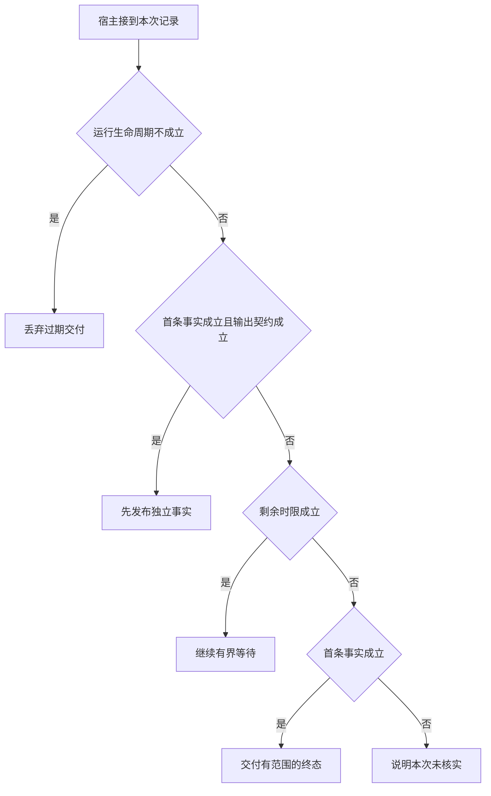

# 前台查询何时值得先流出一个事实

用户继续输入下一个字符后，前一轮联想请求可能失效。
首字节可以提前，未经核实的结论却不能冒充首事实。
保留已证实部分时要同时说明最终义务是否完成。

本篇用一个封闭的教学决策器说明这一问题。输入是宿主收到的记录，不保证每个下游字段都已经获准使用。前置检查未成立时，下游即使带着缓存值，也不能拿来作业务断言。

## 先解决一个具体问题

**联想接口返回得越早，用户体验一定越好吗？**

旧输入的错误结果和没有事实的进度提示都能很快返回。
要对齐哪次输入仍有效、是否产生可用信息，以及随后能否在限定时间给出正确终态。


先取一个能走到「说明本次未核实」的输入：本轮尚在处理、只有进度或未证实文本、用户要求完整后再发布、剩余时限不足。
把这四个条件代回后文的图，前面各个拦截分支都未满足，最终才有“只有进度文字不足以回答问题”这个判断。
还原这个现场时要分别问：哪些位来自可信状态，哪些只是在接口中出现、尚未获得解释资格的字段。

## 先沿一次决策走到底



从上到下取第一条成立的出口。只改一个开关时，只有它之前的检查都未截断，该变化才可能到达真实动作。

“运行生命周期”的两种输入分别是“本轮尚在处理”与“本轮已经终止”。
过期回执可归档，不能悄悄覆盖已交付的终态。

“首条事实”的两种输入分别是“已取得首条可核实事实”与“只有进度或未证实文本”。
开始生成不等于用户已得到可用信息。

“输出契约”的两种输入分别是“允许先发独立核实事实”与“用户要求完整后再发布”。
首条事实与完整比较有不同结束条件。

“剩余时限”的两种输入分别是“截止前仍能完成下一动作”与“剩余时限不足”。
总时间应包含排队、动作和结果交付。

## 最少需要哪几项观察

### 丢弃过期交付

旧请求不能替换当前输入结果。
在本节的全部组合中，有 8 种产生「丢弃过期交付」，这只是逻辑空间的计数，不能当作实际用户请求的比例。

只取得本轮已经终止，已经足以要求宿主「丢弃过期交付」。
保持这些已知项，其余开关自由变化，仍有 8 种补全，判断没有翻转。

若删掉关于运行生命周期的证据，另一份允许的现场是本轮尚在处理、只有进度或未证实文本、用户要求完整后再发布、剩余时限不足，它会使宿主「说明本次未核实」。

### 先发布独立事实

契约允许提前发布已核实内容。
在本节的全部组合中，有 2 种产生「先发布独立事实」，这只是逻辑空间的计数，不能当作实际用户请求的比例。

只取得本轮尚在处理、已取得首条可核实事实、允许先发独立核实事实，已经足以要求宿主「先发布独立事实」。
保持这些已知项，其余开关自由变化，仍有 2 种补全，判断没有翻转。

若删掉关于运行生命周期的证据，另一份允许的现场是本轮已经终止、已取得首条可核实事实、允许先发独立核实事实、剩余时限不足，它会使宿主「丢弃过期交付」。

若删掉关于首条事实的证据，另一份允许的现场是本轮尚在处理、只有进度或未证实文本、允许先发独立核实事实、剩余时限不足，它会使宿主「说明本次未核实」。

若删掉关于输出契约的证据，另一份允许的现场是本轮尚在处理、已取得首条可核实事实、用户要求完整后再发布、剩余时限不足，它会使宿主「交付有范围的终态」。

### 继续有界等待

仍有时间满足完整条件。
在本节的全部组合中，有 3 种产生「继续有界等待」，这只是逻辑空间的计数，不能当作实际用户请求的比例。

只取得本轮尚在处理、只有进度或未证实文本、截止前仍能完成下一动作，已经足以要求宿主「继续有界等待」。

若删掉关于运行生命周期的证据，另一份允许的现场是本轮已经终止、只有进度或未证实文本、用户要求完整后再发布、截止前仍能完成下一动作，它会使宿主「丢弃过期交付」。

若删掉关于首条事实的证据，另一份允许的现场是本轮尚在处理、已取得首条可核实事实、允许先发独立核实事实、截止前仍能完成下一动作，它会使宿主「先发布独立事实」。

若删掉关于剩余时限的证据，另一份允许的现场是本轮尚在处理、只有进度或未证实文本、用户要求完整后再发布、剩余时限不足，它会使宿主「说明本次未核实」。

只取得本轮尚在处理、用户要求完整后再发布、截止前仍能完成下一动作，已经足以要求宿主「继续有界等待」。


若删掉关于输出契约的证据，另一份允许的现场是本轮尚在处理、已取得首条可核实事实、允许先发独立核实事实、截止前仍能完成下一动作，它会使宿主「先发布独立事实」。


### 交付有范围的终态

截止时至少已有一项事实。
在本节的全部组合中，有 1 种产生「交付有范围的终态」，这只是逻辑空间的计数，不能当作实际用户请求的比例。

只取得本轮尚在处理、已取得首条可核实事实、用户要求完整后再发布、剩余时限不足，已经足以要求宿主「交付有范围的终态」。
保持这些已知项，其余开关自由变化，仍有 1 种补全，判断没有翻转。

若删掉关于运行生命周期的证据，另一份允许的现场是本轮已经终止、已取得首条可核实事实、用户要求完整后再发布、剩余时限不足，它会使宿主「丢弃过期交付」。

若删掉关于首条事实的证据，另一份允许的现场是本轮尚在处理、只有进度或未证实文本、用户要求完整后再发布、剩余时限不足，它会使宿主「说明本次未核实」。

若删掉关于输出契约的证据，另一份允许的现场是本轮尚在处理、已取得首条可核实事实、允许先发独立核实事实、剩余时限不足，它会使宿主「先发布独立事实」。

若删掉关于剩余时限的证据，另一份允许的现场是本轮尚在处理、已取得首条可核实事实、用户要求完整后再发布、截止前仍能完成下一动作，它会使宿主「继续有界等待」。

### 说明本次未核实

只有进度文字不足以回答问题。
在本节的全部组合中，有 2 种产生「说明本次未核实」，这只是逻辑空间的计数，不能当作实际用户请求的比例。

只取得本轮尚在处理、只有进度或未证实文本、剩余时限不足，已经足以要求宿主「说明本次未核实」。

若删掉关于运行生命周期的证据，另一份允许的现场是本轮已经终止、只有进度或未证实文本、用户要求完整后再发布、剩余时限不足，它会使宿主「丢弃过期交付」。

若删掉关于首条事实的证据，另一份允许的现场是本轮尚在处理、已取得首条可核实事实、用户要求完整后再发布、剩余时限不足，它会使宿主「交付有范围的终态」。

若删掉关于剩余时限的证据，另一份允许的现场是本轮尚在处理、只有进度或未证实文本、用户要求完整后再发布、截止前仍能完成下一动作，它会使宿主「继续有界等待」。

## 以同一份契约解释截然不同的现场

<details>
<summary>展开推演与对应反例</summary>

下列样本按最先命中的业务分支排列。四位编码只作本篇页内定位，顺序与开头的四项输入一致。可以先猜下一动作，再展开相邻样本。

### 能够触发“丢弃过期交付”的现场

**样本 0000**

业务侧交来本轮已经终止、只有进度或未证实文本，执行侧还记录了用户要求完整后再发布、剩余时限不足。
把样本压成最短证明，保留本轮已经终止就能支持「丢弃过期交付」。

在这份记录上，分别翻转「运行生命周期」中的任一项，其他项完全不变时，下一动作都会改变。

保持其余观察不动，单独切换「首条事实」、「输出契约」、「剩余时限」仍得到「丢弃过期交付」，它们在这个现场不是决定性变量。

要从本例改走「说明本次未核实」，至少需要变动 1 项，一组最少改动是将本轮已经终止换成本轮尚在处理。

要从本例改走「继续有界等待」，至少需要变动 2 项，一组最少改动是将本轮已经终止、剩余时限不足换成本轮尚在处理、截止前仍能完成下一动作。

要从本例改走「交付有范围的终态」，至少需要变动 2 项，一组最少改动是将本轮已经终止、只有进度或未证实文本换成本轮尚在处理、已取得首条可核实事实。

要从本例改走「先发布独立事实」，至少需要变动 3 项，一组最少改动是将本轮已经终止、只有进度或未证实文本、用户要求完整后再发布换成本轮尚在处理、已取得首条可核实事实、允许先发独立核实事实。

**样本 0001**

业务侧交来本轮已经终止、只有进度或未证实文本，执行侧还记录了用户要求完整后再发布、截止前仍能完成下一动作。


要从本例改走「继续有界等待」，至少需要变动 1 项，一组最少改动是将本轮已经终止换成本轮尚在处理。

要从本例改走「说明本次未核实」，至少需要变动 2 项，一组最少改动是将本轮已经终止、截止前仍能完成下一动作换成本轮尚在处理、剩余时限不足。

要从本例改走「交付有范围的终态」，至少需要变动 3 项，一组最少改动是将本轮已经终止、只有进度或未证实文本、截止前仍能完成下一动作换成本轮尚在处理、已取得首条可核实事实、剩余时限不足。


**样本 0010**

业务侧交来本轮已经终止、只有进度或未证实文本，执行侧还记录了允许先发独立核实事实、剩余时限不足。


要从本例改走「先发布独立事实」，至少需要变动 2 项，一组最少改动是将本轮已经终止、只有进度或未证实文本换成本轮尚在处理、已取得首条可核实事实。

要从本例改走「交付有范围的终态」，至少需要变动 3 项，一组最少改动是将本轮已经终止、只有进度或未证实文本、允许先发独立核实事实换成本轮尚在处理、已取得首条可核实事实、用户要求完整后再发布。

**样本 0011**

业务侧交来本轮已经终止、只有进度或未证实文本，执行侧还记录了允许先发独立核实事实、截止前仍能完成下一动作。


要从本例改走「交付有范围的终态」，至少需要变动 4 项，一组最少改动是将本轮已经终止、只有进度或未证实文本、允许先发独立核实事实、截止前仍能完成下一动作换成本轮尚在处理、已取得首条可核实事实、用户要求完整后再发布、剩余时限不足。

**样本 0100**

业务侧交来本轮已经终止、已取得首条可核实事实，执行侧还记录了用户要求完整后再发布、剩余时限不足。


要从本例改走「交付有范围的终态」，至少需要变动 1 项，一组最少改动是将本轮已经终止换成本轮尚在处理。

要从本例改走「说明本次未核实」，至少需要变动 2 项，一组最少改动是将本轮已经终止、已取得首条可核实事实换成本轮尚在处理、只有进度或未证实文本。


要从本例改走「先发布独立事实」，至少需要变动 2 项，一组最少改动是将本轮已经终止、用户要求完整后再发布换成本轮尚在处理、允许先发独立核实事实。

**样本 0101**

业务侧交来本轮已经终止、已取得首条可核实事实，执行侧还记录了用户要求完整后再发布、截止前仍能完成下一动作。


要从本例改走「交付有范围的终态」，至少需要变动 2 项，一组最少改动是将本轮已经终止、截止前仍能完成下一动作换成本轮尚在处理、剩余时限不足。


要从本例改走「说明本次未核实」，至少需要变动 3 项，一组最少改动是将本轮已经终止、已取得首条可核实事实、截止前仍能完成下一动作换成本轮尚在处理、只有进度或未证实文本、剩余时限不足。

**样本 0110**

业务侧交来本轮已经终止、已取得首条可核实事实，执行侧还记录了允许先发独立核实事实、剩余时限不足。


要从本例改走「先发布独立事实」，至少需要变动 1 项，一组最少改动是将本轮已经终止换成本轮尚在处理。


要从本例改走「交付有范围的终态」，至少需要变动 2 项，一组最少改动是将本轮已经终止、允许先发独立核实事实换成本轮尚在处理、用户要求完整后再发布。

要从本例改走「继续有界等待」，至少需要变动 3 项，一组最少改动是将本轮已经终止、已取得首条可核实事实、剩余时限不足换成本轮尚在处理、只有进度或未证实文本、截止前仍能完成下一动作。

**样本 0111**

业务侧交来本轮已经终止、已取得首条可核实事实，执行侧还记录了允许先发独立核实事实、截止前仍能完成下一动作。


要从本例改走「继续有界等待」，至少需要变动 2 项，一组最少改动是将本轮已经终止、已取得首条可核实事实换成本轮尚在处理、只有进度或未证实文本。


要从本例改走「交付有范围的终态」，至少需要变动 3 项，一组最少改动是将本轮已经终止、允许先发独立核实事实、截止前仍能完成下一动作换成本轮尚在处理、用户要求完整后再发布、剩余时限不足。

### 能够触发“先发布独立事实”的现场

**样本 1110**

业务侧交来本轮尚在处理、已取得首条可核实事实，执行侧还记录了允许先发独立核实事实、剩余时限不足。
把样本压成最短证明，保留本轮尚在处理、已取得首条可核实事实、允许先发独立核实事实就能支持「先发布独立事实」。

在这份记录上，分别翻转「运行生命周期」、「首条事实」、「输出契约」中的任一项，其他项完全不变时，下一动作都会改变。

保持其余观察不动，单独切换「剩余时限」仍得到「先发布独立事实」，它们在这个现场不是决定性变量。

本例没走更靠前的「丢弃过期交付」，因为本轮尚在处理与那个入口的必要条件不符。

要从本例改走「丢弃过期交付」，至少需要变动 1 项，一组最少改动是将本轮尚在处理换成本轮已经终止。

要从本例改走「说明本次未核实」，至少需要变动 1 项，一组最少改动是将已取得首条可核实事实换成只有进度或未证实文本。

要从本例改走「交付有范围的终态」，至少需要变动 1 项，一组最少改动是将允许先发独立核实事实换成用户要求完整后再发布。

要从本例改走「继续有界等待」，至少需要变动 2 项，一组最少改动是将已取得首条可核实事实、剩余时限不足换成只有进度或未证实文本、截止前仍能完成下一动作。

**样本 1111**

业务侧交来本轮尚在处理、已取得首条可核实事实，执行侧还记录了允许先发独立核实事实、截止前仍能完成下一动作。


要从本例改走「继续有界等待」，至少需要变动 1 项，一组最少改动是将已取得首条可核实事实换成只有进度或未证实文本。

要从本例改走「说明本次未核实」，至少需要变动 2 项，一组最少改动是将已取得首条可核实事实、截止前仍能完成下一动作换成只有进度或未证实文本、剩余时限不足。

要从本例改走「交付有范围的终态」，至少需要变动 2 项，一组最少改动是将允许先发独立核实事实、截止前仍能完成下一动作换成用户要求完整后再发布、剩余时限不足。

### 能够触发“继续有界等待”的现场

**样本 1001**

业务侧交来本轮尚在处理、只有进度或未证实文本，执行侧还记录了用户要求完整后再发布、截止前仍能完成下一动作。
把样本压成最短证明，保留本轮尚在处理、只有进度或未证实文本、截止前仍能完成下一动作就能支持「继续有界等待」。

在这份记录上，分别翻转「运行生命周期」、「剩余时限」中的任一项，其他项完全不变时，下一动作都会改变。

保持其余观察不动，单独切换「首条事实」、「输出契约」仍得到「继续有界等待」，它们在这个现场不是决定性变量。


本例没走更靠前的「先发布独立事实」，因为只有进度或未证实文本、用户要求完整后再发布与那个入口的必要条件不符。


要从本例改走「说明本次未核实」，至少需要变动 1 项，一组最少改动是将截止前仍能完成下一动作换成剩余时限不足。

要从本例改走「交付有范围的终态」，至少需要变动 2 项，一组最少改动是将只有进度或未证实文本、截止前仍能完成下一动作换成已取得首条可核实事实、剩余时限不足。

要从本例改走「先发布独立事实」，至少需要变动 2 项，一组最少改动是将只有进度或未证实文本、用户要求完整后再发布换成已取得首条可核实事实、允许先发独立核实事实。

**样本 1011**

业务侧交来本轮尚在处理、只有进度或未证实文本，执行侧还记录了允许先发独立核实事实、截止前仍能完成下一动作。

在这份记录上，分别翻转「运行生命周期」、「首条事实」、「剩余时限」中的任一项，其他项完全不变时，下一动作都会改变。

保持其余观察不动，单独切换「输出契约」仍得到「继续有界等待」，它们在这个现场不是决定性变量。


本例没走更靠前的「先发布独立事实」，因为只有进度或未证实文本与那个入口的必要条件不符。


要从本例改走「先发布独立事实」，至少需要变动 1 项，一组最少改动是将只有进度或未证实文本换成已取得首条可核实事实。

要从本例改走「交付有范围的终态」，至少需要变动 3 项，一组最少改动是将只有进度或未证实文本、允许先发独立核实事实、截止前仍能完成下一动作换成已取得首条可核实事实、用户要求完整后再发布、剩余时限不足。

**样本 1101**

业务侧交来本轮尚在处理、已取得首条可核实事实，执行侧还记录了用户要求完整后再发布、截止前仍能完成下一动作。
把样本压成最短证明，保留本轮尚在处理、用户要求完整后再发布、截止前仍能完成下一动作就能支持「继续有界等待」。

在这份记录上，分别翻转「运行生命周期」、「输出契约」、「剩余时限」中的任一项，其他项完全不变时，下一动作都会改变。

保持其余观察不动，单独切换「首条事实」仍得到「继续有界等待」，它们在这个现场不是决定性变量。


本例没走更靠前的「先发布独立事实」，因为用户要求完整后再发布与那个入口的必要条件不符。


要从本例改走「交付有范围的终态」，至少需要变动 1 项，一组最少改动是将截止前仍能完成下一动作换成剩余时限不足。

要从本例改走「先发布独立事实」，至少需要变动 1 项，一组最少改动是将用户要求完整后再发布换成允许先发独立核实事实。


### 能够触发“交付有范围的终态”的现场

**样本 1100**

业务侧交来本轮尚在处理、已取得首条可核实事实，执行侧还记录了用户要求完整后再发布、剩余时限不足。
把样本压成最短证明，保留本轮尚在处理、已取得首条可核实事实、用户要求完整后再发布、剩余时限不足就能支持「交付有范围的终态」。

在这份记录上，分别翻转「运行生命周期」、「首条事实」、「输出契约」、「剩余时限」中的任一项，其他项完全不变时，下一动作都会改变。


本例没走更靠前的「继续有界等待」，因为剩余时限不足与那个入口的必要条件不符。


要从本例改走「继续有界等待」，至少需要变动 1 项，一组最少改动是将剩余时限不足换成截止前仍能完成下一动作。


### 能够触发“说明本次未核实”的现场

**样本 1000**

业务侧交来本轮尚在处理、只有进度或未证实文本，执行侧还记录了用户要求完整后再发布、剩余时限不足。
把样本压成最短证明，保留本轮尚在处理、只有进度或未证实文本、剩余时限不足就能支持「说明本次未核实」。


保持其余观察不动，单独切换「输出契约」仍得到「说明本次未核实」，它们在这个现场不是决定性变量。


本例没走更靠前的「交付有范围的终态」，因为只有进度或未证实文本与那个入口的必要条件不符。


要从本例改走「交付有范围的终态」，至少需要变动 1 项，一组最少改动是将只有进度或未证实文本换成已取得首条可核实事实。


**样本 1010**

业务侧交来本轮尚在处理、只有进度或未证实文本，执行侧还记录了允许先发独立核实事实、剩余时限不足。


要从本例改走「交付有范围的终态」，至少需要变动 2 项，一组最少改动是将只有进度或未证实文本、允许先发独立核实事实换成已取得首条可核实事实、用户要求完整后再发布。

</details>

## 当你只能看见一半记录

<details>
<summary>展开推演与对应反例</summary>

这次隐藏两个字段，保留另两个。对每个可见现场，检查四种合法补全是否同意。如仍有歧义，选择能使最坏剩余候选动作最少的字段继续查。并列时采用本篇字段顺序。

### 只保留运行生命周期与首条事实

已知本轮已经终止、只有进度或未证实文本时，四种补全的动作分布为丢弃过期交付（4 种）。

就“丢弃过期交付”这个动作而言，在本轮已经终止、只有进度或未证实文本的前提下，另外两项观察不会推翻它。

已知本轮已经终止、已取得首条可核实事实时，四种补全的动作分布为丢弃过期交付（4 种）。

就“丢弃过期交付”这个动作而言，在本轮已经终止、已取得首条可核实事实的前提下，另外两项观察不会推翻它。

已知本轮尚在处理、只有进度或未证实文本时，四种补全的动作分布为继续有界等待（2 种）、说明本次未核实（2 种）。

在本轮尚在处理、只有进度或未证实文本这个现场补读「剩余时限」，最坏还剩 1 种动作，计算时只衡量歧义，尚未扣读取代价。
若补来的观察为“剩余时限不足”，范围缩成「说明本次未核实」。若为“截止前仍能完成下一动作”，则保留「继续有界等待」。

区分不了的两条执行可以具体写成 1000 与 1001：它们共享已展示字段，却分别需要「说明本次未核实」和「继续有界等待」。

已知本轮尚在处理、已取得首条可核实事实时，四种补全的动作分布为先发布独立事实（2 种）、继续有界等待（1 种）、交付有范围的终态（1 种）。

在本轮尚在处理、已取得首条可核实事实这个现场补读「输出契约」，最坏还剩 2 种动作，计算时只衡量歧义，尚未扣读取代价。
若补来的观察为“用户要求完整后再发布”，范围缩成「交付有范围的终态」、「继续有界等待」。若为“允许先发独立核实事实”，则保留「先发布独立事实」。

区分不了的两条执行可以具体写成 1100 与 1101：它们共享已展示字段，却分别需要「交付有范围的终态」和「继续有界等待」。

### 只保留运行生命周期与输出契约

已知本轮已经终止、用户要求完整后再发布时，四种补全的动作分布为丢弃过期交付（4 种）。

就“丢弃过期交付”这个动作而言，在本轮已经终止、用户要求完整后再发布的前提下，另外两项观察不会推翻它。

已知本轮已经终止、允许先发独立核实事实时，四种补全的动作分布为丢弃过期交付（4 种）。

就“丢弃过期交付”这个动作而言，在本轮已经终止、允许先发独立核实事实的前提下，另外两项观察不会推翻它。

已知本轮尚在处理、用户要求完整后再发布时，四种补全的动作分布为继续有界等待（2 种）、交付有范围的终态（1 种）、说明本次未核实（1 种）。

在本轮尚在处理、用户要求完整后再发布这个现场补读「首条事实」，最坏还剩 2 种动作，计算时只衡量歧义，尚未扣读取代价。
若补来的观察为“只有进度或未证实文本”，范围缩成「说明本次未核实」、「继续有界等待」。若为“已取得首条可核实事实”，则保留「交付有范围的终态」、「继续有界等待」。


已知本轮尚在处理、允许先发独立核实事实时，四种补全的动作分布为先发布独立事实（2 种）、继续有界等待（1 种）、说明本次未核实（1 种）。

在本轮尚在处理、允许先发独立核实事实这个现场补读「首条事实」，最坏还剩 2 种动作，计算时只衡量歧义，尚未扣读取代价。
若补来的观察为“只有进度或未证实文本”，范围缩成「说明本次未核实」、「继续有界等待」。若为“已取得首条可核实事实”，则保留「先发布独立事实」。

区分不了的两条执行可以具体写成 1010 与 1011：它们共享已展示字段，却分别需要「说明本次未核实」和「继续有界等待」。

### 只保留首条事实与输出契约

已知只有进度或未证实文本、用户要求完整后再发布时，四种补全的动作分布为丢弃过期交付（2 种）、继续有界等待（1 种）、说明本次未核实（1 种）。

在只有进度或未证实文本、用户要求完整后再发布这个现场补读「运行生命周期」，最坏还剩 2 种动作，计算时只衡量歧义，尚未扣读取代价。
若补来的观察为“本轮已经终止”，范围缩成「丢弃过期交付」。若为“本轮尚在处理”，则保留「说明本次未核实」、「继续有界等待」。

区分不了的两条执行可以具体写成 0000 与 1000：它们共享已展示字段，却分别需要「丢弃过期交付」和「说明本次未核实」。

已知只有进度或未证实文本、允许先发独立核实事实时，四种补全的动作分布为丢弃过期交付（2 种）、继续有界等待（1 种）、说明本次未核实（1 种）。

在只有进度或未证实文本、允许先发独立核实事实这个现场补读「运行生命周期」，最坏还剩 2 种动作，计算时只衡量歧义，尚未扣读取代价。

区分不了的两条执行可以具体写成 0010 与 1010：它们共享已展示字段，却分别需要「丢弃过期交付」和「说明本次未核实」。

已知已取得首条可核实事实、用户要求完整后再发布时，四种补全的动作分布为丢弃过期交付（2 种）、继续有界等待（1 种）、交付有范围的终态（1 种）。

在已取得首条可核实事实、用户要求完整后再发布这个现场补读「运行生命周期」，最坏还剩 2 种动作，计算时只衡量歧义，尚未扣读取代价。
若补来的观察为“本轮已经终止”，范围缩成「丢弃过期交付」。若为“本轮尚在处理”，则保留「交付有范围的终态」、「继续有界等待」。

区分不了的两条执行可以具体写成 0100 与 1100：它们共享已展示字段，却分别需要「丢弃过期交付」和「交付有范围的终态」。

已知已取得首条可核实事实、允许先发独立核实事实时，四种补全的动作分布为丢弃过期交付（2 种）、先发布独立事实（2 种）。

在已取得首条可核实事实、允许先发独立核实事实这个现场补读「运行生命周期」，最坏还剩 1 种动作，计算时只衡量歧义，尚未扣读取代价。
若补来的观察为“本轮已经终止”，范围缩成「丢弃过期交付」。若为“本轮尚在处理”，则保留「先发布独立事实」。

区分不了的两条执行可以具体写成 0110 与 1110：它们共享已展示字段，却分别需要「丢弃过期交付」和「先发布独立事实」。

### 只保留运行生命周期与剩余时限

已知本轮已经终止、剩余时限不足时，四种补全的动作分布为丢弃过期交付（4 种）。

就“丢弃过期交付”这个动作而言，在本轮已经终止、剩余时限不足的前提下，另外两项观察不会推翻它。

已知本轮已经终止、截止前仍能完成下一动作时，四种补全的动作分布为丢弃过期交付（4 种）。

就“丢弃过期交付”这个动作而言，在本轮已经终止、截止前仍能完成下一动作的前提下，另外两项观察不会推翻它。

已知本轮尚在处理、剩余时限不足时，四种补全的动作分布为先发布独立事实（1 种）、交付有范围的终态（1 种）、说明本次未核实（2 种）。

在本轮尚在处理、剩余时限不足这个现场补读「首条事实」，最坏还剩 2 种动作，计算时只衡量歧义，尚未扣读取代价。
若补来的观察为“只有进度或未证实文本”，范围缩成「说明本次未核实」。若为“已取得首条可核实事实”，则保留「交付有范围的终态」、「先发布独立事实」。

区分不了的两条执行可以具体写成 1000 与 1100：它们共享已展示字段，却分别需要「说明本次未核实」和「交付有范围的终态」。

已知本轮尚在处理、截止前仍能完成下一动作时，四种补全的动作分布为先发布独立事实（1 种）、继续有界等待（3 种）。

在本轮尚在处理、截止前仍能完成下一动作这个现场补读「首条事实」，最坏还剩 2 种动作，计算时只衡量歧义，尚未扣读取代价。
若补来的观察为“只有进度或未证实文本”，范围缩成「继续有界等待」。若为“已取得首条可核实事实”，则保留「继续有界等待」、「先发布独立事实」。

区分不了的两条执行可以具体写成 1001 与 1111：它们共享已展示字段，却分别需要「继续有界等待」和「先发布独立事实」。

### 只保留首条事实与剩余时限

已知只有进度或未证实文本、剩余时限不足时，四种补全的动作分布为丢弃过期交付（2 种）、说明本次未核实（2 种）。

在只有进度或未证实文本、剩余时限不足这个现场补读「运行生命周期」，最坏还剩 1 种动作，计算时只衡量歧义，尚未扣读取代价。
若补来的观察为“本轮已经终止”，范围缩成「丢弃过期交付」。若为“本轮尚在处理”，则保留「说明本次未核实」。


已知只有进度或未证实文本、截止前仍能完成下一动作时，四种补全的动作分布为丢弃过期交付（2 种）、继续有界等待（2 种）。

在只有进度或未证实文本、截止前仍能完成下一动作这个现场补读「运行生命周期」，最坏还剩 1 种动作，计算时只衡量歧义，尚未扣读取代价。
若补来的观察为“本轮已经终止”，范围缩成「丢弃过期交付」。若为“本轮尚在处理”，则保留「继续有界等待」。

区分不了的两条执行可以具体写成 0001 与 1001：它们共享已展示字段，却分别需要「丢弃过期交付」和「继续有界等待」。

已知已取得首条可核实事实、剩余时限不足时，四种补全的动作分布为丢弃过期交付（2 种）、先发布独立事实（1 种）、交付有范围的终态（1 种）。

在已取得首条可核实事实、剩余时限不足这个现场补读「运行生命周期」，最坏还剩 2 种动作，计算时只衡量歧义，尚未扣读取代价。
若补来的观察为“本轮已经终止”，范围缩成「丢弃过期交付」。若为“本轮尚在处理”，则保留「交付有范围的终态」、「先发布独立事实」。


已知已取得首条可核实事实、截止前仍能完成下一动作时，四种补全的动作分布为丢弃过期交付（2 种）、先发布独立事实（1 种）、继续有界等待（1 种）。

在已取得首条可核实事实、截止前仍能完成下一动作这个现场补读「运行生命周期」，最坏还剩 2 种动作，计算时只衡量歧义，尚未扣读取代价。
若补来的观察为“本轮已经终止”，范围缩成「丢弃过期交付」。若为“本轮尚在处理”，则保留「继续有界等待」、「先发布独立事实」。

区分不了的两条执行可以具体写成 0101 与 1101：它们共享已展示字段，却分别需要「丢弃过期交付」和「继续有界等待」。

### 只保留输出契约与剩余时限

已知用户要求完整后再发布、剩余时限不足时，四种补全的动作分布为丢弃过期交付（2 种）、交付有范围的终态（1 种）、说明本次未核实（1 种）。

在用户要求完整后再发布、剩余时限不足这个现场补读「运行生命周期」，最坏还剩 2 种动作，计算时只衡量歧义，尚未扣读取代价。
若补来的观察为“本轮已经终止”，范围缩成「丢弃过期交付」。若为“本轮尚在处理”，则保留「说明本次未核实」、「交付有范围的终态」。


已知用户要求完整后再发布、截止前仍能完成下一动作时，四种补全的动作分布为丢弃过期交付（2 种）、继续有界等待（2 种）。

在用户要求完整后再发布、截止前仍能完成下一动作这个现场补读「运行生命周期」，最坏还剩 1 种动作，计算时只衡量歧义，尚未扣读取代价。


已知允许先发独立核实事实、剩余时限不足时，四种补全的动作分布为丢弃过期交付（2 种）、先发布独立事实（1 种）、说明本次未核实（1 种）。

在允许先发独立核实事实、剩余时限不足这个现场补读「运行生命周期」，最坏还剩 2 种动作，计算时只衡量歧义，尚未扣读取代价。
若补来的观察为“本轮已经终止”，范围缩成「丢弃过期交付」。若为“本轮尚在处理”，则保留「说明本次未核实」、「先发布独立事实」。


已知允许先发独立核实事实、截止前仍能完成下一动作时，四种补全的动作分布为丢弃过期交付（2 种）、先发布独立事实（1 种）、继续有界等待（1 种）。

在允许先发独立核实事实、截止前仍能完成下一动作这个现场补读「运行生命周期」，最坏还剩 2 种动作，计算时只衡量歧义，尚未扣读取代价。

区分不了的两条执行可以具体写成 0011 与 1011：它们共享已展示字段，却分别需要「丢弃过期交付」和「继续有界等待」。

</details>

## 单因素干预与边界测试

<details>
<summary>展开推演与对应反例</summary>

### 只改变运行生命周期

固定另外三个条件得到八对现场，从“本轮已经终止”转为“本轮尚在处理”时，8 对翻转动作，另外 0 对保持不变。

有 2 对现场沿「丢弃过期交付」变到「说明本次未核实」，可复现的一组受控背景为只有进度或未证实文本、用户要求完整后再发布、剩余时限不足。

有 3 对现场沿「丢弃过期交付」变到「继续有界等待」，可复现的一组受控背景为只有进度或未证实文本、用户要求完整后再发布、截止前仍能完成下一动作。

有 1 对现场沿「丢弃过期交付」变到「交付有范围的终态」，可复现的一组受控背景为已取得首条可核实事实、用户要求完整后再发布、剩余时限不足。

有 2 对现场沿「丢弃过期交付」变到「先发布独立事实」，可复现的一组受控背景为已取得首条可核实事实、允许先发独立核实事实、剩余时限不足。

### 只改变首条事实

固定另外三个条件得到八对现场，从“只有进度或未证实文本”转为“已取得首条可核实事实”时，3 对翻转动作，另外 5 对保持不变。

令本轮已经终止、用户要求完整后再发布、剩余时限不足，首条事实的两个取值均得到「丢弃过期交付」。在八对中，共有 4 对表现为这一种稳定出口。

有 1 对现场沿「说明本次未核实」变到「交付有范围的终态」，可复现的一组受控背景为本轮尚在处理、用户要求完整后再发布、剩余时限不足。

令本轮尚在处理、用户要求完整后再发布、截止前仍能完成下一动作，首条事实的两个取值均得到「继续有界等待」。在八对中，共有 1 对表现为这一种稳定出口。

有 1 对现场沿「说明本次未核实」变到「先发布独立事实」，可复现的一组受控背景为本轮尚在处理、允许先发独立核实事实、剩余时限不足。

有 1 对现场沿「继续有界等待」变到「先发布独立事实」，可复现的一组受控背景为本轮尚在处理、允许先发独立核实事实、截止前仍能完成下一动作。

### 只改变输出契约

固定另外三个条件得到八对现场，从“用户要求完整后再发布”转为“允许先发独立核实事实”时，2 对翻转动作，另外 6 对保持不变。

令本轮已经终止、只有进度或未证实文本、剩余时限不足，输出契约的两个取值均得到「丢弃过期交付」。在八对中，共有 4 对表现为这一种稳定出口。

令本轮尚在处理、只有进度或未证实文本、剩余时限不足，输出契约的两个取值均得到「说明本次未核实」。在八对中，共有 1 对表现为这一种稳定出口。

令本轮尚在处理、只有进度或未证实文本、截止前仍能完成下一动作，输出契约的两个取值均得到「继续有界等待」。在八对中，共有 1 对表现为这一种稳定出口。

有 1 对现场沿「交付有范围的终态」变到「先发布独立事实」，可复现的一组受控背景为本轮尚在处理、已取得首条可核实事实、剩余时限不足。

有 1 对现场沿「继续有界等待」变到「先发布独立事实」，可复现的一组受控背景为本轮尚在处理、已取得首条可核实事实、截止前仍能完成下一动作。

### 只改变剩余时限

固定另外三个条件得到八对现场，从“剩余时限不足”转为“截止前仍能完成下一动作”时，3 对翻转动作，另外 5 对保持不变。

令本轮已经终止、只有进度或未证实文本、用户要求完整后再发布，剩余时限的两个取值均得到「丢弃过期交付」。在八对中，共有 4 对表现为这一种稳定出口。

有 2 对现场沿「说明本次未核实」变到「继续有界等待」，可复现的一组受控背景为本轮尚在处理、只有进度或未证实文本、用户要求完整后再发布。

有 1 对现场沿「交付有范围的终态」变到「继续有界等待」，可复现的一组受控背景为本轮尚在处理、已取得首条可核实事实、用户要求完整后再发布。

令本轮尚在处理、已取得首条可核实事实、允许先发独立核实事实，剩余时限的两个取值均得到「先发布独立事实」。在八对中，共有 1 对表现为这一种稳定出口。

</details>

## 哪些回归样本真能抓住实现错误

<details>
<summary>展开推演与对应反例</summary>

如果删除“丢弃过期交付”这个分支，在本篇 16 种输入里有 8 种会改走另一出口。

反例 0000 的完整记录为本轮已经终止、只有进度或未证实文本、用户要求完整后再发布、剩余时限不足。正确结果是「丢弃过期交付」，这个改坏的实现却给出「说明本次未核实」。

如果删除“先发布独立事实”这个分支，在本篇 16 种输入里有 2 种会改走另一出口。

反例 1110 的完整记录为本轮尚在处理、已取得首条可核实事实、允许先发独立核实事实、剩余时限不足。正确结果是「先发布独立事实」，这个改坏的实现却给出「交付有范围的终态」。

如果删除“继续有界等待”这个分支，在本篇 16 种输入里有 3 种会改走另一出口。

反例 1001 的完整记录为本轮尚在处理、只有进度或未证实文本、用户要求完整后再发布、截止前仍能完成下一动作。正确结果是「继续有界等待」，这个改坏的实现却给出「说明本次未核实」。

如果删除“交付有范围的终态”这个分支，在本篇 16 种输入里有 1 种会改走另一出口。

反例 1100 的完整记录为本轮尚在处理、已取得首条可核实事实、用户要求完整后再发布、剩余时限不足。正确结果是「交付有范围的终态」，这个改坏的实现却给出「说明本次未核实」。

如果交换“丢弃过期交付”和“先发布独立事实”的判断次序，在本篇 16 种输入里有 2 种会改走另一出口。

反例 0110 的完整记录为本轮已经终止、已取得首条可核实事实、允许先发独立核实事实、剩余时限不足。正确结果是「丢弃过期交付」，这个改坏的实现却给出「先发布独立事实」。

如果交换“先发布独立事实”和“继续有界等待”的判断次序，在本篇 16 种输入里有 1 种会改走另一出口。

反例 1111 的完整记录为本轮尚在处理、已取得首条可核实事实、允许先发独立核实事实、截止前仍能完成下一动作。正确结果是「先发布独立事实」，这个改坏的实现却给出「继续有界等待」。

如果交换“继续有界等待”和“交付有范围的终态”的判断次序，在本篇 16 种输入里有 1 种会改走另一出口。

反例 1101 的完整记录为本轮尚在处理、已取得首条可核实事实、用户要求完整后再发布、截止前仍能完成下一动作。正确结果是「继续有界等待」，这个改坏的实现却给出「交付有范围的终态」。

补入样本 0110（本轮已经终止、已取得首条可核实事实、允许先发独立核实事实、剩余时限不足）能新增检出「删除“丢弃过期交付”这个分支」、「交换“丢弃过期交付”和“先发布独立事实”的判断次序」。

补入样本 1101（本轮尚在处理、已取得首条可核实事实、用户要求完整后再发布、截止前仍能完成下一动作）能新增检出「删除“继续有界等待”这个分支」、「交换“继续有界等待”和“交付有范围的终态”的判断次序」。

补入样本 1111（本轮尚在处理、已取得首条可核实事实、允许先发独立核实事实、截止前仍能完成下一动作）能新增检出「删除“先发布独立事实”这个分支」、「交换“先发布独立事实”和“继续有界等待”的判断次序」。

补入样本 1100（本轮尚在处理、已取得首条可核实事实、用户要求完整后再发布、剩余时限不足）能新增检出「删除“交付有范围的终态”这个分支」。

这里每次选覆盖尚未捕获缺陷最多的样本，并不保证用例数全局最小。它给出的反例能作为 Java 单测输入。真实模型是否会自主产生这些提议，仍须单独评测。

</details>

## 把状态覆盖换成有抽样偏差的评测批次

<details>
<summary>展开推演与对应反例</summary>

前面的十六种记录各有一票。现在只改样本构成：对一个给定字段，把成立侧的每种记录各取三份、另一侧各取一份。这是人为配比的 32 份回放，不是线上频率估计。
将偏向成立与偏向不成立的两次批次对照，可以隔离分母变化。底层宿主和所有答案保持相同，比例仍可能移动。

### 改变“运行生命周期”的样本配比

只看「丢弃过期交付」，在本轮尚在处理的八个不同输入中有 0 个命中，在本轮已经终止的另八个输入中有 8 个命中。
把「运行生命周期」成立侧按三倍取样，「丢弃过期交付」占 8/32，反过来向未成立侧倾斜后占 24/32。
这次重加权使「丢弃过期交付」的占比相差 50 个百分点。若按两种不同的“运行生命周期”分布跑新旧版，不能把这项差异全部归功于实现。

只看「先发布独立事实」，在本轮尚在处理的八个不同输入中有 2 个命中，在本轮已经终止的另八个输入中有 0 个命中。
把「运行生命周期」成立侧按三倍取样，「先发布独立事实」占 6/32，反过来向未成立侧倾斜后占 2/32。
这次重加权使「先发布独立事实」的占比相差 12.5 个百分点。若按两种不同的“运行生命周期”分布跑新旧版，不能把这项差异全部归功于实现。

只看「继续有界等待」，在本轮尚在处理的八个不同输入中有 3 个命中，在本轮已经终止的另八个输入中有 0 个命中。
把「运行生命周期」成立侧按三倍取样，「继续有界等待」占 9/32，反过来向未成立侧倾斜后占 3/32。
这次重加权使「继续有界等待」的占比相差 18.75 个百分点。若按两种不同的“运行生命周期”分布跑新旧版，不能把这项差异全部归功于实现。

只看「交付有范围的终态」，在本轮尚在处理的八个不同输入中有 1 个命中，在本轮已经终止的另八个输入中有 0 个命中。
把「运行生命周期」成立侧按三倍取样，「交付有范围的终态」占 3/32，反过来向未成立侧倾斜后占 1/32。
这次重加权使「交付有范围的终态」的占比相差 6.25 个百分点。若按两种不同的“运行生命周期”分布跑新旧版，不能把这项差异全部归功于实现。

只看「说明本次未核实」，在本轮尚在处理的八个不同输入中有 2 个命中，在本轮已经终止的另八个输入中有 0 个命中。
把「运行生命周期」成立侧按三倍取样，「说明本次未核实」占 6/32，反过来向未成立侧倾斜后占 2/32。
这次重加权使「说明本次未核实」的占比相差 12.5 个百分点。若按两种不同的“运行生命周期”分布跑新旧版，不能把这项差异全部归功于实现。

### 改变“首条事实”的样本配比

只看「丢弃过期交付」，在已取得首条可核实事实的八个不同输入中有 4 个命中，在只有进度或未证实文本的另八个输入中有 4 个命中。
把「首条事实」成立侧按三倍取样，「丢弃过期交付」占 16/32，反过来向未成立侧倾斜后占 16/32。
两批「丢弃过期交付」的边际比例相同，是因为这个出口在“首条事实”的两侧计数相等，这不能单独证明每一对现场都不受它影响。

只看「先发布独立事实」，在已取得首条可核实事实的八个不同输入中有 2 个命中，在只有进度或未证实文本的另八个输入中有 0 个命中。
把「首条事实」成立侧按三倍取样，「先发布独立事实」占 6/32，反过来向未成立侧倾斜后占 2/32。
这次重加权使「先发布独立事实」的占比相差 12.5 个百分点。若按两种不同的“首条事实”分布跑新旧版，不能把这项差异全部归功于实现。

只看「继续有界等待」，在已取得首条可核实事实的八个不同输入中有 1 个命中，在只有进度或未证实文本的另八个输入中有 2 个命中。
把「首条事实」成立侧按三倍取样，「继续有界等待」占 5/32，反过来向未成立侧倾斜后占 7/32。
这次重加权使「继续有界等待」的占比相差 6.25 个百分点。若按两种不同的“首条事实”分布跑新旧版，不能把这项差异全部归功于实现。

只看「交付有范围的终态」，在已取得首条可核实事实的八个不同输入中有 1 个命中，在只有进度或未证实文本的另八个输入中有 0 个命中。
把「首条事实」成立侧按三倍取样，「交付有范围的终态」占 3/32，反过来向未成立侧倾斜后占 1/32。
这次重加权使「交付有范围的终态」的占比相差 6.25 个百分点。若按两种不同的“首条事实”分布跑新旧版，不能把这项差异全部归功于实现。

只看「说明本次未核实」，在已取得首条可核实事实的八个不同输入中有 0 个命中，在只有进度或未证实文本的另八个输入中有 2 个命中。
把「首条事实」成立侧按三倍取样，「说明本次未核实」占 2/32，反过来向未成立侧倾斜后占 6/32。
这次重加权使「说明本次未核实」的占比相差 12.5 个百分点。若按两种不同的“首条事实”分布跑新旧版，不能把这项差异全部归功于实现。

### 改变“输出契约”的样本配比

只看「丢弃过期交付」，在允许先发独立核实事实的八个不同输入中有 4 个命中，在用户要求完整后再发布的另八个输入中有 4 个命中。
把「输出契约」成立侧按三倍取样，「丢弃过期交付」占 16/32，反过来向未成立侧倾斜后占 16/32。
两批「丢弃过期交付」的边际比例相同，是因为这个出口在“输出契约”的两侧计数相等，这不能单独证明每一对现场都不受它影响。

只看「先发布独立事实」，在允许先发独立核实事实的八个不同输入中有 2 个命中，在用户要求完整后再发布的另八个输入中有 0 个命中。
把「输出契约」成立侧按三倍取样，「先发布独立事实」占 6/32，反过来向未成立侧倾斜后占 2/32。
这次重加权使「先发布独立事实」的占比相差 12.5 个百分点。若按两种不同的“输出契约”分布跑新旧版，不能把这项差异全部归功于实现。

只看「继续有界等待」，在允许先发独立核实事实的八个不同输入中有 1 个命中，在用户要求完整后再发布的另八个输入中有 2 个命中。
把「输出契约」成立侧按三倍取样，「继续有界等待」占 5/32，反过来向未成立侧倾斜后占 7/32。
这次重加权使「继续有界等待」的占比相差 6.25 个百分点。若按两种不同的“输出契约”分布跑新旧版，不能把这项差异全部归功于实现。

只看「交付有范围的终态」，在允许先发独立核实事实的八个不同输入中有 0 个命中，在用户要求完整后再发布的另八个输入中有 1 个命中。
把「输出契约」成立侧按三倍取样，「交付有范围的终态」占 1/32，反过来向未成立侧倾斜后占 3/32。
这次重加权使「交付有范围的终态」的占比相差 6.25 个百分点。若按两种不同的“输出契约”分布跑新旧版，不能把这项差异全部归功于实现。

只看「说明本次未核实」，在允许先发独立核实事实的八个不同输入中有 1 个命中，在用户要求完整后再发布的另八个输入中有 1 个命中。
把「输出契约」成立侧按三倍取样，「说明本次未核实」占 4/32，反过来向未成立侧倾斜后占 4/32。
两批「说明本次未核实」的边际比例相同，是因为这个出口在“输出契约”的两侧计数相等，这不能单独证明每一对现场都不受它影响。

### 改变“剩余时限”的样本配比

只看「丢弃过期交付」，在截止前仍能完成下一动作的八个不同输入中有 4 个命中，在剩余时限不足的另八个输入中有 4 个命中。
把「剩余时限」成立侧按三倍取样，「丢弃过期交付」占 16/32，反过来向未成立侧倾斜后占 16/32。
两批「丢弃过期交付」的边际比例相同，是因为这个出口在“剩余时限”的两侧计数相等，这不能单独证明每一对现场都不受它影响。

只看「先发布独立事实」，在截止前仍能完成下一动作的八个不同输入中有 1 个命中，在剩余时限不足的另八个输入中有 1 个命中。
把「剩余时限」成立侧按三倍取样，「先发布独立事实」占 4/32，反过来向未成立侧倾斜后占 4/32。
两批「先发布独立事实」的边际比例相同，是因为这个出口在“剩余时限”的两侧计数相等，这不能单独证明每一对现场都不受它影响。

只看「继续有界等待」，在截止前仍能完成下一动作的八个不同输入中有 3 个命中，在剩余时限不足的另八个输入中有 0 个命中。
把「剩余时限」成立侧按三倍取样，「继续有界等待」占 9/32，反过来向未成立侧倾斜后占 3/32。
这次重加权使「继续有界等待」的占比相差 18.75 个百分点。若按两种不同的“剩余时限”分布跑新旧版，不能把这项差异全部归功于实现。

只看「交付有范围的终态」，在截止前仍能完成下一动作的八个不同输入中有 0 个命中，在剩余时限不足的另八个输入中有 1 个命中。
把「剩余时限」成立侧按三倍取样，「交付有范围的终态」占 1/32，反过来向未成立侧倾斜后占 3/32。
这次重加权使「交付有范围的终态」的占比相差 6.25 个百分点。若按两种不同的“剩余时限”分布跑新旧版，不能把这项差异全部归功于实现。

只看「说明本次未核实」，在截止前仍能完成下一动作的八个不同输入中有 0 个命中，在剩余时限不足的另八个输入中有 2 个命中。
把「剩余时限」成立侧按三倍取样，「说明本次未核实」占 2/32，反过来向未成立侧倾斜后占 6/32。
这次重加权使「说明本次未核实」的占比相差 12.5 个百分点。若按两种不同的“剩余时限”分布跑新旧版，不能把这项差异全部归功于实现。

</details>

## 只看终态，能逆推出多少原始事实

<details>
<summary>展开推演与对应反例</summary>

### 只保留“丢弃过期交付”这条结果时

在本节契约与完整输入域内，仅知「丢弃过期交付」就能倒推出本轮已经终止，这一推断依赖版本未变且日志中的终态可信。

「丢弃过期交付」不能证明首条事实取哪一侧：0000 和 0100 有相同终态，却分别记为“只有进度或未证实文本”和“已取得首条可核实事实”。

「丢弃过期交付」不能证明输出契约取哪一侧：0000 和 0010 有相同终态，却分别记为“用户要求完整后再发布”和“允许先发独立核实事实”。

「丢弃过期交付」不能证明剩余时限取哪一侧：0000 和 0001 有相同终态，却分别记为“剩余时限不足”和“截止前仍能完成下一动作”。

反查「丢弃过期交付」的诊断日志，优先保留能区分样本 0000 与 1000 的「运行生命周期」，否则很容易把邻近的「说明本次未核实」看成同一种故障。

### 只保留“先发布独立事实”这条结果时

在本节契约与完整输入域内，仅知「先发布独立事实」就能倒推出本轮尚在处理，这一推断依赖版本未变且日志中的终态可信。

在本节契约与完整输入域内，仅知「先发布独立事实」就能倒推出已取得首条可核实事实，这一推断依赖版本未变且日志中的终态可信。

在本节契约与完整输入域内，仅知「先发布独立事实」就能倒推出允许先发独立核实事实，这一推断依赖版本未变且日志中的终态可信。

「先发布独立事实」不能证明剩余时限取哪一侧：1110 和 1111 有相同终态，却分别记为“剩余时限不足”和“截止前仍能完成下一动作”。

反查「先发布独立事实」的诊断日志，优先保留能区分样本 1110 与 0110 的「运行生命周期」，否则很容易把邻近的「丢弃过期交付」看成同一种故障。

### 只保留“继续有界等待”这条结果时

在本节契约与完整输入域内，仅知「继续有界等待」就能倒推出本轮尚在处理，这一推断依赖版本未变且日志中的终态可信。

「继续有界等待」不能证明首条事实取哪一侧：1001 和 1101 有相同终态，却分别记为“只有进度或未证实文本”和“已取得首条可核实事实”。

「继续有界等待」不能证明输出契约取哪一侧：1001 和 1011 有相同终态，却分别记为“用户要求完整后再发布”和“允许先发独立核实事实”。

在本节契约与完整输入域内，仅知「继续有界等待」就能倒推出截止前仍能完成下一动作，这一推断依赖版本未变且日志中的终态可信。

反查「继续有界等待」的诊断日志，优先保留能区分样本 1001 与 0001 的「运行生命周期」，否则很容易把邻近的「丢弃过期交付」看成同一种故障。

### 只保留“交付有范围的终态”这条结果时

在本节契约与完整输入域内，仅知「交付有范围的终态」就能倒推出本轮尚在处理，这一推断依赖版本未变且日志中的终态可信。

在本节契约与完整输入域内，仅知「交付有范围的终态」就能倒推出已取得首条可核实事实，这一推断依赖版本未变且日志中的终态可信。

在本节契约与完整输入域内，仅知「交付有范围的终态」就能倒推出用户要求完整后再发布，这一推断依赖版本未变且日志中的终态可信。

在本节契约与完整输入域内，仅知「交付有范围的终态」就能倒推出剩余时限不足，这一推断依赖版本未变且日志中的终态可信。

反查「交付有范围的终态」的诊断日志，优先保留能区分样本 1100 与 0100 的「运行生命周期」，否则很容易把邻近的「丢弃过期交付」看成同一种故障。

### 只保留“说明本次未核实”这条结果时

在本节契约与完整输入域内，仅知「说明本次未核实」就能倒推出本轮尚在处理，这一推断依赖版本未变且日志中的终态可信。

在本节契约与完整输入域内，仅知「说明本次未核实」就能倒推出只有进度或未证实文本，这一推断依赖版本未变且日志中的终态可信。

「说明本次未核实」不能证明输出契约取哪一侧：1000 和 1010 有相同终态，却分别记为“用户要求完整后再发布”和“允许先发独立核实事实”。

在本节契约与完整输入域内，仅知「说明本次未核实」就能倒推出剩余时限不足，这一推断依赖版本未变且日志中的终态可信。

反查「说明本次未核实」的诊断日志，优先保留能区分样本 1000 与 0000 的「运行生命周期」，否则很容易把邻近的「丢弃过期交付」看成同一种故障。

</details>

## 面试复述与复算

面试题可以从“联想接口返回得越早，用户体验一定越好吗？”起步。先给出本篇的触发条件和一条真实执行端可检查的证据，再用一个相邻反例限定结论的适用范围。

在仓库根目录执行下列命令可以重算本篇的一个输入。四位数字依次选择正文列出的四项条件，0 表示未成立或低档，1 表示成立或高档。
```powershell
node examples/reading-cases/replay.mjs 9 4 0101
```

[本周主文](../theory.md) · [配套实验](../lab.md) · [下一篇研读](05.md)
