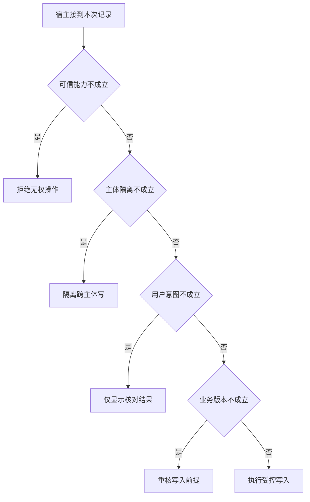

# 快慢两路的写权限在哪里汇合

规则路由和模型路由最终都可能调用草稿服务。
把授权只放在慢路径，会使一次误分类变成一次实际越权。
执行边界要有与策略无关的共同规则。

本篇用一个封闭的教学决策器说明这一问题。输入是宿主收到的记录，不保证每个下游字段都已经获准使用。前置检查未成立时，下游即使带着缓存值，也不能拿来作业务断言。

## 先解决一个具体问题

**路由组件能否同时承担所有写授权？**

只要还有重放、恢复或其他可绕开的执行路径，路由判断就不完整。
在共用业务写服务再次核验，做到换了策略也不能扩大动作权限。


先取一个能走到「执行受控写入」的输入：宿主确认当前主体获准、数据与当前主体匹配、用户明确要求起草、资料版本仍适用。
把这四个条件代回后文的图，前面各个拦截分支都未满足，最终才有“共同业务条件均成立”这个判断。
还原这个现场时要分别问：哪些位来自可信状态，哪些只是在接口中出现、尚未获得解释资格的字段。

## 先沿一次决策走到底



从上到下取第一条成立的出口。只改一个开关时，只有它之前的检查都未截断，该变化才可能到达真实动作。

“可信能力”的两种输入分别是“宿主确认当前主体获准”与“当前主体未获授权”。
权限取自可信入口或执行端，不由模型生成。

“主体隔离”的两种输入分别是“数据与当前主体匹配”与“数据属于另一主体”。
隔离应发生在把材料交给模型之前。

“用户意图”的两种输入分别是“用户明确要求起草”与“仅要求检查资料”。
只读查询不能自动扩大为外部状态变更。

“业务版本”的两种输入分别是“资料版本仍适用”与“观察所依据版本已过期”。
写入前应重新验证可能变化的业务前提。

## 最少需要哪几项观察

### 拒绝无权操作

不能因为路径便宜而跳过授权。
在本节的全部组合中，有 8 种产生「拒绝无权操作」，这只是逻辑空间的计数，不能当作实际用户请求的比例。

只取得当前主体未获授权，已经足以要求宿主「拒绝无权操作」。
保持这些已知项，其余开关自由变化，仍有 8 种补全，判断没有翻转。

若删掉关于可信能力的证据，另一份允许的现场是宿主确认当前主体获准、数据属于另一主体、仅要求检查资料、观察所依据版本已过期，它会使宿主「隔离跨主体写」。

### 隔离跨主体写

案件须属于可信上下文。
在本节的全部组合中，有 4 种产生「隔离跨主体写」，这只是逻辑空间的计数，不能当作实际用户请求的比例。

只取得宿主确认当前主体获准、数据属于另一主体，已经足以要求宿主「隔离跨主体写」。
保持这些已知项，其余开关自由变化，仍有 4 种补全，判断没有翻转。

若删掉关于可信能力的证据，另一份允许的现场是当前主体未获授权、数据属于另一主体、仅要求检查资料、观察所依据版本已过期，它会使宿主「拒绝无权操作」。

若删掉关于主体隔离的证据，另一份允许的现场是宿主确认当前主体获准、数据与当前主体匹配、仅要求检查资料、观察所依据版本已过期，它会使宿主「仅显示核对结果」。

### 仅显示核对结果

用户只授权了读取。
在本节的全部组合中，有 2 种产生「仅显示核对结果」，这只是逻辑空间的计数，不能当作实际用户请求的比例。

只取得宿主确认当前主体获准、数据与当前主体匹配、仅要求检查资料，已经足以要求宿主「仅显示核对结果」。
保持这些已知项，其余开关自由变化，仍有 2 种补全，判断没有翻转。

若删掉关于可信能力的证据，另一份允许的现场是当前主体未获授权、数据与当前主体匹配、仅要求检查资料、观察所依据版本已过期，它会使宿主「拒绝无权操作」。

若删掉关于主体隔离的证据，另一份允许的现场是宿主确认当前主体获准、数据属于另一主体、仅要求检查资料、观察所依据版本已过期，它会使宿主「隔离跨主体写」。

若删掉关于用户意图的证据，另一份允许的现场是宿主确认当前主体获准、数据与当前主体匹配、用户明确要求起草、观察所依据版本已过期，它会使宿主「重核写入前提」。

### 重核写入前提

旧材料版本不足以支持新草稿。
在本节的全部组合中，有 1 种产生「重核写入前提」，这只是逻辑空间的计数，不能当作实际用户请求的比例。

只取得宿主确认当前主体获准、数据与当前主体匹配、用户明确要求起草、观察所依据版本已过期，已经足以要求宿主「重核写入前提」。
保持这些已知项，其余开关自由变化，仍有 1 种补全，判断没有翻转。

若删掉关于可信能力的证据，另一份允许的现场是当前主体未获授权、数据与当前主体匹配、用户明确要求起草、观察所依据版本已过期，它会使宿主「拒绝无权操作」。

若删掉关于主体隔离的证据，另一份允许的现场是宿主确认当前主体获准、数据属于另一主体、用户明确要求起草、观察所依据版本已过期，它会使宿主「隔离跨主体写」。

若删掉关于用户意图的证据，另一份允许的现场是宿主确认当前主体获准、数据与当前主体匹配、仅要求检查资料、观察所依据版本已过期，它会使宿主「仅显示核对结果」。

若删掉关于业务版本的证据，另一份允许的现场是宿主确认当前主体获准、数据与当前主体匹配、用户明确要求起草、资料版本仍适用，它会使宿主「执行受控写入」。

### 执行受控写入

共同业务条件均成立。
在本节的全部组合中，有 1 种产生「执行受控写入」，这只是逻辑空间的计数，不能当作实际用户请求的比例。

只取得宿主确认当前主体获准、数据与当前主体匹配、用户明确要求起草、资料版本仍适用，已经足以要求宿主「执行受控写入」。

若删掉关于可信能力的证据，另一份允许的现场是当前主体未获授权、数据与当前主体匹配、用户明确要求起草、资料版本仍适用，它会使宿主「拒绝无权操作」。

若删掉关于主体隔离的证据，另一份允许的现场是宿主确认当前主体获准、数据属于另一主体、用户明确要求起草、资料版本仍适用，它会使宿主「隔离跨主体写」。

若删掉关于用户意图的证据，另一份允许的现场是宿主确认当前主体获准、数据与当前主体匹配、仅要求检查资料、资料版本仍适用，它会使宿主「仅显示核对结果」。

若删掉关于业务版本的证据，另一份允许的现场是宿主确认当前主体获准、数据与当前主体匹配、用户明确要求起草、观察所依据版本已过期，它会使宿主「重核写入前提」。

## 以同一份契约解释截然不同的现场

<details>
<summary>展开推演与对应反例</summary>

下列样本按最先命中的业务分支排列。四位编码只作本篇页内定位，顺序与开头的四项输入一致。可以先猜下一动作，再展开相邻样本。

### 能够触发“拒绝无权操作”的现场

**样本 0000**

业务侧交来当前主体未获授权、数据属于另一主体，执行侧还记录了仅要求检查资料、观察所依据版本已过期。
把样本压成最短证明，保留当前主体未获授权就能支持「拒绝无权操作」。

在这份记录上，分别翻转「可信能力」中的任一项，其他项完全不变时，下一动作都会改变。

保持其余观察不动，单独切换「主体隔离」、「用户意图」、「业务版本」仍得到「拒绝无权操作」，它们在这个现场不是决定性变量。

要从本例改走「隔离跨主体写」，至少需要变动 1 项，一组最少改动是将当前主体未获授权换成宿主确认当前主体获准。

要从本例改走「仅显示核对结果」，至少需要变动 2 项，一组最少改动是将当前主体未获授权、数据属于另一主体换成宿主确认当前主体获准、数据与当前主体匹配。

要从本例改走「重核写入前提」，至少需要变动 3 项，一组最少改动是将当前主体未获授权、数据属于另一主体、仅要求检查资料换成宿主确认当前主体获准、数据与当前主体匹配、用户明确要求起草。

要从本例改走「执行受控写入」，至少需要变动 4 项，一组最少改动是将当前主体未获授权、数据属于另一主体、仅要求检查资料、观察所依据版本已过期换成宿主确认当前主体获准、数据与当前主体匹配、用户明确要求起草、资料版本仍适用。

**样本 0001**

业务侧交来当前主体未获授权、数据属于另一主体，执行侧还记录了仅要求检查资料、资料版本仍适用。


要从本例改走「执行受控写入」，至少需要变动 3 项，一组最少改动是将当前主体未获授权、数据属于另一主体、仅要求检查资料换成宿主确认当前主体获准、数据与当前主体匹配、用户明确要求起草。

要从本例改走「重核写入前提」，至少需要变动 4 项，一组最少改动是将当前主体未获授权、数据属于另一主体、仅要求检查资料、资料版本仍适用换成宿主确认当前主体获准、数据与当前主体匹配、用户明确要求起草、观察所依据版本已过期。

**样本 0010**

业务侧交来当前主体未获授权、数据属于另一主体，执行侧还记录了用户明确要求起草、观察所依据版本已过期。


要从本例改走「重核写入前提」，至少需要变动 2 项，一组最少改动是将当前主体未获授权、数据属于另一主体换成宿主确认当前主体获准、数据与当前主体匹配。

要从本例改走「仅显示核对结果」，至少需要变动 3 项，一组最少改动是将当前主体未获授权、数据属于另一主体、用户明确要求起草换成宿主确认当前主体获准、数据与当前主体匹配、仅要求检查资料。

要从本例改走「执行受控写入」，至少需要变动 3 项，一组最少改动是将当前主体未获授权、数据属于另一主体、观察所依据版本已过期换成宿主确认当前主体获准、数据与当前主体匹配、资料版本仍适用。

**样本 0011**

业务侧交来当前主体未获授权、数据属于另一主体，执行侧还记录了用户明确要求起草、资料版本仍适用。


要从本例改走「执行受控写入」，至少需要变动 2 项，一组最少改动是将当前主体未获授权、数据属于另一主体换成宿主确认当前主体获准、数据与当前主体匹配。


要从本例改走「重核写入前提」，至少需要变动 3 项，一组最少改动是将当前主体未获授权、数据属于另一主体、资料版本仍适用换成宿主确认当前主体获准、数据与当前主体匹配、观察所依据版本已过期。

**样本 0100**

业务侧交来当前主体未获授权、数据与当前主体匹配，执行侧还记录了仅要求检查资料、观察所依据版本已过期。


要从本例改走「仅显示核对结果」，至少需要变动 1 项，一组最少改动是将当前主体未获授权换成宿主确认当前主体获准。

要从本例改走「隔离跨主体写」，至少需要变动 2 项，一组最少改动是将当前主体未获授权、数据与当前主体匹配换成宿主确认当前主体获准、数据属于另一主体。

要从本例改走「重核写入前提」，至少需要变动 2 项，一组最少改动是将当前主体未获授权、仅要求检查资料换成宿主确认当前主体获准、用户明确要求起草。

要从本例改走「执行受控写入」，至少需要变动 3 项，一组最少改动是将当前主体未获授权、仅要求检查资料、观察所依据版本已过期换成宿主确认当前主体获准、用户明确要求起草、资料版本仍适用。

**样本 0101**

业务侧交来当前主体未获授权、数据与当前主体匹配，执行侧还记录了仅要求检查资料、资料版本仍适用。


要从本例改走「执行受控写入」，至少需要变动 2 项，一组最少改动是将当前主体未获授权、仅要求检查资料换成宿主确认当前主体获准、用户明确要求起草。

要从本例改走「重核写入前提」，至少需要变动 3 项，一组最少改动是将当前主体未获授权、仅要求检查资料、资料版本仍适用换成宿主确认当前主体获准、用户明确要求起草、观察所依据版本已过期。

**样本 0110**

业务侧交来当前主体未获授权、数据与当前主体匹配，执行侧还记录了用户明确要求起草、观察所依据版本已过期。


要从本例改走「重核写入前提」，至少需要变动 1 项，一组最少改动是将当前主体未获授权换成宿主确认当前主体获准。


要从本例改走「仅显示核对结果」，至少需要变动 2 项，一组最少改动是将当前主体未获授权、用户明确要求起草换成宿主确认当前主体获准、仅要求检查资料。

要从本例改走「执行受控写入」，至少需要变动 2 项，一组最少改动是将当前主体未获授权、观察所依据版本已过期换成宿主确认当前主体获准、资料版本仍适用。

**样本 0111**

业务侧交来当前主体未获授权、数据与当前主体匹配，执行侧还记录了用户明确要求起草、资料版本仍适用。


要从本例改走「执行受控写入」，至少需要变动 1 项，一组最少改动是将当前主体未获授权换成宿主确认当前主体获准。


要从本例改走「重核写入前提」，至少需要变动 2 项，一组最少改动是将当前主体未获授权、资料版本仍适用换成宿主确认当前主体获准、观察所依据版本已过期。

### 能够触发“隔离跨主体写”的现场

**样本 1000**

业务侧交来宿主确认当前主体获准、数据属于另一主体，执行侧还记录了仅要求检查资料、观察所依据版本已过期。
把样本压成最短证明，保留宿主确认当前主体获准、数据属于另一主体就能支持「隔离跨主体写」。

在这份记录上，分别翻转「可信能力」、「主体隔离」中的任一项，其他项完全不变时，下一动作都会改变。

保持其余观察不动，单独切换「用户意图」、「业务版本」仍得到「隔离跨主体写」，它们在这个现场不是决定性变量。

本例没走更靠前的「拒绝无权操作」，因为宿主确认当前主体获准与那个入口的必要条件不符。

要从本例改走「拒绝无权操作」，至少需要变动 1 项，一组最少改动是将宿主确认当前主体获准换成当前主体未获授权。

要从本例改走「仅显示核对结果」，至少需要变动 1 项，一组最少改动是将数据属于另一主体换成数据与当前主体匹配。

要从本例改走「重核写入前提」，至少需要变动 2 项，一组最少改动是将数据属于另一主体、仅要求检查资料换成数据与当前主体匹配、用户明确要求起草。

要从本例改走「执行受控写入」，至少需要变动 3 项，一组最少改动是将数据属于另一主体、仅要求检查资料、观察所依据版本已过期换成数据与当前主体匹配、用户明确要求起草、资料版本仍适用。

**样本 1001**

业务侧交来宿主确认当前主体获准、数据属于另一主体，执行侧还记录了仅要求检查资料、资料版本仍适用。


要从本例改走「执行受控写入」，至少需要变动 2 项，一组最少改动是将数据属于另一主体、仅要求检查资料换成数据与当前主体匹配、用户明确要求起草。

要从本例改走「重核写入前提」，至少需要变动 3 项，一组最少改动是将数据属于另一主体、仅要求检查资料、资料版本仍适用换成数据与当前主体匹配、用户明确要求起草、观察所依据版本已过期。

**样本 1010**

业务侧交来宿主确认当前主体获准、数据属于另一主体，执行侧还记录了用户明确要求起草、观察所依据版本已过期。


要从本例改走「重核写入前提」，至少需要变动 1 项，一组最少改动是将数据属于另一主体换成数据与当前主体匹配。

要从本例改走「仅显示核对结果」，至少需要变动 2 项，一组最少改动是将数据属于另一主体、用户明确要求起草换成数据与当前主体匹配、仅要求检查资料。

要从本例改走「执行受控写入」，至少需要变动 2 项，一组最少改动是将数据属于另一主体、观察所依据版本已过期换成数据与当前主体匹配、资料版本仍适用。

**样本 1011**

业务侧交来宿主确认当前主体获准、数据属于另一主体，执行侧还记录了用户明确要求起草、资料版本仍适用。


要从本例改走「执行受控写入」，至少需要变动 1 项，一组最少改动是将数据属于另一主体换成数据与当前主体匹配。


要从本例改走「重核写入前提」，至少需要变动 2 项，一组最少改动是将数据属于另一主体、资料版本仍适用换成数据与当前主体匹配、观察所依据版本已过期。

### 能够触发“仅显示核对结果”的现场

**样本 1100**

业务侧交来宿主确认当前主体获准、数据与当前主体匹配，执行侧还记录了仅要求检查资料、观察所依据版本已过期。
把样本压成最短证明，保留宿主确认当前主体获准、数据与当前主体匹配、仅要求检查资料就能支持「仅显示核对结果」。

在这份记录上，分别翻转「可信能力」、「主体隔离」、「用户意图」中的任一项，其他项完全不变时，下一动作都会改变。

保持其余观察不动，单独切换「业务版本」仍得到「仅显示核对结果」，它们在这个现场不是决定性变量。


本例没走更靠前的「隔离跨主体写」，因为数据与当前主体匹配与那个入口的必要条件不符。


要从本例改走「隔离跨主体写」，至少需要变动 1 项，一组最少改动是将数据与当前主体匹配换成数据属于另一主体。

要从本例改走「重核写入前提」，至少需要变动 1 项，一组最少改动是将仅要求检查资料换成用户明确要求起草。

要从本例改走「执行受控写入」，至少需要变动 2 项，一组最少改动是将仅要求检查资料、观察所依据版本已过期换成用户明确要求起草、资料版本仍适用。

**样本 1101**

业务侧交来宿主确认当前主体获准、数据与当前主体匹配，执行侧还记录了仅要求检查资料、资料版本仍适用。


要从本例改走「执行受控写入」，至少需要变动 1 项，一组最少改动是将仅要求检查资料换成用户明确要求起草。

要从本例改走「重核写入前提」，至少需要变动 2 项，一组最少改动是将仅要求检查资料、资料版本仍适用换成用户明确要求起草、观察所依据版本已过期。

### 能够触发“重核写入前提”的现场

**样本 1110**

业务侧交来宿主确认当前主体获准、数据与当前主体匹配，执行侧还记录了用户明确要求起草、观察所依据版本已过期。
把样本压成最短证明，保留宿主确认当前主体获准、数据与当前主体匹配、用户明确要求起草、观察所依据版本已过期就能支持「重核写入前提」。

在这份记录上，分别翻转「可信能力」、「主体隔离」、「用户意图」、「业务版本」中的任一项，其他项完全不变时，下一动作都会改变。


本例没走更靠前的「仅显示核对结果」，因为用户明确要求起草与那个入口的必要条件不符。


要从本例改走「仅显示核对结果」，至少需要变动 1 项，一组最少改动是将用户明确要求起草换成仅要求检查资料。

要从本例改走「执行受控写入」，至少需要变动 1 项，一组最少改动是将观察所依据版本已过期换成资料版本仍适用。

### 能够触发“执行受控写入”的现场

**样本 1111**

业务侧交来宿主确认当前主体获准、数据与当前主体匹配，执行侧还记录了用户明确要求起草、资料版本仍适用。
把样本压成最短证明，保留宿主确认当前主体获准、数据与当前主体匹配、用户明确要求起草、资料版本仍适用就能支持「执行受控写入」。


本例没走更靠前的「重核写入前提」，因为资料版本仍适用与那个入口的必要条件不符。


要从本例改走「重核写入前提」，至少需要变动 1 项，一组最少改动是将资料版本仍适用换成观察所依据版本已过期。

</details>

## 当你只能看见一半记录

<details>
<summary>展开推演与对应反例</summary>

这次隐藏两个字段，保留另两个。对每个可见现场，检查四种合法补全是否同意。如仍有歧义，选择能使最坏剩余候选动作最少的字段继续查。并列时采用本篇字段顺序。

### 只保留可信能力与主体隔离

已知当前主体未获授权、数据属于另一主体时，四种补全的动作分布为拒绝无权操作（4 种）。

就“拒绝无权操作”这个动作而言，在当前主体未获授权、数据属于另一主体的前提下，另外两项观察不会推翻它。

已知当前主体未获授权、数据与当前主体匹配时，四种补全的动作分布为拒绝无权操作（4 种）。

就“拒绝无权操作”这个动作而言，在当前主体未获授权、数据与当前主体匹配的前提下，另外两项观察不会推翻它。

已知宿主确认当前主体获准、数据属于另一主体时，四种补全的动作分布为隔离跨主体写（4 种）。

就“隔离跨主体写”这个动作而言，在宿主确认当前主体获准、数据属于另一主体的前提下，另外两项观察不会推翻它。

已知宿主确认当前主体获准、数据与当前主体匹配时，四种补全的动作分布为仅显示核对结果（2 种）、重核写入前提（1 种）、执行受控写入（1 种）。

在宿主确认当前主体获准、数据与当前主体匹配这个现场补读「用户意图」，最坏还剩 2 种动作，计算时只衡量歧义，尚未扣读取代价。
若补来的观察为“仅要求检查资料”，范围缩成「仅显示核对结果」。若为“用户明确要求起草”，则保留「重核写入前提」、「执行受控写入」。

区分不了的两条执行可以具体写成 1100 与 1110：它们共享已展示字段，却分别需要「仅显示核对结果」和「重核写入前提」。

### 只保留可信能力与用户意图

已知当前主体未获授权、仅要求检查资料时，四种补全的动作分布为拒绝无权操作（4 种）。

就“拒绝无权操作”这个动作而言，在当前主体未获授权、仅要求检查资料的前提下，另外两项观察不会推翻它。

已知当前主体未获授权、用户明确要求起草时，四种补全的动作分布为拒绝无权操作（4 种）。

就“拒绝无权操作”这个动作而言，在当前主体未获授权、用户明确要求起草的前提下，另外两项观察不会推翻它。

已知宿主确认当前主体获准、仅要求检查资料时，四种补全的动作分布为隔离跨主体写（2 种）、仅显示核对结果（2 种）。

在宿主确认当前主体获准、仅要求检查资料这个现场补读「主体隔离」，最坏还剩 1 种动作，计算时只衡量歧义，尚未扣读取代价。
若补来的观察为“数据属于另一主体”，范围缩成「隔离跨主体写」。若为“数据与当前主体匹配”，则保留「仅显示核对结果」。

区分不了的两条执行可以具体写成 1000 与 1100：它们共享已展示字段，却分别需要「隔离跨主体写」和「仅显示核对结果」。

已知宿主确认当前主体获准、用户明确要求起草时，四种补全的动作分布为隔离跨主体写（2 种）、重核写入前提（1 种）、执行受控写入（1 种）。

在宿主确认当前主体获准、用户明确要求起草这个现场补读「主体隔离」，最坏还剩 2 种动作，计算时只衡量歧义，尚未扣读取代价。
若补来的观察为“数据属于另一主体”，范围缩成「隔离跨主体写」。若为“数据与当前主体匹配”，则保留「重核写入前提」、「执行受控写入」。

区分不了的两条执行可以具体写成 1010 与 1110：它们共享已展示字段，却分别需要「隔离跨主体写」和「重核写入前提」。

### 只保留主体隔离与用户意图

已知数据属于另一主体、仅要求检查资料时，四种补全的动作分布为拒绝无权操作（2 种）、隔离跨主体写（2 种）。

在数据属于另一主体、仅要求检查资料这个现场补读「可信能力」，最坏还剩 1 种动作，计算时只衡量歧义，尚未扣读取代价。
若补来的观察为“当前主体未获授权”，范围缩成「拒绝无权操作」。若为“宿主确认当前主体获准”，则保留「隔离跨主体写」。

区分不了的两条执行可以具体写成 0000 与 1000：它们共享已展示字段，却分别需要「拒绝无权操作」和「隔离跨主体写」。

已知数据属于另一主体、用户明确要求起草时，四种补全的动作分布为拒绝无权操作（2 种）、隔离跨主体写（2 种）。

在数据属于另一主体、用户明确要求起草这个现场补读「可信能力」，最坏还剩 1 种动作，计算时只衡量歧义，尚未扣读取代价。

区分不了的两条执行可以具体写成 0010 与 1010：它们共享已展示字段，却分别需要「拒绝无权操作」和「隔离跨主体写」。

已知数据与当前主体匹配、仅要求检查资料时，四种补全的动作分布为拒绝无权操作（2 种）、仅显示核对结果（2 种）。

在数据与当前主体匹配、仅要求检查资料这个现场补读「可信能力」，最坏还剩 1 种动作，计算时只衡量歧义，尚未扣读取代价。
若补来的观察为“当前主体未获授权”，范围缩成「拒绝无权操作」。若为“宿主确认当前主体获准”，则保留「仅显示核对结果」。

区分不了的两条执行可以具体写成 0100 与 1100：它们共享已展示字段，却分别需要「拒绝无权操作」和「仅显示核对结果」。

已知数据与当前主体匹配、用户明确要求起草时，四种补全的动作分布为拒绝无权操作（2 种）、重核写入前提（1 种）、执行受控写入（1 种）。

在数据与当前主体匹配、用户明确要求起草这个现场补读「可信能力」，最坏还剩 2 种动作，计算时只衡量歧义，尚未扣读取代价。
若补来的观察为“当前主体未获授权”，范围缩成「拒绝无权操作」。若为“宿主确认当前主体获准”，则保留「重核写入前提」、「执行受控写入」。

区分不了的两条执行可以具体写成 0110 与 1110：它们共享已展示字段，却分别需要「拒绝无权操作」和「重核写入前提」。

### 只保留可信能力与业务版本

已知当前主体未获授权、观察所依据版本已过期时，四种补全的动作分布为拒绝无权操作（4 种）。

就“拒绝无权操作”这个动作而言，在当前主体未获授权、观察所依据版本已过期的前提下，另外两项观察不会推翻它。

已知当前主体未获授权、资料版本仍适用时，四种补全的动作分布为拒绝无权操作（4 种）。

就“拒绝无权操作”这个动作而言，在当前主体未获授权、资料版本仍适用的前提下，另外两项观察不会推翻它。

已知宿主确认当前主体获准、观察所依据版本已过期时，四种补全的动作分布为隔离跨主体写（2 种）、仅显示核对结果（1 种）、重核写入前提（1 种）。

在宿主确认当前主体获准、观察所依据版本已过期这个现场补读「主体隔离」，最坏还剩 2 种动作，计算时只衡量歧义，尚未扣读取代价。
若补来的观察为“数据属于另一主体”，范围缩成「隔离跨主体写」。若为“数据与当前主体匹配”，则保留「仅显示核对结果」、「重核写入前提」。


已知宿主确认当前主体获准、资料版本仍适用时，四种补全的动作分布为隔离跨主体写（2 种）、仅显示核对结果（1 种）、执行受控写入（1 种）。

在宿主确认当前主体获准、资料版本仍适用这个现场补读「主体隔离」，最坏还剩 2 种动作，计算时只衡量歧义，尚未扣读取代价。
若补来的观察为“数据属于另一主体”，范围缩成「隔离跨主体写」。若为“数据与当前主体匹配”，则保留「仅显示核对结果」、「执行受控写入」。

区分不了的两条执行可以具体写成 1001 与 1101：它们共享已展示字段，却分别需要「隔离跨主体写」和「仅显示核对结果」。

### 只保留主体隔离与业务版本

已知数据属于另一主体、观察所依据版本已过期时，四种补全的动作分布为拒绝无权操作（2 种）、隔离跨主体写（2 种）。

在数据属于另一主体、观察所依据版本已过期这个现场补读「可信能力」，最坏还剩 1 种动作，计算时只衡量歧义，尚未扣读取代价。


已知数据属于另一主体、资料版本仍适用时，四种补全的动作分布为拒绝无权操作（2 种）、隔离跨主体写（2 种）。

在数据属于另一主体、资料版本仍适用这个现场补读「可信能力」，最坏还剩 1 种动作，计算时只衡量歧义，尚未扣读取代价。

区分不了的两条执行可以具体写成 0001 与 1001：它们共享已展示字段，却分别需要「拒绝无权操作」和「隔离跨主体写」。

已知数据与当前主体匹配、观察所依据版本已过期时，四种补全的动作分布为拒绝无权操作（2 种）、仅显示核对结果（1 种）、重核写入前提（1 种）。

在数据与当前主体匹配、观察所依据版本已过期这个现场补读「可信能力」，最坏还剩 2 种动作，计算时只衡量歧义，尚未扣读取代价。
若补来的观察为“当前主体未获授权”，范围缩成「拒绝无权操作」。若为“宿主确认当前主体获准”，则保留「仅显示核对结果」、「重核写入前提」。


已知数据与当前主体匹配、资料版本仍适用时，四种补全的动作分布为拒绝无权操作（2 种）、仅显示核对结果（1 种）、执行受控写入（1 种）。

在数据与当前主体匹配、资料版本仍适用这个现场补读「可信能力」，最坏还剩 2 种动作，计算时只衡量歧义，尚未扣读取代价。
若补来的观察为“当前主体未获授权”，范围缩成「拒绝无权操作」。若为“宿主确认当前主体获准”，则保留「仅显示核对结果」、「执行受控写入」。

区分不了的两条执行可以具体写成 0101 与 1101：它们共享已展示字段，却分别需要「拒绝无权操作」和「仅显示核对结果」。

### 只保留用户意图与业务版本

已知仅要求检查资料、观察所依据版本已过期时，四种补全的动作分布为拒绝无权操作（2 种）、隔离跨主体写（1 种）、仅显示核对结果（1 种）。

在仅要求检查资料、观察所依据版本已过期这个现场补读「可信能力」，最坏还剩 2 种动作，计算时只衡量歧义，尚未扣读取代价。
若补来的观察为“当前主体未获授权”，范围缩成「拒绝无权操作」。若为“宿主确认当前主体获准”，则保留「隔离跨主体写」、「仅显示核对结果」。


已知仅要求检查资料、资料版本仍适用时，四种补全的动作分布为拒绝无权操作（2 种）、隔离跨主体写（1 种）、仅显示核对结果（1 种）。

在仅要求检查资料、资料版本仍适用这个现场补读「可信能力」，最坏还剩 2 种动作，计算时只衡量歧义，尚未扣读取代价。


已知用户明确要求起草、观察所依据版本已过期时，四种补全的动作分布为拒绝无权操作（2 种）、隔离跨主体写（1 种）、重核写入前提（1 种）。

在用户明确要求起草、观察所依据版本已过期这个现场补读「可信能力」，最坏还剩 2 种动作，计算时只衡量歧义，尚未扣读取代价。
若补来的观察为“当前主体未获授权”，范围缩成「拒绝无权操作」。若为“宿主确认当前主体获准”，则保留「隔离跨主体写」、「重核写入前提」。


已知用户明确要求起草、资料版本仍适用时，四种补全的动作分布为拒绝无权操作（2 种）、隔离跨主体写（1 种）、执行受控写入（1 种）。

在用户明确要求起草、资料版本仍适用这个现场补读「可信能力」，最坏还剩 2 种动作，计算时只衡量歧义，尚未扣读取代价。
若补来的观察为“当前主体未获授权”，范围缩成「拒绝无权操作」。若为“宿主确认当前主体获准”，则保留「隔离跨主体写」、「执行受控写入」。

区分不了的两条执行可以具体写成 0011 与 1011：它们共享已展示字段，却分别需要「拒绝无权操作」和「隔离跨主体写」。

</details>

## 单因素干预与边界测试

<details>
<summary>展开推演与对应反例</summary>

### 只改变可信能力

固定另外三个条件得到八对现场，从“当前主体未获授权”转为“宿主确认当前主体获准”时，8 对翻转动作，另外 0 对保持不变。

有 4 对现场沿「拒绝无权操作」变到「隔离跨主体写」，可复现的一组受控背景为数据属于另一主体、仅要求检查资料、观察所依据版本已过期。

有 2 对现场沿「拒绝无权操作」变到「仅显示核对结果」，可复现的一组受控背景为数据与当前主体匹配、仅要求检查资料、观察所依据版本已过期。

有 1 对现场沿「拒绝无权操作」变到「重核写入前提」，可复现的一组受控背景为数据与当前主体匹配、用户明确要求起草、观察所依据版本已过期。

有 1 对现场沿「拒绝无权操作」变到「执行受控写入」，可复现的一组受控背景为数据与当前主体匹配、用户明确要求起草、资料版本仍适用。

### 只改变主体隔离

固定另外三个条件得到八对现场，从“数据属于另一主体”转为“数据与当前主体匹配”时，4 对翻转动作，另外 4 对保持不变。

令当前主体未获授权、仅要求检查资料、观察所依据版本已过期，主体隔离的两个取值均得到「拒绝无权操作」。在八对中，共有 4 对表现为这一种稳定出口。

有 2 对现场沿「隔离跨主体写」变到「仅显示核对结果」，可复现的一组受控背景为宿主确认当前主体获准、仅要求检查资料、观察所依据版本已过期。

有 1 对现场沿「隔离跨主体写」变到「重核写入前提」，可复现的一组受控背景为宿主确认当前主体获准、用户明确要求起草、观察所依据版本已过期。

有 1 对现场沿「隔离跨主体写」变到「执行受控写入」，可复现的一组受控背景为宿主确认当前主体获准、用户明确要求起草、资料版本仍适用。

### 只改变用户意图

固定另外三个条件得到八对现场，从“仅要求检查资料”转为“用户明确要求起草”时，2 对翻转动作，另外 6 对保持不变。

令当前主体未获授权、数据属于另一主体、观察所依据版本已过期，用户意图的两个取值均得到「拒绝无权操作」。在八对中，共有 4 对表现为这一种稳定出口。

令宿主确认当前主体获准、数据属于另一主体、观察所依据版本已过期，用户意图的两个取值均得到「隔离跨主体写」。在八对中，共有 2 对表现为这一种稳定出口。

有 1 对现场沿「仅显示核对结果」变到「重核写入前提」，可复现的一组受控背景为宿主确认当前主体获准、数据与当前主体匹配、观察所依据版本已过期。

有 1 对现场沿「仅显示核对结果」变到「执行受控写入」，可复现的一组受控背景为宿主确认当前主体获准、数据与当前主体匹配、资料版本仍适用。

### 只改变业务版本

固定另外三个条件得到八对现场，从“观察所依据版本已过期”转为“资料版本仍适用”时，1 对翻转动作，另外 7 对保持不变。

令当前主体未获授权、数据属于另一主体、仅要求检查资料，业务版本的两个取值均得到「拒绝无权操作」。在八对中，共有 4 对表现为这一种稳定出口。

令宿主确认当前主体获准、数据属于另一主体、仅要求检查资料，业务版本的两个取值均得到「隔离跨主体写」。在八对中，共有 2 对表现为这一种稳定出口。

令宿主确认当前主体获准、数据与当前主体匹配、仅要求检查资料，业务版本的两个取值均得到「仅显示核对结果」。在八对中，共有 1 对表现为这一种稳定出口。

有 1 对现场沿「重核写入前提」变到「执行受控写入」，可复现的一组受控背景为宿主确认当前主体获准、数据与当前主体匹配、用户明确要求起草。

</details>

## 哪些回归样本真能抓住实现错误

<details>
<summary>展开推演与对应反例</summary>

如果删除“拒绝无权操作”这个分支，在本篇 16 种输入里有 8 种会改走另一出口。

反例 0000 的完整记录为当前主体未获授权、数据属于另一主体、仅要求检查资料、观察所依据版本已过期。正确结果是「拒绝无权操作」，这个改坏的实现却给出「隔离跨主体写」。

如果删除“隔离跨主体写”这个分支，在本篇 16 种输入里有 4 种会改走另一出口。

反例 1000 的完整记录为宿主确认当前主体获准、数据属于另一主体、仅要求检查资料、观察所依据版本已过期。正确结果是「隔离跨主体写」，这个改坏的实现却给出「仅显示核对结果」。

如果删除“仅显示核对结果”这个分支，在本篇 16 种输入里有 2 种会改走另一出口。

反例 1100 的完整记录为宿主确认当前主体获准、数据与当前主体匹配、仅要求检查资料、观察所依据版本已过期。正确结果是「仅显示核对结果」，这个改坏的实现却给出「重核写入前提」。

如果删除“重核写入前提”这个分支，在本篇 16 种输入里有 1 种会改走另一出口。

反例 1110 的完整记录为宿主确认当前主体获准、数据与当前主体匹配、用户明确要求起草、观察所依据版本已过期。正确结果是「重核写入前提」，这个改坏的实现却给出「执行受控写入」。

如果交换“拒绝无权操作”和“隔离跨主体写”的判断次序，在本篇 16 种输入里有 4 种会改走另一出口。


如果交换“隔离跨主体写”和“仅显示核对结果”的判断次序，在本篇 16 种输入里有 2 种会改走另一出口。


如果交换“仅显示核对结果”和“重核写入前提”的判断次序，在本篇 16 种输入里有 1 种会改走另一出口。


补入样本 0000（当前主体未获授权、数据属于另一主体、仅要求检查资料、观察所依据版本已过期）能新增检出「删除“拒绝无权操作”这个分支」、「交换“拒绝无权操作”和“隔离跨主体写”的判断次序」。

补入样本 1000（宿主确认当前主体获准、数据属于另一主体、仅要求检查资料、观察所依据版本已过期）能新增检出「删除“隔离跨主体写”这个分支」、「交换“隔离跨主体写”和“仅显示核对结果”的判断次序」。

补入样本 1100（宿主确认当前主体获准、数据与当前主体匹配、仅要求检查资料、观察所依据版本已过期）能新增检出「删除“仅显示核对结果”这个分支」、「交换“仅显示核对结果”和“重核写入前提”的判断次序」。

补入样本 1110（宿主确认当前主体获准、数据与当前主体匹配、用户明确要求起草、观察所依据版本已过期）能新增检出「删除“重核写入前提”这个分支」。

这里每次选覆盖尚未捕获缺陷最多的样本，并不保证用例数全局最小。它给出的反例能作为 Java 单测输入。真实模型是否会自主产生这些提议，仍须单独评测。

</details>

## 把状态覆盖换成有抽样偏差的评测批次

<details>
<summary>展开推演与对应反例</summary>

前面的十六种记录各有一票。现在只改样本构成：对一个给定字段，把成立侧的每种记录各取三份、另一侧各取一份。这是人为配比的 32 份回放，不是线上频率估计。
将偏向成立与偏向不成立的两次批次对照，可以隔离分母变化。底层宿主和所有答案保持相同，比例仍可能移动。

### 改变“可信能力”的样本配比

只看「拒绝无权操作」，在宿主确认当前主体获准的八个不同输入中有 0 个命中，在当前主体未获授权的另八个输入中有 8 个命中。
把「可信能力」成立侧按三倍取样，「拒绝无权操作」占 8/32，反过来向未成立侧倾斜后占 24/32。
这次重加权使「拒绝无权操作」的占比相差 50 个百分点。若按两种不同的“可信能力”分布跑新旧版，不能把这项差异全部归功于实现。

只看「隔离跨主体写」，在宿主确认当前主体获准的八个不同输入中有 4 个命中，在当前主体未获授权的另八个输入中有 0 个命中。
把「可信能力」成立侧按三倍取样，「隔离跨主体写」占 12/32，反过来向未成立侧倾斜后占 4/32。
这次重加权使「隔离跨主体写」的占比相差 25 个百分点。若按两种不同的“可信能力”分布跑新旧版，不能把这项差异全部归功于实现。

只看「仅显示核对结果」，在宿主确认当前主体获准的八个不同输入中有 2 个命中，在当前主体未获授权的另八个输入中有 0 个命中。
把「可信能力」成立侧按三倍取样，「仅显示核对结果」占 6/32，反过来向未成立侧倾斜后占 2/32。
这次重加权使「仅显示核对结果」的占比相差 12.5 个百分点。若按两种不同的“可信能力”分布跑新旧版，不能把这项差异全部归功于实现。

只看「重核写入前提」，在宿主确认当前主体获准的八个不同输入中有 1 个命中，在当前主体未获授权的另八个输入中有 0 个命中。
把「可信能力」成立侧按三倍取样，「重核写入前提」占 3/32，反过来向未成立侧倾斜后占 1/32。
这次重加权使「重核写入前提」的占比相差 6.25 个百分点。若按两种不同的“可信能力”分布跑新旧版，不能把这项差异全部归功于实现。

只看「执行受控写入」，在宿主确认当前主体获准的八个不同输入中有 1 个命中，在当前主体未获授权的另八个输入中有 0 个命中。
把「可信能力」成立侧按三倍取样，「执行受控写入」占 3/32，反过来向未成立侧倾斜后占 1/32。
这次重加权使「执行受控写入」的占比相差 6.25 个百分点。若按两种不同的“可信能力”分布跑新旧版，不能把这项差异全部归功于实现。

### 改变“主体隔离”的样本配比

只看「拒绝无权操作」，在数据与当前主体匹配的八个不同输入中有 4 个命中，在数据属于另一主体的另八个输入中有 4 个命中。
把「主体隔离」成立侧按三倍取样，「拒绝无权操作」占 16/32，反过来向未成立侧倾斜后占 16/32。
两批「拒绝无权操作」的边际比例相同，是因为这个出口在“主体隔离”的两侧计数相等，这不能单独证明每一对现场都不受它影响。

只看「隔离跨主体写」，在数据与当前主体匹配的八个不同输入中有 0 个命中，在数据属于另一主体的另八个输入中有 4 个命中。
把「主体隔离」成立侧按三倍取样，「隔离跨主体写」占 4/32，反过来向未成立侧倾斜后占 12/32。
这次重加权使「隔离跨主体写」的占比相差 25 个百分点。若按两种不同的“主体隔离”分布跑新旧版，不能把这项差异全部归功于实现。

只看「仅显示核对结果」，在数据与当前主体匹配的八个不同输入中有 2 个命中，在数据属于另一主体的另八个输入中有 0 个命中。
把「主体隔离」成立侧按三倍取样，「仅显示核对结果」占 6/32，反过来向未成立侧倾斜后占 2/32。
这次重加权使「仅显示核对结果」的占比相差 12.5 个百分点。若按两种不同的“主体隔离”分布跑新旧版，不能把这项差异全部归功于实现。

只看「重核写入前提」，在数据与当前主体匹配的八个不同输入中有 1 个命中，在数据属于另一主体的另八个输入中有 0 个命中。
把「主体隔离」成立侧按三倍取样，「重核写入前提」占 3/32，反过来向未成立侧倾斜后占 1/32。
这次重加权使「重核写入前提」的占比相差 6.25 个百分点。若按两种不同的“主体隔离”分布跑新旧版，不能把这项差异全部归功于实现。

只看「执行受控写入」，在数据与当前主体匹配的八个不同输入中有 1 个命中，在数据属于另一主体的另八个输入中有 0 个命中。
把「主体隔离」成立侧按三倍取样，「执行受控写入」占 3/32，反过来向未成立侧倾斜后占 1/32。
这次重加权使「执行受控写入」的占比相差 6.25 个百分点。若按两种不同的“主体隔离”分布跑新旧版，不能把这项差异全部归功于实现。

### 改变“用户意图”的样本配比

只看「拒绝无权操作」，在用户明确要求起草的八个不同输入中有 4 个命中，在仅要求检查资料的另八个输入中有 4 个命中。
把「用户意图」成立侧按三倍取样，「拒绝无权操作」占 16/32，反过来向未成立侧倾斜后占 16/32。
两批「拒绝无权操作」的边际比例相同，是因为这个出口在“用户意图”的两侧计数相等，这不能单独证明每一对现场都不受它影响。

只看「隔离跨主体写」，在用户明确要求起草的八个不同输入中有 2 个命中，在仅要求检查资料的另八个输入中有 2 个命中。
把「用户意图」成立侧按三倍取样，「隔离跨主体写」占 8/32，反过来向未成立侧倾斜后占 8/32。
两批「隔离跨主体写」的边际比例相同，是因为这个出口在“用户意图”的两侧计数相等，这不能单独证明每一对现场都不受它影响。

只看「仅显示核对结果」，在用户明确要求起草的八个不同输入中有 0 个命中，在仅要求检查资料的另八个输入中有 2 个命中。
把「用户意图」成立侧按三倍取样，「仅显示核对结果」占 2/32，反过来向未成立侧倾斜后占 6/32。
这次重加权使「仅显示核对结果」的占比相差 12.5 个百分点。若按两种不同的“用户意图”分布跑新旧版，不能把这项差异全部归功于实现。

只看「重核写入前提」，在用户明确要求起草的八个不同输入中有 1 个命中，在仅要求检查资料的另八个输入中有 0 个命中。
把「用户意图」成立侧按三倍取样，「重核写入前提」占 3/32，反过来向未成立侧倾斜后占 1/32。
这次重加权使「重核写入前提」的占比相差 6.25 个百分点。若按两种不同的“用户意图”分布跑新旧版，不能把这项差异全部归功于实现。

只看「执行受控写入」，在用户明确要求起草的八个不同输入中有 1 个命中，在仅要求检查资料的另八个输入中有 0 个命中。
把「用户意图」成立侧按三倍取样，「执行受控写入」占 3/32，反过来向未成立侧倾斜后占 1/32。
这次重加权使「执行受控写入」的占比相差 6.25 个百分点。若按两种不同的“用户意图”分布跑新旧版，不能把这项差异全部归功于实现。

### 改变“业务版本”的样本配比

只看「拒绝无权操作」，在资料版本仍适用的八个不同输入中有 4 个命中，在观察所依据版本已过期的另八个输入中有 4 个命中。
把「业务版本」成立侧按三倍取样，「拒绝无权操作」占 16/32，反过来向未成立侧倾斜后占 16/32。
两批「拒绝无权操作」的边际比例相同，是因为这个出口在“业务版本”的两侧计数相等，这不能单独证明每一对现场都不受它影响。

只看「隔离跨主体写」，在资料版本仍适用的八个不同输入中有 2 个命中，在观察所依据版本已过期的另八个输入中有 2 个命中。
把「业务版本」成立侧按三倍取样，「隔离跨主体写」占 8/32，反过来向未成立侧倾斜后占 8/32。
两批「隔离跨主体写」的边际比例相同，是因为这个出口在“业务版本”的两侧计数相等，这不能单独证明每一对现场都不受它影响。

只看「仅显示核对结果」，在资料版本仍适用的八个不同输入中有 1 个命中，在观察所依据版本已过期的另八个输入中有 1 个命中。
把「业务版本」成立侧按三倍取样，「仅显示核对结果」占 4/32，反过来向未成立侧倾斜后占 4/32。
两批「仅显示核对结果」的边际比例相同，是因为这个出口在“业务版本”的两侧计数相等，这不能单独证明每一对现场都不受它影响。

只看「重核写入前提」，在资料版本仍适用的八个不同输入中有 0 个命中，在观察所依据版本已过期的另八个输入中有 1 个命中。
把「业务版本」成立侧按三倍取样，「重核写入前提」占 1/32，反过来向未成立侧倾斜后占 3/32。
这次重加权使「重核写入前提」的占比相差 6.25 个百分点。若按两种不同的“业务版本”分布跑新旧版，不能把这项差异全部归功于实现。

只看「执行受控写入」，在资料版本仍适用的八个不同输入中有 1 个命中，在观察所依据版本已过期的另八个输入中有 0 个命中。
把「业务版本」成立侧按三倍取样，「执行受控写入」占 3/32，反过来向未成立侧倾斜后占 1/32。
这次重加权使「执行受控写入」的占比相差 6.25 个百分点。若按两种不同的“业务版本”分布跑新旧版，不能把这项差异全部归功于实现。

</details>

## 只看终态，能逆推出多少原始事实

<details>
<summary>展开推演与对应反例</summary>

### 只保留“拒绝无权操作”这条结果时

在本节契约与完整输入域内，仅知「拒绝无权操作」就能倒推出当前主体未获授权，这一推断依赖版本未变且日志中的终态可信。

「拒绝无权操作」不能证明主体隔离取哪一侧：0000 和 0100 有相同终态，却分别记为“数据属于另一主体”和“数据与当前主体匹配”。

「拒绝无权操作」不能证明用户意图取哪一侧：0000 和 0010 有相同终态，却分别记为“仅要求检查资料”和“用户明确要求起草”。

「拒绝无权操作」不能证明业务版本取哪一侧：0000 和 0001 有相同终态，却分别记为“观察所依据版本已过期”和“资料版本仍适用”。

反查「拒绝无权操作」的诊断日志，优先保留能区分样本 0000 与 1000 的「可信能力」，否则很容易把邻近的「隔离跨主体写」看成同一种故障。

### 只保留“隔离跨主体写”这条结果时

在本节契约与完整输入域内，仅知「隔离跨主体写」就能倒推出宿主确认当前主体获准，这一推断依赖版本未变且日志中的终态可信。

在本节契约与完整输入域内，仅知「隔离跨主体写」就能倒推出数据属于另一主体，这一推断依赖版本未变且日志中的终态可信。

「隔离跨主体写」不能证明用户意图取哪一侧：1000 和 1010 有相同终态，却分别记为“仅要求检查资料”和“用户明确要求起草”。

「隔离跨主体写」不能证明业务版本取哪一侧：1000 和 1001 有相同终态，却分别记为“观察所依据版本已过期”和“资料版本仍适用”。

反查「隔离跨主体写」的诊断日志，优先保留能区分样本 1000 与 0000 的「可信能力」，否则很容易把邻近的「拒绝无权操作」看成同一种故障。

### 只保留“仅显示核对结果”这条结果时

在本节契约与完整输入域内，仅知「仅显示核对结果」就能倒推出宿主确认当前主体获准，这一推断依赖版本未变且日志中的终态可信。

在本节契约与完整输入域内，仅知「仅显示核对结果」就能倒推出数据与当前主体匹配，这一推断依赖版本未变且日志中的终态可信。

在本节契约与完整输入域内，仅知「仅显示核对结果」就能倒推出仅要求检查资料，这一推断依赖版本未变且日志中的终态可信。

「仅显示核对结果」不能证明业务版本取哪一侧：1100 和 1101 有相同终态，却分别记为“观察所依据版本已过期”和“资料版本仍适用”。

反查「仅显示核对结果」的诊断日志，优先保留能区分样本 1100 与 0100 的「可信能力」，否则很容易把邻近的「拒绝无权操作」看成同一种故障。

### 只保留“重核写入前提”这条结果时

在本节契约与完整输入域内，仅知「重核写入前提」就能倒推出宿主确认当前主体获准，这一推断依赖版本未变且日志中的终态可信。

在本节契约与完整输入域内，仅知「重核写入前提」就能倒推出数据与当前主体匹配，这一推断依赖版本未变且日志中的终态可信。

在本节契约与完整输入域内，仅知「重核写入前提」就能倒推出用户明确要求起草，这一推断依赖版本未变且日志中的终态可信。

在本节契约与完整输入域内，仅知「重核写入前提」就能倒推出观察所依据版本已过期，这一推断依赖版本未变且日志中的终态可信。

反查「重核写入前提」的诊断日志，优先保留能区分样本 1110 与 0110 的「可信能力」，否则很容易把邻近的「拒绝无权操作」看成同一种故障。

### 只保留“执行受控写入”这条结果时

在本节契约与完整输入域内，仅知「执行受控写入」就能倒推出宿主确认当前主体获准，这一推断依赖版本未变且日志中的终态可信。

在本节契约与完整输入域内，仅知「执行受控写入」就能倒推出数据与当前主体匹配，这一推断依赖版本未变且日志中的终态可信。

在本节契约与完整输入域内，仅知「执行受控写入」就能倒推出用户明确要求起草，这一推断依赖版本未变且日志中的终态可信。

在本节契约与完整输入域内，仅知「执行受控写入」就能倒推出资料版本仍适用，这一推断依赖版本未变且日志中的终态可信。

反查「执行受控写入」的诊断日志，优先保留能区分样本 1111 与 0111 的「可信能力」，否则很容易把邻近的「拒绝无权操作」看成同一种故障。

</details>

## 面试复述与复算

面试题可以从“路由组件能否同时承担所有写授权？”起步。先给出本篇的触发条件和一条真实执行端可检查的证据，再用一个相邻反例限定结论的适用范围。

在仓库根目录执行下列命令可以重算本篇的一个输入。四位数字依次选择正文列出的四项条件，0 表示未成立或低档，1 表示成立或高档。
```powershell
node examples/reading-cases/replay.mjs 9 5 0101
```

[本周主文](../theory.md) · [配套实验](../lab.md) · [下一篇研读](06.md)
