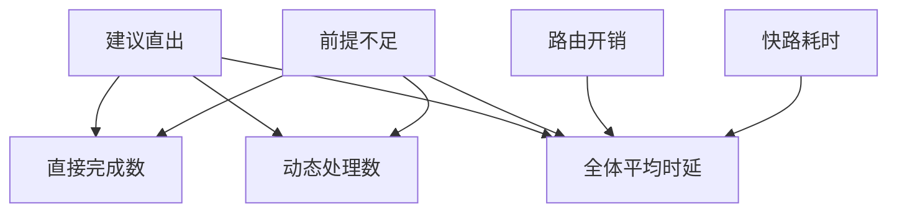

# 快路径误路由的成本由谁支付

一批100个请求均先经过路由器。
有些快路径输入因证据不全回退到动态策略，同一个用户同时支付两段时间。
动态路径统一600毫秒且每个答案都正确。
平均数不提供P99和误放率。

## 先解决一个具体问题

**回退成功的请求如何算平均时延？**

同一条用户请求支付初次路由、快路径尝试和动态回退。
把它分别记在两个策略的成功桶而不合并，会低估真实等待并高估直出收益。


先从具体的低档设定开始：建议直出取 40个、前提不足取 3个、路由开销取 15毫秒、快路耗时取 60毫秒。
三个结果依次是直接完成数 37个、动态处理数 63个、全体平均时延 417毫秒。
先手算这个起点，读完后再把另一个输入切到高档，这样能知道数字变化时究竟改变了哪个假设。

## 先写清输入边界和三个观测量

用 a 表示建议直出，取 40个 或 75个，这两点是用于隔离因果影响的教学输入。

用 b 表示前提不足，取 3个 或 15个，这两点是用于隔离因果影响的教学输入。

用 c 表示路由开销，取 15毫秒 或 85毫秒，这两点是用于隔离因果影响的教学输入。

用 d 表示快路耗时，取 60毫秒 或 140毫秒，这两点是用于隔离因果影响的教学输入。

「直接完成数」的计算式为 `a-b`，按业务量展开是 `建议直出-前提不足`，输出单位为个。

「动态处理数」的计算式为 `100-a+b`，按业务量展开是 `100-建议直出+前提不足`，输出单位为个。

「全体平均时延」的计算式为 `c+(a*d+(100-a+b)*600)/100`，按业务量展开是 `路由开销+(建议直出×快路耗时+(100-建议直出+前提不足)×600)/100`，输出单位为毫秒。

公式中 ceil 与 floor 分别向上、向下取整，% 在表达式中作取余，** 为乘方，三元条件按“条件 ? 成立值 : 其他值”读取。展示数值最多保留三位小数，比较和反推采用未舍入值。



图上的箭头表示该输入出现在计算式中。同一输入通向多个指标时，三个读数可能共同移动。分支、取整或相互抵消又会使某些边在具体样本上没有可见增量。

## 从输入按单位逐步算到可比较的结果

<details>
<summary>展开推演与对应反例</summary>

### 样本 0000：建议直出 40、前提不足 3

这一组设定为建议直出为 40个、前提不足为 3个、路由开销为 15毫秒、快路耗时为 60毫秒。

代入「直接完成数」：`40-3`，得到 37个。

代入「动态处理数」：`100-40+3`，得到 63个。

代入「全体平均时延」：`15+(40*60+(100-40+3)*600)/100`，得到 417毫秒。

以「全体平均时延」作主读数时，本组单独切换建议直出的绝对变化最大或并列最大，读数会从 417毫秒 变为 228毫秒。

对角样本 1111 的主读数为 430毫秒。它同时改了四项，差额不能充当任一单个因素的净收益。

### 样本 0001：建议直出 40、前提不足 3

这一组设定为建议直出为 40个、前提不足为 3个、路由开销为 15毫秒、快路耗时为 140毫秒。


代入「全体平均时延」：`15+(40*140+(100-40+3)*600)/100`，得到 449毫秒。

以「全体平均时延」作主读数时，本组单独切换建议直出的绝对变化最大或并列最大，读数会从 449毫秒 变为 288毫秒。

对角样本 1110 的主读数为 370毫秒。它同时改了四项，差额不能充当任一单个因素的净收益。

### 样本 0010：建议直出 40、前提不足 3

这一组设定为建议直出为 40个、前提不足为 3个、路由开销为 85毫秒、快路耗时为 60毫秒。


代入「全体平均时延」：`85+(40*60+(100-40+3)*600)/100`，得到 487毫秒。

以「全体平均时延」作主读数时，本组单独切换建议直出的绝对变化最大或并列最大，读数会从 487毫秒 变为 298毫秒。

对角样本 1101 的主读数为 360毫秒。它同时改了四项，差额不能充当任一单个因素的净收益。

### 样本 0011：建议直出 40、前提不足 3

这一组设定为建议直出为 40个、前提不足为 3个、路由开销为 85毫秒、快路耗时为 140毫秒。


代入「全体平均时延」：`85+(40*140+(100-40+3)*600)/100`，得到 519毫秒。

以「全体平均时延」作主读数时，本组单独切换建议直出的绝对变化最大或并列最大，读数会从 519毫秒 变为 358毫秒。

对角样本 1100 的主读数为 300毫秒。它同时改了四项，差额不能充当任一单个因素的净收益。

### 样本 0100：建议直出 40、前提不足 15

这一组设定为建议直出为 40个、前提不足为 15个、路由开销为 15毫秒、快路耗时为 60毫秒。

代入「直接完成数」：`40-15`，得到 25个。

代入「动态处理数」：`100-40+15`，得到 75个。

代入「全体平均时延」：`15+(40*60+(100-40+15)*600)/100`，得到 489毫秒。

以「全体平均时延」作主读数时，本组单独切换建议直出的绝对变化最大或并列最大，读数会从 489毫秒 变为 300毫秒。

对角样本 1011 的主读数为 358毫秒。它同时改了四项，差额不能充当任一单个因素的净收益。

### 样本 0101：建议直出 40、前提不足 15

这一组设定为建议直出为 40个、前提不足为 15个、路由开销为 15毫秒、快路耗时为 140毫秒。


代入「全体平均时延」：`15+(40*140+(100-40+15)*600)/100`，得到 521毫秒。

以「全体平均时延」作主读数时，本组单独切换建议直出的绝对变化最大或并列最大，读数会从 521毫秒 变为 360毫秒。

对角样本 1010 的主读数为 298毫秒。它同时改了四项，差额不能充当任一单个因素的净收益。

### 样本 0110：建议直出 40、前提不足 15

这一组设定为建议直出为 40个、前提不足为 15个、路由开销为 85毫秒、快路耗时为 60毫秒。


代入「全体平均时延」：`85+(40*60+(100-40+15)*600)/100`，得到 559毫秒。

以「全体平均时延」作主读数时，本组单独切换建议直出的绝对变化最大或并列最大，读数会从 559毫秒 变为 370毫秒。

对角样本 1001 的主读数为 288毫秒。它同时改了四项，差额不能充当任一单个因素的净收益。

### 样本 0111：建议直出 40、前提不足 15

这一组设定为建议直出为 40个、前提不足为 15个、路由开销为 85毫秒、快路耗时为 140毫秒。


代入「全体平均时延」：`85+(40*140+(100-40+15)*600)/100`，得到 591毫秒。

以「全体平均时延」作主读数时，本组单独切换建议直出的绝对变化最大或并列最大，读数会从 591毫秒 变为 430毫秒。

对角样本 1000 的主读数为 228毫秒。它同时改了四项，差额不能充当任一单个因素的净收益。

### 样本 1000：建议直出 75、前提不足 3

这一组设定为建议直出为 75个、前提不足为 3个、路由开销为 15毫秒、快路耗时为 60毫秒。

代入「直接完成数」：`75-3`，得到 72个。

代入「动态处理数」：`100-75+3`，得到 28个。

代入「全体平均时延」：`15+(75*60+(100-75+3)*600)/100`，得到 228毫秒。

以「全体平均时延」作主读数时，本组单独切换建议直出的绝对变化最大或并列最大，读数会从 228毫秒 变为 417毫秒。

对角样本 0111 的主读数为 591毫秒。它同时改了四项，差额不能充当任一单个因素的净收益。

### 样本 1001：建议直出 75、前提不足 3

这一组设定为建议直出为 75个、前提不足为 3个、路由开销为 15毫秒、快路耗时为 140毫秒。


代入「全体平均时延」：`15+(75*140+(100-75+3)*600)/100`，得到 288毫秒。

以「全体平均时延」作主读数时，本组单独切换建议直出的绝对变化最大或并列最大，读数会从 288毫秒 变为 449毫秒。

对角样本 0110 的主读数为 559毫秒。它同时改了四项，差额不能充当任一单个因素的净收益。

### 样本 1010：建议直出 75、前提不足 3

这一组设定为建议直出为 75个、前提不足为 3个、路由开销为 85毫秒、快路耗时为 60毫秒。


代入「全体平均时延」：`85+(75*60+(100-75+3)*600)/100`，得到 298毫秒。

以「全体平均时延」作主读数时，本组单独切换建议直出的绝对变化最大或并列最大，读数会从 298毫秒 变为 487毫秒。

对角样本 0101 的主读数为 521毫秒。它同时改了四项，差额不能充当任一单个因素的净收益。

### 样本 1011：建议直出 75、前提不足 3

这一组设定为建议直出为 75个、前提不足为 3个、路由开销为 85毫秒、快路耗时为 140毫秒。


代入「全体平均时延」：`85+(75*140+(100-75+3)*600)/100`，得到 358毫秒。

以「全体平均时延」作主读数时，本组单独切换建议直出的绝对变化最大或并列最大，读数会从 358毫秒 变为 519毫秒。

对角样本 0100 的主读数为 489毫秒。它同时改了四项，差额不能充当任一单个因素的净收益。

### 样本 1100：建议直出 75、前提不足 15

这一组设定为建议直出为 75个、前提不足为 15个、路由开销为 15毫秒、快路耗时为 60毫秒。

代入「直接完成数」：`75-15`，得到 60个。

代入「动态处理数」：`100-75+15`，得到 40个。

代入「全体平均时延」：`15+(75*60+(100-75+15)*600)/100`，得到 300毫秒。

以「全体平均时延」作主读数时，本组单独切换建议直出的绝对变化最大或并列最大，读数会从 300毫秒 变为 489毫秒。

对角样本 0011 的主读数为 519毫秒。它同时改了四项，差额不能充当任一单个因素的净收益。

### 样本 1101：建议直出 75、前提不足 15

这一组设定为建议直出为 75个、前提不足为 15个、路由开销为 15毫秒、快路耗时为 140毫秒。


代入「全体平均时延」：`15+(75*140+(100-75+15)*600)/100`，得到 360毫秒。

以「全体平均时延」作主读数时，本组单独切换建议直出的绝对变化最大或并列最大，读数会从 360毫秒 变为 521毫秒。

对角样本 0010 的主读数为 487毫秒。它同时改了四项，差额不能充当任一单个因素的净收益。

### 样本 1110：建议直出 75、前提不足 15

这一组设定为建议直出为 75个、前提不足为 15个、路由开销为 85毫秒、快路耗时为 60毫秒。


代入「全体平均时延」：`85+(75*60+(100-75+15)*600)/100`，得到 370毫秒。

以「全体平均时延」作主读数时，本组单独切换建议直出的绝对变化最大或并列最大，读数会从 370毫秒 变为 559毫秒。

对角样本 0001 的主读数为 449毫秒。它同时改了四项，差额不能充当任一单个因素的净收益。

### 样本 1111：建议直出 75、前提不足 15

这一组设定为建议直出为 75个、前提不足为 15个、路由开销为 85毫秒、快路耗时为 140毫秒。


代入「全体平均时延」：`85+(75*140+(100-75+15)*600)/100`，得到 430毫秒。

以「全体平均时延」作主读数时，本组单独切换建议直出的绝对变化最大或并列最大，读数会从 430毫秒 变为 591毫秒。

对角样本 0000 的主读数为 417毫秒。它同时改了四项，差额不能充当任一单个因素的净收益。

</details>

## 逐个干预：其余条件固定时，变化真的发生在哪里

<details>
<summary>展开推演与对应反例</summary>

### 只改变建议直出

固定前提不足为 3个、路由开销为 15毫秒、快路耗时为 60毫秒，只把建议直出从 40个改到 75个。
这一对的直接完成数从 37个 变为 72个，动态处理数的差为 -35个，全体平均时延的差为 -189毫秒。

固定前提不足为 3个、路由开销为 15毫秒、快路耗时为 140毫秒，只把建议直出从 40个改到 75个。
这一对的直接完成数从 37个 变为 72个，动态处理数的差为 -35个，全体平均时延的差为 -161毫秒。

固定前提不足为 3个、路由开销为 85毫秒、快路耗时为 60毫秒，只把建议直出从 40个改到 75个。

固定前提不足为 3个、路由开销为 85毫秒、快路耗时为 140毫秒，只把建议直出从 40个改到 75个。

固定前提不足为 15个、路由开销为 15毫秒、快路耗时为 60毫秒，只把建议直出从 40个改到 75个。
这一对的直接完成数从 25个 变为 60个，动态处理数的差为 -35个，全体平均时延的差为 -189毫秒。

固定前提不足为 15个、路由开销为 15毫秒、快路耗时为 140毫秒，只把建议直出从 40个改到 75个。
这一对的直接完成数从 25个 变为 60个，动态处理数的差为 -35个，全体平均时延的差为 -161毫秒。

固定前提不足为 15个、路由开销为 85毫秒、快路耗时为 60毫秒，只把建议直出从 40个改到 75个。

固定前提不足为 15个、路由开销为 85毫秒、快路耗时为 140毫秒，只把建议直出从 40个改到 75个。

综合八组受控背景，建议直出升到较高设定时「直接完成数」的差值区间是 35个，共有 8 对出现可观察变化。

综合八组受控背景，建议直出升到较高设定时「动态处理数」的差值区间是 -35个，共有 8 对出现可观察变化。

综合八组受控背景，建议直出升到较高设定时「全体平均时延」的差值区间是 -189毫秒 至 -161毫秒，共有 8 对出现可观察变化。

### 只改变前提不足

固定建议直出为 40个、路由开销为 15毫秒、快路耗时为 60毫秒，只把前提不足从 3个改到 15个。
这一对的直接完成数从 37个 变为 25个，动态处理数的差为 12个，全体平均时延的差为 72毫秒。

固定建议直出为 40个、路由开销为 15毫秒、快路耗时为 140毫秒，只把前提不足从 3个改到 15个。

固定建议直出为 40个、路由开销为 85毫秒、快路耗时为 60毫秒，只把前提不足从 3个改到 15个。

固定建议直出为 40个、路由开销为 85毫秒、快路耗时为 140毫秒，只把前提不足从 3个改到 15个。

固定建议直出为 75个、路由开销为 15毫秒、快路耗时为 60毫秒，只把前提不足从 3个改到 15个。
这一对的直接完成数从 72个 变为 60个，动态处理数的差为 12个，全体平均时延的差为 72毫秒。

固定建议直出为 75个、路由开销为 15毫秒、快路耗时为 140毫秒，只把前提不足从 3个改到 15个。

固定建议直出为 75个、路由开销为 85毫秒、快路耗时为 60毫秒，只把前提不足从 3个改到 15个。

固定建议直出为 75个、路由开销为 85毫秒、快路耗时为 140毫秒，只把前提不足从 3个改到 15个。

综合八组受控背景，前提不足升到较高设定时「直接完成数」的差值区间是 -12个，共有 8 对出现可观察变化。

综合八组受控背景，前提不足升到较高设定时「动态处理数」的差值区间是 12个，共有 8 对出现可观察变化。

综合八组受控背景，前提不足升到较高设定时「全体平均时延」的差值区间是 72毫秒，共有 8 对出现可观察变化。

### 只改变路由开销

固定建议直出为 40个、前提不足为 3个、快路耗时为 60毫秒，只把路由开销从 15毫秒改到 85毫秒。
这一对的直接完成数从 37个 变为 37个，动态处理数的差为 0个，全体平均时延的差为 70毫秒。

固定建议直出为 40个、前提不足为 3个、快路耗时为 140毫秒，只把路由开销从 15毫秒改到 85毫秒。

固定建议直出为 40个、前提不足为 15个、快路耗时为 60毫秒，只把路由开销从 15毫秒改到 85毫秒。
这一对的直接完成数从 25个 变为 25个，动态处理数的差为 0个，全体平均时延的差为 70毫秒。

固定建议直出为 40个、前提不足为 15个、快路耗时为 140毫秒，只把路由开销从 15毫秒改到 85毫秒。

固定建议直出为 75个、前提不足为 3个、快路耗时为 60毫秒，只把路由开销从 15毫秒改到 85毫秒。
这一对的直接完成数从 72个 变为 72个，动态处理数的差为 0个，全体平均时延的差为 70毫秒。

固定建议直出为 75个、前提不足为 3个、快路耗时为 140毫秒，只把路由开销从 15毫秒改到 85毫秒。

固定建议直出为 75个、前提不足为 15个、快路耗时为 60毫秒，只把路由开销从 15毫秒改到 85毫秒。
这一对的直接完成数从 60个 变为 60个，动态处理数的差为 0个，全体平均时延的差为 70毫秒。

固定建议直出为 75个、前提不足为 15个、快路耗时为 140毫秒，只把路由开销从 15毫秒改到 85毫秒。

综合八组受控背景，路由开销升到较高设定时「直接完成数」的差值区间是 0个，共有 0 对出现可观察变化。

综合八组受控背景，路由开销升到较高设定时「动态处理数」的差值区间是 0个，共有 0 对出现可观察变化。

综合八组受控背景，路由开销升到较高设定时「全体平均时延」的差值区间是 70毫秒，共有 8 对出现可观察变化。

### 只改变快路耗时

固定建议直出为 40个、前提不足为 3个、路由开销为 15毫秒，只把快路耗时从 60毫秒改到 140毫秒。
这一对的直接完成数从 37个 变为 37个，动态处理数的差为 0个，全体平均时延的差为 32毫秒。

固定建议直出为 40个、前提不足为 3个、路由开销为 85毫秒，只把快路耗时从 60毫秒改到 140毫秒。

固定建议直出为 40个、前提不足为 15个、路由开销为 15毫秒，只把快路耗时从 60毫秒改到 140毫秒。
这一对的直接完成数从 25个 变为 25个，动态处理数的差为 0个，全体平均时延的差为 32毫秒。

固定建议直出为 40个、前提不足为 15个、路由开销为 85毫秒，只把快路耗时从 60毫秒改到 140毫秒。

固定建议直出为 75个、前提不足为 3个、路由开销为 15毫秒，只把快路耗时从 60毫秒改到 140毫秒。
这一对的直接完成数从 72个 变为 72个，动态处理数的差为 0个，全体平均时延的差为 60毫秒。

固定建议直出为 75个、前提不足为 3个、路由开销为 85毫秒，只把快路耗时从 60毫秒改到 140毫秒。

固定建议直出为 75个、前提不足为 15个、路由开销为 15毫秒，只把快路耗时从 60毫秒改到 140毫秒。
这一对的直接完成数从 60个 变为 60个，动态处理数的差为 0个，全体平均时延的差为 60毫秒。

固定建议直出为 75个、前提不足为 15个、路由开销为 85毫秒，只把快路耗时从 60毫秒改到 140毫秒。

综合八组受控背景，快路耗时升到较高设定时「直接完成数」的差值区间是 0个，共有 0 对出现可观察变化。

综合八组受控背景，快路耗时升到较高设定时「动态处理数」的差值区间是 0个，共有 0 对出现可观察变化。

综合八组受控背景，快路耗时升到较高设定时「全体平均时延」的差值区间是 32毫秒 至 60毫秒，共有 8 对出现可观察变化。

</details>

## 只拿到部分输入，结论还能缩小到多大范围

<details>
<summary>展开推演与对应反例</summary>

### 已知建议直出和前提不足

当建议直出为 40个、前提不足为 3个时，另两项有四种补全，主读数「全体平均时延」只能限定为 417毫秒 至 519毫秒。
这个条件下，取路由开销为 15毫秒、快路耗时为 60毫秒可得到下界 417毫秒，取路由开销为 85毫秒、快路耗时为 140毫秒可达到上界 519毫秒。

用同样可见的建议直出为 40个、前提不足为 3个去推「直接完成数」，能得到的范围为 37个，不能把另一个指标的单位代入。

用同样可见的建议直出为 40个、前提不足为 3个去推「动态处理数」，能得到的范围为 63个，不能把另一个指标的单位代入。

若只许再问一项，按最坏区间宽度优先核对路由开销，补得低档时为 417毫秒 至 449毫秒，高档时为 487毫秒 至 519毫秒。

当建议直出为 40个、前提不足为 15个时，另两项有四种补全，主读数「全体平均时延」只能限定为 489毫秒 至 591毫秒。
这个条件下，取路由开销为 15毫秒、快路耗时为 60毫秒可得到下界 489毫秒，取路由开销为 85毫秒、快路耗时为 140毫秒可达到上界 591毫秒。

用同样可见的建议直出为 40个、前提不足为 15个去推「直接完成数」，能得到的范围为 25个，不能把另一个指标的单位代入。

用同样可见的建议直出为 40个、前提不足为 15个去推「动态处理数」，能得到的范围为 75个，不能把另一个指标的单位代入。

若只许再问一项，按最坏区间宽度优先核对路由开销，补得低档时为 489毫秒 至 521毫秒，高档时为 559毫秒 至 591毫秒。

当建议直出为 75个、前提不足为 3个时，另两项有四种补全，主读数「全体平均时延」只能限定为 228毫秒 至 358毫秒。
这个条件下，取路由开销为 15毫秒、快路耗时为 60毫秒可得到下界 228毫秒，取路由开销为 85毫秒、快路耗时为 140毫秒可达到上界 358毫秒。

用同样可见的建议直出为 75个、前提不足为 3个去推「直接完成数」，能得到的范围为 72个，不能把另一个指标的单位代入。

用同样可见的建议直出为 75个、前提不足为 3个去推「动态处理数」，能得到的范围为 28个，不能把另一个指标的单位代入。

若只许再问一项，按最坏区间宽度优先核对路由开销，补得低档时为 228毫秒 至 288毫秒，高档时为 298毫秒 至 358毫秒。

当建议直出为 75个、前提不足为 15个时，另两项有四种补全，主读数「全体平均时延」只能限定为 300毫秒 至 430毫秒。
这个条件下，取路由开销为 15毫秒、快路耗时为 60毫秒可得到下界 300毫秒，取路由开销为 85毫秒、快路耗时为 140毫秒可达到上界 430毫秒。

用同样可见的建议直出为 75个、前提不足为 15个去推「直接完成数」，能得到的范围为 60个，不能把另一个指标的单位代入。

用同样可见的建议直出为 75个、前提不足为 15个去推「动态处理数」，能得到的范围为 40个，不能把另一个指标的单位代入。

若只许再问一项，按最坏区间宽度优先核对路由开销，补得低档时为 300毫秒 至 360毫秒，高档时为 370毫秒 至 430毫秒。

### 已知建议直出和路由开销

当建议直出为 40个、路由开销为 15毫秒时，另两项有四种补全，主读数「全体平均时延」只能限定为 417毫秒 至 521毫秒。
这个条件下，取前提不足为 3个、快路耗时为 60毫秒可得到下界 417毫秒，取前提不足为 15个、快路耗时为 140毫秒可达到上界 521毫秒。

用同样可见的建议直出为 40个、路由开销为 15毫秒去推「直接完成数」，能得到的范围为 25个 至 37个，不能把另一个指标的单位代入。

用同样可见的建议直出为 40个、路由开销为 15毫秒去推「动态处理数」，能得到的范围为 63个 至 75个，不能把另一个指标的单位代入。

若只许再问一项，按最坏区间宽度优先核对前提不足，补得低档时为 417毫秒 至 449毫秒，高档时为 489毫秒 至 521毫秒。

当建议直出为 40个、路由开销为 85毫秒时，另两项有四种补全，主读数「全体平均时延」只能限定为 487毫秒 至 591毫秒。
这个条件下，取前提不足为 3个、快路耗时为 60毫秒可得到下界 487毫秒，取前提不足为 15个、快路耗时为 140毫秒可达到上界 591毫秒。

用同样可见的建议直出为 40个、路由开销为 85毫秒去推「直接完成数」，能得到的范围为 25个 至 37个，不能把另一个指标的单位代入。

用同样可见的建议直出为 40个、路由开销为 85毫秒去推「动态处理数」，能得到的范围为 63个 至 75个，不能把另一个指标的单位代入。

若只许再问一项，按最坏区间宽度优先核对前提不足，补得低档时为 487毫秒 至 519毫秒，高档时为 559毫秒 至 591毫秒。

当建议直出为 75个、路由开销为 15毫秒时，另两项有四种补全，主读数「全体平均时延」只能限定为 228毫秒 至 360毫秒。
这个条件下，取前提不足为 3个、快路耗时为 60毫秒可得到下界 228毫秒，取前提不足为 15个、快路耗时为 140毫秒可达到上界 360毫秒。

用同样可见的建议直出为 75个、路由开销为 15毫秒去推「直接完成数」，能得到的范围为 60个 至 72个，不能把另一个指标的单位代入。

用同样可见的建议直出为 75个、路由开销为 15毫秒去推「动态处理数」，能得到的范围为 28个 至 40个，不能把另一个指标的单位代入。

若只许再问一项，按最坏区间宽度优先核对前提不足，补得低档时为 228毫秒 至 288毫秒，高档时为 300毫秒 至 360毫秒。

当建议直出为 75个、路由开销为 85毫秒时，另两项有四种补全，主读数「全体平均时延」只能限定为 298毫秒 至 430毫秒。
这个条件下，取前提不足为 3个、快路耗时为 60毫秒可得到下界 298毫秒，取前提不足为 15个、快路耗时为 140毫秒可达到上界 430毫秒。

用同样可见的建议直出为 75个、路由开销为 85毫秒去推「直接完成数」，能得到的范围为 60个 至 72个，不能把另一个指标的单位代入。

用同样可见的建议直出为 75个、路由开销为 85毫秒去推「动态处理数」，能得到的范围为 28个 至 40个，不能把另一个指标的单位代入。

若只许再问一项，按最坏区间宽度优先核对前提不足，补得低档时为 298毫秒 至 358毫秒，高档时为 370毫秒 至 430毫秒。

### 已知前提不足和路由开销

当前提不足为 3个、路由开销为 15毫秒时，另两项有四种补全，主读数「全体平均时延」只能限定为 228毫秒 至 449毫秒。
这个条件下，取建议直出为 75个、快路耗时为 60毫秒可得到下界 228毫秒，取建议直出为 40个、快路耗时为 140毫秒可达到上界 449毫秒。

用同样可见的前提不足为 3个、路由开销为 15毫秒去推「直接完成数」，能得到的范围为 37个 至 72个，不能把另一个指标的单位代入。

用同样可见的前提不足为 3个、路由开销为 15毫秒去推「动态处理数」，能得到的范围为 28个 至 63个，不能把另一个指标的单位代入。

若只许再问一项，按最坏区间宽度优先核对建议直出，补得低档时为 417毫秒 至 449毫秒，高档时为 228毫秒 至 288毫秒。

当前提不足为 3个、路由开销为 85毫秒时，另两项有四种补全，主读数「全体平均时延」只能限定为 298毫秒 至 519毫秒。
这个条件下，取建议直出为 75个、快路耗时为 60毫秒可得到下界 298毫秒，取建议直出为 40个、快路耗时为 140毫秒可达到上界 519毫秒。

用同样可见的前提不足为 3个、路由开销为 85毫秒去推「直接完成数」，能得到的范围为 37个 至 72个，不能把另一个指标的单位代入。

用同样可见的前提不足为 3个、路由开销为 85毫秒去推「动态处理数」，能得到的范围为 28个 至 63个，不能把另一个指标的单位代入。

若只许再问一项，按最坏区间宽度优先核对建议直出，补得低档时为 487毫秒 至 519毫秒，高档时为 298毫秒 至 358毫秒。

当前提不足为 15个、路由开销为 15毫秒时，另两项有四种补全，主读数「全体平均时延」只能限定为 300毫秒 至 521毫秒。
这个条件下，取建议直出为 75个、快路耗时为 60毫秒可得到下界 300毫秒，取建议直出为 40个、快路耗时为 140毫秒可达到上界 521毫秒。

用同样可见的前提不足为 15个、路由开销为 15毫秒去推「直接完成数」，能得到的范围为 25个 至 60个，不能把另一个指标的单位代入。

用同样可见的前提不足为 15个、路由开销为 15毫秒去推「动态处理数」，能得到的范围为 40个 至 75个，不能把另一个指标的单位代入。

若只许再问一项，按最坏区间宽度优先核对建议直出，补得低档时为 489毫秒 至 521毫秒，高档时为 300毫秒 至 360毫秒。

当前提不足为 15个、路由开销为 85毫秒时，另两项有四种补全，主读数「全体平均时延」只能限定为 370毫秒 至 591毫秒。
这个条件下，取建议直出为 75个、快路耗时为 60毫秒可得到下界 370毫秒，取建议直出为 40个、快路耗时为 140毫秒可达到上界 591毫秒。

用同样可见的前提不足为 15个、路由开销为 85毫秒去推「直接完成数」，能得到的范围为 25个 至 60个，不能把另一个指标的单位代入。

用同样可见的前提不足为 15个、路由开销为 85毫秒去推「动态处理数」，能得到的范围为 40个 至 75个，不能把另一个指标的单位代入。

若只许再问一项，按最坏区间宽度优先核对建议直出，补得低档时为 559毫秒 至 591毫秒，高档时为 370毫秒 至 430毫秒。

### 已知建议直出和快路耗时

当建议直出为 40个、快路耗时为 60毫秒时，另两项有四种补全，主读数「全体平均时延」只能限定为 417毫秒 至 559毫秒。
这个条件下，取前提不足为 3个、路由开销为 15毫秒可得到下界 417毫秒，取前提不足为 15个、路由开销为 85毫秒可达到上界 559毫秒。

用同样可见的建议直出为 40个、快路耗时为 60毫秒去推「直接完成数」，能得到的范围为 25个 至 37个，不能把另一个指标的单位代入。

用同样可见的建议直出为 40个、快路耗时为 60毫秒去推「动态处理数」，能得到的范围为 63个 至 75个，不能把另一个指标的单位代入。

若只许再问一项，按最坏区间宽度优先核对前提不足，补得低档时为 417毫秒 至 487毫秒，高档时为 489毫秒 至 559毫秒。

当建议直出为 40个、快路耗时为 140毫秒时，另两项有四种补全，主读数「全体平均时延」只能限定为 449毫秒 至 591毫秒。
这个条件下，取前提不足为 3个、路由开销为 15毫秒可得到下界 449毫秒，取前提不足为 15个、路由开销为 85毫秒可达到上界 591毫秒。

用同样可见的建议直出为 40个、快路耗时为 140毫秒去推「直接完成数」，能得到的范围为 25个 至 37个，不能把另一个指标的单位代入。

用同样可见的建议直出为 40个、快路耗时为 140毫秒去推「动态处理数」，能得到的范围为 63个 至 75个，不能把另一个指标的单位代入。

若只许再问一项，按最坏区间宽度优先核对前提不足，补得低档时为 449毫秒 至 519毫秒，高档时为 521毫秒 至 591毫秒。

当建议直出为 75个、快路耗时为 60毫秒时，另两项有四种补全，主读数「全体平均时延」只能限定为 228毫秒 至 370毫秒。
这个条件下，取前提不足为 3个、路由开销为 15毫秒可得到下界 228毫秒，取前提不足为 15个、路由开销为 85毫秒可达到上界 370毫秒。

用同样可见的建议直出为 75个、快路耗时为 60毫秒去推「直接完成数」，能得到的范围为 60个 至 72个，不能把另一个指标的单位代入。

用同样可见的建议直出为 75个、快路耗时为 60毫秒去推「动态处理数」，能得到的范围为 28个 至 40个，不能把另一个指标的单位代入。

若只许再问一项，按最坏区间宽度优先核对前提不足，补得低档时为 228毫秒 至 298毫秒，高档时为 300毫秒 至 370毫秒。

当建议直出为 75个、快路耗时为 140毫秒时，另两项有四种补全，主读数「全体平均时延」只能限定为 288毫秒 至 430毫秒。
这个条件下，取前提不足为 3个、路由开销为 15毫秒可得到下界 288毫秒，取前提不足为 15个、路由开销为 85毫秒可达到上界 430毫秒。

用同样可见的建议直出为 75个、快路耗时为 140毫秒去推「直接完成数」，能得到的范围为 60个 至 72个，不能把另一个指标的单位代入。

用同样可见的建议直出为 75个、快路耗时为 140毫秒去推「动态处理数」，能得到的范围为 28个 至 40个，不能把另一个指标的单位代入。

若只许再问一项，按最坏区间宽度优先核对前提不足，补得低档时为 288毫秒 至 358毫秒，高档时为 360毫秒 至 430毫秒。

### 已知前提不足和快路耗时

当前提不足为 3个、快路耗时为 60毫秒时，另两项有四种补全，主读数「全体平均时延」只能限定为 228毫秒 至 487毫秒。
这个条件下，取建议直出为 75个、路由开销为 15毫秒可得到下界 228毫秒，取建议直出为 40个、路由开销为 85毫秒可达到上界 487毫秒。

用同样可见的前提不足为 3个、快路耗时为 60毫秒去推「直接完成数」，能得到的范围为 37个 至 72个，不能把另一个指标的单位代入。

用同样可见的前提不足为 3个、快路耗时为 60毫秒去推「动态处理数」，能得到的范围为 28个 至 63个，不能把另一个指标的单位代入。

若只许再问一项，按最坏区间宽度优先核对建议直出，补得低档时为 417毫秒 至 487毫秒，高档时为 228毫秒 至 298毫秒。

当前提不足为 3个、快路耗时为 140毫秒时，另两项有四种补全，主读数「全体平均时延」只能限定为 288毫秒 至 519毫秒。
这个条件下，取建议直出为 75个、路由开销为 15毫秒可得到下界 288毫秒，取建议直出为 40个、路由开销为 85毫秒可达到上界 519毫秒。

用同样可见的前提不足为 3个、快路耗时为 140毫秒去推「直接完成数」，能得到的范围为 37个 至 72个，不能把另一个指标的单位代入。

用同样可见的前提不足为 3个、快路耗时为 140毫秒去推「动态处理数」，能得到的范围为 28个 至 63个，不能把另一个指标的单位代入。

若只许再问一项，按最坏区间宽度优先核对建议直出，补得低档时为 449毫秒 至 519毫秒，高档时为 288毫秒 至 358毫秒。

当前提不足为 15个、快路耗时为 60毫秒时，另两项有四种补全，主读数「全体平均时延」只能限定为 300毫秒 至 559毫秒。
这个条件下，取建议直出为 75个、路由开销为 15毫秒可得到下界 300毫秒，取建议直出为 40个、路由开销为 85毫秒可达到上界 559毫秒。

用同样可见的前提不足为 15个、快路耗时为 60毫秒去推「直接完成数」，能得到的范围为 25个 至 60个，不能把另一个指标的单位代入。

用同样可见的前提不足为 15个、快路耗时为 60毫秒去推「动态处理数」，能得到的范围为 40个 至 75个，不能把另一个指标的单位代入。

若只许再问一项，按最坏区间宽度优先核对建议直出，补得低档时为 489毫秒 至 559毫秒，高档时为 300毫秒 至 370毫秒。

当前提不足为 15个、快路耗时为 140毫秒时，另两项有四种补全，主读数「全体平均时延」只能限定为 360毫秒 至 591毫秒。
这个条件下，取建议直出为 75个、路由开销为 15毫秒可得到下界 360毫秒，取建议直出为 40个、路由开销为 85毫秒可达到上界 591毫秒。

用同样可见的前提不足为 15个、快路耗时为 140毫秒去推「直接完成数」，能得到的范围为 25个 至 60个，不能把另一个指标的单位代入。

用同样可见的前提不足为 15个、快路耗时为 140毫秒去推「动态处理数」，能得到的范围为 40个 至 75个，不能把另一个指标的单位代入。

若只许再问一项，按最坏区间宽度优先核对建议直出，补得低档时为 521毫秒 至 591毫秒，高档时为 360毫秒 至 430毫秒。

### 已知路由开销和快路耗时

当路由开销为 15毫秒、快路耗时为 60毫秒时，另两项有四种补全，主读数「全体平均时延」只能限定为 228毫秒 至 489毫秒。
这个条件下，取建议直出为 75个、前提不足为 3个可得到下界 228毫秒，取建议直出为 40个、前提不足为 15个可达到上界 489毫秒。

用同样可见的路由开销为 15毫秒、快路耗时为 60毫秒去推「直接完成数」，能得到的范围为 25个 至 72个，不能把另一个指标的单位代入。

用同样可见的路由开销为 15毫秒、快路耗时为 60毫秒去推「动态处理数」，能得到的范围为 28个 至 75个，不能把另一个指标的单位代入。

若只许再问一项，按最坏区间宽度优先核对建议直出，补得低档时为 417毫秒 至 489毫秒，高档时为 228毫秒 至 300毫秒。

当路由开销为 15毫秒、快路耗时为 140毫秒时，另两项有四种补全，主读数「全体平均时延」只能限定为 288毫秒 至 521毫秒。
这个条件下，取建议直出为 75个、前提不足为 3个可得到下界 288毫秒，取建议直出为 40个、前提不足为 15个可达到上界 521毫秒。

用同样可见的路由开销为 15毫秒、快路耗时为 140毫秒去推「直接完成数」，能得到的范围为 25个 至 72个，不能把另一个指标的单位代入。

用同样可见的路由开销为 15毫秒、快路耗时为 140毫秒去推「动态处理数」，能得到的范围为 28个 至 75个，不能把另一个指标的单位代入。

若只许再问一项，按最坏区间宽度优先核对建议直出，补得低档时为 449毫秒 至 521毫秒，高档时为 288毫秒 至 360毫秒。

当路由开销为 85毫秒、快路耗时为 60毫秒时，另两项有四种补全，主读数「全体平均时延」只能限定为 298毫秒 至 559毫秒。
这个条件下，取建议直出为 75个、前提不足为 3个可得到下界 298毫秒，取建议直出为 40个、前提不足为 15个可达到上界 559毫秒。

用同样可见的路由开销为 85毫秒、快路耗时为 60毫秒去推「直接完成数」，能得到的范围为 25个 至 72个，不能把另一个指标的单位代入。

用同样可见的路由开销为 85毫秒、快路耗时为 60毫秒去推「动态处理数」，能得到的范围为 28个 至 75个，不能把另一个指标的单位代入。

若只许再问一项，按最坏区间宽度优先核对建议直出，补得低档时为 487毫秒 至 559毫秒，高档时为 298毫秒 至 370毫秒。

当路由开销为 85毫秒、快路耗时为 140毫秒时，另两项有四种补全，主读数「全体平均时延」只能限定为 358毫秒 至 591毫秒。
这个条件下，取建议直出为 75个、前提不足为 3个可得到下界 358毫秒，取建议直出为 40个、前提不足为 15个可达到上界 591毫秒。

用同样可见的路由开销为 85毫秒、快路耗时为 140毫秒去推「直接完成数」，能得到的范围为 25个 至 72个，不能把另一个指标的单位代入。

用同样可见的路由开销为 85毫秒、快路耗时为 140毫秒去推「动态处理数」，能得到的范围为 28个 至 75个，不能把另一个指标的单位代入。

若只许再问一项，按最坏区间宽度优先核对建议直出，补得低档时为 519毫秒 至 591毫秒，高档时为 358毫秒 至 430毫秒。

</details>

## 反过来审查一份报表：能从结果还原哪些输入

<details>
<summary>展开推演与对应反例</summary>

### 仅保留“直接完成数”的读数

报表只写「直接完成数=37个」时，在本实验的离散取值中有 4 组输入与之相容。

对这个 37个 的「直接完成数」读数，所有相容样本都要求建议直出为 40个、前提不足为 3个。

只凭「直接完成数」的 37个 无法确定路由开销：0000 与 0010 的取值分别为 15 和 85毫秒。

报表只写「直接完成数=25个」时，在本实验的离散取值中有 4 组输入与之相容。

对这个 25个 的「直接完成数」读数，所有相容样本都要求建议直出为 40个、前提不足为 15个。

只凭「直接完成数」的 25个 无法确定路由开销：0100 与 0110 的取值分别为 15 和 85毫秒。

报表只写「直接完成数=72个」时，在本实验的离散取值中有 4 组输入与之相容。

对这个 72个 的「直接完成数」读数，所有相容样本都要求建议直出为 75个、前提不足为 3个。

只凭「直接完成数」的 72个 无法确定路由开销：1000 与 1010 的取值分别为 15 和 85毫秒。

报表只写「直接完成数=60个」时，在本实验的离散取值中有 4 组输入与之相容。

对这个 60个 的「直接完成数」读数，所有相容样本都要求建议直出为 75个、前提不足为 15个。

只凭「直接完成数」的 60个 无法确定路由开销：1100 与 1110 的取值分别为 15 和 85毫秒。

### 仅保留“动态处理数”的读数

报表只写「动态处理数=63个」时，在本实验的离散取值中有 4 组输入与之相容。

对这个 63个 的「动态处理数」读数，所有相容样本都要求建议直出为 40个、前提不足为 3个。

只凭「动态处理数」的 63个 无法确定路由开销：0000 与 0010 的取值分别为 15 和 85毫秒。

报表只写「动态处理数=75个」时，在本实验的离散取值中有 4 组输入与之相容。

对这个 75个 的「动态处理数」读数，所有相容样本都要求建议直出为 40个、前提不足为 15个。

只凭「动态处理数」的 75个 无法确定路由开销：0100 与 0110 的取值分别为 15 和 85毫秒。

报表只写「动态处理数=28个」时，在本实验的离散取值中有 4 组输入与之相容。

对这个 28个 的「动态处理数」读数，所有相容样本都要求建议直出为 75个、前提不足为 3个。

只凭「动态处理数」的 28个 无法确定路由开销：1000 与 1010 的取值分别为 15 和 85毫秒。

报表只写「动态处理数=40个」时，在本实验的离散取值中有 4 组输入与之相容。

对这个 40个 的「动态处理数」读数，所有相容样本都要求建议直出为 75个、前提不足为 15个。

只凭「动态处理数」的 40个 无法确定路由开销：1100 与 1110 的取值分别为 15 和 85毫秒。

### 仅保留“全体平均时延”的读数

报表只写「全体平均时延=417毫秒」时，在本实验的离散取值中有 1 组输入与之相容。

对这个 417毫秒 的「全体平均时延」读数，所有相容样本都要求建议直出为 40个、前提不足为 3个、路由开销为 15毫秒、快路耗时为 60毫秒。

报表只写「全体平均时延=449毫秒」时，在本实验的离散取值中有 1 组输入与之相容。

对这个 449毫秒 的「全体平均时延」读数，所有相容样本都要求建议直出为 40个、前提不足为 3个、路由开销为 15毫秒、快路耗时为 140毫秒。

报表只写「全体平均时延=487毫秒」时，在本实验的离散取值中有 1 组输入与之相容。

对这个 487毫秒 的「全体平均时延」读数，所有相容样本都要求建议直出为 40个、前提不足为 3个、路由开销为 85毫秒、快路耗时为 60毫秒。

报表只写「全体平均时延=519毫秒」时，在本实验的离散取值中有 1 组输入与之相容。

对这个 519毫秒 的「全体平均时延」读数，所有相容样本都要求建议直出为 40个、前提不足为 3个、路由开销为 85毫秒、快路耗时为 140毫秒。

报表只写「全体平均时延=489毫秒」时，在本实验的离散取值中有 1 组输入与之相容。

对这个 489毫秒 的「全体平均时延」读数，所有相容样本都要求建议直出为 40个、前提不足为 15个、路由开销为 15毫秒、快路耗时为 60毫秒。

报表只写「全体平均时延=521毫秒」时，在本实验的离散取值中有 1 组输入与之相容。

对这个 521毫秒 的「全体平均时延」读数，所有相容样本都要求建议直出为 40个、前提不足为 15个、路由开销为 15毫秒、快路耗时为 140毫秒。

报表只写「全体平均时延=559毫秒」时，在本实验的离散取值中有 1 组输入与之相容。

对这个 559毫秒 的「全体平均时延」读数，所有相容样本都要求建议直出为 40个、前提不足为 15个、路由开销为 85毫秒、快路耗时为 60毫秒。

报表只写「全体平均时延=591毫秒」时，在本实验的离散取值中有 1 组输入与之相容。

对这个 591毫秒 的「全体平均时延」读数，所有相容样本都要求建议直出为 40个、前提不足为 15个、路由开销为 85毫秒、快路耗时为 140毫秒。

报表只写「全体平均时延=228毫秒」时，在本实验的离散取值中有 1 组输入与之相容。

对这个 228毫秒 的「全体平均时延」读数，所有相容样本都要求建议直出为 75个、前提不足为 3个、路由开销为 15毫秒、快路耗时为 60毫秒。

报表只写「全体平均时延=288毫秒」时，在本实验的离散取值中有 1 组输入与之相容。

对这个 288毫秒 的「全体平均时延」读数，所有相容样本都要求建议直出为 75个、前提不足为 3个、路由开销为 15毫秒、快路耗时为 140毫秒。

报表只写「全体平均时延=298毫秒」时，在本实验的离散取值中有 1 组输入与之相容。

对这个 298毫秒 的「全体平均时延」读数，所有相容样本都要求建议直出为 75个、前提不足为 3个、路由开销为 85毫秒、快路耗时为 60毫秒。

报表只写「全体平均时延=358毫秒」时，在本实验的离散取值中有 1 组输入与之相容。

对这个 358毫秒 的「全体平均时延」读数，所有相容样本都要求建议直出为 75个、前提不足为 3个、路由开销为 85毫秒、快路耗时为 140毫秒。

报表只写「全体平均时延=300毫秒」时，在本实验的离散取值中有 1 组输入与之相容。

对这个 300毫秒 的「全体平均时延」读数，所有相容样本都要求建议直出为 75个、前提不足为 15个、路由开销为 15毫秒、快路耗时为 60毫秒。

报表只写「全体平均时延=360毫秒」时，在本实验的离散取值中有 1 组输入与之相容。

对这个 360毫秒 的「全体平均时延」读数，所有相容样本都要求建议直出为 75个、前提不足为 15个、路由开销为 15毫秒、快路耗时为 140毫秒。

报表只写「全体平均时延=370毫秒」时，在本实验的离散取值中有 1 组输入与之相容。

对这个 370毫秒 的「全体平均时延」读数，所有相容样本都要求建议直出为 75个、前提不足为 15个、路由开销为 85毫秒、快路耗时为 60毫秒。

报表只写「全体平均时延=430毫秒」时，在本实验的离散取值中有 1 组输入与之相容。

对这个 430毫秒 的「全体平均时延」读数，所有相容样本都要求建议直出为 75个、前提不足为 15个、路由开销为 85毫秒、快路耗时为 140毫秒。

</details>

## 给错误算法找反例，再给正确算法画使用边界

<details>
<summary>展开推演与对应反例</summary>

### 忽略快路失败后的动态处理

把「全体平均时延」错写成 `c+(a*d+(100-a)*600)/100`，在 16 组教学输入中有 16 组会与参照计算不同。

对于建议直出为 40个、前提不足为 3个、路由开销为 15毫秒、快路耗时为 60毫秒，这个错误口径得 399毫秒，参照式为 417毫秒，偏差为 -18毫秒。

对于建议直出为 40个、前提不足为 3个、路由开销为 15毫秒、快路耗时为 140毫秒，这个错误口径得 431毫秒，参照式为 449毫秒，偏差为 -18毫秒。

对于建议直出为 40个、前提不足为 3个、路由开销为 85毫秒、快路耗时为 60毫秒，这个错误口径得 469毫秒，参照式为 487毫秒，偏差为 -18毫秒。

对于建议直出为 40个、前提不足为 3个、路由开销为 85毫秒、快路耗时为 140毫秒，这个错误口径得 501毫秒，参照式为 519毫秒，偏差为 -18毫秒。

对于建议直出为 40个、前提不足为 15个、路由开销为 15毫秒、快路耗时为 60毫秒，这个错误口径得 399毫秒，参照式为 489毫秒，偏差为 -90毫秒。

对于建议直出为 40个、前提不足为 15个、路由开销为 15毫秒、快路耗时为 140毫秒，这个错误口径得 431毫秒，参照式为 521毫秒，偏差为 -90毫秒。

对于建议直出为 40个、前提不足为 15个、路由开销为 85毫秒、快路耗时为 60毫秒，这个错误口径得 469毫秒，参照式为 559毫秒，偏差为 -90毫秒。

对于建议直出为 40个、前提不足为 15个、路由开销为 85毫秒、快路耗时为 140毫秒，这个错误口径得 501毫秒，参照式为 591毫秒，偏差为 -90毫秒。

对于建议直出为 75个、前提不足为 3个、路由开销为 15毫秒、快路耗时为 60毫秒，这个错误口径得 210毫秒，参照式为 228毫秒，偏差为 -18毫秒。

对于建议直出为 75个、前提不足为 3个、路由开销为 15毫秒、快路耗时为 140毫秒，这个错误口径得 270毫秒，参照式为 288毫秒，偏差为 -18毫秒。

对于建议直出为 75个、前提不足为 3个、路由开销为 85毫秒、快路耗时为 60毫秒，这个错误口径得 280毫秒，参照式为 298毫秒，偏差为 -18毫秒。

对于建议直出为 75个、前提不足为 3个、路由开销为 85毫秒、快路耗时为 140毫秒，这个错误口径得 340毫秒，参照式为 358毫秒，偏差为 -18毫秒。

对于建议直出为 75个、前提不足为 15个、路由开销为 15毫秒、快路耗时为 60毫秒，这个错误口径得 210毫秒，参照式为 300毫秒，偏差为 -90毫秒。

对于建议直出为 75个、前提不足为 15个、路由开销为 15毫秒、快路耗时为 140毫秒，这个错误口径得 270毫秒，参照式为 360毫秒，偏差为 -90毫秒。

对于建议直出为 75个、前提不足为 15个、路由开销为 85毫秒、快路耗时为 60毫秒，这个错误口径得 280毫秒，参照式为 370毫秒，偏差为 -90毫秒。

对于建议直出为 75个、前提不足为 15个、路由开销为 85毫秒、快路耗时为 140毫秒，这个错误口径得 340毫秒，参照式为 430毫秒，偏差为 -90毫秒。

### 只对被建议直出的请求收取路由成本

把「全体平均时延」错写成 `a*c/100+(a*d+(100-a+b)*600)/100`，在 16 组教学输入中有 16 组会与参照计算不同。

对于建议直出为 40个、前提不足为 3个、路由开销为 15毫秒、快路耗时为 60毫秒，这个错误口径得 408毫秒，参照式为 417毫秒，偏差为 -9毫秒。

对于建议直出为 40个、前提不足为 3个、路由开销为 15毫秒、快路耗时为 140毫秒，这个错误口径得 440毫秒，参照式为 449毫秒，偏差为 -9毫秒。

对于建议直出为 40个、前提不足为 3个、路由开销为 85毫秒、快路耗时为 60毫秒，这个错误口径得 436毫秒，参照式为 487毫秒，偏差为 -51毫秒。

对于建议直出为 40个、前提不足为 3个、路由开销为 85毫秒、快路耗时为 140毫秒，这个错误口径得 468毫秒，参照式为 519毫秒，偏差为 -51毫秒。

对于建议直出为 40个、前提不足为 15个、路由开销为 15毫秒、快路耗时为 60毫秒，这个错误口径得 480毫秒，参照式为 489毫秒，偏差为 -9毫秒。

对于建议直出为 40个、前提不足为 15个、路由开销为 15毫秒、快路耗时为 140毫秒，这个错误口径得 512毫秒，参照式为 521毫秒，偏差为 -9毫秒。

对于建议直出为 40个、前提不足为 15个、路由开销为 85毫秒、快路耗时为 60毫秒，这个错误口径得 508毫秒，参照式为 559毫秒，偏差为 -51毫秒。

对于建议直出为 40个、前提不足为 15个、路由开销为 85毫秒、快路耗时为 140毫秒，这个错误口径得 540毫秒，参照式为 591毫秒，偏差为 -51毫秒。

对于建议直出为 75个、前提不足为 3个、路由开销为 15毫秒、快路耗时为 60毫秒，这个错误口径得 224.25毫秒，参照式为 228毫秒，偏差为 -3.75毫秒。

对于建议直出为 75个、前提不足为 3个、路由开销为 15毫秒、快路耗时为 140毫秒，这个错误口径得 284.25毫秒，参照式为 288毫秒，偏差为 -3.75毫秒。

对于建议直出为 75个、前提不足为 3个、路由开销为 85毫秒、快路耗时为 60毫秒，这个错误口径得 276.75毫秒，参照式为 298毫秒，偏差为 -21.25毫秒。

对于建议直出为 75个、前提不足为 3个、路由开销为 85毫秒、快路耗时为 140毫秒，这个错误口径得 336.75毫秒，参照式为 358毫秒，偏差为 -21.25毫秒。

对于建议直出为 75个、前提不足为 15个、路由开销为 15毫秒、快路耗时为 60毫秒，这个错误口径得 296.25毫秒，参照式为 300毫秒，偏差为 -3.75毫秒。

对于建议直出为 75个、前提不足为 15个、路由开销为 15毫秒、快路耗时为 140毫秒，这个错误口径得 356.25毫秒，参照式为 360毫秒，偏差为 -3.75毫秒。

对于建议直出为 75个、前提不足为 15个、路由开销为 85毫秒、快路耗时为 60毫秒，这个错误口径得 348.75毫秒，参照式为 370毫秒，偏差为 -21.25毫秒。

对于建议直出为 75个、前提不足为 15个、路由开销为 85毫秒、快路耗时为 140毫秒，这个错误口径得 408.75毫秒，参照式为 430毫秒，偏差为 -21.25毫秒。

</details>

## 从教学算例回到可验证的工程结论

要把这些数写入项目说明，先用真实输入替换教学常数，列明样本分母、实际资源限制和观测边界，再验证公式所需前提。两点敏感性只描述这两个设定之间的差异。

## 面试复述与复算

面试题可以从“回退成功的请求如何算平均时延？”起步。先给出本篇的触发条件和一条真实执行端可检查的证据，再用一个相邻反例限定结论的适用范围。

在仓库根目录执行下列命令可以重算本篇的一个输入。四位数字依次选择正文列出的四项条件，0 表示未成立或低档，1 表示成立或高档。
```powershell
node examples/reading-cases/replay.mjs 9 6 0101
```

[本周主文](../theory.md) · [配套实验](../lab.md) · [下一篇研读](07.md)
