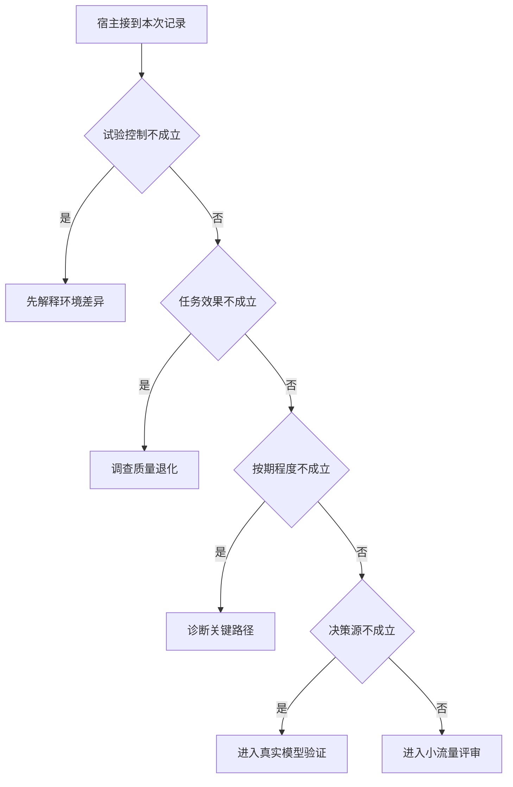

# 架构比较何时可以进入部署评审

对照若换了资料或工具，就不能只把差异归给控制架构。
真实请求要完成同一目标，回放用于量调度机制，两组数据须分别报告。

本篇用一个封闭的教学决策器说明这一问题。输入是宿主收到的记录，不保证每个下游字段都已经获准使用。前置检查未成立时，下游即使带着缓存值，也不能拿来作业务断言。

## 先解决一个具体问题

**如何解释“同预算实验”和“各自优化后对照”的区别？**

前者为了隔离决策机制，后者为了判断哪个服务值得采用。
两者共同需要一致的用户义务和质量门限，但不应从只换路由的一次实验推广所有部署条件。


先取一个能走到「进入小流量评审」的输入：其余关键条件已经冻结、外部后置条件成立、达成约定时间目标、真实模型提出动作。
把这四个条件代回后文的图，前面各个拦截分支都未满足，最终才有“教学前提都满足仍需检验真实负载”这个判断。
还原这个现场时要分别问：哪些位来自可信状态，哪些只是在接口中出现、尚未获得解释资格的字段。

## 先沿一次决策走到底



从上到下取第一条成立的出口。只改一个开关时，只有它之前的检查都未截断，该变化才可能到达真实动作。

“试验控制”的两种输入分别是“其余关键条件已经冻结”与“环境或资料随版本变化”。
孤立机制归因要保持其他条件可比。

“任务效果”的两种输入分别是“外部后置条件成立”与“用户目标未达成”。
回复称已写入不能证明数据库真的发生变化。

“按期程度”的两种输入分别是“达成约定时间目标”与“已超过约定时限”。
正确且过期要与按时正确完成区分。

“决策源”的两种输入分别是“真实模型提出动作”与“脚本重放固定动作”。
回放能验证宿主分支，不直接验证真实选工具质量。

## 最少需要哪几项观察

### 先解释环境差异

实验没有隔离机制。
在本节的全部组合中，有 8 种产生「先解释环境差异」，这只是逻辑空间的计数，不能当作实际用户请求的比例。

只取得环境或资料随版本变化，已经足以要求宿主「先解释环境差异」。
保持这些已知项，其余开关自由变化，仍有 8 种补全，判断没有翻转。

若删掉关于试验控制的证据，另一份允许的现场是其余关键条件已经冻结、用户目标未达成、已超过约定时限、脚本重放固定动作，它会使宿主「调查质量退化」。

### 调查质量退化

更快的错误答案未完成用户目标。
在本节的全部组合中，有 4 种产生「调查质量退化」，这只是逻辑空间的计数，不能当作实际用户请求的比例。

只取得其余关键条件已经冻结、用户目标未达成，已经足以要求宿主「调查质量退化」。
保持这些已知项，其余开关自由变化，仍有 4 种补全，判断没有翻转。

若删掉关于试验控制的证据，另一份允许的现场是环境或资料随版本变化、用户目标未达成、已超过约定时限、脚本重放固定动作，它会使宿主「先解释环境差异」。

若删掉关于任务效果的证据，另一份允许的现场是其余关键条件已经冻结、外部后置条件成立、已超过约定时限、脚本重放固定动作，它会使宿主「诊断关键路径」。

### 诊断关键路径

质量达标但截止目标未满足。
在本节的全部组合中，有 2 种产生「诊断关键路径」，这只是逻辑空间的计数，不能当作实际用户请求的比例。

只取得其余关键条件已经冻结、外部后置条件成立、已超过约定时限，已经足以要求宿主「诊断关键路径」。
保持这些已知项，其余开关自由变化，仍有 2 种补全，判断没有翻转。

若删掉关于试验控制的证据，另一份允许的现场是环境或资料随版本变化、外部后置条件成立、已超过约定时限、脚本重放固定动作，它会使宿主「先解释环境差异」。

若删掉关于任务效果的证据，另一份允许的现场是其余关键条件已经冻结、用户目标未达成、已超过约定时限、脚本重放固定动作，它会使宿主「调查质量退化」。

若删掉关于按期程度的证据，另一份允许的现场是其余关键条件已经冻结、外部后置条件成立、达成约定时间目标、脚本重放固定动作，它会使宿主「进入真实模型验证」。

### 进入真实模型验证

回放尚不能反映在线决策与限流。
在本节的全部组合中，有 1 种产生「进入真实模型验证」，这只是逻辑空间的计数，不能当作实际用户请求的比例。

只取得其余关键条件已经冻结、外部后置条件成立、达成约定时间目标、脚本重放固定动作，已经足以要求宿主「进入真实模型验证」。
保持这些已知项，其余开关自由变化，仍有 1 种补全，判断没有翻转。

若删掉关于试验控制的证据，另一份允许的现场是环境或资料随版本变化、外部后置条件成立、达成约定时间目标、脚本重放固定动作，它会使宿主「先解释环境差异」。

若删掉关于任务效果的证据，另一份允许的现场是其余关键条件已经冻结、用户目标未达成、达成约定时间目标、脚本重放固定动作，它会使宿主「调查质量退化」。

若删掉关于按期程度的证据，另一份允许的现场是其余关键条件已经冻结、外部后置条件成立、已超过约定时限、脚本重放固定动作，它会使宿主「诊断关键路径」。

若删掉关于决策源的证据，另一份允许的现场是其余关键条件已经冻结、外部后置条件成立、达成约定时间目标、真实模型提出动作，它会使宿主「进入小流量评审」。

### 进入小流量评审

教学前提都满足仍需检验真实负载。
在本节的全部组合中，有 1 种产生「进入小流量评审」，这只是逻辑空间的计数，不能当作实际用户请求的比例。

只取得其余关键条件已经冻结、外部后置条件成立、达成约定时间目标、真实模型提出动作，已经足以要求宿主「进入小流量评审」。

若删掉关于试验控制的证据，另一份允许的现场是环境或资料随版本变化、外部后置条件成立、达成约定时间目标、真实模型提出动作，它会使宿主「先解释环境差异」。

若删掉关于任务效果的证据，另一份允许的现场是其余关键条件已经冻结、用户目标未达成、达成约定时间目标、真实模型提出动作，它会使宿主「调查质量退化」。

若删掉关于按期程度的证据，另一份允许的现场是其余关键条件已经冻结、外部后置条件成立、已超过约定时限、真实模型提出动作，它会使宿主「诊断关键路径」。

若删掉关于决策源的证据，另一份允许的现场是其余关键条件已经冻结、外部后置条件成立、达成约定时间目标、脚本重放固定动作，它会使宿主「进入真实模型验证」。

## 以同一份契约解释截然不同的现场

<details>
<summary>展开推演与对应反例</summary>

下列样本按最先命中的业务分支排列。四位编码只作本篇页内定位，顺序与开头的四项输入一致。可以先猜下一动作，再展开相邻样本。

### 能够触发“先解释环境差异”的现场

**样本 0000**

业务侧交来环境或资料随版本变化、用户目标未达成，执行侧还记录了已超过约定时限、脚本重放固定动作。
把样本压成最短证明，保留环境或资料随版本变化就能支持「先解释环境差异」。

在这份记录上，分别翻转「试验控制」中的任一项，其他项完全不变时，下一动作都会改变。

保持其余观察不动，单独切换「任务效果」、「按期程度」、「决策源」仍得到「先解释环境差异」，它们在这个现场不是决定性变量。

要从本例改走「调查质量退化」，至少需要变动 1 项，一组最少改动是将环境或资料随版本变化换成其余关键条件已经冻结。

要从本例改走「诊断关键路径」，至少需要变动 2 项，一组最少改动是将环境或资料随版本变化、用户目标未达成换成其余关键条件已经冻结、外部后置条件成立。

要从本例改走「进入真实模型验证」，至少需要变动 3 项，一组最少改动是将环境或资料随版本变化、用户目标未达成、已超过约定时限换成其余关键条件已经冻结、外部后置条件成立、达成约定时间目标。

要从本例改走「进入小流量评审」，至少需要变动 4 项，一组最少改动是将环境或资料随版本变化、用户目标未达成、已超过约定时限、脚本重放固定动作换成其余关键条件已经冻结、外部后置条件成立、达成约定时间目标、真实模型提出动作。

**样本 0001**

业务侧交来环境或资料随版本变化、用户目标未达成，执行侧还记录了已超过约定时限、真实模型提出动作。


要从本例改走「进入小流量评审」，至少需要变动 3 项，一组最少改动是将环境或资料随版本变化、用户目标未达成、已超过约定时限换成其余关键条件已经冻结、外部后置条件成立、达成约定时间目标。

要从本例改走「进入真实模型验证」，至少需要变动 4 项，一组最少改动是将环境或资料随版本变化、用户目标未达成、已超过约定时限、真实模型提出动作换成其余关键条件已经冻结、外部后置条件成立、达成约定时间目标、脚本重放固定动作。

**样本 0010**

业务侧交来环境或资料随版本变化、用户目标未达成，执行侧还记录了达成约定时间目标、脚本重放固定动作。


要从本例改走「进入真实模型验证」，至少需要变动 2 项，一组最少改动是将环境或资料随版本变化、用户目标未达成换成其余关键条件已经冻结、外部后置条件成立。

要从本例改走「诊断关键路径」，至少需要变动 3 项，一组最少改动是将环境或资料随版本变化、用户目标未达成、达成约定时间目标换成其余关键条件已经冻结、外部后置条件成立、已超过约定时限。

要从本例改走「进入小流量评审」，至少需要变动 3 项，一组最少改动是将环境或资料随版本变化、用户目标未达成、脚本重放固定动作换成其余关键条件已经冻结、外部后置条件成立、真实模型提出动作。

**样本 0011**

业务侧交来环境或资料随版本变化、用户目标未达成，执行侧还记录了达成约定时间目标、真实模型提出动作。


要从本例改走「进入小流量评审」，至少需要变动 2 项，一组最少改动是将环境或资料随版本变化、用户目标未达成换成其余关键条件已经冻结、外部后置条件成立。


要从本例改走「进入真实模型验证」，至少需要变动 3 项，一组最少改动是将环境或资料随版本变化、用户目标未达成、真实模型提出动作换成其余关键条件已经冻结、外部后置条件成立、脚本重放固定动作。

**样本 0100**

业务侧交来环境或资料随版本变化、外部后置条件成立，执行侧还记录了已超过约定时限、脚本重放固定动作。


要从本例改走「诊断关键路径」，至少需要变动 1 项，一组最少改动是将环境或资料随版本变化换成其余关键条件已经冻结。

要从本例改走「调查质量退化」，至少需要变动 2 项，一组最少改动是将环境或资料随版本变化、外部后置条件成立换成其余关键条件已经冻结、用户目标未达成。

要从本例改走「进入真实模型验证」，至少需要变动 2 项，一组最少改动是将环境或资料随版本变化、已超过约定时限换成其余关键条件已经冻结、达成约定时间目标。

要从本例改走「进入小流量评审」，至少需要变动 3 项，一组最少改动是将环境或资料随版本变化、已超过约定时限、脚本重放固定动作换成其余关键条件已经冻结、达成约定时间目标、真实模型提出动作。

**样本 0101**

业务侧交来环境或资料随版本变化、外部后置条件成立，执行侧还记录了已超过约定时限、真实模型提出动作。


要从本例改走「进入小流量评审」，至少需要变动 2 项，一组最少改动是将环境或资料随版本变化、已超过约定时限换成其余关键条件已经冻结、达成约定时间目标。

要从本例改走「进入真实模型验证」，至少需要变动 3 项，一组最少改动是将环境或资料随版本变化、已超过约定时限、真实模型提出动作换成其余关键条件已经冻结、达成约定时间目标、脚本重放固定动作。

**样本 0110**

业务侧交来环境或资料随版本变化、外部后置条件成立，执行侧还记录了达成约定时间目标、脚本重放固定动作。


要从本例改走「进入真实模型验证」，至少需要变动 1 项，一组最少改动是将环境或资料随版本变化换成其余关键条件已经冻结。


要从本例改走「诊断关键路径」，至少需要变动 2 项，一组最少改动是将环境或资料随版本变化、达成约定时间目标换成其余关键条件已经冻结、已超过约定时限。

要从本例改走「进入小流量评审」，至少需要变动 2 项，一组最少改动是将环境或资料随版本变化、脚本重放固定动作换成其余关键条件已经冻结、真实模型提出动作。

**样本 0111**

业务侧交来环境或资料随版本变化、外部后置条件成立，执行侧还记录了达成约定时间目标、真实模型提出动作。


要从本例改走「进入小流量评审」，至少需要变动 1 项，一组最少改动是将环境或资料随版本变化换成其余关键条件已经冻结。


要从本例改走「进入真实模型验证」，至少需要变动 2 项，一组最少改动是将环境或资料随版本变化、真实模型提出动作换成其余关键条件已经冻结、脚本重放固定动作。

### 能够触发“调查质量退化”的现场

**样本 1000**

业务侧交来其余关键条件已经冻结、用户目标未达成，执行侧还记录了已超过约定时限、脚本重放固定动作。
把样本压成最短证明，保留其余关键条件已经冻结、用户目标未达成就能支持「调查质量退化」。

在这份记录上，分别翻转「试验控制」、「任务效果」中的任一项，其他项完全不变时，下一动作都会改变。

保持其余观察不动，单独切换「按期程度」、「决策源」仍得到「调查质量退化」，它们在这个现场不是决定性变量。

本例没走更靠前的「先解释环境差异」，因为其余关键条件已经冻结与那个入口的必要条件不符。

要从本例改走「先解释环境差异」，至少需要变动 1 项，一组最少改动是将其余关键条件已经冻结换成环境或资料随版本变化。

要从本例改走「诊断关键路径」，至少需要变动 1 项，一组最少改动是将用户目标未达成换成外部后置条件成立。

要从本例改走「进入真实模型验证」，至少需要变动 2 项，一组最少改动是将用户目标未达成、已超过约定时限换成外部后置条件成立、达成约定时间目标。

要从本例改走「进入小流量评审」，至少需要变动 3 项，一组最少改动是将用户目标未达成、已超过约定时限、脚本重放固定动作换成外部后置条件成立、达成约定时间目标、真实模型提出动作。

**样本 1001**

业务侧交来其余关键条件已经冻结、用户目标未达成，执行侧还记录了已超过约定时限、真实模型提出动作。


要从本例改走「进入小流量评审」，至少需要变动 2 项，一组最少改动是将用户目标未达成、已超过约定时限换成外部后置条件成立、达成约定时间目标。

要从本例改走「进入真实模型验证」，至少需要变动 3 项，一组最少改动是将用户目标未达成、已超过约定时限、真实模型提出动作换成外部后置条件成立、达成约定时间目标、脚本重放固定动作。

**样本 1010**

业务侧交来其余关键条件已经冻结、用户目标未达成，执行侧还记录了达成约定时间目标、脚本重放固定动作。


要从本例改走「进入真实模型验证」，至少需要变动 1 项，一组最少改动是将用户目标未达成换成外部后置条件成立。

要从本例改走「诊断关键路径」，至少需要变动 2 项，一组最少改动是将用户目标未达成、达成约定时间目标换成外部后置条件成立、已超过约定时限。

要从本例改走「进入小流量评审」，至少需要变动 2 项，一组最少改动是将用户目标未达成、脚本重放固定动作换成外部后置条件成立、真实模型提出动作。

**样本 1011**

业务侧交来其余关键条件已经冻结、用户目标未达成，执行侧还记录了达成约定时间目标、真实模型提出动作。


要从本例改走「进入小流量评审」，至少需要变动 1 项，一组最少改动是将用户目标未达成换成外部后置条件成立。


要从本例改走「进入真实模型验证」，至少需要变动 2 项，一组最少改动是将用户目标未达成、真实模型提出动作换成外部后置条件成立、脚本重放固定动作。

### 能够触发“诊断关键路径”的现场

**样本 1100**

业务侧交来其余关键条件已经冻结、外部后置条件成立，执行侧还记录了已超过约定时限、脚本重放固定动作。
把样本压成最短证明，保留其余关键条件已经冻结、外部后置条件成立、已超过约定时限就能支持「诊断关键路径」。

在这份记录上，分别翻转「试验控制」、「任务效果」、「按期程度」中的任一项，其他项完全不变时，下一动作都会改变。

保持其余观察不动，单独切换「决策源」仍得到「诊断关键路径」，它们在这个现场不是决定性变量。


本例没走更靠前的「调查质量退化」，因为外部后置条件成立与那个入口的必要条件不符。


要从本例改走「调查质量退化」，至少需要变动 1 项，一组最少改动是将外部后置条件成立换成用户目标未达成。

要从本例改走「进入真实模型验证」，至少需要变动 1 项，一组最少改动是将已超过约定时限换成达成约定时间目标。

要从本例改走「进入小流量评审」，至少需要变动 2 项，一组最少改动是将已超过约定时限、脚本重放固定动作换成达成约定时间目标、真实模型提出动作。

**样本 1101**

业务侧交来其余关键条件已经冻结、外部后置条件成立，执行侧还记录了已超过约定时限、真实模型提出动作。


要从本例改走「进入小流量评审」，至少需要变动 1 项，一组最少改动是将已超过约定时限换成达成约定时间目标。

要从本例改走「进入真实模型验证」，至少需要变动 2 项，一组最少改动是将已超过约定时限、真实模型提出动作换成达成约定时间目标、脚本重放固定动作。

### 能够触发“进入真实模型验证”的现场

**样本 1110**

业务侧交来其余关键条件已经冻结、外部后置条件成立，执行侧还记录了达成约定时间目标、脚本重放固定动作。
把样本压成最短证明，保留其余关键条件已经冻结、外部后置条件成立、达成约定时间目标、脚本重放固定动作就能支持「进入真实模型验证」。

在这份记录上，分别翻转「试验控制」、「任务效果」、「按期程度」、「决策源」中的任一项，其他项完全不变时，下一动作都会改变。


本例没走更靠前的「诊断关键路径」，因为达成约定时间目标与那个入口的必要条件不符。


要从本例改走「诊断关键路径」，至少需要变动 1 项，一组最少改动是将达成约定时间目标换成已超过约定时限。

要从本例改走「进入小流量评审」，至少需要变动 1 项，一组最少改动是将脚本重放固定动作换成真实模型提出动作。

### 能够触发“进入小流量评审”的现场

**样本 1111**

业务侧交来其余关键条件已经冻结、外部后置条件成立，执行侧还记录了达成约定时间目标、真实模型提出动作。
把样本压成最短证明，保留其余关键条件已经冻结、外部后置条件成立、达成约定时间目标、真实模型提出动作就能支持「进入小流量评审」。


本例没走更靠前的「进入真实模型验证」，因为真实模型提出动作与那个入口的必要条件不符。


要从本例改走「进入真实模型验证」，至少需要变动 1 项，一组最少改动是将真实模型提出动作换成脚本重放固定动作。

</details>

## 当你只能看见一半记录

<details>
<summary>展开推演与对应反例</summary>

这次隐藏两个字段，保留另两个。对每个可见现场，检查四种合法补全是否同意。如仍有歧义，选择能使最坏剩余候选动作最少的字段继续查。并列时采用本篇字段顺序。

### 只保留试验控制与任务效果

已知环境或资料随版本变化、用户目标未达成时，四种补全的动作分布为先解释环境差异（4 种）。

就“先解释环境差异”这个动作而言，在环境或资料随版本变化、用户目标未达成的前提下，另外两项观察不会推翻它。

已知环境或资料随版本变化、外部后置条件成立时，四种补全的动作分布为先解释环境差异（4 种）。

就“先解释环境差异”这个动作而言，在环境或资料随版本变化、外部后置条件成立的前提下，另外两项观察不会推翻它。

已知其余关键条件已经冻结、用户目标未达成时，四种补全的动作分布为调查质量退化（4 种）。

就“调查质量退化”这个动作而言，在其余关键条件已经冻结、用户目标未达成的前提下，另外两项观察不会推翻它。

已知其余关键条件已经冻结、外部后置条件成立时，四种补全的动作分布为诊断关键路径（2 种）、进入真实模型验证（1 种）、进入小流量评审（1 种）。

在其余关键条件已经冻结、外部后置条件成立这个现场补读「按期程度」，最坏还剩 2 种动作，计算时只衡量歧义，尚未扣读取代价。
若补来的观察为“已超过约定时限”，范围缩成「诊断关键路径」。若为“达成约定时间目标”，则保留「进入真实模型验证」、「进入小流量评审」。

区分不了的两条执行可以具体写成 1100 与 1110：它们共享已展示字段，却分别需要「诊断关键路径」和「进入真实模型验证」。

### 只保留试验控制与按期程度

已知环境或资料随版本变化、已超过约定时限时，四种补全的动作分布为先解释环境差异（4 种）。

就“先解释环境差异”这个动作而言，在环境或资料随版本变化、已超过约定时限的前提下，另外两项观察不会推翻它。

已知环境或资料随版本变化、达成约定时间目标时，四种补全的动作分布为先解释环境差异（4 种）。

就“先解释环境差异”这个动作而言，在环境或资料随版本变化、达成约定时间目标的前提下，另外两项观察不会推翻它。

已知其余关键条件已经冻结、已超过约定时限时，四种补全的动作分布为调查质量退化（2 种）、诊断关键路径（2 种）。

在其余关键条件已经冻结、已超过约定时限这个现场补读「任务效果」，最坏还剩 1 种动作，计算时只衡量歧义，尚未扣读取代价。
若补来的观察为“用户目标未达成”，范围缩成「调查质量退化」。若为“外部后置条件成立”，则保留「诊断关键路径」。

区分不了的两条执行可以具体写成 1000 与 1100：它们共享已展示字段，却分别需要「调查质量退化」和「诊断关键路径」。

已知其余关键条件已经冻结、达成约定时间目标时，四种补全的动作分布为调查质量退化（2 种）、进入真实模型验证（1 种）、进入小流量评审（1 种）。

在其余关键条件已经冻结、达成约定时间目标这个现场补读「任务效果」，最坏还剩 2 种动作，计算时只衡量歧义，尚未扣读取代价。
若补来的观察为“用户目标未达成”，范围缩成「调查质量退化」。若为“外部后置条件成立”，则保留「进入真实模型验证」、「进入小流量评审」。

区分不了的两条执行可以具体写成 1010 与 1110：它们共享已展示字段，却分别需要「调查质量退化」和「进入真实模型验证」。

### 只保留任务效果与按期程度

已知用户目标未达成、已超过约定时限时，四种补全的动作分布为先解释环境差异（2 种）、调查质量退化（2 种）。

在用户目标未达成、已超过约定时限这个现场补读「试验控制」，最坏还剩 1 种动作，计算时只衡量歧义，尚未扣读取代价。
若补来的观察为“环境或资料随版本变化”，范围缩成「先解释环境差异」。若为“其余关键条件已经冻结”，则保留「调查质量退化」。

区分不了的两条执行可以具体写成 0000 与 1000：它们共享已展示字段，却分别需要「先解释环境差异」和「调查质量退化」。

已知用户目标未达成、达成约定时间目标时，四种补全的动作分布为先解释环境差异（2 种）、调查质量退化（2 种）。

在用户目标未达成、达成约定时间目标这个现场补读「试验控制」，最坏还剩 1 种动作，计算时只衡量歧义，尚未扣读取代价。

区分不了的两条执行可以具体写成 0010 与 1010：它们共享已展示字段，却分别需要「先解释环境差异」和「调查质量退化」。

已知外部后置条件成立、已超过约定时限时，四种补全的动作分布为先解释环境差异（2 种）、诊断关键路径（2 种）。

在外部后置条件成立、已超过约定时限这个现场补读「试验控制」，最坏还剩 1 种动作，计算时只衡量歧义，尚未扣读取代价。
若补来的观察为“环境或资料随版本变化”，范围缩成「先解释环境差异」。若为“其余关键条件已经冻结”，则保留「诊断关键路径」。

区分不了的两条执行可以具体写成 0100 与 1100：它们共享已展示字段，却分别需要「先解释环境差异」和「诊断关键路径」。

已知外部后置条件成立、达成约定时间目标时，四种补全的动作分布为先解释环境差异（2 种）、进入真实模型验证（1 种）、进入小流量评审（1 种）。

在外部后置条件成立、达成约定时间目标这个现场补读「试验控制」，最坏还剩 2 种动作，计算时只衡量歧义，尚未扣读取代价。
若补来的观察为“环境或资料随版本变化”，范围缩成「先解释环境差异」。若为“其余关键条件已经冻结”，则保留「进入真实模型验证」、「进入小流量评审」。

区分不了的两条执行可以具体写成 0110 与 1110：它们共享已展示字段，却分别需要「先解释环境差异」和「进入真实模型验证」。

### 只保留试验控制与决策源

已知环境或资料随版本变化、脚本重放固定动作时，四种补全的动作分布为先解释环境差异（4 种）。

就“先解释环境差异”这个动作而言，在环境或资料随版本变化、脚本重放固定动作的前提下，另外两项观察不会推翻它。

已知环境或资料随版本变化、真实模型提出动作时，四种补全的动作分布为先解释环境差异（4 种）。

就“先解释环境差异”这个动作而言，在环境或资料随版本变化、真实模型提出动作的前提下，另外两项观察不会推翻它。

已知其余关键条件已经冻结、脚本重放固定动作时，四种补全的动作分布为调查质量退化（2 种）、诊断关键路径（1 种）、进入真实模型验证（1 种）。

在其余关键条件已经冻结、脚本重放固定动作这个现场补读「任务效果」，最坏还剩 2 种动作，计算时只衡量歧义，尚未扣读取代价。
若补来的观察为“用户目标未达成”，范围缩成「调查质量退化」。若为“外部后置条件成立”，则保留「诊断关键路径」、「进入真实模型验证」。


已知其余关键条件已经冻结、真实模型提出动作时，四种补全的动作分布为调查质量退化（2 种）、诊断关键路径（1 种）、进入小流量评审（1 种）。

在其余关键条件已经冻结、真实模型提出动作这个现场补读「任务效果」，最坏还剩 2 种动作，计算时只衡量歧义，尚未扣读取代价。
若补来的观察为“用户目标未达成”，范围缩成「调查质量退化」。若为“外部后置条件成立”，则保留「诊断关键路径」、「进入小流量评审」。

区分不了的两条执行可以具体写成 1001 与 1101：它们共享已展示字段，却分别需要「调查质量退化」和「诊断关键路径」。

### 只保留任务效果与决策源

已知用户目标未达成、脚本重放固定动作时，四种补全的动作分布为先解释环境差异（2 种）、调查质量退化（2 种）。

在用户目标未达成、脚本重放固定动作这个现场补读「试验控制」，最坏还剩 1 种动作，计算时只衡量歧义，尚未扣读取代价。


已知用户目标未达成、真实模型提出动作时，四种补全的动作分布为先解释环境差异（2 种）、调查质量退化（2 种）。

在用户目标未达成、真实模型提出动作这个现场补读「试验控制」，最坏还剩 1 种动作，计算时只衡量歧义，尚未扣读取代价。

区分不了的两条执行可以具体写成 0001 与 1001：它们共享已展示字段，却分别需要「先解释环境差异」和「调查质量退化」。

已知外部后置条件成立、脚本重放固定动作时，四种补全的动作分布为先解释环境差异（2 种）、诊断关键路径（1 种）、进入真实模型验证（1 种）。

在外部后置条件成立、脚本重放固定动作这个现场补读「试验控制」，最坏还剩 2 种动作，计算时只衡量歧义，尚未扣读取代价。
若补来的观察为“环境或资料随版本变化”，范围缩成「先解释环境差异」。若为“其余关键条件已经冻结”，则保留「诊断关键路径」、「进入真实模型验证」。


已知外部后置条件成立、真实模型提出动作时，四种补全的动作分布为先解释环境差异（2 种）、诊断关键路径（1 种）、进入小流量评审（1 种）。

在外部后置条件成立、真实模型提出动作这个现场补读「试验控制」，最坏还剩 2 种动作，计算时只衡量歧义，尚未扣读取代价。
若补来的观察为“环境或资料随版本变化”，范围缩成「先解释环境差异」。若为“其余关键条件已经冻结”，则保留「诊断关键路径」、「进入小流量评审」。

区分不了的两条执行可以具体写成 0101 与 1101：它们共享已展示字段，却分别需要「先解释环境差异」和「诊断关键路径」。

### 只保留按期程度与决策源

已知已超过约定时限、脚本重放固定动作时，四种补全的动作分布为先解释环境差异（2 种）、调查质量退化（1 种）、诊断关键路径（1 种）。

在已超过约定时限、脚本重放固定动作这个现场补读「试验控制」，最坏还剩 2 种动作，计算时只衡量歧义，尚未扣读取代价。
若补来的观察为“环境或资料随版本变化”，范围缩成「先解释环境差异」。若为“其余关键条件已经冻结”，则保留「调查质量退化」、「诊断关键路径」。


已知已超过约定时限、真实模型提出动作时，四种补全的动作分布为先解释环境差异（2 种）、调查质量退化（1 种）、诊断关键路径（1 种）。

在已超过约定时限、真实模型提出动作这个现场补读「试验控制」，最坏还剩 2 种动作，计算时只衡量歧义，尚未扣读取代价。


已知达成约定时间目标、脚本重放固定动作时，四种补全的动作分布为先解释环境差异（2 种）、调查质量退化（1 种）、进入真实模型验证（1 种）。

在达成约定时间目标、脚本重放固定动作这个现场补读「试验控制」，最坏还剩 2 种动作，计算时只衡量歧义，尚未扣读取代价。
若补来的观察为“环境或资料随版本变化”，范围缩成「先解释环境差异」。若为“其余关键条件已经冻结”，则保留「调查质量退化」、「进入真实模型验证」。


已知达成约定时间目标、真实模型提出动作时，四种补全的动作分布为先解释环境差异（2 种）、调查质量退化（1 种）、进入小流量评审（1 种）。

在达成约定时间目标、真实模型提出动作这个现场补读「试验控制」，最坏还剩 2 种动作，计算时只衡量歧义，尚未扣读取代价。
若补来的观察为“环境或资料随版本变化”，范围缩成「先解释环境差异」。若为“其余关键条件已经冻结”，则保留「调查质量退化」、「进入小流量评审」。

区分不了的两条执行可以具体写成 0011 与 1011：它们共享已展示字段，却分别需要「先解释环境差异」和「调查质量退化」。

</details>

## 单因素干预与边界测试

<details>
<summary>展开推演与对应反例</summary>

### 只改变试验控制

固定另外三个条件得到八对现场，从“环境或资料随版本变化”转为“其余关键条件已经冻结”时，8 对翻转动作，另外 0 对保持不变。

有 4 对现场沿「先解释环境差异」变到「调查质量退化」，可复现的一组受控背景为用户目标未达成、已超过约定时限、脚本重放固定动作。

有 2 对现场沿「先解释环境差异」变到「诊断关键路径」，可复现的一组受控背景为外部后置条件成立、已超过约定时限、脚本重放固定动作。

有 1 对现场沿「先解释环境差异」变到「进入真实模型验证」，可复现的一组受控背景为外部后置条件成立、达成约定时间目标、脚本重放固定动作。

有 1 对现场沿「先解释环境差异」变到「进入小流量评审」，可复现的一组受控背景为外部后置条件成立、达成约定时间目标、真实模型提出动作。

### 只改变任务效果

固定另外三个条件得到八对现场，从“用户目标未达成”转为“外部后置条件成立”时，4 对翻转动作，另外 4 对保持不变。

令环境或资料随版本变化、已超过约定时限、脚本重放固定动作，任务效果的两个取值均得到「先解释环境差异」。在八对中，共有 4 对表现为这一种稳定出口。

有 2 对现场沿「调查质量退化」变到「诊断关键路径」，可复现的一组受控背景为其余关键条件已经冻结、已超过约定时限、脚本重放固定动作。

有 1 对现场沿「调查质量退化」变到「进入真实模型验证」，可复现的一组受控背景为其余关键条件已经冻结、达成约定时间目标、脚本重放固定动作。

有 1 对现场沿「调查质量退化」变到「进入小流量评审」，可复现的一组受控背景为其余关键条件已经冻结、达成约定时间目标、真实模型提出动作。

### 只改变按期程度

固定另外三个条件得到八对现场，从“已超过约定时限”转为“达成约定时间目标”时，2 对翻转动作，另外 6 对保持不变。

令环境或资料随版本变化、用户目标未达成、脚本重放固定动作，按期程度的两个取值均得到「先解释环境差异」。在八对中，共有 4 对表现为这一种稳定出口。

令其余关键条件已经冻结、用户目标未达成、脚本重放固定动作，按期程度的两个取值均得到「调查质量退化」。在八对中，共有 2 对表现为这一种稳定出口。

有 1 对现场沿「诊断关键路径」变到「进入真实模型验证」，可复现的一组受控背景为其余关键条件已经冻结、外部后置条件成立、脚本重放固定动作。

有 1 对现场沿「诊断关键路径」变到「进入小流量评审」，可复现的一组受控背景为其余关键条件已经冻结、外部后置条件成立、真实模型提出动作。

### 只改变决策源

固定另外三个条件得到八对现场，从“脚本重放固定动作”转为“真实模型提出动作”时，1 对翻转动作，另外 7 对保持不变。

令环境或资料随版本变化、用户目标未达成、已超过约定时限，决策源的两个取值均得到「先解释环境差异」。在八对中，共有 4 对表现为这一种稳定出口。

令其余关键条件已经冻结、用户目标未达成、已超过约定时限，决策源的两个取值均得到「调查质量退化」。在八对中，共有 2 对表现为这一种稳定出口。

令其余关键条件已经冻结、外部后置条件成立、已超过约定时限，决策源的两个取值均得到「诊断关键路径」。在八对中，共有 1 对表现为这一种稳定出口。

有 1 对现场沿「进入真实模型验证」变到「进入小流量评审」，可复现的一组受控背景为其余关键条件已经冻结、外部后置条件成立、达成约定时间目标。

</details>

## 哪些回归样本真能抓住实现错误

<details>
<summary>展开推演与对应反例</summary>

如果删除“先解释环境差异”这个分支，在本篇 16 种输入里有 8 种会改走另一出口。

反例 0000 的完整记录为环境或资料随版本变化、用户目标未达成、已超过约定时限、脚本重放固定动作。正确结果是「先解释环境差异」，这个改坏的实现却给出「调查质量退化」。

如果删除“调查质量退化”这个分支，在本篇 16 种输入里有 4 种会改走另一出口。

反例 1000 的完整记录为其余关键条件已经冻结、用户目标未达成、已超过约定时限、脚本重放固定动作。正确结果是「调查质量退化」，这个改坏的实现却给出「诊断关键路径」。

如果删除“诊断关键路径”这个分支，在本篇 16 种输入里有 2 种会改走另一出口。

反例 1100 的完整记录为其余关键条件已经冻结、外部后置条件成立、已超过约定时限、脚本重放固定动作。正确结果是「诊断关键路径」，这个改坏的实现却给出「进入真实模型验证」。

如果删除“进入真实模型验证”这个分支，在本篇 16 种输入里有 1 种会改走另一出口。

反例 1110 的完整记录为其余关键条件已经冻结、外部后置条件成立、达成约定时间目标、脚本重放固定动作。正确结果是「进入真实模型验证」，这个改坏的实现却给出「进入小流量评审」。

如果交换“先解释环境差异”和“调查质量退化”的判断次序，在本篇 16 种输入里有 4 种会改走另一出口。


如果交换“调查质量退化”和“诊断关键路径”的判断次序，在本篇 16 种输入里有 2 种会改走另一出口。


如果交换“诊断关键路径”和“进入真实模型验证”的判断次序，在本篇 16 种输入里有 1 种会改走另一出口。


补入样本 0000（环境或资料随版本变化、用户目标未达成、已超过约定时限、脚本重放固定动作）能新增检出「删除“先解释环境差异”这个分支」、「交换“先解释环境差异”和“调查质量退化”的判断次序」。

补入样本 1000（其余关键条件已经冻结、用户目标未达成、已超过约定时限、脚本重放固定动作）能新增检出「删除“调查质量退化”这个分支」、「交换“调查质量退化”和“诊断关键路径”的判断次序」。

补入样本 1100（其余关键条件已经冻结、外部后置条件成立、已超过约定时限、脚本重放固定动作）能新增检出「删除“诊断关键路径”这个分支」、「交换“诊断关键路径”和“进入真实模型验证”的判断次序」。

补入样本 1110（其余关键条件已经冻结、外部后置条件成立、达成约定时间目标、脚本重放固定动作）能新增检出「删除“进入真实模型验证”这个分支」。

这里每次选覆盖尚未捕获缺陷最多的样本，并不保证用例数全局最小。它给出的反例能作为 Java 单测输入。真实模型是否会自主产生这些提议，仍须单独评测。

</details>

## 把状态覆盖换成有抽样偏差的评测批次

<details>
<summary>展开推演与对应反例</summary>

前面的十六种记录各有一票。现在只改样本构成：对一个给定字段，把成立侧的每种记录各取三份、另一侧各取一份。这是人为配比的 32 份回放，不是线上频率估计。
将偏向成立与偏向不成立的两次批次对照，可以隔离分母变化。底层宿主和所有答案保持相同，比例仍可能移动。

### 改变“试验控制”的样本配比

只看「先解释环境差异」，在其余关键条件已经冻结的八个不同输入中有 0 个命中，在环境或资料随版本变化的另八个输入中有 8 个命中。
把「试验控制」成立侧按三倍取样，「先解释环境差异」占 8/32，反过来向未成立侧倾斜后占 24/32。
这次重加权使「先解释环境差异」的占比相差 50 个百分点。若按两种不同的“试验控制”分布跑新旧版，不能把这项差异全部归功于实现。

只看「调查质量退化」，在其余关键条件已经冻结的八个不同输入中有 4 个命中，在环境或资料随版本变化的另八个输入中有 0 个命中。
把「试验控制」成立侧按三倍取样，「调查质量退化」占 12/32，反过来向未成立侧倾斜后占 4/32。
这次重加权使「调查质量退化」的占比相差 25 个百分点。若按两种不同的“试验控制”分布跑新旧版，不能把这项差异全部归功于实现。

只看「诊断关键路径」，在其余关键条件已经冻结的八个不同输入中有 2 个命中，在环境或资料随版本变化的另八个输入中有 0 个命中。
把「试验控制」成立侧按三倍取样，「诊断关键路径」占 6/32，反过来向未成立侧倾斜后占 2/32。
这次重加权使「诊断关键路径」的占比相差 12.5 个百分点。若按两种不同的“试验控制”分布跑新旧版，不能把这项差异全部归功于实现。

只看「进入真实模型验证」，在其余关键条件已经冻结的八个不同输入中有 1 个命中，在环境或资料随版本变化的另八个输入中有 0 个命中。
把「试验控制」成立侧按三倍取样，「进入真实模型验证」占 3/32，反过来向未成立侧倾斜后占 1/32。
这次重加权使「进入真实模型验证」的占比相差 6.25 个百分点。若按两种不同的“试验控制”分布跑新旧版，不能把这项差异全部归功于实现。

只看「进入小流量评审」，在其余关键条件已经冻结的八个不同输入中有 1 个命中，在环境或资料随版本变化的另八个输入中有 0 个命中。
把「试验控制」成立侧按三倍取样，「进入小流量评审」占 3/32，反过来向未成立侧倾斜后占 1/32。
这次重加权使「进入小流量评审」的占比相差 6.25 个百分点。若按两种不同的“试验控制”分布跑新旧版，不能把这项差异全部归功于实现。

### 改变“任务效果”的样本配比

只看「先解释环境差异」，在外部后置条件成立的八个不同输入中有 4 个命中，在用户目标未达成的另八个输入中有 4 个命中。
把「任务效果」成立侧按三倍取样，「先解释环境差异」占 16/32，反过来向未成立侧倾斜后占 16/32。
两批「先解释环境差异」的边际比例相同，是因为这个出口在“任务效果”的两侧计数相等，这不能单独证明每一对现场都不受它影响。

只看「调查质量退化」，在外部后置条件成立的八个不同输入中有 0 个命中，在用户目标未达成的另八个输入中有 4 个命中。
把「任务效果」成立侧按三倍取样，「调查质量退化」占 4/32，反过来向未成立侧倾斜后占 12/32。
这次重加权使「调查质量退化」的占比相差 25 个百分点。若按两种不同的“任务效果”分布跑新旧版，不能把这项差异全部归功于实现。

只看「诊断关键路径」，在外部后置条件成立的八个不同输入中有 2 个命中，在用户目标未达成的另八个输入中有 0 个命中。
把「任务效果」成立侧按三倍取样，「诊断关键路径」占 6/32，反过来向未成立侧倾斜后占 2/32。
这次重加权使「诊断关键路径」的占比相差 12.5 个百分点。若按两种不同的“任务效果”分布跑新旧版，不能把这项差异全部归功于实现。

只看「进入真实模型验证」，在外部后置条件成立的八个不同输入中有 1 个命中，在用户目标未达成的另八个输入中有 0 个命中。
把「任务效果」成立侧按三倍取样，「进入真实模型验证」占 3/32，反过来向未成立侧倾斜后占 1/32。
这次重加权使「进入真实模型验证」的占比相差 6.25 个百分点。若按两种不同的“任务效果”分布跑新旧版，不能把这项差异全部归功于实现。

只看「进入小流量评审」，在外部后置条件成立的八个不同输入中有 1 个命中，在用户目标未达成的另八个输入中有 0 个命中。
把「任务效果」成立侧按三倍取样，「进入小流量评审」占 3/32，反过来向未成立侧倾斜后占 1/32。
这次重加权使「进入小流量评审」的占比相差 6.25 个百分点。若按两种不同的“任务效果”分布跑新旧版，不能把这项差异全部归功于实现。

### 改变“按期程度”的样本配比

只看「先解释环境差异」，在达成约定时间目标的八个不同输入中有 4 个命中，在已超过约定时限的另八个输入中有 4 个命中。
把「按期程度」成立侧按三倍取样，「先解释环境差异」占 16/32，反过来向未成立侧倾斜后占 16/32。
两批「先解释环境差异」的边际比例相同，是因为这个出口在“按期程度”的两侧计数相等，这不能单独证明每一对现场都不受它影响。

只看「调查质量退化」，在达成约定时间目标的八个不同输入中有 2 个命中，在已超过约定时限的另八个输入中有 2 个命中。
把「按期程度」成立侧按三倍取样，「调查质量退化」占 8/32，反过来向未成立侧倾斜后占 8/32。
两批「调查质量退化」的边际比例相同，是因为这个出口在“按期程度”的两侧计数相等，这不能单独证明每一对现场都不受它影响。

只看「诊断关键路径」，在达成约定时间目标的八个不同输入中有 0 个命中，在已超过约定时限的另八个输入中有 2 个命中。
把「按期程度」成立侧按三倍取样，「诊断关键路径」占 2/32，反过来向未成立侧倾斜后占 6/32。
这次重加权使「诊断关键路径」的占比相差 12.5 个百分点。若按两种不同的“按期程度”分布跑新旧版，不能把这项差异全部归功于实现。

只看「进入真实模型验证」，在达成约定时间目标的八个不同输入中有 1 个命中，在已超过约定时限的另八个输入中有 0 个命中。
把「按期程度」成立侧按三倍取样，「进入真实模型验证」占 3/32，反过来向未成立侧倾斜后占 1/32。
这次重加权使「进入真实模型验证」的占比相差 6.25 个百分点。若按两种不同的“按期程度”分布跑新旧版，不能把这项差异全部归功于实现。

只看「进入小流量评审」，在达成约定时间目标的八个不同输入中有 1 个命中，在已超过约定时限的另八个输入中有 0 个命中。
把「按期程度」成立侧按三倍取样，「进入小流量评审」占 3/32，反过来向未成立侧倾斜后占 1/32。
这次重加权使「进入小流量评审」的占比相差 6.25 个百分点。若按两种不同的“按期程度”分布跑新旧版，不能把这项差异全部归功于实现。

### 改变“决策源”的样本配比

只看「先解释环境差异」，在真实模型提出动作的八个不同输入中有 4 个命中，在脚本重放固定动作的另八个输入中有 4 个命中。
把「决策源」成立侧按三倍取样，「先解释环境差异」占 16/32，反过来向未成立侧倾斜后占 16/32。
两批「先解释环境差异」的边际比例相同，是因为这个出口在“决策源”的两侧计数相等，这不能单独证明每一对现场都不受它影响。

只看「调查质量退化」，在真实模型提出动作的八个不同输入中有 2 个命中，在脚本重放固定动作的另八个输入中有 2 个命中。
把「决策源」成立侧按三倍取样，「调查质量退化」占 8/32，反过来向未成立侧倾斜后占 8/32。
两批「调查质量退化」的边际比例相同，是因为这个出口在“决策源”的两侧计数相等，这不能单独证明每一对现场都不受它影响。

只看「诊断关键路径」，在真实模型提出动作的八个不同输入中有 1 个命中，在脚本重放固定动作的另八个输入中有 1 个命中。
把「决策源」成立侧按三倍取样，「诊断关键路径」占 4/32，反过来向未成立侧倾斜后占 4/32。
两批「诊断关键路径」的边际比例相同，是因为这个出口在“决策源”的两侧计数相等，这不能单独证明每一对现场都不受它影响。

只看「进入真实模型验证」，在真实模型提出动作的八个不同输入中有 0 个命中，在脚本重放固定动作的另八个输入中有 1 个命中。
把「决策源」成立侧按三倍取样，「进入真实模型验证」占 1/32，反过来向未成立侧倾斜后占 3/32。
这次重加权使「进入真实模型验证」的占比相差 6.25 个百分点。若按两种不同的“决策源”分布跑新旧版，不能把这项差异全部归功于实现。

只看「进入小流量评审」，在真实模型提出动作的八个不同输入中有 1 个命中，在脚本重放固定动作的另八个输入中有 0 个命中。
把「决策源」成立侧按三倍取样，「进入小流量评审」占 3/32，反过来向未成立侧倾斜后占 1/32。
这次重加权使「进入小流量评审」的占比相差 6.25 个百分点。若按两种不同的“决策源”分布跑新旧版，不能把这项差异全部归功于实现。

</details>

## 只看终态，能逆推出多少原始事实

<details>
<summary>展开推演与对应反例</summary>

### 只保留“先解释环境差异”这条结果时

在本节契约与完整输入域内，仅知「先解释环境差异」就能倒推出环境或资料随版本变化，这一推断依赖版本未变且日志中的终态可信。

「先解释环境差异」不能证明任务效果取哪一侧：0000 和 0100 有相同终态，却分别记为“用户目标未达成”和“外部后置条件成立”。

「先解释环境差异」不能证明按期程度取哪一侧：0000 和 0010 有相同终态，却分别记为“已超过约定时限”和“达成约定时间目标”。

「先解释环境差异」不能证明决策源取哪一侧：0000 和 0001 有相同终态，却分别记为“脚本重放固定动作”和“真实模型提出动作”。

反查「先解释环境差异」的诊断日志，优先保留能区分样本 0000 与 1000 的「试验控制」，否则很容易把邻近的「调查质量退化」看成同一种故障。

### 只保留“调查质量退化”这条结果时

在本节契约与完整输入域内，仅知「调查质量退化」就能倒推出其余关键条件已经冻结，这一推断依赖版本未变且日志中的终态可信。

在本节契约与完整输入域内，仅知「调查质量退化」就能倒推出用户目标未达成，这一推断依赖版本未变且日志中的终态可信。

「调查质量退化」不能证明按期程度取哪一侧：1000 和 1010 有相同终态，却分别记为“已超过约定时限”和“达成约定时间目标”。

「调查质量退化」不能证明决策源取哪一侧：1000 和 1001 有相同终态，却分别记为“脚本重放固定动作”和“真实模型提出动作”。

反查「调查质量退化」的诊断日志，优先保留能区分样本 1000 与 0000 的「试验控制」，否则很容易把邻近的「先解释环境差异」看成同一种故障。

### 只保留“诊断关键路径”这条结果时

在本节契约与完整输入域内，仅知「诊断关键路径」就能倒推出其余关键条件已经冻结，这一推断依赖版本未变且日志中的终态可信。

在本节契约与完整输入域内，仅知「诊断关键路径」就能倒推出外部后置条件成立，这一推断依赖版本未变且日志中的终态可信。

在本节契约与完整输入域内，仅知「诊断关键路径」就能倒推出已超过约定时限，这一推断依赖版本未变且日志中的终态可信。

「诊断关键路径」不能证明决策源取哪一侧：1100 和 1101 有相同终态，却分别记为“脚本重放固定动作”和“真实模型提出动作”。

反查「诊断关键路径」的诊断日志，优先保留能区分样本 1100 与 0100 的「试验控制」，否则很容易把邻近的「先解释环境差异」看成同一种故障。

### 只保留“进入真实模型验证”这条结果时

在本节契约与完整输入域内，仅知「进入真实模型验证」就能倒推出其余关键条件已经冻结，这一推断依赖版本未变且日志中的终态可信。

在本节契约与完整输入域内，仅知「进入真实模型验证」就能倒推出外部后置条件成立，这一推断依赖版本未变且日志中的终态可信。

在本节契约与完整输入域内，仅知「进入真实模型验证」就能倒推出达成约定时间目标，这一推断依赖版本未变且日志中的终态可信。

在本节契约与完整输入域内，仅知「进入真实模型验证」就能倒推出脚本重放固定动作，这一推断依赖版本未变且日志中的终态可信。

反查「进入真实模型验证」的诊断日志，优先保留能区分样本 1110 与 0110 的「试验控制」，否则很容易把邻近的「先解释环境差异」看成同一种故障。

### 只保留“进入小流量评审”这条结果时

在本节契约与完整输入域内，仅知「进入小流量评审」就能倒推出其余关键条件已经冻结，这一推断依赖版本未变且日志中的终态可信。

在本节契约与完整输入域内，仅知「进入小流量评审」就能倒推出外部后置条件成立，这一推断依赖版本未变且日志中的终态可信。

在本节契约与完整输入域内，仅知「进入小流量评审」就能倒推出达成约定时间目标，这一推断依赖版本未变且日志中的终态可信。

在本节契约与完整输入域内，仅知「进入小流量评审」就能倒推出真实模型提出动作，这一推断依赖版本未变且日志中的终态可信。

反查「进入小流量评审」的诊断日志，优先保留能区分样本 1111 与 0111 的「试验控制」，否则很容易把邻近的「先解释环境差异」看成同一种故障。

</details>

## 面试复述与复算

面试题可以从“如何解释“同预算实验”和“各自优化后对照”的区别？”起步。先给出本篇的触发条件和一条真实执行端可检查的证据，再用一个相邻反例限定结论的适用范围。

在仓库根目录执行下列命令可以重算本篇的一个输入。四位数字依次选择正文列出的四项条件，0 表示未成立或低档，1 表示成立或高档。
```powershell
node examples/reading-cases/replay.mjs 9 7 0101
```

[本周主文](../theory.md) · [配套实验](../lab.md)
