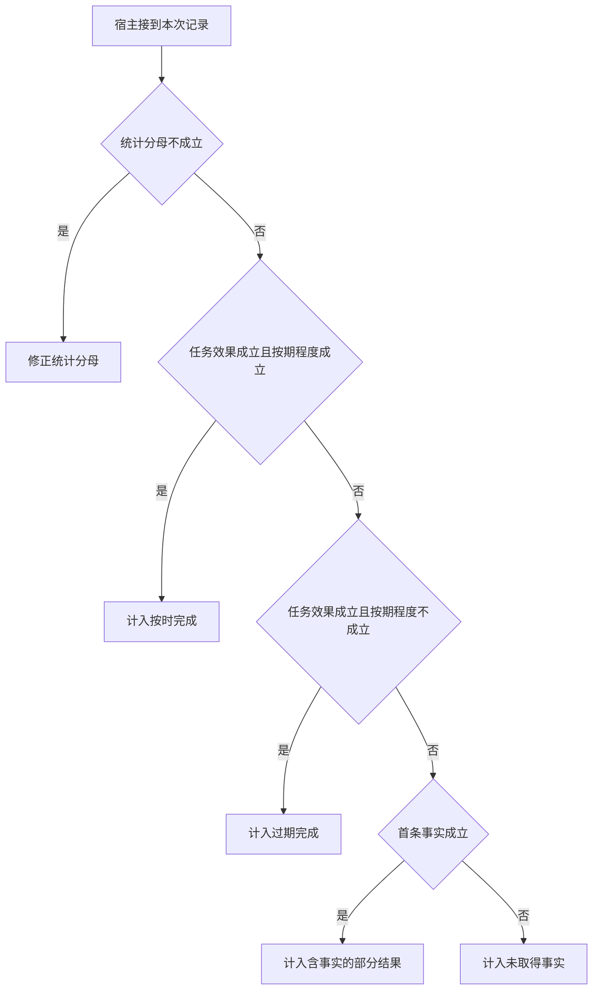

# 首 token 和首个可用事实如何计量

客户端可能先收到“正在核验”，一秒后才收到有证据的事实。
没有正确事实的请求应留在覆盖率分母。只计算成功样本的延迟会掩盖快速失败。

本篇用一个封闭的教学决策器说明这一问题。输入是宿主收到的记录，不保证每个下游字段都已经获准使用。前置检查未成立时，下游即使带着缓存值，也不能拿来作业务断言。

完整目标也可能只需要一个结构化确认。首事实位专门记录独立的事实事件，正确终态仍按用户整体目标判断。

## 先解决一个具体问题

**首 token 提早了，为什么还看首条正确事实？**

进度提示可以在任何读取之前发出，对根因问题没有提供证据。
给首条独立可验证事实和正确终态各设时钟，并让没有事实的请求留在覆盖率分母。


先取一个能走到「计入未取得事实」的输入：只有进度或未证实文本、用户目标未达成、已超过约定时限、统计包含全部失败与尝试。
把这四个条件代回后文的图，前面各个拦截分支都未满足，最终才有“进度文本不能充当业务证据”这个判断。
还原这个现场时要分别问：哪些位来自可信状态，哪些只是在接口中出现、尚未获得解释资格的字段。

## 先沿一次决策走到底



从上到下取第一条成立的出口。只改一个开关时，只有它之前的检查都未截断，该变化才可能到达真实动作。

“首条事实”的两种输入分别是“已取得首条可核实事实”与“只有进度或未证实文本”。
开始生成不等于用户已得到可用信息。

“任务效果”的两种输入分别是“外部后置条件成立”与“用户目标未达成”。
回复称已写入不能证明数据库真的发生变化。

“按期程度”的两种输入分别是“达成约定时间目标”与“已超过约定时限”。
正确且过期要与按时正确完成区分。

“统计分母”的两种输入分别是“统计包含全部失败与尝试”与“统计漏掉超时或失败”。
只测成功请求会产生样本选择偏差。

## 最少需要哪几项观察

### 修正统计分母

丢弃失败样本会扭曲服务表现。
在本节的全部组合中，有 8 种产生「修正统计分母」，这只是逻辑空间的计数，不能当作实际用户请求的比例。

只取得统计漏掉超时或失败，已经足以要求宿主「修正统计分母」。
保持这些已知项，其余开关自由变化，仍有 8 种补全，判断没有翻转。

若删掉关于统计分母的证据，另一份允许的现场是只有进度或未证实文本、用户目标未达成、已超过约定时限、统计包含全部失败与尝试，它会使宿主「计入未取得事实」。

### 计入按时完成

用户目标在时限内达到。
在本节的全部组合中，有 2 种产生「计入按时完成」，这只是逻辑空间的计数，不能当作实际用户请求的比例。

只取得外部后置条件成立、达成约定时间目标、统计包含全部失败与尝试，已经足以要求宿主「计入按时完成」。
保持这些已知项，其余开关自由变化，仍有 2 种补全，判断没有翻转。

若删掉关于任务效果的证据，另一份允许的现场是只有进度或未证实文本、用户目标未达成、达成约定时间目标、统计包含全部失败与尝试，它会使宿主「计入未取得事实」。

若删掉关于按期程度的证据，另一份允许的现场是只有进度或未证实文本、外部后置条件成立、已超过约定时限、统计包含全部失败与尝试，它会使宿主「计入过期完成」。

若删掉关于统计分母的证据，另一份允许的现场是只有进度或未证实文本、外部后置条件成立、达成约定时间目标、统计漏掉超时或失败，它会使宿主「修正统计分母」。

### 计入过期完成

正确终态错过截止。
在本节的全部组合中，有 2 种产生「计入过期完成」，这只是逻辑空间的计数，不能当作实际用户请求的比例。

只取得外部后置条件成立、已超过约定时限、统计包含全部失败与尝试，已经足以要求宿主「计入过期完成」。

若删掉关于任务效果的证据，另一份允许的现场是只有进度或未证实文本、用户目标未达成、已超过约定时限、统计包含全部失败与尝试，它会使宿主「计入未取得事实」。

若删掉关于按期程度的证据，另一份允许的现场是只有进度或未证实文本、外部后置条件成立、达成约定时间目标、统计包含全部失败与尝试，它会使宿主「计入按时完成」。

若删掉关于统计分母的证据，另一份允许的现场是只有进度或未证实文本、外部后置条件成立、已超过约定时限、统计漏掉超时或失败，它会使宿主「修正统计分母」。

### 计入含事实的部分结果

已产生可用事实但没有完整完成。
在本节的全部组合中，有 2 种产生「计入含事实的部分结果」，这只是逻辑空间的计数，不能当作实际用户请求的比例。

只取得已取得首条可核实事实、用户目标未达成、统计包含全部失败与尝试，已经足以要求宿主「计入含事实的部分结果」。

若删掉关于首条事实的证据，另一份允许的现场是只有进度或未证实文本、用户目标未达成、已超过约定时限、统计包含全部失败与尝试，它会使宿主「计入未取得事实」。

若删掉关于任务效果的证据，另一份允许的现场是已取得首条可核实事实、外部后置条件成立、已超过约定时限、统计包含全部失败与尝试，它会使宿主「计入过期完成」。

若删掉关于统计分母的证据，另一份允许的现场是已取得首条可核实事实、用户目标未达成、已超过约定时限、统计漏掉超时或失败，它会使宿主「修正统计分母」。

### 计入未取得事实

进度文本不能充当业务证据。
在本节的全部组合中，有 2 种产生「计入未取得事实」，这只是逻辑空间的计数，不能当作实际用户请求的比例。

只取得只有进度或未证实文本、用户目标未达成、统计包含全部失败与尝试，已经足以要求宿主「计入未取得事实」。

若删掉关于首条事实的证据，另一份允许的现场是已取得首条可核实事实、用户目标未达成、已超过约定时限、统计包含全部失败与尝试，它会使宿主「计入含事实的部分结果」。

若删掉关于任务效果的证据，另一份允许的现场是只有进度或未证实文本、外部后置条件成立、已超过约定时限、统计包含全部失败与尝试，它会使宿主「计入过期完成」。

若删掉关于统计分母的证据，另一份允许的现场是只有进度或未证实文本、用户目标未达成、已超过约定时限、统计漏掉超时或失败，它会使宿主「修正统计分母」。

## 以同一份契约解释截然不同的现场

<details>
<summary>展开推演与对应反例</summary>

下列样本按最先命中的业务分支排列。四位编码只作本篇页内定位，顺序与开头的四项输入一致。可以先猜下一动作，再展开相邻样本。

### 能够触发“修正统计分母”的现场

**样本 0000**

业务侧交来只有进度或未证实文本、用户目标未达成，执行侧还记录了已超过约定时限、统计漏掉超时或失败。
把样本压成最短证明，保留统计漏掉超时或失败就能支持「修正统计分母」。

在这份记录上，分别翻转「统计分母」中的任一项，其他项完全不变时，下一动作都会改变。

保持其余观察不动，单独切换「首条事实」、「任务效果」、「按期程度」仍得到「修正统计分母」，它们在这个现场不是决定性变量。

要从本例改走「计入未取得事实」，至少需要变动 1 项，一组最少改动是将统计漏掉超时或失败换成统计包含全部失败与尝试。

要从本例改走「计入过期完成」，至少需要变动 2 项，一组最少改动是将用户目标未达成、统计漏掉超时或失败换成外部后置条件成立、统计包含全部失败与尝试。

要从本例改走「计入含事实的部分结果」，至少需要变动 2 项，一组最少改动是将只有进度或未证实文本、统计漏掉超时或失败换成已取得首条可核实事实、统计包含全部失败与尝试。

要从本例改走「计入按时完成」，至少需要变动 3 项，一组最少改动是将用户目标未达成、已超过约定时限、统计漏掉超时或失败换成外部后置条件成立、达成约定时间目标、统计包含全部失败与尝试。

**样本 0010**

业务侧交来只有进度或未证实文本、用户目标未达成，执行侧还记录了达成约定时间目标、统计漏掉超时或失败。


要从本例改走「计入按时完成」，至少需要变动 2 项，一组最少改动是将用户目标未达成、统计漏掉超时或失败换成外部后置条件成立、统计包含全部失败与尝试。


要从本例改走「计入过期完成」，至少需要变动 3 项，一组最少改动是将用户目标未达成、达成约定时间目标、统计漏掉超时或失败换成外部后置条件成立、已超过约定时限、统计包含全部失败与尝试。

**样本 0100**

业务侧交来只有进度或未证实文本、外部后置条件成立，执行侧还记录了已超过约定时限、统计漏掉超时或失败。


要从本例改走「计入过期完成」，至少需要变动 1 项，一组最少改动是将统计漏掉超时或失败换成统计包含全部失败与尝试。

要从本例改走「计入未取得事实」，至少需要变动 2 项，一组最少改动是将外部后置条件成立、统计漏掉超时或失败换成用户目标未达成、统计包含全部失败与尝试。

要从本例改走「计入按时完成」，至少需要变动 2 项，一组最少改动是将已超过约定时限、统计漏掉超时或失败换成达成约定时间目标、统计包含全部失败与尝试。

要从本例改走「计入含事实的部分结果」，至少需要变动 3 项，一组最少改动是将只有进度或未证实文本、外部后置条件成立、统计漏掉超时或失败换成已取得首条可核实事实、用户目标未达成、统计包含全部失败与尝试。

**样本 0110**

业务侧交来只有进度或未证实文本、外部后置条件成立，执行侧还记录了达成约定时间目标、统计漏掉超时或失败。


要从本例改走「计入按时完成」，至少需要变动 1 项，一组最少改动是将统计漏掉超时或失败换成统计包含全部失败与尝试。


要从本例改走「计入过期完成」，至少需要变动 2 项，一组最少改动是将达成约定时间目标、统计漏掉超时或失败换成已超过约定时限、统计包含全部失败与尝试。


**样本 1000**

业务侧交来已取得首条可核实事实、用户目标未达成，执行侧还记录了已超过约定时限、统计漏掉超时或失败。


要从本例改走「计入含事实的部分结果」，至少需要变动 1 项，一组最少改动是将统计漏掉超时或失败换成统计包含全部失败与尝试。

要从本例改走「计入未取得事实」，至少需要变动 2 项，一组最少改动是将已取得首条可核实事实、统计漏掉超时或失败换成只有进度或未证实文本、统计包含全部失败与尝试。


**样本 1010**

业务侧交来已取得首条可核实事实、用户目标未达成，执行侧还记录了达成约定时间目标、统计漏掉超时或失败。


**样本 1100**

业务侧交来已取得首条可核实事实、外部后置条件成立，执行侧还记录了已超过约定时限、统计漏掉超时或失败。


要从本例改走「计入含事实的部分结果」，至少需要变动 2 项，一组最少改动是将外部后置条件成立、统计漏掉超时或失败换成用户目标未达成、统计包含全部失败与尝试。


要从本例改走「计入未取得事实」，至少需要变动 3 项，一组最少改动是将已取得首条可核实事实、外部后置条件成立、统计漏掉超时或失败换成只有进度或未证实文本、用户目标未达成、统计包含全部失败与尝试。

**样本 1110**

业务侧交来已取得首条可核实事实、外部后置条件成立，执行侧还记录了达成约定时间目标、统计漏掉超时或失败。


### 能够触发“计入按时完成”的现场

**样本 0111**

业务侧交来只有进度或未证实文本、外部后置条件成立，执行侧还记录了达成约定时间目标、统计包含全部失败与尝试。
把样本压成最短证明，保留外部后置条件成立、达成约定时间目标、统计包含全部失败与尝试就能支持「计入按时完成」。

在这份记录上，分别翻转「任务效果」、「按期程度」、「统计分母」中的任一项，其他项完全不变时，下一动作都会改变。

保持其余观察不动，单独切换「首条事实」仍得到「计入按时完成」，它们在这个现场不是决定性变量。

本例没走更靠前的「修正统计分母」，因为统计包含全部失败与尝试与那个入口的必要条件不符。

要从本例改走「计入未取得事实」，至少需要变动 1 项，一组最少改动是将外部后置条件成立换成用户目标未达成。

要从本例改走「计入过期完成」，至少需要变动 1 项，一组最少改动是将达成约定时间目标换成已超过约定时限。

要从本例改走「修正统计分母」，至少需要变动 1 项，一组最少改动是将统计包含全部失败与尝试换成统计漏掉超时或失败。

要从本例改走「计入含事实的部分结果」，至少需要变动 2 项，一组最少改动是将只有进度或未证实文本、外部后置条件成立换成已取得首条可核实事实、用户目标未达成。

**样本 1111**

业务侧交来已取得首条可核实事实、外部后置条件成立，执行侧还记录了达成约定时间目标、统计包含全部失败与尝试。


要从本例改走「计入含事实的部分结果」，至少需要变动 1 项，一组最少改动是将外部后置条件成立换成用户目标未达成。


要从本例改走「计入未取得事实」，至少需要变动 2 项，一组最少改动是将已取得首条可核实事实、外部后置条件成立换成只有进度或未证实文本、用户目标未达成。

### 能够触发“计入过期完成”的现场

**样本 0101**

业务侧交来只有进度或未证实文本、外部后置条件成立，执行侧还记录了已超过约定时限、统计包含全部失败与尝试。
把样本压成最短证明，保留外部后置条件成立、已超过约定时限、统计包含全部失败与尝试就能支持「计入过期完成」。


保持其余观察不动，单独切换「首条事实」仍得到「计入过期完成」，它们在这个现场不是决定性变量。


本例没走更靠前的「计入按时完成」，因为已超过约定时限与那个入口的必要条件不符。


要从本例改走「计入按时完成」，至少需要变动 1 项，一组最少改动是将已超过约定时限换成达成约定时间目标。


**样本 1101**

业务侧交来已取得首条可核实事实、外部后置条件成立，执行侧还记录了已超过约定时限、统计包含全部失败与尝试。


### 能够触发“计入含事实的部分结果”的现场

**样本 1001**

业务侧交来已取得首条可核实事实、用户目标未达成，执行侧还记录了已超过约定时限、统计包含全部失败与尝试。
把样本压成最短证明，保留已取得首条可核实事实、用户目标未达成、统计包含全部失败与尝试就能支持「计入含事实的部分结果」。

在这份记录上，分别翻转「首条事实」、「任务效果」、「统计分母」中的任一项，其他项完全不变时，下一动作都会改变。

保持其余观察不动，单独切换「按期程度」仍得到「计入含事实的部分结果」，它们在这个现场不是决定性变量。


本例没走更靠前的「计入按时完成」，因为用户目标未达成、已超过约定时限与那个入口的必要条件不符。

本例没走更靠前的「计入过期完成」，因为用户目标未达成与那个入口的必要条件不符。

要从本例改走「计入未取得事实」，至少需要变动 1 项，一组最少改动是将已取得首条可核实事实换成只有进度或未证实文本。


要从本例改走「计入过期完成」，至少需要变动 1 项，一组最少改动是将用户目标未达成换成外部后置条件成立。

要从本例改走「计入按时完成」，至少需要变动 2 项，一组最少改动是将用户目标未达成、已超过约定时限换成外部后置条件成立、达成约定时间目标。

**样本 1011**

业务侧交来已取得首条可核实事实、用户目标未达成，执行侧还记录了达成约定时间目标、统计包含全部失败与尝试。


本例没走更靠前的「计入按时完成」，因为用户目标未达成与那个入口的必要条件不符。

本例没走更靠前的「计入过期完成」，因为用户目标未达成、达成约定时间目标与那个入口的必要条件不符。


要从本例改走「计入按时完成」，至少需要变动 1 项，一组最少改动是将用户目标未达成换成外部后置条件成立。

要从本例改走「计入过期完成」，至少需要变动 2 项，一组最少改动是将用户目标未达成、达成约定时间目标换成外部后置条件成立、已超过约定时限。

### 能够触发“计入未取得事实”的现场

**样本 0001**

业务侧交来只有进度或未证实文本、用户目标未达成，执行侧还记录了已超过约定时限、统计包含全部失败与尝试。
把样本压成最短证明，保留只有进度或未证实文本、用户目标未达成、统计包含全部失败与尝试就能支持「计入未取得事实」。


保持其余观察不动，单独切换「按期程度」仍得到「计入未取得事实」，它们在这个现场不是决定性变量。


本例没走更靠前的「计入含事实的部分结果」，因为只有进度或未证实文本与那个入口的必要条件不符。


要从本例改走「计入含事实的部分结果」，至少需要变动 1 项，一组最少改动是将只有进度或未证实文本换成已取得首条可核实事实。


**样本 0011**

业务侧交来只有进度或未证实文本、用户目标未达成，执行侧还记录了达成约定时间目标、统计包含全部失败与尝试。


</details>

## 当你只能看见一半记录

<details>
<summary>展开推演与对应反例</summary>

这次隐藏两个字段，保留另两个。对每个可见现场，检查四种合法补全是否同意。如仍有歧义，选择能使最坏剩余候选动作最少的字段继续查。并列时采用本篇字段顺序。

### 只保留首条事实与任务效果

已知只有进度或未证实文本、用户目标未达成时，四种补全的动作分布为修正统计分母（2 种）、计入未取得事实（2 种）。

在只有进度或未证实文本、用户目标未达成这个现场补读「统计分母」，最坏还剩 1 种动作，计算时只衡量歧义，尚未扣读取代价。
若补来的观察为“统计漏掉超时或失败”，范围缩成「修正统计分母」。若为“统计包含全部失败与尝试”，则保留「计入未取得事实」。

区分不了的两条执行可以具体写成 0000 与 0001：它们共享已展示字段，却分别需要「修正统计分母」和「计入未取得事实」。

已知只有进度或未证实文本、外部后置条件成立时，四种补全的动作分布为修正统计分母（2 种）、计入按时完成（1 种）、计入过期完成（1 种）。

在只有进度或未证实文本、外部后置条件成立这个现场补读「按期程度」，最坏还剩 2 种动作，计算时只衡量歧义，尚未扣读取代价。
若补来的观察为“已超过约定时限”，范围缩成「修正统计分母」、「计入过期完成」。若为“达成约定时间目标”，则保留「修正统计分母」、「计入按时完成」。

区分不了的两条执行可以具体写成 0100 与 0101：它们共享已展示字段，却分别需要「修正统计分母」和「计入过期完成」。

已知已取得首条可核实事实、用户目标未达成时，四种补全的动作分布为修正统计分母（2 种）、计入含事实的部分结果（2 种）。

在已取得首条可核实事实、用户目标未达成这个现场补读「统计分母」，最坏还剩 1 种动作，计算时只衡量歧义，尚未扣读取代价。
若补来的观察为“统计漏掉超时或失败”，范围缩成「修正统计分母」。若为“统计包含全部失败与尝试”，则保留「计入含事实的部分结果」。

区分不了的两条执行可以具体写成 1000 与 1001：它们共享已展示字段，却分别需要「修正统计分母」和「计入含事实的部分结果」。

已知已取得首条可核实事实、外部后置条件成立时，四种补全的动作分布为修正统计分母（2 种）、计入按时完成（1 种）、计入过期完成（1 种）。

在已取得首条可核实事实、外部后置条件成立这个现场补读「按期程度」，最坏还剩 2 种动作，计算时只衡量歧义，尚未扣读取代价。

区分不了的两条执行可以具体写成 1100 与 1101：它们共享已展示字段，却分别需要「修正统计分母」和「计入过期完成」。

### 只保留首条事实与按期程度

已知只有进度或未证实文本、已超过约定时限时，四种补全的动作分布为修正统计分母（2 种）、计入过期完成（1 种）、计入未取得事实（1 种）。

在只有进度或未证实文本、已超过约定时限这个现场补读「任务效果」，最坏还剩 2 种动作，计算时只衡量歧义，尚未扣读取代价。
若补来的观察为“用户目标未达成”，范围缩成「修正统计分母」、「计入未取得事实」。若为“外部后置条件成立”，则保留「修正统计分母」、「计入过期完成」。


已知只有进度或未证实文本、达成约定时间目标时，四种补全的动作分布为修正统计分母（2 种）、计入按时完成（1 种）、计入未取得事实（1 种）。

在只有进度或未证实文本、达成约定时间目标这个现场补读「任务效果」，最坏还剩 2 种动作，计算时只衡量歧义，尚未扣读取代价。
若补来的观察为“用户目标未达成”，范围缩成「修正统计分母」、「计入未取得事实」。若为“外部后置条件成立”，则保留「修正统计分母」、「计入按时完成」。

区分不了的两条执行可以具体写成 0010 与 0011：它们共享已展示字段，却分别需要「修正统计分母」和「计入未取得事实」。

已知已取得首条可核实事实、已超过约定时限时，四种补全的动作分布为修正统计分母（2 种）、计入过期完成（1 种）、计入含事实的部分结果（1 种）。

在已取得首条可核实事实、已超过约定时限这个现场补读「任务效果」，最坏还剩 2 种动作，计算时只衡量歧义，尚未扣读取代价。
若补来的观察为“用户目标未达成”，范围缩成「修正统计分母」、「计入含事实的部分结果」。若为“外部后置条件成立”，则保留「修正统计分母」、「计入过期完成」。


已知已取得首条可核实事实、达成约定时间目标时，四种补全的动作分布为修正统计分母（2 种）、计入按时完成（1 种）、计入含事实的部分结果（1 种）。

在已取得首条可核实事实、达成约定时间目标这个现场补读「任务效果」，最坏还剩 2 种动作，计算时只衡量歧义，尚未扣读取代价。
若补来的观察为“用户目标未达成”，范围缩成「修正统计分母」、「计入含事实的部分结果」。若为“外部后置条件成立”，则保留「修正统计分母」、「计入按时完成」。

区分不了的两条执行可以具体写成 1010 与 1011：它们共享已展示字段，却分别需要「修正统计分母」和「计入含事实的部分结果」。

### 只保留任务效果与按期程度

已知用户目标未达成、已超过约定时限时，四种补全的动作分布为修正统计分母（2 种）、计入含事实的部分结果（1 种）、计入未取得事实（1 种）。

在用户目标未达成、已超过约定时限这个现场补读「首条事实」，最坏还剩 2 种动作，计算时只衡量歧义，尚未扣读取代价。
若补来的观察为“只有进度或未证实文本”，范围缩成「修正统计分母」、「计入未取得事实」。若为“已取得首条可核实事实”，则保留「修正统计分母」、「计入含事实的部分结果」。


已知用户目标未达成、达成约定时间目标时，四种补全的动作分布为修正统计分母（2 种）、计入含事实的部分结果（1 种）、计入未取得事实（1 种）。

在用户目标未达成、达成约定时间目标这个现场补读「首条事实」，最坏还剩 2 种动作，计算时只衡量歧义，尚未扣读取代价。


已知外部后置条件成立、已超过约定时限时，四种补全的动作分布为修正统计分母（2 种）、计入过期完成（2 种）。

在外部后置条件成立、已超过约定时限这个现场补读「统计分母」，最坏还剩 1 种动作，计算时只衡量歧义，尚未扣读取代价。
若补来的观察为“统计漏掉超时或失败”，范围缩成「修正统计分母」。若为“统计包含全部失败与尝试”，则保留「计入过期完成」。


已知外部后置条件成立、达成约定时间目标时，四种补全的动作分布为修正统计分母（2 种）、计入按时完成（2 种）。

在外部后置条件成立、达成约定时间目标这个现场补读「统计分母」，最坏还剩 1 种动作，计算时只衡量歧义，尚未扣读取代价。
若补来的观察为“统计漏掉超时或失败”，范围缩成「修正统计分母」。若为“统计包含全部失败与尝试”，则保留「计入按时完成」。

区分不了的两条执行可以具体写成 0110 与 0111：它们共享已展示字段，却分别需要「修正统计分母」和「计入按时完成」。

### 只保留首条事实与统计分母

已知只有进度或未证实文本、统计漏掉超时或失败时，四种补全的动作分布为修正统计分母（4 种）。

就“修正统计分母”这个动作而言，在只有进度或未证实文本、统计漏掉超时或失败的前提下，另外两项观察不会推翻它。

已知只有进度或未证实文本、统计包含全部失败与尝试时，四种补全的动作分布为计入按时完成（1 种）、计入过期完成（1 种）、计入未取得事实（2 种）。

在只有进度或未证实文本、统计包含全部失败与尝试这个现场补读「任务效果」，最坏还剩 2 种动作，计算时只衡量歧义，尚未扣读取代价。
若补来的观察为“用户目标未达成”，范围缩成「计入未取得事实」。若为“外部后置条件成立”，则保留「计入过期完成」、「计入按时完成」。

区分不了的两条执行可以具体写成 0001 与 0101：它们共享已展示字段，却分别需要「计入未取得事实」和「计入过期完成」。

已知已取得首条可核实事实、统计漏掉超时或失败时，四种补全的动作分布为修正统计分母（4 种）。

就“修正统计分母”这个动作而言，在已取得首条可核实事实、统计漏掉超时或失败的前提下，另外两项观察不会推翻它。

已知已取得首条可核实事实、统计包含全部失败与尝试时，四种补全的动作分布为计入按时完成（1 种）、计入过期完成（1 种）、计入含事实的部分结果（2 种）。

在已取得首条可核实事实、统计包含全部失败与尝试这个现场补读「任务效果」，最坏还剩 2 种动作，计算时只衡量歧义，尚未扣读取代价。
若补来的观察为“用户目标未达成”，范围缩成「计入含事实的部分结果」。若为“外部后置条件成立”，则保留「计入过期完成」、「计入按时完成」。

区分不了的两条执行可以具体写成 1001 与 1101：它们共享已展示字段，却分别需要「计入含事实的部分结果」和「计入过期完成」。

### 只保留任务效果与统计分母

已知用户目标未达成、统计漏掉超时或失败时，四种补全的动作分布为修正统计分母（4 种）。

就“修正统计分母”这个动作而言，在用户目标未达成、统计漏掉超时或失败的前提下，另外两项观察不会推翻它。

已知用户目标未达成、统计包含全部失败与尝试时，四种补全的动作分布为计入含事实的部分结果（2 种）、计入未取得事实（2 种）。

在用户目标未达成、统计包含全部失败与尝试这个现场补读「首条事实」，最坏还剩 1 种动作，计算时只衡量歧义，尚未扣读取代价。
若补来的观察为“只有进度或未证实文本”，范围缩成「计入未取得事实」。若为“已取得首条可核实事实”，则保留「计入含事实的部分结果」。

区分不了的两条执行可以具体写成 0001 与 1001：它们共享已展示字段，却分别需要「计入未取得事实」和「计入含事实的部分结果」。

已知外部后置条件成立、统计漏掉超时或失败时，四种补全的动作分布为修正统计分母（4 种）。

就“修正统计分母”这个动作而言，在外部后置条件成立、统计漏掉超时或失败的前提下，另外两项观察不会推翻它。

已知外部后置条件成立、统计包含全部失败与尝试时，四种补全的动作分布为计入按时完成（2 种）、计入过期完成（2 种）。

在外部后置条件成立、统计包含全部失败与尝试这个现场补读「按期程度」，最坏还剩 1 种动作，计算时只衡量歧义，尚未扣读取代价。
若补来的观察为“已超过约定时限”，范围缩成「计入过期完成」。若为“达成约定时间目标”，则保留「计入按时完成」。

区分不了的两条执行可以具体写成 0101 与 0111：它们共享已展示字段，却分别需要「计入过期完成」和「计入按时完成」。

### 只保留按期程度与统计分母

已知已超过约定时限、统计漏掉超时或失败时，四种补全的动作分布为修正统计分母（4 种）。

就“修正统计分母”这个动作而言，在已超过约定时限、统计漏掉超时或失败的前提下，另外两项观察不会推翻它。

已知已超过约定时限、统计包含全部失败与尝试时，四种补全的动作分布为计入过期完成（2 种）、计入含事实的部分结果（1 种）、计入未取得事实（1 种）。

在已超过约定时限、统计包含全部失败与尝试这个现场补读「首条事实」，最坏还剩 2 种动作，计算时只衡量歧义，尚未扣读取代价。
若补来的观察为“只有进度或未证实文本”，范围缩成「计入未取得事实」、「计入过期完成」。若为“已取得首条可核实事实”，则保留「计入含事实的部分结果」、「计入过期完成」。


已知达成约定时间目标、统计漏掉超时或失败时，四种补全的动作分布为修正统计分母（4 种）。

就“修正统计分母”这个动作而言，在达成约定时间目标、统计漏掉超时或失败的前提下，另外两项观察不会推翻它。

已知达成约定时间目标、统计包含全部失败与尝试时，四种补全的动作分布为计入按时完成（2 种）、计入含事实的部分结果（1 种）、计入未取得事实（1 种）。

在达成约定时间目标、统计包含全部失败与尝试这个现场补读「首条事实」，最坏还剩 2 种动作，计算时只衡量歧义，尚未扣读取代价。
若补来的观察为“只有进度或未证实文本”，范围缩成「计入未取得事实」、「计入按时完成」。若为“已取得首条可核实事实”，则保留「计入含事实的部分结果」、「计入按时完成」。

区分不了的两条执行可以具体写成 0011 与 0111：它们共享已展示字段，却分别需要「计入未取得事实」和「计入按时完成」。

</details>

## 单因素干预与边界测试

<details>
<summary>展开推演与对应反例</summary>

### 只改变首条事实

固定另外三个条件得到八对现场，从“只有进度或未证实文本”转为“已取得首条可核实事实”时，2 对翻转动作，另外 6 对保持不变。

令用户目标未达成、已超过约定时限、统计漏掉超时或失败，首条事实的两个取值均得到「修正统计分母」。在八对中，共有 4 对表现为这一种稳定出口。

有 2 对现场沿「计入未取得事实」变到「计入含事实的部分结果」，可复现的一组受控背景为用户目标未达成、已超过约定时限、统计包含全部失败与尝试。

令外部后置条件成立、已超过约定时限、统计包含全部失败与尝试，首条事实的两个取值均得到「计入过期完成」。在八对中，共有 1 对表现为这一种稳定出口。

令外部后置条件成立、达成约定时间目标、统计包含全部失败与尝试，首条事实的两个取值均得到「计入按时完成」。在八对中，共有 1 对表现为这一种稳定出口。

### 只改变任务效果

固定另外三个条件得到八对现场，从“用户目标未达成”转为“外部后置条件成立”时，4 对翻转动作，另外 4 对保持不变。

令只有进度或未证实文本、已超过约定时限、统计漏掉超时或失败，任务效果的两个取值均得到「修正统计分母」。在八对中，共有 4 对表现为这一种稳定出口。

有 1 对现场沿「计入未取得事实」变到「计入过期完成」，可复现的一组受控背景为只有进度或未证实文本、已超过约定时限、统计包含全部失败与尝试。

有 1 对现场沿「计入未取得事实」变到「计入按时完成」，可复现的一组受控背景为只有进度或未证实文本、达成约定时间目标、统计包含全部失败与尝试。

有 1 对现场沿「计入含事实的部分结果」变到「计入过期完成」，可复现的一组受控背景为已取得首条可核实事实、已超过约定时限、统计包含全部失败与尝试。

有 1 对现场沿「计入含事实的部分结果」变到「计入按时完成」，可复现的一组受控背景为已取得首条可核实事实、达成约定时间目标、统计包含全部失败与尝试。

### 只改变按期程度

固定另外三个条件得到八对现场，从“已超过约定时限”转为“达成约定时间目标”时，2 对翻转动作，另外 6 对保持不变。

令只有进度或未证实文本、用户目标未达成、统计漏掉超时或失败，按期程度的两个取值均得到「修正统计分母」。在八对中，共有 4 对表现为这一种稳定出口。

令只有进度或未证实文本、用户目标未达成、统计包含全部失败与尝试，按期程度的两个取值均得到「计入未取得事实」。在八对中，共有 1 对表现为这一种稳定出口。

有 2 对现场沿「计入过期完成」变到「计入按时完成」，可复现的一组受控背景为只有进度或未证实文本、外部后置条件成立、统计包含全部失败与尝试。

令已取得首条可核实事实、用户目标未达成、统计包含全部失败与尝试，按期程度的两个取值均得到「计入含事实的部分结果」。在八对中，共有 1 对表现为这一种稳定出口。

### 只改变统计分母

固定另外三个条件得到八对现场，从“统计漏掉超时或失败”转为“统计包含全部失败与尝试”时，8 对翻转动作，另外 0 对保持不变。

有 2 对现场沿「修正统计分母」变到「计入未取得事实」，可复现的一组受控背景为只有进度或未证实文本、用户目标未达成、已超过约定时限。

有 2 对现场沿「修正统计分母」变到「计入过期完成」，可复现的一组受控背景为只有进度或未证实文本、外部后置条件成立、已超过约定时限。

有 2 对现场沿「修正统计分母」变到「计入按时完成」，可复现的一组受控背景为只有进度或未证实文本、外部后置条件成立、达成约定时间目标。

有 2 对现场沿「修正统计分母」变到「计入含事实的部分结果」，可复现的一组受控背景为已取得首条可核实事实、用户目标未达成、已超过约定时限。

</details>

## 哪些回归样本真能抓住实现错误

<details>
<summary>展开推演与对应反例</summary>

如果删除“修正统计分母”这个分支，在本篇 16 种输入里有 8 种会改走另一出口。

反例 0000 的完整记录为只有进度或未证实文本、用户目标未达成、已超过约定时限、统计漏掉超时或失败。正确结果是「修正统计分母」，这个改坏的实现却给出「计入未取得事实」。

如果删除“计入按时完成”这个分支，在本篇 16 种输入里有 2 种会改走另一出口。

反例 0111 的完整记录为只有进度或未证实文本、外部后置条件成立、达成约定时间目标、统计包含全部失败与尝试。正确结果是「计入按时完成」，这个改坏的实现却给出「计入未取得事实」。

如果删除“计入过期完成”这个分支，在本篇 16 种输入里有 2 种会改走另一出口。

反例 0101 的完整记录为只有进度或未证实文本、外部后置条件成立、已超过约定时限、统计包含全部失败与尝试。正确结果是「计入过期完成」，这个改坏的实现却给出「计入未取得事实」。

如果删除“计入含事实的部分结果”这个分支，在本篇 16 种输入里有 2 种会改走另一出口。

反例 1001 的完整记录为已取得首条可核实事实、用户目标未达成、已超过约定时限、统计包含全部失败与尝试。正确结果是「计入含事实的部分结果」，这个改坏的实现却给出「计入未取得事实」。

如果交换“修正统计分母”和“计入按时完成”的判断次序，在本篇 16 种输入里有 2 种会改走另一出口。

反例 0110 的完整记录为只有进度或未证实文本、外部后置条件成立、达成约定时间目标、统计漏掉超时或失败。正确结果是「修正统计分母」，这个改坏的实现却给出「计入按时完成」。

如果交换“计入按时完成”和“计入过期完成”的判断次序，在本篇 16 种输入里有 0 种会改走另一出口。

对于“交换“计入按时完成”和“计入过期完成”的判断次序”这项修改，在声明输入域内没有区分它的样本，不能宣称测试捕捉到了故障。

如果交换“计入过期完成”和“计入含事实的部分结果”的判断次序，在本篇 16 种输入里有 1 种会改走另一出口。

反例 1101 的完整记录为已取得首条可核实事实、外部后置条件成立、已超过约定时限、统计包含全部失败与尝试。正确结果是「计入过期完成」，这个改坏的实现却给出「计入含事实的部分结果」。

补入样本 0110（只有进度或未证实文本、外部后置条件成立、达成约定时间目标、统计漏掉超时或失败）能新增检出「删除“修正统计分母”这个分支」、「交换“修正统计分母”和“计入按时完成”的判断次序」。

补入样本 1101（已取得首条可核实事实、外部后置条件成立、已超过约定时限、统计包含全部失败与尝试）能新增检出「删除“计入过期完成”这个分支」、「交换“计入过期完成”和“计入含事实的部分结果”的判断次序」。

补入样本 0111（只有进度或未证实文本、外部后置条件成立、达成约定时间目标、统计包含全部失败与尝试）能新增检出「删除“计入按时完成”这个分支」。

补入样本 1001（已取得首条可核实事实、用户目标未达成、已超过约定时限、统计包含全部失败与尝试）能新增检出「删除“计入含事实的部分结果”这个分支」。

这里每次选覆盖尚未捕获缺陷最多的样本，并不保证用例数全局最小。它给出的反例能作为 Java 单测输入。真实模型是否会自主产生这些提议，仍须单独评测。

</details>

## 把状态覆盖换成有抽样偏差的评测批次

<details>
<summary>展开推演与对应反例</summary>

前面的十六种记录各有一票。现在只改样本构成：对一个给定字段，把成立侧的每种记录各取三份、另一侧各取一份。这是人为配比的 32 份回放，不是线上频率估计。
将偏向成立与偏向不成立的两次批次对照，可以隔离分母变化。底层宿主和所有答案保持相同，比例仍可能移动。

### 改变“首条事实”的样本配比

只看「修正统计分母」，在已取得首条可核实事实的八个不同输入中有 4 个命中，在只有进度或未证实文本的另八个输入中有 4 个命中。
把「首条事实」成立侧按三倍取样，「修正统计分母」占 16/32，反过来向未成立侧倾斜后占 16/32。
两批「修正统计分母」的边际比例相同，是因为这个出口在“首条事实”的两侧计数相等，这不能单独证明每一对现场都不受它影响。

只看「计入按时完成」，在已取得首条可核实事实的八个不同输入中有 1 个命中，在只有进度或未证实文本的另八个输入中有 1 个命中。
把「首条事实」成立侧按三倍取样，「计入按时完成」占 4/32，反过来向未成立侧倾斜后占 4/32。
两批「计入按时完成」的边际比例相同，是因为这个出口在“首条事实”的两侧计数相等，这不能单独证明每一对现场都不受它影响。

只看「计入过期完成」，在已取得首条可核实事实的八个不同输入中有 1 个命中，在只有进度或未证实文本的另八个输入中有 1 个命中。
把「首条事实」成立侧按三倍取样，「计入过期完成」占 4/32，反过来向未成立侧倾斜后占 4/32。
两批「计入过期完成」的边际比例相同，是因为这个出口在“首条事实”的两侧计数相等，这不能单独证明每一对现场都不受它影响。

只看「计入含事实的部分结果」，在已取得首条可核实事实的八个不同输入中有 2 个命中，在只有进度或未证实文本的另八个输入中有 0 个命中。
把「首条事实」成立侧按三倍取样，「计入含事实的部分结果」占 6/32，反过来向未成立侧倾斜后占 2/32。
这次重加权使「计入含事实的部分结果」的占比相差 12.5 个百分点。若按两种不同的“首条事实”分布跑新旧版，不能把这项差异全部归功于实现。

只看「计入未取得事实」，在已取得首条可核实事实的八个不同输入中有 0 个命中，在只有进度或未证实文本的另八个输入中有 2 个命中。
把「首条事实」成立侧按三倍取样，「计入未取得事实」占 2/32，反过来向未成立侧倾斜后占 6/32。
这次重加权使「计入未取得事实」的占比相差 12.5 个百分点。若按两种不同的“首条事实”分布跑新旧版，不能把这项差异全部归功于实现。

### 改变“任务效果”的样本配比

只看「修正统计分母」，在外部后置条件成立的八个不同输入中有 4 个命中，在用户目标未达成的另八个输入中有 4 个命中。
把「任务效果」成立侧按三倍取样，「修正统计分母」占 16/32，反过来向未成立侧倾斜后占 16/32。
两批「修正统计分母」的边际比例相同，是因为这个出口在“任务效果”的两侧计数相等，这不能单独证明每一对现场都不受它影响。

只看「计入按时完成」，在外部后置条件成立的八个不同输入中有 2 个命中，在用户目标未达成的另八个输入中有 0 个命中。
把「任务效果」成立侧按三倍取样，「计入按时完成」占 6/32，反过来向未成立侧倾斜后占 2/32。
这次重加权使「计入按时完成」的占比相差 12.5 个百分点。若按两种不同的“任务效果”分布跑新旧版，不能把这项差异全部归功于实现。

只看「计入过期完成」，在外部后置条件成立的八个不同输入中有 2 个命中，在用户目标未达成的另八个输入中有 0 个命中。
把「任务效果」成立侧按三倍取样，「计入过期完成」占 6/32，反过来向未成立侧倾斜后占 2/32。
这次重加权使「计入过期完成」的占比相差 12.5 个百分点。若按两种不同的“任务效果”分布跑新旧版，不能把这项差异全部归功于实现。

只看「计入含事实的部分结果」，在外部后置条件成立的八个不同输入中有 0 个命中，在用户目标未达成的另八个输入中有 2 个命中。
把「任务效果」成立侧按三倍取样，「计入含事实的部分结果」占 2/32，反过来向未成立侧倾斜后占 6/32。
这次重加权使「计入含事实的部分结果」的占比相差 12.5 个百分点。若按两种不同的“任务效果”分布跑新旧版，不能把这项差异全部归功于实现。

只看「计入未取得事实」，在外部后置条件成立的八个不同输入中有 0 个命中，在用户目标未达成的另八个输入中有 2 个命中。
把「任务效果」成立侧按三倍取样，「计入未取得事实」占 2/32，反过来向未成立侧倾斜后占 6/32。
这次重加权使「计入未取得事实」的占比相差 12.5 个百分点。若按两种不同的“任务效果”分布跑新旧版，不能把这项差异全部归功于实现。

### 改变“按期程度”的样本配比

只看「修正统计分母」，在达成约定时间目标的八个不同输入中有 4 个命中，在已超过约定时限的另八个输入中有 4 个命中。
把「按期程度」成立侧按三倍取样，「修正统计分母」占 16/32，反过来向未成立侧倾斜后占 16/32。
两批「修正统计分母」的边际比例相同，是因为这个出口在“按期程度”的两侧计数相等，这不能单独证明每一对现场都不受它影响。

只看「计入按时完成」，在达成约定时间目标的八个不同输入中有 2 个命中，在已超过约定时限的另八个输入中有 0 个命中。
把「按期程度」成立侧按三倍取样，「计入按时完成」占 6/32，反过来向未成立侧倾斜后占 2/32。
这次重加权使「计入按时完成」的占比相差 12.5 个百分点。若按两种不同的“按期程度”分布跑新旧版，不能把这项差异全部归功于实现。

只看「计入过期完成」，在达成约定时间目标的八个不同输入中有 0 个命中，在已超过约定时限的另八个输入中有 2 个命中。
把「按期程度」成立侧按三倍取样，「计入过期完成」占 2/32，反过来向未成立侧倾斜后占 6/32。
这次重加权使「计入过期完成」的占比相差 12.5 个百分点。若按两种不同的“按期程度”分布跑新旧版，不能把这项差异全部归功于实现。

只看「计入含事实的部分结果」，在达成约定时间目标的八个不同输入中有 1 个命中，在已超过约定时限的另八个输入中有 1 个命中。
把「按期程度」成立侧按三倍取样，「计入含事实的部分结果」占 4/32，反过来向未成立侧倾斜后占 4/32。
两批「计入含事实的部分结果」的边际比例相同，是因为这个出口在“按期程度”的两侧计数相等，这不能单独证明每一对现场都不受它影响。

只看「计入未取得事实」，在达成约定时间目标的八个不同输入中有 1 个命中，在已超过约定时限的另八个输入中有 1 个命中。
把「按期程度」成立侧按三倍取样，「计入未取得事实」占 4/32，反过来向未成立侧倾斜后占 4/32。
两批「计入未取得事实」的边际比例相同，是因为这个出口在“按期程度”的两侧计数相等，这不能单独证明每一对现场都不受它影响。

### 改变“统计分母”的样本配比

只看「修正统计分母」，在统计包含全部失败与尝试的八个不同输入中有 0 个命中，在统计漏掉超时或失败的另八个输入中有 8 个命中。
把「统计分母」成立侧按三倍取样，「修正统计分母」占 8/32，反过来向未成立侧倾斜后占 24/32。
这次重加权使「修正统计分母」的占比相差 50 个百分点。若按两种不同的“统计分母”分布跑新旧版，不能把这项差异全部归功于实现。

只看「计入按时完成」，在统计包含全部失败与尝试的八个不同输入中有 2 个命中，在统计漏掉超时或失败的另八个输入中有 0 个命中。
把「统计分母」成立侧按三倍取样，「计入按时完成」占 6/32，反过来向未成立侧倾斜后占 2/32。
这次重加权使「计入按时完成」的占比相差 12.5 个百分点。若按两种不同的“统计分母”分布跑新旧版，不能把这项差异全部归功于实现。

只看「计入过期完成」，在统计包含全部失败与尝试的八个不同输入中有 2 个命中，在统计漏掉超时或失败的另八个输入中有 0 个命中。
把「统计分母」成立侧按三倍取样，「计入过期完成」占 6/32，反过来向未成立侧倾斜后占 2/32。
这次重加权使「计入过期完成」的占比相差 12.5 个百分点。若按两种不同的“统计分母”分布跑新旧版，不能把这项差异全部归功于实现。

只看「计入含事实的部分结果」，在统计包含全部失败与尝试的八个不同输入中有 2 个命中，在统计漏掉超时或失败的另八个输入中有 0 个命中。
把「统计分母」成立侧按三倍取样，「计入含事实的部分结果」占 6/32，反过来向未成立侧倾斜后占 2/32。
这次重加权使「计入含事实的部分结果」的占比相差 12.5 个百分点。若按两种不同的“统计分母”分布跑新旧版，不能把这项差异全部归功于实现。

只看「计入未取得事实」，在统计包含全部失败与尝试的八个不同输入中有 2 个命中，在统计漏掉超时或失败的另八个输入中有 0 个命中。
把「统计分母」成立侧按三倍取样，「计入未取得事实」占 6/32，反过来向未成立侧倾斜后占 2/32。
这次重加权使「计入未取得事实」的占比相差 12.5 个百分点。若按两种不同的“统计分母”分布跑新旧版，不能把这项差异全部归功于实现。

</details>

## 只看终态，能逆推出多少原始事实

<details>
<summary>展开推演与对应反例</summary>

### 只保留“修正统计分母”这条结果时

「修正统计分母」不能证明首条事实取哪一侧：0000 和 1000 有相同终态，却分别记为“只有进度或未证实文本”和“已取得首条可核实事实”。

「修正统计分母」不能证明任务效果取哪一侧：0000 和 0100 有相同终态，却分别记为“用户目标未达成”和“外部后置条件成立”。

「修正统计分母」不能证明按期程度取哪一侧：0000 和 0010 有相同终态，却分别记为“已超过约定时限”和“达成约定时间目标”。

在本节契约与完整输入域内，仅知「修正统计分母」就能倒推出统计漏掉超时或失败，这一推断依赖版本未变且日志中的终态可信。

反查「修正统计分母」的诊断日志，优先保留能区分样本 0000 与 0001 的「统计分母」，否则很容易把邻近的「计入未取得事实」看成同一种故障。

### 只保留“计入按时完成”这条结果时

「计入按时完成」不能证明首条事实取哪一侧：0111 和 1111 有相同终态，却分别记为“只有进度或未证实文本”和“已取得首条可核实事实”。

在本节契约与完整输入域内，仅知「计入按时完成」就能倒推出外部后置条件成立，这一推断依赖版本未变且日志中的终态可信。

在本节契约与完整输入域内，仅知「计入按时完成」就能倒推出达成约定时间目标，这一推断依赖版本未变且日志中的终态可信。

在本节契约与完整输入域内，仅知「计入按时完成」就能倒推出统计包含全部失败与尝试，这一推断依赖版本未变且日志中的终态可信。

反查「计入按时完成」的诊断日志，优先保留能区分样本 0111 与 0011 的「任务效果」，否则很容易把邻近的「计入未取得事实」看成同一种故障。

### 只保留“计入过期完成”这条结果时

「计入过期完成」不能证明首条事实取哪一侧：0101 和 1101 有相同终态，却分别记为“只有进度或未证实文本”和“已取得首条可核实事实”。

在本节契约与完整输入域内，仅知「计入过期完成」就能倒推出外部后置条件成立，这一推断依赖版本未变且日志中的终态可信。

在本节契约与完整输入域内，仅知「计入过期完成」就能倒推出已超过约定时限，这一推断依赖版本未变且日志中的终态可信。

在本节契约与完整输入域内，仅知「计入过期完成」就能倒推出统计包含全部失败与尝试，这一推断依赖版本未变且日志中的终态可信。

反查「计入过期完成」的诊断日志，优先保留能区分样本 0101 与 0001 的「任务效果」，否则很容易把邻近的「计入未取得事实」看成同一种故障。

### 只保留“计入含事实的部分结果”这条结果时

在本节契约与完整输入域内，仅知「计入含事实的部分结果」就能倒推出已取得首条可核实事实，这一推断依赖版本未变且日志中的终态可信。

在本节契约与完整输入域内，仅知「计入含事实的部分结果」就能倒推出用户目标未达成，这一推断依赖版本未变且日志中的终态可信。

「计入含事实的部分结果」不能证明按期程度取哪一侧：1001 和 1011 有相同终态，却分别记为“已超过约定时限”和“达成约定时间目标”。

在本节契约与完整输入域内，仅知「计入含事实的部分结果」就能倒推出统计包含全部失败与尝试，这一推断依赖版本未变且日志中的终态可信。

反查「计入含事实的部分结果」的诊断日志，优先保留能区分样本 1001 与 0001 的「首条事实」，否则很容易把邻近的「计入未取得事实」看成同一种故障。

### 只保留“计入未取得事实”这条结果时

在本节契约与完整输入域内，仅知「计入未取得事实」就能倒推出只有进度或未证实文本，这一推断依赖版本未变且日志中的终态可信。

在本节契约与完整输入域内，仅知「计入未取得事实」就能倒推出用户目标未达成，这一推断依赖版本未变且日志中的终态可信。

「计入未取得事实」不能证明按期程度取哪一侧：0001 和 0011 有相同终态，却分别记为“已超过约定时限”和“达成约定时间目标”。

在本节契约与完整输入域内，仅知「计入未取得事实」就能倒推出统计包含全部失败与尝试，这一推断依赖版本未变且日志中的终态可信。

反查「计入未取得事实」的诊断日志，优先保留能区分样本 0001 与 0000 的「统计分母」，否则很容易把邻近的「修正统计分母」看成同一种故障。

</details>

## 面试复述与复算

面试题可以从“首 token 提早了，为什么还看首条正确事实？”起步。先给出本篇的触发条件和一条真实执行端可检查的证据，再用一个相邻反例限定结论的适用范围。

在仓库根目录执行下列命令可以重算本篇的一个输入。四位数字依次选择正文列出的四项条件，0 表示未成立或低档，1 表示成立或高档。
```powershell
node examples/reading-cases/replay.mjs 10 1 0101
```

[本周主文](../theory.md) · [配套实验](../lab.md) · [下一篇研读](02.md)
