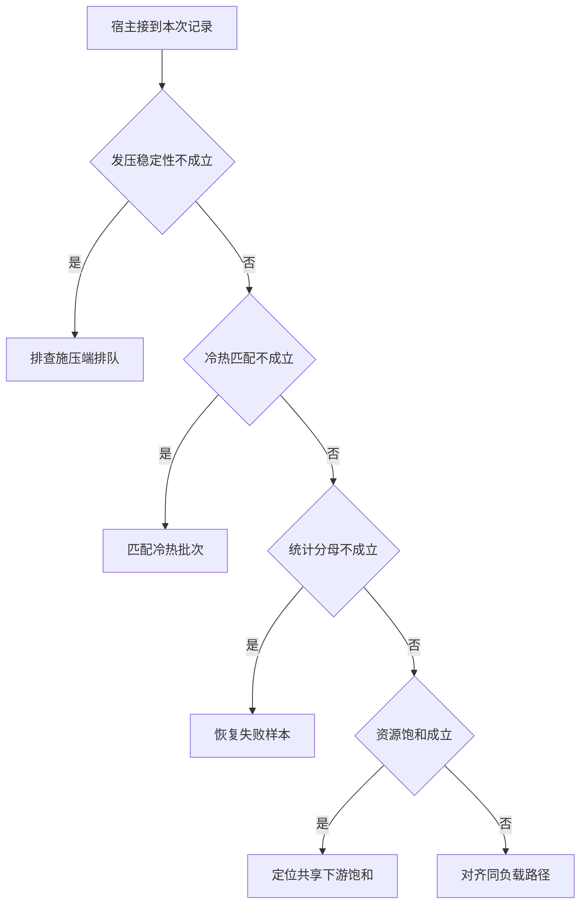

# 打开到达率以后先排除压测端瓶颈

发压机线程耗尽时，服务会收到比计划更低的流量。
冷热缓存和漏记超时也可能改变结果。
先校验实验本身，再解释哪段队列使尾部变长。

本篇用一个封闭的教学决策器说明这一问题。输入是宿主收到的记录，不保证每个下游字段都已经获准使用。前置检查未成立时，下游即使带着缓存值，也不能拿来作业务断言。

## 先解决一个具体问题

**怎么判断压到的是被测服务还是施压客户端？**

比对计划发送与真实发起的时刻，同时记录连接、工作线程和失败。
若服务变慢时客户端自动减少到达，测试无法代表固定外部流量持续进入的情况。


先取一个能走到「对齐同负载路径」的输入：实际发起符合约定负载、两组的冷暖状态相同、统计包含全部失败与尝试、共享下游尚有容量。
把这四个条件代回后文的图，前面各个拦截分支都未满足，最终才有“入口与口径一致后再比较关键阶段”这个判断。
还原这个现场时要分别问：哪些位来自可信状态，哪些只是在接口中出现、尚未获得解释资格的字段。

## 先沿一次决策走到底



从上到下取第一条成立的出口。只改一个开关时，只有它之前的检查都未截断，该变化才可能到达真实动作。

“发压稳定性”的两种输入分别是“实际发起符合约定负载”与“施压端自己产生积压”。
客户端饱和会改变被测服务的实际到达过程。

“冷热匹配”的两种输入分别是“两组的冷暖状态相同”与“两组缓存温度不匹配”。
预热差异会混入策略差异。

“统计分母”的两种输入分别是“统计包含全部失败与尝试”与“统计漏掉超时或失败”。
只测成功请求会产生样本选择偏差。

“资源饱和”的两种输入分别是“共享下游已出现饱和”与“共享下游尚有容量”。
扩大扇出可能使其他请求更慢。

## 最少需要哪几项观察

### 排查施压端排队

实际到达偏离计划。
在本节的全部组合中，有 8 种产生「排查施压端排队」，这只是逻辑空间的计数，不能当作实际用户请求的比例。

只取得施压端自己产生积压，已经足以要求宿主「排查施压端排队」。
保持这些已知项，其余开关自由变化，仍有 8 种补全，判断没有翻转。

若删掉关于发压稳定性的证据，另一份允许的现场是实际发起符合约定负载、两组缓存温度不匹配、统计漏掉超时或失败、共享下游尚有容量，它会使宿主「匹配冷热批次」。

### 匹配冷热批次

两组混入不同预热开销。
在本节的全部组合中，有 4 种产生「匹配冷热批次」，这只是逻辑空间的计数，不能当作实际用户请求的比例。

只取得实际发起符合约定负载、两组缓存温度不匹配，已经足以要求宿主「匹配冷热批次」。
保持这些已知项，其余开关自由变化，仍有 4 种补全，判断没有翻转。

若删掉关于发压稳定性的证据，另一份允许的现场是施压端自己产生积压、两组缓存温度不匹配、统计漏掉超时或失败、共享下游尚有容量，它会使宿主「排查施压端排队」。

若删掉关于冷热匹配的证据，另一份允许的现场是实际发起符合约定负载、两组的冷暖状态相同、统计漏掉超时或失败、共享下游尚有容量，它会使宿主「恢复失败样本」。

### 恢复失败样本

统计分母不全。
在本节的全部组合中，有 2 种产生「恢复失败样本」，这只是逻辑空间的计数，不能当作实际用户请求的比例。

只取得实际发起符合约定负载、两组的冷暖状态相同、统计漏掉超时或失败，已经足以要求宿主「恢复失败样本」。
保持这些已知项，其余开关自由变化，仍有 2 种补全，判断没有翻转。

若删掉关于发压稳定性的证据，另一份允许的现场是施压端自己产生积压、两组的冷暖状态相同、统计漏掉超时或失败、共享下游尚有容量，它会使宿主「排查施压端排队」。

若删掉关于冷热匹配的证据，另一份允许的现场是实际发起符合约定负载、两组缓存温度不匹配、统计漏掉超时或失败、共享下游尚有容量，它会使宿主「匹配冷热批次」。

若删掉关于统计分母的证据，另一份允许的现场是实际发起符合约定负载、两组的冷暖状态相同、统计包含全部失败与尝试、共享下游尚有容量，它会使宿主「对齐同负载路径」。

### 定位共享下游饱和

受控负载下已有资源压力信号。
在本节的全部组合中，有 1 种产生「定位共享下游饱和」，这只是逻辑空间的计数，不能当作实际用户请求的比例。

只取得实际发起符合约定负载、两组的冷暖状态相同、统计包含全部失败与尝试、共享下游已出现饱和，已经足以要求宿主「定位共享下游饱和」。
保持这些已知项，其余开关自由变化，仍有 1 种补全，判断没有翻转。

若删掉关于发压稳定性的证据，另一份允许的现场是施压端自己产生积压、两组的冷暖状态相同、统计包含全部失败与尝试、共享下游已出现饱和，它会使宿主「排查施压端排队」。

若删掉关于冷热匹配的证据，另一份允许的现场是实际发起符合约定负载、两组缓存温度不匹配、统计包含全部失败与尝试、共享下游已出现饱和，它会使宿主「匹配冷热批次」。

若删掉关于统计分母的证据，另一份允许的现场是实际发起符合约定负载、两组的冷暖状态相同、统计漏掉超时或失败、共享下游已出现饱和，它会使宿主「恢复失败样本」。

若删掉关于资源饱和的证据，另一份允许的现场是实际发起符合约定负载、两组的冷暖状态相同、统计包含全部失败与尝试、共享下游尚有容量，它会使宿主「对齐同负载路径」。

### 对齐同负载路径

入口与口径一致后再比较关键阶段。
在本节的全部组合中，有 1 种产生「对齐同负载路径」，这只是逻辑空间的计数，不能当作实际用户请求的比例。

只取得实际发起符合约定负载、两组的冷暖状态相同、统计包含全部失败与尝试、共享下游尚有容量，已经足以要求宿主「对齐同负载路径」。

若删掉关于发压稳定性的证据，另一份允许的现场是施压端自己产生积压、两组的冷暖状态相同、统计包含全部失败与尝试、共享下游尚有容量，它会使宿主「排查施压端排队」。

若删掉关于冷热匹配的证据，另一份允许的现场是实际发起符合约定负载、两组缓存温度不匹配、统计包含全部失败与尝试、共享下游尚有容量，它会使宿主「匹配冷热批次」。

若删掉关于统计分母的证据，另一份允许的现场是实际发起符合约定负载、两组的冷暖状态相同、统计漏掉超时或失败、共享下游尚有容量，它会使宿主「恢复失败样本」。

若删掉关于资源饱和的证据，另一份允许的现场是实际发起符合约定负载、两组的冷暖状态相同、统计包含全部失败与尝试、共享下游已出现饱和，它会使宿主「定位共享下游饱和」。

## 以同一份契约解释截然不同的现场

<details>
<summary>展开推演与对应反例</summary>

下列样本按最先命中的业务分支排列。四位编码只作本篇页内定位，顺序与开头的四项输入一致。可以先猜下一动作，再展开相邻样本。

### 能够触发“排查施压端排队”的现场

**样本 0000**

业务侧交来施压端自己产生积压、两组缓存温度不匹配，执行侧还记录了统计漏掉超时或失败、共享下游尚有容量。
把样本压成最短证明，保留施压端自己产生积压就能支持「排查施压端排队」。

在这份记录上，分别翻转「发压稳定性」中的任一项，其他项完全不变时，下一动作都会改变。

保持其余观察不动，单独切换「冷热匹配」、「统计分母」、「资源饱和」仍得到「排查施压端排队」，它们在这个现场不是决定性变量。

要从本例改走「匹配冷热批次」，至少需要变动 1 项，一组最少改动是将施压端自己产生积压换成实际发起符合约定负载。

要从本例改走「恢复失败样本」，至少需要变动 2 项，一组最少改动是将施压端自己产生积压、两组缓存温度不匹配换成实际发起符合约定负载、两组的冷暖状态相同。

要从本例改走「对齐同负载路径」，至少需要变动 3 项，一组最少改动是将施压端自己产生积压、两组缓存温度不匹配、统计漏掉超时或失败换成实际发起符合约定负载、两组的冷暖状态相同、统计包含全部失败与尝试。

要从本例改走「定位共享下游饱和」，至少需要变动 4 项，一组最少改动是将施压端自己产生积压、两组缓存温度不匹配、统计漏掉超时或失败、共享下游尚有容量换成实际发起符合约定负载、两组的冷暖状态相同、统计包含全部失败与尝试、共享下游已出现饱和。

**样本 0001**

业务侧交来施压端自己产生积压、两组缓存温度不匹配，执行侧还记录了统计漏掉超时或失败、共享下游已出现饱和。


要从本例改走「定位共享下游饱和」，至少需要变动 3 项，一组最少改动是将施压端自己产生积压、两组缓存温度不匹配、统计漏掉超时或失败换成实际发起符合约定负载、两组的冷暖状态相同、统计包含全部失败与尝试。

要从本例改走「对齐同负载路径」，至少需要变动 4 项，一组最少改动是将施压端自己产生积压、两组缓存温度不匹配、统计漏掉超时或失败、共享下游已出现饱和换成实际发起符合约定负载、两组的冷暖状态相同、统计包含全部失败与尝试、共享下游尚有容量。

**样本 0010**

业务侧交来施压端自己产生积压、两组缓存温度不匹配，执行侧还记录了统计包含全部失败与尝试、共享下游尚有容量。


要从本例改走「对齐同负载路径」，至少需要变动 2 项，一组最少改动是将施压端自己产生积压、两组缓存温度不匹配换成实际发起符合约定负载、两组的冷暖状态相同。

要从本例改走「恢复失败样本」，至少需要变动 3 项，一组最少改动是将施压端自己产生积压、两组缓存温度不匹配、统计包含全部失败与尝试换成实际发起符合约定负载、两组的冷暖状态相同、统计漏掉超时或失败。

要从本例改走「定位共享下游饱和」，至少需要变动 3 项，一组最少改动是将施压端自己产生积压、两组缓存温度不匹配、共享下游尚有容量换成实际发起符合约定负载、两组的冷暖状态相同、共享下游已出现饱和。

**样本 0011**

业务侧交来施压端自己产生积压、两组缓存温度不匹配，执行侧还记录了统计包含全部失败与尝试、共享下游已出现饱和。


要从本例改走「定位共享下游饱和」，至少需要变动 2 项，一组最少改动是将施压端自己产生积压、两组缓存温度不匹配换成实际发起符合约定负载、两组的冷暖状态相同。


要从本例改走「对齐同负载路径」，至少需要变动 3 项，一组最少改动是将施压端自己产生积压、两组缓存温度不匹配、共享下游已出现饱和换成实际发起符合约定负载、两组的冷暖状态相同、共享下游尚有容量。

**样本 0100**

业务侧交来施压端自己产生积压、两组的冷暖状态相同，执行侧还记录了统计漏掉超时或失败、共享下游尚有容量。


要从本例改走「恢复失败样本」，至少需要变动 1 项，一组最少改动是将施压端自己产生积压换成实际发起符合约定负载。

要从本例改走「匹配冷热批次」，至少需要变动 2 项，一组最少改动是将施压端自己产生积压、两组的冷暖状态相同换成实际发起符合约定负载、两组缓存温度不匹配。

要从本例改走「对齐同负载路径」，至少需要变动 2 项，一组最少改动是将施压端自己产生积压、统计漏掉超时或失败换成实际发起符合约定负载、统计包含全部失败与尝试。

要从本例改走「定位共享下游饱和」，至少需要变动 3 项，一组最少改动是将施压端自己产生积压、统计漏掉超时或失败、共享下游尚有容量换成实际发起符合约定负载、统计包含全部失败与尝试、共享下游已出现饱和。

**样本 0101**

业务侧交来施压端自己产生积压、两组的冷暖状态相同，执行侧还记录了统计漏掉超时或失败、共享下游已出现饱和。


要从本例改走「定位共享下游饱和」，至少需要变动 2 项，一组最少改动是将施压端自己产生积压、统计漏掉超时或失败换成实际发起符合约定负载、统计包含全部失败与尝试。

要从本例改走「对齐同负载路径」，至少需要变动 3 项，一组最少改动是将施压端自己产生积压、统计漏掉超时或失败、共享下游已出现饱和换成实际发起符合约定负载、统计包含全部失败与尝试、共享下游尚有容量。

**样本 0110**

业务侧交来施压端自己产生积压、两组的冷暖状态相同，执行侧还记录了统计包含全部失败与尝试、共享下游尚有容量。


要从本例改走「对齐同负载路径」，至少需要变动 1 项，一组最少改动是将施压端自己产生积压换成实际发起符合约定负载。


要从本例改走「恢复失败样本」，至少需要变动 2 项，一组最少改动是将施压端自己产生积压、统计包含全部失败与尝试换成实际发起符合约定负载、统计漏掉超时或失败。

要从本例改走「定位共享下游饱和」，至少需要变动 2 项，一组最少改动是将施压端自己产生积压、共享下游尚有容量换成实际发起符合约定负载、共享下游已出现饱和。

**样本 0111**

业务侧交来施压端自己产生积压、两组的冷暖状态相同，执行侧还记录了统计包含全部失败与尝试、共享下游已出现饱和。


要从本例改走「定位共享下游饱和」，至少需要变动 1 项，一组最少改动是将施压端自己产生积压换成实际发起符合约定负载。


要从本例改走「对齐同负载路径」，至少需要变动 2 项，一组最少改动是将施压端自己产生积压、共享下游已出现饱和换成实际发起符合约定负载、共享下游尚有容量。

### 能够触发“匹配冷热批次”的现场

**样本 1000**

业务侧交来实际发起符合约定负载、两组缓存温度不匹配，执行侧还记录了统计漏掉超时或失败、共享下游尚有容量。
把样本压成最短证明，保留实际发起符合约定负载、两组缓存温度不匹配就能支持「匹配冷热批次」。

在这份记录上，分别翻转「发压稳定性」、「冷热匹配」中的任一项，其他项完全不变时，下一动作都会改变。

保持其余观察不动，单独切换「统计分母」、「资源饱和」仍得到「匹配冷热批次」，它们在这个现场不是决定性变量。

本例没走更靠前的「排查施压端排队」，因为实际发起符合约定负载与那个入口的必要条件不符。

要从本例改走「排查施压端排队」，至少需要变动 1 项，一组最少改动是将实际发起符合约定负载换成施压端自己产生积压。

要从本例改走「恢复失败样本」，至少需要变动 1 项，一组最少改动是将两组缓存温度不匹配换成两组的冷暖状态相同。

要从本例改走「对齐同负载路径」，至少需要变动 2 项，一组最少改动是将两组缓存温度不匹配、统计漏掉超时或失败换成两组的冷暖状态相同、统计包含全部失败与尝试。

要从本例改走「定位共享下游饱和」，至少需要变动 3 项，一组最少改动是将两组缓存温度不匹配、统计漏掉超时或失败、共享下游尚有容量换成两组的冷暖状态相同、统计包含全部失败与尝试、共享下游已出现饱和。

**样本 1001**

业务侧交来实际发起符合约定负载、两组缓存温度不匹配，执行侧还记录了统计漏掉超时或失败、共享下游已出现饱和。


要从本例改走「定位共享下游饱和」，至少需要变动 2 项，一组最少改动是将两组缓存温度不匹配、统计漏掉超时或失败换成两组的冷暖状态相同、统计包含全部失败与尝试。

要从本例改走「对齐同负载路径」，至少需要变动 3 项，一组最少改动是将两组缓存温度不匹配、统计漏掉超时或失败、共享下游已出现饱和换成两组的冷暖状态相同、统计包含全部失败与尝试、共享下游尚有容量。

**样本 1010**

业务侧交来实际发起符合约定负载、两组缓存温度不匹配，执行侧还记录了统计包含全部失败与尝试、共享下游尚有容量。


要从本例改走「对齐同负载路径」，至少需要变动 1 项，一组最少改动是将两组缓存温度不匹配换成两组的冷暖状态相同。

要从本例改走「恢复失败样本」，至少需要变动 2 项，一组最少改动是将两组缓存温度不匹配、统计包含全部失败与尝试换成两组的冷暖状态相同、统计漏掉超时或失败。

要从本例改走「定位共享下游饱和」，至少需要变动 2 项，一组最少改动是将两组缓存温度不匹配、共享下游尚有容量换成两组的冷暖状态相同、共享下游已出现饱和。

**样本 1011**

业务侧交来实际发起符合约定负载、两组缓存温度不匹配，执行侧还记录了统计包含全部失败与尝试、共享下游已出现饱和。


要从本例改走「定位共享下游饱和」，至少需要变动 1 项，一组最少改动是将两组缓存温度不匹配换成两组的冷暖状态相同。


要从本例改走「对齐同负载路径」，至少需要变动 2 项，一组最少改动是将两组缓存温度不匹配、共享下游已出现饱和换成两组的冷暖状态相同、共享下游尚有容量。

### 能够触发“恢复失败样本”的现场

**样本 1100**

业务侧交来实际发起符合约定负载、两组的冷暖状态相同，执行侧还记录了统计漏掉超时或失败、共享下游尚有容量。
把样本压成最短证明，保留实际发起符合约定负载、两组的冷暖状态相同、统计漏掉超时或失败就能支持「恢复失败样本」。

在这份记录上，分别翻转「发压稳定性」、「冷热匹配」、「统计分母」中的任一项，其他项完全不变时，下一动作都会改变。

保持其余观察不动，单独切换「资源饱和」仍得到「恢复失败样本」，它们在这个现场不是决定性变量。


本例没走更靠前的「匹配冷热批次」，因为两组的冷暖状态相同与那个入口的必要条件不符。


要从本例改走「匹配冷热批次」，至少需要变动 1 项，一组最少改动是将两组的冷暖状态相同换成两组缓存温度不匹配。

要从本例改走「对齐同负载路径」，至少需要变动 1 项，一组最少改动是将统计漏掉超时或失败换成统计包含全部失败与尝试。

要从本例改走「定位共享下游饱和」，至少需要变动 2 项，一组最少改动是将统计漏掉超时或失败、共享下游尚有容量换成统计包含全部失败与尝试、共享下游已出现饱和。

**样本 1101**

业务侧交来实际发起符合约定负载、两组的冷暖状态相同，执行侧还记录了统计漏掉超时或失败、共享下游已出现饱和。


要从本例改走「定位共享下游饱和」，至少需要变动 1 项，一组最少改动是将统计漏掉超时或失败换成统计包含全部失败与尝试。

要从本例改走「对齐同负载路径」，至少需要变动 2 项，一组最少改动是将统计漏掉超时或失败、共享下游已出现饱和换成统计包含全部失败与尝试、共享下游尚有容量。

### 能够触发“定位共享下游饱和”的现场

**样本 1111**

业务侧交来实际发起符合约定负载、两组的冷暖状态相同，执行侧还记录了统计包含全部失败与尝试、共享下游已出现饱和。
把样本压成最短证明，保留实际发起符合约定负载、两组的冷暖状态相同、统计包含全部失败与尝试、共享下游已出现饱和就能支持「定位共享下游饱和」。

在这份记录上，分别翻转「发压稳定性」、「冷热匹配」、「统计分母」、「资源饱和」中的任一项，其他项完全不变时，下一动作都会改变。


本例没走更靠前的「恢复失败样本」，因为统计包含全部失败与尝试与那个入口的必要条件不符。


要从本例改走「恢复失败样本」，至少需要变动 1 项，一组最少改动是将统计包含全部失败与尝试换成统计漏掉超时或失败。

要从本例改走「对齐同负载路径」，至少需要变动 1 项，一组最少改动是将共享下游已出现饱和换成共享下游尚有容量。

### 能够触发“对齐同负载路径”的现场

**样本 1110**

业务侧交来实际发起符合约定负载、两组的冷暖状态相同，执行侧还记录了统计包含全部失败与尝试、共享下游尚有容量。
把样本压成最短证明，保留实际发起符合约定负载、两组的冷暖状态相同、统计包含全部失败与尝试、共享下游尚有容量就能支持「对齐同负载路径」。


本例没走更靠前的「定位共享下游饱和」，因为共享下游尚有容量与那个入口的必要条件不符。


要从本例改走「定位共享下游饱和」，至少需要变动 1 项，一组最少改动是将共享下游尚有容量换成共享下游已出现饱和。

</details>

## 当你只能看见一半记录

<details>
<summary>展开推演与对应反例</summary>

这次隐藏两个字段，保留另两个。对每个可见现场，检查四种合法补全是否同意。如仍有歧义，选择能使最坏剩余候选动作最少的字段继续查。并列时采用本篇字段顺序。

### 只保留发压稳定性与冷热匹配

已知施压端自己产生积压、两组缓存温度不匹配时，四种补全的动作分布为排查施压端排队（4 种）。

就“排查施压端排队”这个动作而言，在施压端自己产生积压、两组缓存温度不匹配的前提下，另外两项观察不会推翻它。

已知施压端自己产生积压、两组的冷暖状态相同时，四种补全的动作分布为排查施压端排队（4 种）。

就“排查施压端排队”这个动作而言，在施压端自己产生积压、两组的冷暖状态相同的前提下，另外两项观察不会推翻它。

已知实际发起符合约定负载、两组缓存温度不匹配时，四种补全的动作分布为匹配冷热批次（4 种）。

就“匹配冷热批次”这个动作而言，在实际发起符合约定负载、两组缓存温度不匹配的前提下，另外两项观察不会推翻它。

已知实际发起符合约定负载、两组的冷暖状态相同时，四种补全的动作分布为恢复失败样本（2 种）、定位共享下游饱和（1 种）、对齐同负载路径（1 种）。

在实际发起符合约定负载、两组的冷暖状态相同这个现场补读「统计分母」，最坏还剩 2 种动作，计算时只衡量歧义，尚未扣读取代价。
若补来的观察为“统计漏掉超时或失败”，范围缩成「恢复失败样本」。若为“统计包含全部失败与尝试”，则保留「对齐同负载路径」、「定位共享下游饱和」。

区分不了的两条执行可以具体写成 1100 与 1110：它们共享已展示字段，却分别需要「恢复失败样本」和「对齐同负载路径」。

### 只保留发压稳定性与统计分母

已知施压端自己产生积压、统计漏掉超时或失败时，四种补全的动作分布为排查施压端排队（4 种）。

就“排查施压端排队”这个动作而言，在施压端自己产生积压、统计漏掉超时或失败的前提下，另外两项观察不会推翻它。

已知施压端自己产生积压、统计包含全部失败与尝试时，四种补全的动作分布为排查施压端排队（4 种）。

就“排查施压端排队”这个动作而言，在施压端自己产生积压、统计包含全部失败与尝试的前提下，另外两项观察不会推翻它。

已知实际发起符合约定负载、统计漏掉超时或失败时，四种补全的动作分布为匹配冷热批次（2 种）、恢复失败样本（2 种）。

在实际发起符合约定负载、统计漏掉超时或失败这个现场补读「冷热匹配」，最坏还剩 1 种动作，计算时只衡量歧义，尚未扣读取代价。
若补来的观察为“两组缓存温度不匹配”，范围缩成「匹配冷热批次」。若为“两组的冷暖状态相同”，则保留「恢复失败样本」。

区分不了的两条执行可以具体写成 1000 与 1100：它们共享已展示字段，却分别需要「匹配冷热批次」和「恢复失败样本」。

已知实际发起符合约定负载、统计包含全部失败与尝试时，四种补全的动作分布为匹配冷热批次（2 种）、定位共享下游饱和（1 种）、对齐同负载路径（1 种）。

在实际发起符合约定负载、统计包含全部失败与尝试这个现场补读「冷热匹配」，最坏还剩 2 种动作，计算时只衡量歧义，尚未扣读取代价。
若补来的观察为“两组缓存温度不匹配”，范围缩成「匹配冷热批次」。若为“两组的冷暖状态相同”，则保留「对齐同负载路径」、「定位共享下游饱和」。

区分不了的两条执行可以具体写成 1010 与 1110：它们共享已展示字段，却分别需要「匹配冷热批次」和「对齐同负载路径」。

### 只保留冷热匹配与统计分母

已知两组缓存温度不匹配、统计漏掉超时或失败时，四种补全的动作分布为排查施压端排队（2 种）、匹配冷热批次（2 种）。

在两组缓存温度不匹配、统计漏掉超时或失败这个现场补读「发压稳定性」，最坏还剩 1 种动作，计算时只衡量歧义，尚未扣读取代价。
若补来的观察为“施压端自己产生积压”，范围缩成「排查施压端排队」。若为“实际发起符合约定负载”，则保留「匹配冷热批次」。

区分不了的两条执行可以具体写成 0000 与 1000：它们共享已展示字段，却分别需要「排查施压端排队」和「匹配冷热批次」。

已知两组缓存温度不匹配、统计包含全部失败与尝试时，四种补全的动作分布为排查施压端排队（2 种）、匹配冷热批次（2 种）。

在两组缓存温度不匹配、统计包含全部失败与尝试这个现场补读「发压稳定性」，最坏还剩 1 种动作，计算时只衡量歧义，尚未扣读取代价。

区分不了的两条执行可以具体写成 0010 与 1010：它们共享已展示字段，却分别需要「排查施压端排队」和「匹配冷热批次」。

已知两组的冷暖状态相同、统计漏掉超时或失败时，四种补全的动作分布为排查施压端排队（2 种）、恢复失败样本（2 种）。

在两组的冷暖状态相同、统计漏掉超时或失败这个现场补读「发压稳定性」，最坏还剩 1 种动作，计算时只衡量歧义，尚未扣读取代价。
若补来的观察为“施压端自己产生积压”，范围缩成「排查施压端排队」。若为“实际发起符合约定负载”，则保留「恢复失败样本」。

区分不了的两条执行可以具体写成 0100 与 1100：它们共享已展示字段，却分别需要「排查施压端排队」和「恢复失败样本」。

已知两组的冷暖状态相同、统计包含全部失败与尝试时，四种补全的动作分布为排查施压端排队（2 种）、定位共享下游饱和（1 种）、对齐同负载路径（1 种）。

在两组的冷暖状态相同、统计包含全部失败与尝试这个现场补读「发压稳定性」，最坏还剩 2 种动作，计算时只衡量歧义，尚未扣读取代价。
若补来的观察为“施压端自己产生积压”，范围缩成「排查施压端排队」。若为“实际发起符合约定负载”，则保留「对齐同负载路径」、「定位共享下游饱和」。

区分不了的两条执行可以具体写成 0110 与 1110：它们共享已展示字段，却分别需要「排查施压端排队」和「对齐同负载路径」。

### 只保留发压稳定性与资源饱和

已知施压端自己产生积压、共享下游尚有容量时，四种补全的动作分布为排查施压端排队（4 种）。

就“排查施压端排队”这个动作而言，在施压端自己产生积压、共享下游尚有容量的前提下，另外两项观察不会推翻它。

已知施压端自己产生积压、共享下游已出现饱和时，四种补全的动作分布为排查施压端排队（4 种）。

就“排查施压端排队”这个动作而言，在施压端自己产生积压、共享下游已出现饱和的前提下，另外两项观察不会推翻它。

已知实际发起符合约定负载、共享下游尚有容量时，四种补全的动作分布为匹配冷热批次（2 种）、恢复失败样本（1 种）、对齐同负载路径（1 种）。

在实际发起符合约定负载、共享下游尚有容量这个现场补读「冷热匹配」，最坏还剩 2 种动作，计算时只衡量歧义，尚未扣读取代价。
若补来的观察为“两组缓存温度不匹配”，范围缩成「匹配冷热批次」。若为“两组的冷暖状态相同”，则保留「恢复失败样本」、「对齐同负载路径」。


已知实际发起符合约定负载、共享下游已出现饱和时，四种补全的动作分布为匹配冷热批次（2 种）、恢复失败样本（1 种）、定位共享下游饱和（1 种）。

在实际发起符合约定负载、共享下游已出现饱和这个现场补读「冷热匹配」，最坏还剩 2 种动作，计算时只衡量歧义，尚未扣读取代价。
若补来的观察为“两组缓存温度不匹配”，范围缩成「匹配冷热批次」。若为“两组的冷暖状态相同”，则保留「恢复失败样本」、「定位共享下游饱和」。

区分不了的两条执行可以具体写成 1001 与 1101：它们共享已展示字段，却分别需要「匹配冷热批次」和「恢复失败样本」。

### 只保留冷热匹配与资源饱和

已知两组缓存温度不匹配、共享下游尚有容量时，四种补全的动作分布为排查施压端排队（2 种）、匹配冷热批次（2 种）。

在两组缓存温度不匹配、共享下游尚有容量这个现场补读「发压稳定性」，最坏还剩 1 种动作，计算时只衡量歧义，尚未扣读取代价。


已知两组缓存温度不匹配、共享下游已出现饱和时，四种补全的动作分布为排查施压端排队（2 种）、匹配冷热批次（2 种）。

在两组缓存温度不匹配、共享下游已出现饱和这个现场补读「发压稳定性」，最坏还剩 1 种动作，计算时只衡量歧义，尚未扣读取代价。

区分不了的两条执行可以具体写成 0001 与 1001：它们共享已展示字段，却分别需要「排查施压端排队」和「匹配冷热批次」。

已知两组的冷暖状态相同、共享下游尚有容量时，四种补全的动作分布为排查施压端排队（2 种）、恢复失败样本（1 种）、对齐同负载路径（1 种）。

在两组的冷暖状态相同、共享下游尚有容量这个现场补读「发压稳定性」，最坏还剩 2 种动作，计算时只衡量歧义，尚未扣读取代价。
若补来的观察为“施压端自己产生积压”，范围缩成「排查施压端排队」。若为“实际发起符合约定负载”，则保留「恢复失败样本」、「对齐同负载路径」。


已知两组的冷暖状态相同、共享下游已出现饱和时，四种补全的动作分布为排查施压端排队（2 种）、恢复失败样本（1 种）、定位共享下游饱和（1 种）。

在两组的冷暖状态相同、共享下游已出现饱和这个现场补读「发压稳定性」，最坏还剩 2 种动作，计算时只衡量歧义，尚未扣读取代价。
若补来的观察为“施压端自己产生积压”，范围缩成「排查施压端排队」。若为“实际发起符合约定负载”，则保留「恢复失败样本」、「定位共享下游饱和」。

区分不了的两条执行可以具体写成 0101 与 1101：它们共享已展示字段，却分别需要「排查施压端排队」和「恢复失败样本」。

### 只保留统计分母与资源饱和

已知统计漏掉超时或失败、共享下游尚有容量时，四种补全的动作分布为排查施压端排队（2 种）、匹配冷热批次（1 种）、恢复失败样本（1 种）。

在统计漏掉超时或失败、共享下游尚有容量这个现场补读「发压稳定性」，最坏还剩 2 种动作，计算时只衡量歧义，尚未扣读取代价。
若补来的观察为“施压端自己产生积压”，范围缩成「排查施压端排队」。若为“实际发起符合约定负载”，则保留「匹配冷热批次」、「恢复失败样本」。


已知统计漏掉超时或失败、共享下游已出现饱和时，四种补全的动作分布为排查施压端排队（2 种）、匹配冷热批次（1 种）、恢复失败样本（1 种）。

在统计漏掉超时或失败、共享下游已出现饱和这个现场补读「发压稳定性」，最坏还剩 2 种动作，计算时只衡量歧义，尚未扣读取代价。


已知统计包含全部失败与尝试、共享下游尚有容量时，四种补全的动作分布为排查施压端排队（2 种）、匹配冷热批次（1 种）、对齐同负载路径（1 种）。

在统计包含全部失败与尝试、共享下游尚有容量这个现场补读「发压稳定性」，最坏还剩 2 种动作，计算时只衡量歧义，尚未扣读取代价。
若补来的观察为“施压端自己产生积压”，范围缩成「排查施压端排队」。若为“实际发起符合约定负载”，则保留「匹配冷热批次」、「对齐同负载路径」。


已知统计包含全部失败与尝试、共享下游已出现饱和时，四种补全的动作分布为排查施压端排队（2 种）、匹配冷热批次（1 种）、定位共享下游饱和（1 种）。

在统计包含全部失败与尝试、共享下游已出现饱和这个现场补读「发压稳定性」，最坏还剩 2 种动作，计算时只衡量歧义，尚未扣读取代价。
若补来的观察为“施压端自己产生积压”，范围缩成「排查施压端排队」。若为“实际发起符合约定负载”，则保留「匹配冷热批次」、「定位共享下游饱和」。

区分不了的两条执行可以具体写成 0011 与 1011：它们共享已展示字段，却分别需要「排查施压端排队」和「匹配冷热批次」。

</details>

## 单因素干预与边界测试

<details>
<summary>展开推演与对应反例</summary>

### 只改变发压稳定性

固定另外三个条件得到八对现场，从“施压端自己产生积压”转为“实际发起符合约定负载”时，8 对翻转动作，另外 0 对保持不变。

有 4 对现场沿「排查施压端排队」变到「匹配冷热批次」，可复现的一组受控背景为两组缓存温度不匹配、统计漏掉超时或失败、共享下游尚有容量。

有 2 对现场沿「排查施压端排队」变到「恢复失败样本」，可复现的一组受控背景为两组的冷暖状态相同、统计漏掉超时或失败、共享下游尚有容量。

有 1 对现场沿「排查施压端排队」变到「对齐同负载路径」，可复现的一组受控背景为两组的冷暖状态相同、统计包含全部失败与尝试、共享下游尚有容量。

有 1 对现场沿「排查施压端排队」变到「定位共享下游饱和」，可复现的一组受控背景为两组的冷暖状态相同、统计包含全部失败与尝试、共享下游已出现饱和。

### 只改变冷热匹配

固定另外三个条件得到八对现场，从“两组缓存温度不匹配”转为“两组的冷暖状态相同”时，4 对翻转动作，另外 4 对保持不变。

令施压端自己产生积压、统计漏掉超时或失败、共享下游尚有容量，冷热匹配的两个取值均得到「排查施压端排队」。在八对中，共有 4 对表现为这一种稳定出口。

有 2 对现场沿「匹配冷热批次」变到「恢复失败样本」，可复现的一组受控背景为实际发起符合约定负载、统计漏掉超时或失败、共享下游尚有容量。

有 1 对现场沿「匹配冷热批次」变到「对齐同负载路径」，可复现的一组受控背景为实际发起符合约定负载、统计包含全部失败与尝试、共享下游尚有容量。

有 1 对现场沿「匹配冷热批次」变到「定位共享下游饱和」，可复现的一组受控背景为实际发起符合约定负载、统计包含全部失败与尝试、共享下游已出现饱和。

### 只改变统计分母

固定另外三个条件得到八对现场，从“统计漏掉超时或失败”转为“统计包含全部失败与尝试”时，2 对翻转动作，另外 6 对保持不变。

令施压端自己产生积压、两组缓存温度不匹配、共享下游尚有容量，统计分母的两个取值均得到「排查施压端排队」。在八对中，共有 4 对表现为这一种稳定出口。

令实际发起符合约定负载、两组缓存温度不匹配、共享下游尚有容量，统计分母的两个取值均得到「匹配冷热批次」。在八对中，共有 2 对表现为这一种稳定出口。

有 1 对现场沿「恢复失败样本」变到「对齐同负载路径」，可复现的一组受控背景为实际发起符合约定负载、两组的冷暖状态相同、共享下游尚有容量。

有 1 对现场沿「恢复失败样本」变到「定位共享下游饱和」，可复现的一组受控背景为实际发起符合约定负载、两组的冷暖状态相同、共享下游已出现饱和。

### 只改变资源饱和

固定另外三个条件得到八对现场，从“共享下游尚有容量”转为“共享下游已出现饱和”时，1 对翻转动作，另外 7 对保持不变。

令施压端自己产生积压、两组缓存温度不匹配、统计漏掉超时或失败，资源饱和的两个取值均得到「排查施压端排队」。在八对中，共有 4 对表现为这一种稳定出口。

令实际发起符合约定负载、两组缓存温度不匹配、统计漏掉超时或失败，资源饱和的两个取值均得到「匹配冷热批次」。在八对中，共有 2 对表现为这一种稳定出口。

令实际发起符合约定负载、两组的冷暖状态相同、统计漏掉超时或失败，资源饱和的两个取值均得到「恢复失败样本」。在八对中，共有 1 对表现为这一种稳定出口。

有 1 对现场沿「对齐同负载路径」变到「定位共享下游饱和」，可复现的一组受控背景为实际发起符合约定负载、两组的冷暖状态相同、统计包含全部失败与尝试。

</details>

## 哪些回归样本真能抓住实现错误

<details>
<summary>展开推演与对应反例</summary>

如果删除“排查施压端排队”这个分支，在本篇 16 种输入里有 8 种会改走另一出口。

反例 0000 的完整记录为施压端自己产生积压、两组缓存温度不匹配、统计漏掉超时或失败、共享下游尚有容量。正确结果是「排查施压端排队」，这个改坏的实现却给出「匹配冷热批次」。

如果删除“匹配冷热批次”这个分支，在本篇 16 种输入里有 4 种会改走另一出口。

反例 1000 的完整记录为实际发起符合约定负载、两组缓存温度不匹配、统计漏掉超时或失败、共享下游尚有容量。正确结果是「匹配冷热批次」，这个改坏的实现却给出「恢复失败样本」。

如果删除“恢复失败样本”这个分支，在本篇 16 种输入里有 2 种会改走另一出口。

反例 1100 的完整记录为实际发起符合约定负载、两组的冷暖状态相同、统计漏掉超时或失败、共享下游尚有容量。正确结果是「恢复失败样本」，这个改坏的实现却给出「对齐同负载路径」。

如果删除“定位共享下游饱和”这个分支，在本篇 16 种输入里有 1 种会改走另一出口。

反例 1111 的完整记录为实际发起符合约定负载、两组的冷暖状态相同、统计包含全部失败与尝试、共享下游已出现饱和。正确结果是「定位共享下游饱和」，这个改坏的实现却给出「对齐同负载路径」。

如果交换“排查施压端排队”和“匹配冷热批次”的判断次序，在本篇 16 种输入里有 4 种会改走另一出口。


如果交换“匹配冷热批次”和“恢复失败样本”的判断次序，在本篇 16 种输入里有 2 种会改走另一出口。


如果交换“恢复失败样本”和“定位共享下游饱和”的判断次序，在本篇 16 种输入里有 1 种会改走另一出口。

反例 1101 的完整记录为实际发起符合约定负载、两组的冷暖状态相同、统计漏掉超时或失败、共享下游已出现饱和。正确结果是「恢复失败样本」，这个改坏的实现却给出「定位共享下游饱和」。

补入样本 0000（施压端自己产生积压、两组缓存温度不匹配、统计漏掉超时或失败、共享下游尚有容量）能新增检出「删除“排查施压端排队”这个分支」、「交换“排查施压端排队”和“匹配冷热批次”的判断次序」。

补入样本 1000（实际发起符合约定负载、两组缓存温度不匹配、统计漏掉超时或失败、共享下游尚有容量）能新增检出「删除“匹配冷热批次”这个分支」、「交换“匹配冷热批次”和“恢复失败样本”的判断次序」。

补入样本 1101（实际发起符合约定负载、两组的冷暖状态相同、统计漏掉超时或失败、共享下游已出现饱和）能新增检出「删除“恢复失败样本”这个分支」、「交换“恢复失败样本”和“定位共享下游饱和”的判断次序」。

补入样本 1111（实际发起符合约定负载、两组的冷暖状态相同、统计包含全部失败与尝试、共享下游已出现饱和）能新增检出「删除“定位共享下游饱和”这个分支」。

这里每次选覆盖尚未捕获缺陷最多的样本，并不保证用例数全局最小。它给出的反例能作为 Java 单测输入。真实模型是否会自主产生这些提议，仍须单独评测。

</details>

## 把状态覆盖换成有抽样偏差的评测批次

<details>
<summary>展开推演与对应反例</summary>

前面的十六种记录各有一票。现在只改样本构成：对一个给定字段，把成立侧的每种记录各取三份、另一侧各取一份。这是人为配比的 32 份回放，不是线上频率估计。
将偏向成立与偏向不成立的两次批次对照，可以隔离分母变化。底层宿主和所有答案保持相同，比例仍可能移动。

### 改变“发压稳定性”的样本配比

只看「排查施压端排队」，在实际发起符合约定负载的八个不同输入中有 0 个命中，在施压端自己产生积压的另八个输入中有 8 个命中。
把「发压稳定性」成立侧按三倍取样，「排查施压端排队」占 8/32，反过来向未成立侧倾斜后占 24/32。
这次重加权使「排查施压端排队」的占比相差 50 个百分点。若按两种不同的“发压稳定性”分布跑新旧版，不能把这项差异全部归功于实现。

只看「匹配冷热批次」，在实际发起符合约定负载的八个不同输入中有 4 个命中，在施压端自己产生积压的另八个输入中有 0 个命中。
把「发压稳定性」成立侧按三倍取样，「匹配冷热批次」占 12/32，反过来向未成立侧倾斜后占 4/32。
这次重加权使「匹配冷热批次」的占比相差 25 个百分点。若按两种不同的“发压稳定性”分布跑新旧版，不能把这项差异全部归功于实现。

只看「恢复失败样本」，在实际发起符合约定负载的八个不同输入中有 2 个命中，在施压端自己产生积压的另八个输入中有 0 个命中。
把「发压稳定性」成立侧按三倍取样，「恢复失败样本」占 6/32，反过来向未成立侧倾斜后占 2/32。
这次重加权使「恢复失败样本」的占比相差 12.5 个百分点。若按两种不同的“发压稳定性”分布跑新旧版，不能把这项差异全部归功于实现。

只看「定位共享下游饱和」，在实际发起符合约定负载的八个不同输入中有 1 个命中，在施压端自己产生积压的另八个输入中有 0 个命中。
把「发压稳定性」成立侧按三倍取样，「定位共享下游饱和」占 3/32，反过来向未成立侧倾斜后占 1/32。
这次重加权使「定位共享下游饱和」的占比相差 6.25 个百分点。若按两种不同的“发压稳定性”分布跑新旧版，不能把这项差异全部归功于实现。

只看「对齐同负载路径」，在实际发起符合约定负载的八个不同输入中有 1 个命中，在施压端自己产生积压的另八个输入中有 0 个命中。
把「发压稳定性」成立侧按三倍取样，「对齐同负载路径」占 3/32，反过来向未成立侧倾斜后占 1/32。
这次重加权使「对齐同负载路径」的占比相差 6.25 个百分点。若按两种不同的“发压稳定性”分布跑新旧版，不能把这项差异全部归功于实现。

### 改变“冷热匹配”的样本配比

只看「排查施压端排队」，在两组的冷暖状态相同的八个不同输入中有 4 个命中，在两组缓存温度不匹配的另八个输入中有 4 个命中。
把「冷热匹配」成立侧按三倍取样，「排查施压端排队」占 16/32，反过来向未成立侧倾斜后占 16/32。
两批「排查施压端排队」的边际比例相同，是因为这个出口在“冷热匹配”的两侧计数相等，这不能单独证明每一对现场都不受它影响。

只看「匹配冷热批次」，在两组的冷暖状态相同的八个不同输入中有 0 个命中，在两组缓存温度不匹配的另八个输入中有 4 个命中。
把「冷热匹配」成立侧按三倍取样，「匹配冷热批次」占 4/32，反过来向未成立侧倾斜后占 12/32。
这次重加权使「匹配冷热批次」的占比相差 25 个百分点。若按两种不同的“冷热匹配”分布跑新旧版，不能把这项差异全部归功于实现。

只看「恢复失败样本」，在两组的冷暖状态相同的八个不同输入中有 2 个命中，在两组缓存温度不匹配的另八个输入中有 0 个命中。
把「冷热匹配」成立侧按三倍取样，「恢复失败样本」占 6/32，反过来向未成立侧倾斜后占 2/32。
这次重加权使「恢复失败样本」的占比相差 12.5 个百分点。若按两种不同的“冷热匹配”分布跑新旧版，不能把这项差异全部归功于实现。

只看「定位共享下游饱和」，在两组的冷暖状态相同的八个不同输入中有 1 个命中，在两组缓存温度不匹配的另八个输入中有 0 个命中。
把「冷热匹配」成立侧按三倍取样，「定位共享下游饱和」占 3/32，反过来向未成立侧倾斜后占 1/32。
这次重加权使「定位共享下游饱和」的占比相差 6.25 个百分点。若按两种不同的“冷热匹配”分布跑新旧版，不能把这项差异全部归功于实现。

只看「对齐同负载路径」，在两组的冷暖状态相同的八个不同输入中有 1 个命中，在两组缓存温度不匹配的另八个输入中有 0 个命中。
把「冷热匹配」成立侧按三倍取样，「对齐同负载路径」占 3/32，反过来向未成立侧倾斜后占 1/32。
这次重加权使「对齐同负载路径」的占比相差 6.25 个百分点。若按两种不同的“冷热匹配”分布跑新旧版，不能把这项差异全部归功于实现。

### 改变“统计分母”的样本配比

只看「排查施压端排队」，在统计包含全部失败与尝试的八个不同输入中有 4 个命中，在统计漏掉超时或失败的另八个输入中有 4 个命中。
把「统计分母」成立侧按三倍取样，「排查施压端排队」占 16/32，反过来向未成立侧倾斜后占 16/32。
两批「排查施压端排队」的边际比例相同，是因为这个出口在“统计分母”的两侧计数相等，这不能单独证明每一对现场都不受它影响。

只看「匹配冷热批次」，在统计包含全部失败与尝试的八个不同输入中有 2 个命中，在统计漏掉超时或失败的另八个输入中有 2 个命中。
把「统计分母」成立侧按三倍取样，「匹配冷热批次」占 8/32，反过来向未成立侧倾斜后占 8/32。
两批「匹配冷热批次」的边际比例相同，是因为这个出口在“统计分母”的两侧计数相等，这不能单独证明每一对现场都不受它影响。

只看「恢复失败样本」，在统计包含全部失败与尝试的八个不同输入中有 0 个命中，在统计漏掉超时或失败的另八个输入中有 2 个命中。
把「统计分母」成立侧按三倍取样，「恢复失败样本」占 2/32，反过来向未成立侧倾斜后占 6/32。
这次重加权使「恢复失败样本」的占比相差 12.5 个百分点。若按两种不同的“统计分母”分布跑新旧版，不能把这项差异全部归功于实现。

只看「定位共享下游饱和」，在统计包含全部失败与尝试的八个不同输入中有 1 个命中，在统计漏掉超时或失败的另八个输入中有 0 个命中。
把「统计分母」成立侧按三倍取样，「定位共享下游饱和」占 3/32，反过来向未成立侧倾斜后占 1/32。
这次重加权使「定位共享下游饱和」的占比相差 6.25 个百分点。若按两种不同的“统计分母”分布跑新旧版，不能把这项差异全部归功于实现。

只看「对齐同负载路径」，在统计包含全部失败与尝试的八个不同输入中有 1 个命中，在统计漏掉超时或失败的另八个输入中有 0 个命中。
把「统计分母」成立侧按三倍取样，「对齐同负载路径」占 3/32，反过来向未成立侧倾斜后占 1/32。
这次重加权使「对齐同负载路径」的占比相差 6.25 个百分点。若按两种不同的“统计分母”分布跑新旧版，不能把这项差异全部归功于实现。

### 改变“资源饱和”的样本配比

只看「排查施压端排队」，在共享下游已出现饱和的八个不同输入中有 4 个命中，在共享下游尚有容量的另八个输入中有 4 个命中。
把「资源饱和」成立侧按三倍取样，「排查施压端排队」占 16/32，反过来向未成立侧倾斜后占 16/32。
两批「排查施压端排队」的边际比例相同，是因为这个出口在“资源饱和”的两侧计数相等，这不能单独证明每一对现场都不受它影响。

只看「匹配冷热批次」，在共享下游已出现饱和的八个不同输入中有 2 个命中，在共享下游尚有容量的另八个输入中有 2 个命中。
把「资源饱和」成立侧按三倍取样，「匹配冷热批次」占 8/32，反过来向未成立侧倾斜后占 8/32。
两批「匹配冷热批次」的边际比例相同，是因为这个出口在“资源饱和”的两侧计数相等，这不能单独证明每一对现场都不受它影响。

只看「恢复失败样本」，在共享下游已出现饱和的八个不同输入中有 1 个命中，在共享下游尚有容量的另八个输入中有 1 个命中。
把「资源饱和」成立侧按三倍取样，「恢复失败样本」占 4/32，反过来向未成立侧倾斜后占 4/32。
两批「恢复失败样本」的边际比例相同，是因为这个出口在“资源饱和”的两侧计数相等，这不能单独证明每一对现场都不受它影响。

只看「定位共享下游饱和」，在共享下游已出现饱和的八个不同输入中有 1 个命中，在共享下游尚有容量的另八个输入中有 0 个命中。
把「资源饱和」成立侧按三倍取样，「定位共享下游饱和」占 3/32，反过来向未成立侧倾斜后占 1/32。
这次重加权使「定位共享下游饱和」的占比相差 6.25 个百分点。若按两种不同的“资源饱和”分布跑新旧版，不能把这项差异全部归功于实现。

只看「对齐同负载路径」，在共享下游已出现饱和的八个不同输入中有 0 个命中，在共享下游尚有容量的另八个输入中有 1 个命中。
把「资源饱和」成立侧按三倍取样，「对齐同负载路径」占 1/32，反过来向未成立侧倾斜后占 3/32。
这次重加权使「对齐同负载路径」的占比相差 6.25 个百分点。若按两种不同的“资源饱和”分布跑新旧版，不能把这项差异全部归功于实现。

</details>

## 只看终态，能逆推出多少原始事实

<details>
<summary>展开推演与对应反例</summary>

### 只保留“排查施压端排队”这条结果时

在本节契约与完整输入域内，仅知「排查施压端排队」就能倒推出施压端自己产生积压，这一推断依赖版本未变且日志中的终态可信。

「排查施压端排队」不能证明冷热匹配取哪一侧：0000 和 0100 有相同终态，却分别记为“两组缓存温度不匹配”和“两组的冷暖状态相同”。

「排查施压端排队」不能证明统计分母取哪一侧：0000 和 0010 有相同终态，却分别记为“统计漏掉超时或失败”和“统计包含全部失败与尝试”。

「排查施压端排队」不能证明资源饱和取哪一侧：0000 和 0001 有相同终态，却分别记为“共享下游尚有容量”和“共享下游已出现饱和”。

反查「排查施压端排队」的诊断日志，优先保留能区分样本 0000 与 1000 的「发压稳定性」，否则很容易把邻近的「匹配冷热批次」看成同一种故障。

### 只保留“匹配冷热批次”这条结果时

在本节契约与完整输入域内，仅知「匹配冷热批次」就能倒推出实际发起符合约定负载，这一推断依赖版本未变且日志中的终态可信。

在本节契约与完整输入域内，仅知「匹配冷热批次」就能倒推出两组缓存温度不匹配，这一推断依赖版本未变且日志中的终态可信。

「匹配冷热批次」不能证明统计分母取哪一侧：1000 和 1010 有相同终态，却分别记为“统计漏掉超时或失败”和“统计包含全部失败与尝试”。

「匹配冷热批次」不能证明资源饱和取哪一侧：1000 和 1001 有相同终态，却分别记为“共享下游尚有容量”和“共享下游已出现饱和”。

反查「匹配冷热批次」的诊断日志，优先保留能区分样本 1000 与 0000 的「发压稳定性」，否则很容易把邻近的「排查施压端排队」看成同一种故障。

### 只保留“恢复失败样本”这条结果时

在本节契约与完整输入域内，仅知「恢复失败样本」就能倒推出实际发起符合约定负载，这一推断依赖版本未变且日志中的终态可信。

在本节契约与完整输入域内，仅知「恢复失败样本」就能倒推出两组的冷暖状态相同，这一推断依赖版本未变且日志中的终态可信。

在本节契约与完整输入域内，仅知「恢复失败样本」就能倒推出统计漏掉超时或失败，这一推断依赖版本未变且日志中的终态可信。

「恢复失败样本」不能证明资源饱和取哪一侧：1100 和 1101 有相同终态，却分别记为“共享下游尚有容量”和“共享下游已出现饱和”。

反查「恢复失败样本」的诊断日志，优先保留能区分样本 1100 与 0100 的「发压稳定性」，否则很容易把邻近的「排查施压端排队」看成同一种故障。

### 只保留“定位共享下游饱和”这条结果时

在本节契约与完整输入域内，仅知「定位共享下游饱和」就能倒推出实际发起符合约定负载，这一推断依赖版本未变且日志中的终态可信。

在本节契约与完整输入域内，仅知「定位共享下游饱和」就能倒推出两组的冷暖状态相同，这一推断依赖版本未变且日志中的终态可信。

在本节契约与完整输入域内，仅知「定位共享下游饱和」就能倒推出统计包含全部失败与尝试，这一推断依赖版本未变且日志中的终态可信。

在本节契约与完整输入域内，仅知「定位共享下游饱和」就能倒推出共享下游已出现饱和，这一推断依赖版本未变且日志中的终态可信。

反查「定位共享下游饱和」的诊断日志，优先保留能区分样本 1111 与 0111 的「发压稳定性」，否则很容易把邻近的「排查施压端排队」看成同一种故障。

### 只保留“对齐同负载路径”这条结果时

在本节契约与完整输入域内，仅知「对齐同负载路径」就能倒推出实际发起符合约定负载，这一推断依赖版本未变且日志中的终态可信。

在本节契约与完整输入域内，仅知「对齐同负载路径」就能倒推出两组的冷暖状态相同，这一推断依赖版本未变且日志中的终态可信。

在本节契约与完整输入域内，仅知「对齐同负载路径」就能倒推出统计包含全部失败与尝试，这一推断依赖版本未变且日志中的终态可信。

在本节契约与完整输入域内，仅知「对齐同负载路径」就能倒推出共享下游尚有容量，这一推断依赖版本未变且日志中的终态可信。

反查「对齐同负载路径」的诊断日志，优先保留能区分样本 1110 与 0110 的「发压稳定性」，否则很容易把邻近的「排查施压端排队」看成同一种故障。

</details>

## 面试复述与复算

面试题可以从“怎么判断压到的是被测服务还是施压客户端？”起步。先给出本篇的触发条件和一条真实执行端可检查的证据，再用一个相邻反例限定结论的适用范围。

在仓库根目录执行下列命令可以重算本篇的一个输入。四位数字依次选择正文列出的四项条件，0 表示未成立或低档，1 表示成立或高档。
```powershell
node examples/reading-cases/replay.mjs 10 2 0101
```

[本周主文](../theory.md) · [配套实验](../lab.md) · [下一篇研读](03.md)
