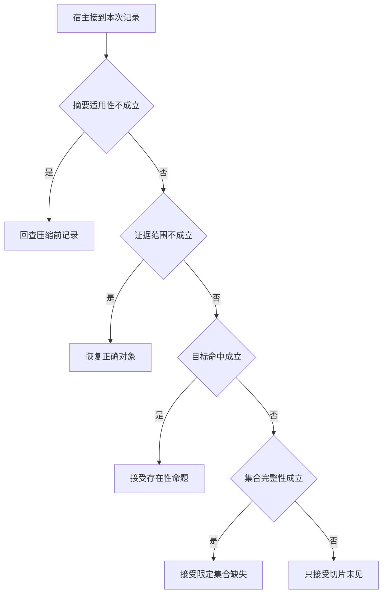

# 减少日志输入能否保持判断正确

摘要把一万多 token 缩成一千，不代表用户仍能得到相同证据。
若删除了目标对象或覆盖标记，模型会在更短时间内给出过强结论。
质量门限必须跟随时延一起测。

本篇用一个封闭的教学决策器说明这一问题。输入是宿主收到的记录，不保证每个下游字段都已经获准使用。前置检查未成立时，下游即使带着缓存值，也不能拿来作业务断言。

## 先解决一个具体问题

**输入压缩能省掉模型 token，怎样查有没有同时省掉事实？**

让截断和完整两份输入保持相同的可见列表，观察候选命题是否仍能区分它们。
若压缩后两者都报告过滤，减少 token 的同时也删除了必要边界。


先取一个能走到「只接受切片未见」的输入：摘要保留关键限定、资料属于目标服务、记录只是可见切片、可见部分没有对象。
把这四个条件代回后文的图，前面各个拦截分支都未满足，最终才有“没有完整性证明不得推导过滤原因”这个判断。
还原这个现场时要分别问：哪些位来自可信状态，哪些只是在接口中出现、尚未获得解释资格的字段。

## 先沿一次决策走到底



从上到下取第一条成立的出口。只改一个开关时，只有它之前的检查都未截断，该变化才可能到达真实动作。

“摘要适用性”的两种输入分别是“摘要保留关键限定”与“摘要丢失重要的限定”。
相似文本也可能不再支持当前命题。

“证据范围”的两种输入分别是“资料属于目标服务”与“资料来自另一服务区域”。
同楼地点也可能服务不同，引用要绑定业务对象。

“集合完整性”的两种输入分别是“记录覆盖全体目标集合”与“记录只是可见切片”。
否定存在性时须证明查过了所声称的范围。

“目标命中”的两种输入分别是“对象出现在可见记录”与“可见部分没有对象”。
存在可以由一个命中支持，缺失还需证明覆盖面。

## 最少需要哪几项观察

### 回查压缩前记录

摘要丢失适用条件。
在本节的全部组合中，有 8 种产生「回查压缩前记录」，这只是逻辑空间的计数，不能当作实际用户请求的比例。

只取得摘要丢失重要的限定，已经足以要求宿主「回查压缩前记录」。
保持这些已知项，其余开关自由变化，仍有 8 种补全，判断没有翻转。

若删掉关于摘要适用性的证据，另一份允许的现场是摘要保留关键限定、资料来自另一服务区域、记录只是可见切片、可见部分没有对象，它会使宿主「恢复正确对象」。

### 恢复正确对象

内容不属于目标业务范围。
在本节的全部组合中，有 4 种产生「恢复正确对象」，这只是逻辑空间的计数，不能当作实际用户请求的比例。

只取得摘要保留关键限定、资料来自另一服务区域，已经足以要求宿主「恢复正确对象」。
保持这些已知项，其余开关自由变化，仍有 4 种补全，判断没有翻转。

若删掉关于摘要适用性的证据，另一份允许的现场是摘要丢失重要的限定、资料来自另一服务区域、记录只是可见切片、可见部分没有对象，它会使宿主「回查压缩前记录」。

若删掉关于证据范围的证据，另一份允许的现场是摘要保留关键限定、资料属于目标服务、记录只是可见切片、可见部分没有对象，它会使宿主「只接受切片未见」。

### 接受存在性命题

正确记录确实看见目标。
在本节的全部组合中，有 2 种产生「接受存在性命题」，这只是逻辑空间的计数，不能当作实际用户请求的比例。

只取得摘要保留关键限定、资料属于目标服务、对象出现在可见记录，已经足以要求宿主「接受存在性命题」。
保持这些已知项，其余开关自由变化，仍有 2 种补全，判断没有翻转。

若删掉关于摘要适用性的证据，另一份允许的现场是摘要丢失重要的限定、资料属于目标服务、记录只是可见切片、对象出现在可见记录，它会使宿主「回查压缩前记录」。

若删掉关于证据范围的证据，另一份允许的现场是摘要保留关键限定、资料来自另一服务区域、记录只是可见切片、对象出现在可见记录，它会使宿主「恢复正确对象」。

若删掉关于目标命中的证据，另一份允许的现场是摘要保留关键限定、资料属于目标服务、记录只是可见切片、可见部分没有对象，它会使宿主「只接受切片未见」。

### 接受限定集合缺失

存在完整覆盖的否定证据。
在本节的全部组合中，有 1 种产生「接受限定集合缺失」，这只是逻辑空间的计数，不能当作实际用户请求的比例。

只取得摘要保留关键限定、资料属于目标服务、记录覆盖全体目标集合、可见部分没有对象，已经足以要求宿主「接受限定集合缺失」。
保持这些已知项，其余开关自由变化，仍有 1 种补全，判断没有翻转。

若删掉关于摘要适用性的证据，另一份允许的现场是摘要丢失重要的限定、资料属于目标服务、记录覆盖全体目标集合、可见部分没有对象，它会使宿主「回查压缩前记录」。

若删掉关于证据范围的证据，另一份允许的现场是摘要保留关键限定、资料来自另一服务区域、记录覆盖全体目标集合、可见部分没有对象，它会使宿主「恢复正确对象」。

若删掉关于集合完整性的证据，另一份允许的现场是摘要保留关键限定、资料属于目标服务、记录只是可见切片、可见部分没有对象，它会使宿主「只接受切片未见」。

若删掉关于目标命中的证据，另一份允许的现场是摘要保留关键限定、资料属于目标服务、记录覆盖全体目标集合、对象出现在可见记录，它会使宿主「接受存在性命题」。

### 只接受切片未见

没有完整性证明不得推导过滤原因。
在本节的全部组合中，有 1 种产生「只接受切片未见」，这只是逻辑空间的计数，不能当作实际用户请求的比例。

只取得摘要保留关键限定、资料属于目标服务、记录只是可见切片、可见部分没有对象，已经足以要求宿主「只接受切片未见」。

若删掉关于摘要适用性的证据，另一份允许的现场是摘要丢失重要的限定、资料属于目标服务、记录只是可见切片、可见部分没有对象，它会使宿主「回查压缩前记录」。

若删掉关于证据范围的证据，另一份允许的现场是摘要保留关键限定、资料来自另一服务区域、记录只是可见切片、可见部分没有对象，它会使宿主「恢复正确对象」。

若删掉关于集合完整性的证据，另一份允许的现场是摘要保留关键限定、资料属于目标服务、记录覆盖全体目标集合、可见部分没有对象，它会使宿主「接受限定集合缺失」。

若删掉关于目标命中的证据，另一份允许的现场是摘要保留关键限定、资料属于目标服务、记录只是可见切片、对象出现在可见记录，它会使宿主「接受存在性命题」。

## 以同一份契约解释截然不同的现场

<details>
<summary>展开推演与对应反例</summary>

下列样本按最先命中的业务分支排列。四位编码只作本篇页内定位，顺序与开头的四项输入一致。可以先猜下一动作，再展开相邻样本。

### 能够触发“回查压缩前记录”的现场

**样本 0000**

业务侧交来摘要丢失重要的限定、资料来自另一服务区域，执行侧还记录了记录只是可见切片、可见部分没有对象。
把样本压成最短证明，保留摘要丢失重要的限定就能支持「回查压缩前记录」。

在这份记录上，分别翻转「摘要适用性」中的任一项，其他项完全不变时，下一动作都会改变。

保持其余观察不动，单独切换「证据范围」、「集合完整性」、「目标命中」仍得到「回查压缩前记录」，它们在这个现场不是决定性变量。

要从本例改走「恢复正确对象」，至少需要变动 1 项，一组最少改动是将摘要丢失重要的限定换成摘要保留关键限定。

要从本例改走「只接受切片未见」，至少需要变动 2 项，一组最少改动是将摘要丢失重要的限定、资料来自另一服务区域换成摘要保留关键限定、资料属于目标服务。

要从本例改走「接受存在性命题」，至少需要变动 3 项，一组最少改动是将摘要丢失重要的限定、资料来自另一服务区域、可见部分没有对象换成摘要保留关键限定、资料属于目标服务、对象出现在可见记录。

要从本例改走「接受限定集合缺失」，至少需要变动 3 项，一组最少改动是将摘要丢失重要的限定、资料来自另一服务区域、记录只是可见切片换成摘要保留关键限定、资料属于目标服务、记录覆盖全体目标集合。

**样本 0001**

业务侧交来摘要丢失重要的限定、资料来自另一服务区域，执行侧还记录了记录只是可见切片、对象出现在可见记录。


要从本例改走「接受存在性命题」，至少需要变动 2 项，一组最少改动是将摘要丢失重要的限定、资料来自另一服务区域换成摘要保留关键限定、资料属于目标服务。

要从本例改走「只接受切片未见」，至少需要变动 3 项，一组最少改动是将摘要丢失重要的限定、资料来自另一服务区域、对象出现在可见记录换成摘要保留关键限定、资料属于目标服务、可见部分没有对象。

要从本例改走「接受限定集合缺失」，至少需要变动 4 项，一组最少改动是将摘要丢失重要的限定、资料来自另一服务区域、记录只是可见切片、对象出现在可见记录换成摘要保留关键限定、资料属于目标服务、记录覆盖全体目标集合、可见部分没有对象。

**样本 0010**

业务侧交来摘要丢失重要的限定、资料来自另一服务区域，执行侧还记录了记录覆盖全体目标集合、可见部分没有对象。


要从本例改走「接受限定集合缺失」，至少需要变动 2 项，一组最少改动是将摘要丢失重要的限定、资料来自另一服务区域换成摘要保留关键限定、资料属于目标服务。

要从本例改走「只接受切片未见」，至少需要变动 3 项，一组最少改动是将摘要丢失重要的限定、资料来自另一服务区域、记录覆盖全体目标集合换成摘要保留关键限定、资料属于目标服务、记录只是可见切片。


**样本 0011**

业务侧交来摘要丢失重要的限定、资料来自另一服务区域，执行侧还记录了记录覆盖全体目标集合、对象出现在可见记录。


要从本例改走「接受限定集合缺失」，至少需要变动 3 项，一组最少改动是将摘要丢失重要的限定、资料来自另一服务区域、对象出现在可见记录换成摘要保留关键限定、资料属于目标服务、可见部分没有对象。

要从本例改走「只接受切片未见」，至少需要变动 4 项，一组最少改动是将摘要丢失重要的限定、资料来自另一服务区域、记录覆盖全体目标集合、对象出现在可见记录换成摘要保留关键限定、资料属于目标服务、记录只是可见切片、可见部分没有对象。

**样本 0100**

业务侧交来摘要丢失重要的限定、资料属于目标服务，执行侧还记录了记录只是可见切片、可见部分没有对象。


要从本例改走「只接受切片未见」，至少需要变动 1 项，一组最少改动是将摘要丢失重要的限定换成摘要保留关键限定。

要从本例改走「恢复正确对象」，至少需要变动 2 项，一组最少改动是将摘要丢失重要的限定、资料属于目标服务换成摘要保留关键限定、资料来自另一服务区域。

要从本例改走「接受存在性命题」，至少需要变动 2 项，一组最少改动是将摘要丢失重要的限定、可见部分没有对象换成摘要保留关键限定、对象出现在可见记录。

要从本例改走「接受限定集合缺失」，至少需要变动 2 项，一组最少改动是将摘要丢失重要的限定、记录只是可见切片换成摘要保留关键限定、记录覆盖全体目标集合。

**样本 0101**

业务侧交来摘要丢失重要的限定、资料属于目标服务，执行侧还记录了记录只是可见切片、对象出现在可见记录。


要从本例改走「接受存在性命题」，至少需要变动 1 项，一组最少改动是将摘要丢失重要的限定换成摘要保留关键限定。


要从本例改走「只接受切片未见」，至少需要变动 2 项，一组最少改动是将摘要丢失重要的限定、对象出现在可见记录换成摘要保留关键限定、可见部分没有对象。

要从本例改走「接受限定集合缺失」，至少需要变动 3 项，一组最少改动是将摘要丢失重要的限定、记录只是可见切片、对象出现在可见记录换成摘要保留关键限定、记录覆盖全体目标集合、可见部分没有对象。

**样本 0110**

业务侧交来摘要丢失重要的限定、资料属于目标服务，执行侧还记录了记录覆盖全体目标集合、可见部分没有对象。


要从本例改走「接受限定集合缺失」，至少需要变动 1 项，一组最少改动是将摘要丢失重要的限定换成摘要保留关键限定。


要从本例改走「只接受切片未见」，至少需要变动 2 项，一组最少改动是将摘要丢失重要的限定、记录覆盖全体目标集合换成摘要保留关键限定、记录只是可见切片。


**样本 0111**

业务侧交来摘要丢失重要的限定、资料属于目标服务，执行侧还记录了记录覆盖全体目标集合、对象出现在可见记录。


要从本例改走「接受限定集合缺失」，至少需要变动 2 项，一组最少改动是将摘要丢失重要的限定、对象出现在可见记录换成摘要保留关键限定、可见部分没有对象。

要从本例改走「只接受切片未见」，至少需要变动 3 项，一组最少改动是将摘要丢失重要的限定、记录覆盖全体目标集合、对象出现在可见记录换成摘要保留关键限定、记录只是可见切片、可见部分没有对象。

### 能够触发“恢复正确对象”的现场

**样本 1000**

业务侧交来摘要保留关键限定、资料来自另一服务区域，执行侧还记录了记录只是可见切片、可见部分没有对象。
把样本压成最短证明，保留摘要保留关键限定、资料来自另一服务区域就能支持「恢复正确对象」。

在这份记录上，分别翻转「摘要适用性」、「证据范围」中的任一项，其他项完全不变时，下一动作都会改变。

保持其余观察不动，单独切换「集合完整性」、「目标命中」仍得到「恢复正确对象」，它们在这个现场不是决定性变量。

本例没走更靠前的「回查压缩前记录」，因为摘要保留关键限定与那个入口的必要条件不符。

要从本例改走「回查压缩前记录」，至少需要变动 1 项，一组最少改动是将摘要保留关键限定换成摘要丢失重要的限定。

要从本例改走「只接受切片未见」，至少需要变动 1 项，一组最少改动是将资料来自另一服务区域换成资料属于目标服务。

要从本例改走「接受存在性命题」，至少需要变动 2 项，一组最少改动是将资料来自另一服务区域、可见部分没有对象换成资料属于目标服务、对象出现在可见记录。

要从本例改走「接受限定集合缺失」，至少需要变动 2 项，一组最少改动是将资料来自另一服务区域、记录只是可见切片换成资料属于目标服务、记录覆盖全体目标集合。

**样本 1001**

业务侧交来摘要保留关键限定、资料来自另一服务区域，执行侧还记录了记录只是可见切片、对象出现在可见记录。


要从本例改走「接受存在性命题」，至少需要变动 1 项，一组最少改动是将资料来自另一服务区域换成资料属于目标服务。

要从本例改走「只接受切片未见」，至少需要变动 2 项，一组最少改动是将资料来自另一服务区域、对象出现在可见记录换成资料属于目标服务、可见部分没有对象。

要从本例改走「接受限定集合缺失」，至少需要变动 3 项，一组最少改动是将资料来自另一服务区域、记录只是可见切片、对象出现在可见记录换成资料属于目标服务、记录覆盖全体目标集合、可见部分没有对象。

**样本 1010**

业务侧交来摘要保留关键限定、资料来自另一服务区域，执行侧还记录了记录覆盖全体目标集合、可见部分没有对象。


要从本例改走「接受限定集合缺失」，至少需要变动 1 项，一组最少改动是将资料来自另一服务区域换成资料属于目标服务。

要从本例改走「只接受切片未见」，至少需要变动 2 项，一组最少改动是将资料来自另一服务区域、记录覆盖全体目标集合换成资料属于目标服务、记录只是可见切片。


**样本 1011**

业务侧交来摘要保留关键限定、资料来自另一服务区域，执行侧还记录了记录覆盖全体目标集合、对象出现在可见记录。


要从本例改走「接受限定集合缺失」，至少需要变动 2 项，一组最少改动是将资料来自另一服务区域、对象出现在可见记录换成资料属于目标服务、可见部分没有对象。

要从本例改走「只接受切片未见」，至少需要变动 3 项，一组最少改动是将资料来自另一服务区域、记录覆盖全体目标集合、对象出现在可见记录换成资料属于目标服务、记录只是可见切片、可见部分没有对象。

### 能够触发“接受存在性命题”的现场

**样本 1101**

业务侧交来摘要保留关键限定、资料属于目标服务，执行侧还记录了记录只是可见切片、对象出现在可见记录。
把样本压成最短证明，保留摘要保留关键限定、资料属于目标服务、对象出现在可见记录就能支持「接受存在性命题」。

在这份记录上，分别翻转「摘要适用性」、「证据范围」、「目标命中」中的任一项，其他项完全不变时，下一动作都会改变。

保持其余观察不动，单独切换「集合完整性」仍得到「接受存在性命题」，它们在这个现场不是决定性变量。


本例没走更靠前的「恢复正确对象」，因为资料属于目标服务与那个入口的必要条件不符。


要从本例改走「恢复正确对象」，至少需要变动 1 项，一组最少改动是将资料属于目标服务换成资料来自另一服务区域。

要从本例改走「只接受切片未见」，至少需要变动 1 项，一组最少改动是将对象出现在可见记录换成可见部分没有对象。

要从本例改走「接受限定集合缺失」，至少需要变动 2 项，一组最少改动是将记录只是可见切片、对象出现在可见记录换成记录覆盖全体目标集合、可见部分没有对象。

**样本 1111**

业务侧交来摘要保留关键限定、资料属于目标服务，执行侧还记录了记录覆盖全体目标集合、对象出现在可见记录。


要从本例改走「接受限定集合缺失」，至少需要变动 1 项，一组最少改动是将对象出现在可见记录换成可见部分没有对象。

要从本例改走「只接受切片未见」，至少需要变动 2 项，一组最少改动是将记录覆盖全体目标集合、对象出现在可见记录换成记录只是可见切片、可见部分没有对象。

### 能够触发“接受限定集合缺失”的现场

**样本 1110**

业务侧交来摘要保留关键限定、资料属于目标服务，执行侧还记录了记录覆盖全体目标集合、可见部分没有对象。
把样本压成最短证明，保留摘要保留关键限定、资料属于目标服务、记录覆盖全体目标集合、可见部分没有对象就能支持「接受限定集合缺失」。

在这份记录上，分别翻转「摘要适用性」、「证据范围」、「集合完整性」、「目标命中」中的任一项，其他项完全不变时，下一动作都会改变。


本例没走更靠前的「接受存在性命题」，因为可见部分没有对象与那个入口的必要条件不符。


要从本例改走「只接受切片未见」，至少需要变动 1 项，一组最少改动是将记录覆盖全体目标集合换成记录只是可见切片。

要从本例改走「接受存在性命题」，至少需要变动 1 项，一组最少改动是将可见部分没有对象换成对象出现在可见记录。

### 能够触发“只接受切片未见”的现场

**样本 1100**

业务侧交来摘要保留关键限定、资料属于目标服务，执行侧还记录了记录只是可见切片、可见部分没有对象。
把样本压成最短证明，保留摘要保留关键限定、资料属于目标服务、记录只是可见切片、可见部分没有对象就能支持「只接受切片未见」。


本例没走更靠前的「接受限定集合缺失」，因为记录只是可见切片与那个入口的必要条件不符。


要从本例改走「接受限定集合缺失」，至少需要变动 1 项，一组最少改动是将记录只是可见切片换成记录覆盖全体目标集合。

</details>

## 当你只能看见一半记录

<details>
<summary>展开推演与对应反例</summary>

这次隐藏两个字段，保留另两个。对每个可见现场，检查四种合法补全是否同意。如仍有歧义，选择能使最坏剩余候选动作最少的字段继续查。并列时采用本篇字段顺序。

### 只保留摘要适用性与证据范围

已知摘要丢失重要的限定、资料来自另一服务区域时，四种补全的动作分布为回查压缩前记录（4 种）。

就“回查压缩前记录”这个动作而言，在摘要丢失重要的限定、资料来自另一服务区域的前提下，另外两项观察不会推翻它。

已知摘要丢失重要的限定、资料属于目标服务时，四种补全的动作分布为回查压缩前记录（4 种）。

就“回查压缩前记录”这个动作而言，在摘要丢失重要的限定、资料属于目标服务的前提下，另外两项观察不会推翻它。

已知摘要保留关键限定、资料来自另一服务区域时，四种补全的动作分布为恢复正确对象（4 种）。

就“恢复正确对象”这个动作而言，在摘要保留关键限定、资料来自另一服务区域的前提下，另外两项观察不会推翻它。

已知摘要保留关键限定、资料属于目标服务时，四种补全的动作分布为接受存在性命题（2 种）、接受限定集合缺失（1 种）、只接受切片未见（1 种）。

在摘要保留关键限定、资料属于目标服务这个现场补读「集合完整性」，最坏还剩 2 种动作，计算时只衡量歧义，尚未扣读取代价。
若补来的观察为“记录只是可见切片”，范围缩成「只接受切片未见」、「接受存在性命题」。若为“记录覆盖全体目标集合”，则保留「接受限定集合缺失」、「接受存在性命题」。

区分不了的两条执行可以具体写成 1100 与 1101：它们共享已展示字段，却分别需要「只接受切片未见」和「接受存在性命题」。

### 只保留摘要适用性与集合完整性

已知摘要丢失重要的限定、记录只是可见切片时，四种补全的动作分布为回查压缩前记录（4 种）。

就“回查压缩前记录”这个动作而言，在摘要丢失重要的限定、记录只是可见切片的前提下，另外两项观察不会推翻它。

已知摘要丢失重要的限定、记录覆盖全体目标集合时，四种补全的动作分布为回查压缩前记录（4 种）。

就“回查压缩前记录”这个动作而言，在摘要丢失重要的限定、记录覆盖全体目标集合的前提下，另外两项观察不会推翻它。

已知摘要保留关键限定、记录只是可见切片时，四种补全的动作分布为恢复正确对象（2 种）、接受存在性命题（1 种）、只接受切片未见（1 种）。

在摘要保留关键限定、记录只是可见切片这个现场补读「证据范围」，最坏还剩 2 种动作，计算时只衡量歧义，尚未扣读取代价。
若补来的观察为“资料来自另一服务区域”，范围缩成「恢复正确对象」。若为“资料属于目标服务”，则保留「只接受切片未见」、「接受存在性命题」。

区分不了的两条执行可以具体写成 1000 与 1100：它们共享已展示字段，却分别需要「恢复正确对象」和「只接受切片未见」。

已知摘要保留关键限定、记录覆盖全体目标集合时，四种补全的动作分布为恢复正确对象（2 种）、接受存在性命题（1 种）、接受限定集合缺失（1 种）。

在摘要保留关键限定、记录覆盖全体目标集合这个现场补读「证据范围」，最坏还剩 2 种动作，计算时只衡量歧义，尚未扣读取代价。
若补来的观察为“资料来自另一服务区域”，范围缩成「恢复正确对象」。若为“资料属于目标服务”，则保留「接受限定集合缺失」、「接受存在性命题」。

区分不了的两条执行可以具体写成 1010 与 1110：它们共享已展示字段，却分别需要「恢复正确对象」和「接受限定集合缺失」。

### 只保留证据范围与集合完整性

已知资料来自另一服务区域、记录只是可见切片时，四种补全的动作分布为回查压缩前记录（2 种）、恢复正确对象（2 种）。

在资料来自另一服务区域、记录只是可见切片这个现场补读「摘要适用性」，最坏还剩 1 种动作，计算时只衡量歧义，尚未扣读取代价。
若补来的观察为“摘要丢失重要的限定”，范围缩成「回查压缩前记录」。若为“摘要保留关键限定”，则保留「恢复正确对象」。

区分不了的两条执行可以具体写成 0000 与 1000：它们共享已展示字段，却分别需要「回查压缩前记录」和「恢复正确对象」。

已知资料来自另一服务区域、记录覆盖全体目标集合时，四种补全的动作分布为回查压缩前记录（2 种）、恢复正确对象（2 种）。

在资料来自另一服务区域、记录覆盖全体目标集合这个现场补读「摘要适用性」，最坏还剩 1 种动作，计算时只衡量歧义，尚未扣读取代价。

区分不了的两条执行可以具体写成 0010 与 1010：它们共享已展示字段，却分别需要「回查压缩前记录」和「恢复正确对象」。

已知资料属于目标服务、记录只是可见切片时，四种补全的动作分布为回查压缩前记录（2 种）、接受存在性命题（1 种）、只接受切片未见（1 种）。

在资料属于目标服务、记录只是可见切片这个现场补读「摘要适用性」，最坏还剩 2 种动作，计算时只衡量歧义，尚未扣读取代价。
若补来的观察为“摘要丢失重要的限定”，范围缩成「回查压缩前记录」。若为“摘要保留关键限定”，则保留「只接受切片未见」、「接受存在性命题」。

区分不了的两条执行可以具体写成 0100 与 1100：它们共享已展示字段，却分别需要「回查压缩前记录」和「只接受切片未见」。

已知资料属于目标服务、记录覆盖全体目标集合时，四种补全的动作分布为回查压缩前记录（2 种）、接受存在性命题（1 种）、接受限定集合缺失（1 种）。

在资料属于目标服务、记录覆盖全体目标集合这个现场补读「摘要适用性」，最坏还剩 2 种动作，计算时只衡量歧义，尚未扣读取代价。
若补来的观察为“摘要丢失重要的限定”，范围缩成「回查压缩前记录」。若为“摘要保留关键限定”，则保留「接受限定集合缺失」、「接受存在性命题」。

区分不了的两条执行可以具体写成 0110 与 1110：它们共享已展示字段，却分别需要「回查压缩前记录」和「接受限定集合缺失」。

### 只保留摘要适用性与目标命中

已知摘要丢失重要的限定、可见部分没有对象时，四种补全的动作分布为回查压缩前记录（4 种）。

就“回查压缩前记录”这个动作而言，在摘要丢失重要的限定、可见部分没有对象的前提下，另外两项观察不会推翻它。

已知摘要丢失重要的限定、对象出现在可见记录时，四种补全的动作分布为回查压缩前记录（4 种）。

就“回查压缩前记录”这个动作而言，在摘要丢失重要的限定、对象出现在可见记录的前提下，另外两项观察不会推翻它。

已知摘要保留关键限定、可见部分没有对象时，四种补全的动作分布为恢复正确对象（2 种）、接受限定集合缺失（1 种）、只接受切片未见（1 种）。

在摘要保留关键限定、可见部分没有对象这个现场补读「证据范围」，最坏还剩 2 种动作，计算时只衡量歧义，尚未扣读取代价。
若补来的观察为“资料来自另一服务区域”，范围缩成「恢复正确对象」。若为“资料属于目标服务”，则保留「只接受切片未见」、「接受限定集合缺失」。


已知摘要保留关键限定、对象出现在可见记录时，四种补全的动作分布为恢复正确对象（2 种）、接受存在性命题（2 种）。

在摘要保留关键限定、对象出现在可见记录这个现场补读「证据范围」，最坏还剩 1 种动作，计算时只衡量歧义，尚未扣读取代价。
若补来的观察为“资料来自另一服务区域”，范围缩成「恢复正确对象」。若为“资料属于目标服务”，则保留「接受存在性命题」。

区分不了的两条执行可以具体写成 1001 与 1101：它们共享已展示字段，却分别需要「恢复正确对象」和「接受存在性命题」。

### 只保留证据范围与目标命中

已知资料来自另一服务区域、可见部分没有对象时，四种补全的动作分布为回查压缩前记录（2 种）、恢复正确对象（2 种）。

在资料来自另一服务区域、可见部分没有对象这个现场补读「摘要适用性」，最坏还剩 1 种动作，计算时只衡量歧义，尚未扣读取代价。


已知资料来自另一服务区域、对象出现在可见记录时，四种补全的动作分布为回查压缩前记录（2 种）、恢复正确对象（2 种）。

在资料来自另一服务区域、对象出现在可见记录这个现场补读「摘要适用性」，最坏还剩 1 种动作，计算时只衡量歧义，尚未扣读取代价。

区分不了的两条执行可以具体写成 0001 与 1001：它们共享已展示字段，却分别需要「回查压缩前记录」和「恢复正确对象」。

已知资料属于目标服务、可见部分没有对象时，四种补全的动作分布为回查压缩前记录（2 种）、接受限定集合缺失（1 种）、只接受切片未见（1 种）。

在资料属于目标服务、可见部分没有对象这个现场补读「摘要适用性」，最坏还剩 2 种动作，计算时只衡量歧义，尚未扣读取代价。
若补来的观察为“摘要丢失重要的限定”，范围缩成「回查压缩前记录」。若为“摘要保留关键限定”，则保留「只接受切片未见」、「接受限定集合缺失」。


已知资料属于目标服务、对象出现在可见记录时，四种补全的动作分布为回查压缩前记录（2 种）、接受存在性命题（2 种）。

在资料属于目标服务、对象出现在可见记录这个现场补读「摘要适用性」，最坏还剩 1 种动作，计算时只衡量歧义，尚未扣读取代价。
若补来的观察为“摘要丢失重要的限定”，范围缩成「回查压缩前记录」。若为“摘要保留关键限定”，则保留「接受存在性命题」。

区分不了的两条执行可以具体写成 0101 与 1101：它们共享已展示字段，却分别需要「回查压缩前记录」和「接受存在性命题」。

### 只保留集合完整性与目标命中

已知记录只是可见切片、可见部分没有对象时，四种补全的动作分布为回查压缩前记录（2 种）、恢复正确对象（1 种）、只接受切片未见（1 种）。

在记录只是可见切片、可见部分没有对象这个现场补读「摘要适用性」，最坏还剩 2 种动作，计算时只衡量歧义，尚未扣读取代价。
若补来的观察为“摘要丢失重要的限定”，范围缩成「回查压缩前记录」。若为“摘要保留关键限定”，则保留「恢复正确对象」、「只接受切片未见」。


已知记录只是可见切片、对象出现在可见记录时，四种补全的动作分布为回查压缩前记录（2 种）、恢复正确对象（1 种）、接受存在性命题（1 种）。

在记录只是可见切片、对象出现在可见记录这个现场补读「摘要适用性」，最坏还剩 2 种动作，计算时只衡量歧义，尚未扣读取代价。
若补来的观察为“摘要丢失重要的限定”，范围缩成「回查压缩前记录」。若为“摘要保留关键限定”，则保留「恢复正确对象」、「接受存在性命题」。


已知记录覆盖全体目标集合、可见部分没有对象时，四种补全的动作分布为回查压缩前记录（2 种）、恢复正确对象（1 种）、接受限定集合缺失（1 种）。

在记录覆盖全体目标集合、可见部分没有对象这个现场补读「摘要适用性」，最坏还剩 2 种动作，计算时只衡量歧义，尚未扣读取代价。
若补来的观察为“摘要丢失重要的限定”，范围缩成「回查压缩前记录」。若为“摘要保留关键限定”，则保留「恢复正确对象」、「接受限定集合缺失」。


已知记录覆盖全体目标集合、对象出现在可见记录时，四种补全的动作分布为回查压缩前记录（2 种）、恢复正确对象（1 种）、接受存在性命题（1 种）。

在记录覆盖全体目标集合、对象出现在可见记录这个现场补读「摘要适用性」，最坏还剩 2 种动作，计算时只衡量歧义，尚未扣读取代价。

区分不了的两条执行可以具体写成 0011 与 1011：它们共享已展示字段，却分别需要「回查压缩前记录」和「恢复正确对象」。

</details>

## 单因素干预与边界测试

<details>
<summary>展开推演与对应反例</summary>

### 只改变摘要适用性

固定另外三个条件得到八对现场，从“摘要丢失重要的限定”转为“摘要保留关键限定”时，8 对翻转动作，另外 0 对保持不变。

有 4 对现场沿「回查压缩前记录」变到「恢复正确对象」，可复现的一组受控背景为资料来自另一服务区域、记录只是可见切片、可见部分没有对象。

有 1 对现场沿「回查压缩前记录」变到「只接受切片未见」，可复现的一组受控背景为资料属于目标服务、记录只是可见切片、可见部分没有对象。

有 2 对现场沿「回查压缩前记录」变到「接受存在性命题」，可复现的一组受控背景为资料属于目标服务、记录只是可见切片、对象出现在可见记录。

有 1 对现场沿「回查压缩前记录」变到「接受限定集合缺失」，可复现的一组受控背景为资料属于目标服务、记录覆盖全体目标集合、可见部分没有对象。

### 只改变证据范围

固定另外三个条件得到八对现场，从“资料来自另一服务区域”转为“资料属于目标服务”时，4 对翻转动作，另外 4 对保持不变。

令摘要丢失重要的限定、记录只是可见切片、可见部分没有对象，证据范围的两个取值均得到「回查压缩前记录」。在八对中，共有 4 对表现为这一种稳定出口。

有 1 对现场沿「恢复正确对象」变到「只接受切片未见」，可复现的一组受控背景为摘要保留关键限定、记录只是可见切片、可见部分没有对象。

有 2 对现场沿「恢复正确对象」变到「接受存在性命题」，可复现的一组受控背景为摘要保留关键限定、记录只是可见切片、对象出现在可见记录。

有 1 对现场沿「恢复正确对象」变到「接受限定集合缺失」，可复现的一组受控背景为摘要保留关键限定、记录覆盖全体目标集合、可见部分没有对象。

### 只改变集合完整性

固定另外三个条件得到八对现场，从“记录只是可见切片”转为“记录覆盖全体目标集合”时，1 对翻转动作，另外 7 对保持不变。

令摘要丢失重要的限定、资料来自另一服务区域、可见部分没有对象，集合完整性的两个取值均得到「回查压缩前记录」。在八对中，共有 4 对表现为这一种稳定出口。

令摘要保留关键限定、资料来自另一服务区域、可见部分没有对象，集合完整性的两个取值均得到「恢复正确对象」。在八对中，共有 2 对表现为这一种稳定出口。

有 1 对现场沿「只接受切片未见」变到「接受限定集合缺失」，可复现的一组受控背景为摘要保留关键限定、资料属于目标服务、可见部分没有对象。

令摘要保留关键限定、资料属于目标服务、对象出现在可见记录，集合完整性的两个取值均得到「接受存在性命题」。在八对中，共有 1 对表现为这一种稳定出口。

### 只改变目标命中

固定另外三个条件得到八对现场，从“可见部分没有对象”转为“对象出现在可见记录”时，2 对翻转动作，另外 6 对保持不变。

令摘要丢失重要的限定、资料来自另一服务区域、记录只是可见切片，目标命中的两个取值均得到「回查压缩前记录」。在八对中，共有 4 对表现为这一种稳定出口。

令摘要保留关键限定、资料来自另一服务区域、记录只是可见切片，目标命中的两个取值均得到「恢复正确对象」。在八对中，共有 2 对表现为这一种稳定出口。

有 1 对现场沿「只接受切片未见」变到「接受存在性命题」，可复现的一组受控背景为摘要保留关键限定、资料属于目标服务、记录只是可见切片。

有 1 对现场沿「接受限定集合缺失」变到「接受存在性命题」，可复现的一组受控背景为摘要保留关键限定、资料属于目标服务、记录覆盖全体目标集合。

</details>

## 哪些回归样本真能抓住实现错误

<details>
<summary>展开推演与对应反例</summary>

如果删除“回查压缩前记录”这个分支，在本篇 16 种输入里有 8 种会改走另一出口。

反例 0000 的完整记录为摘要丢失重要的限定、资料来自另一服务区域、记录只是可见切片、可见部分没有对象。正确结果是「回查压缩前记录」，这个改坏的实现却给出「恢复正确对象」。

如果删除“恢复正确对象”这个分支，在本篇 16 种输入里有 4 种会改走另一出口。

反例 1000 的完整记录为摘要保留关键限定、资料来自另一服务区域、记录只是可见切片、可见部分没有对象。正确结果是「恢复正确对象」，这个改坏的实现却给出「只接受切片未见」。

如果删除“接受存在性命题”这个分支，在本篇 16 种输入里有 2 种会改走另一出口。

反例 1101 的完整记录为摘要保留关键限定、资料属于目标服务、记录只是可见切片、对象出现在可见记录。正确结果是「接受存在性命题」，这个改坏的实现却给出「只接受切片未见」。

如果删除“接受限定集合缺失”这个分支，在本篇 16 种输入里有 1 种会改走另一出口。

反例 1110 的完整记录为摘要保留关键限定、资料属于目标服务、记录覆盖全体目标集合、可见部分没有对象。正确结果是「接受限定集合缺失」，这个改坏的实现却给出「只接受切片未见」。

如果交换“回查压缩前记录”和“恢复正确对象”的判断次序，在本篇 16 种输入里有 4 种会改走另一出口。


如果交换“恢复正确对象”和“接受存在性命题”的判断次序，在本篇 16 种输入里有 2 种会改走另一出口。

反例 1001 的完整记录为摘要保留关键限定、资料来自另一服务区域、记录只是可见切片、对象出现在可见记录。正确结果是「恢复正确对象」，这个改坏的实现却给出「接受存在性命题」。

如果交换“接受存在性命题”和“接受限定集合缺失”的判断次序，在本篇 16 种输入里有 1 种会改走另一出口。

反例 1111 的完整记录为摘要保留关键限定、资料属于目标服务、记录覆盖全体目标集合、对象出现在可见记录。正确结果是「接受存在性命题」，这个改坏的实现却给出「接受限定集合缺失」。

补入样本 0000（摘要丢失重要的限定、资料来自另一服务区域、记录只是可见切片、可见部分没有对象）能新增检出「删除“回查压缩前记录”这个分支」、「交换“回查压缩前记录”和“恢复正确对象”的判断次序」。

补入样本 1001（摘要保留关键限定、资料来自另一服务区域、记录只是可见切片、对象出现在可见记录）能新增检出「删除“恢复正确对象”这个分支」、「交换“恢复正确对象”和“接受存在性命题”的判断次序」。

补入样本 1111（摘要保留关键限定、资料属于目标服务、记录覆盖全体目标集合、对象出现在可见记录）能新增检出「删除“接受存在性命题”这个分支」、「交换“接受存在性命题”和“接受限定集合缺失”的判断次序」。

补入样本 1110（摘要保留关键限定、资料属于目标服务、记录覆盖全体目标集合、可见部分没有对象）能新增检出「删除“接受限定集合缺失”这个分支」。

这里每次选覆盖尚未捕获缺陷最多的样本，并不保证用例数全局最小。它给出的反例能作为 Java 单测输入。真实模型是否会自主产生这些提议，仍须单独评测。

</details>

## 把状态覆盖换成有抽样偏差的评测批次

<details>
<summary>展开推演与对应反例</summary>

前面的十六种记录各有一票。现在只改样本构成：对一个给定字段，把成立侧的每种记录各取三份、另一侧各取一份。这是人为配比的 32 份回放，不是线上频率估计。
将偏向成立与偏向不成立的两次批次对照，可以隔离分母变化。底层宿主和所有答案保持相同，比例仍可能移动。

### 改变“摘要适用性”的样本配比

只看「回查压缩前记录」，在摘要保留关键限定的八个不同输入中有 0 个命中，在摘要丢失重要的限定的另八个输入中有 8 个命中。
把「摘要适用性」成立侧按三倍取样，「回查压缩前记录」占 8/32，反过来向未成立侧倾斜后占 24/32。
这次重加权使「回查压缩前记录」的占比相差 50 个百分点。若按两种不同的“摘要适用性”分布跑新旧版，不能把这项差异全部归功于实现。

只看「恢复正确对象」，在摘要保留关键限定的八个不同输入中有 4 个命中，在摘要丢失重要的限定的另八个输入中有 0 个命中。
把「摘要适用性」成立侧按三倍取样，「恢复正确对象」占 12/32，反过来向未成立侧倾斜后占 4/32。
这次重加权使「恢复正确对象」的占比相差 25 个百分点。若按两种不同的“摘要适用性”分布跑新旧版，不能把这项差异全部归功于实现。

只看「接受存在性命题」，在摘要保留关键限定的八个不同输入中有 2 个命中，在摘要丢失重要的限定的另八个输入中有 0 个命中。
把「摘要适用性」成立侧按三倍取样，「接受存在性命题」占 6/32，反过来向未成立侧倾斜后占 2/32。
这次重加权使「接受存在性命题」的占比相差 12.5 个百分点。若按两种不同的“摘要适用性”分布跑新旧版，不能把这项差异全部归功于实现。

只看「接受限定集合缺失」，在摘要保留关键限定的八个不同输入中有 1 个命中，在摘要丢失重要的限定的另八个输入中有 0 个命中。
把「摘要适用性」成立侧按三倍取样，「接受限定集合缺失」占 3/32，反过来向未成立侧倾斜后占 1/32。
这次重加权使「接受限定集合缺失」的占比相差 6.25 个百分点。若按两种不同的“摘要适用性”分布跑新旧版，不能把这项差异全部归功于实现。

只看「只接受切片未见」，在摘要保留关键限定的八个不同输入中有 1 个命中，在摘要丢失重要的限定的另八个输入中有 0 个命中。
把「摘要适用性」成立侧按三倍取样，「只接受切片未见」占 3/32，反过来向未成立侧倾斜后占 1/32。
这次重加权使「只接受切片未见」的占比相差 6.25 个百分点。若按两种不同的“摘要适用性”分布跑新旧版，不能把这项差异全部归功于实现。

### 改变“证据范围”的样本配比

只看「回查压缩前记录」，在资料属于目标服务的八个不同输入中有 4 个命中，在资料来自另一服务区域的另八个输入中有 4 个命中。
把「证据范围」成立侧按三倍取样，「回查压缩前记录」占 16/32，反过来向未成立侧倾斜后占 16/32。
两批「回查压缩前记录」的边际比例相同，是因为这个出口在“证据范围”的两侧计数相等，这不能单独证明每一对现场都不受它影响。

只看「恢复正确对象」，在资料属于目标服务的八个不同输入中有 0 个命中，在资料来自另一服务区域的另八个输入中有 4 个命中。
把「证据范围」成立侧按三倍取样，「恢复正确对象」占 4/32，反过来向未成立侧倾斜后占 12/32。
这次重加权使「恢复正确对象」的占比相差 25 个百分点。若按两种不同的“证据范围”分布跑新旧版，不能把这项差异全部归功于实现。

只看「接受存在性命题」，在资料属于目标服务的八个不同输入中有 2 个命中，在资料来自另一服务区域的另八个输入中有 0 个命中。
把「证据范围」成立侧按三倍取样，「接受存在性命题」占 6/32，反过来向未成立侧倾斜后占 2/32。
这次重加权使「接受存在性命题」的占比相差 12.5 个百分点。若按两种不同的“证据范围”分布跑新旧版，不能把这项差异全部归功于实现。

只看「接受限定集合缺失」，在资料属于目标服务的八个不同输入中有 1 个命中，在资料来自另一服务区域的另八个输入中有 0 个命中。
把「证据范围」成立侧按三倍取样，「接受限定集合缺失」占 3/32，反过来向未成立侧倾斜后占 1/32。
这次重加权使「接受限定集合缺失」的占比相差 6.25 个百分点。若按两种不同的“证据范围”分布跑新旧版，不能把这项差异全部归功于实现。

只看「只接受切片未见」，在资料属于目标服务的八个不同输入中有 1 个命中，在资料来自另一服务区域的另八个输入中有 0 个命中。
把「证据范围」成立侧按三倍取样，「只接受切片未见」占 3/32，反过来向未成立侧倾斜后占 1/32。
这次重加权使「只接受切片未见」的占比相差 6.25 个百分点。若按两种不同的“证据范围”分布跑新旧版，不能把这项差异全部归功于实现。

### 改变“集合完整性”的样本配比

只看「回查压缩前记录」，在记录覆盖全体目标集合的八个不同输入中有 4 个命中，在记录只是可见切片的另八个输入中有 4 个命中。
把「集合完整性」成立侧按三倍取样，「回查压缩前记录」占 16/32，反过来向未成立侧倾斜后占 16/32。
两批「回查压缩前记录」的边际比例相同，是因为这个出口在“集合完整性”的两侧计数相等，这不能单独证明每一对现场都不受它影响。

只看「恢复正确对象」，在记录覆盖全体目标集合的八个不同输入中有 2 个命中，在记录只是可见切片的另八个输入中有 2 个命中。
把「集合完整性」成立侧按三倍取样，「恢复正确对象」占 8/32，反过来向未成立侧倾斜后占 8/32。
两批「恢复正确对象」的边际比例相同，是因为这个出口在“集合完整性”的两侧计数相等，这不能单独证明每一对现场都不受它影响。

只看「接受存在性命题」，在记录覆盖全体目标集合的八个不同输入中有 1 个命中，在记录只是可见切片的另八个输入中有 1 个命中。
把「集合完整性」成立侧按三倍取样，「接受存在性命题」占 4/32，反过来向未成立侧倾斜后占 4/32。
两批「接受存在性命题」的边际比例相同，是因为这个出口在“集合完整性”的两侧计数相等，这不能单独证明每一对现场都不受它影响。

只看「接受限定集合缺失」，在记录覆盖全体目标集合的八个不同输入中有 1 个命中，在记录只是可见切片的另八个输入中有 0 个命中。
把「集合完整性」成立侧按三倍取样，「接受限定集合缺失」占 3/32，反过来向未成立侧倾斜后占 1/32。
这次重加权使「接受限定集合缺失」的占比相差 6.25 个百分点。若按两种不同的“集合完整性”分布跑新旧版，不能把这项差异全部归功于实现。

只看「只接受切片未见」，在记录覆盖全体目标集合的八个不同输入中有 0 个命中，在记录只是可见切片的另八个输入中有 1 个命中。
把「集合完整性」成立侧按三倍取样，「只接受切片未见」占 1/32，反过来向未成立侧倾斜后占 3/32。
这次重加权使「只接受切片未见」的占比相差 6.25 个百分点。若按两种不同的“集合完整性”分布跑新旧版，不能把这项差异全部归功于实现。

### 改变“目标命中”的样本配比

只看「回查压缩前记录」，在对象出现在可见记录的八个不同输入中有 4 个命中，在可见部分没有对象的另八个输入中有 4 个命中。
把「目标命中」成立侧按三倍取样，「回查压缩前记录」占 16/32，反过来向未成立侧倾斜后占 16/32。
两批「回查压缩前记录」的边际比例相同，是因为这个出口在“目标命中”的两侧计数相等，这不能单独证明每一对现场都不受它影响。

只看「恢复正确对象」，在对象出现在可见记录的八个不同输入中有 2 个命中，在可见部分没有对象的另八个输入中有 2 个命中。
把「目标命中」成立侧按三倍取样，「恢复正确对象」占 8/32，反过来向未成立侧倾斜后占 8/32。
两批「恢复正确对象」的边际比例相同，是因为这个出口在“目标命中”的两侧计数相等，这不能单独证明每一对现场都不受它影响。

只看「接受存在性命题」，在对象出现在可见记录的八个不同输入中有 2 个命中，在可见部分没有对象的另八个输入中有 0 个命中。
把「目标命中」成立侧按三倍取样，「接受存在性命题」占 6/32，反过来向未成立侧倾斜后占 2/32。
这次重加权使「接受存在性命题」的占比相差 12.5 个百分点。若按两种不同的“目标命中”分布跑新旧版，不能把这项差异全部归功于实现。

只看「接受限定集合缺失」，在对象出现在可见记录的八个不同输入中有 0 个命中，在可见部分没有对象的另八个输入中有 1 个命中。
把「目标命中」成立侧按三倍取样，「接受限定集合缺失」占 1/32，反过来向未成立侧倾斜后占 3/32。
这次重加权使「接受限定集合缺失」的占比相差 6.25 个百分点。若按两种不同的“目标命中”分布跑新旧版，不能把这项差异全部归功于实现。

只看「只接受切片未见」，在对象出现在可见记录的八个不同输入中有 0 个命中，在可见部分没有对象的另八个输入中有 1 个命中。
把「目标命中」成立侧按三倍取样，「只接受切片未见」占 1/32，反过来向未成立侧倾斜后占 3/32。
这次重加权使「只接受切片未见」的占比相差 6.25 个百分点。若按两种不同的“目标命中”分布跑新旧版，不能把这项差异全部归功于实现。

</details>

## 只看终态，能逆推出多少原始事实

<details>
<summary>展开推演与对应反例</summary>

### 只保留“回查压缩前记录”这条结果时

在本节契约与完整输入域内，仅知「回查压缩前记录」就能倒推出摘要丢失重要的限定，这一推断依赖版本未变且日志中的终态可信。

「回查压缩前记录」不能证明证据范围取哪一侧：0000 和 0100 有相同终态，却分别记为“资料来自另一服务区域”和“资料属于目标服务”。

「回查压缩前记录」不能证明集合完整性取哪一侧：0000 和 0010 有相同终态，却分别记为“记录只是可见切片”和“记录覆盖全体目标集合”。

「回查压缩前记录」不能证明目标命中取哪一侧：0000 和 0001 有相同终态，却分别记为“可见部分没有对象”和“对象出现在可见记录”。

反查「回查压缩前记录」的诊断日志，优先保留能区分样本 0000 与 1000 的「摘要适用性」，否则很容易把邻近的「恢复正确对象」看成同一种故障。

### 只保留“恢复正确对象”这条结果时

在本节契约与完整输入域内，仅知「恢复正确对象」就能倒推出摘要保留关键限定，这一推断依赖版本未变且日志中的终态可信。

在本节契约与完整输入域内，仅知「恢复正确对象」就能倒推出资料来自另一服务区域，这一推断依赖版本未变且日志中的终态可信。

「恢复正确对象」不能证明集合完整性取哪一侧：1000 和 1010 有相同终态，却分别记为“记录只是可见切片”和“记录覆盖全体目标集合”。

「恢复正确对象」不能证明目标命中取哪一侧：1000 和 1001 有相同终态，却分别记为“可见部分没有对象”和“对象出现在可见记录”。

反查「恢复正确对象」的诊断日志，优先保留能区分样本 1000 与 0000 的「摘要适用性」，否则很容易把邻近的「回查压缩前记录」看成同一种故障。

### 只保留“接受存在性命题”这条结果时

在本节契约与完整输入域内，仅知「接受存在性命题」就能倒推出摘要保留关键限定，这一推断依赖版本未变且日志中的终态可信。

在本节契约与完整输入域内，仅知「接受存在性命题」就能倒推出资料属于目标服务，这一推断依赖版本未变且日志中的终态可信。

「接受存在性命题」不能证明集合完整性取哪一侧：1101 和 1111 有相同终态，却分别记为“记录只是可见切片”和“记录覆盖全体目标集合”。

在本节契约与完整输入域内，仅知「接受存在性命题」就能倒推出对象出现在可见记录，这一推断依赖版本未变且日志中的终态可信。

反查「接受存在性命题」的诊断日志，优先保留能区分样本 1101 与 0101 的「摘要适用性」，否则很容易把邻近的「回查压缩前记录」看成同一种故障。

### 只保留“接受限定集合缺失”这条结果时

在本节契约与完整输入域内，仅知「接受限定集合缺失」就能倒推出摘要保留关键限定，这一推断依赖版本未变且日志中的终态可信。

在本节契约与完整输入域内，仅知「接受限定集合缺失」就能倒推出资料属于目标服务，这一推断依赖版本未变且日志中的终态可信。

在本节契约与完整输入域内，仅知「接受限定集合缺失」就能倒推出记录覆盖全体目标集合，这一推断依赖版本未变且日志中的终态可信。

在本节契约与完整输入域内，仅知「接受限定集合缺失」就能倒推出可见部分没有对象，这一推断依赖版本未变且日志中的终态可信。

反查「接受限定集合缺失」的诊断日志，优先保留能区分样本 1110 与 0110 的「摘要适用性」，否则很容易把邻近的「回查压缩前记录」看成同一种故障。

### 只保留“只接受切片未见”这条结果时

在本节契约与完整输入域内，仅知「只接受切片未见」就能倒推出摘要保留关键限定，这一推断依赖版本未变且日志中的终态可信。

在本节契约与完整输入域内，仅知「只接受切片未见」就能倒推出资料属于目标服务，这一推断依赖版本未变且日志中的终态可信。

在本节契约与完整输入域内，仅知「只接受切片未见」就能倒推出记录只是可见切片，这一推断依赖版本未变且日志中的终态可信。

在本节契约与完整输入域内，仅知「只接受切片未见」就能倒推出可见部分没有对象，这一推断依赖版本未变且日志中的终态可信。

反查「只接受切片未见」的诊断日志，优先保留能区分样本 1100 与 0100 的「摘要适用性」，否则很容易把邻近的「回查压缩前记录」看成同一种故障。

</details>

## 面试复述与复算

面试题可以从“输入压缩能省掉模型 token，怎样查有没有同时省掉事实？”起步。先给出本篇的触发条件和一条真实执行端可检查的证据，再用一个相邻反例限定结论的适用范围。

在仓库根目录执行下列命令可以重算本篇的一个输入。四位数字依次选择正文列出的四项条件，0 表示未成立或低档，1 表示成立或高档。
```powershell
node examples/reading-cases/replay.mjs 10 4 0101
```

[本周主文](../theory.md) · [配套实验](../lab.md) · [下一篇研读](05.md)
