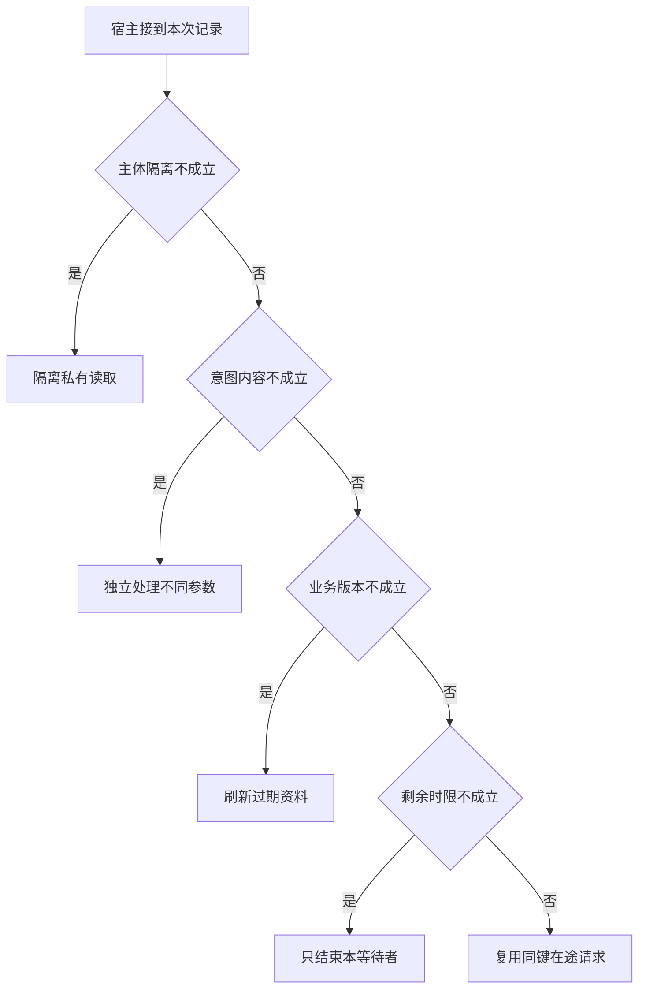

# 热点请求可以共享哪个 Future

两位用户几乎同时查询同一资料。
共享在途读取可以减轻下游压力，但键若漏掉主体或版本，就把性能技巧变成数据泄露。
一位等待者超时也不等于其他人不再需要结果。

本篇用一个封闭的教学决策器说明这一问题。输入是宿主收到的记录，不保证每个下游字段都已经获准使用。前置检查未成立时，下游即使带着缓存值，也不能拿来作业务断言。

本题模拟带主体约束的私有观察，不能把身份不同的调用合并。真正公开且无权限差异的资料可以另立缓存政策。

## 先解决一个具体问题

**一个请求取消，是否应该取消合并读取的底层操作？**

先确认是否还有其他等待者以及这个 Future 的公共资源边界。
如果复用跨主体或跨版本，本身就不能共享。合法共享时要把等待者截止与底层生命周期分开。


先取一个能走到「复用同键在途请求」的输入：数据与当前主体匹配、内容与原操作键一致、资料版本仍适用、截止前仍能完成下一动作。
把这四个条件代回后文的图，前面各个拦截分支都未满足，最终才有“归属内容版本与等待条件匹配”这个判断。
还原这个现场时要分别问：哪些位来自可信状态，哪些只是在接口中出现、尚未获得解释资格的字段。

## 先沿一次决策走到底



从上到下取第一条成立的出口。只改一个开关时，只有它之前的检查都未截断，该变化才可能到达真实动作。

“主体隔离”的两种输入分别是“数据与当前主体匹配”与“数据属于另一主体”。
隔离应发生在把材料交给模型之前。

“意图内容”的两种输入分别是“内容与原操作键一致”与“同一键携带不同内容”。
同键异义要显式冲突，不能返回假成功。

“业务版本”的两种输入分别是“资料版本仍适用”与“观察所依据版本已过期”。
写入前应重新验证可能变化的业务前提。

“剩余时限”的两种输入分别是“截止前仍能完成下一动作”与“剩余时限不足”。
总时间应包含排队、动作和结果交付。

## 最少需要哪几项观察

### 隔离私有读取

不同主体不得共享私有观察。
在本节的全部组合中，有 8 种产生「隔离私有读取」，这只是逻辑空间的计数，不能当作实际用户请求的比例。

只取得数据属于另一主体，已经足以要求宿主「隔离私有读取」。
保持这些已知项，其余开关自由变化，仍有 8 种补全，判断没有翻转。

若删掉关于主体隔离的证据，另一份允许的现场是数据与当前主体匹配、同一键携带不同内容、观察所依据版本已过期、剩余时限不足，它会使宿主「独立处理不同参数」。

### 独立处理不同参数

两个意图不满足同键条件。
在本节的全部组合中，有 4 种产生「独立处理不同参数」，这只是逻辑空间的计数，不能当作实际用户请求的比例。

只取得数据与当前主体匹配、同一键携带不同内容，已经足以要求宿主「独立处理不同参数」。
保持这些已知项，其余开关自由变化，仍有 4 种补全，判断没有翻转。

若删掉关于主体隔离的证据，另一份允许的现场是数据属于另一主体、同一键携带不同内容、观察所依据版本已过期、剩余时限不足，它会使宿主「隔离私有读取」。

若删掉关于意图内容的证据，另一份允许的现场是数据与当前主体匹配、内容与原操作键一致、观察所依据版本已过期、剩余时限不足，它会使宿主「刷新过期资料」。

### 刷新过期资料

旧版本不能支撑当前核验。
在本节的全部组合中，有 2 种产生「刷新过期资料」，这只是逻辑空间的计数，不能当作实际用户请求的比例。

只取得数据与当前主体匹配、内容与原操作键一致、观察所依据版本已过期，已经足以要求宿主「刷新过期资料」。
保持这些已知项，其余开关自由变化，仍有 2 种补全，判断没有翻转。

若删掉关于主体隔离的证据，另一份允许的现场是数据属于另一主体、内容与原操作键一致、观察所依据版本已过期、剩余时限不足，它会使宿主「隔离私有读取」。

若删掉关于意图内容的证据，另一份允许的现场是数据与当前主体匹配、同一键携带不同内容、观察所依据版本已过期、剩余时限不足，它会使宿主「独立处理不同参数」。

若删掉关于业务版本的证据，另一份允许的现场是数据与当前主体匹配、内容与原操作键一致、资料版本仍适用、剩余时限不足，它会使宿主「只结束本等待者」。

### 只结束本等待者

不得因一人截止误取消他人的读取。
在本节的全部组合中，有 1 种产生「只结束本等待者」，这只是逻辑空间的计数，不能当作实际用户请求的比例。

只取得数据与当前主体匹配、内容与原操作键一致、资料版本仍适用、剩余时限不足，已经足以要求宿主「只结束本等待者」。
保持这些已知项，其余开关自由变化，仍有 1 种补全，判断没有翻转。

若删掉关于主体隔离的证据，另一份允许的现场是数据属于另一主体、内容与原操作键一致、资料版本仍适用、剩余时限不足，它会使宿主「隔离私有读取」。

若删掉关于意图内容的证据，另一份允许的现场是数据与当前主体匹配、同一键携带不同内容、资料版本仍适用、剩余时限不足，它会使宿主「独立处理不同参数」。

若删掉关于业务版本的证据，另一份允许的现场是数据与当前主体匹配、内容与原操作键一致、观察所依据版本已过期、剩余时限不足，它会使宿主「刷新过期资料」。

若删掉关于剩余时限的证据，另一份允许的现场是数据与当前主体匹配、内容与原操作键一致、资料版本仍适用、截止前仍能完成下一动作，它会使宿主「复用同键在途请求」。

### 复用同键在途请求

归属内容版本与等待条件匹配。
在本节的全部组合中，有 1 种产生「复用同键在途请求」，这只是逻辑空间的计数，不能当作实际用户请求的比例。

只取得数据与当前主体匹配、内容与原操作键一致、资料版本仍适用、截止前仍能完成下一动作，已经足以要求宿主「复用同键在途请求」。

若删掉关于主体隔离的证据，另一份允许的现场是数据属于另一主体、内容与原操作键一致、资料版本仍适用、截止前仍能完成下一动作，它会使宿主「隔离私有读取」。

若删掉关于意图内容的证据，另一份允许的现场是数据与当前主体匹配、同一键携带不同内容、资料版本仍适用、截止前仍能完成下一动作，它会使宿主「独立处理不同参数」。

若删掉关于业务版本的证据，另一份允许的现场是数据与当前主体匹配、内容与原操作键一致、观察所依据版本已过期、截止前仍能完成下一动作，它会使宿主「刷新过期资料」。

若删掉关于剩余时限的证据，另一份允许的现场是数据与当前主体匹配、内容与原操作键一致、资料版本仍适用、剩余时限不足，它会使宿主「只结束本等待者」。

## 以同一份契约解释截然不同的现场

<details>
<summary>展开推演与对应反例</summary>

下列样本按最先命中的业务分支排列。四位编码只作本篇页内定位，顺序与开头的四项输入一致。可以先猜下一动作，再展开相邻样本。

### 能够触发“隔离私有读取”的现场

**样本 0000**

业务侧交来数据属于另一主体、同一键携带不同内容，执行侧还记录了观察所依据版本已过期、剩余时限不足。
把样本压成最短证明，保留数据属于另一主体就能支持「隔离私有读取」。

在这份记录上，分别翻转「主体隔离」中的任一项，其他项完全不变时，下一动作都会改变。

保持其余观察不动，单独切换「意图内容」、「业务版本」、「剩余时限」仍得到「隔离私有读取」，它们在这个现场不是决定性变量。

要从本例改走「独立处理不同参数」，至少需要变动 1 项，一组最少改动是将数据属于另一主体换成数据与当前主体匹配。

要从本例改走「刷新过期资料」，至少需要变动 2 项，一组最少改动是将数据属于另一主体、同一键携带不同内容换成数据与当前主体匹配、内容与原操作键一致。

要从本例改走「只结束本等待者」，至少需要变动 3 项，一组最少改动是将数据属于另一主体、同一键携带不同内容、观察所依据版本已过期换成数据与当前主体匹配、内容与原操作键一致、资料版本仍适用。

要从本例改走「复用同键在途请求」，至少需要变动 4 项，一组最少改动是将数据属于另一主体、同一键携带不同内容、观察所依据版本已过期、剩余时限不足换成数据与当前主体匹配、内容与原操作键一致、资料版本仍适用、截止前仍能完成下一动作。

**样本 0001**

业务侧交来数据属于另一主体、同一键携带不同内容，执行侧还记录了观察所依据版本已过期、截止前仍能完成下一动作。


要从本例改走「复用同键在途请求」，至少需要变动 3 项，一组最少改动是将数据属于另一主体、同一键携带不同内容、观察所依据版本已过期换成数据与当前主体匹配、内容与原操作键一致、资料版本仍适用。

要从本例改走「只结束本等待者」，至少需要变动 4 项，一组最少改动是将数据属于另一主体、同一键携带不同内容、观察所依据版本已过期、截止前仍能完成下一动作换成数据与当前主体匹配、内容与原操作键一致、资料版本仍适用、剩余时限不足。

**样本 0010**

业务侧交来数据属于另一主体、同一键携带不同内容，执行侧还记录了资料版本仍适用、剩余时限不足。


要从本例改走「只结束本等待者」，至少需要变动 2 项，一组最少改动是将数据属于另一主体、同一键携带不同内容换成数据与当前主体匹配、内容与原操作键一致。

要从本例改走「刷新过期资料」，至少需要变动 3 项，一组最少改动是将数据属于另一主体、同一键携带不同内容、资料版本仍适用换成数据与当前主体匹配、内容与原操作键一致、观察所依据版本已过期。

要从本例改走「复用同键在途请求」，至少需要变动 3 项，一组最少改动是将数据属于另一主体、同一键携带不同内容、剩余时限不足换成数据与当前主体匹配、内容与原操作键一致、截止前仍能完成下一动作。

**样本 0011**

业务侧交来数据属于另一主体、同一键携带不同内容，执行侧还记录了资料版本仍适用、截止前仍能完成下一动作。


要从本例改走「复用同键在途请求」，至少需要变动 2 项，一组最少改动是将数据属于另一主体、同一键携带不同内容换成数据与当前主体匹配、内容与原操作键一致。


要从本例改走「只结束本等待者」，至少需要变动 3 项，一组最少改动是将数据属于另一主体、同一键携带不同内容、截止前仍能完成下一动作换成数据与当前主体匹配、内容与原操作键一致、剩余时限不足。

**样本 0100**

业务侧交来数据属于另一主体、内容与原操作键一致，执行侧还记录了观察所依据版本已过期、剩余时限不足。


要从本例改走「刷新过期资料」，至少需要变动 1 项，一组最少改动是将数据属于另一主体换成数据与当前主体匹配。

要从本例改走「独立处理不同参数」，至少需要变动 2 项，一组最少改动是将数据属于另一主体、内容与原操作键一致换成数据与当前主体匹配、同一键携带不同内容。

要从本例改走「只结束本等待者」，至少需要变动 2 项，一组最少改动是将数据属于另一主体、观察所依据版本已过期换成数据与当前主体匹配、资料版本仍适用。

要从本例改走「复用同键在途请求」，至少需要变动 3 项，一组最少改动是将数据属于另一主体、观察所依据版本已过期、剩余时限不足换成数据与当前主体匹配、资料版本仍适用、截止前仍能完成下一动作。

**样本 0101**

业务侧交来数据属于另一主体、内容与原操作键一致，执行侧还记录了观察所依据版本已过期、截止前仍能完成下一动作。


要从本例改走「复用同键在途请求」，至少需要变动 2 项，一组最少改动是将数据属于另一主体、观察所依据版本已过期换成数据与当前主体匹配、资料版本仍适用。

要从本例改走「只结束本等待者」，至少需要变动 3 项，一组最少改动是将数据属于另一主体、观察所依据版本已过期、截止前仍能完成下一动作换成数据与当前主体匹配、资料版本仍适用、剩余时限不足。

**样本 0110**

业务侧交来数据属于另一主体、内容与原操作键一致，执行侧还记录了资料版本仍适用、剩余时限不足。


要从本例改走「只结束本等待者」，至少需要变动 1 项，一组最少改动是将数据属于另一主体换成数据与当前主体匹配。


要从本例改走「刷新过期资料」，至少需要变动 2 项，一组最少改动是将数据属于另一主体、资料版本仍适用换成数据与当前主体匹配、观察所依据版本已过期。

要从本例改走「复用同键在途请求」，至少需要变动 2 项，一组最少改动是将数据属于另一主体、剩余时限不足换成数据与当前主体匹配、截止前仍能完成下一动作。

**样本 0111**

业务侧交来数据属于另一主体、内容与原操作键一致，执行侧还记录了资料版本仍适用、截止前仍能完成下一动作。


要从本例改走「复用同键在途请求」，至少需要变动 1 项，一组最少改动是将数据属于另一主体换成数据与当前主体匹配。


要从本例改走「只结束本等待者」，至少需要变动 2 项，一组最少改动是将数据属于另一主体、截止前仍能完成下一动作换成数据与当前主体匹配、剩余时限不足。

### 能够触发“独立处理不同参数”的现场

**样本 1000**

业务侧交来数据与当前主体匹配、同一键携带不同内容，执行侧还记录了观察所依据版本已过期、剩余时限不足。
把样本压成最短证明，保留数据与当前主体匹配、同一键携带不同内容就能支持「独立处理不同参数」。

在这份记录上，分别翻转「主体隔离」、「意图内容」中的任一项，其他项完全不变时，下一动作都会改变。

保持其余观察不动，单独切换「业务版本」、「剩余时限」仍得到「独立处理不同参数」，它们在这个现场不是决定性变量。

本例没走更靠前的「隔离私有读取」，因为数据与当前主体匹配与那个入口的必要条件不符。

要从本例改走「隔离私有读取」，至少需要变动 1 项，一组最少改动是将数据与当前主体匹配换成数据属于另一主体。

要从本例改走「刷新过期资料」，至少需要变动 1 项，一组最少改动是将同一键携带不同内容换成内容与原操作键一致。

要从本例改走「只结束本等待者」，至少需要变动 2 项，一组最少改动是将同一键携带不同内容、观察所依据版本已过期换成内容与原操作键一致、资料版本仍适用。

要从本例改走「复用同键在途请求」，至少需要变动 3 项，一组最少改动是将同一键携带不同内容、观察所依据版本已过期、剩余时限不足换成内容与原操作键一致、资料版本仍适用、截止前仍能完成下一动作。

**样本 1001**

业务侧交来数据与当前主体匹配、同一键携带不同内容，执行侧还记录了观察所依据版本已过期、截止前仍能完成下一动作。


要从本例改走「复用同键在途请求」，至少需要变动 2 项，一组最少改动是将同一键携带不同内容、观察所依据版本已过期换成内容与原操作键一致、资料版本仍适用。

要从本例改走「只结束本等待者」，至少需要变动 3 项，一组最少改动是将同一键携带不同内容、观察所依据版本已过期、截止前仍能完成下一动作换成内容与原操作键一致、资料版本仍适用、剩余时限不足。

**样本 1010**

业务侧交来数据与当前主体匹配、同一键携带不同内容，执行侧还记录了资料版本仍适用、剩余时限不足。


要从本例改走「只结束本等待者」，至少需要变动 1 项，一组最少改动是将同一键携带不同内容换成内容与原操作键一致。

要从本例改走「刷新过期资料」，至少需要变动 2 项，一组最少改动是将同一键携带不同内容、资料版本仍适用换成内容与原操作键一致、观察所依据版本已过期。

要从本例改走「复用同键在途请求」，至少需要变动 2 项，一组最少改动是将同一键携带不同内容、剩余时限不足换成内容与原操作键一致、截止前仍能完成下一动作。

**样本 1011**

业务侧交来数据与当前主体匹配、同一键携带不同内容，执行侧还记录了资料版本仍适用、截止前仍能完成下一动作。


要从本例改走「复用同键在途请求」，至少需要变动 1 项，一组最少改动是将同一键携带不同内容换成内容与原操作键一致。


要从本例改走「只结束本等待者」，至少需要变动 2 项，一组最少改动是将同一键携带不同内容、截止前仍能完成下一动作换成内容与原操作键一致、剩余时限不足。

### 能够触发“刷新过期资料”的现场

**样本 1100**

业务侧交来数据与当前主体匹配、内容与原操作键一致，执行侧还记录了观察所依据版本已过期、剩余时限不足。
把样本压成最短证明，保留数据与当前主体匹配、内容与原操作键一致、观察所依据版本已过期就能支持「刷新过期资料」。

在这份记录上，分别翻转「主体隔离」、「意图内容」、「业务版本」中的任一项，其他项完全不变时，下一动作都会改变。

保持其余观察不动，单独切换「剩余时限」仍得到「刷新过期资料」，它们在这个现场不是决定性变量。


本例没走更靠前的「独立处理不同参数」，因为内容与原操作键一致与那个入口的必要条件不符。


要从本例改走「独立处理不同参数」，至少需要变动 1 项，一组最少改动是将内容与原操作键一致换成同一键携带不同内容。

要从本例改走「只结束本等待者」，至少需要变动 1 项，一组最少改动是将观察所依据版本已过期换成资料版本仍适用。

要从本例改走「复用同键在途请求」，至少需要变动 2 项，一组最少改动是将观察所依据版本已过期、剩余时限不足换成资料版本仍适用、截止前仍能完成下一动作。

**样本 1101**

业务侧交来数据与当前主体匹配、内容与原操作键一致，执行侧还记录了观察所依据版本已过期、截止前仍能完成下一动作。


要从本例改走「复用同键在途请求」，至少需要变动 1 项，一组最少改动是将观察所依据版本已过期换成资料版本仍适用。

要从本例改走「只结束本等待者」，至少需要变动 2 项，一组最少改动是将观察所依据版本已过期、截止前仍能完成下一动作换成资料版本仍适用、剩余时限不足。

### 能够触发“只结束本等待者”的现场

**样本 1110**

业务侧交来数据与当前主体匹配、内容与原操作键一致，执行侧还记录了资料版本仍适用、剩余时限不足。
把样本压成最短证明，保留数据与当前主体匹配、内容与原操作键一致、资料版本仍适用、剩余时限不足就能支持「只结束本等待者」。

在这份记录上，分别翻转「主体隔离」、「意图内容」、「业务版本」、「剩余时限」中的任一项，其他项完全不变时，下一动作都会改变。


本例没走更靠前的「刷新过期资料」，因为资料版本仍适用与那个入口的必要条件不符。


要从本例改走「刷新过期资料」，至少需要变动 1 项，一组最少改动是将资料版本仍适用换成观察所依据版本已过期。

要从本例改走「复用同键在途请求」，至少需要变动 1 项，一组最少改动是将剩余时限不足换成截止前仍能完成下一动作。

### 能够触发“复用同键在途请求”的现场

**样本 1111**

业务侧交来数据与当前主体匹配、内容与原操作键一致，执行侧还记录了资料版本仍适用、截止前仍能完成下一动作。
把样本压成最短证明，保留数据与当前主体匹配、内容与原操作键一致、资料版本仍适用、截止前仍能完成下一动作就能支持「复用同键在途请求」。


本例没走更靠前的「只结束本等待者」，因为截止前仍能完成下一动作与那个入口的必要条件不符。


要从本例改走「只结束本等待者」，至少需要变动 1 项，一组最少改动是将截止前仍能完成下一动作换成剩余时限不足。

</details>

## 当你只能看见一半记录

<details>
<summary>展开推演与对应反例</summary>

这次隐藏两个字段，保留另两个。对每个可见现场，检查四种合法补全是否同意。如仍有歧义，选择能使最坏剩余候选动作最少的字段继续查。并列时采用本篇字段顺序。

### 只保留主体隔离与意图内容

已知数据属于另一主体、同一键携带不同内容时，四种补全的动作分布为隔离私有读取（4 种）。

就“隔离私有读取”这个动作而言，在数据属于另一主体、同一键携带不同内容的前提下，另外两项观察不会推翻它。

已知数据属于另一主体、内容与原操作键一致时，四种补全的动作分布为隔离私有读取（4 种）。

就“隔离私有读取”这个动作而言，在数据属于另一主体、内容与原操作键一致的前提下，另外两项观察不会推翻它。

已知数据与当前主体匹配、同一键携带不同内容时，四种补全的动作分布为独立处理不同参数（4 种）。

就“独立处理不同参数”这个动作而言，在数据与当前主体匹配、同一键携带不同内容的前提下，另外两项观察不会推翻它。

已知数据与当前主体匹配、内容与原操作键一致时，四种补全的动作分布为刷新过期资料（2 种）、只结束本等待者（1 种）、复用同键在途请求（1 种）。

在数据与当前主体匹配、内容与原操作键一致这个现场补读「业务版本」，最坏还剩 2 种动作，计算时只衡量歧义，尚未扣读取代价。
若补来的观察为“观察所依据版本已过期”，范围缩成「刷新过期资料」。若为“资料版本仍适用”，则保留「只结束本等待者」、「复用同键在途请求」。

区分不了的两条执行可以具体写成 1100 与 1110：它们共享已展示字段，却分别需要「刷新过期资料」和「只结束本等待者」。

### 只保留主体隔离与业务版本

已知数据属于另一主体、观察所依据版本已过期时，四种补全的动作分布为隔离私有读取（4 种）。

就“隔离私有读取”这个动作而言，在数据属于另一主体、观察所依据版本已过期的前提下，另外两项观察不会推翻它。

已知数据属于另一主体、资料版本仍适用时，四种补全的动作分布为隔离私有读取（4 种）。

就“隔离私有读取”这个动作而言，在数据属于另一主体、资料版本仍适用的前提下，另外两项观察不会推翻它。

已知数据与当前主体匹配、观察所依据版本已过期时，四种补全的动作分布为独立处理不同参数（2 种）、刷新过期资料（2 种）。

在数据与当前主体匹配、观察所依据版本已过期这个现场补读「意图内容」，最坏还剩 1 种动作，计算时只衡量歧义，尚未扣读取代价。
若补来的观察为“同一键携带不同内容”，范围缩成「独立处理不同参数」。若为“内容与原操作键一致”，则保留「刷新过期资料」。

区分不了的两条执行可以具体写成 1000 与 1100：它们共享已展示字段，却分别需要「独立处理不同参数」和「刷新过期资料」。

已知数据与当前主体匹配、资料版本仍适用时，四种补全的动作分布为独立处理不同参数（2 种）、只结束本等待者（1 种）、复用同键在途请求（1 种）。

在数据与当前主体匹配、资料版本仍适用这个现场补读「意图内容」，最坏还剩 2 种动作，计算时只衡量歧义，尚未扣读取代价。
若补来的观察为“同一键携带不同内容”，范围缩成「独立处理不同参数」。若为“内容与原操作键一致”，则保留「只结束本等待者」、「复用同键在途请求」。

区分不了的两条执行可以具体写成 1010 与 1110：它们共享已展示字段，却分别需要「独立处理不同参数」和「只结束本等待者」。

### 只保留意图内容与业务版本

已知同一键携带不同内容、观察所依据版本已过期时，四种补全的动作分布为隔离私有读取（2 种）、独立处理不同参数（2 种）。

在同一键携带不同内容、观察所依据版本已过期这个现场补读「主体隔离」，最坏还剩 1 种动作，计算时只衡量歧义，尚未扣读取代价。
若补来的观察为“数据属于另一主体”，范围缩成「隔离私有读取」。若为“数据与当前主体匹配”，则保留「独立处理不同参数」。

区分不了的两条执行可以具体写成 0000 与 1000：它们共享已展示字段，却分别需要「隔离私有读取」和「独立处理不同参数」。

已知同一键携带不同内容、资料版本仍适用时，四种补全的动作分布为隔离私有读取（2 种）、独立处理不同参数（2 种）。

在同一键携带不同内容、资料版本仍适用这个现场补读「主体隔离」，最坏还剩 1 种动作，计算时只衡量歧义，尚未扣读取代价。

区分不了的两条执行可以具体写成 0010 与 1010：它们共享已展示字段，却分别需要「隔离私有读取」和「独立处理不同参数」。

已知内容与原操作键一致、观察所依据版本已过期时，四种补全的动作分布为隔离私有读取（2 种）、刷新过期资料（2 种）。

在内容与原操作键一致、观察所依据版本已过期这个现场补读「主体隔离」，最坏还剩 1 种动作，计算时只衡量歧义，尚未扣读取代价。
若补来的观察为“数据属于另一主体”，范围缩成「隔离私有读取」。若为“数据与当前主体匹配”，则保留「刷新过期资料」。

区分不了的两条执行可以具体写成 0100 与 1100：它们共享已展示字段，却分别需要「隔离私有读取」和「刷新过期资料」。

已知内容与原操作键一致、资料版本仍适用时，四种补全的动作分布为隔离私有读取（2 种）、只结束本等待者（1 种）、复用同键在途请求（1 种）。

在内容与原操作键一致、资料版本仍适用这个现场补读「主体隔离」，最坏还剩 2 种动作，计算时只衡量歧义，尚未扣读取代价。
若补来的观察为“数据属于另一主体”，范围缩成「隔离私有读取」。若为“数据与当前主体匹配”，则保留「只结束本等待者」、「复用同键在途请求」。

区分不了的两条执行可以具体写成 0110 与 1110：它们共享已展示字段，却分别需要「隔离私有读取」和「只结束本等待者」。

### 只保留主体隔离与剩余时限

已知数据属于另一主体、剩余时限不足时，四种补全的动作分布为隔离私有读取（4 种）。

就“隔离私有读取”这个动作而言，在数据属于另一主体、剩余时限不足的前提下，另外两项观察不会推翻它。

已知数据属于另一主体、截止前仍能完成下一动作时，四种补全的动作分布为隔离私有读取（4 种）。

就“隔离私有读取”这个动作而言，在数据属于另一主体、截止前仍能完成下一动作的前提下，另外两项观察不会推翻它。

已知数据与当前主体匹配、剩余时限不足时，四种补全的动作分布为独立处理不同参数（2 种）、刷新过期资料（1 种）、只结束本等待者（1 种）。

在数据与当前主体匹配、剩余时限不足这个现场补读「意图内容」，最坏还剩 2 种动作，计算时只衡量歧义，尚未扣读取代价。
若补来的观察为“同一键携带不同内容”，范围缩成「独立处理不同参数」。若为“内容与原操作键一致”，则保留「刷新过期资料」、「只结束本等待者」。


已知数据与当前主体匹配、截止前仍能完成下一动作时，四种补全的动作分布为独立处理不同参数（2 种）、刷新过期资料（1 种）、复用同键在途请求（1 种）。

在数据与当前主体匹配、截止前仍能完成下一动作这个现场补读「意图内容」，最坏还剩 2 种动作，计算时只衡量歧义，尚未扣读取代价。
若补来的观察为“同一键携带不同内容”，范围缩成「独立处理不同参数」。若为“内容与原操作键一致”，则保留「刷新过期资料」、「复用同键在途请求」。

区分不了的两条执行可以具体写成 1001 与 1101：它们共享已展示字段，却分别需要「独立处理不同参数」和「刷新过期资料」。

### 只保留意图内容与剩余时限

已知同一键携带不同内容、剩余时限不足时，四种补全的动作分布为隔离私有读取（2 种）、独立处理不同参数（2 种）。

在同一键携带不同内容、剩余时限不足这个现场补读「主体隔离」，最坏还剩 1 种动作，计算时只衡量歧义，尚未扣读取代价。


已知同一键携带不同内容、截止前仍能完成下一动作时，四种补全的动作分布为隔离私有读取（2 种）、独立处理不同参数（2 种）。

在同一键携带不同内容、截止前仍能完成下一动作这个现场补读「主体隔离」，最坏还剩 1 种动作，计算时只衡量歧义，尚未扣读取代价。

区分不了的两条执行可以具体写成 0001 与 1001：它们共享已展示字段，却分别需要「隔离私有读取」和「独立处理不同参数」。

已知内容与原操作键一致、剩余时限不足时，四种补全的动作分布为隔离私有读取（2 种）、刷新过期资料（1 种）、只结束本等待者（1 种）。

在内容与原操作键一致、剩余时限不足这个现场补读「主体隔离」，最坏还剩 2 种动作，计算时只衡量歧义，尚未扣读取代价。
若补来的观察为“数据属于另一主体”，范围缩成「隔离私有读取」。若为“数据与当前主体匹配”，则保留「刷新过期资料」、「只结束本等待者」。


已知内容与原操作键一致、截止前仍能完成下一动作时，四种补全的动作分布为隔离私有读取（2 种）、刷新过期资料（1 种）、复用同键在途请求（1 种）。

在内容与原操作键一致、截止前仍能完成下一动作这个现场补读「主体隔离」，最坏还剩 2 种动作，计算时只衡量歧义，尚未扣读取代价。
若补来的观察为“数据属于另一主体”，范围缩成「隔离私有读取」。若为“数据与当前主体匹配”，则保留「刷新过期资料」、「复用同键在途请求」。

区分不了的两条执行可以具体写成 0101 与 1101：它们共享已展示字段，却分别需要「隔离私有读取」和「刷新过期资料」。

### 只保留业务版本与剩余时限

已知观察所依据版本已过期、剩余时限不足时，四种补全的动作分布为隔离私有读取（2 种）、独立处理不同参数（1 种）、刷新过期资料（1 种）。

在观察所依据版本已过期、剩余时限不足这个现场补读「主体隔离」，最坏还剩 2 种动作，计算时只衡量歧义，尚未扣读取代价。
若补来的观察为“数据属于另一主体”，范围缩成「隔离私有读取」。若为“数据与当前主体匹配”，则保留「独立处理不同参数」、「刷新过期资料」。


已知观察所依据版本已过期、截止前仍能完成下一动作时，四种补全的动作分布为隔离私有读取（2 种）、独立处理不同参数（1 种）、刷新过期资料（1 种）。

在观察所依据版本已过期、截止前仍能完成下一动作这个现场补读「主体隔离」，最坏还剩 2 种动作，计算时只衡量歧义，尚未扣读取代价。


已知资料版本仍适用、剩余时限不足时，四种补全的动作分布为隔离私有读取（2 种）、独立处理不同参数（1 种）、只结束本等待者（1 种）。

在资料版本仍适用、剩余时限不足这个现场补读「主体隔离」，最坏还剩 2 种动作，计算时只衡量歧义，尚未扣读取代价。
若补来的观察为“数据属于另一主体”，范围缩成「隔离私有读取」。若为“数据与当前主体匹配”，则保留「独立处理不同参数」、「只结束本等待者」。


已知资料版本仍适用、截止前仍能完成下一动作时，四种补全的动作分布为隔离私有读取（2 种）、独立处理不同参数（1 种）、复用同键在途请求（1 种）。

在资料版本仍适用、截止前仍能完成下一动作这个现场补读「主体隔离」，最坏还剩 2 种动作，计算时只衡量歧义，尚未扣读取代价。
若补来的观察为“数据属于另一主体”，范围缩成「隔离私有读取」。若为“数据与当前主体匹配”，则保留「独立处理不同参数」、「复用同键在途请求」。

区分不了的两条执行可以具体写成 0011 与 1011：它们共享已展示字段，却分别需要「隔离私有读取」和「独立处理不同参数」。

</details>

## 单因素干预与边界测试

<details>
<summary>展开推演与对应反例</summary>

### 只改变主体隔离

固定另外三个条件得到八对现场，从“数据属于另一主体”转为“数据与当前主体匹配”时，8 对翻转动作，另外 0 对保持不变。

有 4 对现场沿「隔离私有读取」变到「独立处理不同参数」，可复现的一组受控背景为同一键携带不同内容、观察所依据版本已过期、剩余时限不足。

有 2 对现场沿「隔离私有读取」变到「刷新过期资料」，可复现的一组受控背景为内容与原操作键一致、观察所依据版本已过期、剩余时限不足。

有 1 对现场沿「隔离私有读取」变到「只结束本等待者」，可复现的一组受控背景为内容与原操作键一致、资料版本仍适用、剩余时限不足。

有 1 对现场沿「隔离私有读取」变到「复用同键在途请求」，可复现的一组受控背景为内容与原操作键一致、资料版本仍适用、截止前仍能完成下一动作。

### 只改变意图内容

固定另外三个条件得到八对现场，从“同一键携带不同内容”转为“内容与原操作键一致”时，4 对翻转动作，另外 4 对保持不变。

令数据属于另一主体、观察所依据版本已过期、剩余时限不足，意图内容的两个取值均得到「隔离私有读取」。在八对中，共有 4 对表现为这一种稳定出口。

有 2 对现场沿「独立处理不同参数」变到「刷新过期资料」，可复现的一组受控背景为数据与当前主体匹配、观察所依据版本已过期、剩余时限不足。

有 1 对现场沿「独立处理不同参数」变到「只结束本等待者」，可复现的一组受控背景为数据与当前主体匹配、资料版本仍适用、剩余时限不足。

有 1 对现场沿「独立处理不同参数」变到「复用同键在途请求」，可复现的一组受控背景为数据与当前主体匹配、资料版本仍适用、截止前仍能完成下一动作。

### 只改变业务版本

固定另外三个条件得到八对现场，从“观察所依据版本已过期”转为“资料版本仍适用”时，2 对翻转动作，另外 6 对保持不变。

令数据属于另一主体、同一键携带不同内容、剩余时限不足，业务版本的两个取值均得到「隔离私有读取」。在八对中，共有 4 对表现为这一种稳定出口。

令数据与当前主体匹配、同一键携带不同内容、剩余时限不足，业务版本的两个取值均得到「独立处理不同参数」。在八对中，共有 2 对表现为这一种稳定出口。

有 1 对现场沿「刷新过期资料」变到「只结束本等待者」，可复现的一组受控背景为数据与当前主体匹配、内容与原操作键一致、剩余时限不足。

有 1 对现场沿「刷新过期资料」变到「复用同键在途请求」，可复现的一组受控背景为数据与当前主体匹配、内容与原操作键一致、截止前仍能完成下一动作。

### 只改变剩余时限

固定另外三个条件得到八对现场，从“剩余时限不足”转为“截止前仍能完成下一动作”时，1 对翻转动作，另外 7 对保持不变。

令数据属于另一主体、同一键携带不同内容、观察所依据版本已过期，剩余时限的两个取值均得到「隔离私有读取」。在八对中，共有 4 对表现为这一种稳定出口。

令数据与当前主体匹配、同一键携带不同内容、观察所依据版本已过期，剩余时限的两个取值均得到「独立处理不同参数」。在八对中，共有 2 对表现为这一种稳定出口。

令数据与当前主体匹配、内容与原操作键一致、观察所依据版本已过期，剩余时限的两个取值均得到「刷新过期资料」。在八对中，共有 1 对表现为这一种稳定出口。

有 1 对现场沿「只结束本等待者」变到「复用同键在途请求」，可复现的一组受控背景为数据与当前主体匹配、内容与原操作键一致、资料版本仍适用。

</details>

## 哪些回归样本真能抓住实现错误

<details>
<summary>展开推演与对应反例</summary>

如果删除“隔离私有读取”这个分支，在本篇 16 种输入里有 8 种会改走另一出口。

反例 0000 的完整记录为数据属于另一主体、同一键携带不同内容、观察所依据版本已过期、剩余时限不足。正确结果是「隔离私有读取」，这个改坏的实现却给出「独立处理不同参数」。

如果删除“独立处理不同参数”这个分支，在本篇 16 种输入里有 4 种会改走另一出口。

反例 1000 的完整记录为数据与当前主体匹配、同一键携带不同内容、观察所依据版本已过期、剩余时限不足。正确结果是「独立处理不同参数」，这个改坏的实现却给出「刷新过期资料」。

如果删除“刷新过期资料”这个分支，在本篇 16 种输入里有 2 种会改走另一出口。

反例 1100 的完整记录为数据与当前主体匹配、内容与原操作键一致、观察所依据版本已过期、剩余时限不足。正确结果是「刷新过期资料」，这个改坏的实现却给出「只结束本等待者」。

如果删除“只结束本等待者”这个分支，在本篇 16 种输入里有 1 种会改走另一出口。

反例 1110 的完整记录为数据与当前主体匹配、内容与原操作键一致、资料版本仍适用、剩余时限不足。正确结果是「只结束本等待者」，这个改坏的实现却给出「复用同键在途请求」。

如果交换“隔离私有读取”和“独立处理不同参数”的判断次序，在本篇 16 种输入里有 4 种会改走另一出口。


如果交换“独立处理不同参数”和“刷新过期资料”的判断次序，在本篇 16 种输入里有 2 种会改走另一出口。


如果交换“刷新过期资料”和“只结束本等待者”的判断次序，在本篇 16 种输入里有 1 种会改走另一出口。


补入样本 0000（数据属于另一主体、同一键携带不同内容、观察所依据版本已过期、剩余时限不足）能新增检出「删除“隔离私有读取”这个分支」、「交换“隔离私有读取”和“独立处理不同参数”的判断次序」。

补入样本 1000（数据与当前主体匹配、同一键携带不同内容、观察所依据版本已过期、剩余时限不足）能新增检出「删除“独立处理不同参数”这个分支」、「交换“独立处理不同参数”和“刷新过期资料”的判断次序」。

补入样本 1100（数据与当前主体匹配、内容与原操作键一致、观察所依据版本已过期、剩余时限不足）能新增检出「删除“刷新过期资料”这个分支」、「交换“刷新过期资料”和“只结束本等待者”的判断次序」。

补入样本 1110（数据与当前主体匹配、内容与原操作键一致、资料版本仍适用、剩余时限不足）能新增检出「删除“只结束本等待者”这个分支」。

这里每次选覆盖尚未捕获缺陷最多的样本，并不保证用例数全局最小。它给出的反例能作为 Java 单测输入。真实模型是否会自主产生这些提议，仍须单独评测。

</details>

## 把状态覆盖换成有抽样偏差的评测批次

<details>
<summary>展开推演与对应反例</summary>

前面的十六种记录各有一票。现在只改样本构成：对一个给定字段，把成立侧的每种记录各取三份、另一侧各取一份。这是人为配比的 32 份回放，不是线上频率估计。
将偏向成立与偏向不成立的两次批次对照，可以隔离分母变化。底层宿主和所有答案保持相同，比例仍可能移动。

### 改变“主体隔离”的样本配比

只看「隔离私有读取」，在数据与当前主体匹配的八个不同输入中有 0 个命中，在数据属于另一主体的另八个输入中有 8 个命中。
把「主体隔离」成立侧按三倍取样，「隔离私有读取」占 8/32，反过来向未成立侧倾斜后占 24/32。
这次重加权使「隔离私有读取」的占比相差 50 个百分点。若按两种不同的“主体隔离”分布跑新旧版，不能把这项差异全部归功于实现。

只看「独立处理不同参数」，在数据与当前主体匹配的八个不同输入中有 4 个命中，在数据属于另一主体的另八个输入中有 0 个命中。
把「主体隔离」成立侧按三倍取样，「独立处理不同参数」占 12/32，反过来向未成立侧倾斜后占 4/32。
这次重加权使「独立处理不同参数」的占比相差 25 个百分点。若按两种不同的“主体隔离”分布跑新旧版，不能把这项差异全部归功于实现。

只看「刷新过期资料」，在数据与当前主体匹配的八个不同输入中有 2 个命中，在数据属于另一主体的另八个输入中有 0 个命中。
把「主体隔离」成立侧按三倍取样，「刷新过期资料」占 6/32，反过来向未成立侧倾斜后占 2/32。
这次重加权使「刷新过期资料」的占比相差 12.5 个百分点。若按两种不同的“主体隔离”分布跑新旧版，不能把这项差异全部归功于实现。

只看「只结束本等待者」，在数据与当前主体匹配的八个不同输入中有 1 个命中，在数据属于另一主体的另八个输入中有 0 个命中。
把「主体隔离」成立侧按三倍取样，「只结束本等待者」占 3/32，反过来向未成立侧倾斜后占 1/32。
这次重加权使「只结束本等待者」的占比相差 6.25 个百分点。若按两种不同的“主体隔离”分布跑新旧版，不能把这项差异全部归功于实现。

只看「复用同键在途请求」，在数据与当前主体匹配的八个不同输入中有 1 个命中，在数据属于另一主体的另八个输入中有 0 个命中。
把「主体隔离」成立侧按三倍取样，「复用同键在途请求」占 3/32，反过来向未成立侧倾斜后占 1/32。
这次重加权使「复用同键在途请求」的占比相差 6.25 个百分点。若按两种不同的“主体隔离”分布跑新旧版，不能把这项差异全部归功于实现。

### 改变“意图内容”的样本配比

只看「隔离私有读取」，在内容与原操作键一致的八个不同输入中有 4 个命中，在同一键携带不同内容的另八个输入中有 4 个命中。
把「意图内容」成立侧按三倍取样，「隔离私有读取」占 16/32，反过来向未成立侧倾斜后占 16/32。
两批「隔离私有读取」的边际比例相同，是因为这个出口在“意图内容”的两侧计数相等，这不能单独证明每一对现场都不受它影响。

只看「独立处理不同参数」，在内容与原操作键一致的八个不同输入中有 0 个命中，在同一键携带不同内容的另八个输入中有 4 个命中。
把「意图内容」成立侧按三倍取样，「独立处理不同参数」占 4/32，反过来向未成立侧倾斜后占 12/32。
这次重加权使「独立处理不同参数」的占比相差 25 个百分点。若按两种不同的“意图内容”分布跑新旧版，不能把这项差异全部归功于实现。

只看「刷新过期资料」，在内容与原操作键一致的八个不同输入中有 2 个命中，在同一键携带不同内容的另八个输入中有 0 个命中。
把「意图内容」成立侧按三倍取样，「刷新过期资料」占 6/32，反过来向未成立侧倾斜后占 2/32。
这次重加权使「刷新过期资料」的占比相差 12.5 个百分点。若按两种不同的“意图内容”分布跑新旧版，不能把这项差异全部归功于实现。

只看「只结束本等待者」，在内容与原操作键一致的八个不同输入中有 1 个命中，在同一键携带不同内容的另八个输入中有 0 个命中。
把「意图内容」成立侧按三倍取样，「只结束本等待者」占 3/32，反过来向未成立侧倾斜后占 1/32。
这次重加权使「只结束本等待者」的占比相差 6.25 个百分点。若按两种不同的“意图内容”分布跑新旧版，不能把这项差异全部归功于实现。

只看「复用同键在途请求」，在内容与原操作键一致的八个不同输入中有 1 个命中，在同一键携带不同内容的另八个输入中有 0 个命中。
把「意图内容」成立侧按三倍取样，「复用同键在途请求」占 3/32，反过来向未成立侧倾斜后占 1/32。
这次重加权使「复用同键在途请求」的占比相差 6.25 个百分点。若按两种不同的“意图内容”分布跑新旧版，不能把这项差异全部归功于实现。

### 改变“业务版本”的样本配比

只看「隔离私有读取」，在资料版本仍适用的八个不同输入中有 4 个命中，在观察所依据版本已过期的另八个输入中有 4 个命中。
把「业务版本」成立侧按三倍取样，「隔离私有读取」占 16/32，反过来向未成立侧倾斜后占 16/32。
两批「隔离私有读取」的边际比例相同，是因为这个出口在“业务版本”的两侧计数相等，这不能单独证明每一对现场都不受它影响。

只看「独立处理不同参数」，在资料版本仍适用的八个不同输入中有 2 个命中，在观察所依据版本已过期的另八个输入中有 2 个命中。
把「业务版本」成立侧按三倍取样，「独立处理不同参数」占 8/32，反过来向未成立侧倾斜后占 8/32。
两批「独立处理不同参数」的边际比例相同，是因为这个出口在“业务版本”的两侧计数相等，这不能单独证明每一对现场都不受它影响。

只看「刷新过期资料」，在资料版本仍适用的八个不同输入中有 0 个命中，在观察所依据版本已过期的另八个输入中有 2 个命中。
把「业务版本」成立侧按三倍取样，「刷新过期资料」占 2/32，反过来向未成立侧倾斜后占 6/32。
这次重加权使「刷新过期资料」的占比相差 12.5 个百分点。若按两种不同的“业务版本”分布跑新旧版，不能把这项差异全部归功于实现。

只看「只结束本等待者」，在资料版本仍适用的八个不同输入中有 1 个命中，在观察所依据版本已过期的另八个输入中有 0 个命中。
把「业务版本」成立侧按三倍取样，「只结束本等待者」占 3/32，反过来向未成立侧倾斜后占 1/32。
这次重加权使「只结束本等待者」的占比相差 6.25 个百分点。若按两种不同的“业务版本”分布跑新旧版，不能把这项差异全部归功于实现。

只看「复用同键在途请求」，在资料版本仍适用的八个不同输入中有 1 个命中，在观察所依据版本已过期的另八个输入中有 0 个命中。
把「业务版本」成立侧按三倍取样，「复用同键在途请求」占 3/32，反过来向未成立侧倾斜后占 1/32。
这次重加权使「复用同键在途请求」的占比相差 6.25 个百分点。若按两种不同的“业务版本”分布跑新旧版，不能把这项差异全部归功于实现。

### 改变“剩余时限”的样本配比

只看「隔离私有读取」，在截止前仍能完成下一动作的八个不同输入中有 4 个命中，在剩余时限不足的另八个输入中有 4 个命中。
把「剩余时限」成立侧按三倍取样，「隔离私有读取」占 16/32，反过来向未成立侧倾斜后占 16/32。
两批「隔离私有读取」的边际比例相同，是因为这个出口在“剩余时限”的两侧计数相等，这不能单独证明每一对现场都不受它影响。

只看「独立处理不同参数」，在截止前仍能完成下一动作的八个不同输入中有 2 个命中，在剩余时限不足的另八个输入中有 2 个命中。
把「剩余时限」成立侧按三倍取样，「独立处理不同参数」占 8/32，反过来向未成立侧倾斜后占 8/32。
两批「独立处理不同参数」的边际比例相同，是因为这个出口在“剩余时限”的两侧计数相等，这不能单独证明每一对现场都不受它影响。

只看「刷新过期资料」，在截止前仍能完成下一动作的八个不同输入中有 1 个命中，在剩余时限不足的另八个输入中有 1 个命中。
把「剩余时限」成立侧按三倍取样，「刷新过期资料」占 4/32，反过来向未成立侧倾斜后占 4/32。
两批「刷新过期资料」的边际比例相同，是因为这个出口在“剩余时限”的两侧计数相等，这不能单独证明每一对现场都不受它影响。

只看「只结束本等待者」，在截止前仍能完成下一动作的八个不同输入中有 0 个命中，在剩余时限不足的另八个输入中有 1 个命中。
把「剩余时限」成立侧按三倍取样，「只结束本等待者」占 1/32，反过来向未成立侧倾斜后占 3/32。
这次重加权使「只结束本等待者」的占比相差 6.25 个百分点。若按两种不同的“剩余时限”分布跑新旧版，不能把这项差异全部归功于实现。

只看「复用同键在途请求」，在截止前仍能完成下一动作的八个不同输入中有 1 个命中，在剩余时限不足的另八个输入中有 0 个命中。
把「剩余时限」成立侧按三倍取样，「复用同键在途请求」占 3/32，反过来向未成立侧倾斜后占 1/32。
这次重加权使「复用同键在途请求」的占比相差 6.25 个百分点。若按两种不同的“剩余时限”分布跑新旧版，不能把这项差异全部归功于实现。

</details>

## 只看终态，能逆推出多少原始事实

<details>
<summary>展开推演与对应反例</summary>

### 只保留“隔离私有读取”这条结果时

在本节契约与完整输入域内，仅知「隔离私有读取」就能倒推出数据属于另一主体，这一推断依赖版本未变且日志中的终态可信。

「隔离私有读取」不能证明意图内容取哪一侧：0000 和 0100 有相同终态，却分别记为“同一键携带不同内容”和“内容与原操作键一致”。

「隔离私有读取」不能证明业务版本取哪一侧：0000 和 0010 有相同终态，却分别记为“观察所依据版本已过期”和“资料版本仍适用”。

「隔离私有读取」不能证明剩余时限取哪一侧：0000 和 0001 有相同终态，却分别记为“剩余时限不足”和“截止前仍能完成下一动作”。

反查「隔离私有读取」的诊断日志，优先保留能区分样本 0000 与 1000 的「主体隔离」，否则很容易把邻近的「独立处理不同参数」看成同一种故障。

### 只保留“独立处理不同参数”这条结果时

在本节契约与完整输入域内，仅知「独立处理不同参数」就能倒推出数据与当前主体匹配，这一推断依赖版本未变且日志中的终态可信。

在本节契约与完整输入域内，仅知「独立处理不同参数」就能倒推出同一键携带不同内容，这一推断依赖版本未变且日志中的终态可信。

「独立处理不同参数」不能证明业务版本取哪一侧：1000 和 1010 有相同终态，却分别记为“观察所依据版本已过期”和“资料版本仍适用”。

「独立处理不同参数」不能证明剩余时限取哪一侧：1000 和 1001 有相同终态，却分别记为“剩余时限不足”和“截止前仍能完成下一动作”。

反查「独立处理不同参数」的诊断日志，优先保留能区分样本 1000 与 0000 的「主体隔离」，否则很容易把邻近的「隔离私有读取」看成同一种故障。

### 只保留“刷新过期资料”这条结果时

在本节契约与完整输入域内，仅知「刷新过期资料」就能倒推出数据与当前主体匹配，这一推断依赖版本未变且日志中的终态可信。

在本节契约与完整输入域内，仅知「刷新过期资料」就能倒推出内容与原操作键一致，这一推断依赖版本未变且日志中的终态可信。

在本节契约与完整输入域内，仅知「刷新过期资料」就能倒推出观察所依据版本已过期，这一推断依赖版本未变且日志中的终态可信。

「刷新过期资料」不能证明剩余时限取哪一侧：1100 和 1101 有相同终态，却分别记为“剩余时限不足”和“截止前仍能完成下一动作”。

反查「刷新过期资料」的诊断日志，优先保留能区分样本 1100 与 0100 的「主体隔离」，否则很容易把邻近的「隔离私有读取」看成同一种故障。

### 只保留“只结束本等待者”这条结果时

在本节契约与完整输入域内，仅知「只结束本等待者」就能倒推出数据与当前主体匹配，这一推断依赖版本未变且日志中的终态可信。

在本节契约与完整输入域内，仅知「只结束本等待者」就能倒推出内容与原操作键一致，这一推断依赖版本未变且日志中的终态可信。

在本节契约与完整输入域内，仅知「只结束本等待者」就能倒推出资料版本仍适用，这一推断依赖版本未变且日志中的终态可信。

在本节契约与完整输入域内，仅知「只结束本等待者」就能倒推出剩余时限不足，这一推断依赖版本未变且日志中的终态可信。

反查「只结束本等待者」的诊断日志，优先保留能区分样本 1110 与 0110 的「主体隔离」，否则很容易把邻近的「隔离私有读取」看成同一种故障。

### 只保留“复用同键在途请求”这条结果时

在本节契约与完整输入域内，仅知「复用同键在途请求」就能倒推出数据与当前主体匹配，这一推断依赖版本未变且日志中的终态可信。

在本节契约与完整输入域内，仅知「复用同键在途请求」就能倒推出内容与原操作键一致，这一推断依赖版本未变且日志中的终态可信。

在本节契约与完整输入域内，仅知「复用同键在途请求」就能倒推出资料版本仍适用，这一推断依赖版本未变且日志中的终态可信。

在本节契约与完整输入域内，仅知「复用同键在途请求」就能倒推出截止前仍能完成下一动作，这一推断依赖版本未变且日志中的终态可信。

反查「复用同键在途请求」的诊断日志，优先保留能区分样本 1111 与 0111 的「主体隔离」，否则很容易把邻近的「隔离私有读取」看成同一种故障。

</details>

## 面试复述与复算

面试题可以从“一个请求取消，是否应该取消合并读取的底层操作？”起步。先给出本篇的触发条件和一条真实执行端可检查的证据，再用一个相邻反例限定结论的适用范围。

在仓库根目录执行下列命令可以重算本篇的一个输入。四位数字依次选择正文列出的四项条件，0 表示未成立或低档，1 表示成立或高档。
```powershell
node examples/reading-cases/replay.mjs 10 5 0101
```

[本周主文](../theory.md) · [配套实验](../lab.md) · [下一篇研读](06.md)
