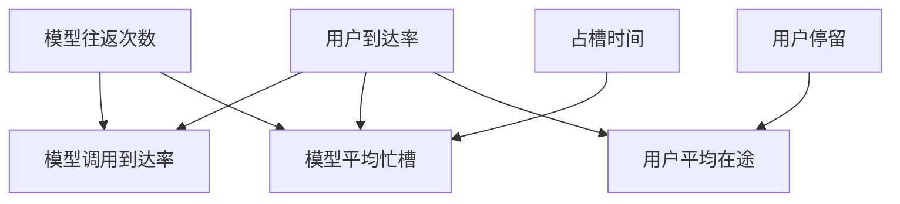

# 把用户到达率换算成模型忙槽

用户平均停留与模型平均占槽属于不同系统边界。
先将每请求模型轮数乘入模型到达率，再用稳定系统的平均关系计算在途量。
Little定律使用同一边界内的稳态平均量。
平均忙槽不能直接预测满足P99需要多少线程。

## 先解决一个具体问题

**用户侧平均在途 30，等于模型需要 30 个并发槽吗？**

先从用户到达率换成模型调用到达率，再乘模型实际持槽时间。用户平均停留则含排队、工具与输出。
用两个不同边界的平均数不能直接证明生产 P99。


先从具体的低档设定开始：用户到达率取 10请求每秒、模型往返次数取 2次、占槽时间取 150毫秒、用户停留取 900毫秒。
三个结果依次是模型调用到达率 20调用每秒、模型平均忙槽 3个、用户平均在途 9个。
先手算这个起点，读完后再把另一个输入切到高档，这样能知道数字变化时究竟改变了哪个假设。

## 先写清输入边界和三个观测量

用 a 表示用户到达率，取 10请求每秒 或 35请求每秒，这两点是用于隔离因果影响的教学输入。

用 b 表示模型往返次数，取 2次 或 4次，这两点是用于隔离因果影响的教学输入。

用 c 表示占槽时间，取 150毫秒 或 450毫秒，这两点是用于隔离因果影响的教学输入。

用 d 表示用户停留，取 900毫秒 或 1800毫秒，这两点是用于隔离因果影响的教学输入。

「模型调用到达率」的计算式为 `a*b`，按业务量展开是 `用户到达率×模型往返次数`，输出单位为调用每秒。

「模型平均忙槽」的计算式为 `a*b*c/1000`，按业务量展开是 `用户到达率×模型往返次数×占槽时间/1000`，输出单位为个。

「用户平均在途」的计算式为 `a*d/1000`，按业务量展开是 `用户到达率×用户停留/1000`，输出单位为个。

公式中 ceil 与 floor 分别向上、向下取整，% 在表达式中作取余，** 为乘方，三元条件按“条件 ? 成立值 : 其他值”读取。展示数值最多保留三位小数，比较和反推采用未舍入值。



图上的箭头表示该输入出现在计算式中。同一输入通向多个指标时，三个读数可能共同移动。分支、取整或相互抵消又会使某些边在具体样本上没有可见增量。

## 从输入按单位逐步算到可比较的结果

<details>
<summary>展开推演与对应反例</summary>

### 样本 0000：用户到达率 10、模型往返次数 2

这一组设定为用户到达率为 10请求每秒、模型往返次数为 2次、占槽时间为 150毫秒、用户停留为 900毫秒。

代入「模型调用到达率」：`10*2`，得到 20调用每秒。

代入「模型平均忙槽」：`10*2*150/1000`，得到 3个。

代入「用户平均在途」：`10*900/1000`，得到 9个。

以「模型平均忙槽」作主读数时，本组单独切换用户到达率的绝对变化最大或并列最大，读数会从 3个 变为 10.5个。

本组固定其余输入时，分别改变「用户停留」均不会改变 3个 这个主读数，是否影响另一指标仍需另算。

对角样本 1111 的主读数为 63个。它同时改了四项，差额不能充当任一单个因素的净收益。

### 样本 0001：用户到达率 10、模型往返次数 2

这一组设定为用户到达率为 10请求每秒、模型往返次数为 2次、占槽时间为 150毫秒、用户停留为 1800毫秒。


代入「用户平均在途」：`10*1800/1000`，得到 18个。


对角样本 1110 的主读数为 63个。它同时改了四项，差额不能充当任一单个因素的净收益。

### 样本 0010：用户到达率 10、模型往返次数 2

这一组设定为用户到达率为 10请求每秒、模型往返次数为 2次、占槽时间为 450毫秒、用户停留为 900毫秒。


代入「模型平均忙槽」：`10*2*450/1000`，得到 9个。


以「模型平均忙槽」作主读数时，本组单独切换用户到达率的绝对变化最大或并列最大，读数会从 9个 变为 31.5个。

本组固定其余输入时，分别改变「用户停留」均不会改变 9个 这个主读数，是否影响另一指标仍需另算。

对角样本 1101 的主读数为 21个。它同时改了四项，差额不能充当任一单个因素的净收益。

### 样本 0011：用户到达率 10、模型往返次数 2

这一组设定为用户到达率为 10请求每秒、模型往返次数为 2次、占槽时间为 450毫秒、用户停留为 1800毫秒。


对角样本 1100 的主读数为 21个。它同时改了四项，差额不能充当任一单个因素的净收益。

### 样本 0100：用户到达率 10、模型往返次数 4

这一组设定为用户到达率为 10请求每秒、模型往返次数为 4次、占槽时间为 150毫秒、用户停留为 900毫秒。

代入「模型调用到达率」：`10*4`，得到 40调用每秒。

代入「模型平均忙槽」：`10*4*150/1000`，得到 6个。


以「模型平均忙槽」作主读数时，本组单独切换用户到达率的绝对变化最大或并列最大，读数会从 6个 变为 21个。

本组固定其余输入时，分别改变「用户停留」均不会改变 6个 这个主读数，是否影响另一指标仍需另算。

对角样本 1011 的主读数为 31.5个。它同时改了四项，差额不能充当任一单个因素的净收益。

### 样本 0101：用户到达率 10、模型往返次数 4

这一组设定为用户到达率为 10请求每秒、模型往返次数为 4次、占槽时间为 150毫秒、用户停留为 1800毫秒。


对角样本 1010 的主读数为 31.5个。它同时改了四项，差额不能充当任一单个因素的净收益。

### 样本 0110：用户到达率 10、模型往返次数 4

这一组设定为用户到达率为 10请求每秒、模型往返次数为 4次、占槽时间为 450毫秒、用户停留为 900毫秒。


代入「模型平均忙槽」：`10*4*450/1000`，得到 18个。


以「模型平均忙槽」作主读数时，本组单独切换用户到达率的绝对变化最大或并列最大，读数会从 18个 变为 63个。

本组固定其余输入时，分别改变「用户停留」均不会改变 18个 这个主读数，是否影响另一指标仍需另算。

对角样本 1001 的主读数为 10.5个。它同时改了四项，差额不能充当任一单个因素的净收益。

### 样本 0111：用户到达率 10、模型往返次数 4

这一组设定为用户到达率为 10请求每秒、模型往返次数为 4次、占槽时间为 450毫秒、用户停留为 1800毫秒。


对角样本 1000 的主读数为 10.5个。它同时改了四项，差额不能充当任一单个因素的净收益。

### 样本 1000：用户到达率 35、模型往返次数 2

这一组设定为用户到达率为 35请求每秒、模型往返次数为 2次、占槽时间为 150毫秒、用户停留为 900毫秒。

代入「模型调用到达率」：`35*2`，得到 70调用每秒。

代入「模型平均忙槽」：`35*2*150/1000`，得到 10.5个。

代入「用户平均在途」：`35*900/1000`，得到 31.5个。

以「模型平均忙槽」作主读数时，本组单独切换占槽时间的绝对变化最大或并列最大，读数会从 10.5个 变为 31.5个。

本组固定其余输入时，分别改变「用户停留」均不会改变 10.5个 这个主读数，是否影响另一指标仍需另算。

对角样本 0111 的主读数为 18个。它同时改了四项，差额不能充当任一单个因素的净收益。

### 样本 1001：用户到达率 35、模型往返次数 2

这一组设定为用户到达率为 35请求每秒、模型往返次数为 2次、占槽时间为 150毫秒、用户停留为 1800毫秒。


代入「用户平均在途」：`35*1800/1000`，得到 63个。


对角样本 0110 的主读数为 18个。它同时改了四项，差额不能充当任一单个因素的净收益。

### 样本 1010：用户到达率 35、模型往返次数 2

这一组设定为用户到达率为 35请求每秒、模型往返次数为 2次、占槽时间为 450毫秒、用户停留为 900毫秒。


代入「模型平均忙槽」：`35*2*450/1000`，得到 31.5个。


以「模型平均忙槽」作主读数时，本组单独切换模型往返次数的绝对变化最大或并列最大，读数会从 31.5个 变为 63个。

本组固定其余输入时，分别改变「用户停留」均不会改变 31.5个 这个主读数，是否影响另一指标仍需另算。

对角样本 0101 的主读数为 6个。它同时改了四项，差额不能充当任一单个因素的净收益。

### 样本 1011：用户到达率 35、模型往返次数 2

这一组设定为用户到达率为 35请求每秒、模型往返次数为 2次、占槽时间为 450毫秒、用户停留为 1800毫秒。


对角样本 0100 的主读数为 6个。它同时改了四项，差额不能充当任一单个因素的净收益。

### 样本 1100：用户到达率 35、模型往返次数 4

这一组设定为用户到达率为 35请求每秒、模型往返次数为 4次、占槽时间为 150毫秒、用户停留为 900毫秒。

代入「模型调用到达率」：`35*4`，得到 140调用每秒。

代入「模型平均忙槽」：`35*4*150/1000`，得到 21个。


以「模型平均忙槽」作主读数时，本组单独切换占槽时间的绝对变化最大或并列最大，读数会从 21个 变为 63个。

本组固定其余输入时，分别改变「用户停留」均不会改变 21个 这个主读数，是否影响另一指标仍需另算。

对角样本 0011 的主读数为 9个。它同时改了四项，差额不能充当任一单个因素的净收益。

### 样本 1101：用户到达率 35、模型往返次数 4

这一组设定为用户到达率为 35请求每秒、模型往返次数为 4次、占槽时间为 150毫秒、用户停留为 1800毫秒。


对角样本 0010 的主读数为 9个。它同时改了四项，差额不能充当任一单个因素的净收益。

### 样本 1110：用户到达率 35、模型往返次数 4

这一组设定为用户到达率为 35请求每秒、模型往返次数为 4次、占槽时间为 450毫秒、用户停留为 900毫秒。


代入「模型平均忙槽」：`35*4*450/1000`，得到 63个。


以「模型平均忙槽」作主读数时，本组单独切换用户到达率的绝对变化最大或并列最大，读数会从 63个 变为 18个。

本组固定其余输入时，分别改变「用户停留」均不会改变 63个 这个主读数，是否影响另一指标仍需另算。

对角样本 0001 的主读数为 3个。它同时改了四项，差额不能充当任一单个因素的净收益。

### 样本 1111：用户到达率 35、模型往返次数 4

这一组设定为用户到达率为 35请求每秒、模型往返次数为 4次、占槽时间为 450毫秒、用户停留为 1800毫秒。


对角样本 0000 的主读数为 3个。它同时改了四项，差额不能充当任一单个因素的净收益。

</details>

## 逐个干预：其余条件固定时，变化真的发生在哪里

<details>
<summary>展开推演与对应反例</summary>

### 只改变用户到达率

固定模型往返次数为 2次、占槽时间为 150毫秒、用户停留为 900毫秒，只把用户到达率从 10请求每秒改到 35请求每秒。
这一对的模型调用到达率从 20调用每秒 变为 70调用每秒，模型平均忙槽的差为 7.5个，用户平均在途的差为 22.5个。

固定模型往返次数为 2次、占槽时间为 150毫秒、用户停留为 1800毫秒，只把用户到达率从 10请求每秒改到 35请求每秒。
这一对的模型调用到达率从 20调用每秒 变为 70调用每秒，模型平均忙槽的差为 7.5个，用户平均在途的差为 45个。

固定模型往返次数为 2次、占槽时间为 450毫秒、用户停留为 900毫秒，只把用户到达率从 10请求每秒改到 35请求每秒。
这一对的模型调用到达率从 20调用每秒 变为 70调用每秒，模型平均忙槽的差为 22.5个，用户平均在途的差为 22.5个。

固定模型往返次数为 2次、占槽时间为 450毫秒、用户停留为 1800毫秒，只把用户到达率从 10请求每秒改到 35请求每秒。
这一对的模型调用到达率从 20调用每秒 变为 70调用每秒，模型平均忙槽的差为 22.5个，用户平均在途的差为 45个。

固定模型往返次数为 4次、占槽时间为 150毫秒、用户停留为 900毫秒，只把用户到达率从 10请求每秒改到 35请求每秒。
这一对的模型调用到达率从 40调用每秒 变为 140调用每秒，模型平均忙槽的差为 15个，用户平均在途的差为 22.5个。

固定模型往返次数为 4次、占槽时间为 150毫秒、用户停留为 1800毫秒，只把用户到达率从 10请求每秒改到 35请求每秒。
这一对的模型调用到达率从 40调用每秒 变为 140调用每秒，模型平均忙槽的差为 15个，用户平均在途的差为 45个。

固定模型往返次数为 4次、占槽时间为 450毫秒、用户停留为 900毫秒，只把用户到达率从 10请求每秒改到 35请求每秒。
这一对的模型调用到达率从 40调用每秒 变为 140调用每秒，模型平均忙槽的差为 45个，用户平均在途的差为 22.5个。

固定模型往返次数为 4次、占槽时间为 450毫秒、用户停留为 1800毫秒，只把用户到达率从 10请求每秒改到 35请求每秒。
这一对的模型调用到达率从 40调用每秒 变为 140调用每秒，模型平均忙槽的差为 45个，用户平均在途的差为 45个。

综合八组受控背景，用户到达率升到较高设定时「模型调用到达率」的差值区间是 50调用每秒 至 100调用每秒，共有 8 对出现可观察变化。

综合八组受控背景，用户到达率升到较高设定时「模型平均忙槽」的差值区间是 7.5个 至 45个，共有 8 对出现可观察变化。

综合八组受控背景，用户到达率升到较高设定时「用户平均在途」的差值区间是 22.5个 至 45个，共有 8 对出现可观察变化。

### 只改变模型往返次数

固定用户到达率为 10请求每秒、占槽时间为 150毫秒、用户停留为 900毫秒，只把模型往返次数从 2次改到 4次。
这一对的模型调用到达率从 20调用每秒 变为 40调用每秒，模型平均忙槽的差为 3个，用户平均在途的差为 0个。

固定用户到达率为 10请求每秒、占槽时间为 150毫秒、用户停留为 1800毫秒，只把模型往返次数从 2次改到 4次。

固定用户到达率为 10请求每秒、占槽时间为 450毫秒、用户停留为 900毫秒，只把模型往返次数从 2次改到 4次。
这一对的模型调用到达率从 20调用每秒 变为 40调用每秒，模型平均忙槽的差为 9个，用户平均在途的差为 0个。

固定用户到达率为 10请求每秒、占槽时间为 450毫秒、用户停留为 1800毫秒，只把模型往返次数从 2次改到 4次。

固定用户到达率为 35请求每秒、占槽时间为 150毫秒、用户停留为 900毫秒，只把模型往返次数从 2次改到 4次。
这一对的模型调用到达率从 70调用每秒 变为 140调用每秒，模型平均忙槽的差为 10.5个，用户平均在途的差为 0个。

固定用户到达率为 35请求每秒、占槽时间为 150毫秒、用户停留为 1800毫秒，只把模型往返次数从 2次改到 4次。

固定用户到达率为 35请求每秒、占槽时间为 450毫秒、用户停留为 900毫秒，只把模型往返次数从 2次改到 4次。
这一对的模型调用到达率从 70调用每秒 变为 140调用每秒，模型平均忙槽的差为 31.5个，用户平均在途的差为 0个。

固定用户到达率为 35请求每秒、占槽时间为 450毫秒、用户停留为 1800毫秒，只把模型往返次数从 2次改到 4次。

综合八组受控背景，模型往返次数升到较高设定时「模型调用到达率」的差值区间是 20调用每秒 至 70调用每秒，共有 8 对出现可观察变化。

综合八组受控背景，模型往返次数升到较高设定时「模型平均忙槽」的差值区间是 3个 至 31.5个，共有 8 对出现可观察变化。

综合八组受控背景，模型往返次数升到较高设定时「用户平均在途」的差值区间是 0个，共有 0 对出现可观察变化。

### 只改变占槽时间

固定用户到达率为 10请求每秒、模型往返次数为 2次、用户停留为 900毫秒，只把占槽时间从 150毫秒改到 450毫秒。
这一对的模型调用到达率从 20调用每秒 变为 20调用每秒，模型平均忙槽的差为 6个，用户平均在途的差为 0个。

固定用户到达率为 10请求每秒、模型往返次数为 2次、用户停留为 1800毫秒，只把占槽时间从 150毫秒改到 450毫秒。

固定用户到达率为 10请求每秒、模型往返次数为 4次、用户停留为 900毫秒，只把占槽时间从 150毫秒改到 450毫秒。
这一对的模型调用到达率从 40调用每秒 变为 40调用每秒，模型平均忙槽的差为 12个，用户平均在途的差为 0个。

固定用户到达率为 10请求每秒、模型往返次数为 4次、用户停留为 1800毫秒，只把占槽时间从 150毫秒改到 450毫秒。

固定用户到达率为 35请求每秒、模型往返次数为 2次、用户停留为 900毫秒，只把占槽时间从 150毫秒改到 450毫秒。
这一对的模型调用到达率从 70调用每秒 变为 70调用每秒，模型平均忙槽的差为 21个，用户平均在途的差为 0个。

固定用户到达率为 35请求每秒、模型往返次数为 2次、用户停留为 1800毫秒，只把占槽时间从 150毫秒改到 450毫秒。

固定用户到达率为 35请求每秒、模型往返次数为 4次、用户停留为 900毫秒，只把占槽时间从 150毫秒改到 450毫秒。
这一对的模型调用到达率从 140调用每秒 变为 140调用每秒，模型平均忙槽的差为 42个，用户平均在途的差为 0个。

固定用户到达率为 35请求每秒、模型往返次数为 4次、用户停留为 1800毫秒，只把占槽时间从 150毫秒改到 450毫秒。

综合八组受控背景，占槽时间升到较高设定时「模型调用到达率」的差值区间是 0调用每秒，共有 0 对出现可观察变化。

综合八组受控背景，占槽时间升到较高设定时「模型平均忙槽」的差值区间是 6个 至 42个，共有 8 对出现可观察变化。

综合八组受控背景，占槽时间升到较高设定时「用户平均在途」的差值区间是 0个，共有 0 对出现可观察变化。

### 只改变用户停留

固定用户到达率为 10请求每秒、模型往返次数为 2次、占槽时间为 150毫秒，只把用户停留从 900毫秒改到 1800毫秒。
这一对的模型调用到达率从 20调用每秒 变为 20调用每秒，模型平均忙槽的差为 0个，用户平均在途的差为 9个。

固定用户到达率为 10请求每秒、模型往返次数为 2次、占槽时间为 450毫秒，只把用户停留从 900毫秒改到 1800毫秒。

固定用户到达率为 10请求每秒、模型往返次数为 4次、占槽时间为 150毫秒，只把用户停留从 900毫秒改到 1800毫秒。
这一对的模型调用到达率从 40调用每秒 变为 40调用每秒，模型平均忙槽的差为 0个，用户平均在途的差为 9个。

固定用户到达率为 10请求每秒、模型往返次数为 4次、占槽时间为 450毫秒，只把用户停留从 900毫秒改到 1800毫秒。

固定用户到达率为 35请求每秒、模型往返次数为 2次、占槽时间为 150毫秒，只把用户停留从 900毫秒改到 1800毫秒。
这一对的模型调用到达率从 70调用每秒 变为 70调用每秒，模型平均忙槽的差为 0个，用户平均在途的差为 31.5个。

固定用户到达率为 35请求每秒、模型往返次数为 2次、占槽时间为 450毫秒，只把用户停留从 900毫秒改到 1800毫秒。

固定用户到达率为 35请求每秒、模型往返次数为 4次、占槽时间为 150毫秒，只把用户停留从 900毫秒改到 1800毫秒。
这一对的模型调用到达率从 140调用每秒 变为 140调用每秒，模型平均忙槽的差为 0个，用户平均在途的差为 31.5个。

固定用户到达率为 35请求每秒、模型往返次数为 4次、占槽时间为 450毫秒，只把用户停留从 900毫秒改到 1800毫秒。

综合八组受控背景，用户停留升到较高设定时「模型调用到达率」的差值区间是 0调用每秒，共有 0 对出现可观察变化。

综合八组受控背景，用户停留升到较高设定时「模型平均忙槽」的差值区间是 0个，共有 0 对出现可观察变化。

综合八组受控背景，用户停留升到较高设定时「用户平均在途」的差值区间是 9个 至 31.5个，共有 8 对出现可观察变化。

</details>

## 只拿到部分输入，结论还能缩小到多大范围

<details>
<summary>展开推演与对应反例</summary>

### 已知用户到达率和模型往返次数

当用户到达率为 10请求每秒、模型往返次数为 2次时，另两项有四种补全，主读数「模型平均忙槽」只能限定为 3个 至 9个。
这个条件下，取占槽时间为 150毫秒、用户停留为 900毫秒可得到下界 3个，取占槽时间为 450毫秒、用户停留为 900毫秒可达到上界 9个。

用同样可见的用户到达率为 10请求每秒、模型往返次数为 2次去推「模型调用到达率」，能得到的范围为 20调用每秒，不能把另一个指标的单位代入。

用同样可见的用户到达率为 10请求每秒、模型往返次数为 2次去推「用户平均在途」，能得到的范围为 9个 至 18个，不能把另一个指标的单位代入。

若只许再问一项，按最坏区间宽度优先核对占槽时间，补得低档时为 3个，高档时为 9个。

当用户到达率为 10请求每秒、模型往返次数为 4次时，另两项有四种补全，主读数「模型平均忙槽」只能限定为 6个 至 18个。
这个条件下，取占槽时间为 150毫秒、用户停留为 900毫秒可得到下界 6个，取占槽时间为 450毫秒、用户停留为 900毫秒可达到上界 18个。

用同样可见的用户到达率为 10请求每秒、模型往返次数为 4次去推「模型调用到达率」，能得到的范围为 40调用每秒，不能把另一个指标的单位代入。

用同样可见的用户到达率为 10请求每秒、模型往返次数为 4次去推「用户平均在途」，能得到的范围为 9个 至 18个，不能把另一个指标的单位代入。

若只许再问一项，按最坏区间宽度优先核对占槽时间，补得低档时为 6个，高档时为 18个。

当用户到达率为 35请求每秒、模型往返次数为 2次时，另两项有四种补全，主读数「模型平均忙槽」只能限定为 10.5个 至 31.5个。
这个条件下，取占槽时间为 150毫秒、用户停留为 900毫秒可得到下界 10.5个，取占槽时间为 450毫秒、用户停留为 900毫秒可达到上界 31.5个。

用同样可见的用户到达率为 35请求每秒、模型往返次数为 2次去推「模型调用到达率」，能得到的范围为 70调用每秒，不能把另一个指标的单位代入。

用同样可见的用户到达率为 35请求每秒、模型往返次数为 2次去推「用户平均在途」，能得到的范围为 31.5个 至 63个，不能把另一个指标的单位代入。

若只许再问一项，按最坏区间宽度优先核对占槽时间，补得低档时为 10.5个，高档时为 31.5个。

当用户到达率为 35请求每秒、模型往返次数为 4次时，另两项有四种补全，主读数「模型平均忙槽」只能限定为 21个 至 63个。
这个条件下，取占槽时间为 150毫秒、用户停留为 900毫秒可得到下界 21个，取占槽时间为 450毫秒、用户停留为 900毫秒可达到上界 63个。

用同样可见的用户到达率为 35请求每秒、模型往返次数为 4次去推「模型调用到达率」，能得到的范围为 140调用每秒，不能把另一个指标的单位代入。

用同样可见的用户到达率为 35请求每秒、模型往返次数为 4次去推「用户平均在途」，能得到的范围为 31.5个 至 63个，不能把另一个指标的单位代入。

若只许再问一项，按最坏区间宽度优先核对占槽时间，补得低档时为 21个，高档时为 63个。

### 已知用户到达率和占槽时间

当用户到达率为 10请求每秒、占槽时间为 150毫秒时，另两项有四种补全，主读数「模型平均忙槽」只能限定为 3个 至 6个。
这个条件下，取模型往返次数为 2次、用户停留为 900毫秒可得到下界 3个，取模型往返次数为 4次、用户停留为 900毫秒可达到上界 6个。

用同样可见的用户到达率为 10请求每秒、占槽时间为 150毫秒去推「模型调用到达率」，能得到的范围为 20调用每秒 至 40调用每秒，不能把另一个指标的单位代入。

用同样可见的用户到达率为 10请求每秒、占槽时间为 150毫秒去推「用户平均在途」，能得到的范围为 9个 至 18个，不能把另一个指标的单位代入。

若只许再问一项，按最坏区间宽度优先核对模型往返次数，补得低档时为 3个，高档时为 6个。

当用户到达率为 10请求每秒、占槽时间为 450毫秒时，另两项有四种补全，主读数「模型平均忙槽」只能限定为 9个 至 18个。
这个条件下，取模型往返次数为 2次、用户停留为 900毫秒可得到下界 9个，取模型往返次数为 4次、用户停留为 900毫秒可达到上界 18个。

用同样可见的用户到达率为 10请求每秒、占槽时间为 450毫秒去推「模型调用到达率」，能得到的范围为 20调用每秒 至 40调用每秒，不能把另一个指标的单位代入。

用同样可见的用户到达率为 10请求每秒、占槽时间为 450毫秒去推「用户平均在途」，能得到的范围为 9个 至 18个，不能把另一个指标的单位代入。

若只许再问一项，按最坏区间宽度优先核对模型往返次数，补得低档时为 9个，高档时为 18个。

当用户到达率为 35请求每秒、占槽时间为 150毫秒时，另两项有四种补全，主读数「模型平均忙槽」只能限定为 10.5个 至 21个。
这个条件下，取模型往返次数为 2次、用户停留为 900毫秒可得到下界 10.5个，取模型往返次数为 4次、用户停留为 900毫秒可达到上界 21个。

用同样可见的用户到达率为 35请求每秒、占槽时间为 150毫秒去推「模型调用到达率」，能得到的范围为 70调用每秒 至 140调用每秒，不能把另一个指标的单位代入。

用同样可见的用户到达率为 35请求每秒、占槽时间为 150毫秒去推「用户平均在途」，能得到的范围为 31.5个 至 63个，不能把另一个指标的单位代入。

若只许再问一项，按最坏区间宽度优先核对模型往返次数，补得低档时为 10.5个，高档时为 21个。

当用户到达率为 35请求每秒、占槽时间为 450毫秒时，另两项有四种补全，主读数「模型平均忙槽」只能限定为 31.5个 至 63个。
这个条件下，取模型往返次数为 2次、用户停留为 900毫秒可得到下界 31.5个，取模型往返次数为 4次、用户停留为 900毫秒可达到上界 63个。

用同样可见的用户到达率为 35请求每秒、占槽时间为 450毫秒去推「模型调用到达率」，能得到的范围为 70调用每秒 至 140调用每秒，不能把另一个指标的单位代入。

用同样可见的用户到达率为 35请求每秒、占槽时间为 450毫秒去推「用户平均在途」，能得到的范围为 31.5个 至 63个，不能把另一个指标的单位代入。

若只许再问一项，按最坏区间宽度优先核对模型往返次数，补得低档时为 31.5个，高档时为 63个。

### 已知模型往返次数和占槽时间

当模型往返次数为 2次、占槽时间为 150毫秒时，另两项有四种补全，主读数「模型平均忙槽」只能限定为 3个 至 10.5个。
这个条件下，取用户到达率为 10请求每秒、用户停留为 900毫秒可得到下界 3个，取用户到达率为 35请求每秒、用户停留为 900毫秒可达到上界 10.5个。

用同样可见的模型往返次数为 2次、占槽时间为 150毫秒去推「模型调用到达率」，能得到的范围为 20调用每秒 至 70调用每秒，不能把另一个指标的单位代入。

用同样可见的模型往返次数为 2次、占槽时间为 150毫秒去推「用户平均在途」，能得到的范围为 9个 至 63个，不能把另一个指标的单位代入。

若只许再问一项，按最坏区间宽度优先核对用户到达率，补得低档时为 3个，高档时为 10.5个。

当模型往返次数为 2次、占槽时间为 450毫秒时，另两项有四种补全，主读数「模型平均忙槽」只能限定为 9个 至 31.5个。
这个条件下，取用户到达率为 10请求每秒、用户停留为 900毫秒可得到下界 9个，取用户到达率为 35请求每秒、用户停留为 900毫秒可达到上界 31.5个。

用同样可见的模型往返次数为 2次、占槽时间为 450毫秒去推「模型调用到达率」，能得到的范围为 20调用每秒 至 70调用每秒，不能把另一个指标的单位代入。

用同样可见的模型往返次数为 2次、占槽时间为 450毫秒去推「用户平均在途」，能得到的范围为 9个 至 63个，不能把另一个指标的单位代入。

若只许再问一项，按最坏区间宽度优先核对用户到达率，补得低档时为 9个，高档时为 31.5个。

当模型往返次数为 4次、占槽时间为 150毫秒时，另两项有四种补全，主读数「模型平均忙槽」只能限定为 6个 至 21个。
这个条件下，取用户到达率为 10请求每秒、用户停留为 900毫秒可得到下界 6个，取用户到达率为 35请求每秒、用户停留为 900毫秒可达到上界 21个。

用同样可见的模型往返次数为 4次、占槽时间为 150毫秒去推「模型调用到达率」，能得到的范围为 40调用每秒 至 140调用每秒，不能把另一个指标的单位代入。

用同样可见的模型往返次数为 4次、占槽时间为 150毫秒去推「用户平均在途」，能得到的范围为 9个 至 63个，不能把另一个指标的单位代入。

若只许再问一项，按最坏区间宽度优先核对用户到达率，补得低档时为 6个，高档时为 21个。

当模型往返次数为 4次、占槽时间为 450毫秒时，另两项有四种补全，主读数「模型平均忙槽」只能限定为 18个 至 63个。
这个条件下，取用户到达率为 10请求每秒、用户停留为 900毫秒可得到下界 18个，取用户到达率为 35请求每秒、用户停留为 900毫秒可达到上界 63个。

用同样可见的模型往返次数为 4次、占槽时间为 450毫秒去推「模型调用到达率」，能得到的范围为 40调用每秒 至 140调用每秒，不能把另一个指标的单位代入。

用同样可见的模型往返次数为 4次、占槽时间为 450毫秒去推「用户平均在途」，能得到的范围为 9个 至 63个，不能把另一个指标的单位代入。

若只许再问一项，按最坏区间宽度优先核对用户到达率，补得低档时为 18个，高档时为 63个。

### 已知用户到达率和用户停留

当用户到达率为 10请求每秒、用户停留为 900毫秒时，另两项有四种补全，主读数「模型平均忙槽」只能限定为 3个 至 18个。
这个条件下，取模型往返次数为 2次、占槽时间为 150毫秒可得到下界 3个，取模型往返次数为 4次、占槽时间为 450毫秒可达到上界 18个。

用同样可见的用户到达率为 10请求每秒、用户停留为 900毫秒去推「模型调用到达率」，能得到的范围为 20调用每秒 至 40调用每秒，不能把另一个指标的单位代入。

用同样可见的用户到达率为 10请求每秒、用户停留为 900毫秒去推「用户平均在途」，能得到的范围为 9个，不能把另一个指标的单位代入。

若只许再问一项，按最坏区间宽度优先核对占槽时间，补得低档时为 3个 至 6个，高档时为 9个 至 18个。

当用户到达率为 10请求每秒、用户停留为 1800毫秒时，另两项有四种补全，主读数「模型平均忙槽」只能限定为 3个 至 18个。

用同样可见的用户到达率为 10请求每秒、用户停留为 1800毫秒去推「模型调用到达率」，能得到的范围为 20调用每秒 至 40调用每秒，不能把另一个指标的单位代入。

用同样可见的用户到达率为 10请求每秒、用户停留为 1800毫秒去推「用户平均在途」，能得到的范围为 18个，不能把另一个指标的单位代入。


当用户到达率为 35请求每秒、用户停留为 900毫秒时，另两项有四种补全，主读数「模型平均忙槽」只能限定为 10.5个 至 63个。
这个条件下，取模型往返次数为 2次、占槽时间为 150毫秒可得到下界 10.5个，取模型往返次数为 4次、占槽时间为 450毫秒可达到上界 63个。

用同样可见的用户到达率为 35请求每秒、用户停留为 900毫秒去推「模型调用到达率」，能得到的范围为 70调用每秒 至 140调用每秒，不能把另一个指标的单位代入。

用同样可见的用户到达率为 35请求每秒、用户停留为 900毫秒去推「用户平均在途」，能得到的范围为 31.5个，不能把另一个指标的单位代入。

若只许再问一项，按最坏区间宽度优先核对占槽时间，补得低档时为 10.5个 至 21个，高档时为 31.5个 至 63个。

当用户到达率为 35请求每秒、用户停留为 1800毫秒时，另两项有四种补全，主读数「模型平均忙槽」只能限定为 10.5个 至 63个。

用同样可见的用户到达率为 35请求每秒、用户停留为 1800毫秒去推「模型调用到达率」，能得到的范围为 70调用每秒 至 140调用每秒，不能把另一个指标的单位代入。

用同样可见的用户到达率为 35请求每秒、用户停留为 1800毫秒去推「用户平均在途」，能得到的范围为 63个，不能把另一个指标的单位代入。


### 已知模型往返次数和用户停留

当模型往返次数为 2次、用户停留为 900毫秒时，另两项有四种补全，主读数「模型平均忙槽」只能限定为 3个 至 31.5个。
这个条件下，取用户到达率为 10请求每秒、占槽时间为 150毫秒可得到下界 3个，取用户到达率为 35请求每秒、占槽时间为 450毫秒可达到上界 31.5个。

用同样可见的模型往返次数为 2次、用户停留为 900毫秒去推「模型调用到达率」，能得到的范围为 20调用每秒 至 70调用每秒，不能把另一个指标的单位代入。

用同样可见的模型往返次数为 2次、用户停留为 900毫秒去推「用户平均在途」，能得到的范围为 9个 至 31.5个，不能把另一个指标的单位代入。

若只许再问一项，按最坏区间宽度优先核对用户到达率，补得低档时为 3个 至 9个，高档时为 10.5个 至 31.5个。

当模型往返次数为 2次、用户停留为 1800毫秒时，另两项有四种补全，主读数「模型平均忙槽」只能限定为 3个 至 31.5个。

用同样可见的模型往返次数为 2次、用户停留为 1800毫秒去推「模型调用到达率」，能得到的范围为 20调用每秒 至 70调用每秒，不能把另一个指标的单位代入。

用同样可见的模型往返次数为 2次、用户停留为 1800毫秒去推「用户平均在途」，能得到的范围为 18个 至 63个，不能把另一个指标的单位代入。


当模型往返次数为 4次、用户停留为 900毫秒时，另两项有四种补全，主读数「模型平均忙槽」只能限定为 6个 至 63个。
这个条件下，取用户到达率为 10请求每秒、占槽时间为 150毫秒可得到下界 6个，取用户到达率为 35请求每秒、占槽时间为 450毫秒可达到上界 63个。

用同样可见的模型往返次数为 4次、用户停留为 900毫秒去推「模型调用到达率」，能得到的范围为 40调用每秒 至 140调用每秒，不能把另一个指标的单位代入。

用同样可见的模型往返次数为 4次、用户停留为 900毫秒去推「用户平均在途」，能得到的范围为 9个 至 31.5个，不能把另一个指标的单位代入。

若只许再问一项，按最坏区间宽度优先核对用户到达率，补得低档时为 6个 至 18个，高档时为 21个 至 63个。

当模型往返次数为 4次、用户停留为 1800毫秒时，另两项有四种补全，主读数「模型平均忙槽」只能限定为 6个 至 63个。

用同样可见的模型往返次数为 4次、用户停留为 1800毫秒去推「模型调用到达率」，能得到的范围为 40调用每秒 至 140调用每秒，不能把另一个指标的单位代入。

用同样可见的模型往返次数为 4次、用户停留为 1800毫秒去推「用户平均在途」，能得到的范围为 18个 至 63个，不能把另一个指标的单位代入。


### 已知占槽时间和用户停留

当占槽时间为 150毫秒、用户停留为 900毫秒时，另两项有四种补全，主读数「模型平均忙槽」只能限定为 3个 至 21个。
这个条件下，取用户到达率为 10请求每秒、模型往返次数为 2次可得到下界 3个，取用户到达率为 35请求每秒、模型往返次数为 4次可达到上界 21个。

用同样可见的占槽时间为 150毫秒、用户停留为 900毫秒去推「模型调用到达率」，能得到的范围为 20调用每秒 至 140调用每秒，不能把另一个指标的单位代入。

用同样可见的占槽时间为 150毫秒、用户停留为 900毫秒去推「用户平均在途」，能得到的范围为 9个 至 31.5个，不能把另一个指标的单位代入。

若只许再问一项，按最坏区间宽度优先核对用户到达率，补得低档时为 3个 至 6个，高档时为 10.5个 至 21个。

当占槽时间为 150毫秒、用户停留为 1800毫秒时，另两项有四种补全，主读数「模型平均忙槽」只能限定为 3个 至 21个。

用同样可见的占槽时间为 150毫秒、用户停留为 1800毫秒去推「模型调用到达率」，能得到的范围为 20调用每秒 至 140调用每秒，不能把另一个指标的单位代入。

用同样可见的占槽时间为 150毫秒、用户停留为 1800毫秒去推「用户平均在途」，能得到的范围为 18个 至 63个，不能把另一个指标的单位代入。


当占槽时间为 450毫秒、用户停留为 900毫秒时，另两项有四种补全，主读数「模型平均忙槽」只能限定为 9个 至 63个。
这个条件下，取用户到达率为 10请求每秒、模型往返次数为 2次可得到下界 9个，取用户到达率为 35请求每秒、模型往返次数为 4次可达到上界 63个。

用同样可见的占槽时间为 450毫秒、用户停留为 900毫秒去推「模型调用到达率」，能得到的范围为 20调用每秒 至 140调用每秒，不能把另一个指标的单位代入。

用同样可见的占槽时间为 450毫秒、用户停留为 900毫秒去推「用户平均在途」，能得到的范围为 9个 至 31.5个，不能把另一个指标的单位代入。

若只许再问一项，按最坏区间宽度优先核对用户到达率，补得低档时为 9个 至 18个，高档时为 31.5个 至 63个。

当占槽时间为 450毫秒、用户停留为 1800毫秒时，另两项有四种补全，主读数「模型平均忙槽」只能限定为 9个 至 63个。

用同样可见的占槽时间为 450毫秒、用户停留为 1800毫秒去推「模型调用到达率」，能得到的范围为 20调用每秒 至 140调用每秒，不能把另一个指标的单位代入。

用同样可见的占槽时间为 450毫秒、用户停留为 1800毫秒去推「用户平均在途」，能得到的范围为 18个 至 63个，不能把另一个指标的单位代入。


</details>

## 反过来审查一份报表：能从结果还原哪些输入

<details>
<summary>展开推演与对应反例</summary>

### 仅保留“模型调用到达率”的读数

报表只写「模型调用到达率=20调用每秒」时，在本实验的离散取值中有 4 组输入与之相容。

对这个 20调用每秒 的「模型调用到达率」读数，所有相容样本都要求用户到达率为 10请求每秒、模型往返次数为 2次。

只凭「模型调用到达率」的 20调用每秒 无法确定占槽时间：0000 与 0010 的取值分别为 150 和 450毫秒。

报表只写「模型调用到达率=40调用每秒」时，在本实验的离散取值中有 4 组输入与之相容。

对这个 40调用每秒 的「模型调用到达率」读数，所有相容样本都要求用户到达率为 10请求每秒、模型往返次数为 4次。

只凭「模型调用到达率」的 40调用每秒 无法确定占槽时间：0100 与 0110 的取值分别为 150 和 450毫秒。

报表只写「模型调用到达率=70调用每秒」时，在本实验的离散取值中有 4 组输入与之相容。

对这个 70调用每秒 的「模型调用到达率」读数，所有相容样本都要求用户到达率为 35请求每秒、模型往返次数为 2次。

只凭「模型调用到达率」的 70调用每秒 无法确定占槽时间：1000 与 1010 的取值分别为 150 和 450毫秒。

报表只写「模型调用到达率=140调用每秒」时，在本实验的离散取值中有 4 组输入与之相容。

对这个 140调用每秒 的「模型调用到达率」读数，所有相容样本都要求用户到达率为 35请求每秒、模型往返次数为 4次。

只凭「模型调用到达率」的 140调用每秒 无法确定占槽时间：1100 与 1110 的取值分别为 150 和 450毫秒。

### 仅保留“模型平均忙槽”的读数

报表只写「模型平均忙槽=3个」时，在本实验的离散取值中有 2 组输入与之相容。

对这个 3个 的「模型平均忙槽」读数，所有相容样本都要求用户到达率为 10请求每秒、模型往返次数为 2次、占槽时间为 150毫秒。

只凭「模型平均忙槽」的 3个 无法确定用户停留：0000 与 0001 的取值分别为 900 和 1800毫秒。

报表只写「模型平均忙槽=9个」时，在本实验的离散取值中有 2 组输入与之相容。

对这个 9个 的「模型平均忙槽」读数，所有相容样本都要求用户到达率为 10请求每秒、模型往返次数为 2次、占槽时间为 450毫秒。

只凭「模型平均忙槽」的 9个 无法确定用户停留：0010 与 0011 的取值分别为 900 和 1800毫秒。

报表只写「模型平均忙槽=6个」时，在本实验的离散取值中有 2 组输入与之相容。

对这个 6个 的「模型平均忙槽」读数，所有相容样本都要求用户到达率为 10请求每秒、模型往返次数为 4次、占槽时间为 150毫秒。

只凭「模型平均忙槽」的 6个 无法确定用户停留：0100 与 0101 的取值分别为 900 和 1800毫秒。

报表只写「模型平均忙槽=18个」时，在本实验的离散取值中有 2 组输入与之相容。

对这个 18个 的「模型平均忙槽」读数，所有相容样本都要求用户到达率为 10请求每秒、模型往返次数为 4次、占槽时间为 450毫秒。

只凭「模型平均忙槽」的 18个 无法确定用户停留：0110 与 0111 的取值分别为 900 和 1800毫秒。

报表只写「模型平均忙槽=10.5个」时，在本实验的离散取值中有 2 组输入与之相容。

对这个 10.5个 的「模型平均忙槽」读数，所有相容样本都要求用户到达率为 35请求每秒、模型往返次数为 2次、占槽时间为 150毫秒。

只凭「模型平均忙槽」的 10.5个 无法确定用户停留：1000 与 1001 的取值分别为 900 和 1800毫秒。

报表只写「模型平均忙槽=31.5个」时，在本实验的离散取值中有 2 组输入与之相容。

对这个 31.5个 的「模型平均忙槽」读数，所有相容样本都要求用户到达率为 35请求每秒、模型往返次数为 2次、占槽时间为 450毫秒。

只凭「模型平均忙槽」的 31.5个 无法确定用户停留：1010 与 1011 的取值分别为 900 和 1800毫秒。

报表只写「模型平均忙槽=21个」时，在本实验的离散取值中有 2 组输入与之相容。

对这个 21个 的「模型平均忙槽」读数，所有相容样本都要求用户到达率为 35请求每秒、模型往返次数为 4次、占槽时间为 150毫秒。

只凭「模型平均忙槽」的 21个 无法确定用户停留：1100 与 1101 的取值分别为 900 和 1800毫秒。

报表只写「模型平均忙槽=63个」时，在本实验的离散取值中有 2 组输入与之相容。

对这个 63个 的「模型平均忙槽」读数，所有相容样本都要求用户到达率为 35请求每秒、模型往返次数为 4次、占槽时间为 450毫秒。

只凭「模型平均忙槽」的 63个 无法确定用户停留：1110 与 1111 的取值分别为 900 和 1800毫秒。

### 仅保留“用户平均在途”的读数

报表只写「用户平均在途=9个」时，在本实验的离散取值中有 4 组输入与之相容。

对这个 9个 的「用户平均在途」读数，所有相容样本都要求用户到达率为 10请求每秒、用户停留为 900毫秒。

只凭「用户平均在途」的 9个 无法确定模型往返次数：0000 与 0100 的取值分别为 2 和 4次。

报表只写「用户平均在途=18个」时，在本实验的离散取值中有 4 组输入与之相容。

对这个 18个 的「用户平均在途」读数，所有相容样本都要求用户到达率为 10请求每秒、用户停留为 1800毫秒。

只凭「用户平均在途」的 18个 无法确定模型往返次数：0001 与 0101 的取值分别为 2 和 4次。

报表只写「用户平均在途=31.5个」时，在本实验的离散取值中有 4 组输入与之相容。

对这个 31.5个 的「用户平均在途」读数，所有相容样本都要求用户到达率为 35请求每秒、用户停留为 900毫秒。

只凭「用户平均在途」的 31.5个 无法确定模型往返次数：1000 与 1100 的取值分别为 2 和 4次。

报表只写「用户平均在途=63个」时，在本实验的离散取值中有 4 组输入与之相容。

对这个 63个 的「用户平均在途」读数，所有相容样本都要求用户到达率为 35请求每秒、用户停留为 1800毫秒。

只凭「用户平均在途」的 63个 无法确定模型往返次数：1001 与 1101 的取值分别为 2 和 4次。

</details>

## 给错误算法找反例，再给正确算法画使用边界

<details>
<summary>展开推演与对应反例</summary>

### 只拿用户到达率计算忙槽

把「模型平均忙槽」错写成 `a*c/1000`，在 16 组教学输入中有 16 组会与参照计算不同。

对于用户到达率为 10请求每秒、模型往返次数为 2次、占槽时间为 150毫秒、用户停留为 900毫秒，这个错误口径得 1.5个，参照式为 3个，偏差为 -1.5个。

对于用户到达率为 10请求每秒、模型往返次数为 2次、占槽时间为 150毫秒、用户停留为 1800毫秒，这个错误口径得 1.5个，参照式为 3个，偏差为 -1.5个。

对于用户到达率为 10请求每秒、模型往返次数为 2次、占槽时间为 450毫秒、用户停留为 900毫秒，这个错误口径得 4.5个，参照式为 9个，偏差为 -4.5个。

对于用户到达率为 10请求每秒、模型往返次数为 2次、占槽时间为 450毫秒、用户停留为 1800毫秒，这个错误口径得 4.5个，参照式为 9个，偏差为 -4.5个。

对于用户到达率为 10请求每秒、模型往返次数为 4次、占槽时间为 150毫秒、用户停留为 900毫秒，这个错误口径得 1.5个，参照式为 6个，偏差为 -4.5个。

对于用户到达率为 10请求每秒、模型往返次数为 4次、占槽时间为 150毫秒、用户停留为 1800毫秒，这个错误口径得 1.5个，参照式为 6个，偏差为 -4.5个。

对于用户到达率为 10请求每秒、模型往返次数为 4次、占槽时间为 450毫秒、用户停留为 900毫秒，这个错误口径得 4.5个，参照式为 18个，偏差为 -13.5个。

对于用户到达率为 10请求每秒、模型往返次数为 4次、占槽时间为 450毫秒、用户停留为 1800毫秒，这个错误口径得 4.5个，参照式为 18个，偏差为 -13.5个。

对于用户到达率为 35请求每秒、模型往返次数为 2次、占槽时间为 150毫秒、用户停留为 900毫秒，这个错误口径得 5.25个，参照式为 10.5个，偏差为 -5.25个。

对于用户到达率为 35请求每秒、模型往返次数为 2次、占槽时间为 150毫秒、用户停留为 1800毫秒，这个错误口径得 5.25个，参照式为 10.5个，偏差为 -5.25个。

对于用户到达率为 35请求每秒、模型往返次数为 2次、占槽时间为 450毫秒、用户停留为 900毫秒，这个错误口径得 15.75个，参照式为 31.5个，偏差为 -15.75个。

对于用户到达率为 35请求每秒、模型往返次数为 2次、占槽时间为 450毫秒、用户停留为 1800毫秒，这个错误口径得 15.75个，参照式为 31.5个，偏差为 -15.75个。

对于用户到达率为 35请求每秒、模型往返次数为 4次、占槽时间为 150毫秒、用户停留为 900毫秒，这个错误口径得 5.25个，参照式为 21个，偏差为 -15.75个。

对于用户到达率为 35请求每秒、模型往返次数为 4次、占槽时间为 150毫秒、用户停留为 1800毫秒，这个错误口径得 5.25个，参照式为 21个，偏差为 -15.75个。

对于用户到达率为 35请求每秒、模型往返次数为 4次、占槽时间为 450毫秒、用户停留为 900毫秒，这个错误口径得 15.75个，参照式为 63个，偏差为 -47.25个。

对于用户到达率为 35请求每秒、模型往返次数为 4次、占槽时间为 450毫秒、用户停留为 1800毫秒，这个错误口径得 15.75个，参照式为 63个，偏差为 -47.25个。

### 误把模型占槽时长替换为整个用户停留

把「模型平均忙槽」错写成 `a*b*d/1000`，在 16 组教学输入中有 16 组会与参照计算不同。

对于用户到达率为 10请求每秒、模型往返次数为 2次、占槽时间为 150毫秒、用户停留为 900毫秒，这个错误口径得 18个，参照式为 3个，偏差为 15个。

对于用户到达率为 10请求每秒、模型往返次数为 2次、占槽时间为 150毫秒、用户停留为 1800毫秒，这个错误口径得 36个，参照式为 3个，偏差为 33个。

对于用户到达率为 10请求每秒、模型往返次数为 2次、占槽时间为 450毫秒、用户停留为 900毫秒，这个错误口径得 18个，参照式为 9个，偏差为 9个。

对于用户到达率为 10请求每秒、模型往返次数为 2次、占槽时间为 450毫秒、用户停留为 1800毫秒，这个错误口径得 36个，参照式为 9个，偏差为 27个。

对于用户到达率为 10请求每秒、模型往返次数为 4次、占槽时间为 150毫秒、用户停留为 900毫秒，这个错误口径得 36个，参照式为 6个，偏差为 30个。

对于用户到达率为 10请求每秒、模型往返次数为 4次、占槽时间为 150毫秒、用户停留为 1800毫秒，这个错误口径得 72个，参照式为 6个，偏差为 66个。

对于用户到达率为 10请求每秒、模型往返次数为 4次、占槽时间为 450毫秒、用户停留为 900毫秒，这个错误口径得 36个，参照式为 18个，偏差为 18个。

对于用户到达率为 10请求每秒、模型往返次数为 4次、占槽时间为 450毫秒、用户停留为 1800毫秒，这个错误口径得 72个，参照式为 18个，偏差为 54个。

对于用户到达率为 35请求每秒、模型往返次数为 2次、占槽时间为 150毫秒、用户停留为 900毫秒，这个错误口径得 63个，参照式为 10.5个，偏差为 52.5个。

对于用户到达率为 35请求每秒、模型往返次数为 2次、占槽时间为 150毫秒、用户停留为 1800毫秒，这个错误口径得 126个，参照式为 10.5个，偏差为 115.5个。

对于用户到达率为 35请求每秒、模型往返次数为 2次、占槽时间为 450毫秒、用户停留为 900毫秒，这个错误口径得 63个，参照式为 31.5个，偏差为 31.5个。

对于用户到达率为 35请求每秒、模型往返次数为 2次、占槽时间为 450毫秒、用户停留为 1800毫秒，这个错误口径得 126个，参照式为 31.5个，偏差为 94.5个。

对于用户到达率为 35请求每秒、模型往返次数为 4次、占槽时间为 150毫秒、用户停留为 900毫秒，这个错误口径得 126个，参照式为 21个，偏差为 105个。

对于用户到达率为 35请求每秒、模型往返次数为 4次、占槽时间为 150毫秒、用户停留为 1800毫秒，这个错误口径得 252个，参照式为 21个，偏差为 231个。

对于用户到达率为 35请求每秒、模型往返次数为 4次、占槽时间为 450毫秒、用户停留为 900毫秒，这个错误口径得 126个，参照式为 63个，偏差为 63个。

对于用户到达率为 35请求每秒、模型往返次数为 4次、占槽时间为 450毫秒、用户停留为 1800毫秒，这个错误口径得 252个，参照式为 63个，偏差为 189个。

</details>

## 从教学算例回到可验证的工程结论

要把这些数写入项目说明，先用真实输入替换教学常数，列明样本分母、实际资源限制和观测边界，再验证公式所需前提。两点敏感性只描述这两个设定之间的差异。

## 面试复述与复算

面试题可以从“用户侧平均在途 30，等于模型需要 30 个并发槽吗？”起步。先给出本篇的触发条件和一条真实执行端可检查的证据，再用一个相邻反例限定结论的适用范围。

在仓库根目录执行下列命令可以重算本篇的一个输入。四位数字依次选择正文列出的四项条件，0 表示未成立或低档，1 表示成立或高档。
```powershell
node examples/reading-cases/replay.mjs 10 6 0101
```

[本周主文](../theory.md) · [配套实验](../lab.md) · [下一篇研读](07.md)
