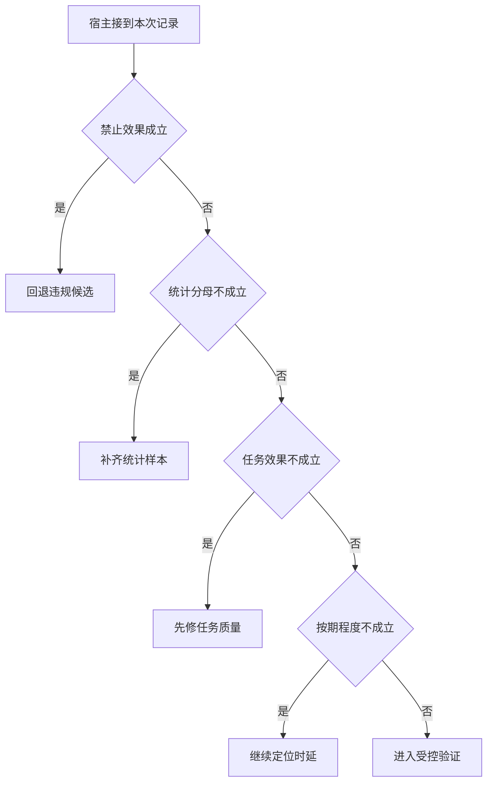

# 是否发布一次延迟优化

候选版本 P95 可能下降，却在首个流式片段承诺未经证实的“已提交”。
发布应同时看禁止效果、完整样本分母、正确完成及剩余保证。

本篇用一个封闭的教学决策器说明这一问题。输入是宿主收到的记录，不保证每个下游字段都已经获准使用。前置检查未成立时，下游即使带着缓存值，也不能拿来作业务断言。

## 先解决一个具体问题

**候选成功样本更快，为什么仍可能不发布？**

先核对违规副作用和漏报的失败，再看截止内正确完成率及任务分桶。
若流式提前产生无依据承诺，低 P95 只能说明错误发生得更快。


先取一个能走到「进入受控验证」的输入：没有观察到禁止效果、统计包含全部失败与尝试、外部后置条件成立、达成约定时间目标。
把这四个条件代回后文的图，前面各个拦截分支都未满足，最终才有“教学检查通过后再观察真实负载”这个判断。
还原这个现场时要分别问：哪些位来自可信状态，哪些只是在接口中出现、尚未获得解释资格的字段。

## 先沿一次决策走到底



从上到下取第一条成立的出口。只改一个开关时，只有它之前的检查都未截断，该变化才可能到达真实动作。

“禁止效果”的两种输入分别是“发生了禁止的副作用”与“没有观察到禁止效果”。
实际状态比模型的自我描述更能证明是否违规。

“统计分母”的两种输入分别是“统计包含全部失败与尝试”与“统计漏掉超时或失败”。
只测成功请求会产生样本选择偏差。

“任务效果”的两种输入分别是“外部后置条件成立”与“用户目标未达成”。
回复称已写入不能证明数据库真的发生变化。

“按期程度”的两种输入分别是“达成约定时间目标”与“已超过约定时限”。
正确且过期要与按时正确完成区分。

## 最少需要哪几项观察

### 回退违规候选

禁止效果不能由平均时延抵消。
在本节的全部组合中，有 8 种产生「回退违规候选」，这只是逻辑空间的计数，不能当作实际用户请求的比例。

只取得发生了禁止的副作用，已经足以要求宿主「回退违规候选」。
保持这些已知项，其余开关自由变化，仍有 8 种补全，判断没有翻转。

若删掉关于禁止效果的证据，另一份允许的现场是没有观察到禁止效果、统计漏掉超时或失败、用户目标未达成、已超过约定时限，它会使宿主「补齐统计样本」。

### 补齐统计样本

分母缺失使上线判断不可复核。
在本节的全部组合中，有 4 种产生「补齐统计样本」，这只是逻辑空间的计数，不能当作实际用户请求的比例。

只取得没有观察到禁止效果、统计漏掉超时或失败，已经足以要求宿主「补齐统计样本」。
保持这些已知项，其余开关自由变化，仍有 4 种补全，判断没有翻转。

若删掉关于禁止效果的证据，另一份允许的现场是发生了禁止的副作用、统计漏掉超时或失败、用户目标未达成、已超过约定时限，它会使宿主「回退违规候选」。

若删掉关于统计分母的证据，另一份允许的现场是没有观察到禁止效果、统计包含全部失败与尝试、用户目标未达成、已超过约定时限，它会使宿主「先修任务质量」。

### 先修任务质量

真实业务目标没有完成。
在本节的全部组合中，有 2 种产生「先修任务质量」，这只是逻辑空间的计数，不能当作实际用户请求的比例。

只取得没有观察到禁止效果、统计包含全部失败与尝试、用户目标未达成，已经足以要求宿主「先修任务质量」。
保持这些已知项，其余开关自由变化，仍有 2 种补全，判断没有翻转。

若删掉关于禁止效果的证据，另一份允许的现场是发生了禁止的副作用、统计包含全部失败与尝试、用户目标未达成、已超过约定时限，它会使宿主「回退违规候选」。

若删掉关于统计分母的证据，另一份允许的现场是没有观察到禁止效果、统计漏掉超时或失败、用户目标未达成、已超过约定时限，它会使宿主「补齐统计样本」。

若删掉关于任务效果的证据，另一份允许的现场是没有观察到禁止效果、统计包含全部失败与尝试、外部后置条件成立、已超过约定时限，它会使宿主「继续定位时延」。

### 继续定位时延

正确终态尚未按期达到。
在本节的全部组合中，有 1 种产生「继续定位时延」，这只是逻辑空间的计数，不能当作实际用户请求的比例。

只取得没有观察到禁止效果、统计包含全部失败与尝试、外部后置条件成立、已超过约定时限，已经足以要求宿主「继续定位时延」。
保持这些已知项，其余开关自由变化，仍有 1 种补全，判断没有翻转。

若删掉关于禁止效果的证据，另一份允许的现场是发生了禁止的副作用、统计包含全部失败与尝试、外部后置条件成立、已超过约定时限，它会使宿主「回退违规候选」。

若删掉关于统计分母的证据，另一份允许的现场是没有观察到禁止效果、统计漏掉超时或失败、外部后置条件成立、已超过约定时限，它会使宿主「补齐统计样本」。

若删掉关于任务效果的证据，另一份允许的现场是没有观察到禁止效果、统计包含全部失败与尝试、用户目标未达成、已超过约定时限，它会使宿主「先修任务质量」。

若删掉关于按期程度的证据，另一份允许的现场是没有观察到禁止效果、统计包含全部失败与尝试、外部后置条件成立、达成约定时间目标，它会使宿主「进入受控验证」。

### 进入受控验证

教学检查通过后再观察真实负载。
在本节的全部组合中，有 1 种产生「进入受控验证」，这只是逻辑空间的计数，不能当作实际用户请求的比例。

只取得没有观察到禁止效果、统计包含全部失败与尝试、外部后置条件成立、达成约定时间目标，已经足以要求宿主「进入受控验证」。

若删掉关于禁止效果的证据，另一份允许的现场是发生了禁止的副作用、统计包含全部失败与尝试、外部后置条件成立、达成约定时间目标，它会使宿主「回退违规候选」。

若删掉关于统计分母的证据，另一份允许的现场是没有观察到禁止效果、统计漏掉超时或失败、外部后置条件成立、达成约定时间目标，它会使宿主「补齐统计样本」。

若删掉关于任务效果的证据，另一份允许的现场是没有观察到禁止效果、统计包含全部失败与尝试、用户目标未达成、达成约定时间目标，它会使宿主「先修任务质量」。

若删掉关于按期程度的证据，另一份允许的现场是没有观察到禁止效果、统计包含全部失败与尝试、外部后置条件成立、已超过约定时限，它会使宿主「继续定位时延」。

## 以同一份契约解释截然不同的现场

<details>
<summary>展开推演与对应反例</summary>

下列样本按最先命中的业务分支排列。四位编码只作本篇页内定位，顺序与开头的四项输入一致。可以先猜下一动作，再展开相邻样本。

### 能够触发“回退违规候选”的现场

**样本 1000**

业务侧交来发生了禁止的副作用、统计漏掉超时或失败，执行侧还记录了用户目标未达成、已超过约定时限。
把样本压成最短证明，保留发生了禁止的副作用就能支持「回退违规候选」。

在这份记录上，分别翻转「禁止效果」中的任一项，其他项完全不变时，下一动作都会改变。

保持其余观察不动，单独切换「统计分母」、「任务效果」、「按期程度」仍得到「回退违规候选」，它们在这个现场不是决定性变量。

要从本例改走「补齐统计样本」，至少需要变动 1 项，一组最少改动是将发生了禁止的副作用换成没有观察到禁止效果。

要从本例改走「先修任务质量」，至少需要变动 2 项，一组最少改动是将发生了禁止的副作用、统计漏掉超时或失败换成没有观察到禁止效果、统计包含全部失败与尝试。

要从本例改走「继续定位时延」，至少需要变动 3 项，一组最少改动是将发生了禁止的副作用、统计漏掉超时或失败、用户目标未达成换成没有观察到禁止效果、统计包含全部失败与尝试、外部后置条件成立。

要从本例改走「进入受控验证」，至少需要变动 4 项，一组最少改动是将发生了禁止的副作用、统计漏掉超时或失败、用户目标未达成、已超过约定时限换成没有观察到禁止效果、统计包含全部失败与尝试、外部后置条件成立、达成约定时间目标。

**样本 1001**

业务侧交来发生了禁止的副作用、统计漏掉超时或失败，执行侧还记录了用户目标未达成、达成约定时间目标。


要从本例改走「进入受控验证」，至少需要变动 3 项，一组最少改动是将发生了禁止的副作用、统计漏掉超时或失败、用户目标未达成换成没有观察到禁止效果、统计包含全部失败与尝试、外部后置条件成立。

要从本例改走「继续定位时延」，至少需要变动 4 项，一组最少改动是将发生了禁止的副作用、统计漏掉超时或失败、用户目标未达成、达成约定时间目标换成没有观察到禁止效果、统计包含全部失败与尝试、外部后置条件成立、已超过约定时限。

**样本 1010**

业务侧交来发生了禁止的副作用、统计漏掉超时或失败，执行侧还记录了外部后置条件成立、已超过约定时限。


要从本例改走「继续定位时延」，至少需要变动 2 项，一组最少改动是将发生了禁止的副作用、统计漏掉超时或失败换成没有观察到禁止效果、统计包含全部失败与尝试。

要从本例改走「先修任务质量」，至少需要变动 3 项，一组最少改动是将发生了禁止的副作用、统计漏掉超时或失败、外部后置条件成立换成没有观察到禁止效果、统计包含全部失败与尝试、用户目标未达成。

要从本例改走「进入受控验证」，至少需要变动 3 项，一组最少改动是将发生了禁止的副作用、统计漏掉超时或失败、已超过约定时限换成没有观察到禁止效果、统计包含全部失败与尝试、达成约定时间目标。

**样本 1011**

业务侧交来发生了禁止的副作用、统计漏掉超时或失败，执行侧还记录了外部后置条件成立、达成约定时间目标。


要从本例改走「进入受控验证」，至少需要变动 2 项，一组最少改动是将发生了禁止的副作用、统计漏掉超时或失败换成没有观察到禁止效果、统计包含全部失败与尝试。


要从本例改走「继续定位时延」，至少需要变动 3 项，一组最少改动是将发生了禁止的副作用、统计漏掉超时或失败、达成约定时间目标换成没有观察到禁止效果、统计包含全部失败与尝试、已超过约定时限。

**样本 1100**

业务侧交来发生了禁止的副作用、统计包含全部失败与尝试，执行侧还记录了用户目标未达成、已超过约定时限。


要从本例改走「先修任务质量」，至少需要变动 1 项，一组最少改动是将发生了禁止的副作用换成没有观察到禁止效果。

要从本例改走「补齐统计样本」，至少需要变动 2 项，一组最少改动是将发生了禁止的副作用、统计包含全部失败与尝试换成没有观察到禁止效果、统计漏掉超时或失败。

要从本例改走「继续定位时延」，至少需要变动 2 项，一组最少改动是将发生了禁止的副作用、用户目标未达成换成没有观察到禁止效果、外部后置条件成立。

要从本例改走「进入受控验证」，至少需要变动 3 项，一组最少改动是将发生了禁止的副作用、用户目标未达成、已超过约定时限换成没有观察到禁止效果、外部后置条件成立、达成约定时间目标。

**样本 1101**

业务侧交来发生了禁止的副作用、统计包含全部失败与尝试，执行侧还记录了用户目标未达成、达成约定时间目标。


要从本例改走「进入受控验证」，至少需要变动 2 项，一组最少改动是将发生了禁止的副作用、用户目标未达成换成没有观察到禁止效果、外部后置条件成立。

要从本例改走「继续定位时延」，至少需要变动 3 项，一组最少改动是将发生了禁止的副作用、用户目标未达成、达成约定时间目标换成没有观察到禁止效果、外部后置条件成立、已超过约定时限。

**样本 1110**

业务侧交来发生了禁止的副作用、统计包含全部失败与尝试，执行侧还记录了外部后置条件成立、已超过约定时限。


要从本例改走「继续定位时延」，至少需要变动 1 项，一组最少改动是将发生了禁止的副作用换成没有观察到禁止效果。


要从本例改走「先修任务质量」，至少需要变动 2 项，一组最少改动是将发生了禁止的副作用、外部后置条件成立换成没有观察到禁止效果、用户目标未达成。

要从本例改走「进入受控验证」，至少需要变动 2 项，一组最少改动是将发生了禁止的副作用、已超过约定时限换成没有观察到禁止效果、达成约定时间目标。

**样本 1111**

业务侧交来发生了禁止的副作用、统计包含全部失败与尝试，执行侧还记录了外部后置条件成立、达成约定时间目标。


要从本例改走「进入受控验证」，至少需要变动 1 项，一组最少改动是将发生了禁止的副作用换成没有观察到禁止效果。


要从本例改走「继续定位时延」，至少需要变动 2 项，一组最少改动是将发生了禁止的副作用、达成约定时间目标换成没有观察到禁止效果、已超过约定时限。

### 能够触发“补齐统计样本”的现场

**样本 0000**

业务侧交来没有观察到禁止效果、统计漏掉超时或失败，执行侧还记录了用户目标未达成、已超过约定时限。
把样本压成最短证明，保留没有观察到禁止效果、统计漏掉超时或失败就能支持「补齐统计样本」。

在这份记录上，分别翻转「禁止效果」、「统计分母」中的任一项，其他项完全不变时，下一动作都会改变。

保持其余观察不动，单独切换「任务效果」、「按期程度」仍得到「补齐统计样本」，它们在这个现场不是决定性变量。

本例没走更靠前的「回退违规候选」，因为没有观察到禁止效果与那个入口的必要条件不符。

要从本例改走「先修任务质量」，至少需要变动 1 项，一组最少改动是将统计漏掉超时或失败换成统计包含全部失败与尝试。

要从本例改走「回退违规候选」，至少需要变动 1 项，一组最少改动是将没有观察到禁止效果换成发生了禁止的副作用。

要从本例改走「继续定位时延」，至少需要变动 2 项，一组最少改动是将统计漏掉超时或失败、用户目标未达成换成统计包含全部失败与尝试、外部后置条件成立。

要从本例改走「进入受控验证」，至少需要变动 3 项，一组最少改动是将统计漏掉超时或失败、用户目标未达成、已超过约定时限换成统计包含全部失败与尝试、外部后置条件成立、达成约定时间目标。

**样本 0001**

业务侧交来没有观察到禁止效果、统计漏掉超时或失败，执行侧还记录了用户目标未达成、达成约定时间目标。


要从本例改走「进入受控验证」，至少需要变动 2 项，一组最少改动是将统计漏掉超时或失败、用户目标未达成换成统计包含全部失败与尝试、外部后置条件成立。

要从本例改走「继续定位时延」，至少需要变动 3 项，一组最少改动是将统计漏掉超时或失败、用户目标未达成、达成约定时间目标换成统计包含全部失败与尝试、外部后置条件成立、已超过约定时限。

**样本 0010**

业务侧交来没有观察到禁止效果、统计漏掉超时或失败，执行侧还记录了外部后置条件成立、已超过约定时限。


要从本例改走「继续定位时延」，至少需要变动 1 项，一组最少改动是将统计漏掉超时或失败换成统计包含全部失败与尝试。


要从本例改走「先修任务质量」，至少需要变动 2 项，一组最少改动是将统计漏掉超时或失败、外部后置条件成立换成统计包含全部失败与尝试、用户目标未达成。

要从本例改走「进入受控验证」，至少需要变动 2 项，一组最少改动是将统计漏掉超时或失败、已超过约定时限换成统计包含全部失败与尝试、达成约定时间目标。

**样本 0011**

业务侧交来没有观察到禁止效果、统计漏掉超时或失败，执行侧还记录了外部后置条件成立、达成约定时间目标。


要从本例改走「进入受控验证」，至少需要变动 1 项，一组最少改动是将统计漏掉超时或失败换成统计包含全部失败与尝试。


要从本例改走「继续定位时延」，至少需要变动 2 项，一组最少改动是将统计漏掉超时或失败、达成约定时间目标换成统计包含全部失败与尝试、已超过约定时限。

### 能够触发“先修任务质量”的现场

**样本 0100**

业务侧交来没有观察到禁止效果、统计包含全部失败与尝试，执行侧还记录了用户目标未达成、已超过约定时限。
把样本压成最短证明，保留没有观察到禁止效果、统计包含全部失败与尝试、用户目标未达成就能支持「先修任务质量」。

在这份记录上，分别翻转「禁止效果」、「统计分母」、「任务效果」中的任一项，其他项完全不变时，下一动作都会改变。

保持其余观察不动，单独切换「按期程度」仍得到「先修任务质量」，它们在这个现场不是决定性变量。


本例没走更靠前的「补齐统计样本」，因为统计包含全部失败与尝试与那个入口的必要条件不符。

要从本例改走「补齐统计样本」，至少需要变动 1 项，一组最少改动是将统计包含全部失败与尝试换成统计漏掉超时或失败。

要从本例改走「继续定位时延」，至少需要变动 1 项，一组最少改动是将用户目标未达成换成外部后置条件成立。


要从本例改走「进入受控验证」，至少需要变动 2 项，一组最少改动是将用户目标未达成、已超过约定时限换成外部后置条件成立、达成约定时间目标。

**样本 0101**

业务侧交来没有观察到禁止效果、统计包含全部失败与尝试，执行侧还记录了用户目标未达成、达成约定时间目标。


要从本例改走「进入受控验证」，至少需要变动 1 项，一组最少改动是将用户目标未达成换成外部后置条件成立。


要从本例改走「继续定位时延」，至少需要变动 2 项，一组最少改动是将用户目标未达成、达成约定时间目标换成外部后置条件成立、已超过约定时限。

### 能够触发“继续定位时延”的现场

**样本 0110**

业务侧交来没有观察到禁止效果、统计包含全部失败与尝试，执行侧还记录了外部后置条件成立、已超过约定时限。
把样本压成最短证明，保留没有观察到禁止效果、统计包含全部失败与尝试、外部后置条件成立、已超过约定时限就能支持「继续定位时延」。

在这份记录上，分别翻转「禁止效果」、「统计分母」、「任务效果」、「按期程度」中的任一项，其他项完全不变时，下一动作都会改变。


本例没走更靠前的「先修任务质量」，因为外部后置条件成立与那个入口的必要条件不符。


要从本例改走「先修任务质量」，至少需要变动 1 项，一组最少改动是将外部后置条件成立换成用户目标未达成。

要从本例改走「进入受控验证」，至少需要变动 1 项，一组最少改动是将已超过约定时限换成达成约定时间目标。


### 能够触发“进入受控验证”的现场

**样本 0111**

业务侧交来没有观察到禁止效果、统计包含全部失败与尝试，执行侧还记录了外部后置条件成立、达成约定时间目标。
把样本压成最短证明，保留没有观察到禁止效果、统计包含全部失败与尝试、外部后置条件成立、达成约定时间目标就能支持「进入受控验证」。


本例没走更靠前的「继续定位时延」，因为达成约定时间目标与那个入口的必要条件不符。


要从本例改走「继续定位时延」，至少需要变动 1 项，一组最少改动是将达成约定时间目标换成已超过约定时限。


</details>

## 当你只能看见一半记录

<details>
<summary>展开推演与对应反例</summary>

这次隐藏两个字段，保留另两个。对每个可见现场，检查四种合法补全是否同意。如仍有歧义，选择能使最坏剩余候选动作最少的字段继续查。并列时采用本篇字段顺序。

### 只保留禁止效果与统计分母

已知没有观察到禁止效果、统计漏掉超时或失败时，四种补全的动作分布为补齐统计样本（4 种）。

就“补齐统计样本”这个动作而言，在没有观察到禁止效果、统计漏掉超时或失败的前提下，另外两项观察不会推翻它。

已知没有观察到禁止效果、统计包含全部失败与尝试时，四种补全的动作分布为先修任务质量（2 种）、继续定位时延（1 种）、进入受控验证（1 种）。

在没有观察到禁止效果、统计包含全部失败与尝试这个现场补读「任务效果」，最坏还剩 2 种动作，计算时只衡量歧义，尚未扣读取代价。
若补来的观察为“用户目标未达成”，范围缩成「先修任务质量」。若为“外部后置条件成立”，则保留「继续定位时延」、「进入受控验证」。

区分不了的两条执行可以具体写成 0100 与 0110：它们共享已展示字段，却分别需要「先修任务质量」和「继续定位时延」。

已知发生了禁止的副作用、统计漏掉超时或失败时，四种补全的动作分布为回退违规候选（4 种）。

就“回退违规候选”这个动作而言，在发生了禁止的副作用、统计漏掉超时或失败的前提下，另外两项观察不会推翻它。

已知发生了禁止的副作用、统计包含全部失败与尝试时，四种补全的动作分布为回退违规候选（4 种）。

就“回退违规候选”这个动作而言，在发生了禁止的副作用、统计包含全部失败与尝试的前提下，另外两项观察不会推翻它。

### 只保留禁止效果与任务效果

已知没有观察到禁止效果、用户目标未达成时，四种补全的动作分布为补齐统计样本（2 种）、先修任务质量（2 种）。

在没有观察到禁止效果、用户目标未达成这个现场补读「统计分母」，最坏还剩 1 种动作，计算时只衡量歧义，尚未扣读取代价。
若补来的观察为“统计漏掉超时或失败”，范围缩成「补齐统计样本」。若为“统计包含全部失败与尝试”，则保留「先修任务质量」。

区分不了的两条执行可以具体写成 0000 与 0100：它们共享已展示字段，却分别需要「补齐统计样本」和「先修任务质量」。

已知没有观察到禁止效果、外部后置条件成立时，四种补全的动作分布为补齐统计样本（2 种）、继续定位时延（1 种）、进入受控验证（1 种）。

在没有观察到禁止效果、外部后置条件成立这个现场补读「统计分母」，最坏还剩 2 种动作，计算时只衡量歧义，尚未扣读取代价。
若补来的观察为“统计漏掉超时或失败”，范围缩成「补齐统计样本」。若为“统计包含全部失败与尝试”，则保留「继续定位时延」、「进入受控验证」。

区分不了的两条执行可以具体写成 0010 与 0110：它们共享已展示字段，却分别需要「补齐统计样本」和「继续定位时延」。

已知发生了禁止的副作用、用户目标未达成时，四种补全的动作分布为回退违规候选（4 种）。

就“回退违规候选”这个动作而言，在发生了禁止的副作用、用户目标未达成的前提下，另外两项观察不会推翻它。

已知发生了禁止的副作用、外部后置条件成立时，四种补全的动作分布为回退违规候选（4 种）。

就“回退违规候选”这个动作而言，在发生了禁止的副作用、外部后置条件成立的前提下，另外两项观察不会推翻它。

### 只保留统计分母与任务效果

已知统计漏掉超时或失败、用户目标未达成时，四种补全的动作分布为回退违规候选（2 种）、补齐统计样本（2 种）。

在统计漏掉超时或失败、用户目标未达成这个现场补读「禁止效果」，最坏还剩 1 种动作，计算时只衡量歧义，尚未扣读取代价。
若补来的观察为“没有观察到禁止效果”，范围缩成「补齐统计样本」。若为“发生了禁止的副作用”，则保留「回退违规候选」。

区分不了的两条执行可以具体写成 0000 与 1000：它们共享已展示字段，却分别需要「补齐统计样本」和「回退违规候选」。

已知统计漏掉超时或失败、外部后置条件成立时，四种补全的动作分布为回退违规候选（2 种）、补齐统计样本（2 种）。

在统计漏掉超时或失败、外部后置条件成立这个现场补读「禁止效果」，最坏还剩 1 种动作，计算时只衡量歧义，尚未扣读取代价。

区分不了的两条执行可以具体写成 0010 与 1010：它们共享已展示字段，却分别需要「补齐统计样本」和「回退违规候选」。

已知统计包含全部失败与尝试、用户目标未达成时，四种补全的动作分布为回退违规候选（2 种）、先修任务质量（2 种）。

在统计包含全部失败与尝试、用户目标未达成这个现场补读「禁止效果」，最坏还剩 1 种动作，计算时只衡量歧义，尚未扣读取代价。
若补来的观察为“没有观察到禁止效果”，范围缩成「先修任务质量」。若为“发生了禁止的副作用”，则保留「回退违规候选」。

区分不了的两条执行可以具体写成 0100 与 1100：它们共享已展示字段，却分别需要「先修任务质量」和「回退违规候选」。

已知统计包含全部失败与尝试、外部后置条件成立时，四种补全的动作分布为回退违规候选（2 种）、继续定位时延（1 种）、进入受控验证（1 种）。

在统计包含全部失败与尝试、外部后置条件成立这个现场补读「禁止效果」，最坏还剩 2 种动作，计算时只衡量歧义，尚未扣读取代价。
若补来的观察为“没有观察到禁止效果”，范围缩成「继续定位时延」、「进入受控验证」。若为“发生了禁止的副作用”，则保留「回退违规候选」。

区分不了的两条执行可以具体写成 0110 与 0111：它们共享已展示字段，却分别需要「继续定位时延」和「进入受控验证」。

### 只保留禁止效果与按期程度

已知没有观察到禁止效果、已超过约定时限时，四种补全的动作分布为补齐统计样本（2 种）、先修任务质量（1 种）、继续定位时延（1 种）。

在没有观察到禁止效果、已超过约定时限这个现场补读「统计分母」，最坏还剩 2 种动作，计算时只衡量歧义，尚未扣读取代价。
若补来的观察为“统计漏掉超时或失败”，范围缩成「补齐统计样本」。若为“统计包含全部失败与尝试”，则保留「先修任务质量」、「继续定位时延」。


已知没有观察到禁止效果、达成约定时间目标时，四种补全的动作分布为补齐统计样本（2 种）、先修任务质量（1 种）、进入受控验证（1 种）。

在没有观察到禁止效果、达成约定时间目标这个现场补读「统计分母」，最坏还剩 2 种动作，计算时只衡量歧义，尚未扣读取代价。
若补来的观察为“统计漏掉超时或失败”，范围缩成「补齐统计样本」。若为“统计包含全部失败与尝试”，则保留「先修任务质量」、「进入受控验证」。

区分不了的两条执行可以具体写成 0001 与 0101：它们共享已展示字段，却分别需要「补齐统计样本」和「先修任务质量」。

已知发生了禁止的副作用、已超过约定时限时，四种补全的动作分布为回退违规候选（4 种）。

就“回退违规候选”这个动作而言，在发生了禁止的副作用、已超过约定时限的前提下，另外两项观察不会推翻它。

已知发生了禁止的副作用、达成约定时间目标时，四种补全的动作分布为回退违规候选（4 种）。

就“回退违规候选”这个动作而言，在发生了禁止的副作用、达成约定时间目标的前提下，另外两项观察不会推翻它。

### 只保留统计分母与按期程度

已知统计漏掉超时或失败、已超过约定时限时，四种补全的动作分布为回退违规候选（2 种）、补齐统计样本（2 种）。

在统计漏掉超时或失败、已超过约定时限这个现场补读「禁止效果」，最坏还剩 1 种动作，计算时只衡量歧义，尚未扣读取代价。


已知统计漏掉超时或失败、达成约定时间目标时，四种补全的动作分布为回退违规候选（2 种）、补齐统计样本（2 种）。

在统计漏掉超时或失败、达成约定时间目标这个现场补读「禁止效果」，最坏还剩 1 种动作，计算时只衡量歧义，尚未扣读取代价。

区分不了的两条执行可以具体写成 0001 与 1001：它们共享已展示字段，却分别需要「补齐统计样本」和「回退违规候选」。

已知统计包含全部失败与尝试、已超过约定时限时，四种补全的动作分布为回退违规候选（2 种）、先修任务质量（1 种）、继续定位时延（1 种）。

在统计包含全部失败与尝试、已超过约定时限这个现场补读「禁止效果」，最坏还剩 2 种动作，计算时只衡量歧义，尚未扣读取代价。
若补来的观察为“没有观察到禁止效果”，范围缩成「先修任务质量」、「继续定位时延」。若为“发生了禁止的副作用”，则保留「回退违规候选」。


已知统计包含全部失败与尝试、达成约定时间目标时，四种补全的动作分布为回退违规候选（2 种）、先修任务质量（1 种）、进入受控验证（1 种）。

在统计包含全部失败与尝试、达成约定时间目标这个现场补读「禁止效果」，最坏还剩 2 种动作，计算时只衡量歧义，尚未扣读取代价。
若补来的观察为“没有观察到禁止效果”，范围缩成「先修任务质量」、「进入受控验证」。若为“发生了禁止的副作用”，则保留「回退违规候选」。

区分不了的两条执行可以具体写成 0101 与 0111：它们共享已展示字段，却分别需要「先修任务质量」和「进入受控验证」。

### 只保留任务效果与按期程度

已知用户目标未达成、已超过约定时限时，四种补全的动作分布为回退违规候选（2 种）、补齐统计样本（1 种）、先修任务质量（1 种）。

在用户目标未达成、已超过约定时限这个现场补读「禁止效果」，最坏还剩 2 种动作，计算时只衡量歧义，尚未扣读取代价。
若补来的观察为“没有观察到禁止效果”，范围缩成「补齐统计样本」、「先修任务质量」。若为“发生了禁止的副作用”，则保留「回退违规候选」。


已知用户目标未达成、达成约定时间目标时，四种补全的动作分布为回退违规候选（2 种）、补齐统计样本（1 种）、先修任务质量（1 种）。

在用户目标未达成、达成约定时间目标这个现场补读「禁止效果」，最坏还剩 2 种动作，计算时只衡量歧义，尚未扣读取代价。


已知外部后置条件成立、已超过约定时限时，四种补全的动作分布为回退违规候选（2 种）、补齐统计样本（1 种）、继续定位时延（1 种）。

在外部后置条件成立、已超过约定时限这个现场补读「禁止效果」，最坏还剩 2 种动作，计算时只衡量歧义，尚未扣读取代价。
若补来的观察为“没有观察到禁止效果”，范围缩成「补齐统计样本」、「继续定位时延」。若为“发生了禁止的副作用”，则保留「回退违规候选」。


已知外部后置条件成立、达成约定时间目标时，四种补全的动作分布为回退违规候选（2 种）、补齐统计样本（1 种）、进入受控验证（1 种）。

在外部后置条件成立、达成约定时间目标这个现场补读「禁止效果」，最坏还剩 2 种动作，计算时只衡量歧义，尚未扣读取代价。
若补来的观察为“没有观察到禁止效果”，范围缩成「补齐统计样本」、「进入受控验证」。若为“发生了禁止的副作用”，则保留「回退违规候选」。

区分不了的两条执行可以具体写成 0011 与 0111：它们共享已展示字段，却分别需要「补齐统计样本」和「进入受控验证」。

</details>

## 单因素干预与边界测试

<details>
<summary>展开推演与对应反例</summary>

### 只改变禁止效果

固定另外三个条件得到八对现场，从“没有观察到禁止效果”转为“发生了禁止的副作用”时，8 对翻转动作，另外 0 对保持不变。

有 4 对现场沿「补齐统计样本」变到「回退违规候选」，可复现的一组受控背景为统计漏掉超时或失败、用户目标未达成、已超过约定时限。

有 2 对现场沿「先修任务质量」变到「回退违规候选」，可复现的一组受控背景为统计包含全部失败与尝试、用户目标未达成、已超过约定时限。

有 1 对现场沿「继续定位时延」变到「回退违规候选」，可复现的一组受控背景为统计包含全部失败与尝试、外部后置条件成立、已超过约定时限。

有 1 对现场沿「进入受控验证」变到「回退违规候选」，可复现的一组受控背景为统计包含全部失败与尝试、外部后置条件成立、达成约定时间目标。

### 只改变统计分母

固定另外三个条件得到八对现场，从“统计漏掉超时或失败”转为“统计包含全部失败与尝试”时，4 对翻转动作，另外 4 对保持不变。

有 2 对现场沿「补齐统计样本」变到「先修任务质量」，可复现的一组受控背景为没有观察到禁止效果、用户目标未达成、已超过约定时限。

有 1 对现场沿「补齐统计样本」变到「继续定位时延」，可复现的一组受控背景为没有观察到禁止效果、外部后置条件成立、已超过约定时限。

有 1 对现场沿「补齐统计样本」变到「进入受控验证」，可复现的一组受控背景为没有观察到禁止效果、外部后置条件成立、达成约定时间目标。

令发生了禁止的副作用、用户目标未达成、已超过约定时限，统计分母的两个取值均得到「回退违规候选」。在八对中，共有 4 对表现为这一种稳定出口。

### 只改变任务效果

固定另外三个条件得到八对现场，从“用户目标未达成”转为“外部后置条件成立”时，2 对翻转动作，另外 6 对保持不变。

令没有观察到禁止效果、统计漏掉超时或失败、已超过约定时限，任务效果的两个取值均得到「补齐统计样本」。在八对中，共有 2 对表现为这一种稳定出口。

有 1 对现场沿「先修任务质量」变到「继续定位时延」，可复现的一组受控背景为没有观察到禁止效果、统计包含全部失败与尝试、已超过约定时限。

有 1 对现场沿「先修任务质量」变到「进入受控验证」，可复现的一组受控背景为没有观察到禁止效果、统计包含全部失败与尝试、达成约定时间目标。

令发生了禁止的副作用、统计漏掉超时或失败、已超过约定时限，任务效果的两个取值均得到「回退违规候选」。在八对中，共有 4 对表现为这一种稳定出口。

### 只改变按期程度

固定另外三个条件得到八对现场，从“已超过约定时限”转为“达成约定时间目标”时，1 对翻转动作，另外 7 对保持不变。

令没有观察到禁止效果、统计漏掉超时或失败、用户目标未达成，按期程度的两个取值均得到「补齐统计样本」。在八对中，共有 2 对表现为这一种稳定出口。

令没有观察到禁止效果、统计包含全部失败与尝试、用户目标未达成，按期程度的两个取值均得到「先修任务质量」。在八对中，共有 1 对表现为这一种稳定出口。

有 1 对现场沿「继续定位时延」变到「进入受控验证」，可复现的一组受控背景为没有观察到禁止效果、统计包含全部失败与尝试、外部后置条件成立。

令发生了禁止的副作用、统计漏掉超时或失败、用户目标未达成，按期程度的两个取值均得到「回退违规候选」。在八对中，共有 4 对表现为这一种稳定出口。

</details>

## 哪些回归样本真能抓住实现错误

<details>
<summary>展开推演与对应反例</summary>

如果删除“回退违规候选”这个分支，在本篇 16 种输入里有 8 种会改走另一出口。

反例 1000 的完整记录为发生了禁止的副作用、统计漏掉超时或失败、用户目标未达成、已超过约定时限。正确结果是「回退违规候选」，这个改坏的实现却给出「补齐统计样本」。

如果删除“补齐统计样本”这个分支，在本篇 16 种输入里有 4 种会改走另一出口。

反例 0000 的完整记录为没有观察到禁止效果、统计漏掉超时或失败、用户目标未达成、已超过约定时限。正确结果是「补齐统计样本」，这个改坏的实现却给出「先修任务质量」。

如果删除“先修任务质量”这个分支，在本篇 16 种输入里有 2 种会改走另一出口。

反例 0100 的完整记录为没有观察到禁止效果、统计包含全部失败与尝试、用户目标未达成、已超过约定时限。正确结果是「先修任务质量」，这个改坏的实现却给出「继续定位时延」。

如果删除“继续定位时延”这个分支，在本篇 16 种输入里有 1 种会改走另一出口。

反例 0110 的完整记录为没有观察到禁止效果、统计包含全部失败与尝试、外部后置条件成立、已超过约定时限。正确结果是「继续定位时延」，这个改坏的实现却给出「进入受控验证」。

如果交换“回退违规候选”和“补齐统计样本”的判断次序，在本篇 16 种输入里有 4 种会改走另一出口。


如果交换“补齐统计样本”和“先修任务质量”的判断次序，在本篇 16 种输入里有 2 种会改走另一出口。


如果交换“先修任务质量”和“继续定位时延”的判断次序，在本篇 16 种输入里有 1 种会改走另一出口。


补入样本 0000（没有观察到禁止效果、统计漏掉超时或失败、用户目标未达成、已超过约定时限）能新增检出「删除“补齐统计样本”这个分支」、「交换“补齐统计样本”和“先修任务质量”的判断次序」。

补入样本 0100（没有观察到禁止效果、统计包含全部失败与尝试、用户目标未达成、已超过约定时限）能新增检出「删除“先修任务质量”这个分支」、「交换“先修任务质量”和“继续定位时延”的判断次序」。

补入样本 1000（发生了禁止的副作用、统计漏掉超时或失败、用户目标未达成、已超过约定时限）能新增检出「删除“回退违规候选”这个分支」、「交换“回退违规候选”和“补齐统计样本”的判断次序」。

补入样本 0110（没有观察到禁止效果、统计包含全部失败与尝试、外部后置条件成立、已超过约定时限）能新增检出「删除“继续定位时延”这个分支」。

这里每次选覆盖尚未捕获缺陷最多的样本，并不保证用例数全局最小。它给出的反例能作为 Java 单测输入。真实模型是否会自主产生这些提议，仍须单独评测。

</details>

## 把状态覆盖换成有抽样偏差的评测批次

<details>
<summary>展开推演与对应反例</summary>

前面的十六种记录各有一票。现在只改样本构成：对一个给定字段，把成立侧的每种记录各取三份、另一侧各取一份。这是人为配比的 32 份回放，不是线上频率估计。
将偏向成立与偏向不成立的两次批次对照，可以隔离分母变化。底层宿主和所有答案保持相同，比例仍可能移动。

### 改变“禁止效果”的样本配比

只看「回退违规候选」，在发生了禁止的副作用的八个不同输入中有 8 个命中，在没有观察到禁止效果的另八个输入中有 0 个命中。
把「禁止效果」成立侧按三倍取样，「回退违规候选」占 24/32，反过来向未成立侧倾斜后占 8/32。
这次重加权使「回退违规候选」的占比相差 50 个百分点。若按两种不同的“禁止效果”分布跑新旧版，不能把这项差异全部归功于实现。

只看「补齐统计样本」，在发生了禁止的副作用的八个不同输入中有 0 个命中，在没有观察到禁止效果的另八个输入中有 4 个命中。
把「禁止效果」成立侧按三倍取样，「补齐统计样本」占 4/32，反过来向未成立侧倾斜后占 12/32。
这次重加权使「补齐统计样本」的占比相差 25 个百分点。若按两种不同的“禁止效果”分布跑新旧版，不能把这项差异全部归功于实现。

只看「先修任务质量」，在发生了禁止的副作用的八个不同输入中有 0 个命中，在没有观察到禁止效果的另八个输入中有 2 个命中。
把「禁止效果」成立侧按三倍取样，「先修任务质量」占 2/32，反过来向未成立侧倾斜后占 6/32。
这次重加权使「先修任务质量」的占比相差 12.5 个百分点。若按两种不同的“禁止效果”分布跑新旧版，不能把这项差异全部归功于实现。

只看「继续定位时延」，在发生了禁止的副作用的八个不同输入中有 0 个命中，在没有观察到禁止效果的另八个输入中有 1 个命中。
把「禁止效果」成立侧按三倍取样，「继续定位时延」占 1/32，反过来向未成立侧倾斜后占 3/32。
这次重加权使「继续定位时延」的占比相差 6.25 个百分点。若按两种不同的“禁止效果”分布跑新旧版，不能把这项差异全部归功于实现。

只看「进入受控验证」，在发生了禁止的副作用的八个不同输入中有 0 个命中，在没有观察到禁止效果的另八个输入中有 1 个命中。
把「禁止效果」成立侧按三倍取样，「进入受控验证」占 1/32，反过来向未成立侧倾斜后占 3/32。
这次重加权使「进入受控验证」的占比相差 6.25 个百分点。若按两种不同的“禁止效果”分布跑新旧版，不能把这项差异全部归功于实现。

### 改变“统计分母”的样本配比

只看「回退违规候选」，在统计包含全部失败与尝试的八个不同输入中有 4 个命中，在统计漏掉超时或失败的另八个输入中有 4 个命中。
把「统计分母」成立侧按三倍取样，「回退违规候选」占 16/32，反过来向未成立侧倾斜后占 16/32。
两批「回退违规候选」的边际比例相同，是因为这个出口在“统计分母”的两侧计数相等，这不能单独证明每一对现场都不受它影响。

只看「补齐统计样本」，在统计包含全部失败与尝试的八个不同输入中有 0 个命中，在统计漏掉超时或失败的另八个输入中有 4 个命中。
把「统计分母」成立侧按三倍取样，「补齐统计样本」占 4/32，反过来向未成立侧倾斜后占 12/32。
这次重加权使「补齐统计样本」的占比相差 25 个百分点。若按两种不同的“统计分母”分布跑新旧版，不能把这项差异全部归功于实现。

只看「先修任务质量」，在统计包含全部失败与尝试的八个不同输入中有 2 个命中，在统计漏掉超时或失败的另八个输入中有 0 个命中。
把「统计分母」成立侧按三倍取样，「先修任务质量」占 6/32，反过来向未成立侧倾斜后占 2/32。
这次重加权使「先修任务质量」的占比相差 12.5 个百分点。若按两种不同的“统计分母”分布跑新旧版，不能把这项差异全部归功于实现。

只看「继续定位时延」，在统计包含全部失败与尝试的八个不同输入中有 1 个命中，在统计漏掉超时或失败的另八个输入中有 0 个命中。
把「统计分母」成立侧按三倍取样，「继续定位时延」占 3/32，反过来向未成立侧倾斜后占 1/32。
这次重加权使「继续定位时延」的占比相差 6.25 个百分点。若按两种不同的“统计分母”分布跑新旧版，不能把这项差异全部归功于实现。

只看「进入受控验证」，在统计包含全部失败与尝试的八个不同输入中有 1 个命中，在统计漏掉超时或失败的另八个输入中有 0 个命中。
把「统计分母」成立侧按三倍取样，「进入受控验证」占 3/32，反过来向未成立侧倾斜后占 1/32。
这次重加权使「进入受控验证」的占比相差 6.25 个百分点。若按两种不同的“统计分母”分布跑新旧版，不能把这项差异全部归功于实现。

### 改变“任务效果”的样本配比

只看「回退违规候选」，在外部后置条件成立的八个不同输入中有 4 个命中，在用户目标未达成的另八个输入中有 4 个命中。
把「任务效果」成立侧按三倍取样，「回退违规候选」占 16/32，反过来向未成立侧倾斜后占 16/32。
两批「回退违规候选」的边际比例相同，是因为这个出口在“任务效果”的两侧计数相等，这不能单独证明每一对现场都不受它影响。

只看「补齐统计样本」，在外部后置条件成立的八个不同输入中有 2 个命中，在用户目标未达成的另八个输入中有 2 个命中。
把「任务效果」成立侧按三倍取样，「补齐统计样本」占 8/32，反过来向未成立侧倾斜后占 8/32。
两批「补齐统计样本」的边际比例相同，是因为这个出口在“任务效果”的两侧计数相等，这不能单独证明每一对现场都不受它影响。

只看「先修任务质量」，在外部后置条件成立的八个不同输入中有 0 个命中，在用户目标未达成的另八个输入中有 2 个命中。
把「任务效果」成立侧按三倍取样，「先修任务质量」占 2/32，反过来向未成立侧倾斜后占 6/32。
这次重加权使「先修任务质量」的占比相差 12.5 个百分点。若按两种不同的“任务效果”分布跑新旧版，不能把这项差异全部归功于实现。

只看「继续定位时延」，在外部后置条件成立的八个不同输入中有 1 个命中，在用户目标未达成的另八个输入中有 0 个命中。
把「任务效果」成立侧按三倍取样，「继续定位时延」占 3/32，反过来向未成立侧倾斜后占 1/32。
这次重加权使「继续定位时延」的占比相差 6.25 个百分点。若按两种不同的“任务效果”分布跑新旧版，不能把这项差异全部归功于实现。

只看「进入受控验证」，在外部后置条件成立的八个不同输入中有 1 个命中，在用户目标未达成的另八个输入中有 0 个命中。
把「任务效果」成立侧按三倍取样，「进入受控验证」占 3/32，反过来向未成立侧倾斜后占 1/32。
这次重加权使「进入受控验证」的占比相差 6.25 个百分点。若按两种不同的“任务效果”分布跑新旧版，不能把这项差异全部归功于实现。

### 改变“按期程度”的样本配比

只看「回退违规候选」，在达成约定时间目标的八个不同输入中有 4 个命中，在已超过约定时限的另八个输入中有 4 个命中。
把「按期程度」成立侧按三倍取样，「回退违规候选」占 16/32，反过来向未成立侧倾斜后占 16/32。
两批「回退违规候选」的边际比例相同，是因为这个出口在“按期程度”的两侧计数相等，这不能单独证明每一对现场都不受它影响。

只看「补齐统计样本」，在达成约定时间目标的八个不同输入中有 2 个命中，在已超过约定时限的另八个输入中有 2 个命中。
把「按期程度」成立侧按三倍取样，「补齐统计样本」占 8/32，反过来向未成立侧倾斜后占 8/32。
两批「补齐统计样本」的边际比例相同，是因为这个出口在“按期程度”的两侧计数相等，这不能单独证明每一对现场都不受它影响。

只看「先修任务质量」，在达成约定时间目标的八个不同输入中有 1 个命中，在已超过约定时限的另八个输入中有 1 个命中。
把「按期程度」成立侧按三倍取样，「先修任务质量」占 4/32，反过来向未成立侧倾斜后占 4/32。
两批「先修任务质量」的边际比例相同，是因为这个出口在“按期程度”的两侧计数相等，这不能单独证明每一对现场都不受它影响。

只看「继续定位时延」，在达成约定时间目标的八个不同输入中有 0 个命中，在已超过约定时限的另八个输入中有 1 个命中。
把「按期程度」成立侧按三倍取样，「继续定位时延」占 1/32，反过来向未成立侧倾斜后占 3/32。
这次重加权使「继续定位时延」的占比相差 6.25 个百分点。若按两种不同的“按期程度”分布跑新旧版，不能把这项差异全部归功于实现。

只看「进入受控验证」，在达成约定时间目标的八个不同输入中有 1 个命中，在已超过约定时限的另八个输入中有 0 个命中。
把「按期程度」成立侧按三倍取样，「进入受控验证」占 3/32，反过来向未成立侧倾斜后占 1/32。
这次重加权使「进入受控验证」的占比相差 6.25 个百分点。若按两种不同的“按期程度”分布跑新旧版，不能把这项差异全部归功于实现。

</details>

## 只看终态，能逆推出多少原始事实

<details>
<summary>展开推演与对应反例</summary>

### 只保留“回退违规候选”这条结果时

在本节契约与完整输入域内，仅知「回退违规候选」就能倒推出发生了禁止的副作用，这一推断依赖版本未变且日志中的终态可信。

「回退违规候选」不能证明统计分母取哪一侧：1000 和 1100 有相同终态，却分别记为“统计漏掉超时或失败”和“统计包含全部失败与尝试”。

「回退违规候选」不能证明任务效果取哪一侧：1000 和 1010 有相同终态，却分别记为“用户目标未达成”和“外部后置条件成立”。

「回退违规候选」不能证明按期程度取哪一侧：1000 和 1001 有相同终态，却分别记为“已超过约定时限”和“达成约定时间目标”。

反查「回退违规候选」的诊断日志，优先保留能区分样本 1000 与 0000 的「禁止效果」，否则很容易把邻近的「补齐统计样本」看成同一种故障。

### 只保留“补齐统计样本”这条结果时

在本节契约与完整输入域内，仅知「补齐统计样本」就能倒推出没有观察到禁止效果，这一推断依赖版本未变且日志中的终态可信。

在本节契约与完整输入域内，仅知「补齐统计样本」就能倒推出统计漏掉超时或失败，这一推断依赖版本未变且日志中的终态可信。

「补齐统计样本」不能证明任务效果取哪一侧：0000 和 0010 有相同终态，却分别记为“用户目标未达成”和“外部后置条件成立”。

「补齐统计样本」不能证明按期程度取哪一侧：0000 和 0001 有相同终态，却分别记为“已超过约定时限”和“达成约定时间目标”。

反查「补齐统计样本」的诊断日志，优先保留能区分样本 0000 与 0100 的「统计分母」，否则很容易把邻近的「先修任务质量」看成同一种故障。

### 只保留“先修任务质量”这条结果时

在本节契约与完整输入域内，仅知「先修任务质量」就能倒推出没有观察到禁止效果，这一推断依赖版本未变且日志中的终态可信。

在本节契约与完整输入域内，仅知「先修任务质量」就能倒推出统计包含全部失败与尝试，这一推断依赖版本未变且日志中的终态可信。

在本节契约与完整输入域内，仅知「先修任务质量」就能倒推出用户目标未达成，这一推断依赖版本未变且日志中的终态可信。

「先修任务质量」不能证明按期程度取哪一侧：0100 和 0101 有相同终态，却分别记为“已超过约定时限”和“达成约定时间目标”。

反查「先修任务质量」的诊断日志，优先保留能区分样本 0100 与 0000 的「统计分母」，否则很容易把邻近的「补齐统计样本」看成同一种故障。

### 只保留“继续定位时延”这条结果时

在本节契约与完整输入域内，仅知「继续定位时延」就能倒推出没有观察到禁止效果，这一推断依赖版本未变且日志中的终态可信。

在本节契约与完整输入域内，仅知「继续定位时延」就能倒推出统计包含全部失败与尝试，这一推断依赖版本未变且日志中的终态可信。

在本节契约与完整输入域内，仅知「继续定位时延」就能倒推出外部后置条件成立，这一推断依赖版本未变且日志中的终态可信。

在本节契约与完整输入域内，仅知「继续定位时延」就能倒推出已超过约定时限，这一推断依赖版本未变且日志中的终态可信。

反查「继续定位时延」的诊断日志，优先保留能区分样本 0110 与 0010 的「统计分母」，否则很容易把邻近的「补齐统计样本」看成同一种故障。

### 只保留“进入受控验证”这条结果时

在本节契约与完整输入域内，仅知「进入受控验证」就能倒推出没有观察到禁止效果，这一推断依赖版本未变且日志中的终态可信。

在本节契约与完整输入域内，仅知「进入受控验证」就能倒推出统计包含全部失败与尝试，这一推断依赖版本未变且日志中的终态可信。

在本节契约与完整输入域内，仅知「进入受控验证」就能倒推出外部后置条件成立，这一推断依赖版本未变且日志中的终态可信。

在本节契约与完整输入域内，仅知「进入受控验证」就能倒推出达成约定时间目标，这一推断依赖版本未变且日志中的终态可信。

反查「进入受控验证」的诊断日志，优先保留能区分样本 0111 与 0011 的「统计分母」，否则很容易把邻近的「补齐统计样本」看成同一种故障。

</details>

## 面试复述与复算

面试题可以从“候选成功样本更快，为什么仍可能不发布？”起步。先给出本篇的触发条件和一条真实执行端可检查的证据，再用一个相邻反例限定结论的适用范围。

在仓库根目录执行下列命令可以重算本篇的一个输入。四位数字依次选择正文列出的四项条件，0 表示未成立或低档，1 表示成立或高档。
```powershell
node examples/reading-cases/replay.mjs 10 7 0101
```

[本周主文](../theory.md) · [配套实验](../lab.md)
